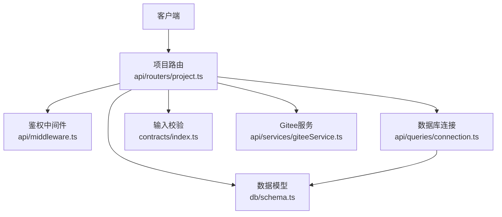
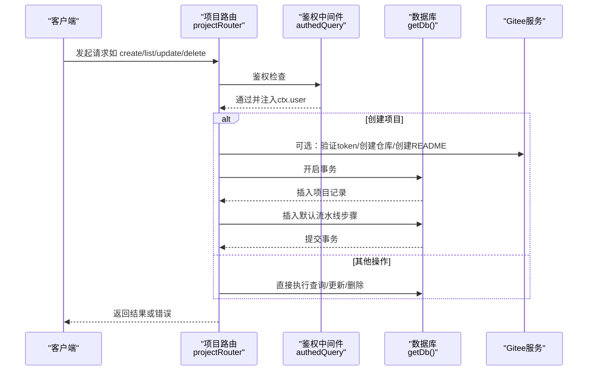
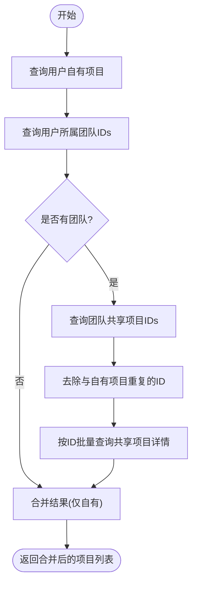
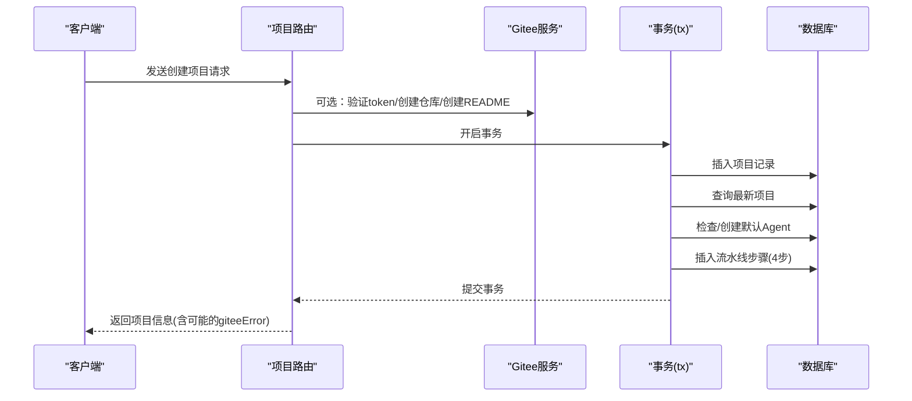
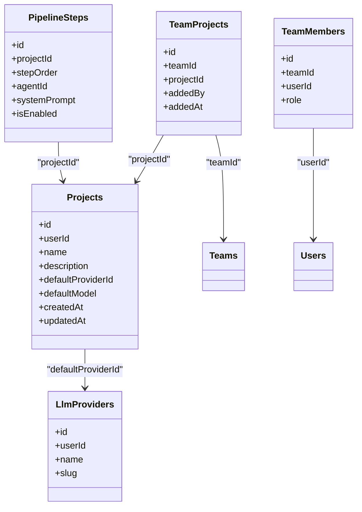

# 项目CRUD操作

<cite>
**本文引用的文件**
- [api/routers/project.ts](file://api/routers/project.ts)
- [db/schema.ts](file://db/schema.ts)
- [contracts/index.ts](file://contracts/index.ts)
- [api/middleware.ts](file://api/middleware.ts)
- [api/services/giteeService.ts](file://api/services/giteeService.ts)
- [api/queries/connection.ts](file://api/queries/connection.ts)
</cite>

## 目录
1. [简介](#简介)
2. [项目结构](#项目结构)
3. [核心组件](#核心组件)
4. [架构总览](#架构总览)
5. [详细组件分析](#详细组件分析)
6. [依赖关系分析](#依赖关系分析)
7. [性能考虑](#性能考虑)
8. [故障排查指南](#故障排查指南)
9. [结论](#结论)
10. [附录：API定义与示例](#附录api定义与示例)

## 简介
本文件为“项目”模块的完整CRUD API文档，覆盖创建、读取、更新、删除四大操作。内容包含：
- 项目基本信息管理（名称、描述、默认提供商配置）
- 权限验证机制与用户隔离策略
- 项目列表查询的复杂逻辑（自有项目与团队共享项目的合并去重）
- 请求参数、响应格式与错误处理示例
- 事务处理与原子性保证的实现细节

## 项目结构
本项目采用分层路由+服务+数据模型的组织方式：
- 路由层：在 api/routers/project.ts 中暴露 tRPC 风格的接口（list/getById/create/update/delete 等）
- 数据层：使用 Drizzle ORM 在 db/schema.ts 中定义表结构（projects、teamMembers、teamProjects、pipelineSteps、llmProviders 等）
- 契约层：在 contracts/index.ts 中定义输入校验Schema（CreateProjectSchema、UpdateProjectSchema 等）
- 中间件：在 api/middleware.ts 中提供鉴权中间件 authedQuery
- 外部集成：通过 api/services/giteeService.ts 与 Gitee 仓库交互；数据库连接通过 api/queries/connection.ts 获取

图表来源
- [api/routers/project.ts:11-54](file://api/routers/project.ts#L11-L54)
- [api/middleware.ts:17-50](file://api/middleware.ts#L17-L50)
- [db/schema.ts:84-150](file://db/schema.ts#L84-L150)
- [contracts/index.ts:45-71](file://contracts/index.ts#L45-L71)
- [api/services/giteeService.ts](file://api/services/giteeService.ts)
- [api/queries/connection.ts](file://api/queries/connection.ts)

章节来源
- [api/routers/project.ts:11-54](file://api/routers/project.ts#L11-L54)
- [db/schema.ts:84-150](file://db/schema.ts#L84-L150)
- [contracts/index.ts:45-71](file://contracts/index.ts#L45-L71)
- [api/middleware.ts:17-50](file://api/middleware.ts#L17-L50)

## 核心组件
- 项目路由（projectRouter）：提供 list、getById、create、update、delete、getPipelineConfig、updatePipelineConfig 等能力
- 数据模型：
  - projects：项目主表，包含名称、描述、默认LLM提供商ID和模型、归档状态、时间戳等
  - teamMembers / teamProjects：实现“用户所属团队”到“可访问项目”的关系映射
  - pipelineSteps：流水线步骤（创建项目时自动初始化）
  - llmProviders：LLM提供商配置
- 输入校验：CreateProjectSchema、UpdateProjectSchema 对请求体进行严格校验
- 鉴权：authedQuery 确保调用者已登录并注入 ctx.user

章节来源
- [api/routers/project.ts:11-405](file://api/routers/project.ts#L11-L405)
- [db/schema.ts:84-150](file://db/schema.ts#L84-L150)
- [db/schema.ts:798-836](file://db/schema.ts#L798-L836)
- [contracts/index.ts:45-71](file://contracts/index.ts#L45-L71)
- [api/middleware.ts:17-50](file://api/middleware.ts#L17-L50)

## 架构总览
下图展示了项目CRUD的核心流程：鉴权→参数校验→业务逻辑→数据库事务→返回结果。其中创建项目涉及可选的外部Gitee集成，且数据库写入被包裹在事务中以保障原子性。

图表来源
- [api/routers/project.ts:103-250](file://api/routers/project.ts#L103-L250)
- [api/routers/project.ts:252-309](file://api/routers/project.ts#L252-L309)
- [api/middleware.ts:17-50](file://api/middleware.ts#L17-L50)
- [api/services/giteeService.ts](file://api/services/giteeService.ts)
- [api/queries/connection.ts](file://api/queries/connection.ts)

## 详细组件分析

### 项目列表查询（合并自有与团队共享）
- 功能说明：返回当前用户可见的所有项目，包括：
  - 用户自有的项目（按 userId 过滤）
  - 用户所属团队共享的项目（通过 teamMembers + teamProjects 关联）
  - 对重复项进行去重（避免用户同时拥有且被团队共享的项目重复出现）
- 复杂度：两次主要查询（自有项目、团队成员），一次基于团队ID的去重过滤，再根据唯一ID集合查询共享项目
- 排序：按更新时间倒序

图表来源
- [api/routers/project.ts:12-54](file://api/routers/project.ts#L12-L54)
- [db/schema.ts:798-836](file://db/schema.ts#L798-L836)

章节来源
- [api/routers/project.ts:12-54](file://api/routers/project.ts#L12-L54)
- [db/schema.ts:798-836](file://db/schema.ts#L798-L836)

### 获取单个项目（权限校验）
- 功能说明：支持两种访问路径：
  - 用户自有项目：直接按 id + userId 匹配
  - 团队共享项目：若用户属于某团队，且该团队与项目存在 teamProjects 关联，则允许读取
- 失败情况：无权限或不存在时返回空

章节来源
- [api/routers/project.ts:56-101](file://api/routers/project.ts#L56-L101)
- [db/schema.ts:798-836](file://db/schema.ts#L798-L836)

### 创建项目（含事务与默认流水线）
- 输入校验：CreateProjectSchema 校验 name、description、giteeOwner/Repo/Branch、defaultProviderId/defaultModel、giteeToken
- 可选外部集成：
  - 若提供 giteeToken，会尝试验证令牌、查找或创建仓库、并在仓库中创建项目README
  - 若外部调用失败，记录错误但不阻断后续DB写入
- 事务与原子性：
  - 所有数据库写入（插入项目、查询最新项目、创建默认流水线步骤）均在一个事务中完成
  - 流水线步骤创建失败不影响项目创建成功（非关键路径）
- 默认流水线：
  - 检查用户是否已有四个默认角色（builder/critic/refiner/polisher）的自定义Agent，缺失则创建
  - 为项目生成四步流水线（Builder → Critic → Refiner → Polisher），设置顺序、系统提示词、温度、最大tokens等

图表来源
- [api/routers/project.ts:103-250](file://api/routers/project.ts#L103-L250)
- [api/services/giteeService.ts](file://api/services/giteeService.ts)
- [db/schema.ts:429-480](file://db/schema.ts#L429-L480)

章节来源
- [api/routers/project.ts:103-250](file://api/routers/project.ts#L103-L250)
- [contracts/index.ts:45-54](file://contracts/index.ts#L45-L54)
- [db/schema.ts:429-480](file://db/schema.ts#L429-L480)

### 更新项目（字段级更新）
- 输入校验：UpdateProjectSchema 支持部分字段更新（name、description、gitee/github 相关、localFolderName、默认提供商/模型、pipelineConfig、isArchived）
- 权限控制：仅允许更新 userId 匹配的项目（用户隔离）
- 返回：更新后的项目对象

章节来源
- [api/routers/project.ts:252-266](file://api/routers/project.ts#L252-L266)
- [contracts/index.ts:56-71](file://contracts/index.ts#L56-L71)

### 删除项目（清理本地与远程资源）
- 权限控制：仅允许删除 userId 匹配的项目
- 清理逻辑：
  - 若项目绑定了 Gitee 仓库，尝试删除项目文件夹与 project-source ZIP
  - 尝试删除本地磁盘上的项目文件
  - 最后删除数据库中的项目记录
- 注意：外部清理失败为非致命错误，不阻止删除

章节来源
- [api/routers/project.ts:268-309](file://api/routers/project.ts#L268-L309)

### 流水线配置（读取与更新）
- 读取：
  - 校验项目归属（userId）
  - 按 stepOrder 升序返回流水线步骤
  - 返回用户可用的 LLM 提供商列表与项目默认提供商ID
- 更新：
  - 校验项目归属
  - 限制每个流水线最多使用3个不同的LLM提供商（Pro Designer）
  - 批量更新步骤字段（启用状态、系统提示词、provider/model/temperature/maxTokens）

章节来源
- [api/routers/project.ts:313-403](file://api/routers/project.ts#L313-L403)

## 依赖关系分析
- 路由依赖：
  - 鉴权中间件：authedQuery（强制登录）
  - 数据库连接：getDb()
  - 数据模型：projects、teamMembers、teamProjects、pipelineSteps、llmProviders、customAgents
  - 输入校验：CreateProjectSchema、UpdateProjectSchema
  - 外部服务：giteeService（可选）
- 数据模型依赖：
  - projects.userId 引用 users.id
  - projects.defaultProviderId 引用 llmProviders.id
  - pipelineSteps.projectId 引用 projects.id
  - teamProjects.teamId 引用 teams.id，projectId 引用 projects.id
  - teamMembers.userId 引用 users.id，teamId 引用 teams.id

图表来源
- [db/schema.ts:84-150](file://db/schema.ts#L84-L150)
- [db/schema.ts:429-480](file://db/schema.ts#L429-L480)
- [db/schema.ts:798-836](file://db/schema.ts#L798-L836)

章节来源
- [db/schema.ts:84-150](file://db/schema.ts#L84-L150)
- [db/schema.ts:429-480](file://db/schema.ts#L429-L480)
- [db/schema.ts:798-836](file://db/schema.ts#L798-L836)

## 性能考虑
- 列表查询优化：
  - 先查自有项目，再查团队成员ID，再查共享项目ID，最后去重后批量查询共享项目详情，减少多次往返
  - 使用 inArray 批量查询提升效率
- 索引利用：
  - projects.userIdIdx、teamMembers/teamProjects 的复合索引有助于快速过滤
- 事务范围：
  - 将必要的DB写入集中在事务内，外部API调用（Gitee）不在事务中，避免长事务锁竞争
- 流水线步骤：
  - 仅在首次创建项目时插入默认步骤，避免每次更新都重建

[本节为通用性能建议，不直接分析具体文件]

## 故障排查指南
- 鉴权失败：
  - 现象：UNAUTHORIZED 错误
  - 原因：未携带有效会话或中间件拦截
  - 处理：确认登录态与上下文注入
- 权限不足：
  - 现象：FORBIDDEN 错误
  - 原因：尝试访问非本人或非团队共享的项目
  - 处理：检查 userId 与 teamProjects 关联
- 外部服务异常：
  - 现象：创建项目时返回 giteeError
  - 原因：Gitee token无效、网络异常、仓库创建失败
  - 处理：查看日志，重试或修正token
- 流水线创建失败：
  - 现象：项目创建成功但默认流水线未生成
  - 原因：内部步骤插入异常
  - 处理：检查日志，必要时手动补建步骤

章节来源
- [api/middleware.ts:17-50](file://api/middleware.ts#L17-L50)
- [api/routers/project.ts:103-250](file://api/routers/project.ts#L103-L250)
- [api/routers/project.ts:268-309](file://api/routers/project.ts#L268-L309)

## 结论
项目CRUD实现了严格的权限控制与用户隔离，支持团队共享项目的合并去重查询，并通过事务保证数据一致性。创建流程集成了可选的Gitee仓库同步，并提供默认流水线初始化。更新与删除操作具备完善的清理逻辑与错误容忍。整体设计兼顾了易用性与健壮性。

[本节为总结性内容，不直接分析具体文件]

## 附录：API定义与示例

### 公共信息
- 协议：tRPC 风格（通过 router 暴露）
- 鉴权：所有接口需登录（authedQuery）
- 输入校验：使用 Zod Schema（CreateProjectSchema、UpdateProjectSchema）

章节来源
- [api/middleware.ts:17-50](file://api/middleware.ts#L17-L50)
- [contracts/index.ts:45-71](file://contracts/index.ts#L45-L71)

### 列表查询
- 方法：list
- 入参：无
- 出参：项目数组（包含自有与团队共享，去重后按更新时间倒序）
- 错误：UNAUTHORIZED（未登录）

章节来源
- [api/routers/project.ts:12-54](file://api/routers/project.ts#L12-L54)

### 获取单个项目
- 方法：getById
- 入参：{ id: number }
- 出参：项目对象或 null（无权限或不存在）
- 错误：UNAUTHORIZED（未登录）

章节来源
- [api/routers/project.ts:56-101](file://api/routers/project.ts#L56-L101)

### 创建项目
- 方法：create
- 入参：CreateProjectSchema（name必填，description可选，giteeOwner/Repo/Branch可选，defaultProviderId/defaultModel可选，giteeToken可选）
- 出参：项目对象（可能附带 giteeError）
- 错误：UNAUTHORIZED（未登录）、外部服务异常（记录错误但不回滚DB）

章节来源
- [api/routers/project.ts:103-250](file://api/routers/project.ts#L103-L250)
- [contracts/index.ts:45-54](file://contracts/index.ts#L45-L54)

### 更新项目
- 方法：update
- 入参：UpdateProjectSchema（id必填，其余字段可选）
- 出参：更新后的项目对象
- 错误：UNAUTHORIZED（未登录）、无权限（非本人项目）

章节来源
- [api/routers/project.ts:252-266](file://api/routers/project.ts#L252-L266)
- [contracts/index.ts:56-71](file://contracts/index.ts#L56-L71)

### 删除项目
- 方法：delete
- 入参：{ id: number, giteeToken?: string }
- 出参：{ success: boolean }
- 错误：UNAUTHORIZED（未登录）、无权限（非本人项目）

章节来源
- [api/routers/project.ts:268-309](file://api/routers/project.ts#L268-L309)

### 流水线配置
- 读取：getPipelineConfig
  - 入参：{ projectId: number }
  - 出参：steps（按顺序）、providers（用户可用）、projectDefaultProviderId
- 更新：updatePipelineConfig
  - 入参：{ projectId, steps[] }（每步可更新 isEnabled/systemPrompt/providerId/model/temperature/maxTokens）
  - 出参：{ steps, providerCount }
  - 约束：同一流水线最多3个不同provider（Pro Designer）

章节来源
- [api/routers/project.ts:313-403](file://api/routers/project.ts#L313-L403)

### 权限与用户隔离
- 所有写操作均要求登录（authedQuery）
- 读/写均基于 userId 进行隔离
- 团队共享通过 teamMembers + teamProjects 实现只读可见性（当前实现中，列表与 getById 支持共享可见）

章节来源
- [api/middleware.ts:17-50](file://api/middleware.ts#L17-L50)
- [api/routers/project.ts:12-101](file://api/routers/project.ts#L12-L101)
- [db/schema.ts:798-836](file://db/schema.ts#L798-L836)

### 事务与原子性
- 创建项目时，数据库写入（项目记录、默认流水线步骤）在单一事务中执行，确保一致性与原子性
- 外部服务调用（Gitee）位于事务外，失败不影响DB事务提交

章节来源
- [api/routers/project.ts:145-250](file://api/routers/project.ts#L145-L250)