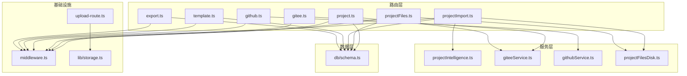
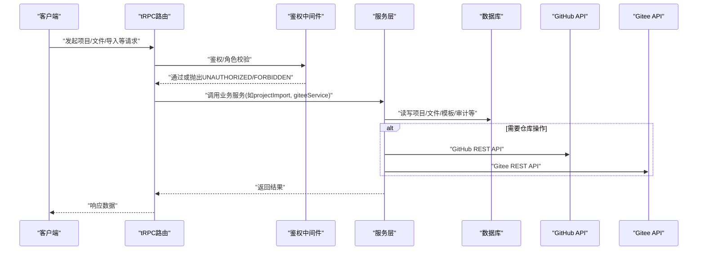
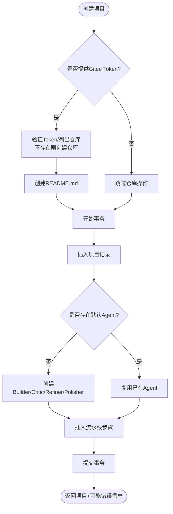
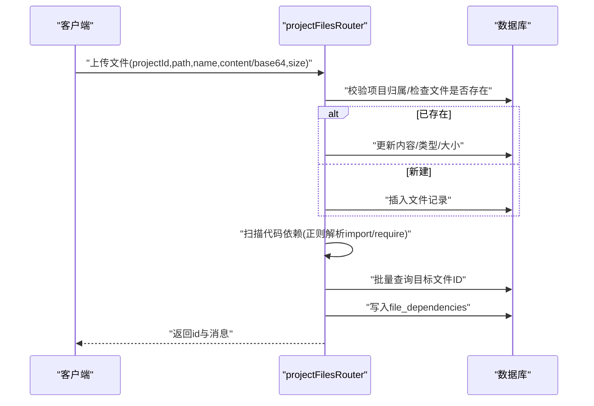
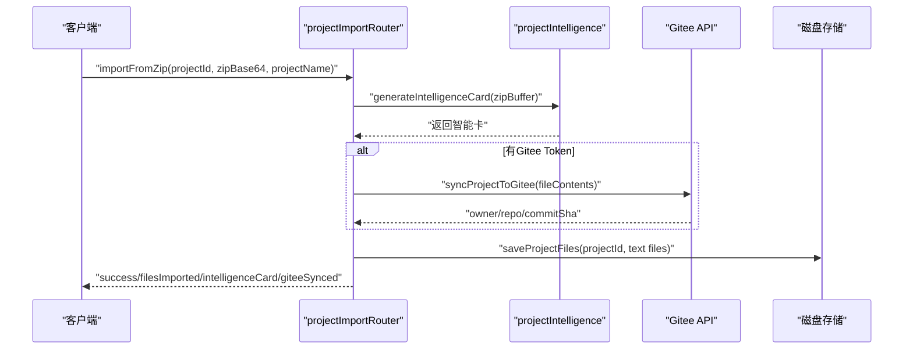
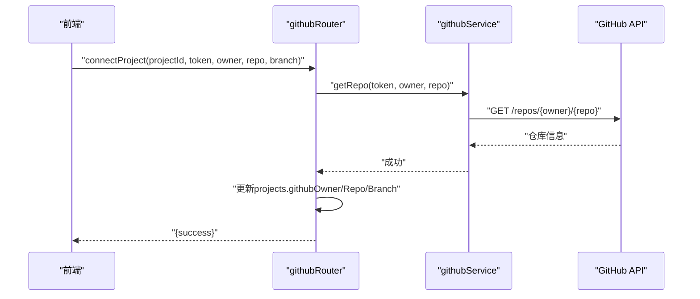
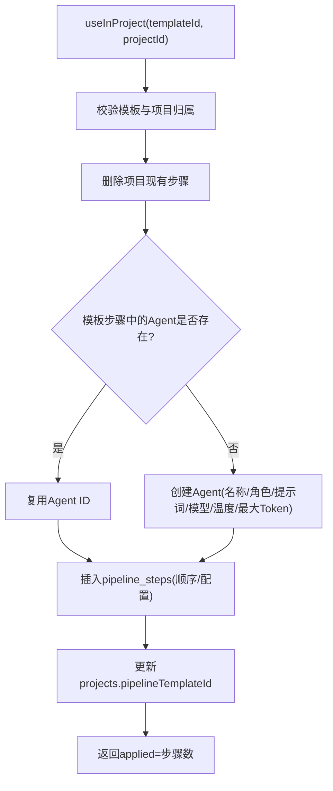
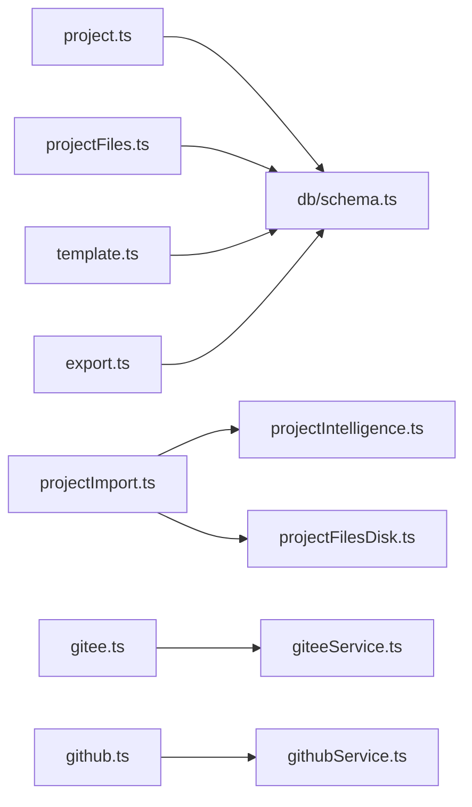

# 项目管理API

<cite>
**本文引用的文件**
- [api/routers/project.ts](file://api/routers/project.ts)
- [api/routers/projectFiles.ts](file://api/routers/projectFiles.ts)
- [api/routers/projectImport.ts](file://api/routers/projectImport.ts)
- [api/services/projectIntelligence.ts](file://api/services/projectIntelligence.ts)
- [api/routers/gitee.ts](file://api/routers/gitee.ts)
- [api/routers/github.ts](file://api/routers/github.ts)
- [api/services/giteeService.ts](file://api/services/giteeService.ts)
- [api/services/githubService.ts](file://api/services/githubService.ts)
- [db/schema.ts](file://db/schema.ts)
- [api/middleware.ts](file://api/middleware.ts)
- [contracts/errors.ts](file://contracts/errors.ts)
- [api/lib/storage.ts](file://api/lib/storage.ts)
- [api/upload-route.ts](file://api/upload-route.ts)
- [api/services/projectFilesDisk.ts](file://api/services/projectFilesDisk.ts)
- [api/routers/template.ts](file://api/routers/template.ts)
- [api/routers/export.ts](file://api/routers/export.ts)
</cite>

## 目录
1. [简介](#简介)
2. [项目结构](#项目结构)
3. [核心组件](#核心组件)
4. [架构总览](#架构总览)
5. [详细组件分析](#详细组件分析)
6. [依赖关系分析](#依赖关系分析)
7. [性能考虑](#性能考虑)
8. [故障排查指南](#故障排查指南)
9. [结论](#结论)
10. [附录](#附录)

## 简介
本技术文档面向“项目管理API”，覆盖项目的CRUD、文件同步与版本控制（GitHub/Gitee）、智能分析（导入ZIP生成“智能卡”）、配置管理（流水线步骤/模板）、导入导出、协作权限控制、访问日志与审计、以及上传下载与大文件处理策略。文档提供端到端的数据流、关键流程时序图、错误处理与性能优化建议，并给出可操作的API调用示例路径与注意事项。

## 项目结构
后端采用 tRPC Router + Drizzle ORM 的模块化设计：
- 路由层：按功能划分 router（project、projectFiles、projectImport、gitee、github、template、export）
- 服务层：封装外部集成（giteeService、githubService）与领域逻辑（projectIntelligence）
- 数据层：Drizzle schema 定义表结构与索引
- 中间件：统一鉴权、角色校验、类型转换
- 存储抽象：本地磁盘/S3 双后端，统一接口
- 上传路由：Hono 路由处理大文件、图片、文档解析与落盘

图表来源
- [api/routers/project.ts:1-405](file://api/routers/project.ts#L1-L405)
- [api/routers/projectFiles.ts:1-381](file://api/routers/projectFiles.ts#L1-L381)
- [api/routers/projectImport.ts:1-653](file://api/routers/projectImport.ts#L1-L653)
- [api/services/projectIntelligence.ts:1-800](file://api/services/projectIntelligence.ts#L1-L800)
- [api/services/giteeService.ts:1-185](file://api/services/giteeService.ts#L1-L185)
- [api/services/githubService.ts:1-124](file://api/services/githubService.ts#L1-L124)
- [db/schema.ts:84-150](file://db/schema.ts#L84-L150)
- [api/middleware.ts:1-51](file://api/middleware.ts#L1-L51)
- [api/lib/storage.ts:1-137](file://api/lib/storage.ts#L1-L137)
- [api/upload-route.ts:196-309](file://api/upload-route.ts#L196-L309)

章节来源
- [api/routers/project.ts:1-405](file://api/routers/project.ts#L1-L405)
- [api/routers/projectFiles.ts:1-381](file://api/routers/projectFiles.ts#L1-L381)
- [api/routers/projectImport.ts:1-653](file://api/routers/projectImport.ts#L1-L653)
- [api/services/projectIntelligence.ts:1-800](file://api/services/projectIntelligence.ts#L1-L800)
- [api/services/giteeService.ts:1-185](file://api/services/giteeService.ts#L1-L185)
- [api/services/githubService.ts:1-124](file://api/services/githubService.ts#L1-L124)
- [db/schema.ts:84-150](file://db/schema.ts#L84-L150)
- [api/middleware.ts:1-51](file://api/middleware.ts#L1-L51)
- [api/lib/storage.ts:1-137](file://api/lib/storage.ts#L1-L137)
- [api/upload-route.ts:196-309](file://api/upload-route.ts#L196-L309)

## 核心组件
- 项目CRUD与流水线配置：创建项目时自动初始化默认流水线步骤（Builder/Critic/Refiner/Polisher），支持更新步骤参数与提供者选择；列表/详情具备团队共享权限判断。
- 文件管理与依赖分析：上传/读取/删除文件，解析TS/JS依赖关系，构建跨文件依赖图，支持影响范围分析（BFS批量查询）。
- 项目导入与智能分析：接收ZIP，过滤无关文件，生成“智能卡”（文件树、入口点、架构/框架识别、实体/数据库表/API端点提取），可选推送到Gitee并缓存到本地磁盘。
- GitHub/Gitee集成：连接仓库、获取文件树、创建/更新文件、断开连接、同步标记；Gitee侧支持“我的数据”浏览与调试。
- 模板系统：创建/复制/更新模板，从项目流水线生成模板，将模板应用到项目（自动创建或复用Agent）。
- 导入导出：导出Agent、流水线、运行历史、完整用户数据；支持全量导入恢复（含偏好设置合并）。
- 权限与审计：tRPC中间件鉴权与角色校验；企业级审计导出（签名账本，CSV/JSON），带速率限制。
- 存储与上传：统一存储抽象（磁盘/S3），上传路由支持图片/文本/文档解析与大小限制。

章节来源
- [api/routers/project.ts:103-249](file://api/routers/project.ts#L103-L249)
- [api/routers/projectFiles.ts:67-301](file://api/routers/projectFiles.ts#L67-L301)
- [api/routers/projectImport.ts:75-238](file://api/routers/projectImport.ts#L75-L238)
- [api/services/projectIntelligence.ts:619-777](file://api/services/projectIntelligence.ts#L619-L777)
- [api/routers/gitee.ts:33-171](file://api/routers/gitee.ts#L33-L171)
- [api/routers/github.ts:8-135](file://api/routers/github.ts#L8-L135)
- [api/routers/template.ts:7-263](file://api/routers/template.ts#L7-L263)
- [api/routers/export.ts:19-403](file://api/routers/export.ts#L19-L403)
- [api/middleware.ts:17-51](file://api/middleware.ts#L17-L51)
- [api/lib/storage.ts:22-137](file://api/lib/storage.ts#L22-L137)
- [api/upload-route.ts:196-309](file://api/upload-route.ts#L196-L309)

## 架构总览
下图展示请求从客户端进入tRPC路由，经过鉴权中间件，调用服务层与数据层，并与外部仓库（GitHub/Gitee）交互的整体流程。

图表来源
- [api/middleware.ts:17-51](file://api/middleware.ts#L17-L51)
- [api/routers/projectImport.ts:75-238](file://api/routers/projectImport.ts#L75-L238)
- [api/services/giteeService.ts:18-98](file://api/services/giteeService.ts#L18-L98)
- [api/services/githubService.ts:25-100](file://api/services/githubService.ts#L25-L100)
- [db/schema.ts:84-150](file://db/schema.ts#L84-L150)

## 详细组件分析

### 项目CRUD与流水线配置
- 列表/详情：聚合“本人项目”和“团队共享项目”，去重并按更新时间排序。
- 创建：可选自动创建Gitee仓库与README；在事务中写入项目与默认流水线步骤（4个阶段），失败不影响项目创建。
- 更新：仅允许所有者更新。
- 删除：清理Gitee文件夹与本地磁盘文件后删除项目记录。
- 流水线配置：读取pipeline_steps，支持最多3个不同LLM提供者（Pro Designer限制）。

图表来源
- [api/routers/project.ts:103-249](file://api/routers/project.ts#L103-L249)

章节来源
- [api/routers/project.ts:12-101](file://api/routers/project.ts#L12-L101)
- [api/routers/project.ts:103-249](file://api/routers/project.ts#L103-L249)
- [api/routers/project.ts:252-309](file://api/routers/project.ts#L252-L309)
- [api/routers/project.ts:313-403](file://api/routers/project.ts#L313-L403)

### 文件管理与依赖分析
- 上传：支持文本与二进制（base64占位），更新时重新扫描依赖。
- 读取/删除：权限校验，删除前清理依赖关系。
- 依赖扫描：解析ES6/CommonJS/动态import，批量匹配目标文件，构建source→target边。
- 影响分析：基于依赖图的BFS批量查询，返回受影响文件集合。

图表来源
- [api/routers/projectFiles.ts:67-147](file://api/routers/projectFiles.ts#L67-L147)
- [api/routers/projectFiles.ts:304-381](file://api/routers/projectFiles.ts#L304-L381)

章节来源
- [api/routers/projectFiles.ts:67-301](file://api/routers/projectFiles.ts#L67-L301)
- [api/routers/projectFiles.ts:304-381](file://api/routers/projectFiles.ts#L304-L381)

### 项目导入与智能分析
- 导入ZIP：解码ZIP，过滤忽略目录/二进制/大文件/敏感文件；生成“智能卡”（语言/框架/架构/入口点/实体/数据库表/API端点/Todos）；可选推送至Gitee；将文本文件保存到本地磁盘以便后续快速读取。
- 智能卡使用：根据查询语义定位相关文件，优先从本地磁盘读取，缺失时回退到Gitee并缓存。

图表来源
- [api/routers/projectImport.ts:75-238](file://api/routers/projectImport.ts#L75-L238)
- [api/services/projectIntelligence.ts:619-777](file://api/services/projectIntelligence.ts#L619-L777)
- [api/services/projectFilesDisk.ts:42-81](file://api/services/projectFilesDisk.ts#L42-L81)

章节来源
- [api/routers/projectImport.ts:75-238](file://api/routers/projectImport.ts#L75-L238)
- [api/routers/projectImport.ts:247-412](file://api/routers/projectImport.ts#L247-L412)
- [api/services/projectIntelligence.ts:173-227](file://api/services/projectIntelligence.ts#L173-L227)
- [api/services/projectIntelligence.ts:619-777](file://api/services/projectIntelligence.ts#L619-L777)

### GitHub/Gitee集成
- GitHub：验证Token、列出仓库、连接/断开项目、同步标记、获取文件树、创建/更新文件。
- Gitee：同上，额外支持“我的数据”树浏览、文件加载、分支回退（master/main）与调试输出。
- 服务层：统一的REST封装，处理目录/大文件/SHA更新等边界情况。

图表来源
- [api/routers/github.ts:21-46](file://api/routers/github.ts#L21-L46)
- [api/services/githubService.ts:17-33](file://api/services/githubService.ts#L17-L33)

章节来源
- [api/routers/github.ts:8-135](file://api/routers/github.ts#L8-L135)
- [api/routers/gitee.ts:33-171](file://api/routers/gitee.ts#L33-L171)
- [api/services/githubService.ts:1-124](file://api/services/githubService.ts#L1-L124)
- [api/services/giteeService.ts:1-185](file://api/services/giteeService.ts#L1-L185)

### 模板系统与流水线应用
- 模板CRUD：创建空模板、从当前流水线生成模板、复制模板、更新步骤。
- 应用到项目：删除现有步骤，按模板顺序插入新步骤；若未找到同名同角色Agent则自动创建；更新项目引用模板ID。

图表来源
- [api/routers/template.ts:186-263](file://api/routers/template.ts#L186-L263)

章节来源
- [api/routers/template.ts:7-263](file://api/routers/template.ts#L7-L263)

### 导入导出与备份
- 导出：Agent、流水线、运行历史、模板、全量用户数据（含偏好设置、测试夹具元数据）。
- 导入：增量导入（按slug/name去重），合并偏好设置。
- 审计导出：管理员专用，生成带签名的JSON/CSV账本，带速率限制。

章节来源
- [api/routers/export.ts:19-403](file://api/routers/export.ts#L19-L403)

### 权限控制、访问日志与审计
- 鉴权：tRPC中间件强制认证，adminQuery要求admin角色。
- 项目访问：多处实现canAccessProject（所有者或团队成员）。
- 审计：审计导出接口对频繁导出进行限流，返回签名账本用于合规审计。

章节来源
- [api/middleware.ts:17-51](file://api/middleware.ts#L17-L51)
- [api/routers/projectImport.ts:52-73](file://api/routers/projectImport.ts#L52-L73)
- [api/routers/export.ts:360-403](file://api/routers/export.ts#L360-L403)

### 文件上传下载与大文件处理
- 上传路由：分类图片/文本/文档，限制图片大小，DOCX文本提取与截断，未知类型尝试文本解析。
- 存储抽象：本地磁盘或S3兼容后端，键名安全化，懒加载SDK，私有对象不暴露直链。
- 项目文件磁盘：按项目隔离目录，批量保存，失败计数。

章节来源
- [api/upload-route.ts:196-309](file://api/upload-route.ts#L196-L309)
- [api/lib/storage.ts:22-137](file://api/lib/storage.ts#L22-L137)
- [api/services/projectFilesDisk.ts:30-81](file://api/services/projectFilesDisk.ts#L30-L81)

## 依赖关系分析
- 路由与服务解耦：router仅负责输入校验、鉴权、编排；具体逻辑下沉至services。
- 数据一致性：项目创建与流水线步骤写入在同一事务中；删除时先清理外部资源再删库。
- 外部依赖：GitHub/Gitee API调用集中在service层，便于替换与重试策略扩展。
- 权限模型：以“所有者+团队共享”为核心，多处复用canAccessProject模式。

图表来源
- [api/routers/project.ts:1-405](file://api/routers/project.ts#L1-L405)
- [api/routers/projectFiles.ts:1-381](file://api/routers/projectFiles.ts#L1-L381)
- [api/routers/projectImport.ts:1-653](file://api/routers/projectImport.ts#L1-L653)
- [api/services/projectIntelligence.ts:1-800](file://api/services/projectIntelligence.ts#L1-L800)
- [api/services/projectFilesDisk.ts:30-81](file://api/services/projectFilesDisk.ts#L30-L81)
- [api/routers/gitee.ts:1-289](file://api/routers/gitee.ts#L1-L289)
- [api/routers/github.ts:1-136](file://api/routers/github.ts#L1-L136)
- [api/routers/template.ts:1-265](file://api/routers/template.ts#L1-L265)
- [api/routers/export.ts:1-404](file://api/routers/export.ts#L1-L404)
- [db/schema.ts:84-150](file://db/schema.ts#L84-L150)

## 性能考虑
- 依赖扫描批量化：一次性inArray查询所有可能的import目标，避免N次单条查询。
- 影响分析BFS批量：每层批量查询上游文件，减少往返次数。
- 导入ZIP过滤：排除node_modules/.git/build等目录与大文件，降低CPU与内存占用。
- 磁盘缓存：导入后文本文件落盘，后续读取优先本地，缺失再回退Gitee并缓存。
- 存储后端懒加载：S3 SDK按需引入，减少冷启动开销。
- 流水线步骤限制：同一流水线最多3个不同LLM提供者，控制并发与成本。
- 审计导出限流：防止高频导出拖垮系统。

[本节为通用性能建议，无需特定文件来源]

## 故障排查指南
- 鉴权失败：确认tRPC上下文包含user且通过authedQuery；检查角色是否为admin（adminQuery）。
- 项目未找到：确保传入projectId正确且当前用户拥有访问权限（所有者或团队成员）。
- Gitee/GitHub连接失败：检查Token有效性、仓库是否存在、分支名称（master/main）；查看服务层错误信息。
- 导入ZIP为空或被过滤：确认ZIP非空且不含被排除的目录/扩展名；检查文件大小限制。
- 文件依赖扫描无结果：确认文件类型为ts/js/jsx/tsx；检查import路径是否可解析（@/别名与相对路径）。
- 上传失败：检查图片大小限制、文档解析能力、存储后端配置（S3环境变量）。
- 审计导出受限：关注TOO_MANY_REQUESTS错误，等待重试间隔。

章节来源
- [api/middleware.ts:17-51](file://api/middleware.ts#L17-L51)
- [api/routers/projectImport.ts:104-113](file://api/routers/projectImport.ts#L104-L113)
- [api/services/giteeService.ts:18-98](file://api/services/giteeService.ts#L18-L98)
- [api/services/githubService.ts:25-100](file://api/services/githubService.ts#L25-L100)
- [api/routers/projectFiles.ts:304-381](file://api/routers/projectFiles.ts#L304-L381)
- [api/upload-route.ts:103-193](file://api/upload-route.ts#L103-L193)
- [api/routers/export.ts:360-403](file://api/routers/export.ts#L360-L403)

## 结论
本项目提供了完善的项目管理能力：从基础的CRUD到复杂的流水线与模板系统，结合智能分析与多平台仓库集成，形成“本地快速读取 + 云端持久化”的混合架构。通过严格的权限控制与审计导出，满足企业级合规需求。建议在大规模使用时进一步引入队列与异步任务以提升吞吐，并对依赖扫描与ZIP解析增加更细粒度的超时与熔断保护。

[本节为总结性内容，无需特定文件来源]

## 附录

### API调用示例（路径参考）
- 项目
  - 列表：GET/POST 对应 projectRouter.list
  - 详情：projectRouter.getById
  - 创建：projectRouter.create
  - 更新：projectRouter.update
  - 删除：projectRouter.delete
  - 流水线配置：projectRouter.getPipelineConfig / updatePipelineConfig
- 文件
  - 上传：projectFilesRouter.upload
  - 列表：projectFilesRouter.list
  - 读取：projectFilesRouter.read
  - 删除：projectFilesRouter.delete
  - 依赖：projectFilesRouter.getDependencies
  - 影响分析：projectFilesRouter.getAffectedFiles
- 导入
  - ZIP导入：projectImportRouter.importFromZip
  - 获取文件内容：projectImportRouter.fetchFileContents
  - 智能检索：projectImportRouter.fetchRelevantFileContents
  - 从Gitee同步：projectImportRouter.syncFromGitee
  - 获取智能卡：projectImportRouter.getIntelligenceCard
  - 从Gitee拉取文件：projectImportRouter.fetchFilesFromGitee
  - 查找相关文件：projectImportRouter.findRelevantFiles
  - 加载本地文件内容：projectImportRouter.loadFileContents
  - 清空智能卡：projectImportRouter.clearIntelligenceCard
- 仓库集成
  - GitHub：githubRouter.validateToken/listRepos/connectProject/disconnectProject/syncProject/getFileTree/createOrUpdateFile
  - Gitee：giteeRouter.validateToken/listRepos/syncProject/getFileTree/createOrUpdateFile/getMyDataTree/getMyDataFile/loadFolder/debugGitee
- 模板
  - templateRouter.list/getById/update/createEmpty/createFromPipeline/delete/duplicate/useInProject
- 导出
  - exportRouter.exportAgents/exportPipeline/exportRun/exportTemplates/exportProjectBackup/exportAllUserData/importAllUserData/auditLedgerJson/auditLedgerCsv

章节来源
- [api/routers/project.ts:11-403](file://api/routers/project.ts#L11-L403)
- [api/routers/projectFiles.ts:67-301](file://api/routers/projectFiles.ts#L67-L301)
- [api/routers/projectImport.ts:75-651](file://api/routers/projectImport.ts#L75-L651)
- [api/routers/github.ts:8-135](file://api/routers/github.ts#L8-L135)
- [api/routers/gitee.ts:33-287](file://api/routers/gitee.ts#L33-L287)
- [api/routers/template.ts:7-263](file://api/routers/template.ts#L7-L263)
- [api/routers/export.ts:19-403](file://api/routers/export.ts#L19-L403)