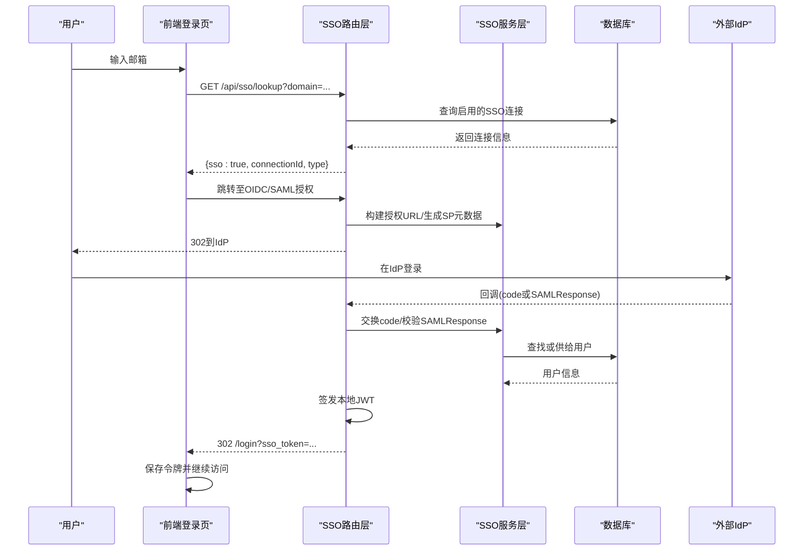
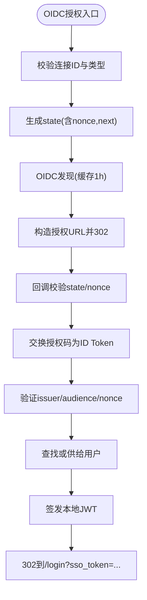
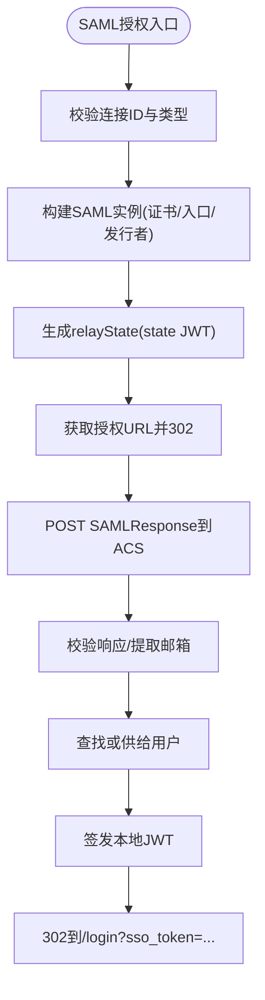
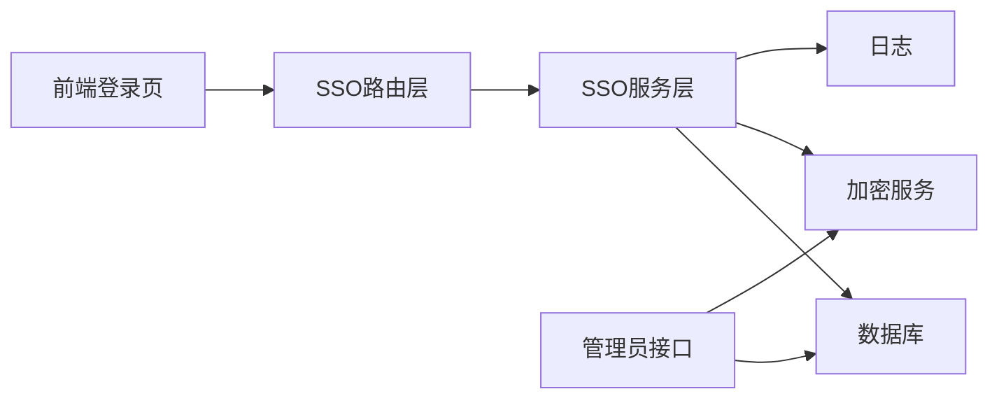

# 企业SSO集成

<cite>
**本文引用的文件**
- [api/sso-route.ts](file://api/sso-route.ts)
- [api/services/sso.ts](file://api/services/sso.ts)
- [api/routers/admin.ts](file://api/routers/admin.ts)
- [db/schema.ts](file://db/schema.ts)
- [db/migrations/013_enterprise.sql](file://db/migrations/013_enterprise.sql)
- [api/routers/localAuth.ts](file://api/routers/localAuth.ts)
- [src/pages/Dashboard.tsx](file://src/pages/Dashboard.tsx)
- [api/lib/env.ts](file://api/lib/env.ts)
- [scripts/smoke-enterprise.mjs](file://scripts/smoke-enterprise.mjs)
</cite>

## 目录
1. [简介](#简介)
2. [项目结构](#项目结构)
3. [核心组件](#核心组件)
4. [架构总览](#架构总览)
5. [详细组件分析](#详细组件分析)
6. [依赖关系分析](#依赖关系分析)
7. [性能考虑](#性能考虑)
8. [故障诊断指南](#故障诊断指南)
9. [结论](#结论)
10. [附录：部署与配置示例](#附录部署与配置示例)

## 简介
本文件为企业单点登录（SSO）功能的完整技术文档，覆盖OIDC与SAML两种协议的实现方式、身份提供商（IdP）配置、用户映射与会话管理、路由处理流程、回调与错误恢复机制、安全考量、部署配置与故障诊断，以及与现有用户系统的集成和迁移策略。该功能通过“企业特性开关”控制启用，并在成功认证后签发应用本地JWT完成会话建立。

## 项目结构
企业SSO由以下关键部分组成：
- SSO路由层：对外暴露的公共端点，负责OIDC/SAML流程编排、状态校验、重定向与错误处理。
- SSO服务层：封装OIDC发现、令牌交换、SAML实例构建与响应校验、用户自动供给等核心逻辑。
- 管理员接口：用于增删改查SSO连接配置（加密存储客户端密钥）。
- 数据库模型：sso_connections表定义，支持OIDC与SAML两类连接。
- 本地认证与会话：统一使用本地JWT作为会话令牌，SSO成功后签发并跳转至登录页携带令牌。
- 前端登录页：根据邮箱域名查询是否启用SSO，引导用户进入对应协议流程，并处理返回令牌或错误提示。

```mermaid
graph TB
Client["浏览器/客户端"] --> Routes["SSO路由层<br/>/api/sso/*"]
Routes --> Service["SSO服务层<br/>OIDC/SAML工具函数"]
Service --> DB["数据库<br/>sso_connections/users"]
Service --> IdP["外部身份提供商<br/>OIDC/SAML"]
Routes --> LocalAuth["本地认证<br/>签发本地JWT"]
Client <--|302 + sso_token| Login["登录页<br/>解析令牌/错误"]
```

图表来源
- [api/sso-route.ts:108-289](file://api/sso-route.ts#L108-L289)
- [api/services/sso.ts:103-369](file://api/services/sso.ts#L103-L369)
- [api/routers/localAuth.ts:38-54](file://api/routers/localAuth.ts#L38-L54)
- [db/schema.ts:1252-1268](file://db/schema.ts#L1252-L1268)

章节来源
- [api/sso-route.ts:1-291](file://api/sso-route.ts#L1-L291)
- [api/services/sso.ts:1-369](file://api/services/sso.ts#L1-L369)
- [db/schema.ts:1252-1268](file://db/schema.ts#L1252-L1268)

## 核心组件
- SSO路由层
  - 提供域名查询、OIDC授权与回调、SAML授权与ACS、SP元数据等端点。
  - 所有端点受“enterprise_sso”特性开关保护；关闭时返回404，避免暴露能力。
  - 失败路径统一302回登录页并附带错误键，不直接返回500，便于前端友好展示。
- SSO服务层
  - OIDC：基于发现文档构建授权URL，交换授权码并验证ID Token（issuer、audience、nonce），JWKS缓存减少重复请求。
  - SAML：为每个连接创建SAML实例，生成SP元数据，校验POST的SAMLResponse，提取NameID或属性中的邮箱。
  - 用户供给：按邮箱匹配或自动创建用户，确保用户名唯一，永不覆盖已有密码哈希。
  - 状态令牌：使用HS256签名的无状态state JWT（10分钟TTL），防CSRF与重放。
- 管理员接口
  - 列出/新增/更新/删除SSO连接；客户端密钥以AES-256-GCM加密存储，列表响应中掩码显示。
- 本地认证与会话
  - 统一使用本地JWT（HS256，7天有效期）作为会话令牌；SSO成功后签发并302到登录页携带令牌。
- 前端登录页
  - 输入邮箱触发域名查询，若存在SSO则跳转到对应协议授权；处理返回的令牌或错误提示。

章节来源
- [api/sso-route.ts:108-289](file://api/sso-route.ts#L108-L289)
- [api/services/sso.ts:103-369](file://api/services/sso.ts#L103-L369)
- [api/routers/admin.ts:273-372](file://api/routers/admin.ts#L273-L372)
- [api/routers/localAuth.ts:38-54](file://api/routers/localAuth.ts#L38-L54)
- [src/pages/Dashboard.tsx:63-133](file://src/pages/Dashboard.tsx#L63-L133)

## 架构总览
下图展示了企业SSO的整体交互：前端根据邮箱域名选择协议，服务端通过特性开关与速率限制保护入口，调用服务层完成OIDC/SAML流程，最终签发本地JWT并引导用户继续访问。



图表来源
- [api/sso-route.ts:108-289](file://api/sso-route.ts#L108-L289)
- [api/services/sso.ts:103-369](file://api/services/sso.ts#L103-L369)
- [api/routers/localAuth.ts:38-54](file://api/routers/localAuth.ts#L38-L54)

## 详细组件分析

### OIDC流程
- 授权阶段
  - 路由接收connectionId与next参数，校验连接类型与启用状态。
  - 生成nonce与state（HS256签名，10分钟TTL），通过发现文档获取授权端点并构造授权URL。
- 回调阶段
  - 校验state与nonce一致性，防止CSRF与重放。
  - 使用授权码交换ID Token，验证issuer、audience与nonce，提取email/name。
  - 查找或自动供给用户，签发本地JWT并重定向到登录页。



图表来源
- [api/sso-route.ts:137-203](file://api/sso-route.ts#L137-L203)
- [api/services/sso.ts:103-181](file://api/services/sso.ts#L103-L181)
- [api/routers/localAuth.ts:38-54](file://api/routers/localAuth.ts#L38-L54)

章节来源
- [api/sso-route.ts:137-203](file://api/sso-route.ts#L137-L203)
- [api/services/sso.ts:103-181](file://api/services/sso.ts#L103-L181)

### SAML流程
- SP发起登录（可选）
  - 路由根据connectionId构建SAML实例，生成relayState（state JWT）并获取授权URL。
- ACS接收
  - 接收POST的SAMLResponse，校验签名（允许response或assertion任一签名），提取NameID或属性中的邮箱。
  - 查找或供给用户，签发本地JWT，尊重relayState中的next参数进行重定向。
- SP元数据
  - 提供XML元数据供IdP配置时使用。



图表来源
- [api/sso-route.ts:205-287](file://api/sso-route.ts#L205-L287)
- [api/services/sso.ts:226-299](file://api/services/sso.ts#L226-L299)

章节来源
- [api/sso-route.ts:205-287](file://api/sso-route.ts#L205-L287)
- [api/services/sso.ts:226-299](file://api/services/sso.ts#L226-L299)

### 用户映射与自动供给
- 邮箱匹配优先：若用户已存在，仅更新最后登录时间。
- 新用户供给：从邮箱本地部分派生用户名，冲突时追加随机后缀；角色固定为用户；密码哈希保持为空，禁止本地密码登录。
- 并发安全：捕获插入冲突并重新查询，保证幂等性。

章节来源
- [api/services/sso.ts:301-357](file://api/services/sso.ts#L301-L357)

### 会话管理与令牌
- 本地JWT：HS256签名，包含userId与username，有效期7天。
- SSO成功后统一签发本地JWT，并通过302将令牌附加到登录页URL，前端存入本地存储并继续访问。
- 前端登录页对sso_token与sso_error进行处理，清理URL参数避免泄露。

章节来源
- [api/routers/localAuth.ts:38-54](file://api/routers/localAuth.ts#L38-L54)
- [src/pages/Dashboard.tsx:63-133](file://src/pages/Dashboard.tsx#L63-L133)

### 错误恢复机制
- 路由层统一错误键：config、exchange、state、denied、provision，前端映射为本地化提示。
- 失败路径一律302回登录页，不返回500，避免敏感信息泄露。
- 速率限制：域名查询接口限流，防止枚举攻击。

章节来源
- [api/sso-route.ts:46-101](file://api/sso-route.ts#L46-L101)
- [api/sso-route.ts:108-135](file://api/sso-route.ts#L108-L135)

## 依赖关系分析
- 路由层依赖服务层提供的OIDC/SAML工具函数与用户供给逻辑。
- 服务层依赖数据库连接、加密服务、日志记录以及外部IdP网络调用。
- 管理员接口依赖数据库操作与加密服务，确保密钥安全存储。
- 前端登录页依赖后端路由与国际化资源。



图表来源
- [api/sso-route.ts:21-41](file://api/sso-route.ts#L21-L41)
- [api/services/sso.ts:16-24](file://api/services/sso.ts#L16-L24)
- [api/routers/admin.ts:273-372](file://api/routers/admin.ts#L273-L372)

章节来源
- [api/sso-route.ts:21-41](file://api/sso-route.ts#L21-L41)
- [api/services/sso.ts:16-24](file://api/services/sso.ts#L16-L24)
- [api/routers/admin.ts:273-372](file://api/routers/admin.ts#L273-L372)

## 性能考虑
- OIDC发现文档与JWKS缓存：发现结果缓存1小时，JWKS按URI复用实例，减少重复网络请求。
- 速率限制：域名查询接口限流，防止滥用。
- 最小化敏感数据驻留：客户端密钥仅在令牌交换时解密并保留在内存中。
- 数据库查询优化：按域或主键精确查找，限制返回行数。

章节来源
- [api/services/sso.ts:61-101](file://api/services/sso.ts#L61-L101)
- [api/sso-route.ts:46-50](file://api/sso-route.ts#L46-L50)

## 故障诊断指南
- 常见问题定位
  - 特性开关未启用：所有SSO端点返回404，检查“enterprise_sso”标志。
  - 连接配置不完整：缺少必要字段（如OIDC发行者/客户端ID/密钥，或SAML入口/发行者/证书）将导致授权失败。
  - state/nonce不匹配：回调时校验失败，检查state是否过期或被篡改。
  - 令牌交换失败：检查IdP返回的错误信息与HTTP状态码。
  - 用户供给失败：检查数据库约束与并发冲突。
- 日志与监控
  - 路由与服务层均记录关键步骤与异常，便于追踪问题链路。
- 测试脚本
  - 提供烟雾测试脚本用于快速验证特性开关与基本流程。

章节来源
- [api/sso-route.ts:75-83](file://api/sso-route.ts#L75-L83)
- [api/services/sso.ts:135-181](file://api/services/sso.ts#L135-L181)
- [scripts/smoke-enterprise.mjs:21-77](file://scripts/smoke-enterprise.mjs#L21-L77)

## 结论
企业SSO通过统一的OIDC与SAML实现，结合特性开关、速率限制与安全校验，提供了可扩展的企业级单点登录能力。服务层封装了复杂的协议细节，路由层专注于流程编排与错误处理，管理员接口简化了配置管理。配合本地JWT与会话管理，实现了无缝的用户体验与安全的认证流程。

## 附录：部署与配置示例

### 支持的Identity Provider类型与配置参数
- OIDC
  - 必需：发行者URL、客户端ID、客户端密钥（加密存储）、作用域（默认openid email profile）。
  - 行为：自动发现授权与令牌端点，验证ID Token的issuer、audience与nonce。
- SAML
  - 必需：入口点URL、SP发行者、IdP证书（PEM或Base64自动转换）。
  - 行为：生成SP元数据供IdP配置，校验SAMLResponse的签名并提取邮箱。

章节来源
- [api/routers/admin.ts:282-326](file://api/routers/admin.ts#L282-L326)
- [api/services/sso.ts:103-122](file://api/services/sso.ts#L103-L122)
- [api/services/sso.ts:226-263](file://api/services/sso.ts#L226-L263)

### 环境变量与密钥管理
- 应用密钥：APP_SECRET用于签发本地JWT与state JWT。
- 数据库连接：DATABASE_URL用于读写操作。
- 其他可选：读取副本、Redis、对象存储等基础设施配置。

章节来源
- [api/lib/env.ts:21-95](file://api/lib/env.ts#L21-L95)

### 数据库模型
- sso_connections表：存储OIDC与SAML连接配置，包含域名、显示名、启用状态及各类协议字段。
- 迁移脚本：定义表结构与默认值，确保增量升级兼容。

章节来源
- [db/schema.ts:1252-1268](file://db/schema.ts#L1252-L1268)
- [db/migrations/013_enterprise.sql:1-23](file://db/migrations/013_enterprise.sql#L1-L23)

### 与现有用户系统的集成方案
- 邮箱匹配优先：若用户已存在，直接使用其账户并更新最后登录时间。
- 新用户自动供给：从邮箱派生用户名，角色为用户，密码哈希为空，禁止本地密码登录。
- 权限继承：当前实现不自动继承外部角色，如需扩展可在用户供给阶段映射外部属性到本地角色。

章节来源
- [api/services/sso.ts:301-357](file://api/services/sso.ts#L301-L357)

### 迁移策略
- 渐进式启用：通过特性开关逐步开放SSO功能，避免一次性切换风险。
- 双轨运行：保留本地密码登录，逐步引导用户使用SSO。
- 数据一致性：确保邮箱唯一性与用户供给幂等性，避免重复账户。

章节来源
- [api/sso-route.ts:46-83](file://api/sso-route.ts#L46-L83)
- [api/services/sso.ts:301-357](file://api/services/sso.ts#L301-L357)