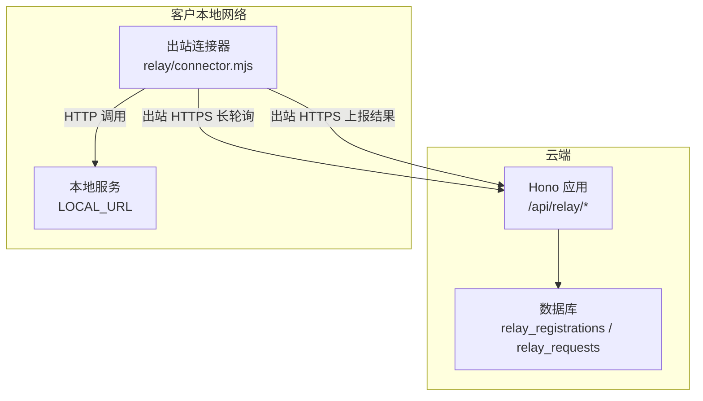
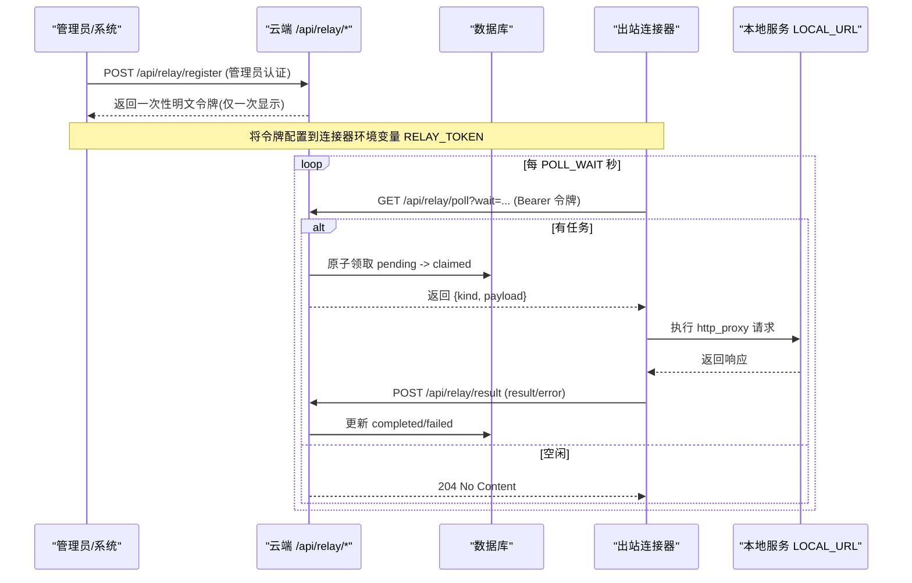
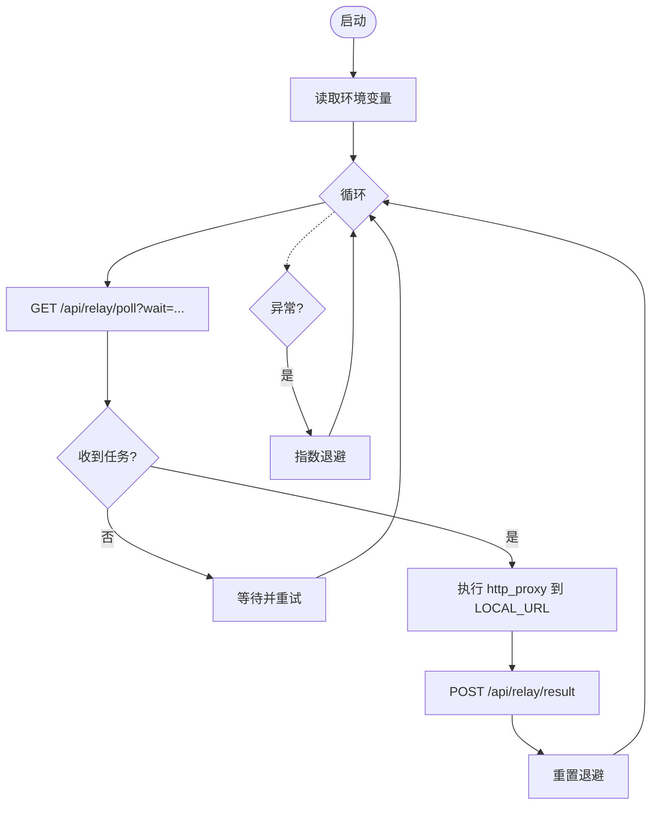
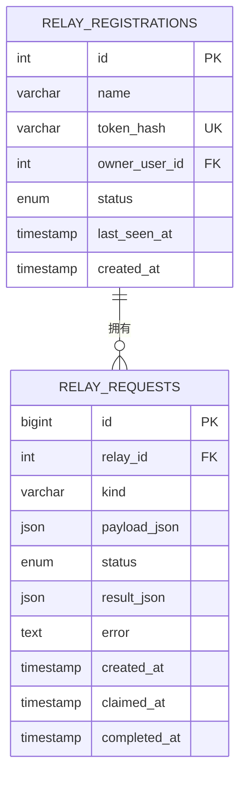
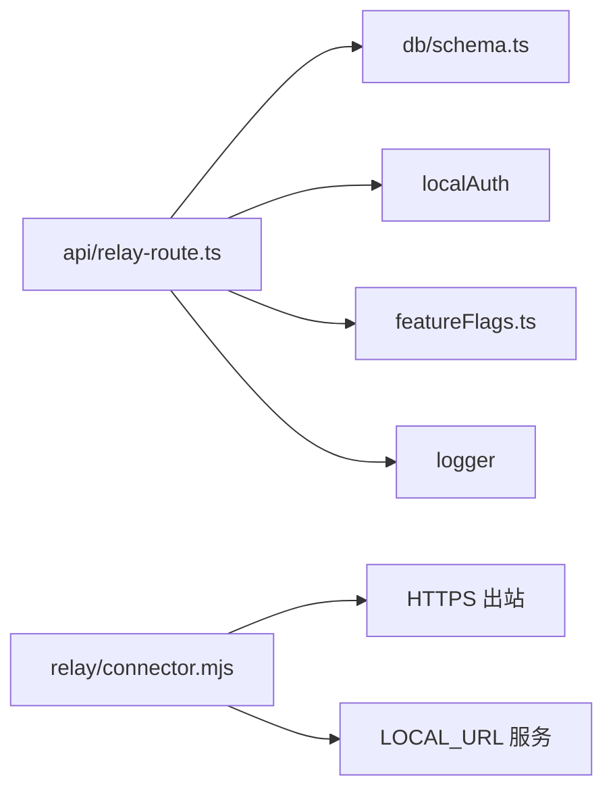

# 出站中继

<cite>
**本文引用的文件**
- [relay/connector.mjs](file://relay/connector.mjs)
- [api/relay-route.ts](file://api/relay-route.ts)
- [db/schema.ts](file://db/schema.ts)
- [docker-compose.relay.yml](file://docker-compose.relay.yml)
- [scripts/smoke-relay-loop.mjs](file://scripts/smoke-relay-loop.mjs)
- [api/plugins/featureFlags.ts](file://api/plugins/featureFlags.ts)
- [DEPLOY.md](file://DEPLOY.md)
</cite>

## 目录
1. [简介](#简介)
2. [项目结构](#项目结构)
3. [核心组件](#核心组件)
4. [架构总览](#架构总览)
5. [详细组件分析](#详细组件分析)
6. [依赖关系分析](#依赖关系分析)
7. [性能考量](#性能考量)
8. [故障排查指南](#故障排查指南)
9. [结论](#结论)
10. [附录](#附录)

## 简介
本文件为“出站中继”功能的完整技术文档。该功能允许数据驻留或位于严格出站网络（仅允许出站 HTTPS）的客户，在不开放任何入站端口的情况下，通过本地运行的“出站连接器”轮询云端 API，将请求转发到本地服务执行，并将结果回传至云端。整体设计遵循“零入站端口、仅出站通信”的原则，满足企业防火墙与代理环境下的部署需求，同时保障数据隐私与传输安全。

## 项目结构
出站中继由两部分组成：
- 云端侧路由与服务：提供注册、长轮询取任务、上报结果等接口，受特性开关控制。
- 本地侧连接器：独立 Node 脚本，持续向云端发起出站 HTTPS 长轮询，拉取任务后在本地执行并回写结果。

图表来源
- [api/relay-route.ts:154-354](file://api/relay-route.ts#L154-L354)
- [relay/connector.mjs:52-149](file://relay/connector.mjs#L52-L149)
- [db/schema.ts:1270-1301](file://db/schema.ts#L1270-L1301)

章节来源
- [api/relay-route.ts:1-354](file://api/relay-route.ts#L1-L354)
- [relay/connector.mjs:1-150](file://relay/connector.mjs#L1-L150)
- [db/schema.ts:1270-1301](file://db/schema.ts#L1270-L1301)

## 核心组件
- 云端路由层：负责中继令牌注册、任务分发（长轮询）、结果落库、以及测试用入队接口；所有接口均受特性开关保护。
- 本地连接器：无依赖的 Node 脚本，实现长轮询、任务执行（当前支持 http_proxy 类型）、错误重试退避、结果上报。
- 数据模型：中继注册表与会话请求队列，包含状态机与审计字段。
- 配置与部署：环境变量驱动连接器行为；Docker Compose 提供无入站端口的容器化运行方式。
- 特性开关：通过 feature flags 控制中继能力是否启用。

章节来源
- [api/relay-route.ts:33-66](file://api/relay-route.ts#L33-L66)
- [relay/connector.mjs:17-28](file://relay/connector.mjs#L17-L28)
- [db/schema.ts:1270-1301](file://db/schema.ts#L1270-L1301)
- [docker-compose.relay.yml:1-38](file://docker-compose.relay.yml#L1-L38)
- [api/plugins/featureFlags.ts:22-73](file://api/plugins/featureFlags.ts#L22-L73)

## 架构总览
出站中继采用“出站长轮询 + 本地执行 + 结果回写”的异步工作流。连接器不暴露任何入站端口，仅通过出站 HTTPS 与云端交互，从而适配 NAT、严格 egress-only 网络与企业代理。

图表来源
- [api/relay-route.ts:158-242](file://api/relay-route.ts#L158-L242)
- [api/relay-route.ts:244-294](file://api/relay-route.ts#L244-L294)
- [relay/connector.mjs:52-149](file://relay/connector.mjs#L52-L149)
- [db/schema.ts:1270-1301](file://db/schema.ts#L1270-L1301)

## 详细组件分析

### 云端路由与协议
- 特性门控：所有 /api/relay/* 路由受 enterprise_relay 特性开关控制；关闭时返回 404，避免暴露攻击面。
- 管理员认证：register/enqueue 使用本地认证令牌校验管理员角色。
- 中继认证：poll/result 使用 Bearer 令牌进行身份验证，令牌以 SHA-256 哈希存储，原始值仅在注册时返回一次。
- 任务领取：poll 使用长轮询，按时间顺序原子领取 oldest pending 请求，避免重复消费。
- 结果上报：result 仅允许所属中继更新其请求，防止跨中继写入。

关键流程要点
- 令牌注册：生成随机令牌，保存哈希，返回明文一次。
- 长轮询：支持 wait 参数，默认 25s，上限 60s；超时返回 204。
- 结果落库：根据 error 字段决定 completed/failed，记录完成时间与结果。

章节来源
- [api/relay-route.ts:53-66](file://api/relay-route.ts#L53-L66)
- [api/relay-route.ts:68-129](file://api/relay-route.ts#L68-L129)
- [api/relay-route.ts:131-151](file://api/relay-route.ts#L131-L151)
- [api/relay-route.ts:158-242](file://api/relay-route.ts#L158-L242)
- [api/relay-route.ts:244-294](file://api/relay-route.ts#L244-L294)

### 本地连接器
- 启动与环境变量：CLOUD_URL、RELAY_TOKEN、LOCAL_URL、POLL_WAIT、MAX_BACKOFF。
- 长轮询循环：周期性调用 poll，若无任务则重置退避继续轮询；有任务则执行。
- 任务执行：当前支持 kind=http_proxy，将 method/path/body 转发到 LOCAL_URL，自动处理 JSON/文本响应。
- 结果上报：将 result 或 error 提交到 /api/relay/result。
- 错误处理：指数退避（最大 MAX_BACKOFF），失败日志输出到 stdout。

图表来源
- [relay/connector.mjs:24-48](file://relay/connector.mjs#L24-L48)
- [relay/connector.mjs:52-92](file://relay/connector.mjs#L52-L92)
- [relay/connector.mjs:94-149](file://relay/connector.mjs#L94-L149)

章节来源
- [relay/connector.mjs:1-150](file://relay/connector.mjs#L1-L150)

### 数据模型与状态机
- 中继注册表：存储名称、令牌哈希、所有者用户、状态（active/revoked）、最近可见时间、创建时间。
- 中继请求队列：存储中继 ID、任务类型、负载、状态（pending/claimed/completed/failed）、结果、错误、时间戳。
- 索引：针对 relayId+status 的复合索引，提升领取效率。

图表来源
- [db/schema.ts:1270-1301](file://db/schema.ts#L1270-L1301)

章节来源
- [db/schema.ts:1270-1301](file://db/schema.ts#L1270-L1301)

### 配置选项与网络设置
- 连接器环境变量
  - CLOUD_URL：云端应用源地址（必填）。
  - RELAY_TOKEN：从云端注册获取的一次性令牌（必填）。
  - LOCAL_URL：本地服务基址（可选，默认 http://localhost:3000）。
  - POLL_WAIT：长轮询等待秒数（可选，默认 25）。
  - MAX_BACKOFF：错误退避上限毫秒（可选，默认 30000）。
- 云端特性开关
  - enterprise_relay：开启后才会暴露 /api/relay/*；关闭时全部 404。
- 网络策略
  - 仅出站 HTTPS 到 CLOUD_URL，仅出站 HTTP 到 LOCAL_URL；不监听任何入站端口。
  - 适合 NAT、严格 egress-only 网络与企业代理环境。

章节来源
- [relay/connector.mjs:17-28](file://relay/connector.mjs#L17-L28)
- [api/relay-route.ts:33-66](file://api/relay-route.ts#L33-L66)
- [docker-compose.relay.yml:1-38](file://docker-compose.relay.yml#L1-L38)

### 安全策略
- 令牌安全：原始令牌仅注册时返回一次，服务端仅存储 SHA-256 哈希。
- 访问控制：
  - register/enqueue：需管理员本地认证令牌。
  - poll/result：需有效中继令牌且状态 active。
- 隔离性：result 仅允许所属中继更新其请求，防止跨中继篡改。
- 传输加密：连接器与云端之间使用 HTTPS；本地服务建议在内网使用 TLS 或可信网络。

章节来源
- [api/relay-route.ts:68-129](file://api/relay-route.ts#L68-L129)
- [api/relay-route.ts:244-294](file://api/relay-route.ts#L244-L294)
- [relay/connector.mjs:50-64](file://relay/connector.mjs#L50-L64)

### 与企业防火墙和代理服务器的集成
- 出站限制：仅需允许出站 HTTPS 到 CLOUD_URL，出站 HTTP 到 LOCAL_URL。
- 代理配置：若企业网络强制走代理，请在连接器运行环境中配置标准代理环境变量（如 https_proxy/http_proxy），使 Node fetch 能正确出站。
- 证书信任：确保连接器所在主机信任云端 CA；必要时配置 CA 包或 NODE_EXTRA_CA_CERTS。
- 无入站端口：无需在防火墙放行任何入站端口，降低暴露面。

章节来源
- [docker-compose.relay.yml:1-38](file://docker-compose.relay.yml#L1-L38)
- [relay/connector.mjs:1-15](file://relay/connector.mjs#L1-L15)

### 部署配置示例
- Docker Compose：使用 node:20-alpine 镜像挂载只读 connector 脚本，注入环境变量，不暴露端口，重启策略 unless-stopped。
- 本地快速验证：通过 smoke 脚本在本地启动应用与连接器，端到端验证 register → poll → execute → result → DB 的闭环。

章节来源
- [docker-compose.relay.yml:1-38](file://docker-compose.relay.yml#L1-L38)
- [scripts/smoke-relay-loop.mjs:1-223](file://scripts/smoke-relay-loop.mjs#L1-L223)

### 监控指标、日志与诊断
- 连接器日志：stdout 输出结构化 JSON 日志，包含时间戳、消息与上下文（如 requestId、kind、backoffMs）。
- 云端日志：关键操作记录信息日志（注册、领取、完成、错误）。
- 数据库观测：
  - relay_registrations.last_seen_at：用于判断连接器存活与活跃度。
  - relay_requests.status：观察 pending/claimed/completed/failed 分布与积压。
- 健康检查：可通过 enqueue 触发一个 http_proxy 请求到 /api/health 来验证链路。

章节来源
- [relay/connector.mjs:46-48](file://relay/connector.mjs#L46-L48)
- [relay/connector.mjs:109-149](file://relay/connector.mjs#L109-L149)
- [api/relay-route.ts:198-199](file://api/relay-route.ts#L198-L199)
- [api/relay-route.ts:292-293](file://api/relay-route.ts#L292-L293)

### 数据隐私与传输加密
- 数据驻留：连接器在客户本地执行，数据不出域；仅传递操作员选择的请求/响应载荷。
- 最小暴露：仅出站 HTTPS 到云端，不暴露入站端口。
- 传输加密：连接器与云端通信使用 HTTPS；建议本地服务也启用 TLS 或在受信内网运行。

章节来源
- [relay/connector.mjs:1-15](file://relay/connector.mjs#L1-L15)
- [docker-compose.relay.yml:1-20](file://docker-compose.relay.yml#L1-L20)

## 依赖关系分析
- 云端路由依赖：
  - Hono 应用框架与中间件。
  - 数据库 ORM（Drizzle）与连接。
  - 本地认证校验、特性开关、日志模块。
- 连接器依赖：
  - Node 18+ 全局 fetch。
  - 环境变量驱动行为。
- 外部依赖：
  - MySQL（通过 schema 定义）。
  - 可选的企业代理与 CA 信任链。

图表来源
- [api/relay-route.ts:23-31](file://api/relay-route.ts#L23-L31)
- [relay/connector.mjs:24-28](file://relay/connector.mjs#L24-L28)
- [db/schema.ts:1270-1301](file://db/schema.ts#L1270-L1301)

章节来源
- [api/relay-route.ts:23-31](file://api/relay-route.ts#L23-L31)
- [relay/connector.mjs:24-28](file://relay/connector.mjs#L24-L28)

## 性能考量
- 长轮询窗口：POLL_WAIT 默认 25s，上限 60s；可根据网络延迟与吞吐调整。
- 退避策略：错误时指数退避，最大 MAX_BACKOFF；成功时重置，避免雪崩。
- 并发与争用：poll 原子领取 oldest pending，避免重复消费；在高并发下关注数据库锁与索引命中。
- 资源占用：连接器轻量，无额外依赖；建议单实例即可，多实例共享同一中继令牌会竞争领取任务。
- 本地服务性能：http_proxy 执行速度取决于 LOCAL_URL 服务；建议对热点路径做缓存与限流。

章节来源
- [relay/connector.mjs:27-28](file://relay/connector.mjs#L27-L28)
- [relay/connector.mjs:107-142](file://relay/connector.mjs#L107-L142)
- [api/relay-route.ts:35-37](file://api/relay-route.ts#L35-L37)
- [api/relay-route.ts:131-151](file://api/relay-route.ts#L131-L151)

## 故障排查指南
常见问题与定位方法
- 无法注册或 404：检查 enterprise_relay 特性开关是否启用；确认路由已注册。
- 连接器 401：检查 RELAY_TOKEN 是否正确、中继状态是否为 active。
- 长时间无任务：检查是否有 enqueue 或上游入队逻辑；观察 poll 是否返回 204。
- 任务未完结：查看 relay_requests 状态是否为 claimed/completed/failed；检查 result 上报是否成功。
- 本地执行失败：检查 LOCAL_URL 可达性与响应格式；确认 http_proxy 的 method/path/body 正确。
- 代理/证书问题：确认代理环境变量与 CA 信任链；必要时配置 NODE_TLS_REJECT_UNAUTHORIZED 或 CA 包。

实用命令与脚本
- 端到端冒烟：scripts/smoke-relay-loop.mjs 可验证完整链路。
- 手动 enqueue：通过管理员接口入队 http_proxy 请求到 /api/health 进行连通性测试。

章节来源
- [api/relay-route.ts:53-66](file://api/relay-route.ts#L53-L66)
- [api/relay-route.ts:158-242](file://api/relay-route.ts#L158-L242)
- [scripts/smoke-relay-loop.mjs:115-179](file://scripts/smoke-relay-loop.mjs#L115-L179)

## 结论
出站中继通过“仅出站通信”的设计，完美适配企业防火墙与代理环境，既满足数据驻留与安全合规要求，又提供了可靠的远程服务访问能力。云端侧提供安全的令牌管理与任务调度，本地侧以极简连接器实现高可靠的任务执行与结果回写。配合特性开关、日志与数据库观测，可实现生产级部署与运维。

## 附录
- 特性开关管理：enterprise_relay 默认关闭，需在部署中启用；参考部署文档与脚本中的开关操作。
- 部署参考：docker-compose.relay.yml 提供无入站端口的容器化运行方式；smoke 脚本可用于本地验证。

章节来源
- [DEPLOY.md:94-94](file://DEPLOY.md#L94-L94)
- [docker-compose.relay.yml:1-38](file://docker-compose.relay.yml#L1-L38)
- [scripts/smoke-relay-loop.mjs:1-223](file://scripts/smoke-relay-loop.mjs#L1-L223)