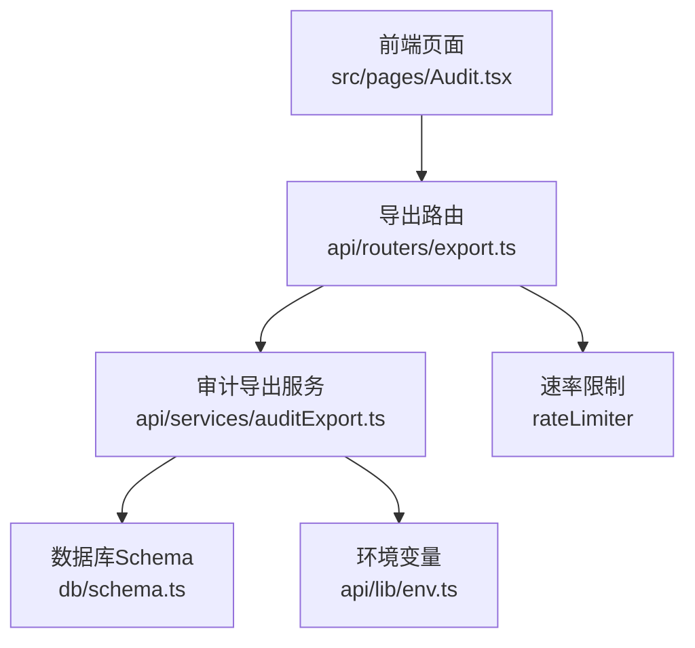
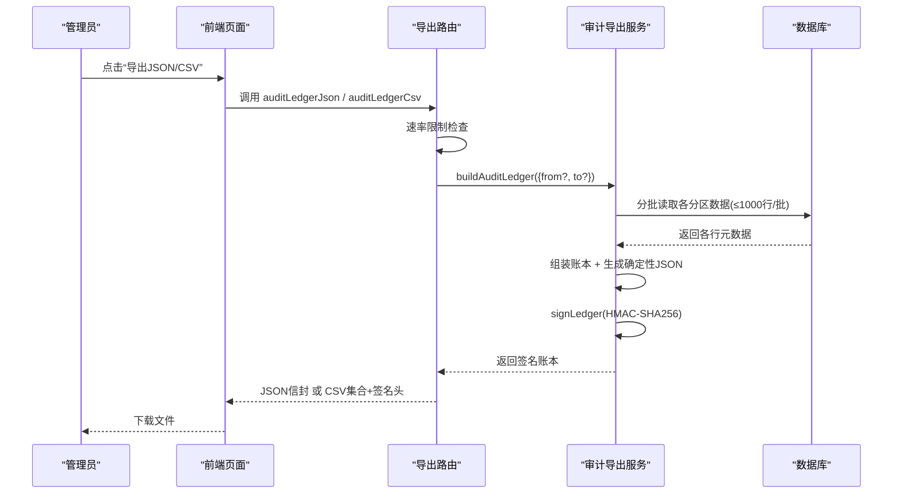
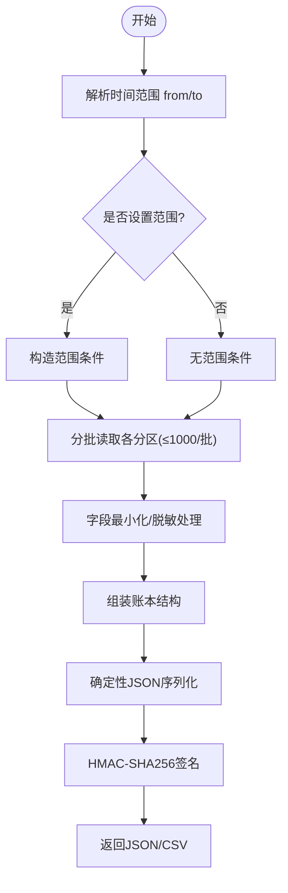
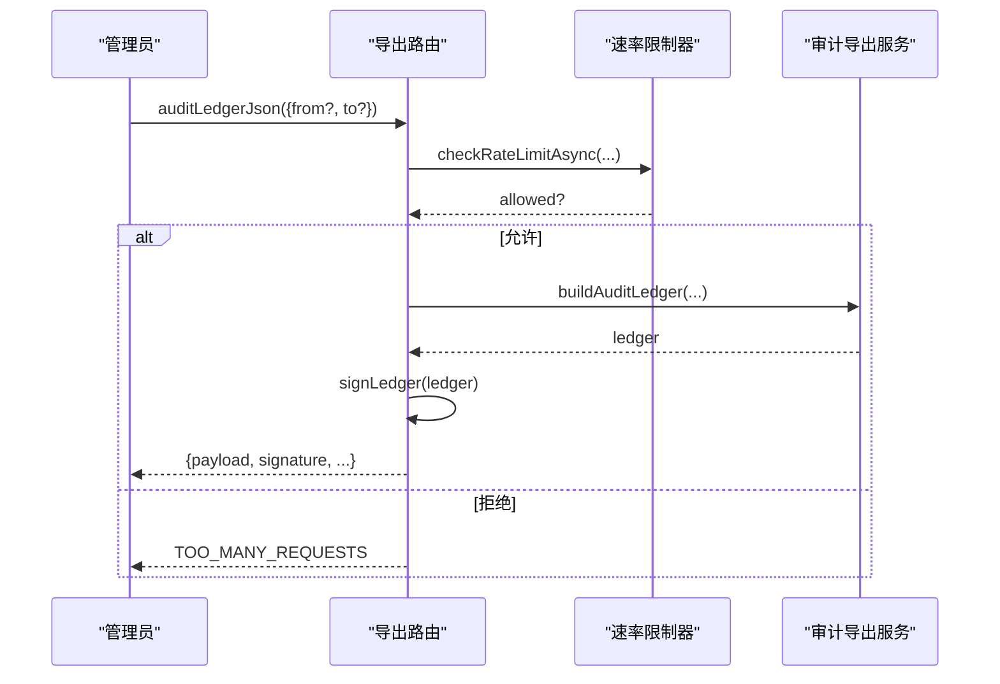
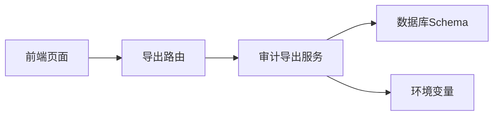

# 合规导出

<cite>
**本文引用的文件**
- [api/services/auditExport.ts](file://api/services/auditExport.ts)
- [api/routers/export.ts](file://api/routers/export.ts)
- [src/pages/Audit.tsx](file://src/pages/Audit.tsx)
- [db/schema.ts](file://db/schema.ts)
- [api/lib/env.ts](file://api/lib/env.ts)
- [DeeWaanAI-Next/PHASE3-SPEC.md](file://DeeWaanAI-Next/PHASE3-SPEC.md)
</cite>

## 目录
1. [简介](#简介)
2. [项目结构](#项目结构)
3. [核心组件](#核心组件)
4. [架构总览](#架构总览)
5. [详细组件分析](#详细组件分析)
6. [依赖关系分析](#依赖关系分析)
7. [性能与可扩展性](#性能与可扩展性)
8. [故障排查指南](#故障排查指南)
9. [结论](#结论)
10. [附录：数据模型与字段说明](#附录数据模型与字段说明)

## 简介
本文件面向“合规导出”能力，覆盖审计数据的收集、整理、打包、签名与下载；明确支持的数据类型与导出范围（用户数据、操作日志、业务记录）；说明导出文件的加密保护、完整性验证与访问控制；并提供自动化导出任务的配置方法与定时执行策略建议。同时梳理与GDPR、SOC2等合规要求相关的实现要点与数据保留策略。

## 项目结构
合规导出由三层组成：
- 路由层：对外暴露受保护的导出接口（JSON/CSV），并实施速率限制与审计日志。
- 服务层：从数据库分批拉取多类审计数据，构建统一账本，生成确定性JSON并进行HMAC-SHA256签名，同时渲染各分区的CSV。
- 前端层：管理员可见的“合规导出”卡片，提供一键下载JSON或合并后的CSV文件。

图表来源
- [api/routers/export.ts:360-402](file://api/routers/export.ts#L360-L402)
- [api/services/auditExport.ts:214-485](file://api/services/auditExport.ts#L214-L485)
- [src/pages/Audit.tsx:322-423](file://src/pages/Audit.tsx#L322-L423)
- [db/schema.ts:1182-1332](file://db/schema.ts#L1182-L1332)
- [api/lib/env.ts:43-46](file://api/lib/env.ts#L43-L46)

章节来源
- [api/routers/export.ts:360-402](file://api/routers/export.ts#L360-L402)
- [api/services/auditExport.ts:214-485](file://api/services/auditExport.ts#L214-L485)
- [src/pages/Audit.tsx:322-423](file://src/pages/Audit.tsx#L322-L423)
- [db/schema.ts:1182-1332](file://db/schema.ts#L1182-L1332)
- [api/lib/env.ts:43-46](file://api/lib/env.ts#L43-L46)

## 核心组件
- 审计导出服务（buildAuditLedger/signLedger/verifyLedgerSignature/toCsv/ledgerToCsvFiles）
- 导出路由（auditLedgerJson / auditLedgerCsv，含速率限制与日志）
- 前端导出入口（管理员可见的JSON/CSV下载按钮）
- 数据源（swarmRuns、approvalAssignments、entitlements、subscriptions、mcpAuditLog、oauthClients、oauthRefreshTokens、users）
- 安全与密钥（AUDIT_EXPORT_KEY 或回退到 APP_SECRET，HMAC-SHA256）

章节来源
- [api/services/auditExport.ts:14-177](file://api/services/auditExport.ts#L14-L177)
- [api/routers/export.ts:360-402](file://api/routers/export.ts#L360-L402)
- [src/pages/Audit.tsx:322-423](file://src/pages/Audit.tsx#L322-L423)
- [db/schema.ts:1182-1332](file://db/schema.ts#L1182-L1332)
- [api/lib/env.ts:43-46](file://api/lib/env.ts#L43-L46)

## 架构总览
合规导出采用“只读、分批、最小化字段、可签名”的设计原则：
- 数据收集：按分区（runs、approvals、entitlements、subscriptions、mcpAuditLog、oauthClients、oauthRefreshTokens、users）分批查询，每批≤1000行，避免全表扫描。
- 数据整理：仅导出元数据与必要标识，不导出提示词/输出内容、token哈希或敏感文本；错误信息仅以布尔存在标记。
- 打包与签名：对导出的结构化账本进行确定性序列化（键稳定排序、日期标准化），计算HMAC-SHA256签名，附带算法、时间戳与keyId。
- 传输与下载：通过管理员专用接口返回JSON信封或CSV集合；前端将CSV拼接为单文件并携带签名头，便于归档与校验。

图表来源
- [api/routers/export.ts:360-402](file://api/routers/export.ts#L360-L402)
- [api/services/auditExport.ts:214-485](file://api/services/auditExport.ts#L214-L485)
- [src/pages/Audit.tsx:342-380](file://src/pages/Audit.tsx#L342-L380)

## 详细组件分析

### 审计导出服务（api/services/auditExport.ts）
- 数据收集与过滤
  - 支持可选的时间范围 from/to，基于 created_at/startedAt 等列进行范围过滤。
  - 所有查询使用 LIMIT/OFFSET 分页，批次大小固定为1000，确保无全表扫描风险。
- 数据最小化
  - 不导出用户提示词、执行结果内容、token哈希或任何机密。
  - 错误信息仅以 hasError 布尔表示，不携带具体错误文本。
  - 订阅信息仅保留是否关联Stripe的布尔标志，不导出原始Stripe ID。
- 签名与校验
  - 确定性JSON：递归排序对象键、Date转ISO字符串、bigint转字符串。
  - HMAC-SHA256：对payload进行签名，附带 algorithm、signedAt、keyId。
  - 密钥管理：优先使用 AUDIT_EXPORT_KEY；为空时回退至 APP_SECRET，保证历史导出仍可验证。
  - 提供 verifyLedgerSignature 用于外部校验。
- CSV渲染
  - 每个分区有固定头部，空分区也输出头部；遵循RFC-4180风格引号与转义。
  - ledgerToCsvFiles 将各分区转为独立CSV字符串，供路由组合下载。

图表来源
- [api/services/auditExport.ts:178-213](file://api/services/auditExport.ts#L178-L213)
- [api/services/auditExport.ts:214-485](file://api/services/auditExport.ts#L214-L485)
- [api/services/auditExport.ts:487-569](file://api/services/auditExport.ts#L487-L569)
- [api/services/auditExport.ts:571-658](file://api/services/auditExport.ts#L571-L658)

章节来源
- [api/services/auditExport.ts:14-177](file://api/services/auditExport.ts#L14-L177)
- [api/services/auditExport.ts:178-213](file://api/services/auditExport.ts#L178-L213)
- [api/services/auditExport.ts:214-485](file://api/services/auditExport.ts#L214-L485)
- [api/services/auditExport.ts:487-569](file://api/services/auditExport.ts#L487-L569)
- [api/services/auditExport.ts:571-658](file://api/services/auditExport.ts#L571-L658)

### 导出路由（api/routers/export.ts）
- 管理员专用接口
  - auditLedgerJson：返回带签名的JSON信封与计数。
  - auditLedgerCsv：返回各分区CSV字符串、签名、算法、签名时间与keyId。
- 速率限制
  - 使用统一的速率限制器，针对审计导出分配较宽松的管理员配额（每小时30次）。
- 审计日志
  - 每次导出均记录用户ID与计数，便于追踪与审计。

图表来源
- [api/routers/export.ts:360-402](file://api/routers/export.ts#L360-L402)
- [api/services/auditExport.ts:30-36](file://api/services/auditExport.ts#L30-L36)

章节来源
- [api/routers/export.ts:360-402](file://api/routers/export.ts#L360-L402)
- [api/services/auditExport.ts:30-36](file://api/services/auditExport.ts#L30-L36)

### 前端导出入口（src/pages/Audit.tsx）
- 管理员可见的“合规导出”卡片，提供JSON与CSV下载。
- JSON：直接下载包含签名信封的文件。
- CSV：将后端返回的各分区CSV拼接为单个文件，并在文件头写入 signature、signedAt、algorithm 三行注释，便于离线校验。

章节来源
- [src/pages/Audit.tsx:322-423](file://src/pages/Audit.tsx#L322-L423)

### 数据源与字段（db/schema.ts）
- 涉及的主要表与字段（节选）：
  - mcp_audit_log：工具调用审计（userId、clientId、toolName、latencyMs、status、error、createdAt）
  - approval_assignments：审批指派（swarmRunId、assigneeUserId、assignedBy、status、createdAt、completedAt）
  - admin_audit_log：管理员操作审计（adminUserId、action、targetType、targetId、detail、ip、createdAt）
  - 其他表（如swarmRuns、entitlements、subscriptions、oauth_clients、oauth_refresh_tokens、users）在导出服务中按需选择最小字段集。

章节来源
- [db/schema.ts:1182-1332](file://db/schema.ts#L1182-L1332)

## 依赖关系分析
- 路由依赖服务：exportRouter 调用 auditExport 中的 buildAuditLedger、signLedger、ledgerToCsvFiles。
- 服务依赖数据库Schema：通过Drizzle ORM按表名选择字段，严格限定导出字段。
- 服务依赖环境变量：AUDIT_EXPORT_KEY 或 APP_SECRET 用于签名密钥派生。
- 前端依赖路由：通过tRPC调用导出接口，完成下载。

图表来源
- [api/routers/export.ts:360-402](file://api/routers/export.ts#L360-L402)
- [api/services/auditExport.ts:214-485](file://api/services/auditExport.ts#L214-L485)
- [api/lib/env.ts:43-46](file://api/lib/env.ts#L43-L46)
- [src/pages/Audit.tsx:342-380](file://src/pages/Audit.tsx#L342-L380)

章节来源
- [api/routers/export.ts:360-402](file://api/routers/export.ts#L360-L402)
- [api/services/auditExport.ts:214-485](file://api/services/auditExport.ts#L214-L485)
- [api/lib/env.ts:43-46](file://api/lib/env.ts#L43-L46)
- [src/pages/Audit.tsx:342-380](file://src/pages/Audit.tsx#L342-L380)

## 性能与可扩展性
- 分批查询：每批≤1000行，避免大表全量加载导致的内存与延迟问题。
- 速率限制：每小时30次导出，防止滥用与资源争用。
- 确定性序列化：键排序与日期标准化确保签名稳定，便于跨环境校验。
- 可扩展点：
  - 新增分区：在服务层增加新的分区类型与CSV头部定义，并在路由中复用现有模式。
  - 调整批次大小：根据数据规模与响应时长调优 BATCH_SIZE。
  - 密钥轮换：通过 AUDIT_EXPORT_KEY 独立于会话密钥，支持历史导出验证不受影响。

[本节为通用指导，无需特定文件引用]

## 故障排查指南
- 速率限制触发
  - 现象：返回 TOO_MANY_REQUESTS。
  - 处理：等待重试间隔后再次请求；如需更高配额，评估扩展速率限制策略。
- 签名校验失败
  - 现象：verifyLedgerSignature 返回 false。
  - 可能原因：payload被篡改、keyId对应的密钥不可用、算法不匹配。
  - 处理：确认 keyId 与当前环境密钥配置一致；核对算法是否为 HMAC-SHA256。
- 导出为空或数据缺失
  - 现象：JSON信封中 counts 为0或某分区为空。
  - 处理：检查时间范围 from/to 是否正确；确认数据库中存在对应时间段的数据。
- 前端下载异常
  - 现象：CSV文件无法打开或缺少签名头。
  - 处理：确认前端拼接逻辑包含 signature、signedAt、algorithm 三行注释；检查浏览器下载行为。

章节来源
- [api/routers/export.ts:360-402](file://api/routers/export.ts#L360-L402)
- [api/services/auditExport.ts:555-569](file://api/services/auditExport.ts#L555-L569)
- [src/pages/Audit.tsx:356-380](file://src/pages/Audit.tsx#L356-L380)

## 结论
合规导出通过“最小字段、分批读取、确定性序列化、HMAC签名”的组合，提供了满足审计与合规要求的可验证数据出口。管理员可通过前端界面便捷下载JSON或CSV，并在离线环境中进行完整性校验。系统已内置速率限制与审计日志，有助于控制风险与追溯操作。未来可按需扩展更多分区与自动化任务。

[本节为总结，无需特定文件引用]

## 附录：数据模型与字段说明
- 支持的导出分区与字段（节选）
  - runs：id、projectId、userId、status、currentStep、pipelineVersion、isTestRun、totalTokensUsed、totalLatencyMs、hasError、startedAt、completedAt
  - approvals：kind、id、swarmRunId、assigneeUserId、assignedBy、status、stepOrder、hasInstructions、createdAt、completedAt
  - entitlements：id、subjectType、subjectId、capability、source、sourceRef、expiresAt、createdAt
  - subscriptions：id、userId、teamId、plan、status、seats、currentPeriodEnd、hasStripeCustomer、hasStripeSubscription、createdAt、updatedAt
  - mcpAuditLog：id、userId、clientId、toolName、latencyMs、status、hasError、createdAt
  - oauthClients：id、clientId、clientName、redirectUris、createdAt
  - oauthRefreshTokens：id、userId、clientId、scopes、expiresAt、revokedAt、createdAt
  - users：id、username、email

- 导出格式
  - JSON：包含 payload（账本）、signature、algorithm、signedAt、keyId 与 counts。
  - CSV：每个分区一个CSV字符串，前端将其拼接为单文件，并在文件头附加 signature、signedAt、algorithm 注释行。

- 加密与完整性
  - 算法：HMAC-SHA256
  - 密钥：优先使用 AUDIT_EXPORT_KEY；为空时回退至 APP_SECRET
  - 校验：verifyLedgerSignature 使用相同算法与密钥进行对比

- 访问控制
  - 接口仅限管理员调用（adminQuery）
  - 速率限制：每小时30次

- 自动化导出任务（建议）
  - 可通过GitHub Actions或其他调度器定期调用 export.auditLedgerJson/export.auditLedgerCsv，并将结果上传至对象存储（如S3）
  - 建议在任务中记录运行日志与失败告警，便于运维跟踪

章节来源
- [api/services/auditExport.ts:138-177](file://api/services/auditExport.ts#L138-L177)
- [api/services/auditExport.ts:571-658](file://api/services/auditExport.ts#L571-L658)
- [api/routers/export.ts:360-402](file://api/routers/export.ts#L360-L402)
- [api/lib/env.ts:43-46](file://api/lib/env.ts#L43-L46)
- [DeeWaanAI-Next/PHASE3-SPEC.md:52-66](file://DeeWaanAI-Next/PHASE3-SPEC.md#L52-L66)