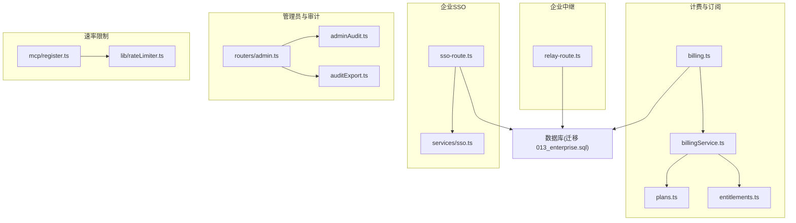
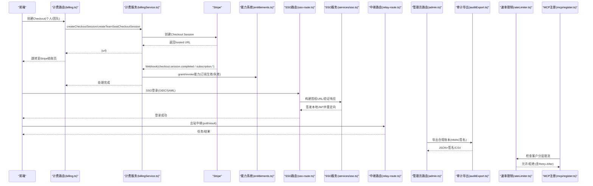
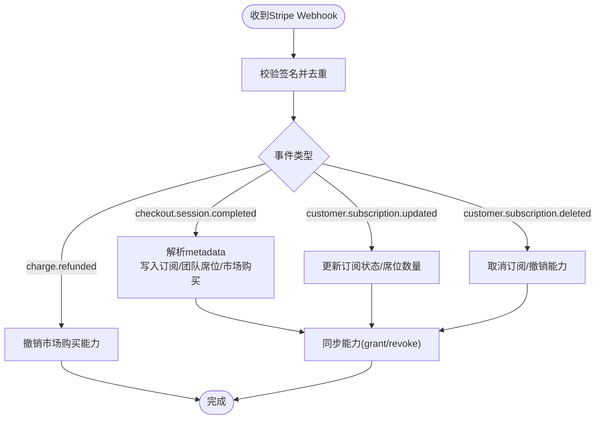
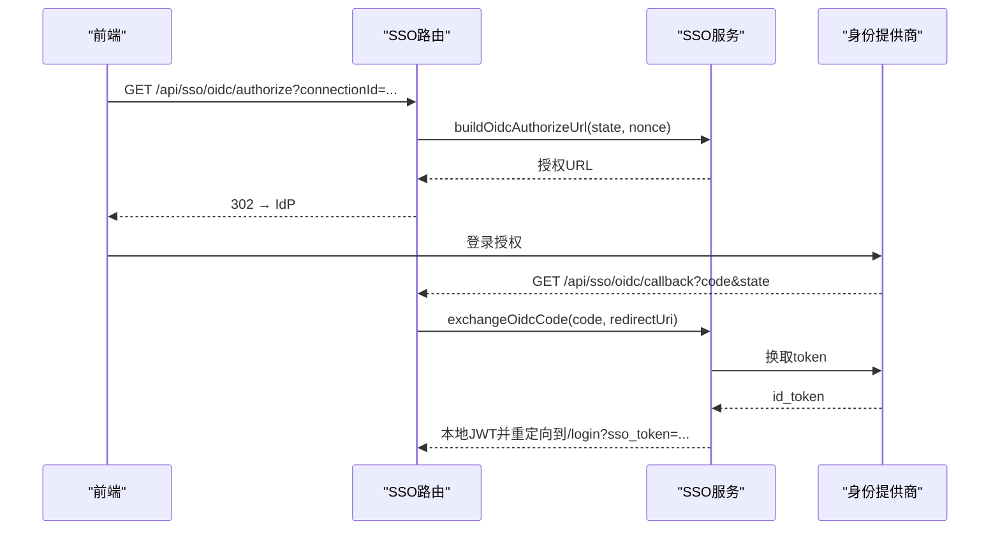
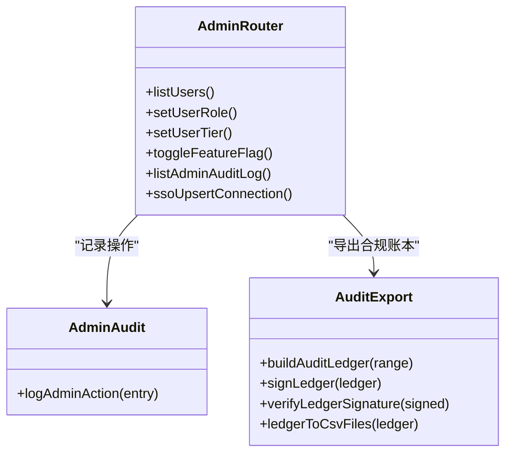
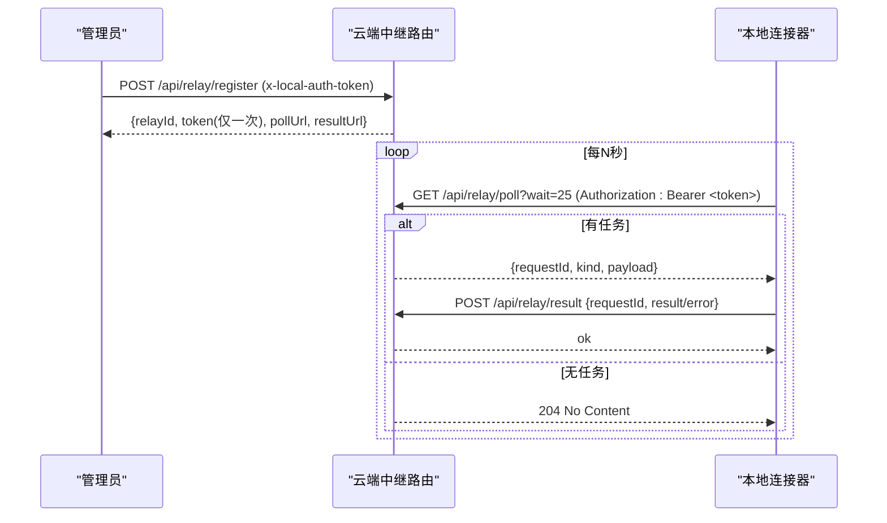
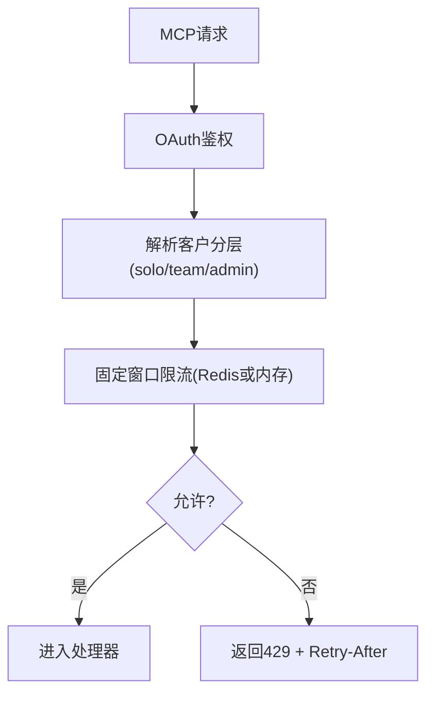
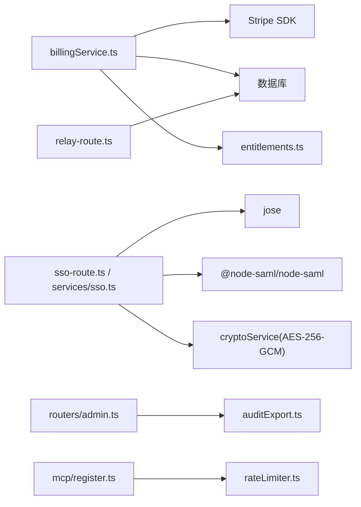

# 商业和企业功能

<cite>
**本文引用的文件**
- [COMMERCIAL.md](file://COMMERCIAL.md)
- [api/routers/billing.ts](file://api/routers/billing.ts)
- [api/services/billingService.ts](file://api/services/billingService.ts)
- [api/config/plans.ts](file://api/config/plans.ts)
- [api/services/entitlements.ts](file://api/services/entitlements.ts)
- [api/sso-route.ts](file://api/sso-route.ts)
- [api/services/sso.ts](file://api/services/sso.ts)
- [api/relay-route.ts](file://api/relay-route.ts)
- [api/mcp/register.ts](file://api/mcp/register.ts)
- [api/lib/rateLimiter.ts](file://api/lib/rateLimiter.ts)
- [api/services/adminAudit.ts](file://api/services/adminAudit.ts)
- [api/routers/admin.ts](file://api/routers/admin.ts)
- [api/services/auditExport.ts](file://api/services/auditExport.ts)
- [db/migrations/013_enterprise.sql](file://db/migrations/013_enterprise.sql)
- [scripts/smoke-enterprise.mjs](file://scripts/smoke-enterprise.mjs)
</cite>

## 目录
1. [简介](#简介)
2. [项目结构](#项目结构)
3. [核心组件](#核心组件)
4. [架构总览](#架构总览)
5. [详细组件分析](#详细组件分析)
6. [依赖关系分析](#依赖关系分析)
7. [性能与扩展性](#性能与扩展性)
8. [故障排查指南](#故障排查指南)
9. [结论](#结论)
10. [附录](#附录)

## 简介
本文件面向DeeWaanAI的商业与企业级能力，覆盖计费与订阅（Stripe集成）、企业SSO（OIDC + SAML）、合规审计导出、管理员功能、出站中继部署、MCP速率限制、许可证与权限控制、数据隔离等主题。文档以代码为依据，提供架构图、流程图与关键路径说明，帮助读者快速理解并安全部署企业版。

## 项目结构
围绕商业与企业能力的代码主要分布在以下模块：
- 计费与订阅：路由层与Stripe服务、计划目录、能力授予
- 企业SSO：OIDC/SAML流程、连接管理、登录路由
- 企业中继：出站-only的本地连接器桥接
- 管理员与审计：角色/功能开关、审计日志、合规导出
- 速率限制：按客户分层（solo/team/admin）的固定窗口限流
- 数据库迁移：企业特性表结构（SSO连接、中继注册与请求队列）

图表来源
- [api/routers/billing.ts:32-161](file://api/routers/billing.ts#L32-L161)
- [api/services/billingService.ts:39-180](file://api/services/billingService.ts#L39-L180)
- [api/config/plans.ts:19-52](file://api/config/plans.ts#L19-L52)
- [api/services/entitlements.ts:42-104](file://api/services/entitlements.ts#L42-L104)
- [api/sso-route.ts:108-291](file://api/sso-route.ts#L108-L291)
- [api/services/sso.ts:76-181](file://api/services/sso.ts#L76-L181)
- [api/relay-route.ts:154-354](file://api/relay-route.ts#L154-L354)
- [api/routers/admin.ts:16-558](file://api/routers/admin.ts#L16-L558)
- [api/services/adminAudit.ts:24-41](file://api/services/adminAudit.ts#L24-L41)
- [api/services/auditExport.ts:214-485](file://api/services/auditExport.ts#L214-L485)
- [db/migrations/013_enterprise.sql:1-54](file://db/migrations/013_enterprise.sql#L1-L54)

章节来源
- [api/routers/billing.ts:32-161](file://api/routers/billing.ts#L32-L161)
- [api/services/billingService.ts:39-180](file://api/services/billingService.ts#L39-L180)
- [api/config/plans.ts:19-52](file://api/config/plans.ts#L19-L52)
- [api/services/entitlements.ts:42-104](file://api/services/entitlements.ts#L42-L104)
- [api/sso-route.ts:108-291](file://api/sso-route.ts#L108-L291)
- [api/services/sso.ts:76-181](file://api/services/sso.ts#L76-L181)
- [api/relay-route.ts:154-354](file://api/relay-route.ts#L154-L354)
- [api/routers/admin.ts:16-558](file://api/routers/admin.ts#L16-L558)
- [api/services/adminAudit.ts:24-41](file://api/services/adminAudit.ts#L24-L41)
- [api/services/auditExport.ts:214-485](file://api/services/auditExport.ts#L214-L485)
- [db/migrations/013_enterprise.sql:1-54](file://db/migrations/013_enterprise.sql#L1-L54)

## 核心组件
- 计费与订阅
  - 公开计划目录与Stripe Checkout创建（个人/团队席位）
  - Webhook处理：购买完成、订阅更新/删除、退款；幂等事件处理
  - 订阅状态与能力同步（通过entitlements）
- 企业SSO
  - OIDC：发现缓存、授权URL构建、code交换、ID令牌校验（JWKS）
  - SAML：SP元数据生成、响应校验（NameID=邮箱）
  - 无状态state JWT（HS256，短TTL），用户匹配或自动配置
- 企业中继
  - 仅出站：云端登记中继、长轮询拉取任务、结果回传
  - 令牌哈希存储，最小化暴露面
- 管理员与审计
  - 用户角色/层级、功能开关、反馈管理、认证队列
  - 持久化审计日志（操作者、目标、时间、IP）
  - 合规导出：多段批处理、HMAC签名、CSV渲染
- 速率限制
  - 通用限流（内存/Redis）
  - 按客户分层（solo/team/admin）固定窗口限流，应用于MCP表面

章节来源
- [api/routers/billing.ts:32-161](file://api/routers/billing.ts#L32-L161)
- [api/services/billingService.ts:182-672](file://api/services/billingService.ts#L182-L672)
- [api/config/plans.ts:19-52](file://api/config/plans.ts#L19-L52)
- [api/services/entitlements.ts:42-207](file://api/services/entitlements.ts#L42-L207)
- [api/sso-route.ts:108-291](file://api/sso-route.ts#L108-L291)
- [api/services/sso.ts:76-357](file://api/services/sso.ts#L76-L357)
- [api/relay-route.ts:154-354](file://api/relay-route.ts#L154-L354)
- [api/routers/admin.ts:16-558](file://api/routers/admin.ts#L16-L558)
- [api/services/adminAudit.ts:24-41](file://api/services/adminAudit.ts#L24-L41)
- [api/services/auditExport.ts:214-658](file://api/services/auditExport.ts#L214-L658)
- [api/lib/rateLimiter.ts:96-216](file://api/lib/rateLimiter.ts#L96-L216)
- [api/mcp/register.ts:39-152](file://api/mcp/register.ts#L39-L152)

## 架构总览
下图展示从前端到后端的关键调用链：计费Checkout、Webhook处理、SSO登录、中继出站、管理员审计与合规导出、MCP速率限制。

图表来源
- [api/routers/billing.ts:32-161](file://api/routers/billing.ts#L32-L161)
- [api/services/billingService.ts:39-180](file://api/services/billingService.ts#L39-L180)
- [api/services/billingService.ts:445-672](file://api/services/billingService.ts#L445-L672)
- [api/services/entitlements.ts:42-104](file://api/services/entitlements.ts#L42-L104)
- [api/sso-route.ts:108-291](file://api/sso-route.ts#L108-L291)
- [api/services/sso.ts:76-181](file://api/services/sso.ts#L76-L181)
- [api/relay-route.ts:154-354](file://api/relay-route.ts#L154-L354)
- [api/services/auditExport.ts:214-485](file://api/services/auditExport.ts#L214-L485)
- [api/lib/rateLimiter.ts:96-216](file://api/lib/rateLimiter.ts#L96-L216)
- [api/mcp/register.ts:39-152](file://api/mcp/register.ts#L39-L152)

## 详细组件分析

### 计费系统与Stripe集成
- 计划目录：定义“个人”和“团队席位”两种计划及其能力集，价格ID来自环境变量，未配置时对外不可用。
- Checkout流程：服务端根据请求Origin计算success/cancel回调地址，创建Stripe托管结账页面。
- Webhook处理：
  - 幂等：使用idempotencyKeys避免重复处理
  - 订阅变更：upsert订阅记录，同步能力授予/撤销
  - 团队席位：维护team_seats行，按成员数调整Stripe订阅项数量
  - 市场一次性购买：完成/退款均会授予/撤销对应能力
- 能力系统：订阅生效时按plan能力集grant，失效时revoke；UI与网关统一基于能力判断。

图表来源
- [api/services/billingService.ts:182-211](file://api/services/billingService.ts#L182-L211)
- [api/services/billingService.ts:445-672](file://api/services/billingService.ts#L445-L672)
- [api/config/plans.ts:19-52](file://api/config/plans.ts#L19-L52)
- [api/services/entitlements.ts:42-104](file://api/services/entitlements.ts#L42-L104)

章节来源
- [api/routers/billing.ts:32-161](file://api/routers/billing.ts#L32-L161)
- [api/services/billingService.ts:39-180](file://api/services/billingService.ts#L39-L180)
- [api/services/billingService.ts:445-672](file://api/services/billingService.ts#L445-L672)
- [api/config/plans.ts:19-52](file://api/config/plans.ts#L19-L52)
- [api/services/entitlements.ts:42-104](file://api/services/entitlements.ts#L42-L104)

### 企业SSO（OIDC + SAML）
- 域名分支：根据邮箱域名查找启用的SSO连接，支持OIDC与SAML两类。
- OIDC流程：
  - 发现端点（带缓存与JWKS实例缓存）
  - 构建授权URL（state nonce）
  - code交换获取ID Token，使用JWKS校验issuer/audience
  - 用户匹配或自动配置（email唯一，密码字段为空，禁止本地密码登录）
- SAML流程：
  - 生成SP元数据供IdP配置
  - 校验SAMLResponse，NameID为邮箱
- 安全要点：
  - 客户端密钥加密存储（AES-256-GCM），仅在交换时解密
  - state JWT HS256，短TTL，防CSRF
  - 失败统一重定向到登录页并携带错误键，不暴露内部错误

图表来源
- [api/sso-route.ts:137-203](file://api/sso-route.ts#L137-L203)
- [api/services/sso.ts:76-181](file://api/services/sso.ts#L76-L181)

章节来源
- [api/sso-route.ts:108-291](file://api/sso-route.ts#L108-L291)
- [api/services/sso.ts:30-357](file://api/services/sso.ts#L30-L357)

### 管理员功能与审计日志
- 管理员能力：
  - 用户列表/搜索、角色与层级修改（防自降/末位管理员保护）
  - 功能开关管理（如enterprise_sso、enterprise_relay）
  - 反馈管理、认证队列修复、等待名单管理
- 审计日志：
  - 所有特权操作写入持久化审计表（操作者、目标、上下文、IP）
  - 写失败不影响主流程（fail-open），仅记录错误
- 合规导出：
  - 多段批量扫描（≤1000行/批），不包含敏感内容
  - 输出JSON账本并HMAC-SHA256签名，支持CSV渲染
  - 支持key轮换兼容历史签名验证

图表来源
- [api/routers/admin.ts:16-558](file://api/routers/admin.ts#L16-L558)
- [api/services/adminAudit.ts:24-41](file://api/services/adminAudit.ts#L24-L41)
- [api/services/auditExport.ts:214-658](file://api/services/auditExport.ts#L214-L658)

章节来源
- [api/routers/admin.ts:16-558](file://api/routers/admin.ts#L16-L558)
- [api/services/adminAudit.ts:24-41](file://api/services/adminAudit.ts#L24-L41)
- [api/services/auditExport.ts:214-658](file://api/services/auditExport.ts#L214-L658)

### 出站中继部署（On-Prem Relay）
- 设计目标：数据驻留/内网环境无需开放入站端口，通过出站HTTPS长轮询拉取任务并在本地执行后回传结果。
- 云端接口：
  - 管理员登记中继（一次性原始令牌，仅哈希落库）
  - 中继认证（Bearer令牌哈希匹配）
  - 长轮询拉取任务（claim oldest pending）
  - 提交结果（completed/failed）
  - 测试入队（admin）
- 安全与可用性：
  - 令牌哈希存储，最小暴露面
  - 特征开关关闭时全部404
  - 写失败记录日志但不阻塞主流程

图表来源
- [api/relay-route.ts:154-354](file://api/relay-route.ts#L154-L354)

章节来源
- [api/relay-route.ts:154-354](file://api/relay-route.ts#L154-L354)

### MCP速率限制（企业级）
- 分层策略：
  - solo：默认60次/分钟
  - team：约4倍（240次/分钟），需存在已付费团队席位
  - admin：约10倍（600次/分钟）
- 实现机制：
  - 优先Redis固定窗口计数（INCR+PEXPIRE），失败降级到进程内内存
  - 每次请求先解析客户分层（带短期缓存），再执行限流
  - 超限返回429并附带Retry-After头
- 应用范围：/mcp*入口（OAuth鉴权后）

图表来源
- [api/mcp/register.ts:39-152](file://api/mcp/register.ts#L39-L152)
- [api/lib/rateLimiter.ts:96-216](file://api/lib/rateLimiter.ts#L96-L216)

章节来源
- [api/mcp/register.ts:39-152](file://api/mcp/register.ts#L39-L152)
- [api/lib/rateLimiter.ts:96-216](file://api/lib/rateLimiter.ts#L96-L216)

### 许可证管理与权限控制
- 许可证模式：双许可（AGPL-3.0开源与商业许可）。商业许可用于闭源嵌入、白标、分发等场景。
- 权限模型：
  - 能力系统（entitlements）作为单一“能否做某事”的判断中枢
  - 优先级：显式授予 > 活跃订阅计划能力集 > 用户层级能力集 > 有效券兑换
  - UI与网关统一消费能力集合进行功能门控
- 数据隔离：
  - 团队席位订阅绑定团队，能力授予可作用于用户或团队上下文
  - 审计导出严格过滤敏感字段，确保合规

章节来源
- [COMMERCIAL.md:1-44](file://COMMERCIAL.md#L1-L44)
- [api/services/entitlements.ts:42-207](file://api/services/entitlements.ts#L42-L207)
- [api/services/auditExport.ts:214-485](file://api/services/auditExport.ts#L214-L485)

## 依赖关系分析
- 计费子系统依赖：
  - Stripe SDK（checkout/webhook）
  - 数据库（subscriptions、teamSeats、idempotencyKeys）
  - 能力系统（grant/revoke）
- SSO子系统依赖：
  - jose（JWT/JWKS校验）
  - @node-saml/node-saml（SAML处理）
  - 加密服务（AES-256-GCM）
- 中继子系统依赖：
  - 数据库（relay_registrations、relay_requests）
  - 本地认证（localAuth）
- 管理员与审计：
  - 数据库（users、featureFlags、adminAuditLog等）
  - 审计导出（crypto HMAC、CSV渲染）
- 速率限制：
  - Redis（可选，提升跨节点一致性）
  - 进程内内存（降级路径）

图表来源
- [api/services/billingService.ts:1-30](file://api/services/billingService.ts#L1-L30)
- [api/services/sso.ts:16-24](file://api/services/sso.ts#L16-L24)
- [api/relay-route.ts:23-31](file://api/relay-route.ts#L23-L31)
- [api/routers/admin.ts:1-15](file://api/routers/admin.ts#L1-L15)
- [api/mcp/register.ts:15-31](file://api/mcp/register.ts#L15-L31)

章节来源
- [api/services/billingService.ts:1-30](file://api/services/billingService.ts#L1-L30)
- [api/services/sso.ts:16-24](file://api/services/sso.ts#L16-L24)
- [api/relay-route.ts:23-31](file://api/relay-route.ts#L23-L31)
- [api/routers/admin.ts:1-15](file://api/routers/admin.ts#L1-L15)
- [api/mcp/register.ts:15-31](file://api/mcp/register.ts#L15-L31)

## 性能与扩展性
- 计费Webhook幂等：通过idempotencyKeys避免重复处理，降低重复计费风险。
- 团队席位同步：成员增减时尝试更新Stripe订阅项数量，失败仅记录警告，保证用户体验。
- SSO发现缓存：1小时TTL减少外部依赖延迟；JWKS实例缓存减少重复网络开销。
- 中继长轮询：合理等待时间（默认25秒，上限60秒）平衡实时性与负载。
- 审计导出：分批查询（≤1000行/批），避免大表全量扫描；CSV稳定列顺序便于下游处理。
- 速率限制：Redis固定窗口保障多节点一致性；缺失时自动降级到内存，保证高可用。

[本节为通用指导，不直接分析具体文件]

## 故障排查指南
- 计费未配置
  - 现象：计费相关接口返回“未配置”
  - 排查：确认Stripe密钥与价格ID环境变量是否设置；isBillingConfigured()返回true
  - 参考路径
    - [api/services/billingService.ts:19-36](file://api/services/billingService.ts#L19-L36)
    - [api/routers/billing.ts:32-61](file://api/routers/billing.ts#L32-L61)
- SSO登录失败
  - 现象：重定向到/login并携带sso_error
  - 排查：检查enterprise_sso开关、连接配置（OIDC Issuer/Client ID/Secret、SAML证书）；核对state/nonce
  - 参考路径
    - [api/sso-route.ts:75-101](file://api/sso-route.ts#L75-L101)
    - [api/services/sso.ts:103-181](file://api/services/sso.ts#L103-L181)
- 中继无法拉取任务
  - 现象：poll返回401或204
  - 排查：确认中继令牌有效且active；检查是否有pending任务；查看last_seen_at
  - 参考路径
    - [api/relay-route.ts:96-151](file://api/relay-route.ts#L96-L151)
    - [api/relay-route.ts:212-242](file://api/relay-route.ts#L212-L242)
- MCP被限流
  - 现象：429 + Retry-After
  - 排查：确认客户分层是否正确；检查Redis是否可用；观察burst行为是否符合预期
  - 参考路径
    - [api/mcp/register.ts:112-142](file://api/mcp/register.ts#L112-L142)
    - [api/lib/rateLimiter.ts:198-216](file://api/lib/rateLimiter.ts#L198-L216)
- 审计导出异常
  - 现象：签名验证失败或CSV列不一致
  - 排查：确认AUDIT_EXPORT_KEY或APP_SECRET；检查canonicalJson排序与日期格式；核对keyId
  - 参考路径
    - [api/services/auditExport.ts:521-569](file://api/services/auditExport.ts#L521-L569)
    - [api/services/auditExport.ts:489-510](file://api/services/auditExport.ts#L489-L510)

章节来源
- [api/services/billingService.ts:19-36](file://api/services/billingService.ts#L19-L36)
- [api/routers/billing.ts:32-61](file://api/routers/billing.ts#L32-L61)
- [api/sso-route.ts:75-101](file://api/sso-route.ts#L75-L101)
- [api/services/sso.ts:103-181](file://api/services/sso.ts#L103-L181)
- [api/relay-route.ts:96-151](file://api/relay-route.ts#L96-L151)
- [api/relay-route.ts:212-242](file://api/relay-route.ts#L212-L242)
- [api/mcp/register.ts:112-142](file://api/mcp/register.ts#L112-L142)
- [api/lib/rateLimiter.ts:198-216](file://api/lib/rateLimiter.ts#L198-L216)
- [api/services/auditExport.ts:521-569](file://api/services/auditExport.ts#L521-L569)
- [api/services/auditExport.ts:489-510](file://api/services/auditExport.ts#L489-L510)

## 结论
DeeWaanAI的企业版在计费、SSO、中继、审计与速率限制方面提供了完整且健壮的实现。通过能力系统统一权限判定、通过幂等与降级策略保障高可用、通过合规导出满足审计需求。建议在生产环境中：
- 启用企业特性开关并最小化暴露面
- 配置可靠的Redis以增强限流与并发一致性
- 定期轮换审计导出密钥并验证历史签名
- 结合团队席位订阅与能力授予实现精细化资源管控

[本节为总结性内容，不直接分析具体文件]

## 附录
- 企业特性数据库表（迁移）
  - sso_connections：OIDC/SAML连接配置
  - relay_registrations：中继注册与令牌哈希
  - relay_requests：云端队列的任务记录
- 冒烟测试脚本
  - 启用/禁用企业特性开关
  - 验证SSO查找与授权
  - 中继注册、拉取、结果回传
  - 审计导出签名验证
  - MCP按客户分层限流（429 + Retry-After）

章节来源
- [db/migrations/013_enterprise.sql:1-54](file://db/migrations/013_enterprise.sql#L1-L54)
- [scripts/smoke-enterprise.mjs:21-167](file://scripts/smoke-enterprise.mjs#L21-L167)