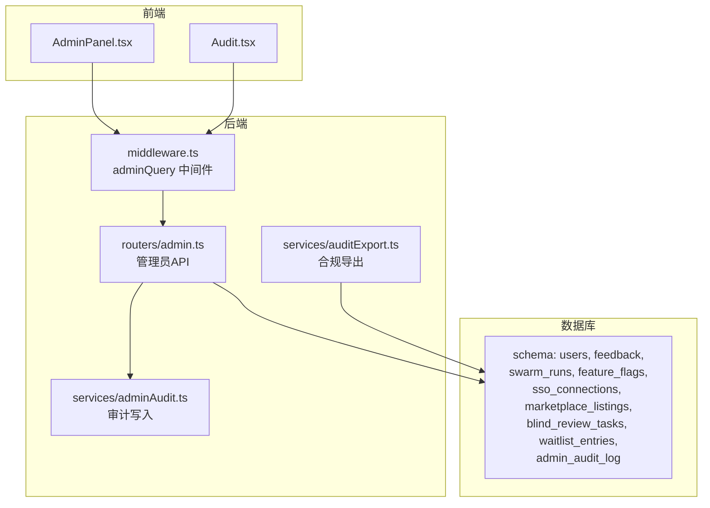
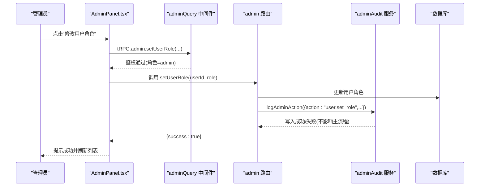
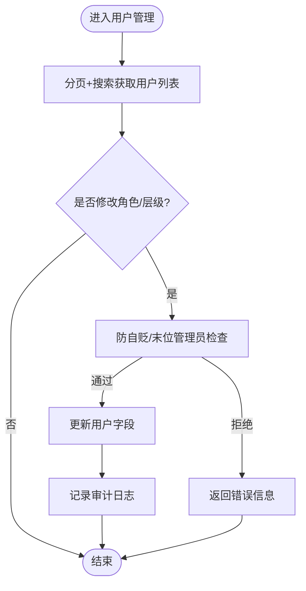
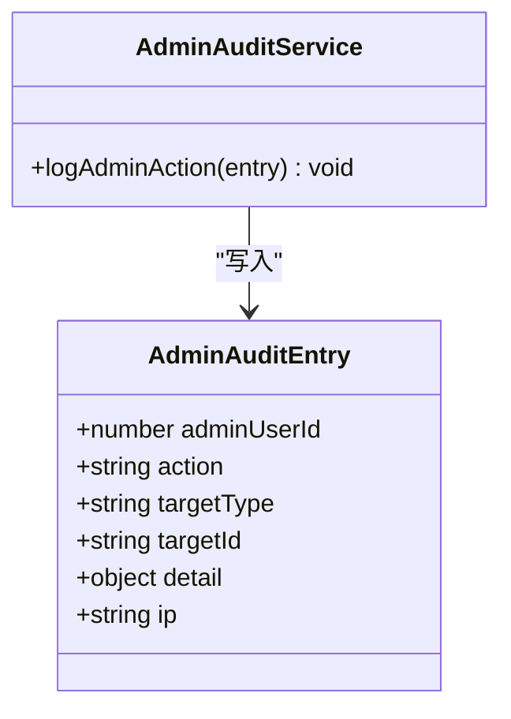
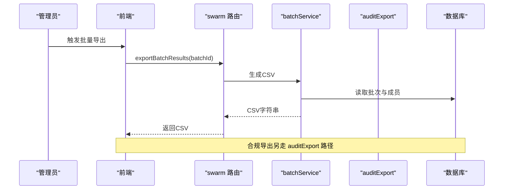
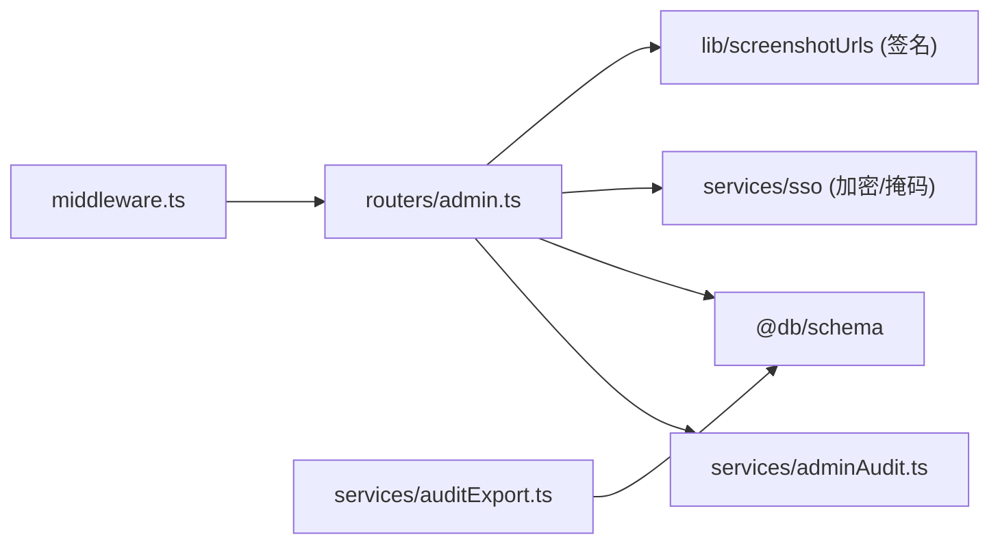

# 管理员功能

<cite>
**本文引用的文件**
- [api/routers/admin.ts](file://api/routers/admin.ts)
- [src/pages/AdminPanel.tsx](file://src/pages/AdminPanel.tsx)
- [src/pages/Audit.tsx](file://src/pages/Audit.tsx)
- [api/services/adminAudit.ts](file://api/services/adminAudit.ts)
- [api/lib/adminGuards.ts](file://api/lib/adminGuards.ts)
- [api/middleware.ts](file://api/middleware.ts)
- [db/migrations/015_admin_audit.sql](file://db/migrations/015_admin_audit.sql)
- [api/services/auditExport.ts](file://api/services/auditExport.ts)
- [api/routers/swarm.ts](file://api/routers/swarm.ts)
- [api/services/batchService.ts](file://api/services/batchService.ts)
</cite>

## 目录
1. [简介](#简介)
2. [项目结构](#项目结构)
3. [核心组件](#核心组件)
4. [架构总览](#架构总览)
5. [详细组件分析](#详细组件分析)
6. [依赖关系分析](#依赖关系分析)
7. [性能考虑](#性能考虑)
8. [故障排查指南](#故障排查指南)
9. [结论](#结论)
10. [附录](#附录)

## 简介
本文件面向系统管理员，系统化说明管理员面板的功能特性与实现机制，覆盖用户管理、系统监控、配置管理、审计日志、权限控制与安全加固、批量操作工具、数据导出与合规报告、以及系统维护任务。文档同时提供最佳实践与安全配置建议，帮助运维与平台团队安全、高效地管理生产环境。

## 项目结构
管理员能力由前端页面与后端路由共同构成：
- 前端 AdminPanel 提供多标签页的管理界面（反馈处理、用户管理、系统统计、功能开关、认证队列、审计、Beta 名单等）。
- 后端 admin 路由暴露受保护的 tRPC 接口，承载用户角色/层级变更、反馈状态更新、系统统计、功能标志切换、SSO 连接管理、认证队列重入队、等待名单管理等。
- 审计日志通过独立服务写入持久化表，并提供可导出的签名化合规账本。
- 权限控制基于中间件的角色校验，配合防自贬/末位管理员保护逻辑。

图表来源
- [src/pages/AdminPanel.tsx:203-287](file://src/pages/AdminPanel.tsx#L203-L287)
- [api/middleware.ts:17-50](file://api/middleware.ts#L17-L50)
- [api/routers/admin.ts:16-558](file://api/routers/admin.ts#L16-L558)
- [api/services/adminAudit.ts:24-40](file://api/services/adminAudit.ts#L24-L40)
- [api/services/auditExport.ts:214-485](file://api/services/auditExport.ts#L214-L485)

章节来源
- [src/pages/AdminPanel.tsx:203-287](file://src/pages/AdminPanel.tsx#L203-L287)
- [api/routers/admin.ts:16-558](file://api/routers/admin.ts#L16-L558)
- [api/middleware.ts:17-50](file://api/middleware.ts#L17-L50)

## 核心组件
- 管理员面板前端：统一入口，按标签组织功能，包含访问控制（仅 role=admin）。
- 管理员 API：封装所有敏感操作的查询与变更，全部经 adminQuery 中间件保护。
- 审计日志：记录每次管理员关键操作（谁、何时、对什么、从哪来），失败不阻断主流程。
- 合规导出：构建跨表的审计账本，支持 JSON/CSV 下载并附带 HMAC-SHA256 签名。
- 权限守卫：防止自我降级与末位管理员被降级的危险场景。
- 批量与导出：批量运行、结果导出；合规导出提供跨域审计材料。

章节来源
- [src/pages/AdminPanel.tsx:203-287](file://src/pages/AdminPanel.tsx#L203-L287)
- [api/routers/admin.ts:16-558](file://api/routers/admin.ts#L16-L558)
- [api/services/adminAudit.ts:24-40](file://api/services/adminAudit.ts#L24-L40)
- [api/services/auditExport.ts:214-485](file://api/services/auditExport.ts#L214-L485)
- [api/lib/adminGuards.ts:17-28](file://api/lib/adminGuards.ts#L17-L28)

## 架构总览
管理员请求的生命周期：
- 前端发起 tRPC 调用，经由 requireAuth + requireRole("admin") 中间件鉴权。
- 路由层执行具体业务逻辑，必要时调用审计服务记录操作。
- 数据落库后返回结果，前端刷新缓存或提示成功。

图表来源
- [api/middleware.ts:17-50](file://api/middleware.ts#L17-L50)
- [api/routers/admin.ts:57-85](file://api/routers/admin.ts#L57-L85)
- [api/services/adminAudit.ts:24-40](file://api/services/adminAudit.ts#L24-L40)

## 详细组件分析

### 用户管理
- 列出用户：支持分页、搜索（用户名/姓名/邮箱）、聚合项目数与运行次数。
- 修改角色：受防自贬/末位管理员保护，变更后记录审计日志。
- 修改层级：支持 standard/pro_designer/pro_auto，变更后记录审计日志。

图表来源
- [api/routers/admin.ts:18-98](file://api/routers/admin.ts#L18-L98)
- [api/lib/adminGuards.ts:17-28](file://api/lib/adminGuards.ts#L17-L28)

章节来源
- [api/routers/admin.ts:18-98](file://api/routers/admin.ts#L18-L98)
- [api/lib/adminGuards.ts:17-28](file://api/lib/adminGuards.ts#L17-L28)

### 系统监控
- 系统统计：用户总量、近7日活跃、按层级分布；运行总数、完成/失败、累计 token；反馈统计；项目数量；进程 uptime 与内存占用。
- 前端定时轮询刷新，便于实时观察系统健康度。

章节来源
- [api/routers/admin.ts:180-219](file://api/routers/admin.ts#L180-L219)
- [src/pages/AdminPanel.tsx:744-800](file://src/pages/AdminPanel.tsx#L744-L800)

### 配置管理（功能标志）
- 列出与切换功能标志键值，变更时记录审计日志。
- 用于灰度发布与特性开关。

章节来源
- [api/routers/admin.ts:222-239](file://api/routers/admin.ts#L222-L239)

### 审计日志系统
- 操作记录：所有管理员关键写操作均调用审计服务写入 admin_audit_log。
- 访问追踪：记录操作者、目标类型与ID、上下文详情（不含敏感内容）、IP、时间戳。
- 合规报告：支持导出全量审计账本（JSON/CSV），带 HMAC-SHA256 签名，支持验证。

图表来源
- [api/services/adminAudit.ts:13-40](file://api/services/adminAudit.ts#L13-L40)
- [db/migrations/015_admin_audit.sql:1-15](file://db/migrations/015_admin_audit.sql#L1-L15)

章节来源
- [api/services/adminAudit.ts:24-40](file://api/services/adminAudit.ts#L24-L40)
- [db/migrations/015_admin_audit.sql:1-15](file://db/migrations/015_admin_audit.sql#L1-L15)
- [api/services/auditExport.ts:214-485](file://api/services/auditExport.ts#L214-L485)

### 权限控制与安全防护
- 中间件：所有 admin 路由使用 adminQuery，强制要求已认证且角色为 admin。
- 防自贬/末位管理员：在角色降级前进行严格校验，避免锁死管理通道。
- SSO 密钥安全：写入加密存储，列表响应中掩码显示。
- 审计不可中断：审计写入失败仅记录错误，不阻断主操作。

章节来源
- [api/middleware.ts:17-50](file://api/middleware.ts#L17-L50)
- [api/lib/adminGuards.ts:17-28](file://api/lib/adminGuards.ts#L17-L28)
- [api/routers/admin.ts:273-372](file://api/routers/admin.ts#L273-L372)
- [api/services/adminAudit.ts:24-40](file://api/services/adminAudit.ts#L24-L40)

### 批量操作工具与数据导出
- 批量运行：支持创建、查询状态、取消、恢复、导出结果（CSV）。
- 合规导出：构建跨表审计账本，支持 JSON/CSV 下载，附带签名与算法元数据。

图表来源
- [api/routers/swarm.ts:615-652](file://api/routers/swarm.ts#L615-L652)
- [api/services/batchService.ts:275-285](file://api/services/batchService.ts#L275-L285)
- [api/services/auditExport.ts:214-485](file://api/services/auditExport.ts#L214-L485)

章节来源
- [api/routers/swarm.ts:615-652](file://api/routers/swarm.ts#L615-L652)
- [api/services/batchService.ts:237-285](file://api/services/batchService.ts#L237-L285)
- [api/services/auditExport.ts:214-485](file://api/services/auditExport.ts#L214-L485)

### 系统维护任务
- 认证队列管理：查看市场商品认证队列，识别卡住状态（如长时间停留在 generating），支持回退到草稿或重建盲审池。
- 等待名单管理：查看 Beta 等待名单，标记邀请发送时间。
- 反馈处理：按状态/严重性/类型筛选，更新反馈状态并分配负责人。

章节来源
- [api/routers/admin.ts:377-479](file://api/routers/admin.ts#L377-L479)
- [api/routers/admin.ts:481-556](file://api/routers/admin.ts#L481-L556)
- [api/routers/admin.ts:101-177](file://api/routers/admin.ts#L101-L177)

### 前端审计与合规导出
- 审计页面：展示运行列表、响应链、指标，支持标记问题响应。
- 合规导出卡片：管理员可见，支持下载 JSON/CSV 的签名化合规包。

章节来源
- [src/pages/Audit.tsx:322-423](file://src/pages/Audit.tsx#L322-L423)
- [src/pages/Audit.tsx:427-563](file://src/pages/Audit.tsx#L427-L563)

## 依赖关系分析
- 中间件依赖：adminQuery 组合 requireAuth 与 requireRole("admin")，确保只有管理员可访问。
- 路由依赖：admin 路由依赖数据库 schema、审计服务、SSO 加密/掩码工具、截图签名工具。
- 审计服务依赖：数据库连接、logger，失败不抛错以保证主流程稳定。
- 合规导出依赖：数据库 schema、加密模块、速率限制配置。

图表来源
- [api/middleware.ts:17-50](file://api/middleware.ts#L17-L50)
- [api/routers/admin.ts:1-15](file://api/routers/admin.ts#L1-L15)
- [api/services/adminAudit.ts:9-12](file://api/services/adminAudit.ts#L9-L12)
- [api/services/auditExport.ts:14-28](file://api/services/auditExport.ts#L14-L28)

章节来源
- [api/middleware.ts:17-50](file://api/middleware.ts#L17-L50)
- [api/routers/admin.ts:1-15](file://api/routers/admin.ts#L1-L15)
- [api/services/adminAudit.ts:9-12](file://api/services/adminAudit.ts#L9-L12)
- [api/services/auditExport.ts:14-28](file://api/services/auditExport.ts#L14-L28)

## 性能考虑
- 分页与过滤：用户列表、反馈列表、等待名单均采用分页与可选过滤，减少单次查询负载。
- 统计聚合：系统统计使用 SQL 聚合计算，避免多次往返。
- 合规导出：采用分批拉取（每批上限 1000 行），避免大表全量扫描导致超时或内存压力。
- 前端轮询：系统统计以固定间隔轮询，注意合理设置频率以避免过多请求。

章节来源
- [api/routers/admin.ts:18-55](file://api/routers/admin.ts#L18-L55)
- [api/routers/admin.ts:101-158](file://api/routers/admin.ts#L101-L158)
- [api/routers/admin.ts:481-533](file://api/routers/admin.ts#L481-L533)
- [api/services/auditExport.ts:180-192](file://api/services/auditExport.ts#L180-L192)
- [src/pages/AdminPanel.tsx:744-748](file://src/pages/AdminPanel.tsx#L744-L748)

## 故障排查指南
- 无法访问管理员面板：确认当前用户角色为 admin；检查中间件鉴权是否通过。
- 角色降级失败：检查是否尝试自我降级或末位管理员降级；参考防自贬逻辑。
- 审计日志未写入：审计写入失败不会阻断主流程，需检查日志服务与数据库连接。
- 合规导出失败：检查导出速率限制与日期范围合法性；确认签名密钥可用。
- 认证队列卡住：查看 listing 状态与最后活动时间，必要时回退至草稿或重建盲审池。

章节来源
- [api/middleware.ts:17-50](file://api/middleware.ts#L17-L50)
- [api/lib/adminGuards.ts:17-28](file://api/lib/adminGuards.ts#L17-L28)
- [api/services/adminAudit.ts:24-40](file://api/services/adminAudit.ts#L24-L40)
- [api/services/auditExport.ts:214-218](file://api/services/auditExport.ts#L214-L218)
- [api/routers/admin.ts:377-479](file://api/routers/admin.ts#L377-L479)

## 结论
管理员功能围绕“最小权限、强审计、可观测、可恢复”的原则设计：
- 权限控制严格，关键写操作均有审计记录。
- 系统监控与统计帮助快速定位异常。
- 合规导出满足审计与合规需求，具备签名与验证能力。
- 批量操作与认证队列管理提升运维效率。
建议在生产环境中启用严格的访问控制、定期审查审计日志、合理配置导出速率限制与轮询频率，并结合告警策略保障系统稳定性。

## 附录

### 管理员最佳实践与安全配置指南
- 访问控制
  - 仅授予必要人员 admin 角色；避免自我降级；确保至少两名管理员。
  - 使用中间件与前端双重校验，禁止非 admin 访问管理路由。
- 审计与合规
  - 定期检查 admin_audit_log 与合规导出包；保留历史签名以便核验。
  - 导出时遵循最小数据集原则，不导出敏感内容。
- 性能与可用性
  - 合理设置分页大小与轮询间隔；对大表导出使用分批策略。
  - 关注系统统计中的内存与运行失败率，及时扩容或优化。
- 安全加固
  - SSO 密钥加密存储与掩码显示；定期轮换密钥。
  - 对敏感操作开启额外审批或双人复核（可在上层流程扩展）。
- 维护任务
  - 定期清理或归档旧反馈与等待名单数据。
  - 监控认证队列，及时处理卡住的任务。

[本节为通用指导，不直接分析具体文件]