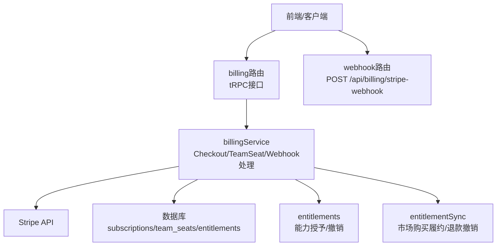
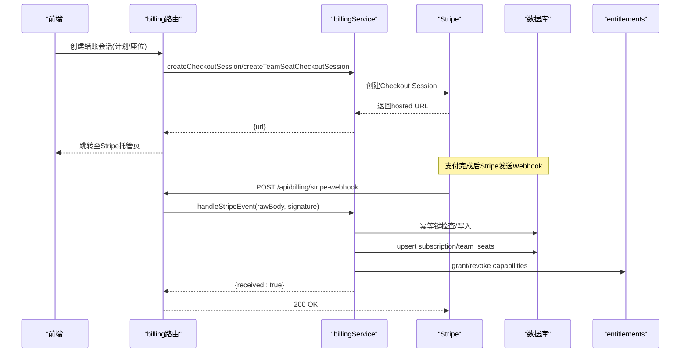
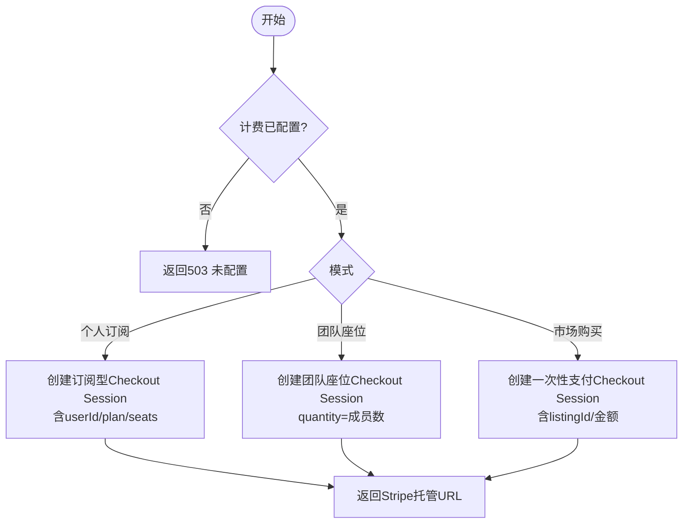
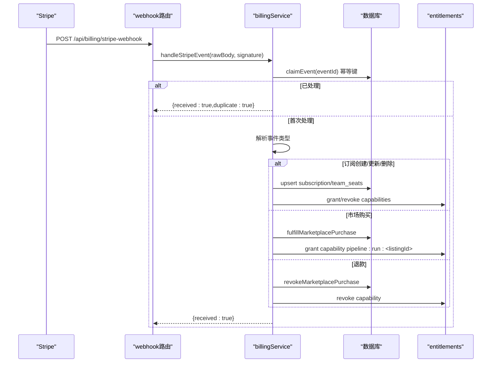
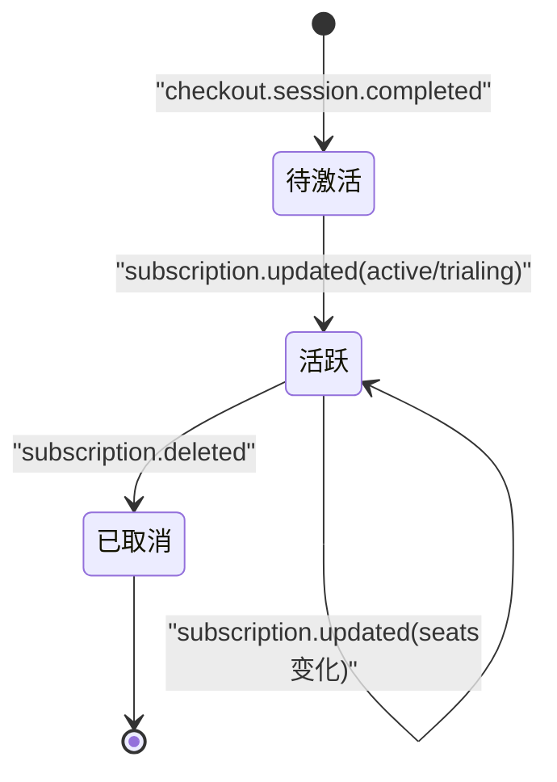
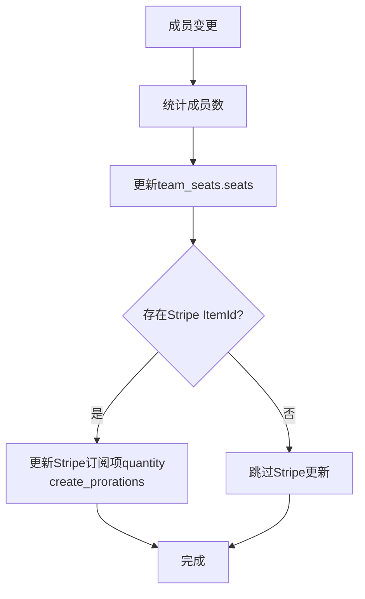
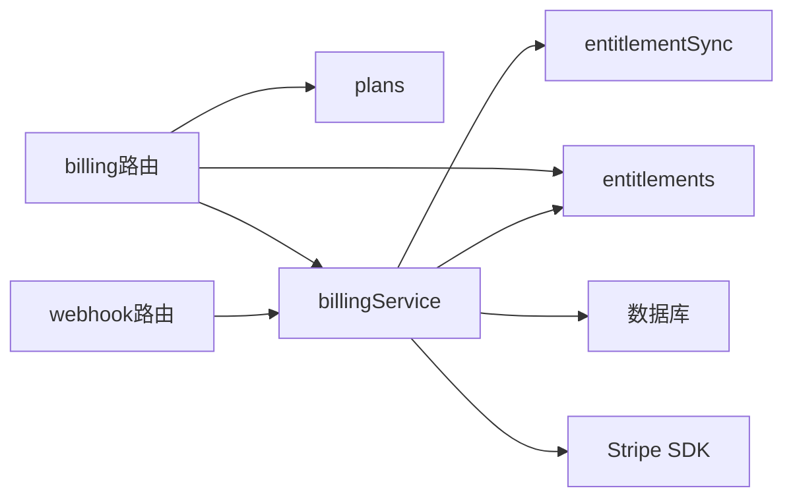

# 计费系统

<cite>
**本文引用的文件**
- [api/routers/billing.ts](file://api/routers/billing.ts)
- [api/billing-webhook-route.ts](file://api/billing-webhook-route.ts)
- [api/services/billingService.ts](file://api/services/billingService.ts)
- [api/config/plans.ts](file://api/config/plans.ts)
- [api/services/entitlements.ts](file://api/services/entitlements.ts)
- [api/services/entitlementSync.ts](file://api/services/entitlementSync.ts)
- [db/schema.ts](file://db/schema.ts)
- [api/lib/env.ts](file://api/lib/env.ts)
</cite>

## 目录
1. [简介](#简介)
2. [项目结构](#项目结构)
3. [核心组件](#核心组件)
4. [架构总览](#架构总览)
5. [详细组件分析](#详细组件分析)
6. [依赖关系分析](#依赖关系分析)
7. [性能与可靠性](#性能与可靠性)
8. [故障排查指南](#故障排查指南)
9. [结论](#结论)
10. [附录：API端点与错误处理](#附录api端点与错误处理)

## 简介
本文件面向DeeWaanAI的计费子系统，聚焦Stripe集成的实现原理与数据流，覆盖订阅管理、结账会话创建、Webhook事件处理、计划配置（solo、team_seat）、座位计费机制、权限解析、计费状态同步、订阅生命周期管理与账单生成流程。同时提供多租户环境下的计费隔离与数据安全注意事项，以及最佳实践与故障排查建议。

## 项目结构
计费相关代码主要分布在以下位置：
- 路由层：billing路由负责对外暴露tRPC接口；webhook路由接收Stripe原始HTTP回调。
- 服务层：billingService封装Stripe SDK调用、事件处理、幂等性保障、订阅与座位数量同步；entitlements与entitlementSync负责能力授予与撤销。
- 配置层：plans定义计划与能力映射；env集中读取Stripe密钥与价格ID。
- 数据层：schema定义subscriptions、team_seats、entitlements等表结构。



图表来源
- [api/routers/billing.ts:32-161](file://api/routers/billing.ts#L32-L161)
- [api/billing-webhook-route.ts:18-49](file://api/billing-webhook-route.ts#L18-L49)
- [api/services/billingService.ts:38-180](file://api/services/billingService.ts#L38-L180)
- [api/services/entitlements.ts:42-104](file://api/services/entitlements.ts#L42-L104)
- [api/services/entitlementSync.ts:32-123](file://api/services/entitlementSync.ts#L32-L123)
- [db/schema.ts:1063-1213](file://db/schema.ts#L1063-L1213)

章节来源
- [api/routers/billing.ts:32-161](file://api/routers/billing.ts#L32-L161)
- [api/billing-webhook-route.ts:18-49](file://api/billing-webhook-route.ts#L18-L49)
- [api/services/billingService.ts:38-180](file://api/services/billingService.ts#L38-L180)
- [api/config/plans.ts:19-50](file://api/config/plans.ts#L19-L50)
- [api/lib/env.ts:24-42](file://api/lib/env.ts#L24-L42)
- [db/schema.ts:1063-1213](file://db/schema.ts#L1063-L1213)

## 核心组件
- 计划配置（plans）：定义“solo”和“team_seat”两个计划，包含名称、周期、是否按座位计费、以及对应的Stripe价格ID。同时维护每个计划的能力集合，用于后续授权。
- 结账会话（checkout sessions）：支持个人订阅、团队座位订阅、市场一次性购买三种场景，均通过Stripe Checkout托管页面完成支付。
- Webhook处理：对Stripe事件进行签名校验、幂等去重、分类处理（订阅创建/更新/删除、退款），并同步本地订阅状态与能力授予。
- 能力系统（entitlements）：统一的能力判定与授予/撤销逻辑，订阅生效时根据计划能力集授予能力，取消或过期时撤销。
- 团队座位计费（team seats）：以团队为单位建立单一Stripe订阅，按成员数量设置quantity；成员增减时同步Stripe quantity并调整账单。

章节来源
- [api/config/plans.ts:19-50](file://api/config/plans.ts#L19-L50)
- [api/services/billingService.ts:38-180](file://api/services/billingService.ts#L38-L180)
- [api/services/billingService.ts:445-671](file://api/services/billingService.ts#L445-L671)
- [api/services/entitlements.ts:42-104](file://api/services/entitlements.ts#L42-L104)
- [db/schema.ts:1063-1213](file://db/schema.ts#L1063-L1213)

## 架构总览
计费系统采用“路由-服务-外部集成-数据持久化-能力系统”的分层架构：
- 路由层：tRPC接口暴露给前端；webhook路由接收Stripe回调。
- 服务层：billingService封装Stripe交互与业务逻辑；entitlements/entitlementSync负责能力与购买记录。
- 数据层：使用Drizzle ORM操作MySQL，存储订阅、座位、能力、幂等键等。
- 外部集成：Stripe用于支付、订阅、价格、退款等。



图表来源
- [api/routers/billing.ts:32-161](file://api/routers/billing.ts#L32-L161)
- [api/billing-webhook-route.ts:18-49](file://api/billing-webhook-route.ts#L18-L49)
- [api/services/billingService.ts:38-180](file://api/services/billingService.ts#L38-L180)
- [api/services/billingService.ts:445-671](file://api/services/billingService.ts#L445-L671)
- [api/services/entitlements.ts:106-154](file://api/services/entitlements.ts#L106-L154)

## 详细组件分析

### 计划配置与能力映射
- 计划类型：
  - solo：非按座位计费，适用于个人用户。
  - team_seat：按座位计费，适用于团队协作。
- 能力映射：
  - 不同计划对应不同的能力集合，订阅激活时授予相应能力，取消或过期时撤销。
- 公开计划列表：
  - 提供不含敏感信息（如priceId）的计划清单，供前端定价页展示。

章节来源
- [api/config/plans.ts:19-50](file://api/config/plans.ts#L19-L50)
- [api/services/entitlements.ts:26-30](file://api/services/entitlements.ts#L26-L30)

### 结账会话创建（订阅与一次性购买）
- 个人订阅结账：
  - 基于计划的priceId创建订阅型Checkout Session，携带userId、plan、seats元数据。
- 团队座位结账：
  - 为团队创建单一订阅，quantity等于当前成员数；metadata标记type=team_seats以便Webhook区分。
- 市场一次性购买：
  - 创建payment模式Checkout Session，携带listingId、amountCents等元数据，并在支付意图中传递元数据以便退款匹配。



图表来源
- [api/services/billingService.ts:38-180](file://api/services/billingService.ts#L38-L180)
- [api/routers/billing.ts:38-104](file://api/routers/billing.ts#L38-L104)

章节来源
- [api/services/billingService.ts:38-180](file://api/services/billingService.ts#L38-L180)
- [api/routers/billing.ts:38-104](file://api/routers/billing.ts#L38-L104)

### Webhook事件处理与幂等性
- 入口：
  - 仅接受带stripe-signature头部的POST请求，使用原始body进行签名验证。
- 幂等性：
  - 使用idempotency_keys表以事件ID为键进行去重，避免重复处理。
- 事件分类：
  - checkout.session.completed：区分市场购买、团队座位、个人订阅三类处理。
  - customer.subscription.updated：更新订阅状态、座位数量、能力授予。
  - customer.subscription.deleted：取消订阅，撤销能力。
  - charge.refunded：市场购买退款，撤销购买与能力。



图表来源
- [api/billing-webhook-route.ts:18-49](file://api/billing-webhook-route.ts#L18-L49)
- [api/services/billingService.ts:182-211](file://api/services/billingService.ts#L182-L211)
- [api/services/billingService.ts:445-671](file://api/services/billingService.ts#L445-L671)
- [api/services/entitlementSync.ts:32-123](file://api/services/entitlementSync.ts#L32-L123)
- [api/services/entitlementSync.ts:129-174](file://api/services/entitlementSync.ts#L129-L174)

章节来源
- [api/billing-webhook-route.ts:18-49](file://api/billing-webhook-route.ts#L18-L49)
- [api/services/billingService.ts:182-211](file://api/services/billingService.ts#L182-L211)
- [api/services/billingService.ts:445-671](file://api/services/billingService.ts#L445-L671)

### 订阅生命周期管理
- 创建：
  - checkout.session.completed触发upsert订阅，状态设为active，并授予计划能力。
- 更新：
  - subscription.updated更新currentPeriodEnd、seats、status，并根据active状态grant或revoke能力。
- 删除：
  - subscription.deleted将状态置为canceled，撤销能力；团队座位则删除team_seats行并撤销team:sync能力。



图表来源
- [api/services/billingService.ts:523-543](file://api/services/billingService.ts#L523-L543)
- [api/services/billingService.ts:546-597](file://api/services/billingService.ts#L546-L597)
- [api/services/billingService.ts:600-647](file://api/services/billingService.ts#L600-L647)

章节来源
- [api/services/billingService.ts:523-543](file://api/services/billingService.ts#L523-L543)
- [api/services/billingService.ts:546-597](file://api/services/billingService.ts#L546-L597)
- [api/services/billingService.ts:600-647](file://api/services/billingService.ts#L600-L647)

### 座位计费机制（团队）
- 初始创建：
  - 团队结账时，quantity设置为当前成员数；metadata标记type=team_seats。
- 成员变更：
  - 每次成员加入/离开后，调用syncTeamSeatQuantity计算最新成员数，更新本地team_seats.seats，并尝试更新Stripe订阅项quantity（proration）。
- 订阅更新：
  - subscription.updated事件中若检测到quantity变化，同步本地seats；同时根据订阅状态授予/撤销team:sync能力给团队所有者。
- 订阅取消：
  - subscription.deleted删除team_seats行，并撤销team:sync能力。



图表来源
- [api/services/billingService.ts:370-412](file://api/services/billingService.ts#L370-L412)
- [api/services/billingService.ts:546-577](file://api/services/billingService.ts#L546-L577)
- [api/services/billingService.ts:600-628](file://api/services/billingService.ts#L600-L628)

章节来源
- [api/services/billingService.ts:370-412](file://api/services/billingService.ts#L370-L412)
- [api/services/billingService.ts:546-577](file://api/services/billingService.ts#L546-L577)
- [api/services/billingService.ts:600-628](file://api/services/billingService.ts#L600-L628)

### 权限解析与能力授予
- 能力来源优先级：
  1) 显式entitlements行（未过期）
  2) 活跃/试用中的订阅 → 计划能力集
  3) 用户tier能力
  4) 未过期的券兑换能力
- 授予与撤销：
  - 订阅激活时，按计划能力集grant能力；取消或过期时revoke。
  - 市场购买成功后grant“pipeline:run:<listingId>”能力；退款时revoke。
  - 团队座位订阅激活时grant“team:sync”能力给团队所有者；取消时revoke。

```mermaid
classDiagram
class Entitlements {
+can(userId, capability) bool
+grant(subjectType, subjectId, capability, source, sourceRef, expiresAt) void
+revoke(subjectType, subjectId, capability, source, sourceRef) number
+resolveCapabilities(userId) {capabilities[], tier}
}
class BillingService {
+handleStripeEvent(rawBody, signature) Promise
+syncSubscriptionEntitlements(opts) void
}
class Plans {
+PLAN_CAPABILITIES
}
BillingService --> Entitlements : "授予/撤销能力"
BillingService --> Plans : "读取计划能力集"
```

图表来源
- [api/services/entitlements.ts:42-104](file://api/services/entitlements.ts#L42-L104)
- [api/services/entitlements.ts:106-154](file://api/services/entitlements.ts#L106-L154)
- [api/services/entitlements.ts:165-207](file://api/services/entitlements.ts#L165-L207)
- [api/config/plans.ts:37-40](file://api/config/plans.ts#L37-L40)
- [api/services/billingService.ts:220-252](file://api/services/billingService.ts#L220-L252)

章节来源
- [api/services/entitlements.ts:42-104](file://api/services/entitlements.ts#L42-L104)
- [api/services/entitlements.ts:106-154](file://api/services/entitlements.ts#L106-L154)
- [api/services/entitlements.ts:165-207](file://api/services/entitlements.ts#L165-L207)
- [api/config/plans.ts:37-40](file://api/config/plans.ts#L37-L40)
- [api/services/billingService.ts:220-252](file://api/services/billingService.ts#L220-L252)

### 数据模型与多租户隔离
- 关键表：
  - subscriptions：记录用户或团队的订阅信息（plan、status、seats、currentPeriodEnd、Stripe关联ID）。
  - team_seats：记录团队的座位计费状态（seats、Stripe订阅及订单项ID）。
  - entitlements：记录主体（用户/团队）的能力授予来源与有效期。
  - idempotency_keys：保证Webhook处理的幂等性。
- 多租户隔离：
  - 团队订阅通过team_seats与teams.id关联，确保各团队计费独立。
  - 能力授予可作用于user或team主体，支持团队级能力（如team:collaborate、team:sync）。

章节来源
- [db/schema.ts:1063-1213](file://db/schema.ts#L1063-L1213)
- [api/services/entitlements.ts:42-104](file://api/services/entitlements.ts#L42-L104)

## 依赖关系分析
- billing路由依赖：
  - plans（计划配置）、billingService（结账与会话）、entitlements（能力查询）。
- billingService依赖：
  - Stripe SDK、数据库连接、plans（计划能力）、entitlements/entitlementSync（能力与购买履约）。
- webhook路由依赖：
  - billingService（事件处理）、env（签名密钥）。
- 数据层依赖：
  - Drizzle ORM与MySQL，索引优化常见查询路径（用户/团队/能力）。



图表来源
- [api/routers/billing.ts:32-161](file://api/routers/billing.ts#L32-L161)
- [api/billing-webhook-route.ts:18-49](file://api/billing-webhook-route.ts#L18-L49)
- [api/services/billingService.ts:38-180](file://api/services/billingService.ts#L38-L180)
- [api/services/billingService.ts:445-671](file://api/services/billingService.ts#L445-L671)

章节来源
- [api/routers/billing.ts:32-161](file://api/routers/billing.ts#L32-L161)
- [api/billing-webhook-route.ts:18-49](file://api/billing-webhook-route.ts#L18-L49)
- [api/services/billingService.ts:38-180](file://api/services/billingService.ts#L38-L180)
- [api/services/billingService.ts:445-671](file://api/services/billingService.ts#L445-L671)

## 性能与可靠性
- 幂等性：
  - 使用idempotency_keys防止重复处理Stripe事件，避免重复授予能力或写入重复记录。
- 健壮性：
  - 当Stripe未配置时，路由返回503，前端可降级提示。
  - 团队座位数量同步失败不影响成员变更操作，仅记录警告日志。
- 可扩展性：
  - 新增计划只需在plans中添加配置与能力集，无需修改核心逻辑。
- 监控与日志：
  - 关键路径均有日志输出（创建会话、事件处理、能力授予/撤销、Stripe同步失败等）。

[本节为通用指导，不直接分析具体文件]

## 故障排查指南
- Webhook签名失败：
  - 检查STRIPE_WEBHOOK_SECRET是否正确配置；确认请求头stripe-signature存在且有效。
- 重复处理：
  - 查看idempotency_keys表是否存在相同key；确认claimEvent逻辑正常。
- 订阅未激活：
  - 检查checkout.session.completed事件是否到达；确认metadata.userId与stripeSubscriptionId正确。
- 团队座位数量不一致：
  - 检查member增删后是否调用syncTeamSeatQuantity；查看Stripe订阅项quantity是否成功更新。
- 能力未生效：
  - 检查entitlements表中是否有对应能力的grant记录；确认订阅状态为active/trialing。
- 退款后权限未撤销：
  - 检查charge.refunded事件是否处理；确认revokeMarketplacePurchase执行成功。

章节来源
- [api/billing-webhook-route.ts:18-49](file://api/billing-webhook-route.ts#L18-L49)
- [api/services/billingService.ts:182-211](file://api/services/billingService.ts#L182-L211)
- [api/services/billingService.ts:445-671](file://api/services/billingService.ts#L445-L671)
- [api/services/entitlementSync.ts:129-174](file://api/services/entitlementSync.ts#L129-L174)

## 结论
DeeWaanAI计费系统通过清晰的层次划分与稳健的事件处理机制，实现了个人订阅、团队座位计费与市场一次性购买的完整闭环。借助幂等性与能力系统，系统在多租户环境下保证了计费隔离与数据安全。建议在生产环境中严格配置Stripe密钥与价格ID，完善监控告警，并定期审计订阅与能力一致性。

[本节为总结性内容，不直接分析具体文件]

## 附录：API端点与错误处理
- tRPC接口（billing路由）：
  - listPlans：获取公开计划列表与计费开关状态。
  - createCheckout：创建个人订阅结账会话，返回Stripe托管URL。
  - createTeamCheckout：创建团队座位结账会话，仅团队所有者可调用。
  - teamSeatStatus：查询团队座位计费状态（成员可见）。
  - mySubscription：查询当前用户的活跃订阅与能力。
  - myCapabilities：解析当前用户的能力集合与tier。
- Webhook端点：
  - POST /api/billing/stripe-webhook：接收Stripe事件，进行签名校验与处理。
- 错误处理策略：
  - 计费未配置：返回503。
  - 签名无效：返回400。
  - 内部处理失败：记录日志并返回500，避免泄露内部细节。
  - 权限不足：返回FORBIDDEN或NOT_FOUND。

章节来源
- [api/routers/billing.ts:32-161](file://api/routers/billing.ts#L32-L161)
- [api/billing-webhook-route.ts:18-49](file://api/billing-webhook-route.ts#L18-L49)