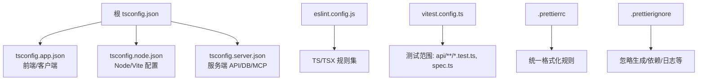
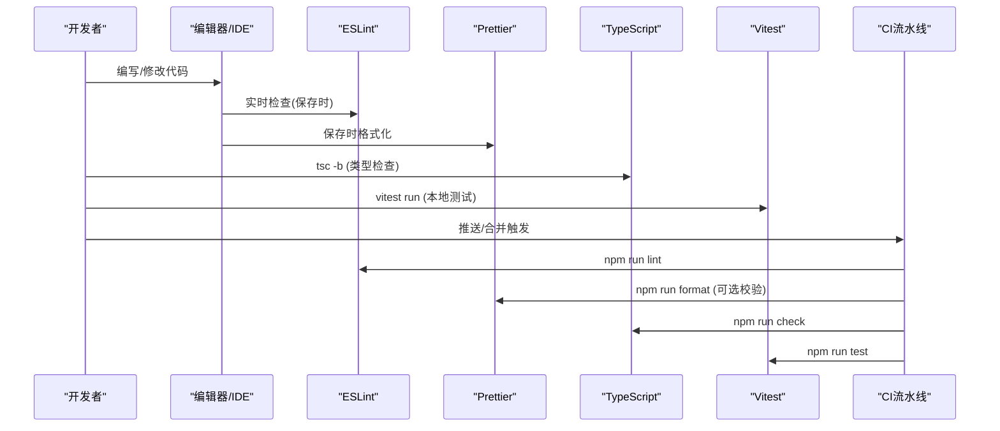
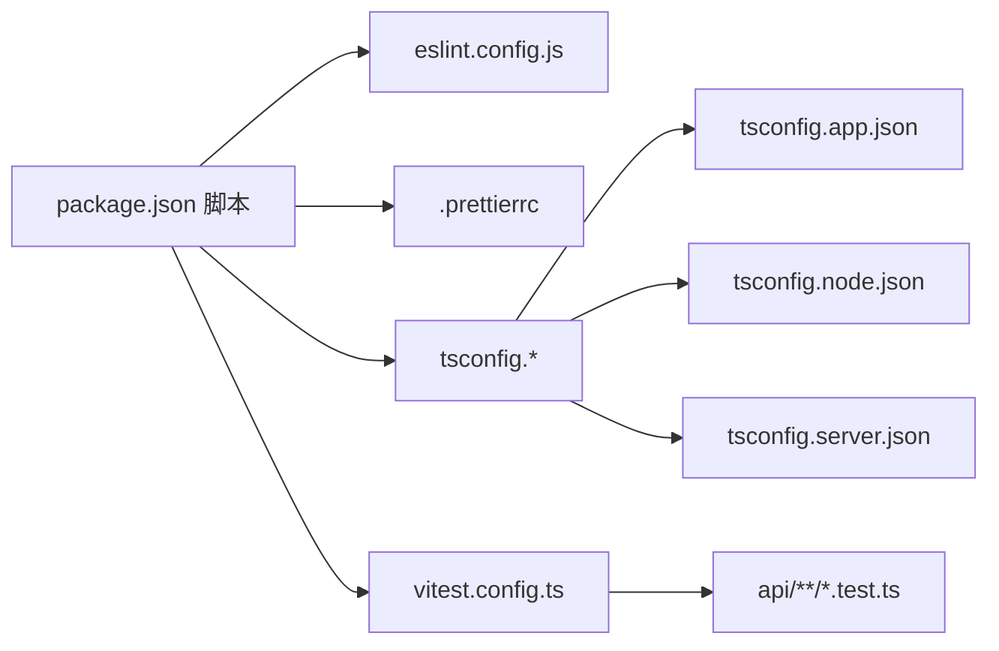

# 代码质量工具

<cite>
**本文引用的文件**
- [eslint.config.js](file://eslint.config.js)
- [.prettierrc](file://.prettierrc)
- [.prettierignore](file://.prettierignore)
- [tsconfig.json](file://tsconfig.json)
- [tsconfig.app.json](file://tsconfig.app.json)
- [tsconfig.node.json](file://tsconfig.node.json)
- [tsconfig.server.json](file://tsconfig.server.json)
- [vitest.config.ts](file://vitest.config.ts)
- [package.json](file://package.json)
- [api/lib/adminGuards.test.ts](file://api/lib/adminGuards.test.ts)
</cite>

## 目录
1. [简介](#简介)
2. [项目结构](#项目结构)
3. [核心组件](#核心组件)
4. [架构总览](#架构总览)
5. [详细组件分析](#详细组件分析)
6. [依赖关系分析](#依赖关系分析)
7. [性能与可维护性建议](#性能与可维护性建议)
8. [故障排查指南](#故障排查指南)
9. [结论](#结论)
10. [附录](#附录)

## 简介
本指南面向DeeWaanAI项目的开发者，系统化说明项目中代码质量工具的用法与最佳实践，涵盖：
- ESLint配置与规则（代码风格检查、潜在错误检测、最佳实践验证）
- Prettier格式化配置（格式标准、自动格式化、编辑器集成）
- TypeScript配置（编译选项、类型检查、路径映射）
- 测试框架使用（Vitest配置、用例编写、覆盖率报告）
- IDE集成（在编码过程中实时获得代码质量反馈）

目标是帮助团队统一代码风格、提前发现缺陷、提升可维护性与交付质量。

## 项目结构
本项目采用多包式TypeScript工程组织，通过根级tsconfig引用多个子配置，分别覆盖前端应用、Node端构建脚本与服务器端代码。ESLint基于Flat Config，Prettier提供统一格式化，Vitest负责单元测试。

图表来源
- [tsconfig.json:1-29](file://tsconfig.json#L1-L29)
- [tsconfig.app.json:1-46](file://tsconfig.app.json#L1-L46)
- [tsconfig.node.json:1-27](file://tsconfig.node.json#L1-L27)
- [tsconfig.server.json:1-28](file://tsconfig.server.json#L1-L28)
- [eslint.config.js:1-24](file://eslint.config.js#L1-L24)
- [vitest.config.ts:1-21](file://vitest.config.ts#L1-L21)
- [.prettierrc:1-16](file://.prettierrc#L1-L16)
- [.prettierignore:1-36](file://.prettierignore#L1-L36)

章节来源
- [tsconfig.json:1-29](file://tsconfig.json#L1-L29)
- [package.json:7-21](file://package.json#L7-L21)

## 核心组件
- ESLint：启用JS推荐规则、TypeScript规则、React Hooks与React Refresh规则，针对TS/TSX进行严格检查。
- Prettier：统一代码风格（分号、引号、行宽、缩进、箭头函数括号等），并提供忽略列表避免格式化无关文件。
- TypeScript：三套tsconfig分别服务前端、Node脚本与服务端，开启严格模式与模块解析优化，并配置路径别名。
- Vitest：以Node环境运行API层测试，支持别名解析，按约定包含测试文件。
- 脚本命令：lint、format、check、test等一键执行。

章节来源
- [eslint.config.js:1-24](file://eslint.config.js#L1-L24)
- [.prettierrc:1-16](file://.prettierrc#L1-L16)
- [.prettierignore:1-36](file://.prettierignore#L1-L36)
- [tsconfig.json:1-29](file://tsconfig.json#L1-L29)
- [tsconfig.app.json:1-46](file://tsconfig.app.json#L1-L46)
- [tsconfig.node.json:1-27](file://tsconfig.node.json#L1-L27)
- [tsconfig.server.json:1-28](file://tsconfig.server.json#L1-L28)
- [vitest.config.ts:1-21](file://vitest.config.ts#L1-L21)
- [package.json:7-21](file://package.json#L7-L21)

## 架构总览
下图展示了开发工作流中各工具的协作关系：编辑时由IDE触发ESLint与Prettier；提交前或CI中执行lint、format、tsc与vitest。

图表来源
- [package.json:7-21](file://package.json#L7-L21)
- [eslint.config.js:1-24](file://eslint.config.js#L1-L24)
- [.prettierrc:1-16](file://.prettierrc#L1-L16)
- [vitest.config.ts:1-21](file://vitest.config.ts#L1-L21)

## 详细组件分析

### ESLint 配置与规则
- 目标语言：TS/TSX
- 继承规则集：
  - JS推荐规则
  - TypeScript推荐规则
  - React Hooks推荐规则
  - React Refresh（Vite）规则
- 语言选项：ECMAScript 2020，浏览器全局变量
- 忽略输出目录：dist

使用方式
- 执行：npm run lint
- 建议在编辑器中启用ESLint插件，保存时自动检查并提示问题。

建议与实践
- 保持React Hooks规则启用，避免常见Hook误用。
- 结合TypeScript严格模式，尽早发现类型相关隐患。
- 如需自定义规则，可在当前配置基础上扩展。

章节来源
- [eslint.config.js:1-24](file://eslint.config.js#L1-L24)
- [package.json:7-21](file://package.json#L7-L21)

### Prettier 格式化配置
- 分号：启用
- 尾逗号：es5
- 引号：双引号（JS/TS/JSON），JSX也使用双引号
- 打印宽度：80
- 缩进：2空格，不使用Tab
- 括号间距：启用
- 箭头函数括号：避免
- 行结束符：LF
- JSX单引号：关闭（即使用双引号）
- 段落换行：preserve

忽略文件
- 依赖、构建产物、生成文件、数据库文件、日志、环境变量、IDE配置、系统临时文件等

使用方式
- 全量格式化：npm run format
- 建议在编辑器中启用“保存时格式化”，并与ESLint共存（优先格式化后检查）。

章节来源
- [.prettierrc:1-16](file://.prettierrc#L1-L16)
- [.prettierignore:1-36](file://.prettierignore#L1-L36)
- [package.json:7-21](file://package.json#L7-L21)

### TypeScript 配置
根配置通过references聚合三个子配置：
- tsconfig.app.json：前端/客户端
  - 目标：ES2022，库：ES2022 + DOM + DOM.Iterable
  - 模块：ESNext，模块解析：bundler
  - 类型：vite/client, node
  - 严格模式：true，未使用局部变量/参数检查，禁止switch穿透，强制无副作用导入等
  - JSX：react-jsx
  - 路径别名：@/* -> src, @contracts/* -> contracts, @db/* -> db
- tsconfig.node.json：Node/Vite配置
  - 目标：ES2023，仅ES2023库
  - 严格模式与模块解析同app
  - 包含：vite.config.ts
- tsconfig.server.json：服务端
  - 目标：ES2022，库：ES2022
  - 类型根：node_modules/@types, types, contracts
  - 模块解析：bundler，启用esModuleInterop与resolveJsonModule
  - 路径别名：同app
  - 包含：api, types, contracts, db；排除src与部分子目录

使用方式
- 类型检查：npm run check（tsc -b）
- 路径别名：在IDE与构建工具中均生效，便于跨模块引用。

章节来源
- [tsconfig.json:1-29](file://tsconfig.json#L1-L29)
- [tsconfig.app.json:1-46](file://tsconfig.app.json#L1-L46)
- [tsconfig.node.json:1-27](file://tsconfig.node.json#L1-L27)
- [tsconfig.server.json:1-28](file://tsconfig.server.json#L1-L28)
- [package.json:7-21](file://package.json#L7-L21)

### 测试框架（Vitest）
- 运行环境：node
- 测试包含：api/**/*.test.ts 与 api/**/*.spec.ts
- 别名解析：@, @contracts, @assets, @db
- 示例用例：参考 adminGuards.test.ts，使用describe/it/expect断言行为

使用方式
- 运行测试：npm run test
- 编写新测试：遵循命名约定与目录结构，确保被vitest包含。

覆盖率报告
- 可通过添加coverage配置或使用CLI参数生成覆盖率（例如 --coverage），具体参数请参考Vitest文档并在vitest.config.ts中按需配置。

章节来源
- [vitest.config.ts:1-21](file://vitest.config.ts#L1-L21)
- [api/lib/adminGuards.test.ts:1-35](file://api/lib/adminGuards.test.ts#L1-L35)
- [package.json:7-21](file://package.json#L7-L21)

### 编辑器与IDE集成
- VS Code
  - 安装ESLint与Prettier扩展
  - 设置保存时格式化，并让Prettier优先于ESLint修复
  - 启用TypeScript类型检查（tsc -b）
  - 将ESLint与Prettier的忽略规则与项目保持一致
- WebStorm / JetBrains
  - 启用ESLint与Prettier插件，配置保存时格式化
  - 关联项目中的配置文件路径
- 通用建议
  - 统一使用LF行结束符
  - 统一缩进为2空格
  - 在CI中重复执行lint/format/check/test，保证一致性

[本节为概念性指导，不直接分析具体文件]

## 依赖关系分析

图表来源
- [package.json:7-21](file://package.json#L7-L21)
- [eslint.config.js:1-24](file://eslint.config.js#L1-L24)
- [.prettierrc:1-16](file://.prettierrc#L1-L16)
- [tsconfig.json:1-29](file://tsconfig.json#L1-L29)
- [vitest.config.ts:1-21](file://vitest.config.ts#L1-L21)

章节来源
- [package.json:7-21](file://package.json#L7-L21)

## 性能与可维护性建议
- 增量检查：利用tsc -b与ESLint缓存，缩短本地反馈时间
- 统一格式化：提交前运行format，减少diff噪音
- 严格模式：保持TS严格模式与ESLint推荐规则，尽早发现问题
- 测试覆盖：为核心逻辑补充测试，逐步提升覆盖率
- 忽略策略：合理使用.prettierignore与ESLint ignore，避免对无关文件进行检查

[本节提供通用建议，不直接分析具体文件]

## 故障排查指南
常见问题与处理
- 格式化冲突
  - 现象：ESLint与Prettier报不一致
  - 处理：确保保存时先格式化再检查；必要时在编辑器中调整插件优先级
- 类型检查失败
  - 现象：tsc -b报错
  - 处理：根据错误定位到对应tsconfig包含范围，确认路径别名与模块解析是否正确
- 测试无法解析别名
  - 现象：import @/xxx 报错
  - 处理：确认vitest.config.ts中alias配置与tsconfig一致
- 忽略文件未生效
  - 现象：仍对某些文件格式化或检查
  - 处理：检查.prettierignore与ESLint忽略配置是否匹配

章节来源
- [.prettierrc:1-16](file://.prettierrc#L1-L16)
- [.prettierignore:1-36](file://.prettierignore#L1-L36)
- [vitest.config.ts:1-21](file://vitest.config.ts#L1-L21)
- [tsconfig.json:1-29](file://tsconfig.json#L1-L29)

## 结论
通过ESLint、Prettier、TypeScript与Vitest的组合，DeeWaanAI建立了从编码到测试的完整质量闭环。配合IDE集成与CI流程，可有效降低缺陷率、统一代码风格、提升团队协作效率。建议持续完善规则与测试覆盖，并根据业务演进灵活调整配置。

[本节为总结性内容，不直接分析具体文件]

## 附录
常用命令速查
- 代码检查：npm run lint
- 代码格式化：npm run format
- 类型检查：npm run check
- 运行测试：npm run test

章节来源
- [package.json:7-21](file://package.json#L7-L21)