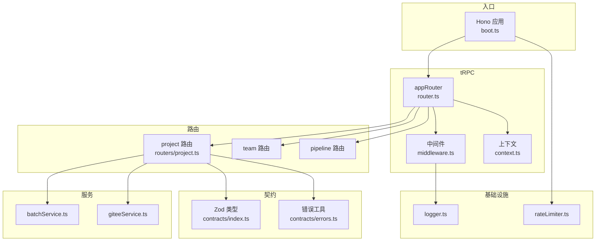
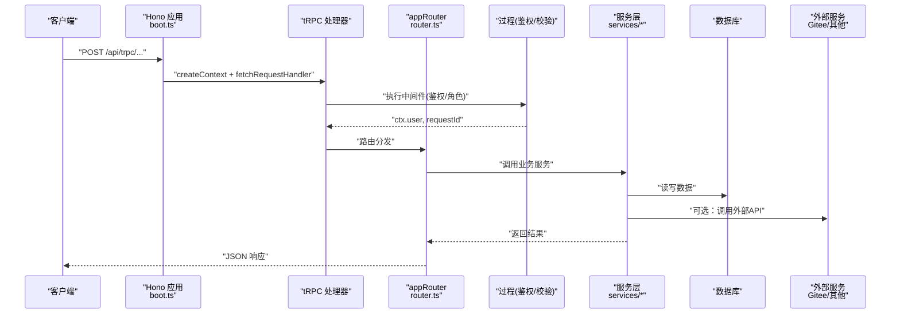
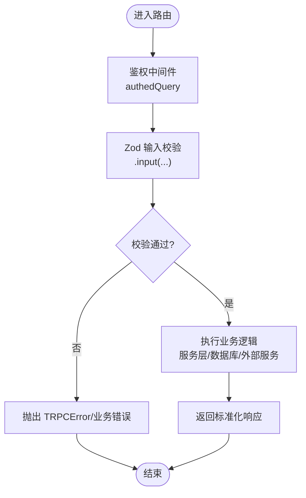
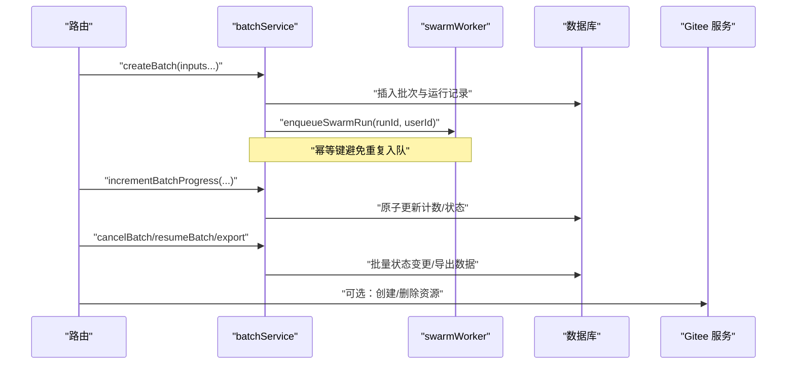
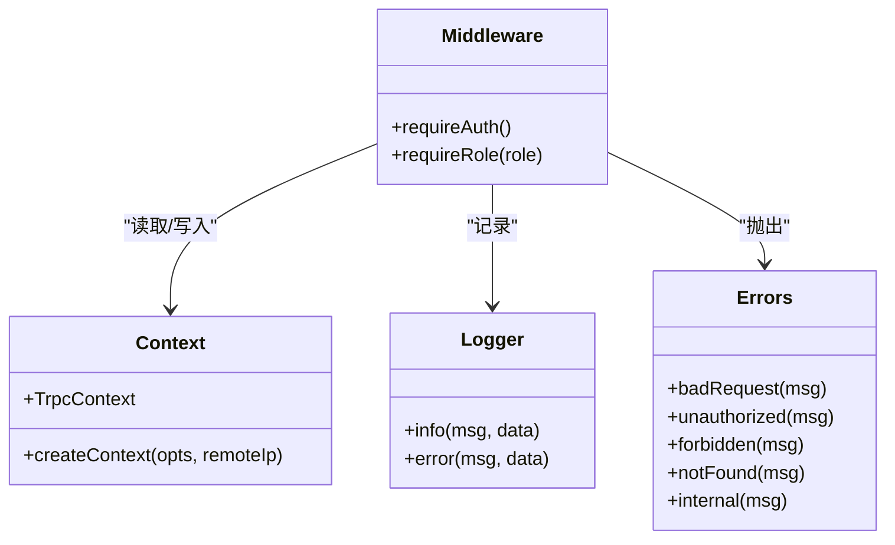
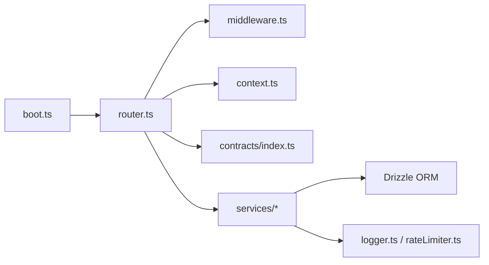

# API扩展

<cite>
**本文引用的文件**
- [api/router.ts](file://api/router.ts)
- [api/middleware.ts](file://api/middleware.ts)
- [api/context.ts](file://api/context.ts)
- [api/routers/project.ts](file://api/routers/project.ts)
- [api/services/batchService.ts](file://api/services/batchService.ts)
- [api/lib/logger.ts](file://api/lib/logger.ts)
- [api/lib/rateLimiter.ts](file://api/lib/rateLimiter.ts)
- [contracts/index.ts](file://contracts/index.ts)
- [contracts/errors.ts](file://contracts/errors.ts)
- [api/boot.ts](file://api/boot.ts)
</cite>

## 目录
1. [简介](#简介)
2. [项目结构](#项目结构)
3. [核心组件](#核心组件)
4. [架构总览](#架构总览)
5. [详细组件分析](#详细组件分析)
6. [依赖分析](#依赖分析)
7. [性能考虑](#性能考虑)
8. [故障排查指南](#故障排查指南)
9. [结论](#结论)
10. [附录](#附录)

## 简介
本指南面向需要在 DeeWaanAI 后端进行 API 扩展的开发者，聚焦以下目标：
- tRPC 路由扩展方法：新增端点、参数校验与响应格式定义
- 服务层扩展：业务逻辑封装、数据库操作与外部服务集成
- 中间件开发：认证、日志记录与错误处理模式
- API 设计最佳实践：版本管理、向后兼容性与文档生成
- 扩展示例与测试方法：确保 API 质量与可维护性

本项目采用 tRPC + Hono 的组合，通过统一上下文与中间件实现鉴权、限流与可观测性；使用 Zod 进行输入校验；以 Drizzle ORM 访问数据库；通过服务层封装复杂业务并与外部系统（如 Gitee）集成。

## 项目结构
API 层按“路由-服务-基础设施”分层组织：
- 路由层：按领域拆分 router（如 project、team、pipeline），在根路由器中聚合
- 服务层：封装跨路由复用的业务逻辑（如批量任务、计费、同步等）
- 中间件/上下文：统一鉴权、角色校验、请求上下文构建
- 契约与类型：Zod schema 集中管理输入输出类型
- 基础设施：日志、限流、Redis、队列等

图表来源
- [api/boot.ts:361-372](file://api/boot.ts#L361-L372)
- [api/router.ts:39-70](file://api/router.ts#L39-L70)
- [api/middleware.ts:10-50](file://api/middleware.ts#L10-L50)
- [api/context.ts:20-54](file://api/context.ts#L20-L54)
- [api/routers/project.ts:11-405](file://api/routers/project.ts#L11-L405)
- [api/services/batchService.ts:45-105](file://api/services/batchService.ts#L45-L105)
- [contracts/index.ts:44-71](file://contracts/index.ts#L44-L71)
- [contracts/errors.ts:7-13](file://contracts/errors.ts#L7-L13)
- [api/lib/logger.ts:26-31](file://api/lib/logger.ts#L26-L31)
- [api/lib/rateLimiter.ts:31-93](file://api/lib/rateLimiter.ts#L31-L93)

章节来源
- [api/router.ts:39-70](file://api/router.ts#L39-L70)
- [api/boot.ts:361-372](file://api/boot.ts#L361-L372)

## 核心组件
- tRPC 根路由器：聚合各子路由，暴露统一的 /api/trpc 入口
- 中间件：提供鉴权与角色控制，统一错误码与消息
- 上下文：解析请求头、注入用户信息、生成请求ID
- 契约：集中定义输入/输出 Schema，保证前后端类型一致
- 服务层：封装复杂流程（批处理、外部集成）、原子事务、重试与降级
- 基础设施：结构化日志、令牌桶/固定窗口限流

章节来源
- [api/middleware.ts:17-50](file://api/middleware.ts#L17-L50)
- [api/context.ts:9-54](file://api/context.ts#L9-L54)
- [contracts/index.ts:44-71](file://contracts/index.ts#L44-L71)
- [api/services/batchService.ts:45-105](file://api/services/batchService.ts#L45-L105)
- [api/lib/logger.ts:26-31](file://api/lib/logger.ts#L26-L31)
- [api/lib/rateLimiter.ts:31-93](file://api/lib/rateLimiter.ts#L31-L93)

## 架构总览
下图展示了从 HTTP 请求到 tRPC 处理器、再到具体路由与服务层的调用链，以及鉴权、限流与日志的横切关注点。

图表来源
- [api/boot.ts:361-372](file://api/boot.ts#L361-L372)
- [api/router.ts:39-70](file://api/router.ts#L39-L70)
- [api/middleware.ts:17-50](file://api/middleware.ts#L17-L50)
- [api/routers/project.ts:11-405](file://api/routers/project.ts#L11-L405)
- [api/services/batchService.ts:45-105](file://api/services/batchService.ts#L45-L105)

## 详细组件分析

### tRPC 路由扩展方法
- 新增端点
  - 在对应领域路由文件中定义 query/mutation，并通过 createRouter 注册
  - 使用 authedQuery/adminQuery 自动附加鉴权/角色校验
  - 示例参考：项目列表、获取、创建、更新、删除、流水线配置
- 参数验证
  - 使用 Zod Schema 集中定义输入模型，并在路由中通过 .input() 绑定
  - 示例参考：CreateProjectSchema、UpdateProjectSchema
- 响应格式定义
  - 建议将响应结构也抽象为类型或 Schema，便于前端消费与测试断言
  - 对于复杂对象（如流水线步骤、提供者列表）应明确字段含义与约束

图表来源
- [api/middleware.ts:17-50](file://api/middleware.ts#L17-L50)
- [api/routers/project.ts:11-405](file://api/routers/project.ts#L11-L405)
- [contracts/index.ts:44-71](file://contracts/index.ts#L44-L71)

章节来源
- [api/routers/project.ts:11-405](file://api/routers/project.ts#L11-L405)
- [contracts/index.ts:44-71](file://contracts/index.ts#L44-L71)

### 服务层扩展（业务逻辑封装、数据库操作、外部服务集成）
- 批处理服务
  - 创建批次并插入成员运行，入队工作项
  - 原子更新批次进度，支持取消、恢复、导出 CSV
  - 与 worker 协作完成异步执行
- 数据库操作
  - 使用 Drizzle ORM 进行查询与事务
  - 对关键写路径使用事务保证一致性
- 外部服务集成
  - 与 Gitee 集成：验证 token、创建仓库/文件夹、上传文件、删除目录
  - 失败时记录日志并降级，不影响主流程

图表来源
- [api/services/batchService.ts:45-105](file://api/services/batchService.ts#L45-L105)
- [api/services/batchService.ts:107-142](file://api/services/batchService.ts#L107-L142)
- [api/services/batchService.ts:201-273](file://api/services/batchService.ts#L201-L273)
- [api/services/batchService.ts:275-321](file://api/services/batchService.ts#L275-L321)
- [api/routers/project.ts:103-250](file://api/routers/project.ts#L103-L250)

章节来源
- [api/services/batchService.ts:45-105](file://api/services/batchService.ts#L45-L105)
- [api/routers/project.ts:103-250](file://api/routers/project.ts#L103-L250)

### 中间件开发（认证、日志、错误处理）
- 认证中间件
  - requireAuth：检查 ctx.user 是否存在，否则抛出 UNAUTHORIZED
  - requireRole：基于角色进行授权，不匹配则抛出 FORBIDDEN
- 上下文构建
  - createContext：解析本地认证头、加载用户、生成 requestId
- 日志与错误
  - logger：结构化 JSON 日志，支持级别过滤
  - errors：统一错误构造器，便于上层统一处理

图表来源
- [api/middleware.ts:17-50](file://api/middleware.ts#L17-L50)
- [api/context.ts:20-54](file://api/context.ts#L20-L54)
- [api/lib/logger.ts:26-31](file://api/lib/logger.ts#L26-L31)
- [contracts/errors.ts:7-13](file://contracts/errors.ts#L7-L13)

章节来源
- [api/middleware.ts:17-50](file://api/middleware.ts#L17-L50)
- [api/context.ts:20-54](file://api/context.ts#L20-L54)
- [api/lib/logger.ts:26-31](file://api/lib/logger.ts#L26-L31)
- [contracts/errors.ts:7-13](file://contracts/errors.ts#L7-L13)

### API 设计最佳实践
- 版本管理
  - 建议在路由命名或请求头中体现版本（如 v1/v2），逐步迁移旧接口
  - 保持新字段可选，避免破坏现有客户端
- 向后兼容性
  - 新增字段默认值或可选；删除字段前保留一段时间
  - 对外暴露稳定的响应结构，内部重构不影响契约
- 文档生成
  - 使用 Zod Schema 作为单一事实源，结合 tRPC 类型推导自动生成前端类型
  - 在路由注释中补充语义说明，便于生成 OpenAPI/Swagger 文档

[本节为通用指导，不直接分析具体文件]

## 依赖分析
- 路由对中间件的依赖：所有需要鉴权的端点使用 authedQuery/adminQuery
- 路由对契约的依赖：输入参数通过 Zod Schema 校验，保证类型安全
- 服务对基础设施的依赖：日志、限流、Redis 等
- 启动时对 tRPC 的处理：Hono 挂载 /api/trpc 并传入上下文工厂

图表来源
- [api/router.ts:39-70](file://api/router.ts#L39-L70)
- [api/middleware.ts:10-50](file://api/middleware.ts#L10-L50)
- [api/context.ts:20-54](file://api/context.ts#L20-L54)
- [contracts/index.ts:44-71](file://contracts/index.ts#L44-L71)
- [api/lib/logger.ts:26-31](file://api/lib/logger.ts#L26-L31)
- [api/lib/rateLimiter.ts:31-93](file://api/lib/rateLimiter.ts#L31-L93)
- [api/boot.ts:361-372](file://api/boot.ts#L361-L372)

章节来源
- [api/router.ts:39-70](file://api/router.ts#L39-L70)
- [api/boot.ts:361-372](file://api/boot.ts#L361-L372)

## 性能考虑
- 限流策略
  - 令牌桶与固定窗口两种模式，优先 Redis 分布式限流，失败回退内存模式
  - 针对不同场景提供预设配额（认证、执行、批量、读、截图等）
- 数据库
  - 使用事务保证一致性；批量更新时使用 SQL 原子运算减少往返
- 外部服务
  - 对第三方 API 调用增加超时与重试；失败时记录日志并降级
- 日志
  - 结构化日志便于追踪与聚合；合理设置日志级别降低 I/O 开销

章节来源
- [api/lib/rateLimiter.ts:31-93](file://api/lib/rateLimiter.ts#L31-L93)
- [api/lib/rateLimiter.ts:95-124](file://api/lib/rateLimiter.ts#L95-L124)
- [api/lib/rateLimiter.ts:150-215](file://api/lib/rateLimiter.ts#L150-L215)
- [api/services/batchService.ts:107-142](file://api/services/batchService.ts#L107-L142)
- [api/lib/logger.ts:26-31](file://api/lib/logger.ts#L26-L31)

## 故障排查指南
- 常见问题定位
  - 未认证/权限不足：检查 ctx.user 与角色；确认中间件是否生效
  - 参数校验失败：核对 Zod Schema 与请求体；查看错误消息
  - 限流触发：检查 key 维度（用户/IP）与配额；观察 retryAfterMs
  - 外部服务异常：查看日志中的错误堆栈与降级行为
- 调试技巧
  - 使用 requestId 关联一次请求的全链路日志
  - 开启更详细的日志级别（debug/info）定位问题
  - 对关键路径添加单元测试与集成测试

章节来源
- [api/middleware.ts:17-50](file://api/middleware.ts#L17-L50)
- [api/lib/rateLimiter.ts:31-93](file://api/lib/rateLimiter.ts#L31-L93)
- [api/lib/logger.ts:26-31](file://api/lib/logger.ts#L26-L31)
- [contracts/errors.ts:7-13](file://contracts/errors.ts#L7-L13)

## 结论
通过 tRPC 路由、中间件、契约与服务层的清晰分层，DeeWaanAI 提供了可扩展、可观测且类型安全的 API 体系。遵循本指南的扩展模式，可以在保证质量与兼容性的前提下快速迭代新功能。建议：
- 始终使用 Zod 定义输入输出，保持契约稳定
- 将复杂逻辑下沉至服务层，路由保持轻量
- 利用中间件统一鉴权、限流与日志
- 通过测试保障正确性与回归防护

[本节为总结，不直接分析具体文件]

## 附录

### 扩展示例：新增一个受保护的项目查询端点
- 步骤
  - 在 routers/project.ts 中新增 query，使用 authedQuery 并绑定 Zod 输入
  - 在服务层封装查询逻辑（如需）
  - 在 router.ts 中确保已注册 project 路由
- 参考路径
  - [api/routers/project.ts:56-101](file://api/routers/project.ts#L56-L101)
  - [api/router.ts:43-43](file://api/router.ts#L43-L43)

### 扩展示例：新增批处理任务提交端点
- 步骤
  - 在路由中接收 inputs，调用 batchService.createBatch
  - 返回批次 ID 与状态，供前端轮询
  - 使用 rateLimiter 限制提交频率
- 参考路径
  - [api/services/batchService.ts:45-105](file://api/services/batchService.ts#L45-L105)
  - [api/lib/rateLimiter.ts:95-124](file://api/lib/rateLimiter.ts#L95-L124)

### 测试方法
- 单元测试
  - 针对纯函数（如邀请码生成、特性标志评估）编写 Vitest 用例
  - 覆盖边界条件与异常分支
- 集成测试
  - 对涉及数据库与外部服务的流程，使用测试夹具与隔离环境
- 参考路径
  - [api/routers/team.test.ts:1-74](file://api/routers/team.test.ts#L1-L74)