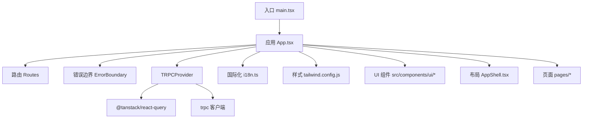
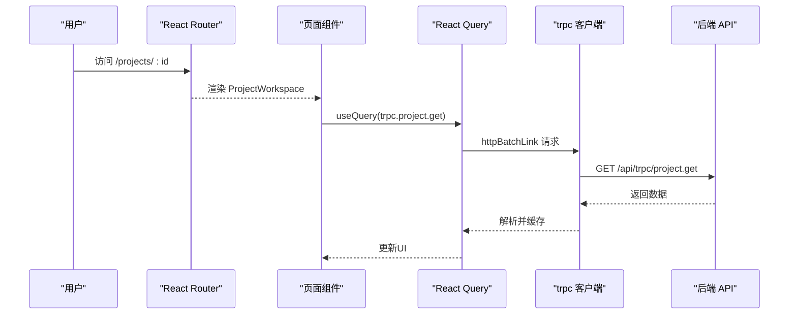
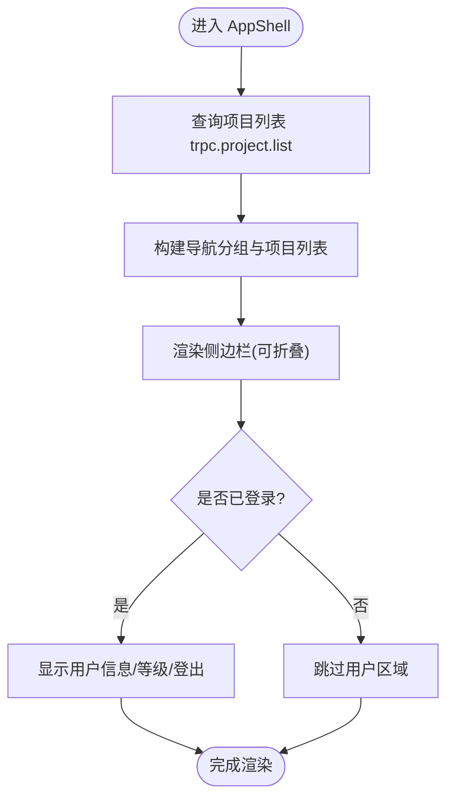
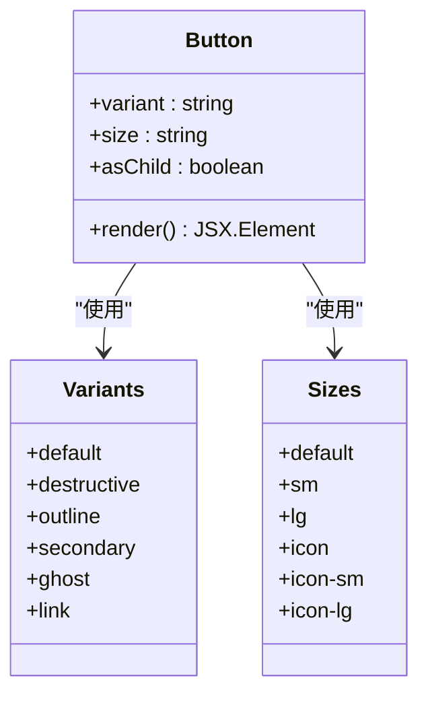
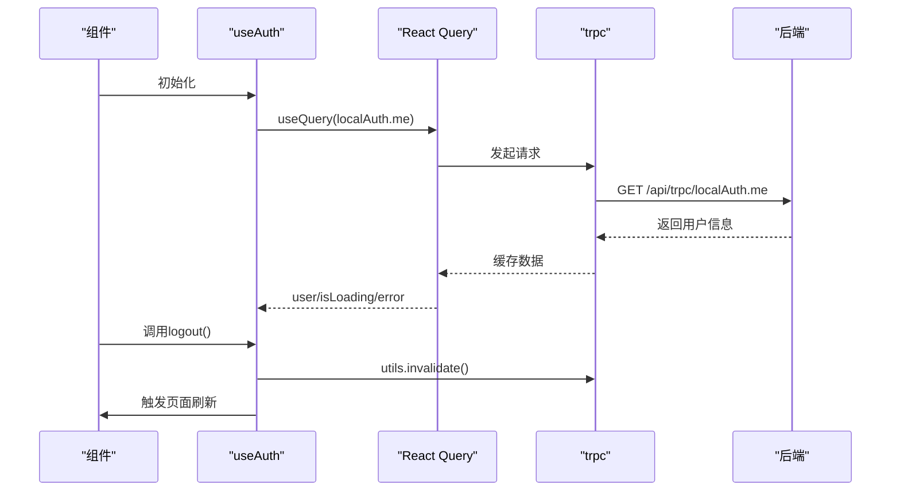
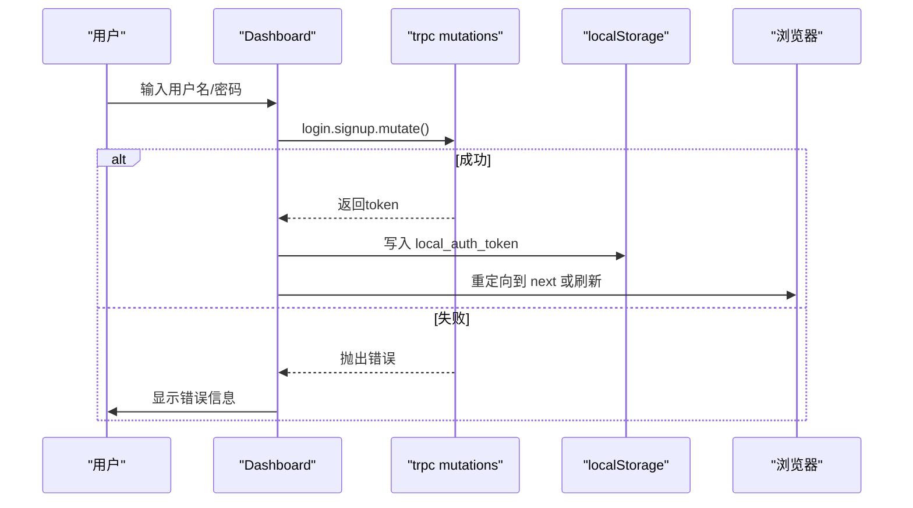
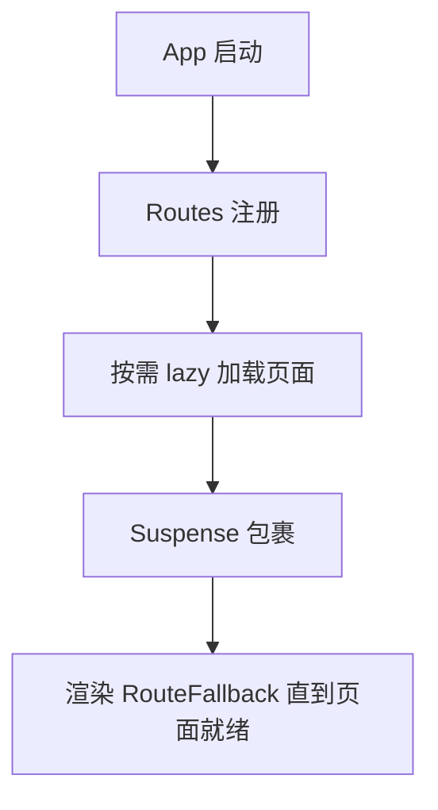
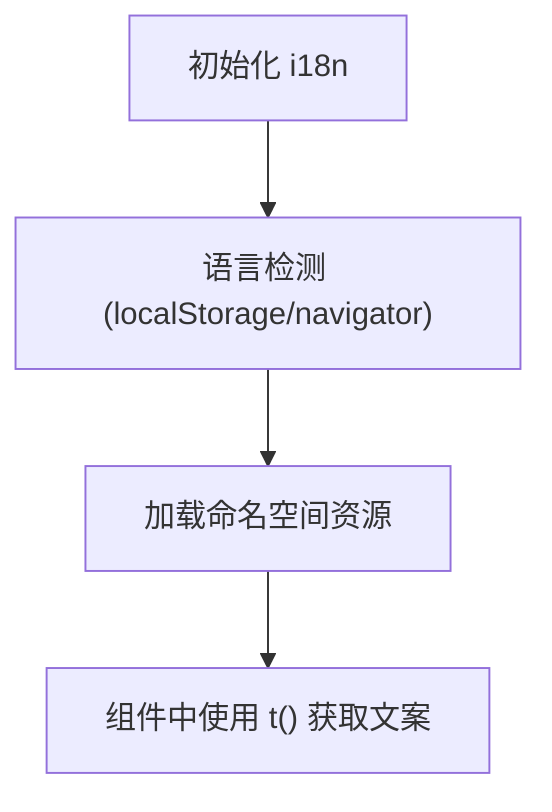
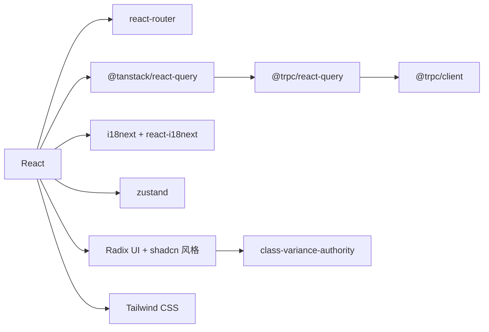

# 前端组件开发

<cite>
**本文引用的文件**
- [src/main.tsx](file://src/main.tsx)
- [src/App.tsx](file://src/App.tsx)
- [package.json](file://package.json)
- [tailwind.config.js](file://tailwind.config.js)
- [src/i18n.ts](file://src/i18n.ts)
- [src/providers/trpc.tsx](file://src/providers/trpc.tsx)
- [src/hooks/useAuth.ts](file://src/hooks/useAuth.ts)
- [src/stores/projectStore.ts](file://src/stores/projectStore.ts)
- [src/components/layout/AppShell.tsx](file://src/components/layout/AppShell.tsx)
- [src/components/ui/button.tsx](file://src/components/ui/button.tsx)
- [src/components/ErrorBoundary.tsx](file://src/components/ErrorBoundary.tsx)
- [src/pages/Dashboard.tsx](file://src/pages/Dashboard.tsx)
- [vitest.config.ts](file://vitest.config.ts)
</cite>

## 目录
1. [简介](#简介)
2. [项目结构](#项目结构)
3. [核心组件](#核心组件)
4. [架构总览](#架构总览)
5. [详细组件分析](#详细组件分析)
6. [依赖关系分析](#依赖关系分析)
7. [性能考虑](#性能考虑)
8. [故障排查指南](#故障排查指南)
9. [结论](#结论)
10. [附录](#附录)

## 简介
本指南面向DeeWaanAI前端React组件开发，聚焦以下目标：
- React组件开发规范：结构设计、状态管理、事件处理
- UI组件库使用与扩展：基础组件、业务组件、布局组件
- 页面开发流程：路由配置、数据获取、用户交互
- 测试方法：单元测试、集成测试、用户体验测试
- 样式管理、国际化支持、性能优化技巧
重点覆盖React组件模式、状态管理与UI组件库使用。

## 项目结构
前端采用Vite + React + TypeScript构建，使用react-router进行路由管理，trpc+@tanstack/react-query进行类型安全的数据获取，i18next实现国际化，Zustand用于轻量全局状态，Tailwind CSS作为样式框架，Radix UI为基础原子组件。

图表来源
- [src/main.tsx:1-21](file://src/main.tsx#L1-L21)
- [src/App.tsx:1-70](file://src/App.tsx#L1-L70)
- [src/providers/trpc.tsx:1-50](file://src/providers/trpc.tsx#L1-L50)
- [src/i18n.ts:1-28](file://src/i18n.ts#L1-L28)
- [tailwind.config.js:1-84](file://tailwind.config.js#L1-L84)

章节来源
- [src/main.tsx:1-21](file://src/main.tsx#L1-L21)
- [src/App.tsx:1-70](file://src/App.tsx#L1-L70)
- [package.json:1-100](file://package.json#L1-L100)

## 核心组件
- 应用壳层与导航：AppShell负责侧边栏导航、用户信息、语言切换、登出等，结合useWorkspaceStore控制侧边栏展开/收起，通过trpc.project.list获取项目列表。
- 基础UI组件：基于Radix UI封装的Button、Dialog、Card、Input等，统一样式与变体（variant/size），通过class-variance-authority管理样式组合。
- 错误边界：ErrorBoundary捕获渲染期异常并提供恢复操作。
- 认证Hook：useAuth封装本地登录态查询与登出逻辑，配合trpc.localAuth.me刷新用户信息。
- 全局状态：Zustand store（如projectStore）用于跨组件共享轻量状态。
- 数据层：trpc客户端配置httpBatchLink、超时、请求头注入token，并集成superjson序列化。

章节来源
- [src/components/layout/AppShell.tsx:1-214](file://src/components/layout/AppShell.tsx#L1-L214)
- [src/components/ui/button.tsx:1-63](file://src/components/ui/button.tsx#L1-L63)
- [src/components/ErrorBoundary.tsx:1-54](file://src/components/ErrorBoundary.tsx#L1-L54)
- [src/hooks/useAuth.ts:1-35](file://src/hooks/useAuth.ts#L1-L35)
- [src/stores/projectStore.ts:1-16](file://src/stores/projectStore.ts#L1-L16)
- [src/providers/trpc.tsx:1-50](file://src/providers/trpc.tsx#L1-L50)

## 架构总览
前端以React为视图层，通过react-router管理页面路由；数据访问通过trpc客户端调用后端API，使用@tanstack/react-query缓存与重试策略；国际化由i18next驱动；样式由Tailwind CSS统一管理；状态分为局部useState、Hook封装、Zustand全局状态三类。

图表来源
- [src/App.tsx:32-63](file://src/App.tsx#L32-L63)
- [src/providers/trpc.tsx:18-38](file://src/providers/trpc.tsx#L18-L38)

## 详细组件分析

### 布局组件 AppShell
职责
- 提供应用级侧边栏导航、分组菜单、当前项目上下文链接、用户信息与登出、语言切换、侧边栏折叠。
- 通过trpc.project.list拉取项目列表，动态渲染项目导航项。
- 根据当前路由高亮对应菜单项。

关键实现要点
- 使用react-i18next进行文案国际化。
- 使用useAuth获取用户信息，结合角色条件渲染管理员入口。
- 使用useWorkspaceStore管理侧边栏展开状态。
- 使用react-router Link进行导航，避免整页刷新。

图表来源
- [src/components/layout/AppShell.tsx:28-214](file://src/components/layout/AppShell.tsx#L28-L214)

章节来源
- [src/components/layout/AppShell.tsx:1-214](file://src/components/layout/AppShell.tsx#L1-L214)

### 基础UI组件 Button
职责
- 封装按钮的基础行为与样式变体（default/destructive/outline/secondary/ghost/link），尺寸（default/sm/lg/icon系列）。
- 支持asChild透传底层元素，便于与第三方组件组合。

设计要点
- 使用class-variance-authority定义变体与默认值。
- 使用cn工具函数合并className，保持样式可扩展性。
- 通过data-slot/data-variant/data-size标记便于调试与自动化测试定位。

图表来源
- [src/components/ui/button.tsx:7-63](file://src/components/ui/button.tsx#L7-L63)

章节来源
- [src/components/ui/button.tsx:1-63](file://src/components/ui/button.tsx#L1-L63)

### 认证与数据流 Hook useAuth
职责
- 封装用户信息查询、加载状态、错误处理与登出逻辑。
- 登出时清理本地令牌并触发全局查询失效，随后刷新页面。

数据流
- 使用trpc.localAuth.me查询当前用户，设置staleTime与retry策略。
- 登出后调用utils.invalidate清空缓存，确保后续请求重新拉取。

图表来源
- [src/hooks/useAuth.ts:1-35](file://src/hooks/useAuth.ts#L1-L35)
- [src/providers/trpc.tsx:10-17](file://src/providers/trpc.tsx#L10-L17)

章节来源
- [src/hooks/useAuth.ts:1-35](file://src/hooks/useAuth.ts#L1-L35)

### 页面开发流程（以Dashboard为例）
职责
- 提供登录/注册表单、SSO跳转、OAuth回调处理、错误提示。
- 使用trpc mutations执行登录/注册，成功后写入本地令牌并重定向。

流程说明
- 从URL参数读取next与sso_token/sso_error，进行安全校验与清理。
- 表单提交时调用localAuth.login/signup mutation，成功则保存令牌并跳转。
- 使用react-i18next进行多语言文案展示。

图表来源
- [src/pages/Dashboard.tsx:38-173](file://src/pages/Dashboard.tsx#L38-L173)

章节来源
- [src/pages/Dashboard.tsx:1-200](file://src/pages/Dashboard.tsx#L1-L200)

### 路由与懒加载
- 在App中集中声明所有页面路由，并使用React.lazy与Suspense进行代码分割，提升首屏性能。
- 提供统一的RouteFallback用于加载占位。

图表来源
- [src/App.tsx:1-70](file://src/App.tsx#L1-L70)

章节来源
- [src/App.tsx:1-70](file://src/App.tsx#L1-L70)

### 国际化配置
- 使用i18next与react-i18next，集中配置资源、默认语言、检测顺序与命名空间。
- 通过LanguageDetector自动检测语言并持久化至localStorage。

图表来源
- [src/i18n.ts:1-28](file://src/i18n.ts#L1-L28)

章节来源
- [src/i18n.ts:1-28](file://src/i18n.ts#L1-L28)

### 样式系统
- Tailwind CSS作为主要样式方案，darkMode启用类名切换。
- 通过自定义主题变量（color/shadow/borderRadius/keyframes）统一设计令牌。
- 插件tailwindcss-animate提供动画能力。

章节来源
- [tailwind.config.js:1-84](file://tailwind.config.js#L1-L84)

## 依赖关系分析
- 运行时依赖：react、react-dom、react-router、@tanstack/react-query、@trpc/*、i18next、react-i18next、zustand、lucide-react、sonner、radix-ui系列、class-variance-authority、clsx、tailwind-merge等。
- 构建与开发：vite、typescript、eslint、prettier、vitest、postcss、autoprefixer、tailwindcss、drizzle-kit等。

图表来源
- [package.json:23-73](file://package.json#L23-L73)

章节来源
- [package.json:1-100](file://package.json#L1-L100)

## 性能考虑
- 路由级代码分割：使用React.lazy与Suspense对页面进行懒加载，减少初始包体积。
- 数据缓存与重试：React Query默认staleTime与refetchOnWindowFocus策略，trpc客户端禁用mutation自动重试以避免非幂等操作重复执行。
- 长耗时请求：trpc客户端为pipeline执行等场景设置较长超时（例如10分钟），避免误杀。
- 样式与主题：Tailwind按需生成CSS，减少冗余；使用class-variance-authority集中管理变体，降低样式分支复杂度。
- 国际化：按需加载命名空间，避免一次性加载全部语言包。

[本节为通用指导，不直接分析具体文件]

## 故障排查指南
- 错误边界：ErrorBoundary捕获渲染期异常，提供“重新加载”恢复路径，并在控制台输出错误堆栈以便定位。
- 认证问题：检查本地令牌是否存在、trpc请求头是否正确携带、后端接口是否返回有效用户信息。
- 网络与超时：确认trpc客户端fetch超时配置是否符合预期，必要时调整或增加重试策略（仅针对幂等查询）。
- 路由与懒加载：若页面空白，检查lazy导入路径与路由匹配，确认Suspense fallback正常显示。
- 国际化缺失：确认命名空间与key存在，fallbackLng生效，语言检测优先级符合预期。

章节来源
- [src/components/ErrorBoundary.tsx:1-54](file://src/components/ErrorBoundary.tsx#L1-L54)
- [src/providers/trpc.tsx:18-38](file://src/providers/trpc.tsx#L18-L38)

## 结论
本项目采用清晰的分层与模块化组织：入口与路由集中在App与main，布局与基础UI组件解耦，数据访问通过trpc与React Query统一管理，国际化与样式体系完善。遵循本指南的组件开发规范、状态管理模式与测试实践，可有效提升代码质量与可维护性，保障用户体验与性能表现。

## 附录
- 测试配置：vitest默认包含api层测试，可按需扩展前端组件测试（引入jsdom环境、Mock trpc与React Query）。
- 脚本命令：dev/build/lint/format/test/db迁移等命令位于package.json scripts中，便于日常开发与发布。

章节来源
- [vitest.config.ts:1-20](file://vitest.config.ts#L1-L20)
- [package.json:7-21](file://package.json#L7-L21)