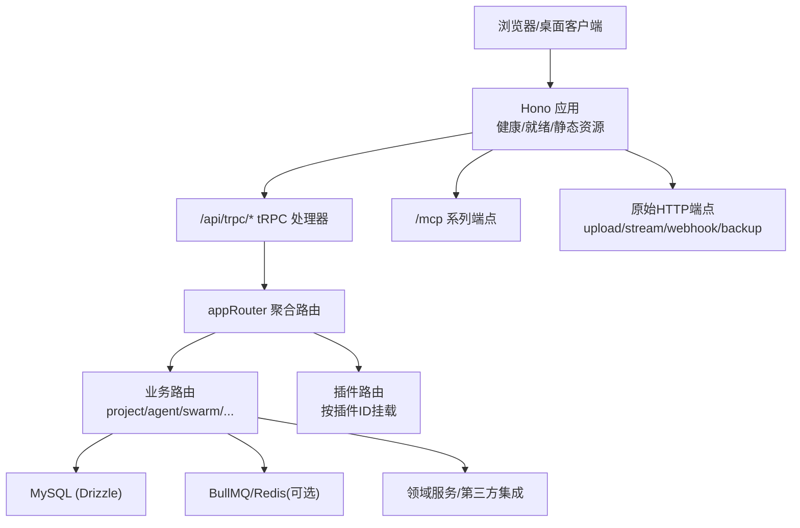
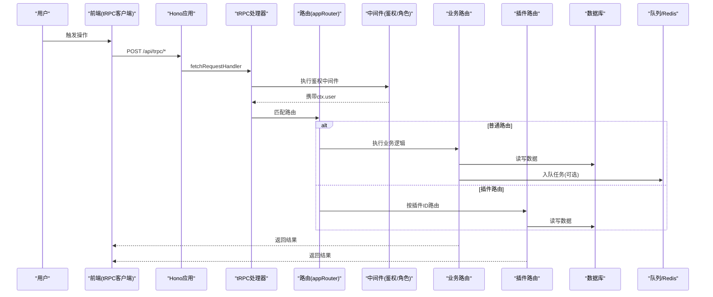
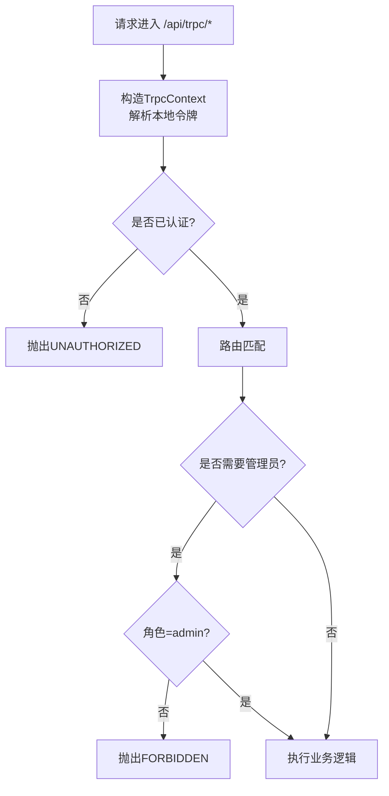
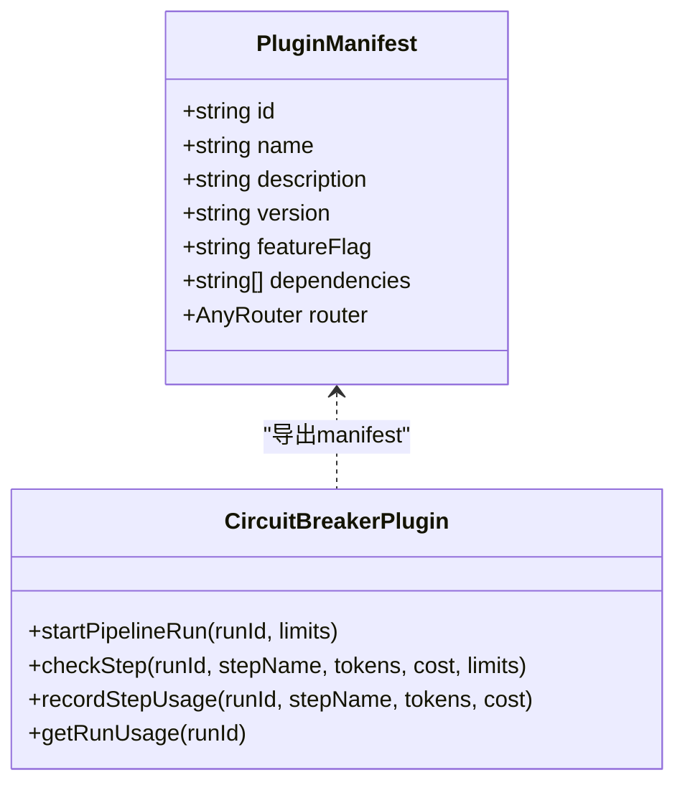
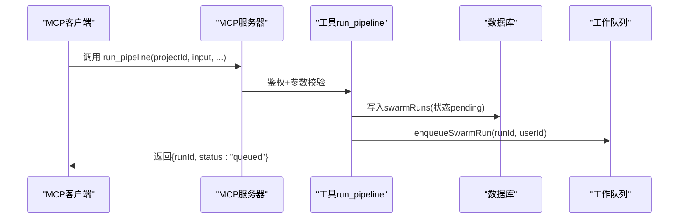
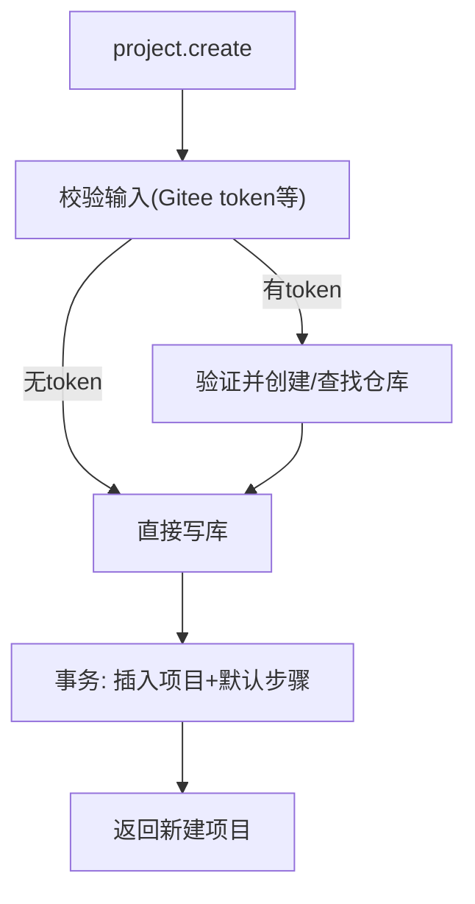
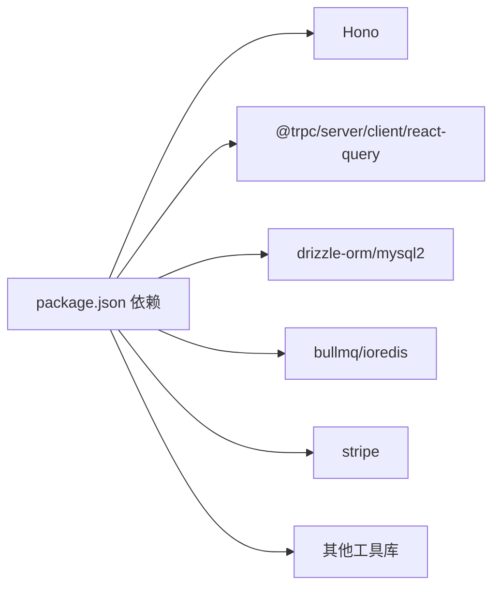

# 功能开发

<cite>
**本文引用的文件**
- [README.md](file://README.md)
- [package.json](file://package.json)
- [api/router.ts](file://api/router.ts)
- [api/middleware.ts](file://api/middleware.ts)
- [api/auth-router.ts](file://api/auth-router.ts)
- [api/context.ts](file://api/context.ts)
- [api/boot.ts](file://api/boot.ts)
- [api/routers/project.ts](file://api/routers/project.ts)
- [api/mcp/tools/index.ts](file://api/mcp/tools/index.ts)
- [api/mcp/tools/runPipeline.ts](file://api/mcp/tools/runPipeline.ts)
- [api/plugins/registry.ts](file://api/plugins/registry.ts)
- [api/plugins/circuit-breaker/index.ts](file://api/plugins/circuit-breaker/index.ts)
- [src/providers/trpc.tsx](file://src/providers/trpc.tsx)
- [db/schema.ts](file://db/schema.ts)
</cite>

## 目录
1. [简介](#简介)
2. [项目结构](#项目结构)
3. [核心组件](#核心组件)
4. [架构总览](#架构总览)
5. [详细组件分析](#详细组件分析)
6. [依赖分析](#依赖分析)
7. [性能考虑](#性能考虑)
8. [故障排查指南](#故障排查指南)
9. [结论](#结论)
10. [附录：新功能开发标准流程与规范](#附录：新功能开发标准流程与规范)

## 简介
本指南面向DeeWaanAI的功能开发者，覆盖从需求分析到上线部署的完整生命周期；明确插件、MCP工具、tRPC路由与前端组件的开发规范；说明API扩展方法（新增端点、中间件、认证集成）；给出代码组织最佳实践（模块划分、依赖管理、版本兼容）；并提供可操作的示例与调试技巧，帮助快速上手。

## 项目结构
- 后端服务入口与HTTP路由由Hono承载，tRPC用于类型安全的API聚合，数据库使用Drizzle ORM + MySQL，可选Redis作为队列与发布订阅后端。
- 启动脚本将构建产物打包为单进程服务，同时提供健康检查、就绪检查、流式接口、上传接口、MCP服务器、SSO/Relay等能力。
- 前端基于React + Vite，通过tRPC客户端调用后端，支持本地认证令牌注入与长请求超时控制。

**图表来源**
- [api/boot.ts:361-373](file://api/boot.ts#L361-L373)
- [api/router.ts:39-70](file://api/router.ts#L39-L70)
- [api/mcp/register.ts:90-110](file://api/mcp/register.ts#L90-L110)

**章节来源**
- [README.md:20-39](file://README.md#L20-L39)
- [package.json:7-21](file://package.json#L7-L21)
- [api/boot.ts:64-135](file://api/boot.ts#L64-L135)

## 核心组件
- 应用启动与健康：提供健康检查与就绪检查，自动拉起流水线工作进程，注册各类路由，处理优雅关闭。
- tRPC上下文与鉴权：在请求进入时解析用户身份（本地令牌），并在中间件中强制鉴权与角色校验。
- 路由聚合：集中注册所有tRPC子路由，并动态挂载插件路由。
- MCP工具注册：统一注册MCP工具，供桌面LLM客户端调用。
- 插件系统：以清单形式声明插件元数据、特性开关与可选路由，便于扩展与治理。
- 前端tRPC客户端：配置批量链接、认证头注入、长请求超时策略。

**章节来源**
- [api/boot.ts:73-135](file://api/boot.ts#L73-L135)
- [api/context.ts:20-54](file://api/context.ts#L20-L54)
- [api/middleware.ts:17-50](file://api/middleware.ts#L17-L50)
- [api/router.ts:31-70](file://api/router.ts#L31-L70)
- [api/mcp/tools/index.ts:45-94](file://api/mcp/tools/index.ts#L45-L94)
- [api/plugins/registry.ts:19-38](file://api/plugins/registry.ts#L19-L38)
- [src/providers/trpc.tsx:18-39](file://src/providers/trpc.tsx#L18-L39)

## 架构总览
下图展示了从浏览器发起请求到后端处理、再到数据库与外部服务的整体链路，包括tRPC鉴权、路由分发、插件扩展、MCP工具调用与工作队列。

**图表来源**
- [api/boot.ts:361-373](file://api/boot.ts#L361-L373)
- [api/middleware.ts:17-50](file://api/middleware.ts#L17-L50)
- [api/router.ts:39-70](file://api/router.ts#L39-L70)

## 详细组件分析

### tRPC路由与鉴权
- 路由聚合：集中定义公共查询与所有业务子路由，并通过插件机制动态挂载。
- 鉴权中间件：未登录或无用户上下文时拒绝访问；管理员接口需额外角色校验。
- 上下文构造：从请求头解析本地认证令牌，加载用户信息，注入requestId与远程IP等。

**图表来源**
- [api/context.ts:20-54](file://api/context.ts#L20-L54)
- [api/middleware.ts:17-50](file://api/middleware.ts#L17-L50)
- [api/router.ts:39-70](file://api/router.ts#L39-L70)

**章节来源**
- [api/router.ts:39-70](file://api/router.ts#L39-L70)
- [api/middleware.ts:17-50](file://api/middleware.ts#L17-L50)
- [api/context.ts:20-54](file://api/context.ts#L20-L54)

### 插件系统与电路断路器
- 插件清单：每个插件包含ID、名称、描述、版本、特性开关键、依赖与可选路由。
- 路由挂载：启动时扫描插件清单，将带router的插件以插件ID为命名空间挂载到appRouter。
- 电路断路器：在流水线步骤执行前进行预算/超时/循环次数检查，防止失控成本与死循环。

**图表来源**
- [api/plugins/registry.ts:19-38](file://api/plugins/registry.ts#L19-L38)
- [api/plugins/circuit-breaker/index.ts:147-185](file://api/plugins/circuit-breaker/index.ts#L147-L185)

**章节来源**
- [api/plugins/registry.ts:19-38](file://api/plugins/registry.ts#L19-L38)
- [api/plugins/circuit-breaker/index.ts:23-143](file://api/plugins/circuit-breaker/index.ts#L23-L143)

### MCP工具开发规范
- 工具注册：所有MCP工具集中在索引中导出，服务端统一过滤与授权。
- 输入校验：使用Zod定义输入Schema，确保参数安全。
- 权限控制：在执行前进行项目访问校验，避免越权。
- 异步执行：创建运行记录后入队，立即返回，前端轮询状态。

**图表来源**
- [api/mcp/tools/index.ts:45-94](file://api/mcp/tools/index.ts#L45-L94)
- [api/mcp/tools/runPipeline.ts:97-155](file://api/mcp/tools/runPipeline.ts#L97-L155)

**章节来源**
- [api/mcp/tools/index.ts:45-94](file://api/mcp/tools/index.ts#L45-L94)
- [api/mcp/tools/runPipeline.ts:15-155](file://api/mcp/tools/runPipeline.ts#L15-L155)

### tRPC路由扩展（以项目为例）
- 列表与详情：支持用户自有项目与团队共享项目的合并去重。
- 创建项目：可选同步Gitee仓库，原子事务写入项目与默认流水线步骤。
- 权限模型：仅所有者或团队成员可访问对应项目。

**图表来源**
- [api/routers/project.ts:103-200](file://api/routers/project.ts#L103-L200)

**章节来源**
- [api/routers/project.ts:11-200](file://api/routers/project.ts#L11-L200)

### 前端组件与tRPC客户端
- 客户端配置：使用httpBatchLink批量请求，注入本地认证头，设置长请求超时。
- 缓存策略：QueryClient默认staleTime与禁用自动重试，避免非幂等操作重复提交。
- Provider封装：统一注入trpc与queryClient，简化页面使用。

**章节来源**
- [src/providers/trpc.tsx:10-49](file://src/providers/trpc.tsx#L10-L49)

### 数据库与模型
- 用户、项目、流水线运行等核心表定义清晰，字段类型与约束完备。
- JSON字段用于灵活存储配置与历史状态，便于演进。
- 索引优化常见查询路径（如用户ID、项目ID）。

**章节来源**
- [db/schema.ts:17-200](file://db/schema.ts#L17-L200)

## 依赖分析
- 运行时依赖：Hono、tRPC、Drizzle、BullMQ、ioredis、Stripe等。
- 构建与开发：Vite、esbuild、TypeScript、Vitest、ESLint/Prettier。
- 环境变量：通过dotenv读取，生产环境严格校验必要变量。

**图表来源**
- [package.json:23-72](file://package.json#L23-L72)

**章节来源**
- [package.json:7-21](file://package.json#L7-L21)
- [package.json:23-72](file://package.json#L23-L72)
- [README.md:41-69](file://README.md#L41-L69)

## 性能考虑
- 健康与就绪探针：区分进程存活与依赖可用，利于负载均衡与编排平台决策。
- 队列与并发：长耗时任务入队，HTTP层快速响应；支持Redis后端提升吞吐。
- 流水线保护：电路断路器限制token、花费、超时与循环次数，防止资源滥用。
- 前端超时：对长请求设置合理超时，避免悬挂连接。

[本节为通用指导，不直接分析具体文件]

## 故障排查指南
- 健康检查：GET /api/health 查看数据库连通性与内存占用；GET /api/ready 检查依赖就绪。
- 日志与追踪：全局错误捕获、unhandledRejection记录；请求级requestId透传。
- 优雅关闭：SIGTERM/SIGINT触发停止工作进程与队列，避免中断中的任务丢失。
- 常见问题定位：
  - 认证失败：检查本地令牌头是否正确注入。
  - 路由404：确认路由注册顺序与插件开关。
  - 队列堆积：检查Redis连接与消费者状态。

**章节来源**
- [api/boot.ts:73-135](file://api/boot.ts#L73-L135)
- [api/boot.ts:375-414](file://api/boot.ts#L375-L414)
- [src/providers/trpc.tsx:23-35](file://src/providers/trpc.tsx#L23-L35)

## 结论
本指南梳理了DeeWaanAI的后端服务、tRPC路由、插件体系、MCP工具与前端客户端的关键实现与协作方式。遵循本文的流程与规范，可高效、安全地扩展新功能，并确保在生产环境中稳定运行。

## 附录：新功能开发标准流程与规范

### 端到端开发流程
- 需求分析与设计
  - 明确功能边界、数据模型变更、权限与计费影响。
  - 评估是否需要新插件、新MCP工具或新tRPC路由。
- 数据层
  - 新增/修改表结构：更新db/schema.ts，生成并执行迁移。
  - 编写必要的索引与约束，保证查询性能与一致性。
- 后端实现
  - 新增tRPC路由：在对应routers目录下实现，使用中间件鉴权与输入校验。
  - 如需插件化：在plugins下创建插件，导出manifest并在registry注册。
  - 如需MCP工具：在mcp/tools下实现工具，注册到索引，定义输入Schema与权限。
  - 服务集成：调用领域服务或第三方API，注意错误处理与重试策略。
- 前端实现
  - 新增页面/组件：复用现有UI组件与布局，保持风格一致。
  - 接入tRPC：使用生成的类型与客户端调用，处理加载与错误状态。
  - 国际化：补充多语言文案，确保i18n检查通过。
- 测试与质量
  - 单元测试：覆盖核心逻辑与边界条件。
  - 集成测试：关键流程端到端验证（如创建项目、运行流水线）。
  - 代码规范：lint/format通过，类型检查通过。
- 构建与部署
  - 本地构建与冒烟测试：npm run build，启动服务验证健康与就绪。
  - 发布：按CI/CD流程推送，监控指标与告警。
- 上线与回滚
  - 灰度发布与观察期，必要时快速回滚。

### 插件开发规范
- 插件清单：包含id、name、description、version、featureFlag、dependencies与可选router。
- 路由挂载：仅在特性开关开启时暴露路由，避免未启用功能被调用。
- 依赖校验：启动时检查依赖是否满足，缺失则报错。
- 示例参考：电路断路器插件提供了限流、超时、循环次数控制的模板。

**章节来源**
- [api/plugins/registry.ts:19-38](file://api/plugins/registry.ts#L19-L38)
- [api/plugins/circuit-breaker/index.ts:147-185](file://api/plugins/circuit-breaker/index.ts#L147-L185)

### MCP工具开发规范
- 工具定义：name、description、inputSchema、requiredScopes、annotations与handler。
- 权限与安全：执行前进行项目访问校验，避免越权。
- 异步执行：创建运行记录后入队，立即返回，前端轮询状态。
- 示例参考：run_pipeline工具展示了完整的输入校验、权限检查、事务写入与入队流程。

**章节来源**
- [api/mcp/tools/runPipeline.ts:15-155](file://api/mcp/tools/runPipeline.ts#L15-L155)
- [api/mcp/tools/index.ts:45-94](file://api/mcp/tools/index.ts#L45-L94)

### tRPC路由扩展方法
- 新增路由：在对应routers文件中定义，使用authedQuery/adminQuery进行鉴权。
- 输入校验：使用Zod定义输入Schema，确保参数安全。
- 事务与一致性：涉及多表写入时使用事务包裹。
- 示例参考：项目路由展示了列表、详情、创建的完整流程与权限控制。

**章节来源**
- [api/routers/project.ts:11-200](file://api/routers/project.ts#L11-L200)
- [api/middleware.ts:17-50](file://api/middleware.ts#L17-L50)

### API扩展方法
- 新增端点：优先通过tRPC路由扩展；对于大文件或特殊协议，使用原始HTTP端点。
- 中间件：统一鉴权、限流、请求ID注入、安全头等。
- 认证集成：支持本地令牌、OAuth/SSO（企业特性），在上下文中解析用户。

**章节来源**
- [api/boot.ts:361-373](file://api/boot.ts#L361-L373)
- [api/context.ts:20-54](file://api/context.ts#L20-L54)
- [api/sso-route.ts:55-89](file://api/sso-route.ts#L55-L89)

### 代码组织最佳实践
- 模块划分：按功能域拆分路由与服务，保持高内聚低耦合。
- 依赖管理：集中声明依赖，避免重复引入；使用类型安全的ORM与客户端。
- 版本兼容：MCP工具只增不改，向后兼容；数据库迁移向前兼容。
- 配置与环境：环境变量集中管理，生产环境严格校验。

**章节来源**
- [package.json:23-72](file://package.json#L23-L72)
- [README.md:41-69](file://README.md#L41-L69)

### 开发示例与调试技巧
- 示例：新增“导出项目”功能
  - 后端：在routers/export.ts新增tRPC路由，使用authedQuery与Zod校验，调用服务层导出逻辑，返回下载链接。
  - 前端：在页面添加按钮，调用export.download()，处理下载与错误提示。
  - 测试：单元测试覆盖导出逻辑；集成测试验证下载成功。
- 调试技巧：
  - 使用健康与就绪探针判断服务状态。
  - 通过requestId关联日志，定位问题。
  - 前端网络面板查看tRPC请求与响应，结合后端日志定位。

[本节为通用指导，不直接分析具体文件]