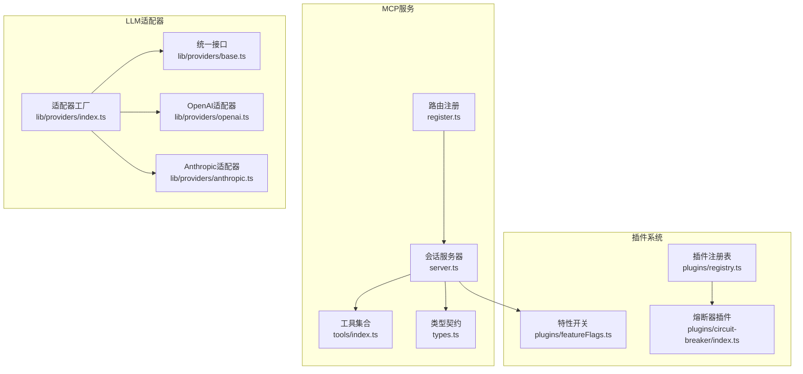
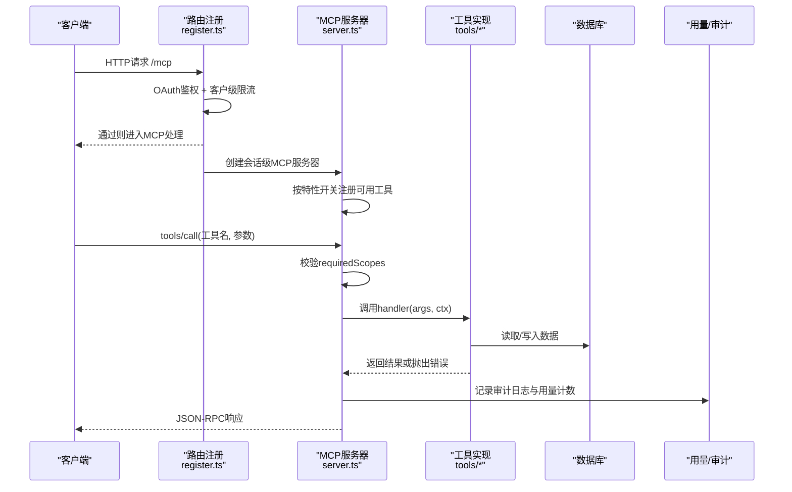
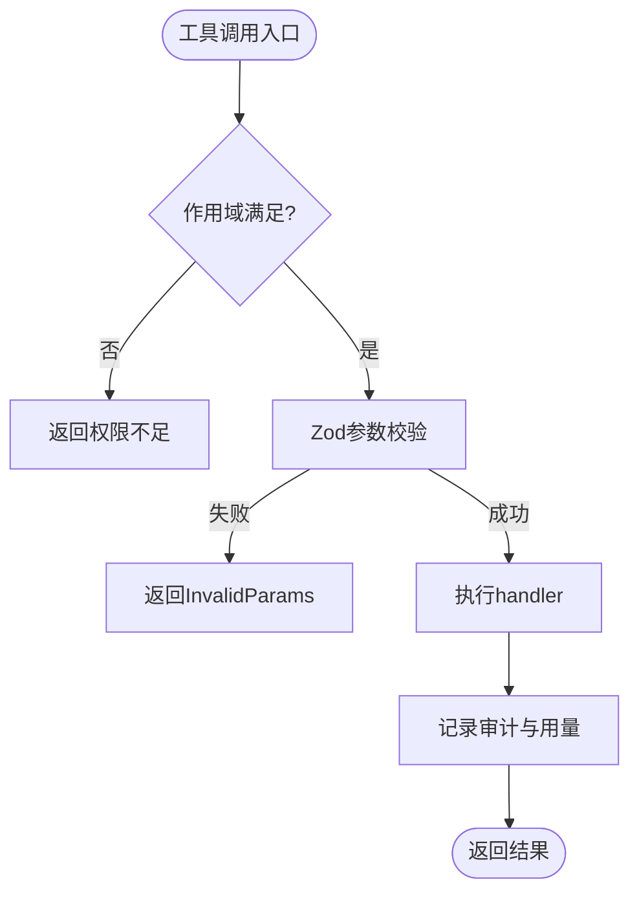
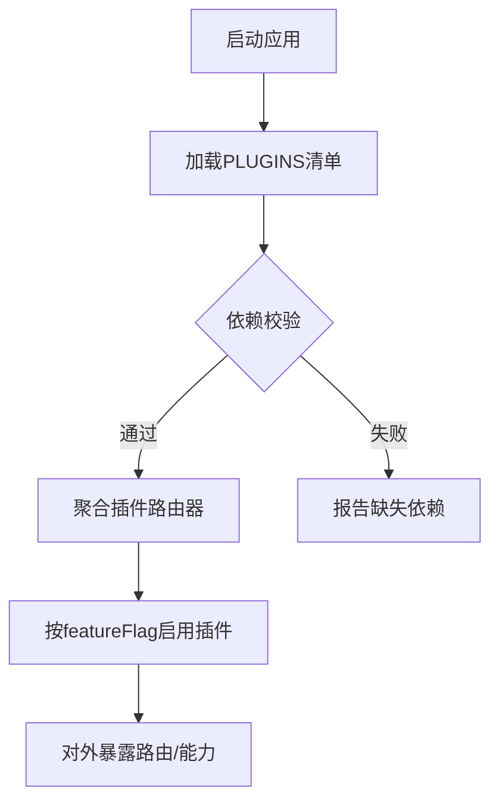
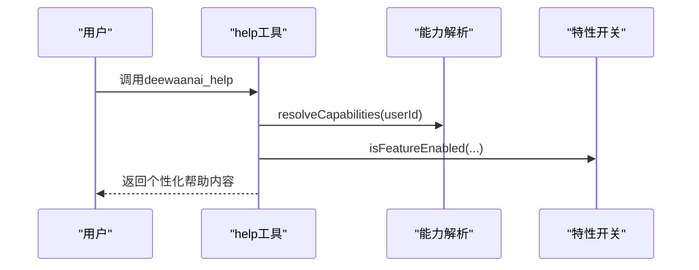
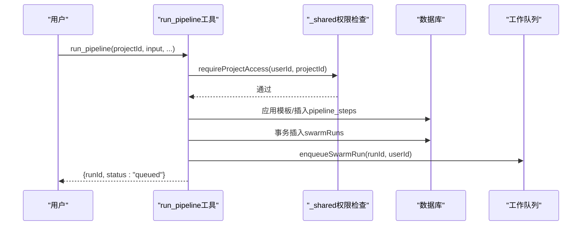
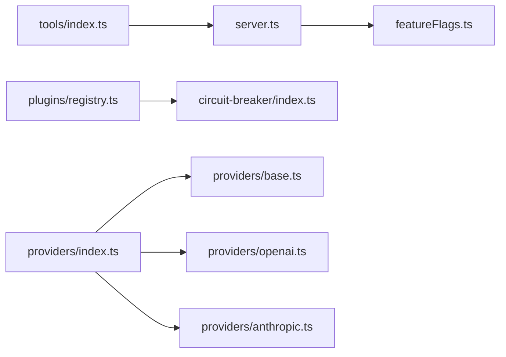

# 插件开发

<cite>
**本文引用的文件**
- [api/mcp/tools/index.ts](file://api/mcp/tools/index.ts)
- [api/mcp/types.ts](file://api/mcp/types.ts)
- [api/mcp/server.ts](file://api/mcp/server.ts)
- [api/mcp/register.ts](file://api/mcp/register.ts)
- [api/mcp/tools/help.ts](file://api/mcp/tools/help.ts)
- [api/mcp/tools/runPipeline.ts](file://api/mcp/tools/runPipeline.ts)
- [api/mcp/tools/_shared.ts](file://api/mcp/tools/_shared.ts)
- [api/plugins/registry.ts](file://api/plugins/registry.ts)
- [api/plugins/circuit-breaker/index.ts](file://api/plugins/circuit-breaker/index.ts)
- [api/plugins/featureFlags.ts](file://api/plugins/featureFlags.ts)
- [api/lib/providers/index.ts](file://api/lib/providers/index.ts)
- [api/lib/providers/base.ts](file://api/lib/providers/base.ts)
- [api/lib/providers/openai.ts](file://api/lib/providers/openai.ts)
- [api/lib/providers/anthropic.ts](file://api/lib/providers/anthropic.ts)
</cite>

## 目录
1. [简介](#简介)
2. [项目结构](#项目结构)
3. [核心组件](#核心组件)
4. [架构总览](#架构总览)
5. [详细组件分析](#详细组件分析)
6. [依赖关系分析](#依赖关系分析)
7. [性能考虑](#性能考虑)
8. [故障排查指南](#故障排查指南)
9. [结论](#结论)
10. [附录](#附录)

## 简介
本文件面向DeeWaanAI的插件开发者，系统性说明以下能力与规范：
- MCP工具插件：接口定义、参数校验、权限与作用域、错误处理、审计与限流。
- LLM提供商适配器：统一抽象、协议适配（OpenAI兼容与Anthropic）、错误归一化与模型列表获取。
- 插件注册机制：动态加载、依赖管理、特性开关控制、生命周期。
- 完整示例：从简单工具到复杂业务逻辑插件的开发路径。
- 测试与调试：如何验证工具输入、鉴权、错误分支与性能指标。

## 项目结构
围绕插件体系的关键目录与职责：
- api/mcp：MCP服务端点、传输层、认证上下文、工具注册与实现。
- api/plugins：插件注册表、特性开关、示例插件（熔断器）。
- api/lib/providers：LLM提供商适配器工厂与各厂商实现。



图表来源
- [api/mcp/register.ts:144-164](file://api/mcp/register.ts#L144-L164)
- [api/mcp/server.ts:135-186](file://api/mcp/server.ts#L135-L186)
- [api/mcp/tools/index.ts:45-94](file://api/mcp/tools/index.ts#L45-L94)
- [api/mcp/types.ts:9-44](file://api/mcp/types.ts#L9-L44)
- [api/plugins/registry.ts:19-38](file://api/plugins/registry.ts#L19-L38)
- [api/plugins/featureFlags.ts:51-73](file://api/plugins/featureFlags.ts#L51-L73)
- [api/lib/providers/index.ts:5-22](file://api/lib/providers/index.ts#L5-L22)
- [api/lib/providers/base.ts:35-43](file://api/lib/providers/base.ts#L35-L43)
- [api/lib/providers/openai.ts:82-207](file://api/lib/providers/openai.ts#L82-L207)
- [api/lib/providers/anthropic.ts:14-187](file://api/lib/providers/anthropic.ts#L14-L187)

章节来源
- [api/mcp/register.ts:144-164](file://api/mcp/register.ts#L144-L164)
- [api/mcp/server.ts:135-186](file://api/mcp/server.ts#L135-L186)
- [api/mcp/tools/index.ts:45-94](file://api/mcp/tools/index.ts#L45-L94)
- [api/mcp/types.ts:9-44](file://api/mcp/types.ts#L9-L44)
- [api/plugins/registry.ts:19-38](file://api/plugins/registry.ts#L19-L38)
- [api/plugins/featureFlags.ts:51-73](file://api/plugins/featureFlags.ts#L51-L73)
- [api/lib/providers/index.ts:5-22](file://api/lib/providers/index.ts#L5-L22)
- [api/lib/providers/base.ts:35-43](file://api/lib/providers/base.ts#L35-L43)
- [api/lib/providers/openai.ts:82-207](file://api/lib/providers/openai.ts#L82-L207)
- [api/lib/providers/anthropic.ts:14-187](file://api/lib/providers/anthropic.ts#L14-L187)

## 核心组件
- MCP工具契约：每个工具以统一的McpTool描述，包含名称、描述、Zod输入Schema、所需作用域、可选特性开关、注解与处理器。
- 会话级MCP服务器：为每个会话构建独立服务器实例，按特性开关过滤工具，执行前校验作用域，调用后记录审计与用量。
- 插件注册表：集中声明插件清单、路由器与依赖；提供依赖校验与路由器聚合。
- 特性开关：基于数据库配置与内存缓存，支持全局开启、按比例灰度、白名单用户。
- LLM适配器：统一LLMProviderAdapter接口，工厂根据slug选择具体实现；OpenAI兼容与Anthropic分别适配各自协议。

章节来源
- [api/mcp/types.ts:9-44](file://api/mcp/types.ts#L9-L44)
- [api/mcp/server.ts:84-124](file://api/mcp/server.ts#L84-L124)
- [api/plugins/registry.ts:19-38](file://api/plugins/registry.ts#L19-L38)
- [api/plugins/featureFlags.ts:51-73](file://api/plugins/featureFlags.ts#L51-L73)
- [api/lib/providers/index.ts:5-22](file://api/lib/providers/index.ts#L5-L22)
- [api/lib/providers/base.ts:35-43](file://api/lib/providers/base.ts#L35-L43)

## 架构总览
下图展示一次MCP工具调用的端到端流程，包括鉴权、限流、作用域校验、工具执行、审计与用量统计。



图表来源
- [api/mcp/register.ts:90-142](file://api/mcp/register.ts#L90-L142)
- [api/mcp/server.ts:84-124](file://api/mcp/server.ts#L84-L124)
- [api/mcp/server.ts:135-186](file://api/mcp/server.ts#L135-L186)

## 详细组件分析

### MCP工具插件开发规范
- 工具接口定义：遵循McpTool结构，使用Zod定义输入Schema，声明requiredScopes与annotations，实现handler。
- 参数验证：由SDK在注册时自动对输入进行safeParseAsync校验，非法参数将返回InvalidParams。
- 权限与作用域：server在调用前检查ctx.scopes是否包含requiredScopes，否则拒绝并记录denied。
- 特性开关：若工具声明featureFlag，仅在isFeatureEnabled为true时注册，否则隐藏且调用视为未知工具。
- 错误处理：工具内部抛错会被捕获并记录error信息；审计与用量统计始终执行。
- 审计与用量：每次调用记录latency、status、error，并原子递增月度用量计数器。



图表来源
- [api/mcp/server.ts:84-124](file://api/mcp/server.ts#L84-L124)
- [api/mcp/server.ts:135-186](file://api/mcp/server.ts#L135-L186)

章节来源
- [api/mcp/types.ts:33-44](file://api/mcp/types.ts#L33-L44)
- [api/mcp/server.ts:84-124](file://api/mcp/server.ts#L84-L124)
- [api/mcp/server.ts:135-186](file://api/mcp/server.ts#L135-L186)

### LLM提供商适配器
- 统一接口：LLMProviderAdapter定义name、slug、defaultBaseUrl、supportedModels、chat、validateKey、listModels。
- 工厂模式：createProviderAdapter根据slug选择openai或anthropic实现，并注入默认baseUrl与模型列表。
- OpenAI兼容：标准化消息体，处理max_tokens与max_completion_tokens兼容重试，统一错误格式化。
- Anthropic适配：分离system提示，转换多模态内容块，适配其/messages API。
- 错误归一化：针对各厂商特定错误码（如401/429）生成可操作的用户提示。

```mermaid
classDiagram
class LLMProviderAdapter {
+string name
+string slug
+string defaultBaseUrl
+string[] supportedModels
+chat(messages, options) ChatResponse
+validateKey() Promise~{valid,error}~
+listModels() string[]
}
class OpenAIAdapter {
+chat(...)
+validateKey()
+listModels()
}
class AnthropicAdapter {
+chat(...)
+validateKey()
+listModels()
}
LLMProviderAdapter <|.. OpenAIAdapter
LLMProviderAdapter <|.. AnthropicAdapter
```

图表来源
- [api/lib/providers/base.ts:35-43](file://api/lib/providers/base.ts#L35-L43)
- [api/lib/providers/openai.ts:82-207](file://api/lib/providers/openai.ts#L82-L207)
- [api/lib/providers/anthropic.ts:14-187](file://api/lib/providers/anthropic.ts#L14-L187)

章节来源
- [api/lib/providers/index.ts:5-22](file://api/lib/providers/index.ts#L5-L22)
- [api/lib/providers/base.ts:35-43](file://api/lib/providers/base.ts#L35-L43)
- [api/lib/providers/openai.ts:82-207](file://api/lib/providers/openai.ts#L82-L207)
- [api/lib/providers/anthropic.ts:14-187](file://api/lib/providers/anthropic.ts#L14-L187)

### 插件注册机制与生命周期
- 插件清单：PLUGINS数组集中声明所有插件，包含id、name、description、version、featureFlag、dependencies、router。
- 依赖校验：validateDependencies检查依赖是否存在于已注册插件集合中，避免运行时缺失。
- 路由器聚合：getPluginRouters收集所有插件暴露的tRPC路由器，供上层挂载。
- 特性开关：插件可通过featureFlag控制启用状态，配合UI与服务端路由门控。
- 示例插件（熔断器）：提供运行期限制（token预算、花费上限、步骤超时、循环次数），并在tRPC中暴露查询与管理员更新接口。



图表来源
- [api/plugins/registry.ts:19-38](file://api/plugins/registry.ts#L19-L38)
- [api/plugins/registry.ts:45-69](file://api/plugins/registry.ts#L45-L69)
- [api/plugins/featureFlags.ts:51-73](file://api/plugins/featureFlags.ts#L51-L73)
- [api/plugins/circuit-breaker/index.ts:178-185](file://api/plugins/circuit-breaker/index.ts#L178-L185)

章节来源
- [api/plugins/registry.ts:19-38](file://api/plugins/registry.ts#L19-L38)
- [api/plugins/registry.ts:45-69](file://api/plugins/registry.ts#L45-L69)
- [api/plugins/featureFlags.ts:51-73](file://api/plugins/featureFlags.ts#L51-L73)
- [api/plugins/circuit-breaker/index.ts:178-185](file://api/plugins/circuit-breaker/index.ts#L178-L185)

### 工具示例：帮助工具与流水线运行
- 帮助工具：根据用户能力、作用域、特性开关与当前设置，生成个性化使用指南，仅展示当前可用的工具与提示。
- 流水线运行：校验项目访问权限，应用模板到项目步骤，原子插入运行记录并入队工作进程，返回runId与状态提示。



图表来源
- [api/mcp/tools/help.ts:18-45](file://api/mcp/tools/help.ts#L18-L45)
- [api/plugins/featureFlags.ts:51-73](file://api/plugins/featureFlags.ts#L51-L73)



图表来源
- [api/mcp/tools/runPipeline.ts:97-155](file://api/mcp/tools/runPipeline.ts#L97-L155)
- [api/mcp/tools/_shared.ts:36-60](file://api/mcp/tools/_shared.ts#L36-L60)

章节来源
- [api/mcp/tools/help.ts:18-45](file://api/mcp/tools/help.ts#L18-L45)
- [api/mcp/tools/runPipeline.ts:97-155](file://api/mcp/tools/runPipeline.ts#L97-L155)
- [api/mcp/tools/_shared.ts:36-60](file://api/mcp/tools/_shared.ts#L36-L60)

## 依赖关系分析
- 工具模块依赖：工具通过index.ts集中导出，server在会话构建时遍历并注册，受特性开关影响。
- 插件系统依赖：registry聚合插件与路由器，featureFlags控制启用；circuit-breaker插件提供运行时保护。
- 适配器依赖：providers/index根据slug选择openai或anthropic，base定义统一接口。



图表来源
- [api/mcp/tools/index.ts:45-94](file://api/mcp/tools/index.ts#L45-L94)
- [api/mcp/server.ts:135-186](file://api/mcp/server.ts#L135-L186)
- [api/plugins/registry.ts:19-38](file://api/plugins/registry.ts#L19-L38)
- [api/plugins/featureFlags.ts:51-73](file://api/plugins/featureFlags.ts#L51-L73)
- [api/lib/providers/index.ts:5-22](file://api/lib/providers/index.ts#L5-L22)
- [api/lib/providers/base.ts:35-43](file://api/lib/providers/base.ts#L35-L43)
- [api/lib/providers/openai.ts:82-207](file://api/lib/providers/openai.ts#L82-L207)
- [api/lib/providers/anthropic.ts:14-187](file://api/lib/providers/anthropic.ts#L14-L187)

章节来源
- [api/mcp/tools/index.ts:45-94](file://api/mcp/tools/index.ts#L45-L94)
- [api/mcp/server.ts:135-186](file://api/mcp/server.ts#L135-L186)
- [api/plugins/registry.ts:19-38](file://api/plugins/registry.ts#L19-L38)
- [api/plugins/featureFlags.ts:51-73](file://api/plugins/featureFlags.ts#L51-L73)
- [api/lib/providers/index.ts:5-22](file://api/lib/providers/index.ts#L5-L22)
- [api/lib/providers/base.ts:35-43](file://api/lib/providers/base.ts#L35-L43)
- [api/lib/providers/openai.ts:82-207](file://api/lib/providers/openai.ts#L82-L207)
- [api/lib/providers/anthropic.ts:14-187](file://api/lib/providers/anthropic.ts#L14-L187)

## 性能考虑
- 每会话服务器：避免跨会话上下文污染，减少锁竞争。
- 特性开关缓存：60秒刷新，降低频繁DB查询。
- 客户级限流：按用户与套餐级别限制MCP调用频率，失败快速返回。
- 适配器重试与兼容：OpenAI适配器对max_tokens/max_completion_tokens自动重试，减少失败率。
- 审计与用量：异步记录，不阻塞主流程。

[本节为通用指导，无需引用具体文件]

## 故障排查指南
- 鉴权失败：检查OAuth令牌与WWW-Authenticate挑战；确认路由注册已启用。
- 作用域不足：确认工具requiredScopes与客户端授权scopes匹配。
- 参数校验失败：核对Zod Schema与传入参数类型/范围。
- 特性开关未生效：检查featureFlags配置与缓存刷新时间。
- 适配器错误：查看错误格式化后的提示（如401/429），确认API Key与配额。
- 审计与用量：核查mcp_audit_log与usageCounters是否写入成功。

章节来源
- [api/mcp/register.ts:90-142](file://api/mcp/register.ts#L90-L142)
- [api/mcp/server.ts:84-124](file://api/mcp/server.ts#L84-L124)
- [api/lib/providers/openai.ts:13-80](file://api/lib/providers/openai.ts#L13-L80)
- [api/lib/providers/anthropic.ts:108-124](file://api/lib/providers/anthropic.ts#L108-L124)

## 结论
DeeWaanAI的插件体系以MCP工具为核心，结合插件注册表与特性开关实现灵活扩展；LLM适配器提供统一抽象屏蔽厂商差异。通过严格的参数校验、作用域控制、审计与限流，确保插件质量与稳定性。建议新增插件时遵循现有契约，充分利用特性开关与依赖校验，完善错误处理与测试用例。

[本节为总结性内容，无需引用具体文件]

## 附录
- 开发清单
  - 定义工具：name、description、inputSchema（Zod）、requiredScopes、annotations、handler。
  - 权限与安全：在项目相关操作中先做访问检查再返回数据。
  - 特性开关：为实验性功能添加featureFlag，便于灰度与回滚。
  - 适配器扩展：如需新厂商，实现LLMProviderAdapter并在工厂中注册。
  - 测试与调试：覆盖参数校验、鉴权失败、错误分支与性能指标。

[本节为补充说明，无需引用具体文件]