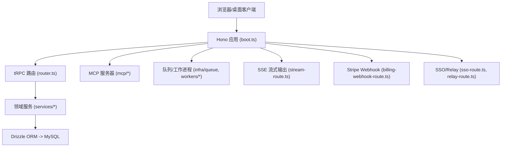
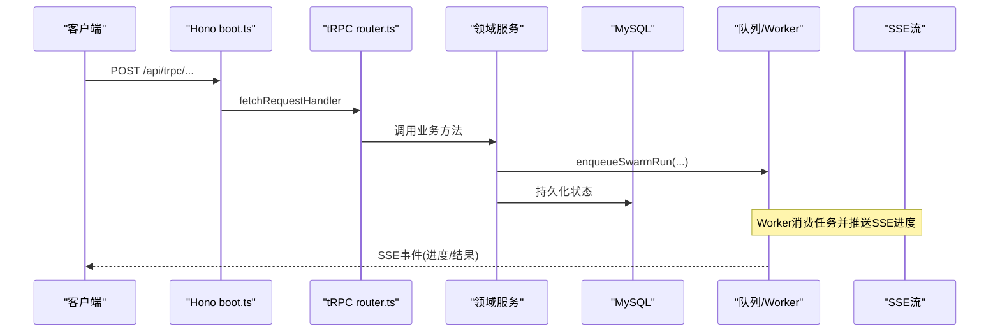
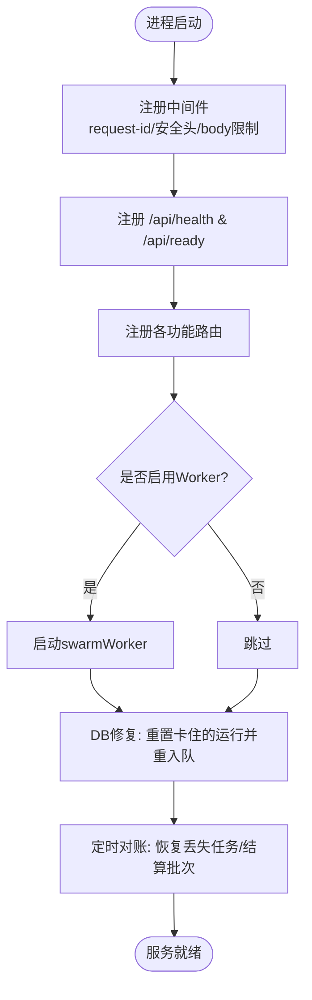
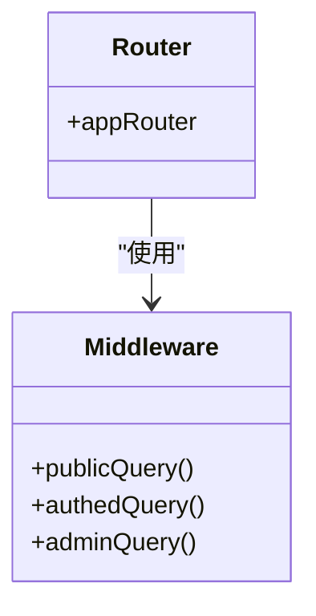
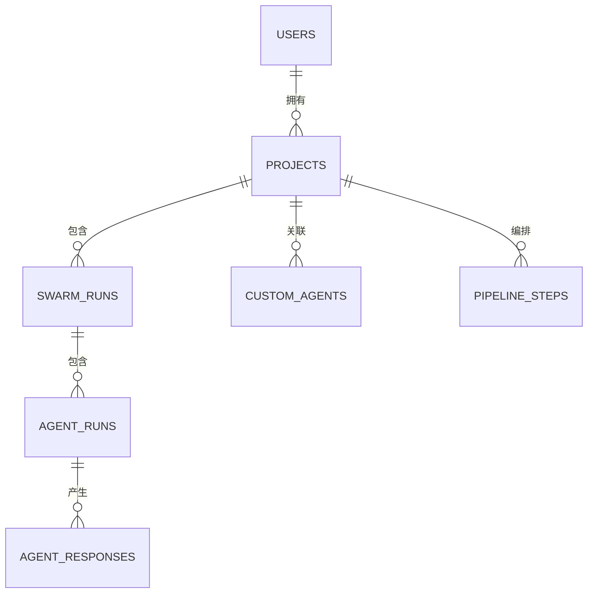
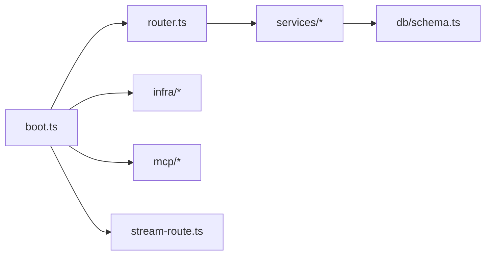

# 开发者指南

<cite>
**本文引用的文件**
- [README.md](file://README.md)
- [package.json](file://package.json)
- [eslint.config.js](file://eslint.config.js)
- [.prettierrc](file://.prettierrc)
- [tsconfig.json](file://tsconfig.json)
- [ENGINEERING.md](file://ENGINEERING.md)
- [DEPLOY.md](file://DEPLOY.md)
- [api/boot.ts](file://api/boot.ts)
- [api/router.ts](file://api/router.ts)
- [api/middleware.ts](file://api/middleware.ts)
- [api/lib/env.ts](file://api/lib/env.ts)
- [db/schema.ts](file://db/schema.ts)
</cite>

## 目录
1. [简介](#简介)
2. [项目结构](#项目结构)
3. [核心组件](#核心组件)
4. [架构总览](#架构总览)
5. [详细组件分析](#详细组件分析)
6. [依赖关系分析](#依赖关系分析)
7. [性能与可观测性](#性能与可观测性)
8. [故障排查指南](#故障排查指南)
9. [贡献指南与提交流程](#贡献指南与提交流程)
10. [代码规范与质量工具](#代码规范与质量工具)
11. [插件开发与API扩展](#插件开发与api扩展)
12. [结论](#结论)

## 简介
本指南面向DeeWaanAI的开发者，覆盖贡献流程、代码规范、提交流程、新功能/插件开发、API扩展、代码审查标准、分支管理策略、故障排查、日志与性能优化、以及ESLint/Prettier/TypeScript配置等。目标是帮助新成员快速理解代码组织并高效协作。

## 项目结构
- 后端服务：基于Hono + tRPC，提供REST/MCP/tRPC接口；内置健康检查、限流、队列、SSE流式输出、Stripe Webhook、SSO/Relay等能力。
- 前端应用：React 19 + Vite SPA，i18n多语言，通过tRPC调用后端。
- 数据库：MySQL + Drizzle ORM，schema集中定义，迁移脚本位于db/migrations。
- 基础设施：Redis（可选）作为队列与发布订阅后端；BullMQ任务队列；对象存储（S3兼容）。
- 文档与工程化：ENGINEERING.md为模块地图与请求流说明；DEPLOY.md提供Railway部署清单；根级README提供快速启动与环境变量说明。

**图表来源**
- [api/boot.ts:35-195](file://api/boot.ts#L35-L195)
- [api/router.ts:1-73](file://api/router.ts#L1-L73)
- [ENGINEERING.md:110-195](file://ENGINEERING.md#L110-L195)

**章节来源**
- [README.md:20-87](file://README.md#L20-L87)
- [ENGINEERING.md:9-106](file://ENGINEERING.md#L9-L106)

## 核心组件
- 应用启动与健康检查：boot.ts注册中间件、路由、MCP/SSO/Relay、健康/就绪端点、后台DB修复与定期对账、优雅关闭。
- tRPC路由聚合：router.ts组合所有子路由与插件路由，统一入口。
- 认证与授权：middleware.ts提供authed/admin过程构建器；权限判定由entitlements服务负责。
- 环境变量校验：env.ts集中读取并校验必需变量，生产环境拒绝不安全默认值。
- 数据模型：db/schema.ts定义用户、项目、代理、运行记录、市场、团队等表结构。

**章节来源**
- [api/boot.ts:35-195](file://api/boot.ts#L35-L195)
- [api/router.ts:1-73](file://api/router.ts#L1-L73)
- [api/middleware.ts:10-51](file://api/middleware.ts#L10-L51)
- [api/lib/env.ts:1-105](file://api/lib/env.ts#L1-L105)
- [db/schema.ts:17-800](file://db/schema.ts#L17-L800)

## 架构总览
- 请求路径：浏览器/桌面客户端 → Hono中间件（request-id、安全头、body限制）→ tRPC处理器 → 领域服务 → 数据库。
- MCP协议：OAuth发现/授权/令牌 → /mcp JSON-RPC工具调用，带范围与特性开关控制。
- 流水线执行：tRPC或MCP触发入队 → 工作进程消费 → LLM提供者 → SSE事件回传进度。
- Stripe Webhook：签名验证 → 订阅/购买/退款事件处理 → 权益同步。

**图表来源**
- [api/boot.ts:361-372](file://api/boot.ts#L361-L372)
- [ENGINEERING.md:142-153](file://ENGINEERING.md#L142-L153)

**章节来源**
- [ENGINEERING.md:110-195](file://ENGINEERING.md#L110-L195)

## 详细组件分析

### 应用启动与生命周期（boot.ts）
- 中间件：注入requestId、安全响应头、body大小限制。
- 健康/就绪：/api/health（liveness）、/api/ready（readiness），报告DB/Redis/队列/Worker状态。
- 路由注册：tRPC、SSE、上传、备份、等待列表、MCP、SSO、Relay等。
- 后台任务：启动时DB修复“卡住”的运行；每60秒对账恢复丢失任务、重置过期运行、结算批次。
- 优雅关闭：停止Worker、关闭队列、超时强制退出。

**图表来源**
- [api/boot.ts:37-135](file://api/boot.ts#L37-L135)
- [api/boot.ts:197-359](file://api/boot.ts#L197-L359)

**章节来源**
- [api/boot.ts:35-428](file://api/boot.ts#L35-L428)

### tRPC路由与中间件（router.ts, middleware.ts）
- 路由聚合：将各业务域路由（project、agent、pipeline、marketplace、team、billing等）与插件路由合并。
- 中间件：提供publicQuery、authedQuery、adminQuery；未登录或无管理员角色抛出对应错误。
- 上下文：在boot中通过createContext注入用户、locale、remoteIp等信息。

**图表来源**
- [api/router.ts:1-73](file://api/router.ts#L1-L73)
- [api/middleware.ts:10-51](file://api/middleware.ts#L10-L51)

**章节来源**
- [api/router.ts:1-73](file://api/router.ts#L1-L73)
- [api/middleware.ts:1-51](file://api/middleware.ts#L1-L51)

### 环境变量与安全（env.ts）
- 必需变量：APP_ID、APP_SECRET、DATABASE_URL、AI_SWARM_MASTER_KEY、MARKETPLACE_MASTER_KEY。
- 可选基础设施：REDIS_URL、STRIPE_*、SENTRY_DSN、BACKUP_TOKEN、S3_*等。
- 安全校验：生产环境拒绝已知不安全默认值；审计导出密钥可与会话密钥分离。

**章节来源**
- [api/lib/env.ts:1-105](file://api/lib/env.ts#L1-L105)
- [README.md:41-69](file://README.md#L41-L69)

### 数据模型概览（schema.ts）
- 核心实体：users、projects、agents、swarm_runs、agent_runs、agent_responses、debug_logs、project_files、custom_agents、pipeline_steps、pipeline_templates。
- 市场与信任：marketplace_listings、test_prompts、listing_reviews、ai_ensemble_reviews、reviewer_profiles、review_assignments、blind_review_tasks、creator_deposits、refund_ledger、marketplace_purchases、encrypted_prompts。
- 团队：teams、team_members（后续字段省略）。

**图表来源**
- [db/schema.ts:17-505](file://db/schema.ts#L17-L505)

**章节来源**
- [db/schema.ts:17-800](file://db/schema.ts#L17-L800)

## 依赖关系分析
- 运行时依赖：Hono、tRPC、BullMQ、ioredis、drizzle-orm、mysql2、stripe、jose、i18next等。
- 开发依赖：Vite、esbuild、TypeScript、Vitest、ESLint、Prettier、Tailwind等。
- 关键耦合：
  - boot.ts聚合所有路由与基础设施，变更需考虑副作用。
  - router.ts集中暴露tRPC API，新增功能优先在此注册。
  - env.ts集中环境变量，新增配置需同步校验与文档。
  - schema.ts驱动数据库结构，任何表变更需配合迁移。

**图表来源**
- [api/boot.ts:1-428](file://api/boot.ts#L1-L428)
- [api/router.ts:1-73](file://api/router.ts#L1-L73)
- [db/schema.ts:17-800](file://db/schema.ts#L17-L800)

**章节来源**
- [package.json:23-98](file://package.json#L23-L98)
- [ENGINEERING.md:9-106](file://ENGINEERING.md#L9-L106)

## 性能与可观测性
- 健康与就绪：/api/health用于存活探测，/api/ready用于就绪探测（要求MySQL与Redis可达）。
- 限流层：IP级固定窗口限流（注册/登录/审计导出/流水线执行），MCP按客户分层限流。
- 队列与并发：BullMQ支持分布式队列；worker并发可通过环境变量调整。
- 可观测性：Sentry集成（可选），结构化日志（JSON lines），requestId贯穿请求链路。
- 资源上限：PM2配置heap cap与重启策略；Docker镜像非root运行。

**章节来源**
- [api/boot.ts:73-135](file://api/boot.ts#L73-L135)
- [ENGINEERING.md:329-358](file://ENGINEERING.md#L329-L358)
- [README.md:89-103](file://README.md#L89-L103)

## 故障排查指南
- 启动失败：检查必需环境变量（APP_SECRET、DATABASE_URL等），生产环境会拒绝不安全默认值。
- 健康检查异常：/api/health返回degraded表示DB不可达；/api/ready返回not-ready表示Redis不可用或未配置。
- 流水线不执行：确认队列后端可用（Redis/BullMQ），Worker是否运行；查看DB-heal日志是否重入队。
- Stripe回调无效：确认STRIPE_SECRET_KEY与STRIPE_WEBHOOK_SECRET已配置；检查签名验证与事件处理。
- 备份失败：确认BACKUP_TOKEN与S3_*配置；手动触发POST /api/admin/backup。

**章节来源**
- [api/lib/env.ts:1-105](file://api/lib/env.ts#L1-L105)
- [api/boot.ts:73-135](file://api/boot.ts#L73-L135)
- [ENGINEERING.md:355-388](file://ENGINEERING.md#L355-L388)

## 贡献指南与提交流程
- 本地开发：
  - 安装依赖：npm ci
  - 初始化数据库：npm run db:push
  - 启动开发：npm run dev（Vite + Hono热重载）
- 提交前自检：
  - 类型检查：npm run check
  - 国际化一致性：npm run i18n:check
  - 单元测试：npm test
  - 构建产物：npm run build
- CI门禁：
  - 每次push/PR触发CI：check → i18n:check → test → build；集成测试在CI中连接真实MySQL/Redis。
- 分支策略建议：
  - main：稳定分支，仅接受经过CI通过的合并。
  - feature/*：新功能开发分支，完成后发起PR至main。
  - fix/*：缺陷修复分支。
  - 发布前进行冒烟测试：scripts/smoke-*.mjs。

**章节来源**
- [README.md:20-87](file://README.md#L20-L87)
- [ENGINEERING.md:367-372](file://ENGINEERING.md#L367-L372)

## 代码规范与质量工具
- ESLint：启用recommended规则、React Hooks与Refresh支持，针对TS/TSX。
- Prettier：统一格式化（分号、尾逗号、单引号、行宽80、Tab禁用等）。
- TypeScript：多项目引用（app/node/server），路径别名@/*、@contracts/*、@db/*。
- 脚本命令：lint、format、check、test、build等均在package.json中定义。

**章节来源**
- [eslint.config.js:1-24](file://eslint.config.js#L1-L24)
- [.prettierrc:1-16](file://.prettierrc#L1-L16)
- [tsconfig.json:1-29](file://tsconfig.json#L1-L29)
- [package.json:7-21](file://package.json#L7-L21)

## 插件开发与API扩展
- 插件路由：在plugins/registry中注册插件，router.ts自动挂载到appRouter。
- MCP工具：遵循“只增不改”的公共契约；在tools/index.ts注册，必要时扩展TOKEN_SCOPES。
- 计费计划：在config/plans.ts扩展PlanId与PLAN_CAPABILITIES，并在Stripe创建价格后绑定环境变量。
- LLM提供商：OpenAI兼容可直接添加默认项；自定义协议需实现LLMProviderAdapter并分支注册。
- 特性开关：通过feature_flags表与isFeatureEnabled进行运行时控制，埋点与降级需fail-closed。

**章节来源**
- [api/router.ts:31-70](file://api/router.ts#L31-L70)
- [ENGINEERING.md:229-297](file://ENGINEERING.md#L229-L297)

## 结论
本指南从架构、组件、依赖、性能、故障排查、贡献流程与代码规范等方面系统梳理了DeeWaanAI的开发实践。建议新成员先阅读ENGINEERING.md与README.md，再根据需求定位具体模块；在修改核心入口（boot.ts、router.ts、env.ts、schema.ts）时务必谨慎，并通过完整门禁与冒烟测试确保稳定性。