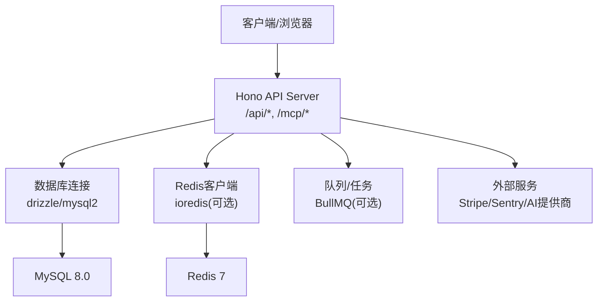
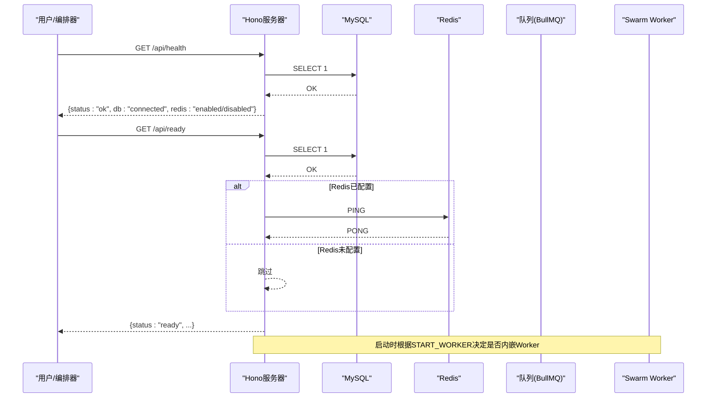
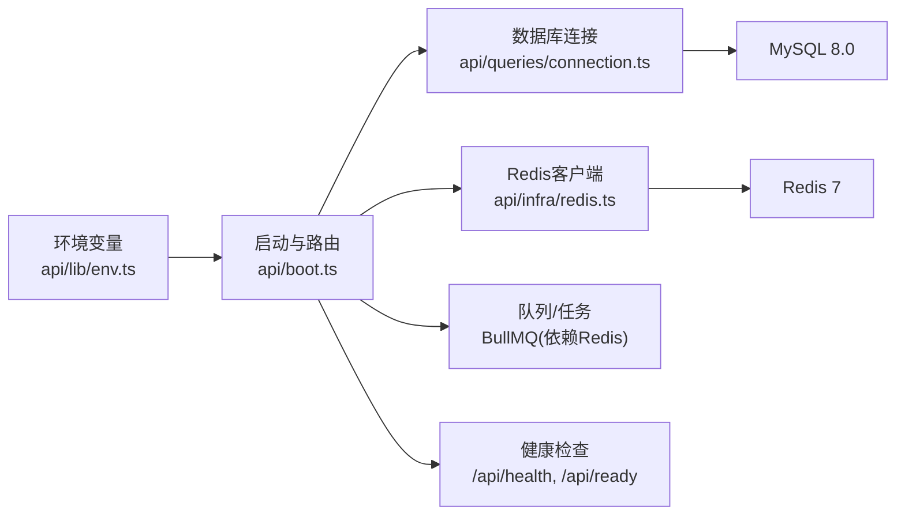

# 常见问题

<cite>
**本文引用的文件**
- [README.md](file://README.md)
- [DEPLOY.md](file://DEPLOY.md)
- [docker-compose.yml](file://docker-compose.yml)
- [Dockerfile](file://Dockerfile)
- [package.json](file://package.json)
- [api/lib/env.ts](file://api/lib/env.ts)
- [api/boot.ts](file://api/boot.ts)
- [drizzle.config.ts](file://drizzle.config.ts)
- [ecosystem.config.cjs](file://ecosystem.config.cjs)
- [api/infra/redis.ts](file://api/infra/redis.ts)
- [api/queries/connection.ts](file://api/queries/connection.ts)
- [db/schema.ts](file://db/schema.ts)
</cite>

## 目录
1. [简介](#简介)
2. [项目结构](#项目结构)
3. [核心组件](#核心组件)
4. [架构总览](#架构总览)
5. [详细组件分析](#详细组件分析)
6. [依赖关系分析](#依赖关系分析)
7. [性能注意事项](#性能注意事项)
8. [故障排查指南](#故障排查指南)
9. [结论](#结论)
10. [附录](#附录)

## 简介
本文件面向开发、运维与测试人员，汇总DeeWaanAI在开发与部署过程中常见的问题与排障方法。重点覆盖：
- Docker容器启动失败
- 环境变量配置错误
- 数据库连接超时或迁移失败
- Redis缓存异常
- 第三方API调用失败（如Stripe、Sentry、AI提供商）
- 权限认证问题（令牌、密钥、代理信任）

每个问题均提供症状描述、原因分析与解决步骤，并附带错误代码对照表与快速修复方案，帮助快速定位与恢复服务。

## 项目结构
- 应用入口与生命周期管理：Node进程同时承载API、MCP表面与静态SPA；健康检查与健康就绪探针用于编排器探测。
- 基础设施：MySQL（drizzle ORM）、Redis（队列/发布订阅，缺失时回退到内存实现）。
- 构建与运行：Vite构建前端，esbuild打包后端；生产通过Docker镜像或PM2运行。
- 关键脚本：数据库推送/迁移、类型检查、测试、国际化校验等。

图表来源
- [api/boot.ts:73-135](file://api/boot.ts#L73-L135)
- [api/queries/connection.ts:10-18](file://api/queries/connection.ts#L10-L18)
- [api/infra/redis.ts:22-59](file://api/infra/redis.ts#L22-L59)

章节来源
- [README.md:20-39](file://README.md#L20-L39)
- [package.json:7-21](file://package.json#L7-L21)

## 核心组件
- 环境配置：集中读取并校验必要环境变量，生产环境拒绝使用默认/不安全值。
- 健康检查：/api/health返回进程存活与数据库可达性；/api/ready要求数据库与Redis（若启用）均可用。
- 数据库连接：单例Drizzle实例，支持只读副本（可选）。
- Redis客户端：惰性连接、指数退避重试，失败后降级为内存实现，确保系统不崩溃。
- 启动流程：注册路由、启动工作进程、执行数据库自愈与周期协调任务。

章节来源
- [api/lib/env.ts:3-19](file://api/lib/env.ts#L3-L19)
- [api/boot.ts:64-135](file://api/boot.ts#L64-L135)
- [api/queries/connection.ts:10-42](file://api/queries/connection.ts#L10-L42)
- [api/infra/redis.ts:1-88](file://api/infra/redis.ts#L1-L88)

## 架构总览

图表来源
- [api/boot.ts:73-135](file://api/boot.ts#L73-L135)
- [api/boot.ts:64-71](file://api/boot.ts#L64-L71)

## 详细组件分析

### 环境变量与启动校验
- 行为：生产环境缺少必需变量会抛错；对敏感变量进行“禁止的默认值”校验。
- 影响：APP_SECRET、DATABASE_URL、AI_SWARM_MASTER_KEY、MARKETPLACE_MASTER_KEY等缺失将阻止启动或导致功能不可用。
- 建议：在CI/CD中注入真实密钥；本地开发使用.env；生产禁用默认值。

章节来源
- [api/lib/env.ts:3-19](file://api/lib/env.ts#L3-L19)
- [api/lib/env.ts:21-35](file://api/lib/env.ts#L21-L35)

### 健康检查与就绪探针
- /api/health：只要进程存活且数据库可达即返回200；否则503并标记degraded。
- /api/ready：需要数据库与Redis（若启用）均正常才返回200；否则503。
- 用途：编排器（Docker/K8s/Railway）据此决定流量接入与重启策略。

章节来源
- [api/boot.ts:73-135](file://api/boot.ts#L73-L135)

### 数据库连接与迁移
- 连接：通过drizzle/mysql2建立单例连接；可选只读副本。
- 迁移：drizzle-kit生成/应用迁移；生产通常先推schema或执行迁移再启动服务。
- 自愈：启动时会把卡住的running/pending任务重置并重入队列，避免僵尸任务。

章节来源
- [api/queries/connection.ts:10-42](file://api/queries/connection.ts#L10-L42)
- [drizzle.config.ts:1-17](file://drizzle.config.ts#L1-L17)
- [api/boot.ts:197-263](file://api/boot.ts#L197-L263)

### Redis与队列
- 行为：未配置REDIS_URL则使用内存回退；配置后尝试连接，失败多次后记录告警并回退。
- 队列：BullMQ作为任务队列；无Redis时降级为内存队列，适合单机。
- 健康：/api/ready在Redis启用时会PING验证连通性。

章节来源
- [api/infra/redis.ts:1-88](file://api/infra/redis.ts#L1-L88)
- [api/boot.ts:101-135](file://api/boot.ts#L101-L135)

### 启动与工作进程
- 内嵌Worker：默认在Web进程中消费队列；可通过START_WORKER=false拆分独立Worker进程。
- 优雅关闭：停止Worker、关闭队列，最长等待30秒完成请求处理。

章节来源
- [api/boot.ts:64-71](file://api/boot.ts#L64-L71)
- [api/boot.ts:383-415](file://api/boot.ts#L383-L415)

## 依赖关系分析

图表来源
- [api/lib/env.ts:21-35](file://api/lib/env.ts#L21-L35)
- [api/boot.ts:64-135](file://api/boot.ts#L64-L135)
- [api/queries/connection.ts:10-18](file://api/queries/connection.ts#L10-L18)
- [api/infra/redis.ts:22-59](file://api/infra/redis.ts#L22-L59)

章节来源
- [package.json:23-72](file://package.json#L23-L72)

## 性能注意事项
- 单进程限制：PM2配置限制堆大小与最大内存，避免OOM。
- 队列并发：研究模式下的并发度由环境变量控制，避免压垮下游LLM提供商。
- 只读副本：读多写少场景可开启read replica降低主库压力。
- 日志级别：通过LOG_LEVEL调整输出量，生产建议info及以上。

章节来源
- [ecosystem.config.cjs:1-32](file://ecosystem.config.cjs#L1-L32)
- [api/lib/env.ts:86-88](file://api/lib/env.ts#L86-L88)
- [api/queries/connection.ts:22-42](file://api/queries/connection.ts#L22-L42)

## 故障排查指南

### 1) Docker容器启动失败
- 症状
  - 容器反复重启或无法访问端口
  - 健康检查失败（/api/health返回503或/ api/ready返回503）
- 可能原因
  - 缺少必需环境变量（如APP_SECRET、DATABASE_URL）
  - 数据库/Redis未就绪或网络不通
  - 端口冲突（默认3000）
- 诊断步骤
  - 查看容器日志，确认是否抛出“缺少环境变量”或“安全默认值”错误
  - 检查docker-compose中MySQL/Redis是否健康
  - 确认端口映射与环境变量正确
- 解决步骤
  - 补齐.env中的必需变量，生产环境必须替换默认密钥
  - 确保MySQL与Redis服务可用后再启动应用
  - 如需自定义端口，修改PORT并更新编排配置
- 预防建议
  - 在CI中校验.env模板完整性
  - 使用编排器的健康检查与就绪探针

章节来源
- [api/lib/env.ts:3-19](file://api/lib/env.ts#L3-L19)
- [docker-compose.yml:1-52](file://docker-compose.yml#L1-L52)
- [Dockerfile:30-38](file://Dockerfile#L30-L38)
- [api/boot.ts:73-135](file://api/boot.ts#L73-L135)

### 2) 环境变量配置错误
- 症状
  - 启动即报错，提示缺少必需变量或使用默认密钥
  - 部分功能不可用（如Stripe、备份、AI分流）
- 可能原因
  - 生产环境未设置APP_SECRET、DATABASE_URL等
  - 使用了示例/默认值
  - 第三方服务密钥未配置
- 诊断步骤
  - 检查NODE_ENV是否为production
  - 核对env.ts中对必需变量的校验逻辑
- 解决步骤
  - 按README说明配置所有必需变量
  - 生产环境使用强随机密钥，避免默认值
  - 对可选功能（Stripe、Sentry、AI分流）按需配置
- 预防建议
  - 使用密钥管理服务（Vault/云平台Secrets）
  - 在部署流水线中强制校验必填项

章节来源
- [api/lib/env.ts:3-19](file://api/lib/env.ts#L3-L19)
- [README.md:41-69](file://README.md#L41-L69)

### 3) 数据库连接超时或迁移失败
- 症状
  - /api/health返回degraded或503
  - 启动时报数据库连接失败
  - drizzle命令报错或迁移冲突
- 可能原因
  - DATABASE_URL格式错误或网络不可达
  - MySQL未启动或权限不足
  - schema与迁移不一致
- 诊断步骤
  - 直接测试数据库连通性（mysql CLI或工具）
  - 查看drizzle配置与当前迁移状态
  - 检查只读副本是否误用写入
- 解决步骤
  - 修正DATABASE_URL，确保主机、端口、用户名、密码、数据库名正确
  - 首次部署使用db:push或执行迁移脚本
  - 读写分离时仅对只读查询使用getReadDb()
- 预防建议
  - 在CI中执行类型检查与迁移预检
  - 生产环境使用只读副本承载报表/浏览类查询

章节来源
- [api/queries/connection.ts:10-42](file://api/queries/connection.ts#L10-L42)
- [drizzle.config.ts:1-17](file://drizzle.config.ts#L1-L17)
- [db/schema.ts:17-53](file://db/schema.ts#L17-L53)

### 4) Redis缓存异常
- 症状
  - /api/ready返回not-ready（当REDIS_URL已配置）
  - 队列任务堆积或丢失
  - 速率限制/发布订阅失效
- 可能原因
  - REDIS_URL无效或网络不可达
  - Redis实例资源不足或限流
  - 客户端连接参数不当
- 诊断步骤
  - 检查isRedisEnabled与getRedis日志
  - 使用redis-cli ping验证连通性
  - 观察是否触发指数退避与放弃连接
- 解决步骤
  - 修正REDIS_URL或网络策略
  - 若暂时不可用，允许系统回退到内存实现（功能受限但稳定）
  - 调整连接超时与重试策略（谨慎修改）
- 预防建议
  - 为Redis配置监控与告警
  - 重要路径增加熔断与降级逻辑

章节来源
- [api/infra/redis.ts:22-88](file://api/infra/redis.ts#L22-L88)
- [api/boot.ts:101-135](file://api/boot.ts#L101-L135)

### 5) 第三方API调用失败（Stripe、Sentry、AI提供商）
- 症状
  - 计费/支付相关接口返回503
  - 错误上报未生效
  - AI分流/模型调用失败或超时
- 可能原因
  - 对应密钥未配置或无效
  - 网络/防火墙阻断
  - 配额/限流触发
- 诊断步骤
  - 检查env中STRIPE_*、SENTRY_DSN、AI_TRIAGE_*等
  - 查看日志中的错误信息与重试情况
- 解决步骤
  - 补齐密钥并确保网络可达
  - 对AI提供商设置合理超时与重试
  - 对非关键能力（如Sentry）采用best-effort，不影响主流程
- 预防建议
  - 为第三方调用增加熔断与降级
  - 在CI中做最小连通性测试

章节来源
- [api/lib/env.ts:36-88](file://api/lib/env.ts#L36-L88)
- [api/boot.ts:61-63](file://api/boot.ts#L61-L63)

### 6) 权限认证问题（令牌、密钥、代理信任）
- 症状
  - 备份接口被拒绝
  - 速率限制未按预期生效
  - 审计导出签名校验失败
- 可能原因
  - BACKUP_TOKEN未设置或Token不匹配
  - TRUSTED_PROXY设置不当导致IP识别错误
  - APP_SECRET旋转后历史导出校验失败
- 诊断步骤
  - 检查备份端点鉴权与S3配置
  - 核对TRUSTED_PROXY与反向代理头
  - 确认AUDIT_EXPORT_KEY与APP_SECRET配置
- 解决步骤
  - 为备份接口设置BACKUP_TOKEN并配置S3_*
  - 直连互联网时设置TRUSTED_PROXY=false
  - 使用独立的AUDIT_EXPORT_KEY以支持密钥轮换
- 预防建议
  - 在部署清单中明确安全变量
  - 定期轮换密钥并验证兼容性

章节来源
- [api/lib/env.ts:43-70](file://api/lib/env.ts#L43-L70)
- [api/lib/env.ts:57-63](file://api/lib/env.ts#L57-L63)

### 7) 队列与工作进程问题
- 症状
  - 任务长时间pending或running
  - Worker未消费任务
  - 重启后任务丢失或重复
- 可能原因
  - 队列后端不可用（Redis）
  - START_WORKER配置不当
  - 进程崩溃导致僵尸任务
- 诊断步骤
  - 检查/ api/health中worker与queue状态
  - 查看启动时的DB自愈与周期协调日志
- 解决步骤
  - 确保队列后端可用或接受内存回退
  - 拆分独立Worker进程（START_WORKER=false）
  - 利用自愈机制重入丢失任务
- 预防建议
  - 监控队列长度与消费延迟
  - 设置合理的超时与重试上限

章节来源
- [api/boot.ts:64-71](file://api/boot.ts#L64-L71)
- [api/boot.ts:197-359](file://api/boot.ts#L197-L359)

### 8) 构建与部署问题
- 症状
  - npm run build失败
  - PM2进程频繁重启
  - 端口占用或服务不可达
- 可能原因
  - 依赖安装失败或版本冲突
  - 内存不足导致构建/运行崩溃
  - 端口被占用或未暴露
- 诊断步骤
  - 查看构建日志与npm错误
  - 检查PM2日志与内存限制
  - 确认端口与反向代理配置
- 解决步骤
  - 清理依赖并重新安装
  - 调整NODE_OPTIONS与max_memory_restart
  - 释放端口或修改PORT
- 预防建议
  - 使用固定版本的依赖锁文件
  - 在CI中执行完整构建与测试

章节来源
- [package.json:7-21](file://package.json#L7-L21)
- [ecosystem.config.cjs:1-32](file://ecosystem.config.cjs#L1-L32)
- [Dockerfile:30-38](file://Dockerfile#L30-L38)

## 结论
通过统一的环境变量管理、健壮的健康检查与就绪探针、数据库与Redis的容错设计，以及工作进程的自愈与协调机制，DeeWaanAI能够在多种异常场景下保持稳定运行。建议在部署前完成环境校验、依赖连通性测试与监控告警配置，以降低故障率并缩短恢复时间。

## 附录

### 错误代码与快速修复对照表
- 启动阶段
  - 缺少必需环境变量（生产）：检查APP_SECRET、DATABASE_URL等必填项
  - 使用默认/不安全密钥：替换为强随机密钥
- 健康检查
  - /api/health返回503：检查数据库连通性与进程状态
  - /api/ready返回503：检查Redis（若启用）连通性
- 数据库
  - 连接失败：校验DATABASE_URL、网络与权限
  - 迁移失败：执行db:generate/db:migrate或db:push
- Redis
  - 连接失败：检查REDIS_URL与网络；允许内存回退
- 第三方API
  - Stripe不可用：配置STRIPE_*并在测试模式验证
  - Sentry未上报：配置SENTRY_DSN
  - AI分流失败：配置AI_TRIAGE_*并验证网络
- 权限与安全
  - 备份接口拒绝：设置BACKUP_TOKEN与S3_*
  - 速率限制异常：核对TRUSTED_PROXY与代理头
- 构建与部署
  - 构建失败：清理依赖并重新安装
  - 进程频繁重启：调整内存限制与日志轮转

章节来源
- [api/lib/env.ts:3-19](file://api/lib/env.ts#L3-L19)
- [api/boot.ts:73-135](file://api/boot.ts#L73-L135)
- [drizzle.config.ts:1-17](file://drizzle.config.ts#L1-L17)
- [api/infra/redis.ts:22-88](file://api/infra/redis.ts#L22-L88)
- [ecosystem.config.cjs:1-32](file://ecosystem.config.cjs#L1-L32)