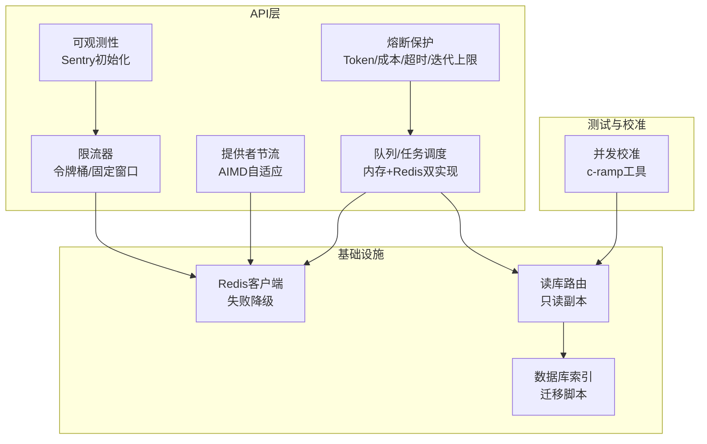
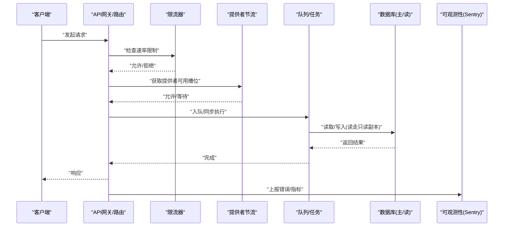
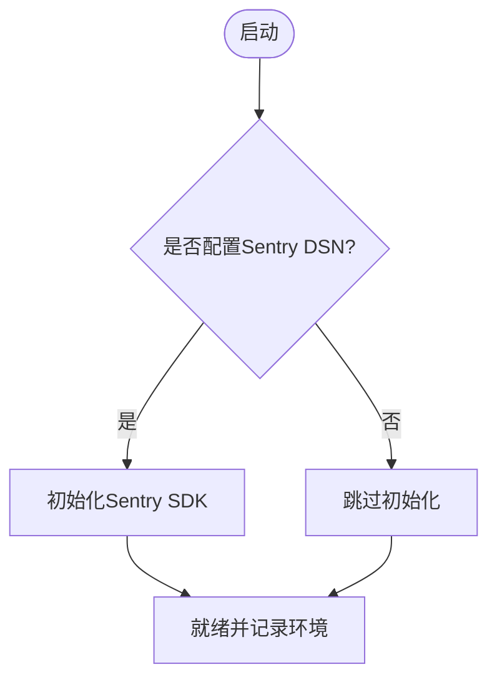
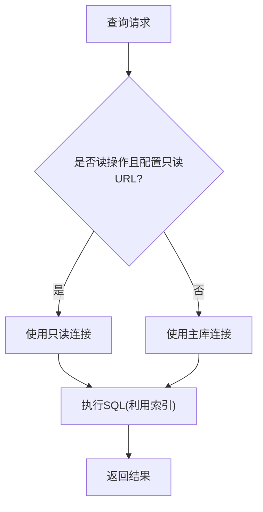
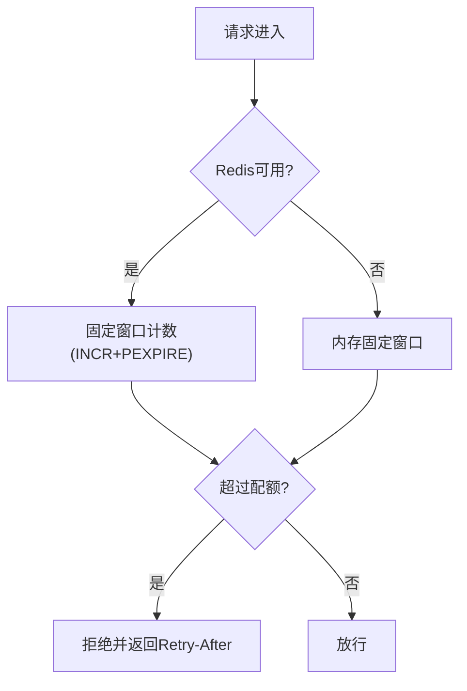
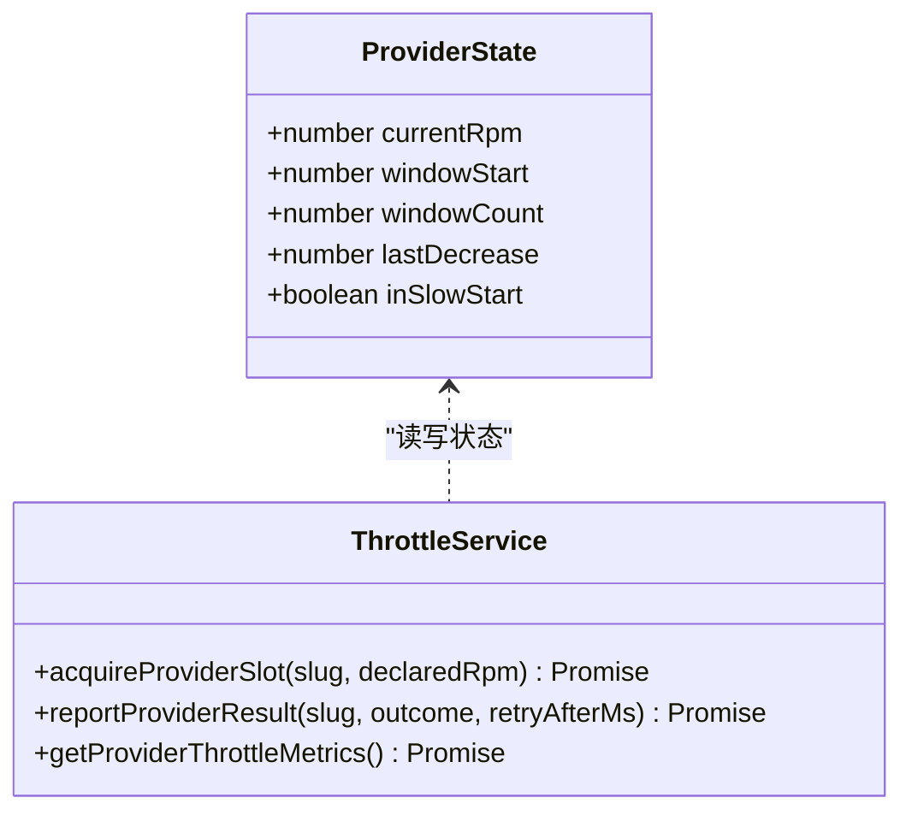
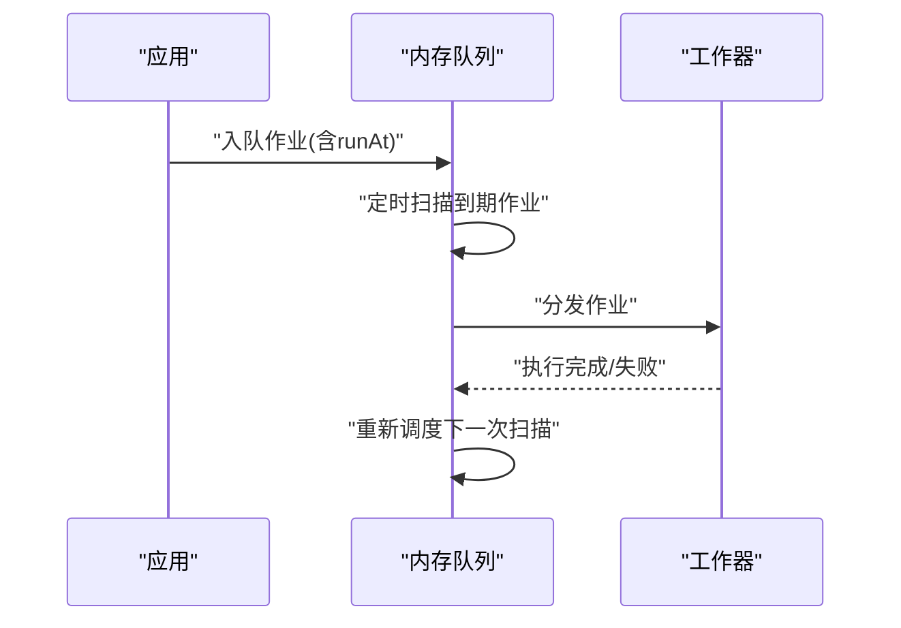
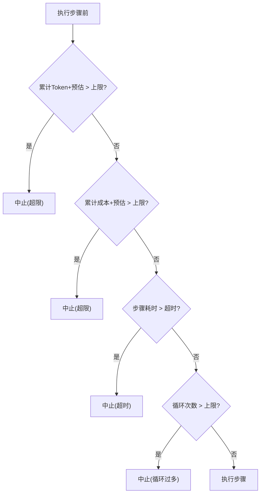
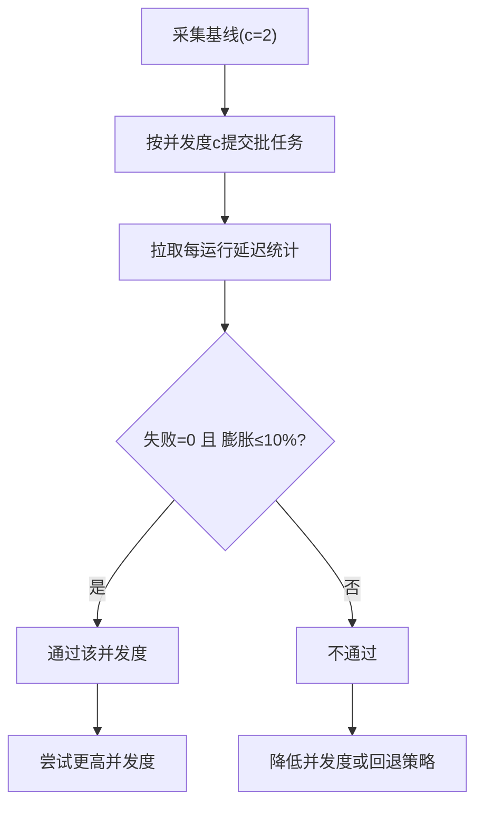
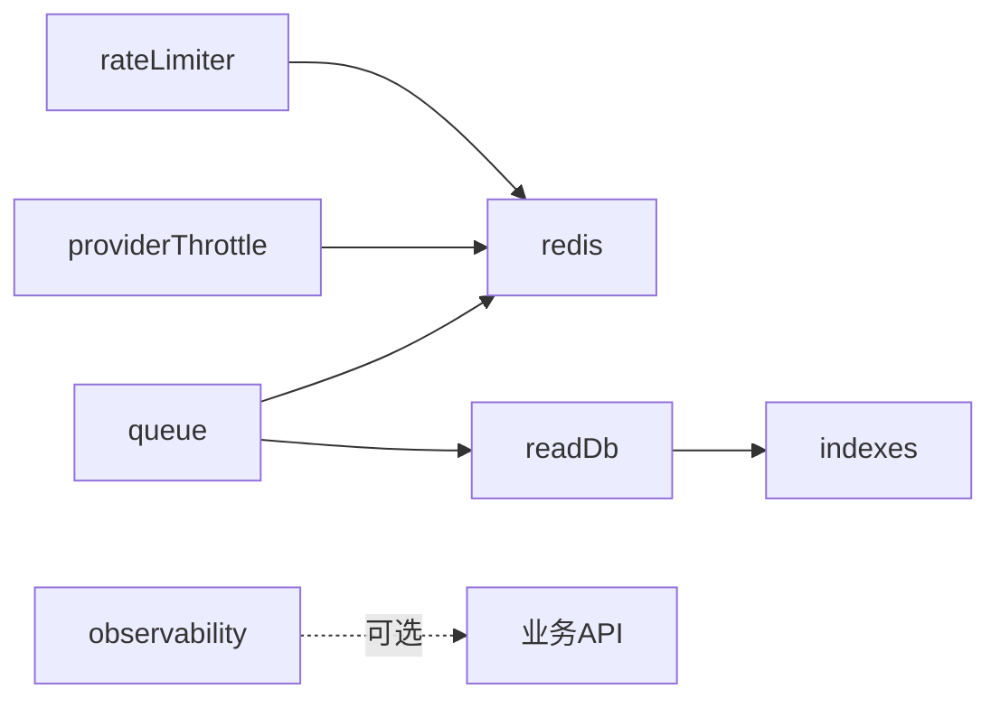

# 性能优化

<cite>
**本文引用的文件**
- [api/lib/observability.ts](file://api/lib/observability.ts)
- [api/infra/redis.ts](file://api/infra/redis.ts)
- [api/lib/rateLimiter.ts](file://api/lib/rateLimiter.ts)
- [api/lib/providerThrottle.ts](file://api/lib/providerThrottle.ts)
- [api/queries/connection.ts](file://api/queries/connection.ts)
- [db/migrate-indexes.sql](file://db/migrate-indexes.sql)
- [api/plugins/circuit-breaker/index.ts](file://api/plugins/circuit-breaker/index.ts)
- [api/infra/queue.ts](file://api/infra/queue.ts)
- [research/orchestration-economics/code/cramp_test.mjs](file://research/orchestration-economics/code/cramp_test.mjs)
- [DeeWaanAI-Next/LIMITER-FIX-HANDOFF.md](file://DeeWaanAI-Next/LIMITER-FIX-HANDOFF.md)
- [api/lib/logger.ts](file://api/lib/logger.ts)
</cite>

## 目录
1. [简介](#简介)
2. [项目结构](#项目结构)
3. [核心组件](#核心组件)
4. [架构总览](#架构总览)
5. [详细组件分析](#详细组件分析)
6. [依赖关系分析](#依赖关系分析)
7. [性能考量](#性能考量)
8. [故障排查指南](#故障排查指南)
9. [结论](#结论)
10. [附录](#附录)

## 简介
本指南面向DeeWaanAI的性能优化与调优，覆盖应用性能监控、数据库查询分析与内存使用监控；总结常见瓶颈与优化策略（索引优化、缓存与限流、异步处理）；提供负载/压力/基准测试方法；给出生产环境资源配置、负载均衡与扩容建议；并通过实际案例展示优化前后效果对比。重点聚焦：API响应时间优化、数据库查询优化、内存泄漏检测、并发控制、缓存命中率提升。

## 项目结构
本项目在API层提供了完善的可观测性、限流、外部服务节流、队列与连接管理，配合数据库索引迁移与并发校准脚本，形成“可观测—可控—可测”的闭环性能体系。

图表来源
- [api/lib/observability.ts:1-34](file://api/lib/observability.ts#L1-L34)
- [api/lib/rateLimiter.ts:1-216](file://api/lib/rateLimiter.ts#L1-L216)
- [api/lib/providerThrottle.ts:1-275](file://api/lib/providerThrottle.ts#L1-L275)
- [api/infra/queue.ts:81-154](file://api/infra/queue.ts#L81-L154)
- [api/infra/redis.ts:1-88](file://api/infra/redis.ts#L1-L88)
- [api/queries/connection.ts:1-42](file://api/queries/connection.ts#L1-L42)
- [db/migrate-indexes.sql:1-111](file://db/migrate-indexes.sql#L1-L111)
- [research/orchestration-economics/code/cramp_test.mjs:1-195](file://research/orchestration-economics/code/cramp_test.mjs#L1-L195)

章节来源
- [api/lib/observability.ts:1-34](file://api/lib/observability.ts#L1-L34)
- [api/lib/rateLimiter.ts:1-216](file://api/lib/rateLimiter.ts#L1-L216)
- [api/lib/providerThrottle.ts:1-275](file://api/lib/providerThrottle.ts#L1-L275)
- [api/infra/queue.ts:81-154](file://api/infra/queue.ts#L81-L154)
- [api/infra/redis.ts:1-88](file://api/infra/redis.ts#L1-L88)
- [api/queries/connection.ts:1-42](file://api/queries/connection.ts#L1-L42)
- [db/migrate-indexes.sql:1-111](file://db/migrate-indexes.sql#L1-L111)
- [research/orchestration-economics/code/cramp_test.mjs:1-195](file://research/orchestration-economics/code/cramp_test.mjs#L1-L195)

## 核心组件
- 可观测性：Sentry按需加载与初始化，失败不阻断服务，便于定位线上异常与慢请求。
- 限流：令牌桶与固定窗口两种策略，支持Redis分布式计数与进程内降级，提供多档速率限制模板与客户分级配额。
- 提供者节流：基于AIMD算法自适应调整各LLM提供者的RPM，结合重试与退避，避免雪崩。
- 队列与任务：内存队列+定时调度，具备幂等与失败重试能力；当Redis不可用时自动降级为内存模式。
- 读库路由：按配置将读请求路由到只读副本，降低主库压力。
- 数据库索引：集中化的二级索引迁移脚本，覆盖高频查询路径。
- 熔断保护：对流水线执行进行Token预算、花费上限、步骤超时与循环次数限制，防止失控消耗。
- 并发校准：通过c-ramp工具在不同并发度下评估延迟膨胀与失败率，选择最优并发水平。

章节来源
- [api/lib/observability.ts:1-34](file://api/lib/observability.ts#L1-L34)
- [api/lib/rateLimiter.ts:1-216](file://api/lib/rateLimiter.ts#L1-L216)
- [api/lib/providerThrottle.ts:1-275](file://api/lib/providerThrottle.ts#L1-L275)
- [api/infra/queue.ts:81-154](file://api/infra/queue.ts#L81-L154)
- [api/queries/connection.ts:1-42](file://api/queries/connection.ts#L1-L42)
- [db/migrate-indexes.sql:1-111](file://db/migrate-indexes.sql#L1-L111)
- [api/plugins/circuit-breaker/index.ts:1-186](file://api/plugins/circuit-breaker/index.ts#L1-L186)
- [research/orchestration-economics/code/cramp_test.mjs:1-195](file://research/orchestration-economics/code/cramp_test.mjs#L1-L195)

## 架构总览
下图展示了从请求进入、限流与节流、队列异步化、数据库读写分离到可观测性与并发校准的整体链路。

图表来源
- [api/lib/rateLimiter.ts:1-216](file://api/lib/rateLimiter.ts#L1-L216)
- [api/lib/providerThrottle.ts:1-275](file://api/lib/providerThrottle.ts#L1-L275)
- [api/infra/queue.ts:81-154](file://api/infra/queue.ts#L81-L154)
- [api/queries/connection.ts:1-42](file://api/queries/connection.ts#L1-L42)
- [api/lib/observability.ts:1-34](file://api/lib/observability.ts#L1-L34)

## 详细组件分析

### 应用性能监控（APM）与日志
- Sentry按需初始化，未配置时跳过SDK加载，确保可观测性不影响启动与运行。
- 结构化日志输出，支持级别过滤与请求追踪ID生成，便于关联调用链。

图表来源
- [api/lib/observability.ts:1-34](file://api/lib/observability.ts#L1-L34)
- [api/lib/logger.ts:1-32](file://api/lib/logger.ts#L1-L32)

章节来源
- [api/lib/observability.ts:1-34](file://api/lib/observability.ts#L1-L34)
- [api/lib/logger.ts:1-32](file://api/lib/logger.ts#L1-L32)

### 数据库查询优化与读库路由
- 读库路由：当配置了只读地址时，读请求自动路由至只读实例，降低主库压力。
- 索引优化：集中式索引迁移脚本为关键表建立二级索引，覆盖用户、项目、状态、外键等高频查询维度。

图表来源
- [api/queries/connection.ts:1-42](file://api/queries/connection.ts#L1-L42)
- [db/migrate-indexes.sql:1-111](file://db/migrate-indexes.sql#L1-L111)

章节来源
- [api/queries/connection.ts:1-42](file://api/queries/connection.ts#L1-L42)
- [db/migrate-indexes.sql:1-111](file://db/migrate-indexes.sql#L1-L111)

### 限流与缓存命中率提升
- 令牌桶限流：进程内维护令牌桶，周期性清理过期桶，适用于单机快速限流。
- 固定窗口限流：基于Redis的INCR+PEXPIRE实现跨节点共享配额，失败回落到内存实现。
- 客户分级配额：按solo/team/admin三档设置不同窗口配额，满足差异化SLA。

图表来源
- [api/lib/rateLimiter.ts:1-216](file://api/lib/rateLimiter.ts#L1-L216)
- [api/infra/redis.ts:1-88](file://api/infra/redis.ts#L1-L88)

章节来源
- [api/lib/rateLimiter.ts:1-216](file://api/lib/rateLimiter.ts#L1-L216)
- [api/infra/redis.ts:1-88](file://api/infra/redis.ts#L1-L88)

### 提供者节流（AIMD）与重试退避
- AIMD自适应：根据成功/429反馈动态调整RPM，包含慢启动、拥塞避免与乘性降速。
- 状态持久化：优先使用Redis存储状态，失败回落到内存Map，保证可用性。
- 重试与退避：遇到限流错误时触发ProviderThrottledError，交由上层重入队列或退避。

图表来源
- [api/lib/providerThrottle.ts:1-275](file://api/lib/providerThrottle.ts#L1-L275)
- [DeeWaanAI-Next/LIMITER-FIX-HANDOFF.md:73-107](file://DeeWaanAI-Next/LIMITER-FIX-HANDOFF.md#L73-L107)

章节来源
- [api/lib/providerThrottle.ts:1-275](file://api/lib/providerThrottle.ts#L1-L275)
- [DeeWaanAI-Next/LIMITER-FIX-HANDOFF.md:73-107](file://DeeWaanAI-Next/LIMITER-FIX-HANDOFF.md#L73-L107)

### 异步处理与队列
- 内存队列：以Map存储作业，定时器驱动消费，支持幂等与失败重试。
- 降级策略：无Redis时完全内存运行，保障基本吞吐。
- 工作器注册：作业发现处理器后执行，失败记录日志。

图表来源
- [api/infra/queue.ts:81-154](file://api/infra/queue.ts#L81-L154)

章节来源
- [api/infra/queue.ts:81-154](file://api/infra/queue.ts#L81-L154)

### 熔断保护（Token/成本/超时/迭代）
- 预算控制：每个流水线运行累计Token与成本，超过阈值即中止。
- 步骤超时：单步执行超时时中断，防止长尾阻塞。
- 循环保护：WHILE循环次数上限，避免无限循环。

图表来源
- [api/plugins/circuit-breaker/index.ts:1-186](file://api/plugins/circuit-breaker/index.ts#L1-L186)

章节来源
- [api/plugins/circuit-breaker/index.ts:1-186](file://api/plugins/circuit-breaker/index.ts#L1-L186)

### 并发控制与校准（c-ramp）
- 目标：找到最大稳定并发度，使失败率为0且中位延迟膨胀≤10%。
- 方法：自上而下二分，提交批量任务，拉取DB中的延迟统计并与基线对比。
- 决策：选择通过的最高并发度作为生产参数。

图表来源
- [research/orchestration-economics/code/cramp_test.mjs:1-195](file://research/orchestration-economics/code/cramp_test.mjs#L1-L195)

章节来源
- [research/orchestration-economics/code/cramp_test.mjs:1-195](file://research/orchestration-economics/code/cramp_test.mjs#L1-L195)

## 依赖关系分析
- 限流与节流均依赖Redis，但具备健壮的内存降级路径，确保服务高可用。
- 队列模块同时依赖Redis与内存状态，按可用性选择执行路径。
- 读库路由与索引迁移共同构成数据库性能优化的基础。
- 可观测性独立于业务逻辑，仅在启用时注入。

图表来源
- [api/lib/rateLimiter.ts:1-216](file://api/lib/rateLimiter.ts#L1-L216)
- [api/lib/providerThrottle.ts:1-275](file://api/lib/providerThrottle.ts#L1-L275)
- [api/infra/queue.ts:81-154](file://api/infra/queue.ts#L81-L154)
- [api/queries/connection.ts:1-42](file://api/queries/connection.ts#L1-L42)
- [db/migrate-indexes.sql:1-111](file://db/migrate-indexes.sql#L1-L111)
- [api/lib/observability.ts:1-34](file://api/lib/observability.ts#L1-L34)

章节来源
- [api/lib/rateLimiter.ts:1-216](file://api/lib/rateLimiter.ts#L1-L216)
- [api/lib/providerThrottle.ts:1-275](file://api/lib/providerThrottle.ts#L1-L275)
- [api/infra/queue.ts:81-154](file://api/infra/queue.ts#L81-L154)
- [api/queries/connection.ts:1-42](file://api/queries/connection.ts#L1-L42)
- [db/migrate-indexes.sql:1-111](file://db/migrate-indexes.sql#L1-L111)
- [api/lib/observability.ts:1-34](file://api/lib/observability.ts#L1-L34)

## 性能考量
- API响应时间优化
  - 前置限流与提供者节流减少无效请求与过载，降低尾部延迟。
  - 读库路由分担读压力，缩短查询时延。
  - 使用熔断保护避免长尾步骤拖垮整体响应。
- 数据库查询优化
  - 依据迁移脚本完善二级索引，覆盖用户、项目、状态、外键等维度。
  - 读操作走只读副本，写操作保持强一致。
- 内存使用监控与泄漏检测
  - 关注内存队列与Map结构的生命周期与清理策略（如过期窗口清理）。
  - 通过日志与Sentry捕获异常堆栈，结合内存快照定位增长点。
- 并发控制
  - 使用AIMD自适应调节外部提供者RPM，避免雪崩。
  - 通过c-ramp校准最佳并发度，平衡吞吐与延迟。
- 缓存命中率提升
  - 固定窗口限流借助Redis原子计数，天然具备热点Key的命中优势。
  - 合理设置窗口过期时间与清理周期，避免内存膨胀。

[本节为通用指导，无需特定文件引用]

## 故障排查指南
- 限流误杀或过度限制
  - 检查Redis连接与降级路径，确认固定窗口计数是否正确。
  - 核对客户分级配额与窗口时长，必要时调整maxTokens与windowMs。
- 提供者频繁429
  - 观察AIMD状态（currentRpm、inSlowStart），确认慢启动与降速是否生效。
  - 检查重试与退避策略，避免立即重试导致雪崩。
- 队列堆积
  - 检查工作器是否注册成功，是否存在长时间阻塞的任务。
  - 确认幂等键清理与过期策略，避免Map无限增长。
- 读库延迟升高
  - 核查索引是否生效，是否存在全表扫描。
  - 确认只读副本是否健康，主从延迟是否在容忍范围。
- 可观测性缺失
  - 确认Sentry DSN与环境变量配置，查看初始化日志。
  - 检查日志级别与请求ID生成，确保链路可追踪。

章节来源
- [api/lib/rateLimiter.ts:1-216](file://api/lib/rateLimiter.ts#L1-L216)
- [api/lib/providerThrottle.ts:1-275](file://api/lib/providerThrottle.ts#L1-L275)
- [api/infra/queue.ts:81-154](file://api/infra/queue.ts#L81-L154)
- [api/queries/connection.ts:1-42](file://api/queries/connection.ts#L1-L42)
- [api/lib/observability.ts:1-34](file://api/lib/observability.ts#L1-L34)
- [api/lib/logger.ts:1-32](file://api/lib/logger.ts#L1-L32)

## 结论
通过“可观测性—限流—节流—队列—读库—索引—并发校准”的系统化建设，DeeWaanAI能够在高并发与外部依赖不稳定场景下保持稳定与高效。建议在生产环境中持续运行c-ramp校准、定期审查索引与读库配置、结合Sentry与结构化日志进行问题定位，并根据业务SLA动态调整限流与节流参数。

[本节为总结，无需特定文件引用]

## 附录
- 负载测试
  - 使用c-ramp在不同并发度下提交批量任务，评估失败率与延迟膨胀，选择通过的最大并发度。
- 压力测试
  - 逐步提高并发度与请求频率，观察限流与节流行为，验证降级路径有效性。
- 基准测试
  - 以低并发（如c=2）建立基线，对比优化前后的中位数与P95延迟，量化收益。
- 生产调优技巧
  - 资源配置：合理设置Redis连接参数、数据库连接池与只读副本数量。
  - 负载均衡：结合限流与节流，避免后端过载；在多实例部署下确保Redis共享配额。
  - 扩容策略：基于c-ramp结果横向扩展实例，配合只读副本与队列水平扩展。

[本节为通用指导，无需特定文件引用]