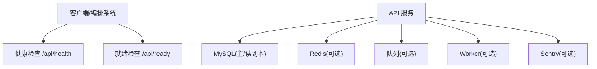
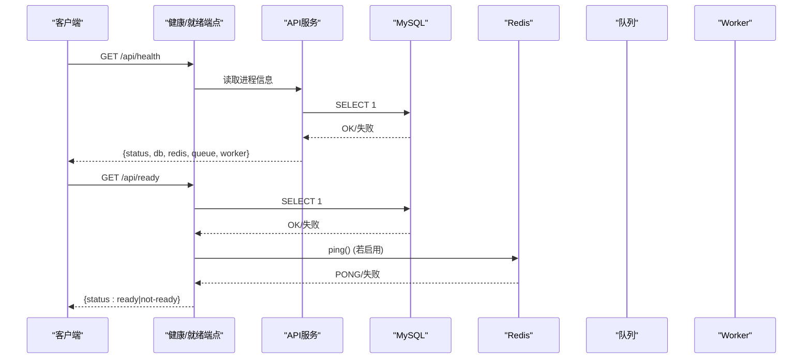
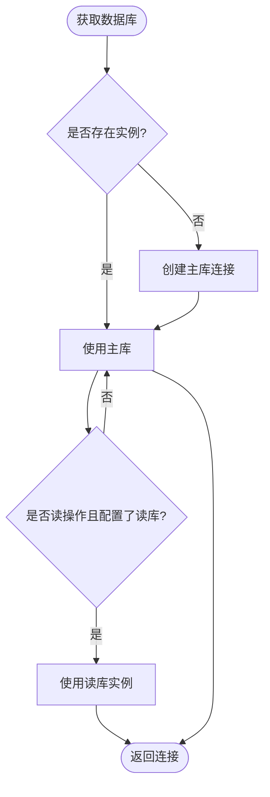
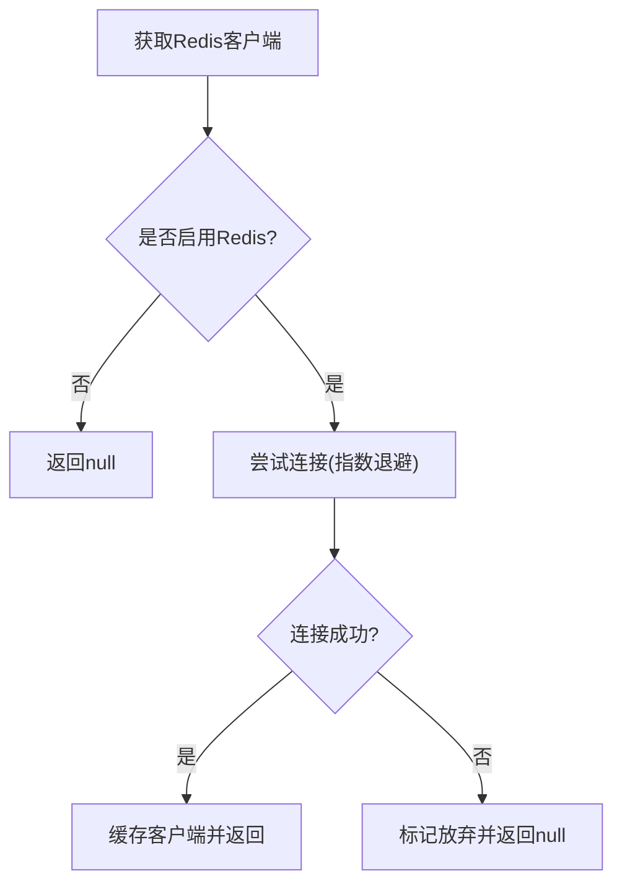
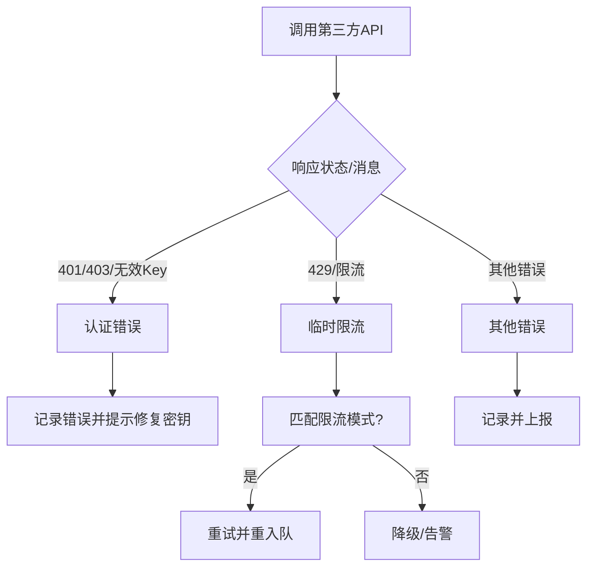
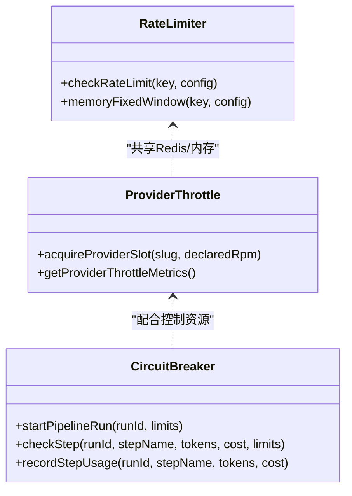
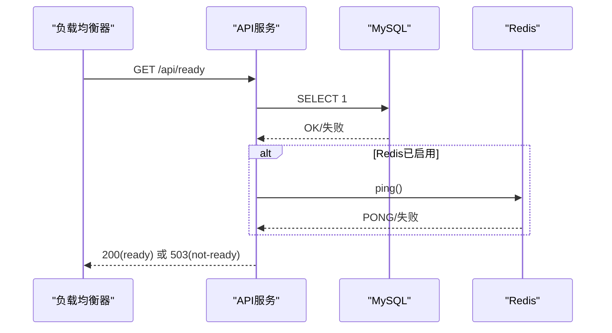
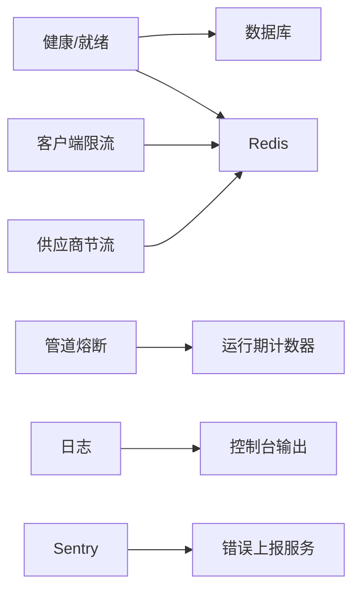

# 故障排查

<cite>
**本文引用的文件**
- [api/boot.ts](file://api/boot.ts)
- [api/lib/logger.ts](file://api/lib/logger.ts)
- [api/lib/observability.ts](file://api/lib/observability.ts)
- [api/infra/redis.ts](file://api/infra/redis.ts)
- [api/lib/rateLimiter.ts](file://api/lib/rateLimiter.ts)
- [api/lib/providerThrottle.ts](file://api/lib/providerThrottle.ts)
- [api/services/swarmService.ts](file://api/services/swarmService.ts)
- [api/lib/providers/openai.ts](file://api/lib/providers/openai.ts)
- [api/queries/connection.ts](file://api/queries/connection.ts)
- [api/middleware.ts](file://api/middleware.ts)
- [contracts/errors.ts](file://contracts/errors.ts)
- [api/plugins/circuit-breaker/index.ts](file://api/plugins/circuit-breaker/index.ts)
- [api/routers/debug.ts](file://api/routers/debug.ts)
</cite>

## 目录
1. [简介](#简介)
2. [项目结构](#项目结构)
3. [核心组件](#核心组件)
4. [架构总览](#架构总览)
5. [详细组件分析](#详细组件分析)
6. [依赖关系分析](#依赖关系分析)
7. [性能考虑](#性能考虑)
8. [故障排查指南](#故障排查指南)
9. [监控与告警配置](#监控与告警配置)
10. [故障恢复流程与预防措施](#故障恢复流程与预防措施)
11. [结论](#结论)

## 简介
本指南面向运维与研发人员，聚焦DeeWaanAI在数据库连接、Redis缓存、第三方服务集成等场景的常见问题定位与解决；提供日志分析方法、性能优化建议、监控告警配置以及故障恢复流程与预防措施，帮助快速恢复服务并避免问题复发。

## 项目结构
- 健康检查与就绪探针：通过统一入口暴露健康与就绪状态，便于负载均衡器与编排系统判断是否可路由流量。
- 日志与可观测性：结构化JSON日志、Sentry错误上报（可选）。
- 外部依赖：MySQL（主/读副本）、Redis（可选，带重试与降级）、队列与Worker（可选）。
- 限流与节流：客户端级速率限制、供应商级AIMD自适应限速、管道熔断保护。
- 错误分类：计费类错误与临时限流错误区分，决定重试或暂停任务。

图表来源
- [api/boot.ts:80-135](file://api/boot.ts#L80-L135)
- [api/queries/connection.ts:10-42](file://api/queries/connection.ts#L10-L42)
- [api/infra/redis.ts:65-87](file://api/infra/redis.ts#L65-L87)
- [api/lib/observability.ts:17-33](file://api/lib/observability.ts#L17-L33)

章节来源
- [api/boot.ts:80-135](file://api/boot.ts#L80-L135)
- [api/queries/connection.ts:10-42](file://api/queries/connection.ts#L10-L42)
- [api/infra/redis.ts:65-87](file://api/infra/redis.ts#L65-L87)
- [api/lib/observability.ts:17-33](file://api/lib/observability.ts#L17-L33)

## 核心组件
- 健康与就绪检查：返回进程运行时间、内存、数据库与Redis连接状态、队列后端与Worker状态。
- 日志系统：结构化JSON输出，支持按环境变量调整日志级别。
- 可观测性：Sentry初始化失败不影响服务启动，确保“尽力而为”的错误上报。
- Redis客户端：带指数退避的重连机制，不可用时自动降级为内存态。
- 限流与节流：
  - 客户端级固定窗口/令牌桶（内存优先，Redis可用时共享）。
  - 供应商级AIMD自适应RPM控制（Redis持久化，内存回退）。
- 管道熔断：防止失控的Token/成本/超时/循环次数。
- 错误分类：计费类错误直接暂停批次；临时限流错误走重试与重入队。

章节来源
- [api/boot.ts:80-135](file://api/boot.ts#L80-L135)
- [api/lib/logger.ts:1-31](file://api/lib/logger.ts#L1-L31)
- [api/lib/observability.ts:17-33](file://api/lib/observability.ts#L17-L33)
- [api/infra/redis.ts:40-87](file://api/infra/redis.ts#L40-L87)
- [api/lib/rateLimiter.ts:1-166](file://api/lib/rateLimiter.ts#L1-L166)
- [api/lib/providerThrottle.ts:1-274](file://api/lib/providerThrottle.ts#L1-L274)
- [api/plugins/circuit-breaker/index.ts:1-186](file://api/plugins/circuit-breaker/index.ts#L1-L186)
- [api/services/swarmService.ts:124-174](file://api/services/swarmService.ts#L124-L174)

## 架构总览
下图展示请求从进入API到调用外部依赖的关键路径，以及健康检查与就绪探针的作用点。

图表来源
- [api/boot.ts:80-135](file://api/boot.ts#L80-L135)
- [api/queries/connection.ts:10-42](file://api/queries/connection.ts#L10-L42)
- [api/infra/redis.ts:65-87](file://api/infra/redis.ts#L65-L87)

## 详细组件分析

### 数据库连接与读写分离
- 单例连接：通过模块级实例缓存数据库连接，避免重复创建。
- 读副本：当配置了读库URL时，读操作可路由至只读实例，写与一致性读仍使用主库。
- 健康检查：/api/ready会执行SELECT 1验证连通性。

图表来源
- [api/queries/connection.ts:10-42](file://api/queries/connection.ts#L10-L42)

章节来源
- [api/queries/connection.ts:10-42](file://api/queries/connection.ts#L10-L42)

### Redis缓存异常与降级
- 连接策略：最多尝试若干次，指数退避；成功后复用客户端；失败则标记放弃并在后续请求中直接返回null。
- 降级策略：当Redis不可用时，相关功能（如供应商节流、部分限流）自动切换为进程内内存态，保证可用性。
- 就绪检查：若启用Redis，/api/ready将ping检测并报告连接状态。

图表来源
- [api/infra/redis.ts:40-87](file://api/infra/redis.ts#L40-L87)
- [api/boot.ts:105-135](file://api/boot.ts#L105-L135)

章节来源
- [api/infra/redis.ts:40-87](file://api/infra/redis.ts#L40-L87)
- [api/boot.ts:105-135](file://api/boot.ts#L105-L135)

### 第三方服务集成失败（供应商限流与认证）
- 错误分类：
  - 计费/配额类错误：视为非重试错误，可能暂停批次，需用户充值或调整计划。
  - 临时限流错误：识别429/速率限制关键词，触发重试与重入队，不暂停批次。
- 供应商特定提示：针对OpenAI/Gemini/Mistral/Anthropic等给出清晰的错误信息与指引链接。
- 自适应限速：基于AIMD算法动态调整每供应商的RPM，结合Redis与内存回退。

图表来源
- [api/services/swarmService.ts:124-174](file://api/services/swarmService.ts#L124-L174)
- [api/lib/providers/openai.ts:58-80](file://api/lib/providers/openai.ts#L58-L80)
- [api/lib/providerThrottle.ts:1-274](file://api/lib/providerThrottle.ts#L1-L274)

章节来源
- [api/services/swarmService.ts:124-174](file://api/services/swarmService.ts#L124-L174)
- [api/lib/providers/openai.ts:58-80](file://api/lib/providers/openai.ts#L58-L80)
- [api/lib/providerThrottle.ts:1-274](file://api/lib/providerThrottle.ts#L1-L274)

### 限流与熔断
- 客户端级限流：固定窗口/令牌桶，内存优先，Redis不可用时降级为进程内计数。
- 供应商级节流：AIMD自适应RPM，Redis持久化，内存回退；提供指标查询接口。
- 管道熔断：对每个流水线运行设置Token预算、花费上限、步骤超时、WHILE迭代上限，超限即中止。

图表来源
- [api/lib/rateLimiter.ts:1-166](file://api/lib/rateLimiter.ts#L1-L166)
- [api/lib/providerThrottle.ts:1-274](file://api/lib/providerThrottle.ts#L1-L274)
- [api/plugins/circuit-breaker/index.ts:1-186](file://api/plugins/circuit-breaker/index.ts#L1-L186)

章节来源
- [api/lib/rateLimiter.ts:1-166](file://api/lib/rateLimiter.ts#L1-L166)
- [api/lib/providerThrottle.ts:1-274](file://api/lib/providerThrottle.ts#L1-L274)
- [api/plugins/circuit-breaker/index.ts:1-186](file://api/plugins/circuit-breaker/index.ts#L1-L186)

### 健康检查与就绪探针
- /api/health：返回进程运行时间、内存、数据库连接、Redis启用状态、队列后端、Worker状态。
- /api/ready：仅在数据库可达且Redis（若启用）可达时返回200，否则503，用于负载均衡/编排系统决定是否路由流量。

图表来源
- [api/boot.ts:80-135](file://api/boot.ts#L80-L135)

章节来源
- [api/boot.ts:80-135](file://api/boot.ts#L80-L135)

## 依赖关系分析
- 健康/就绪端点依赖数据库与Redis连通性。
- 限流与节流依赖Redis（可降级为内存）。
- 管道熔断依赖运行时计数器（内存），与调度/执行链路协作。
- 日志与Sentry为横切关注点，不影响主流程。

图表来源
- [api/boot.ts:80-135](file://api/boot.ts#L80-L135)
- [api/lib/rateLimiter.ts:1-166](file://api/lib/rateLimiter.ts#L1-L166)
- [api/lib/providerThrottle.ts:1-274](file://api/lib/providerThrottle.ts#L1-L274)
- [api/plugins/circuit-breaker/index.ts:1-186](file://api/plugins/circuit-breaker/index.ts#L1-L186)
- [api/lib/logger.ts:1-31](file://api/lib/logger.ts#L1-L31)
- [api/lib/observability.ts:17-33](file://api/lib/observability.ts#L17-L33)

## 性能考虑
- 数据库查询优化
  - 读多写少场景：使用读副本分担读压力，注意复制延迟容忍度。
  - 统计与调试：利用调试路由聚合运行数据（总数、Token、延迟等）辅助定位慢查询与热点。
- 内存使用分析
  - 健康端点暴露RSS与堆内存，便于观察内存趋势与泄漏迹象。
  - 限流/节流在Redis不可用时使用内存态，需注意进程内Map增长与清理周期。
- 响应时间监控
  - 通过调试路由汇总延迟总量与角色维度平均延迟，结合日志时间戳进行端到端分析。
  - 供应商节流AIMD自适应降低突发导致的429，提升整体吞吐稳定性。

章节来源
- [api/queries/connection.ts:22-42](file://api/queries/connection.ts#L22-L42)
- [api/routers/debug.ts:125-173](file://api/routers/debug.ts#L125-L173)
- [api/boot.ts:85-98](file://api/boot.ts#L85-L98)
- [api/lib/rateLimiter.ts:23-29](file://api/lib/rateLimiter.ts#L23-L29)
- [api/lib/providerThrottle.ts:1-274](file://api/lib/providerThrottle.ts#L1-L274)

## 故障排查指南

### 常见问题与解决方案
- 数据库连接失败
  - 现象：/api/ready返回not-ready，db=disconnected。
  - 排查：检查数据库URL、网络连通、权限；确认主/读副本配置是否正确；查看健康端点返回。
  - 处理：修复连接后重启或等待自动重连；必要时回退到主库。
  - 参考路径：[健康检查实现:80-135](file://api/boot.ts#L80-L135)、[数据库连接:10-42](file://api/queries/connection.ts#L10-L42)

- Redis缓存异常
  - 现象：/api/ready中redis=disabled或disconnected；限流/节流降级为内存态。
  - 排查：检查REDIS_URL、网络、Redis服务状态；查看连接重试日志。
  - 处理：恢复Redis后自动重新连接；期间业务降级可用。
  - 参考路径：[Redis客户端:40-87](file://api/infra/redis.ts#L40-L87)、[就绪检查:105-135](file://api/boot.ts#L105-L135)

- 第三方服务集成失败
  - 现象：401/403/429或包含“rate limit/throttled”的消息。
  - 排查：核对API Key与配额；查看供应商特定错误提示；检查AIMD节流状态与指标。
  - 处理：修正凭证或提升配额；等待限流窗口；必要时调整供应商声明RPM。
  - 参考路径：[错误分类与重试:124-174](file://api/services/swarmService.ts#L124-L174)、[供应商错误提示:58-80](file://api/lib/providers/openai.ts#L58-L80)、[AIMD节流:1-274](file://api/lib/providerThrottle.ts#L1-L274)

- 限流触发导致请求被拒
  - 现象：客户端收到429或内部拒绝；剩余配额为0。
  - 排查：检查限流配置（maxTokens、refillRate、windowMs）；查看Redis键与内存Map清理情况。
  - 处理：调大窗口或速率；优化上游调用频率；确保Redis可用以获得跨节点一致限流。
  - 参考路径：[客户端限流:1-166](file://api/lib/rateLimiter.ts#L1-L166)

- 管道失控导致高成本或长时间运行
  - 现象：Token/花费超预算、步骤超时、WHILE循环过多。
  - 排查：查看熔断器的当前限制与实际用量；确认步骤估算是否合理。
  - 处理：收紧默认限制或按运行动态调整；中断失控步骤。
  - 参考路径：[管道熔断:1-186](file://api/plugins/circuit-breaker/index.ts#L1-L186)

### 日志分析方法
- 日志级别配置
  - 通过环境变量控制日志级别（debug/info/warn/error），低于阈值的日志将被过滤。
  - 建议：生产环境默认info，定位问题时临时提升至debug。
  - 参考路径：[日志级别与输出:1-31](file://api/lib/logger.ts#L1-L31)

- 关键信息提取
  - 健康/就绪端点：status、db、redis、queue、worker、uptime、memory。
  - 限流/节流：窗口起始时间、窗口计数、当前RPM、是否在慢启动。
  - 错误分类：计费类错误（暂停批次）、限流类错误（重试重入队）。
  - 参考路径：[健康端点:80-135](file://api/boot.ts#L80-L135)、[AIMD指标:237-274](file://api/lib/providerThrottle.ts#L237-L274)、[错误分类:124-174](file://api/services/swarmService.ts#L124-L174)

- 问题定位技巧
  - 使用调试路由聚合运行统计（总数、Token、延迟、角色维度）定位瓶颈。
  - 结合健康端点与日志时间戳，建立端到端时序视图。
  - 参考路径：[调试统计:125-173](file://api/routers/debug.ts#L125-L173)

章节来源
- [api/lib/logger.ts:1-31](file://api/lib/logger.ts#L1-L31)
- [api/boot.ts:80-135](file://api/boot.ts#L80-L135)
- [api/lib/providerThrottle.ts:237-274](file://api/lib/providerThrottle.ts#L237-L274)
- [api/services/swarmService.ts:124-174](file://api/services/swarmService.ts#L124-L174)
- [api/routers/debug.ts:125-173](file://api/routers/debug.ts#L125-L173)

## 监控与告警配置
- Sentry集成
  - 当配置DSN时初始化Sentry；初始化失败不会阻断服务启动。
  - 建议：在生产环境开启，并设置合适的采样率与环境标签。
  - 参考路径：[可观测性初始化:17-33](file://api/lib/observability.ts#L17-L33)

- 健康检查端点
  - /api/health：返回服务运行状态与依赖健康度。
  - /api/ready：仅当数据库与Redis（若启用）均正常时返回200。
  - 建议：在负载均衡/编排系统中配置探针，未就绪时不路由流量。
  - 参考路径：[健康/就绪端点:80-135](file://api/boot.ts#L80-L135)

- 性能指标收集
  - 进程指标：uptime、rss、heapUsed。
  - 应用指标：队列后端类型、Worker运行状态、供应商节流指标（currentRpm、windowCount、inSlowStart）。
  - 建议：定期抓取/采集这些指标，设置阈值告警（如内存持续增长、RPM骤降、延迟突增）。
  - 参考路径：[进程指标:85-98](file://api/boot.ts#L85-L98)、[节流指标:237-274](file://api/lib/providerThrottle.ts#L237-L274)

章节来源
- [api/lib/observability.ts:17-33](file://api/lib/observability.ts#L17-L33)
- [api/boot.ts:80-135](file://api/boot.ts#L80-L135)
- [api/lib/providerThrottle.ts:237-274](file://api/lib/providerThrottle.ts#L237-L274)

## 故障恢复流程与预防措施
- 故障恢复流程
  - 数据库不可用：立即降级业务（如关闭写入），通知DBA修复；恢复后通过就绪探针验证。
  - Redis不可用：自动降级为内存态；尽快恢复Redis以恢复跨节点一致限流与节流。
  - 第三方限流：依据错误分类进行重试与重入队；若持续429，降低并发或调整AIMD参数。
  - 管道失控：熔断器主动中止；管理员可通过插件更新默认限制。
  - 参考路径：[就绪检查:105-135](file://api/boot.ts#L105-L135)、[错误分类:124-174](file://api/services/swarmService.ts#L124-L174)、[熔断器管理:147-185](file://api/plugins/circuit-breaker/index.ts#L147-L185)

- 预防措施
  - 配置合理的默认限制与窗口大小，避免突发流量压垮下游。
  - 启用Sentry并配置告警规则，覆盖关键错误与性能退化。
  - 定期演练健康/就绪探针失效场景，确保编排系统能正确摘除实例。
  - 监控内存与堆使用，及时清理过期窗口与Map条目。
  - 参考路径：[限流清理](file://api/lib/rateLimiter.ts:23-29), [熔断器默认限制](file://api/plugins/circuit-breaker/index.ts:23-29)

章节来源
- [api/boot.ts:105-135](file://api/boot.ts#L105-L135)
- [api/services/swarmService.ts:124-174](file://api/services/swarmService.ts#L124-L174)
- [api/plugins/circuit-breaker/index.ts:23-29](file://api/plugins/circuit-breaker/index.ts#L23-L29)
- [api/lib/rateLimiter.ts:23-29](file://api/lib/rateLimiter.ts#L23-L29)

## 结论
通过健康/就绪探针、结构化日志、Sentry可观测性与多层限流/熔断机制，DeeWaanAI具备较强的韧性与可诊断性。运维人员应充分利用这些能力，结合本文的故障排查与恢复流程，快速定位并解决问题，同时通过合理配置与演练预防类似问题再次发生。