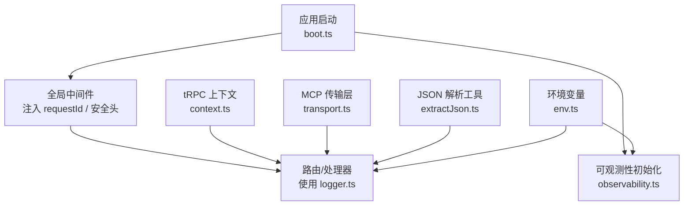
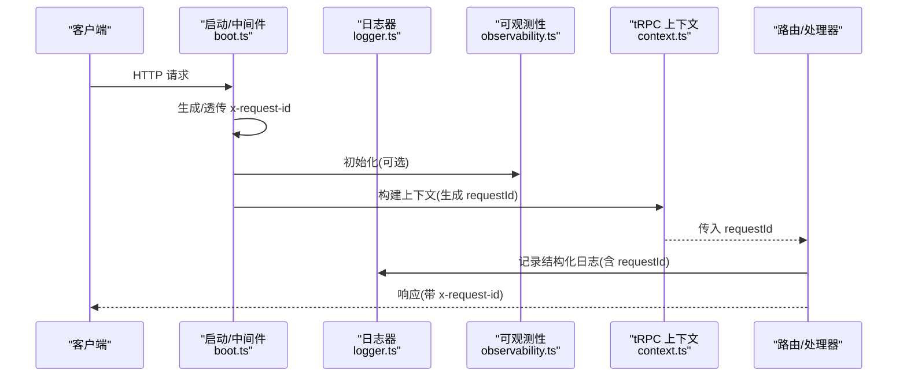
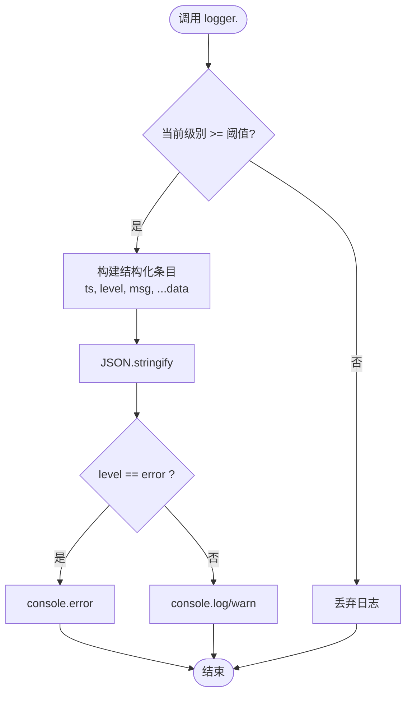
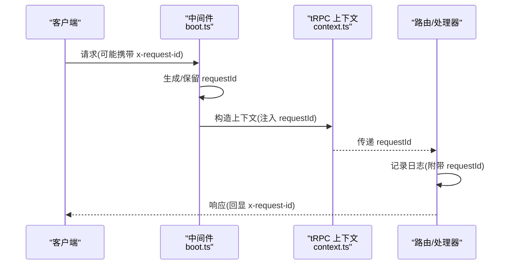
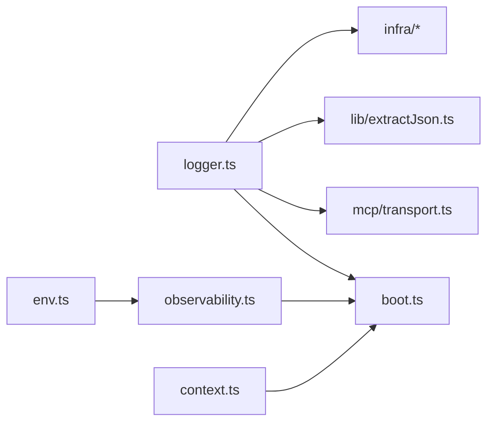

# 日志分析

<cite>
**本文引用的文件**
- [api/lib/logger.ts](file://api/lib/logger.ts)
- [api/boot.ts](file://api/boot.ts)
- [api/context.ts](file://api/context.ts)
- [api/middleware.ts](file://api/middleware.ts)
- [api/lib/observability.ts](file://api/lib/observability.ts)
- [api/lib/env.ts](file://api/lib/env.ts)
- [api/lib/clientIp.ts](file://api/lib/clientIp.ts)
- [api/lib/extractJson.ts](file://api/lib/extractJson.ts)
- [api/mcp/transport.ts](file://api/mcp/transport.ts)
- [api/mcp/context.ts](file://api/mcp/context.ts)
</cite>

## 目录
1. [简介](#简介)
2. [项目结构](#项目结构)
3. [核心组件](#核心组件)
4. [架构总览](#架构总览)
5. [详细组件分析](#详细组件分析)
6. [依赖关系分析](#依赖关系分析)
7. [性能考量](#性能考量)
8. [故障排查指南](#故障排查指南)
9. [结论](#结论)
10. [附录](#附录)

## 简介
本指南面向DeeWaanAI后端服务的日志系统，聚焦以下目标：
- 结构化日志格式、日志级别管理
- 请求追踪（requestId）与错误堆栈记录
- 业务指标与可观测性（Sentry）集成
- 日志查询与分析技巧（过滤条件、常用语句、结果解读）
- 监控告警建议（异常检测、性能阈值、通知机制）
- 日志轮转与清理策略（结合部署环境）

该指南基于仓库中的实际实现进行说明，帮助读者快速定位问题并提升排障效率。

## 项目结构
日志相关能力主要分布在以下模块：
- 统一日志器：提供结构化JSON日志输出与级别控制
- 启动与中间件：注入请求ID、安全头、全局错误处理入口
- 上下文：为tRPC等子系统生成并携带请求ID
- 可观测性：可选的Sentry初始化，用于异常上报
- 环境变量：集中管理日志级别、Sentry DSN等配置
- MCP传输层：会话生命周期日志
- JSON解析工具：失败时记录详细错误上下文

图表来源
- [api/boot.ts:37-57](file://api/boot.ts#L37-L57)
- [api/lib/observability.ts:16-33](file://api/lib/observability.ts#L16-L33)
- [api/context.ts:20-30](file://api/context.ts#L20-L30)
- [api/mcp/transport.ts:174-210](file://api/mcp/transport.ts#L174-L210)
- [api/lib/extractJson.ts:68-77](file://api/lib/extractJson.ts#L68-L77)
- [api/lib/env.ts:64-64](file://api/lib/env.ts#L64-L64)

章节来源
- [api/boot.ts:37-57](file://api/boot.ts#L37-L57)
- [api/lib/observability.ts:16-33](file://api/lib/observability.ts#L16-L33)
- [api/context.ts:20-30](file://api/context.ts#L20-L30)
- [api/mcp/transport.ts:174-210](file://api/mcp/transport.ts#L174-L210)
- [api/lib/extractJson.ts:68-77](file://api/lib/extractJson.ts#L68-L77)
- [api/lib/env.ts:64-64](file://api/lib/env.ts#L64-L64)

## 核心组件
- 结构化日志器
  - 输出字段包含时间戳、级别、消息以及扩展数据
  - 通过环境变量控制日志级别，低于阈值的日志将被丢弃
  - 错误级别输出到标准错误流，其他级别输出到标准输出
- 请求追踪
  - 启动阶段为每个请求生成或透传x-request-id，并在响应头中回显
  - tRPC上下文会为每次调用生成独立请求ID，便于跨链路追踪
- 可观测性
  - 可选Sentry初始化，未配置DSN时不加载SDK，保证健壮性
  - 初始化失败仅记录警告，不影响服务启动
- 环境变量
  - 集中定义SENTRY_DSN、LOG_LEVEL等关键开关
- 客户端IP解析
  - 根据是否信任代理决定从转发头或直接连接地址获取客户端IP，有助于限流与审计

章节来源
- [api/lib/logger.ts:1-31](file://api/lib/logger.ts#L1-L31)
- [api/boot.ts:37-57](file://api/boot.ts#L37-L57)
- [api/context.ts:20-30](file://api/context.ts#L20-L30)
- [api/lib/observability.ts:16-33](file://api/lib/observability.ts#L16-L33)
- [api/lib/env.ts:64-64](file://api/lib/env.ts#L64-L64)
- [api/lib/clientIp.ts:19-36](file://api/lib/clientIp.ts#L19-L36)

## 架构总览
下图展示了请求进入后的日志与可观测性路径：

图表来源
- [api/boot.ts:37-57](file://api/boot.ts#L37-L57)
- [api/context.ts:20-30](file://api/context.ts#L20-L30)
- [api/lib/observability.ts:16-33](file://api/lib/observability.ts#L16-L33)
- [api/lib/logger.ts:12-24](file://api/lib/logger.ts#L12-L24)

## 详细组件分析

### 结构化日志器（logger.ts）
- 设计要点
  - 固定字段：ts（ISO时间）、level、msg；支持任意扩展字段
  - 级别控制：通过环境变量设置最小级别，低于阈值的日志直接丢弃，减少I/O开销
  - 输出通道：error级别走stderr，warn/info走stdout，便于平台采集分流
- 复杂度与性能
  - 每条日志序列化一次JSON，级别过滤在写入前完成，避免无用序列化
- 错误处理
  - 无外部依赖，失败面小；若控制台不可用，由运行环境处理

图表来源
- [api/lib/logger.ts:12-24](file://api/lib/logger.ts#L12-L24)

章节来源
- [api/lib/logger.ts:1-31](file://api/lib/logger.ts#L1-L31)

### 请求追踪（boot.ts + context.ts）
- 启动中间件
  - 读取入站x-request-id或生成新ID，写入上下文并在响应头回显
- tRPC上下文
  - 为每次调用生成唯一requestId，供后续各层使用
- 价值
  - 串联HTTP、MCP、队列、数据库等多环节日志，便于端到端追踪

图表来源
- [api/boot.ts:37-57](file://api/boot.ts#L37-L57)
- [api/context.ts:20-30](file://api/context.ts#L20-L30)

章节来源
- [api/boot.ts:37-57](file://api/boot.ts#L37-L57)
- [api/context.ts:20-30](file://api/context.ts#L20-L30)

### 可观测性与错误上报（observability.ts）
- 行为
  - 当未配置DSN时跳过初始化，记录info
  - 成功初始化后记录environment信息
  - 初始化失败仅记录warn，不中断启动
- 适用场景
  - 生产环境开启以捕获未预期异常与堆栈

章节来源
- [api/lib/observability.ts:16-33](file://api/lib/observability.ts#L16-L33)
- [api/lib/env.ts:64-64](file://api/lib/env.ts#L64-L64)

### MCP会话日志（transport.ts）
- 关键点
  - 会话打开/关闭均记录结构化日志，包含sessionId、userId等
  - 连接失败时记录错误并返回友好错误码
- 用途
  - 诊断长连接稳定性、用户会话生命周期

章节来源
- [api/mcp/transport.ts:174-210](file://api/mcp/transport.ts#L174-L210)

### JSON解析失败日志（extractJson.ts）
- 关键点
  - 解析失败时记录详细上下文与原始内容预览，避免日志洪水
  - 抛出明确错误，便于上层统一处理
- 用途
  - 快速定位AI返回内容格式问题

章节来源
- [api/lib/extractJson.ts:68-77](file://api/lib/extractJson.ts#L68-L77)

### 客户端IP与限流关联（clientIp.ts）
- 关键点
  - 根据是否信任代理选择不同策略解析真实客户端IP
  - 在限流、审计、风控场景中作为维度字段
- 用途
  - 将客户端IP纳入日志，辅助定位异常来源

章节来源
- [api/lib/clientIp.ts:19-36](file://api/lib/clientIp.ts#L19-L36)

## 依赖关系分析
- 日志器被广泛引用，贯穿路由、MCP、基础设施等模块
- 启动流程负责注入请求ID与安全头，并为可观测性初始化提供入口
- tRPC上下文为业务逻辑提供统一的请求标识
- 环境变量集中管理开关项，确保一致的行为

图表来源
- [api/lib/logger.ts:1-31](file://api/lib/logger.ts#L1-L31)
- [api/boot.ts:37-57](file://api/boot.ts#L37-L57)
- [api/mcp/transport.ts:174-210](file://api/mcp/transport.ts#L174-L210)
- [api/lib/extractJson.ts:68-77](file://api/lib/extractJson.ts#L68-L77)
- [api/lib/observability.ts:16-33](file://api/lib/observability.ts#L16-L33)
- [api/lib/env.ts:64-64](file://api/lib/env.ts#L64-L64)
- [api/context.ts:20-30](file://api/context.ts#L20-L30)

章节来源
- [api/lib/logger.ts:1-31](file://api/lib/logger.ts#L1-L31)
- [api/boot.ts:37-57](file://api/boot.ts#L37-L57)
- [api/mcp/transport.ts:174-210](file://api/mcp/transport.ts#L174-L210)
- [api/lib/extractJson.ts:68-77](file://api/lib/extractJson.ts#L68-L77)
- [api/lib/observability.ts:16-33](file://api/lib/observability.ts#L16-L33)
- [api/lib/env.ts:64-64](file://api/lib/env.ts#L64-L64)
- [api/context.ts:20-30](file://api/context.ts#L20-L30)

## 性能考量
- 日志级别过滤在写入前执行，避免不必要的序列化与I/O
- 错误级别单独输出到stderr，便于平台侧按级别分流与聚合
- 请求ID在中间件一次性生成，避免重复计算
- 可观测性初始化采用懒加载与best-effort策略，降低启动成本与失败影响
- 建议在高频路径仅记录必要字段，避免大对象序列化

[本节为通用指导，无需特定文件来源]

## 故障排查指南
- 快速定位请求链路
  - 通过x-request-id或日志中的requestId字段，筛选同一请求的所有日志
  - 关注错误级别日志，结合msg与data字段定位根因
- 常见问题定位
  - JSON解析失败：查看extractJson的错误日志，检查AI返回内容格式
  - MCP会话异常：查看transport的会话打开/关闭与连接失败日志
  - 可观测性未生效：检查SENTRY_DSN是否配置，确认初始化日志
- 客户端IP与限流
  - 结合clientIp解析逻辑，确认是否受代理头影响
  - 对异常流量进行溯源与封禁

章节来源
- [api/lib/extractJson.ts:68-77](file://api/lib/extractJson.ts#L68-L77)
- [api/mcp/transport.ts:174-210](file://api/mcp/transport.ts#L174-L210)
- [api/lib/observability.ts:16-33](file://api/lib/observability.ts#L16-L33)
- [api/lib/clientIp.ts:19-36](file://api/lib/clientIp.ts#L19-L36)

## 结论
DeeWaanAI的日志系统以轻量、稳定为核心：
- 结构化JSON日志配合请求ID，实现端到端追踪
- 可观测性按需启用，保障服务韧性
- 通过环境变量灵活控制日志级别与功能开关
- 结合MCP、JSON解析、客户端IP等模块，覆盖关键业务场景
在生产环境中，建议配合日志聚合平台与告警规则，形成完整的监控闭环。

[本节为总结性内容，无需特定文件来源]

## 附录

### 日志格式与存储位置
- 格式
  - 每条日志为单行JSON，包含时间戳、级别、消息及扩展字段
- 存储位置
  - 默认输出至标准输出/标准错误，具体落盘取决于部署平台（如容器日志、云平台日志服务）
- 访问方式
  - 通过平台日志采集与检索工具进行查询与分析

章节来源
- [api/lib/logger.ts:12-24](file://api/lib/logger.ts#L12-L24)

### 关键日志含义与用途
- 请求追踪
  - x-request-id/requestId：贯穿全链路的唯一标识，用于关联请求上下游日志
- 错误堆栈
  - 错误级别日志包含错误信息与堆栈，便于快速定位异常
- 业务指标
  - 可在业务日志中附加自定义字段（如耗时、资源用量），便于后续指标化

章节来源
- [api/boot.ts:37-57](file://api/boot.ts#L37-L57)
- [api/context.ts:20-30](file://api/context.ts#L20-L30)
- [api/lib/logger.ts:12-24](file://api/lib/logger.ts#L12-L24)

### 日志查询与分析技巧
- 常用过滤条件
  - 按级别：error、warn
  - 按请求ID：x-request-id或requestId字段
  - 按模块：mcp、backup、beacon、billing等
- 常用查询语句（示例）
  - 查找某请求的错误日志：filter by "level=error" AND "requestId=<id>"
  - 统计错误率：group by "level=error" over time window
  - 定位MCP会话异常：filter by "MCP legacy SSE session"
- 结果解读
  - 结合msg与data字段，识别异常类型与上下文
  - 通过请求ID串联HTTP、MCP、队列、DB等多环节日志

章节来源
- [api/mcp/transport.ts:174-210](file://api/mcp/transport.ts#L174-L210)
- [api/lib/extractJson.ts:68-77](file://api/lib/extractJson.ts#L68-L77)

### 监控与告警配置建议
- 异常检测
  - 基于error级别日志的突增阈值触发告警
  - 针对关键路径（MCP连接、备份、计费回调）设置错误率阈值
- 性能阈值
  - 在业务日志中附加耗时字段，设定P95/P99延迟阈值
- 通知机制
  - 将日志接入告警平台，配置多渠道通知（邮件、IM、电话）

[本节为通用指导，无需特定文件来源]

### 日志轮转与清理策略
- 轮转策略
  - 由部署平台负责日志轮转（按大小/时间），避免本地磁盘占用
- 清理策略
  - 结合平台保留策略，定期清理过期日志
- 注意事项
  - 避免在日志中记录敏感信息（密钥、个人信息）
  - 控制日志体积，必要时采样或截断大字段

[本节为通用指导，无需特定文件来源]