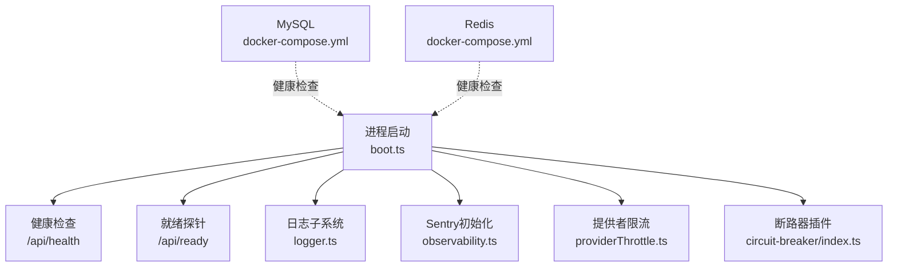
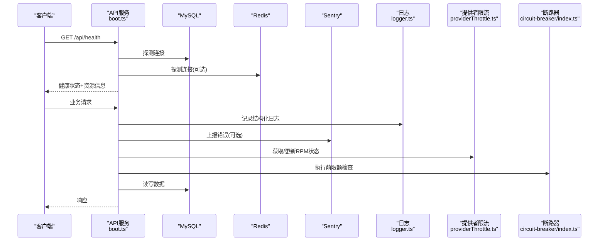
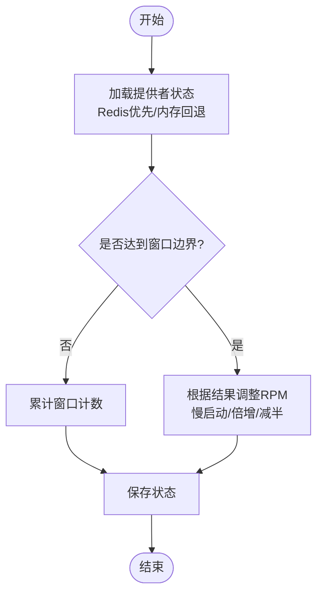
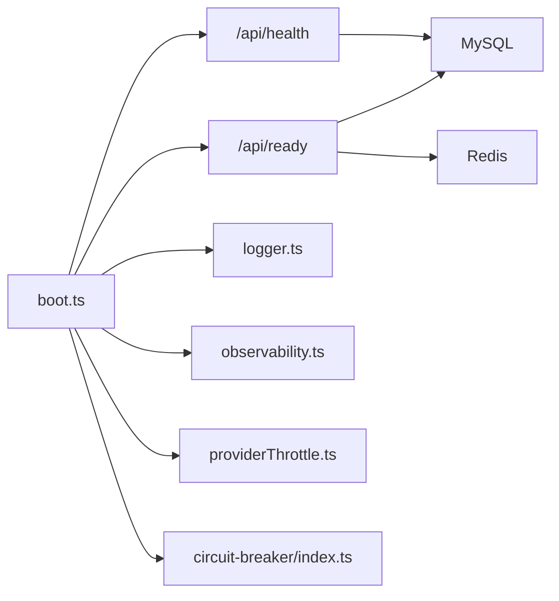

# 监控告警

<cite>
**本文引用的文件**
- [api/lib/observability.ts](file://api/lib/observability.ts)
- [api/lib/logger.ts](file://api/lib/logger.ts)
- [api/lib/env.ts](file://api/lib/env.ts)
- [api/boot.ts](file://api/boot.ts)
- [api/lib/providerThrottle.ts](file://api/lib/providerThrottle.ts)
- [api/plugins/circuit-breaker/index.ts](file://api/plugins/circuit-breaker/index.ts)
- [docker-compose.yml](file://docker-compose.yml)
- [ecosystem.config.cjs](file://ecosystem.config.cjs)
- [db/schema.ts](file://db/schema.ts)
</cite>

## 目录
1. [简介](#简介)
2. [项目结构](#项目结构)
3. [核心组件](#核心组件)
4. [架构总览](#架构总览)
5. [详细组件分析](#详细组件分析)
6. [依赖关系分析](#依赖关系分析)
7. [性能考量](#性能考量)
8. [故障排查指南](#故障排查指南)
9. [结论](#结论)
10. [附录](#附录)

## 简介
本指南面向DeeWaanAI的运维与研发人员，提供一套可落地的监控告警配置方案。内容覆盖：
- 指标采集、日志聚合与链路追踪的整体架构
- 关键监控指标定义（应用健康、资源使用率、业务指标、错误率）
- 告警规则（阈值、通知渠道、升级策略）
- 监控面板搭建（仪表盘设计、可视化、报告生成）
- 故障恢复流程（自动重启、服务降级、数据恢复）
- 重点集成：Sentry、Prometheus指标、Grafana仪表板、健康检查端点、弹性伸缩配置

## 项目结构
本项目在API层提供了完善的可观测性基础能力：
- 健康检查与就绪探针：/api/health 与 /api/ready
- 结构化JSON日志输出，便于外部日志系统采集
- Sentry错误上报（可选，按环境变量启用）
- 提供者限流AIMD状态与用量指标，可用于外部指标导出
- 断路器插件暴露运行用量接口，便于统计与告警
- 容器化编排中内置MySQL与Redis的健康检查

**图表来源**
- [api/boot.ts:85-125](file://api/boot.ts#L85-L125)
- [api/lib/logger.ts:1-32](file://api/lib/logger.ts#L1-L32)
- [api/lib/observability.ts:1-33](file://api/lib/observability.ts#L1-L33)
- [api/lib/providerThrottle.ts:1-114](file://api/lib/providerThrottle.ts#L1-L114)
- [api/plugins/circuit-breaker/index.ts:147-185](file://api/plugins/circuit-breaker/index.ts#L147-L185)
- [docker-compose.yml:1-52](file://docker-compose.yml#L1-L52)

**章节来源**
- [api/boot.ts:85-125](file://api/boot.ts#L85-L125)
- [docker-compose.yml:1-52](file://docker-compose.yml#L1-L52)

## 核心组件
- 健康检查与就绪探针
  - /api/health：返回进程运行时间、内存、数据库/队列/Worker状态等
  - /api/ready：仅在数据库可达且Redis（如启用）连通时返回200，用于负载均衡或编排器路由判定
- 日志系统
  - 统一结构化JSON日志，支持级别过滤与请求ID生成，便于集中采集与检索
- 错误上报（Sentry）
  - 通过环境变量控制是否启用；失败路径被吞掉，确保不影响主服务可用性
- 提供者限流AIMD
  - 维护每个提供者的当前RPM、窗口计数、慢启动状态等，支持Redis持久化与内存回退
- 断路器插件
  - 对流水线执行进行令牌/成本/超时/迭代次数限制，并提供用量查询接口
- 环境配置
  - 集中管理数据库、缓存、对象存储、Sentry、备份等配置项，生产环境强制校验敏感项

**章节来源**
- [api/boot.ts:85-125](file://api/boot.ts#L85-L125)
- [api/lib/logger.ts:1-32](file://api/lib/logger.ts#L1-L32)
- [api/lib/observability.ts:1-33](file://api/lib/observability.ts#L1-L33)
- [api/lib/providerThrottle.ts:1-114](file://api/lib/providerThrottle.ts#L1-L114)
- [api/plugins/circuit-breaker/index.ts:1-186](file://api/plugins/circuit-breaker/index.ts#L1-L186)
- [api/lib/env.ts:1-105](file://api/lib/env.ts#L1-L105)

## 架构总览
下图展示了从请求进入、健康检查、日志与错误上报、到限流与断路器保护的关键路径，以及与外部基础设施的交互。

**图表来源**
- [api/boot.ts:85-125](file://api/boot.ts#L85-L125)
- [api/lib/logger.ts:1-32](file://api/lib/logger.ts#L1-L32)
- [api/lib/observability.ts:1-33](file://api/lib/observability.ts#L1-L33)
- [api/lib/providerThrottle.ts:1-114](file://api/lib/providerThrottle.ts#L1-L114)
- [api/plugins/circuit-breaker/index.ts:147-185](file://api/plugins/circuit-breaker/index.ts#L147-L185)

## 详细组件分析

### 健康检查与就绪探针
- /api/health
  - 返回status、uptime、memory(rss/heap)、db/redis/queue/worker状态，便于上层编排器做存活与健康判断
- /api/ready
  - 仅当数据库可达且Redis（若启用）连通时返回200；否则返回503，避免将流量路由到未就绪实例

建议：
- 将/health作为liveness探针，/ready作为readiness探针
- 结合Kubernetes或云平台编排器实现滚动发布与流量切换

**章节来源**
- [api/boot.ts:85-125](file://api/boot.ts#L85-L125)

### 日志聚合
- 统一输出JSON格式日志，包含时间戳、级别、消息与扩展字段
- 支持通过环境变量调整日志级别
- 建议接入集中式日志系统（如ELK/Cloud Logging），基于level和msg字段建立索引与告警

**章节来源**
- [api/lib/logger.ts:1-32](file://api/lib/logger.ts#L1-L32)

### 错误上报（Sentry）
- 通过环境变量SENTRY_DSN控制启用；未配置时不加载SDK，保证最小开销
- 初始化失败会被捕获并记录警告，不影响服务启动
- 建议在开发/测试环境与生产环境分别设置不同environment，便于区分问题来源

**章节来源**
- [api/lib/observability.ts:1-33](file://api/lib/observability.ts#L1-L33)
- [api/lib/env.ts:63-64](file://api/lib/env.ts#L63-L64)

### 提供者限流AIMD（可观测性指标源）
- 维护每个提供者的currentRpm、windowCount、inSlowStart等状态，支持Redis持久化与内存回退
- 提供getProviderThrottleMetrics()用于读取实时状态，可作为Prometheus指标抓取源
- 适合在外部Exporter中定时拉取并转换为标准指标（如provider_rpm、provider_window_count、provider_slow_start）

**图表来源**
- [api/lib/providerThrottle.ts:1-114](file://api/lib/providerThrottle.ts#L1-L114)

**章节来源**
- [api/lib/providerThrottle.ts:1-114](file://api/lib/providerThrottle.ts#L1-L114)

### 断路器插件（用量与保护）
- 对每次流水线步骤执行前进行令牌、成本、超时、循环次数检查，防止失控消耗
- 提供查询接口返回当前run的用量（totalTokens、totalCost），可作为业务指标来源
- 建议将用量与阈值对比后纳入告警体系

**章节来源**
- [api/plugins/circuit-breaker/index.ts:1-186](file://api/plugins/circuit-breaker/index.ts#L1-L186)

### 环境配置与弹性伸缩
- 环境变量集中管理：数据库、缓存、对象存储、Sentry、备份、限流等
- 生产环境对关键密钥进行安全校验，防止误用默认值
- 配合进程管理器（如PM2）进行自动重启、内存上限与日志轮转，提升稳定性

**章节来源**
- [api/lib/env.ts:1-105](file://api/lib/env.ts#L1-L105)
- [ecosystem.config.cjs:1-32](file://ecosystem.config.cjs#L1-L32)

## 依赖关系分析
- 健康检查依赖数据库与Redis连接能力
- 日志与Sentry为横切关注点，贯穿各模块
- 限流与断路器依赖运行时状态（内存/Redis）
- 容器编排中的MySQL与Redis具备健康检查，支撑就绪探针

**图表来源**
- [api/boot.ts:85-125](file://api/boot.ts#L85-L125)
- [api/lib/logger.ts:1-32](file://api/lib/logger.ts#L1-L32)
- [api/lib/observability.ts:1-33](file://api/lib/observability.ts#L1-L33)
- [api/lib/providerThrottle.ts:1-114](file://api/lib/providerThrottle.ts#L1-L114)
- [api/plugins/circuit-breaker/index.ts:147-185](file://api/plugins/circuit-breaker/index.ts#L147-L185)

**章节来源**
- [api/boot.ts:85-125](file://api/boot.ts#L85-L125)

## 性能考量
- 健康检查与就绪探针应避免重IO，仅做必要连通性检测
- 日志级别在生产环境建议info及以上，减少I/O压力
- Sentry初始化失败不应影响主流程，已实现最佳努力模式
- 限流AIMD使用Redis持久化，降低多实例间状态不一致风险；同时保留内存回退以增强韧性
- 断路器限制令牌/成本/超时/迭代次数，防止异常放大

[本节为通用指导，无需特定文件引用]

## 故障排查指南
- 服务不可用
  - 检查/health与/ready返回值，确认数据库与Redis状态
  - 查看进程管理器日志与崩溃重启记录
- 高错误率
  - 在Sentry中按environment筛选，定位最近错误与堆栈
  - 结合日志级别与请求ID快速关联上下文
- 限流与抖动
  - 通过getProviderThrottleMetrics()观察各提供者RPM变化，识别429风暴
  - 调整PROVIDER_THROTTLE配置或等待AIMD收敛
- 资源耗尽
  - 监控RSS/Heap，结合PM2的max_memory_restart与NODE_OPTIONS限制
  - 检查断路器是否频繁触发，评估流水线复杂度

**章节来源**
- [api/boot.ts:85-125](file://api/boot.ts#L85-L125)
- [api/lib/logger.ts:1-32](file://api/lib/logger.ts#L1-L32)
- [api/lib/observability.ts:1-33](file://api/lib/observability.ts#L1-L33)
- [api/lib/providerThrottle.ts:1-114](file://api/lib/providerThrottle.ts#L1-L114)
- [ecosystem.config.cjs:1-32](file://ecosystem.config.cjs#L1-L32)

## 结论
本项目已具备完善的可观测性基础：健康检查、结构化日志、Sentry错误上报、提供者限流AIMD与断路器保护。在此基础上，建议：
- 将/health与/ready接入编排器的探针机制
- 将日志与Sentry接入平台级可观测性体系
- 将限流与断路器用量指标导出至Prometheus，并在Grafana构建看板
- 制定告警规则与升级策略，形成闭环的监控告警体系

[本节为总结性内容，无需特定文件引用]

## 附录

### 关键监控指标清单（建议）
- 应用健康
  - /api/health状态码与返回字段（status、uptime、memory.rss/heap、db、redis、queue、worker）
  - /api/ready状态码（200/503）
- 资源使用率
  - 进程内存（RSS/Heap）、Node.js堆大小（NODE_OPTIONS）
  - 磁盘与日志文件大小（PM2日志轮转）
- 业务指标
  - 提供者RPM（currentRpm）、窗口计数（windowCount）、慢启动标志（inSlowStart）
  - 断路器用量（totalTokens、totalCost）
- 错误率
  - Sentry事件数（按environment、错误类型分组）
  - 健康检查失败次数（/api/ready=503）

**章节来源**
- [api/boot.ts:85-125](file://api/boot.ts#L85-L125)
- [api/lib/providerThrottle.ts:1-114](file://api/lib/providerThrottle.ts#L1-L114)
- [api/plugins/circuit-breaker/index.ts:147-185](file://api/plugins/circuit-breaker/index.ts#L147-L185)
- [api/lib/observability.ts:1-33](file://api/lib/observability.ts#L1-L33)

### 告警规则配置（示例）
- 阈值建议
  - /api/ready连续N次返回503 → 严重
  - Sentry错误率超过基线X% → 警告/严重
  - 提供者RPM持续低于下限或突降（AIMD减半）→ 警告
  - 断路器触发频率过高 → 警告
- 通知渠道
  - 企业微信/钉钉/邮件/短信（依据组织规范）
- 升级策略
  - 首次告警通知值班工程师
  - 持续N分钟未恢复则升级至二线/三线
  - 重大故障触发紧急会议与回滚预案

[本节为通用指导，无需特定文件引用]

### 监控面板搭建（Grafana）
- 数据源
  - Prometheus：抓取Exporter导出的指标（限流、断路器用量、自定义业务指标）
  - 日志：对接ELK/云日志，创建Dashboard视图
- 仪表盘设计
  - 概览页：健康状态、错误率、RPM趋势、断路器触发次数
  - 详情页：各提供者RPM、慢启动状态、窗口计数
  - 资源页：内存、堆、GC（如有）、磁盘
- 报告生成
  - 定期导出PDF快照或推送至协作平台
  - 结合CI/CD生成变更前后对比报告

[本节为通用指导，无需特定文件引用]

### 弹性伸缩配置
- 容器编排
  - MySQL与Redis提供健康检查，便于编排器判定就绪
- 进程管理
  - PM2配置自动重启、内存上限、日志轮转，保障单实例稳定
- 扩缩容策略
  - 基于CPU/内存/请求延迟/错误率等指标触发水平扩容
  - 滚动发布时依赖/ready探针确保零停机

**章节来源**
- [docker-compose.yml:1-52](file://docker-compose.yml#L1-L52)
- [ecosystem.config.cjs:1-32](file://ecosystem.config.cjs#L1-L32)

### 故障恢复流程
- 自动重启
  - PM2的autorestart与max_restarts配置，结合内存上限避免雪崩
- 服务降级
  - 当外部依赖不可用时，/api/ready返回503，停止新流量
  - 断路器限制异常流水线，防止资源耗尽
- 数据恢复
  - 备份功能依赖S3与数据库URL，支持定时备份与过期清理
  - 恢复流程：选择合适快照→导入数据库→验证一致性→灰度上线

**章节来源**
- [ecosystem.config.cjs:1-32](file://ecosystem.config.cjs#L1-L32)
- [api/plugins/circuit-breaker/index.ts:1-186](file://api/plugins/circuit-breaker/index.ts#L1-L186)
- [db/schema.ts:1081-1104](file://db/schema.ts#L1081-L1104)