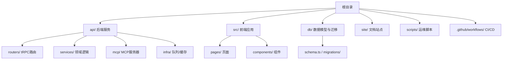
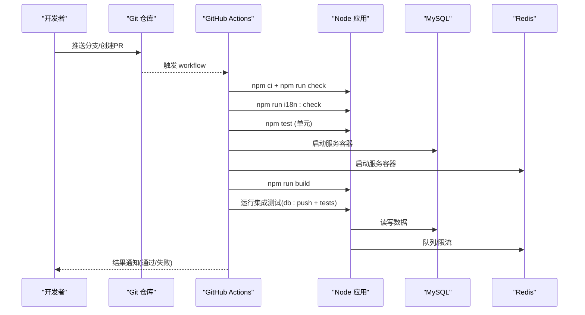
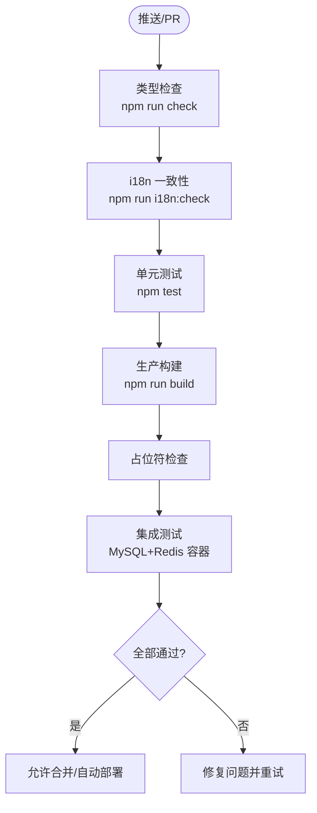
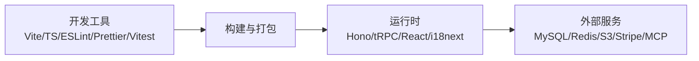

# 贡献指南

<cite>
**本文引用的文件**
- [package.json](file://package.json)
- [eslint.config.js](file://eslint.config.js)
- [.prettierrc](file://.prettierrc)
- [.github/workflows/ci.yml](file://.github/workflows/ci.yml)
- [.github/workflows/backup.yml](file://.github/workflows/backup.yml)
- [.github/workflows/site-ci.yml](file://.github/workflows/site-ci.yml)
- [vitest.config.ts](file://vitest.config.ts)
- [README.md](file://README.md)
- [DEPLOY.md](file://DEPLOY.md)
- [ENGINEERING.md](file://ENGINEERING.md)
</cite>

## 目录
1. [简介](#简介)
2. [项目结构](#项目结构)
3. [核心组件](#核心组件)
4. [架构总览](#架构总览)
5. [详细组件分析](#详细组件分析)
6. [依赖关系分析](#依赖关系分析)
7. [性能注意事项](#性能注意事项)
8. [故障排查指南](#故障排查指南)
9. [结论](#结论)
10. [附录](#附录)

## 简介
本指南面向所有希望为 DeeWaanAI 贡献代码的开发者，涵盖代码规范、提交流程与分支管理策略；记录 ESLint 与 Prettier 的配置规则与检查要求；说明 Git 工作流（分支命名、提交消息规范、Pull Request 流程）；解释 CI/CD 流水线如何验证代码质量（类型检查、测试、构建、集成测试、备份）；并提供新贡献者的入门指导（环境设置、开发工具配置、首次贡献步骤）。目标是让不同背景的贡献者都能高效、安全地参与协作。

## 项目结构
仓库采用前后端同仓的多模块组织：
- 前端 SPA：React + Vite，位于 src/
- 后端 API：Hono + tRPC，位于 api/
- 数据库与迁移：drizzle schema 与 SQL 迁移，位于 db/
- 站点文档：Astro 站点，位于 site/
- 脚本与部署：scripts/、deploy/、Dockerfile、docker-compose*.yml
- 持续集成：.github/workflows/

图表来源
- [README.md:16-18](file://README.md#L16-L18)
- [ENGINEERING.md:9-106](file://ENGINEERING.md#L9-L106)

章节来源
- [README.md:16-18](file://README.md#L16-L18)
- [ENGINEERING.md:9-106](file://ENGINEERING.md#L9-L106)

## 核心组件
- 开发与构建脚本：通过 package.json 提供 dev/build/lint/format/test/check/db 等命令，统一本地与CI执行入口。
- 代码质量：ESLint（TypeScript/React Hooks/Vite刷新）、Prettier（统一格式化）。
- 测试：Vitest 运行纯函数单元测试；集成测试在CI中借助MySQL/Redis容器执行。
- 国际化：i18n key 一致性校验脚本作为构建门禁。
- 数据库：Drizzle ORM，支持 push/generate/migrate。
- 部署：Docker 多阶段构建，PM2 生态配置，Railway/阿里云部署指引。

章节来源
- [package.json:7-21](file://package.json#L7-L21)
- [README.md:71-87](file://README.md#L71-L87)
- [ENGINEERING.md:298-310](file://ENGINEERING.md#L298-L310)

## 架构总览
下图展示从客户端到服务端、再到外部依赖的关键路径，以及CI对代码质量的保障点。

图表来源
- [.github/workflows/ci.yml:10-96](file://.github/workflows/ci.yml#L10-L96)
- [README.md:71-87](file://README.md#L71-L87)
- [ENGINEERING.md:313-372](file://ENGINEERING.md#L313-L372)

## 详细组件分析

### 代码规范与静态检查（ESLint + Prettier）
- ESLint 启用 TypeScript、React Hooks、Vite Refresh 推荐规则，目标文件为 ts/tsx，ECMAScript 版本为 2020，全局使用浏览器环境。
- Prettier 规则包括：分号、尾逗号、单引号、打印宽度、缩进、括号间距、箭头函数括号、行结束符、JSX 单引号、段落换行保留等。
- 建议：
  - 提交前运行 lint 与 format，确保本地与CI一致。
  - 新增/修改 .ts/.tsx 时遵循现有风格，避免混用空格/制表符。
  - 若引入新库或框架特性，确认 ESLint 规则是否覆盖，必要时扩展配置。

章节来源
- [eslint.config.js:1-24](file://eslint.config.js#L1-L24)
- [.prettierrc:1-16](file://.prettierrc#L1-L16)
- [package.json:10,15:10-15](file://package.json#L10-L15)

### 测试策略与运行方式
- 单元测试：Vitest 仅运行 api/**/*.test.ts 与 spec 文件，环境为 Node，包含别名映射。
- 集成测试：CI 中启动 MySQL 8 与 Redis 7 服务容器，执行 db:push 并运行完整测试套件。
- 建议：
  - 新功能必须附带单元测试；涉及数据库/网络/外部服务的用例放入集成测试或冒烟脚本。
  - 保持测试幂等与可重复性，避免共享状态污染。
  - 新增测试后，本地先跑 npm test，再提交。

章节来源
- [vitest.config.ts:1-21](file://vitest.config.ts#L1-L21)
- [.github/workflows/ci.yml:45-96](file://.github/workflows/ci.yml#L45-L96)
- [ENGINEERING.md:313-328](file://ENGINEERING.md#L313-L328)

### 构建与生产打包
- 构建产物：Vite 构建前端至 dist/public；esbuild 将 api/boot.ts 与 workerEntry.ts 打包为 Node ESM 输出至 dist。
- 启动：生产模式通过 node dist/boot.js 启动，worker 可通过独立进程启动。
- 建议：
  - 变更影响构建时，务必本地执行 npm run build 验证。
  - 注意环境变量注入（如 VITE_*），确保构建期可用。

章节来源
- [package.json:8-13](file://package.json#L8-L13)
- [README.md:32-39](file://README.md#L32-L39)
- [ENGINEERING.md:329-358](file://ENGINEERING.md#L329-L358)

### 国际化（i18n）门禁
- 提供 i18n:check 脚本，用于校验客户端与服务端语言包键的一致性，防止遗漏翻译键导致运行时错误。
- 建议：
  - 新增文案需同步更新 en/zh 对应 JSON，并在 server.json 补充服务端消息。
  - 提交前运行 npm run i18n:check，确保构建不中断。

章节来源
- [package.json:21](file://package.json#L21)
- [README.md:78-81](file://README.md#L78-L81)
- [ENGINEERING.md:218-228](file://ENGINEERING.md#L218-L228)

### 数据库与迁移
- 使用 Drizzle ORM，dev 环境通过 db:push 将 schema 推送到数据库；生成迁移与执行迁移分别由 db:generate 与 db:migrate 完成。
- 建议在本地先 db:push 验证，再生成迁移并审查 SQL，最后提交。
- 生产环境按工程约定手动应用编号 SQL 迁移，并保持 schema.ts 同步。

章节来源
- [package.json:17-19](file://package.json#L17-L19)
- [ENGINEERING.md:298-310](file://ENGINEERING.md#L298-L310)

### 部署与运行
- 本地开发：docker compose up 启动 MySQL/Redis，npm run dev 启动开发服务器。
- 生产运行：npm run build 后 npm start；或通过 Docker/PM2/Railway 部署。
- 健康检查：/api/health 与 /api/ready 用于存活与就绪探测。

章节来源
- [README.md:20-39](file://README.md#L20-L39)
- [DEPLOY.md:1-145](file://DEPLOY.md#L1-L145)
- [ENGINEERING.md:329-358](file://ENGINEERING.md#L329-L358)

### 持续集成与自动化
- CI 主流程：类型检查 → i18n 一致性 → 单元测试 → 生产构建 → 占位符检查；另含集成测试任务（MySQL+Redis 容器）。
- 站点 CI：仅当 site/** 变更时触发，进行 Astro 构建与占位符检查。
- 备份：每日定时调用生产备份接口，将数据库导出至 S3 并清理旧备份。

图表来源
- [.github/workflows/ci.yml:10-96](file://.github/workflows/ci.yml#L10-L96)
- [.github/workflows/site-ci.yml:14-43](file://.github/workflows/site-ci.yml#L14-L43)
- [.github/workflows/backup.yml:14-46](file://.github/workflows/backup.yml#L14-L46)

章节来源
- [.github/workflows/ci.yml:10-96](file://.github/workflows/ci.yml#L10-L96)
- [.github/workflows/site-ci.yml:14-43](file://.github/workflows/site-ci.yml#L14-L43)
- [.github/workflows/backup.yml:14-46](file://.github/workflows/backup.yml#L14-L46)

## 依赖关系分析
- 构建与工具链：Vite、esbuild、TypeScript、Tailwind、PostCSS、ESLint、Prettier、Vitest。
- 运行时依赖：Hono、tRPC、React、i18next、BullMQ、ioredis、Stripe、Sentry、Drizzle、MySQL 驱动等。
- 外部服务：MySQL、Redis、对象存储（S3兼容）、支付网关（Stripe）、MCP 桌面客户端。

图表来源
- [package.json:23-98](file://package.json#L23-L98)
- [README.md:16-18](file://README.md#L16-L18)

章节来源
- [package.json:23-98](file://package.json#L23-L98)
- [README.md:16-18](file://README.md#L16-L18)

## 性能注意事项
- 队列与限流：BullMQ 队列与 Redis 限流在高频场景下至关重要，确保连接隔离与正确配置。
- 健康与就绪：/api/health 与 /api/ready 应作为负载均衡探针，避免将未就绪实例纳入流量。
- 资源限制：PM2 配置了内存重启阈值与堆大小限制，生产部署需关注日志与监控。
- 构建优化：按需引入依赖，避免将大型库带入客户端；合理使用懒加载与分包。

章节来源
- [ENGINEERING.md:342-358](file://ENGINEERING.md#L342-L358)
- [DEPLOY.md:135-145](file://DEPLOY.md#L135-L145)

## 故障排查指南
- CI 失败：优先查看类型检查、i18n 一致性、单元测试与构建日志；集成测试失败需检查数据库/Redis 容器与变量。
- 构建失败：检查环境变量注入（VITE_*）、依赖安装与锁文件一致性。
- 运行时异常：通过 Sentry（已配置则启用）与 PM2 日志定位；使用 /api/health 与 /api/ready 快速判断服务状态。
- 备份异常：检查 GitHub Secrets 与生产 BACKUP_TOKEN/S3_* 配置，确认备份接口可达。

章节来源
- [.github/workflows/ci.yml:10-96](file://.github/workflows/ci.yml#L10-L96)
- [DEPLOY.md:108-133](file://DEPLOY.md#L108-L133)
- [.github/workflows/backup.yml:14-46](file://.github/workflows/backup.yml#L14-L46)

## 结论
本指南明确了 DeeWaanAI 的代码规范、提交流程、分支管理与 CI/CD 流水线要求。遵循这些实践可显著提升代码质量与协作效率。建议新贡献者先从“环境设置”和“首次贡献”入手，逐步熟悉模块与流程，再承担更复杂的改动。

## 附录

### 新贡献者入门
- 环境准备
  - 安装 Node 20+ 与 Docker。
  - 克隆仓库，安装依赖，启动 MySQL/Redis，执行数据库初始化。
  - 复制并编辑环境变量文件，启动开发服务器。
- 开发工具配置
  - 编辑器启用 ESLint 与 Prettier 插件，保存时自动格式化。
  - 配置 VS Code 任务或使用脚本一键运行 lint、format、test、build。
- 首次贡献步骤
  - 创建功能分支（见分支命名约定）。
  - 编写/更新测试与文档，本地通过 npm test 与 npm run build。
  - 提交符合规范的提交信息，推送并创建 Pull Request。
  - 等待 CI 通过后，请求评审与合并。

章节来源
- [README.md:20-39](file://README.md#L20-L39)
- [package.json:7-21](file://package.json#L7-L21)
- [DEPLOY.md:1-145](file://DEPLOY.md#L1-L145)

### 代码规范与检查清单
- 格式与风格
  - 使用 Prettier 统一格式；遵守 ESLint 规则。
  - 保持代码可读性与一致性，避免不必要的复杂逻辑。
- 提交前自检
  - 运行 npm run lint 与 npm run format。
  - 运行 npm run check 与 npm test。
  - 运行 npm run build 确保构建无警告/错误。
  - 运行 npm run i18n:check 保证语言包一致性。

章节来源
- [eslint.config.js:1-24](file://eslint.config.js#L1-L24)
- [.prettierrc:1-16](file://.prettierrc#L1-L16)
- [package.json:10-21](file://package.json#L10-L21)

### Git 工作流与分支管理
- 分支命名约定
  - 功能分支：feature/<描述>
  - 修复分支：fix/<描述>
  - 发布分支：release/<版本号>
  - 热修复分支：hotfix/<描述>
- 提交消息规范
  - 使用语义化提交（如 feat/fix/chore/docs），简要描述变更目的与范围。
  - 避免模糊信息，必要时附上相关 issue 编号。
- Pull Request 流程
  - 基于功能分支创建 PR，填写变更说明与测试情况。
  - 确保 CI 全绿后再请求评审；根据反馈迭代直至通过。
  - 合并后删除已合并分支，保持仓库整洁。

章节来源
- [.github/workflows/ci.yml:1-9](file://.github/workflows/ci.yml#L1-L9)
- [README.md:71-87](file://README.md#L71-L87)

### CI/CD 流水线详解
- 主 CI（应用）
  - 类型检查、i18n 一致性、单元测试、生产构建、占位符检查。
  - 集成测试：启动 MySQL 8 与 Redis 7，执行 db:push 与完整测试套件。
- 站点 CI
  - 仅当 site/** 变更时触发，执行 Astro 构建与占位符检查。
- 备份
  - 每日定时触发，调用生产备份接口，将数据库导出至 S3 并清理旧备份。

章节来源
- [.github/workflows/ci.yml:10-96](file://.github/workflows/ci.yml#L10-L96)
- [.github/workflows/site-ci.yml:14-43](file://.github/workflows/site-ci.yml#L14-L43)
- [.github/workflows/backup.yml:14-46](file://.github/workflows/backup.yml#L14-L46)