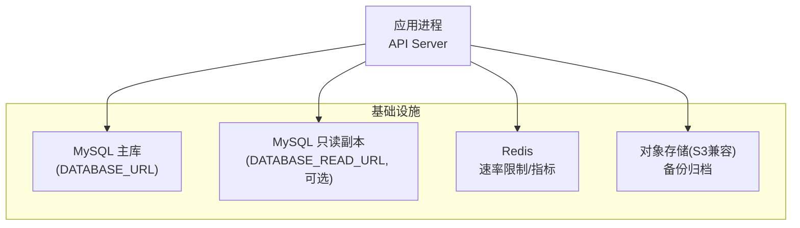
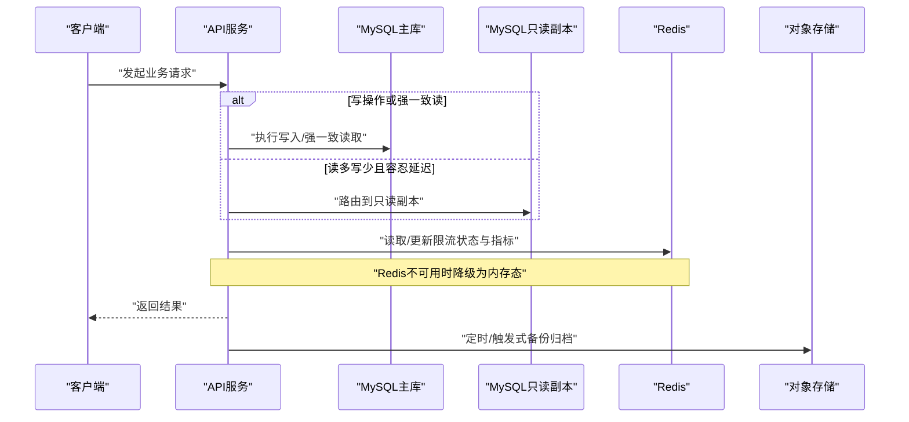
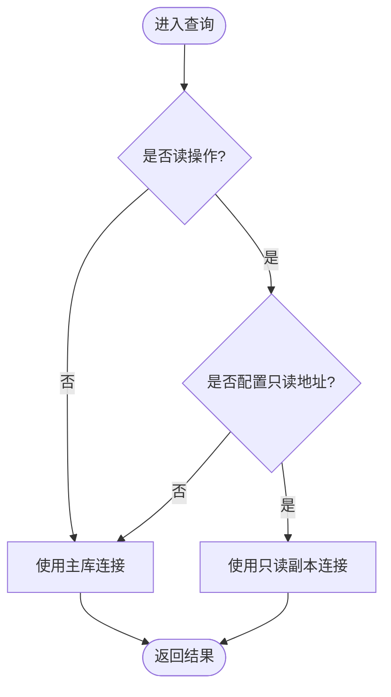
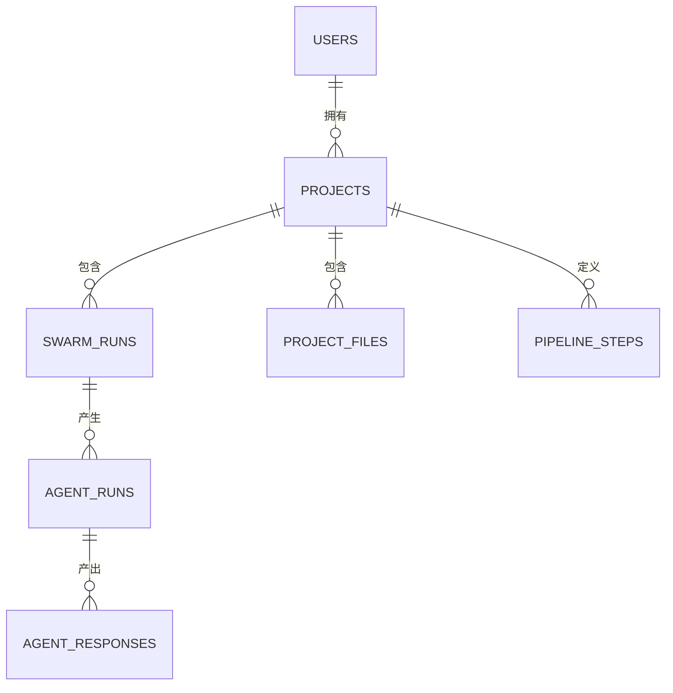
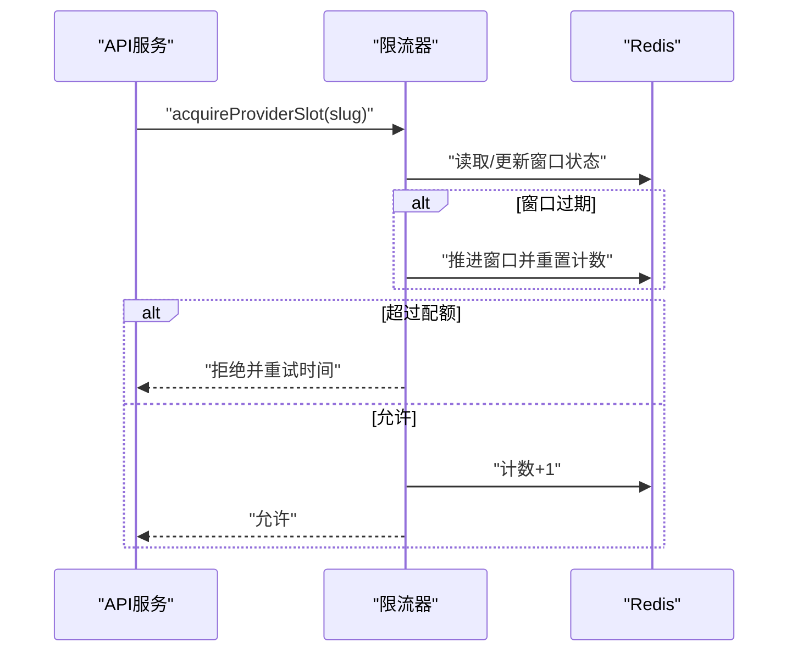
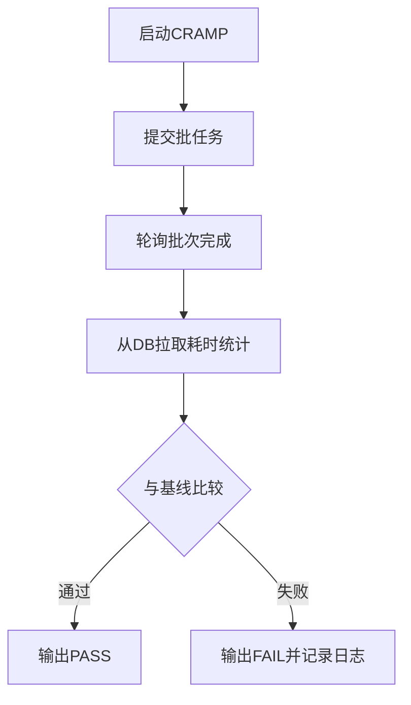
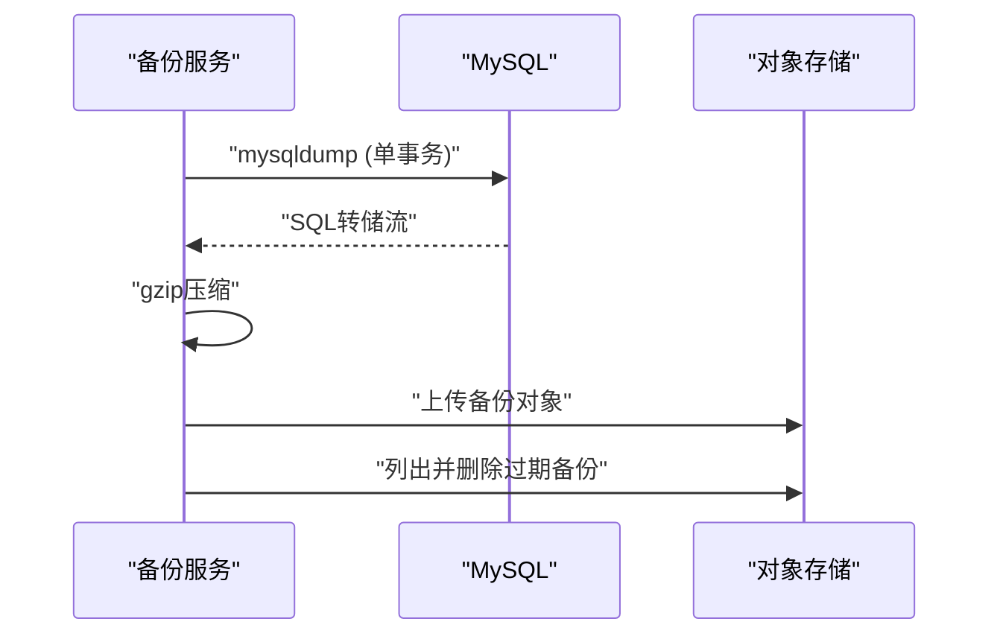
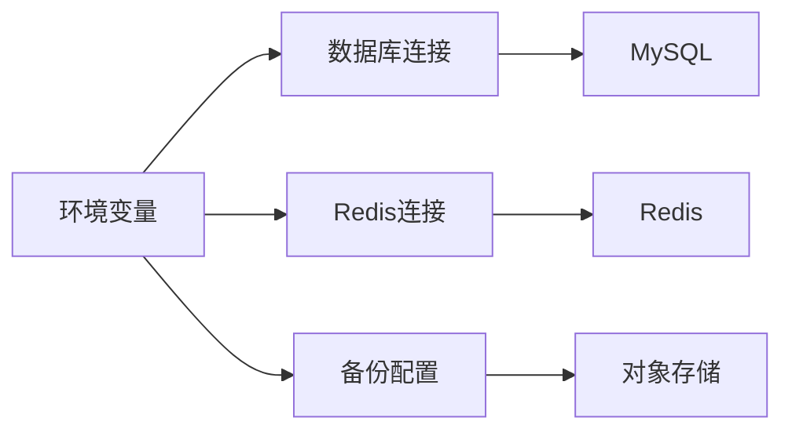

# 性能优化

<cite>
**本文引用的文件**
- [api/queries/connection.ts](file://api/queries/connection.ts)
- [db/schema.ts](file://db/schema.ts)
- [db/migrate-indexes.sql](file://db/migrate-indexes.sql)
- [drizzle.config.ts](file://drizzle.config.ts)
- [docker-compose.yml](file://docker-compose.yml)
- [deploy/aliyun-optimized.md](file://deploy/aliyun-optimized.md)
- [api/lib/env.ts](file://api/lib/env.ts)
- [api/infra/redis.ts](file://api/infra/redis.ts)
- [api/lib/providerThrottle.ts](file://api/lib/providerThrottle.ts)
- [api/services/backup.ts](file://api/services/backup.ts)
- [research/orchestration-economics/code/cramp_test.mjs](file://research/orchestration-economics/code/cramp_test.mjs)
- [scripts/smoke-batch.mjs](file://scripts/smoke-batch.mjs)
</cite>

## 目录
1. [简介](#简介)
2. [项目结构](#项目结构)
3. [核心组件](#核心组件)
4. [架构总览](#架构总览)
5. [详细组件分析](#详细组件分析)
6. [依赖关系分析](#依赖关系分析)
7. [性能考量](#性能考量)
8. [故障排查指南](#故障排查指南)
9. [结论](#结论)
10. [附录](#附录)

## 简介
本文件面向DeeWaanAI数据库性能优化，聚焦索引策略、查询优化、缓存机制、慢查询分析与监控、分库分表与数据归档、连接池配置与资源管理、以及性能基准测试与调优实践。内容基于仓库中实际的数据库Schema、迁移脚本、连接与读副本配置、Redis缓存与限流实现、备份与压测脚本等代码与配置进行系统化梳理，并提供可操作的优化建议与排障指引。

## 项目结构
- 数据库层：MySQL（Docker Compose 提供本地环境），Drizzle ORM 定义 Schema，SQL 迁移脚本维护索引与表结构。
- 应用层：Node.js API 服务，通过环境变量注入数据库与缓存连接信息；支持读写分离（可选读副本）。
- 缓存与限流：Redis 作为共享状态存储，用于提供者速率限制（AIMD）与指标采集。
- 运维与工具：备份到对象存储、压测脚本（CRAMP）、冒烟测试脚本（smoke-batch）。

**图示来源**
- [docker-compose.yml:1-52](file://docker-compose.yml#L1-L52)
- [api/lib/env.ts:24-37](file://api/lib/env.ts#L24-L37)
- [api/queries/connection.ts:10-42](file://api/queries/connection.ts#L10-L42)

**章节来源**
- [docker-compose.yml:1-52](file://docker-compose.yml#L1-L52)
- [api/lib/env.ts:24-37](file://api/lib/env.ts#L24-L37)

## 核心组件
- 数据库连接与读副本路由：单例主库连接，按需创建只读副本连接，仅对读多写少且容忍复制延迟的查询使用。
- 索引与Schema：在Schema中声明关键表与复合索引，并通过独立迁移脚本批量创建二级索引。
- Redis缓存与提供者限流：AIMD算法动态调整各Provider RPM，状态持久化至Redis并回退内存态。
- 备份与归档：mysqldump + gzip 直传S3，保留期清理。
- 压测与监控：CRAMP并发校准脚本从DB拉取耗时统计，结合基线对比评估吞吐与延迟。

**章节来源**
- [api/queries/connection.ts:10-42](file://api/queries/connection.ts#L10-L42)
- [db/schema.ts:17-82](file://db/schema.ts#L17-L82)
- [db/migrate-indexes.sql:1-111](file://db/migrate-indexes.sql#L1-L111)
- [api/infra/redis.ts:40-87](file://api/infra/redis.ts#L40-L87)
- [api/lib/providerThrottle.ts:155-274](file://api/lib/providerThrottle.ts#L155-L274)
- [api/services/backup.ts:119-224](file://api/services/backup.ts#L119-L224)
- [research/orchestration-economics/code/cramp_test.mjs:124-195](file://research/orchestration-economics/code/cramp_test.mjs#L124-L195)

## 架构总览
下图展示请求路径中的数据库访问、缓存与外部依赖交互，体现读写分离、缓存降级与备份归档的关键节点。

**图示来源**
- [api/queries/connection.ts:22-42](file://api/queries/connection.ts#L22-L42)
- [api/infra/redis.ts:61-87](file://api/infra/redis.ts#L61-L87)
- [api/services/backup.ts:173-224](file://api/services/backup.ts#L173-L224)

## 详细组件分析

### 数据库连接与读副本路由
- 主库连接：单例模式创建，避免重复连接开销。
- 读副本路由：当配置了只读地址时，读多写少且可容忍复制延迟的查询走只读实例；否则回退到主库，保证行为一致性。
- 配置来源：环境变量注入，便于在不同环境切换。

**图示来源**
- [api/queries/connection.ts:10-42](file://api/queries/connection.ts#L10-L42)
- [api/lib/env.ts:29-32](file://api/lib/env.ts#L29-L32)

**章节来源**
- [api/queries/connection.ts:10-42](file://api/queries/connection.ts#L10-L42)
- [api/lib/env.ts:29-32](file://api/lib/env.ts#L29-L32)

### 索引策略与Schema设计
- 高频查询字段建立索引：用户、项目、运行记录、响应、调试日志等表均按常见过滤条件建索引。
- 复合索引：如项目文件路径、流水线步骤顺序等，提升范围查询与排序效率。
- 迁移脚本：集中维护二级索引，确保生产环境索引一致性。

**图示来源**
- [db/schema.ts:17-82](file://db/schema.ts#L17-L82)
- [db/schema.ts:173-237](file://db/schema.ts#L173-L237)
- [db/schema.ts:262-333](file://db/schema.ts#L262-L333)
- [db/schema.ts:363-480](file://db/schema.ts#L363-L480)

**章节来源**
- [db/schema.ts:17-82](file://db/schema.ts#L17-L82)
- [db/schema.ts:173-237](file://db/schema.ts#L173-L237)
- [db/schema.ts:262-333](file://db/schema.ts#L262-L333)
- [db/schema.ts:363-480](file://db/schema.ts#L363-L480)
- [db/migrate-indexes.sql:1-111](file://db/migrate-indexes.sql#L1-L111)

### 缓存机制与提供者限流（AIMD）
- 状态存储：每Provider的当前RPM、窗口计数、慢启动标志等存储在Redis哈希中；若Redis不可用则回退到内存态。
- 自适应限流：采用AIMD（加法增长/乘法减少）策略，根据429等限速反馈自动降速，并在窗口到期后恢复增长。
- 指标暴露：提供获取所有Provider实时限流指标的接口，便于监控与告警。

**图示来源**
- [api/lib/providerThrottle.ts:155-274](file://api/lib/providerThrottle.ts#L155-L274)
- [api/infra/redis.ts:61-87](file://api/infra/redis.ts#L61-L87)

**章节来源**
- [api/lib/providerThrottle.ts:155-274](file://api/lib/providerThrottle.ts#L155-L274)
- [api/infra/redis.ts:61-87](file://api/infra/redis.ts#L61-L87)

### 慢查询分析与性能监控
- 压测与基线：CRAMP脚本通过提交批任务并从DB读取swarm_runs.total_latency_ms计算中位数与P95，与c=2基线比较，判定并发度是否通过。
- 冒烟测试：smoke-batch脚本验证批处理端到端流程，间接检验DB写入与查询稳定性。
- 监控建议：结合应用日志与DB慢查询日志，持续跟踪swarm_runs、agent_runs、agent_responses等热点表的查询成本。

**图示来源**
- [research/orchestration-economics/code/cramp_test.mjs:124-195](file://research/orchestration-economics/code/cramp_test.mjs#L124-L195)
- [scripts/smoke-batch.mjs:74-115](file://scripts/smoke-batch.mjs#L74-L115)

**章节来源**
- [research/orchestration-economics/code/cramp_test.mjs:124-195](file://research/orchestration-economics/code/cramp_test.mjs#L124-L195)
- [scripts/smoke-batch.mjs:74-115](file://scripts/smoke-batch.mjs#L74-L115)

### 分库分表策略与数据归档
- 分库：当前未实现水平分库；可通过读写分离缓解读压力。未来可按“用户/项目”维度拆分只读副本以扩展读能力。
- 分表：针对高增长表（如agent_responses、debug_logs、test_prompt_intermediate）建议按时间或实体ID哈希分表，降低单表规模。
- 归档：将历史数据（如已完成批次、旧调试日志）迁移至冷存储或归档库，保持热表轻量化。

[本节为概念性说明，不直接分析具体文件]

### 数据库连接池配置与资源管理最佳实践
- 连接池：当前Drizzle默认模式，建议在连接字符串中启用连接池参数（如pool.size、connectionLimit），并结合MySQL max_connections限制。
- 超时与重试：设置合理的wait_timeout/interactive_timeout，避免长连接占用；对网络抖动增加重试与退避。
- 资源限制：在低内存主机上限制Node堆大小与MySQL缓冲池，参考阿里云优化文档。

**章节来源**
- [docker-compose.yml:1-52](file://docker-compose.yml#L1-L52)
- [deploy/aliyun-optimized.md:15-55](file://deploy/aliyun-optimized.md#L15-L55)

### 备份与归档方案
- 备份流程：mysqldump --single-transaction生成一致性快照，gzip压缩后上传至S3兼容对象存储，保留7天并清理过期备份。
- 安全与可靠性：凭据通过临时my.cnf传递，避免命令行泄露；上传失败不影响备份成功判定，但需告警。

**图示来源**
- [api/services/backup.ts:119-224](file://api/services/backup.ts#L119-L224)

**章节来源**
- [api/services/backup.ts:119-224](file://api/services/backup.ts#L119-L224)

## 依赖关系分析
- 应用依赖：
  - 数据库：Drizzle ORM + MySQL（主库/只读副本）
  - 缓存：Redis（可选，具备降级能力）
  - 对象存储：S3兼容（备份归档）
- 配置依赖：
  - 环境变量：DATABASE_URL、DATABASE_READ_URL、REDIS_URL、S3_*等
  - Drizzle配置：dialect=mysql，schema路径固定

**图示来源**
- [api/lib/env.ts:24-88](file://api/lib/env.ts#L24-L88)
- [drizzle.config.ts:1-17](file://drizzle.config.ts#L1-L17)
- [api/queries/connection.ts:10-42](file://api/queries/connection.ts#L10-L42)
- [api/infra/redis.ts:61-87](file://api/infra/redis.ts#L61-L87)
- [api/services/backup.ts:173-224](file://api/services/backup.ts#L173-L224)

**章节来源**
- [api/lib/env.ts:24-88](file://api/lib/env.ts#L24-L88)
- [drizzle.config.ts:1-17](file://drizzle.config.ts#L1-L17)
- [api/queries/connection.ts:10-42](file://api/queries/connection.ts#L10-L42)
- [api/infra/redis.ts:61-87](file://api/infra/redis.ts#L61-L87)
- [api/services/backup.ts:173-224](file://api/services/backup.ts#L173-L224)

## 性能考量
- 索引优先：确保高频过滤字段有合适索引，避免全表扫描；复合索引覆盖常见查询组合。
- 读写分离：读多写少场景启用只读副本，降低主库压力。
- 缓存与限流：利用Redis做速率限制与指标缓存，避免外部Provider限流导致的级联放大。
- 资源预算：在低内存环境下合理设置MySQL缓冲池与Node堆大小，防止OOM。
- 监控与压测：定期运行CRAMP与冒烟测试，跟踪延迟分布与失败率，及时回归问题。

[本节提供通用指导，不直接分析具体文件]

## 故障排查指南
- Redis不可用：限流器会降级为内存态，指标可能不完整；检查REDIS_URL与网络连通性。
- 只读副本延迟：读多写少查询出现不一致时，确认是否误用了只读副本；必要时回退到主库。
- 备份失败：检查S3凭据与权限；mysqldump错误码与stderr日志定位原因。
- 慢查询定位：结合DB慢查询日志与应用日志，关注swarm_runs、agent_responses等热点表。

**章节来源**
- [api/infra/redis.ts:61-87](file://api/infra/redis.ts#L61-L87)
- [api/queries/connection.ts:22-42](file://api/queries/connection.ts#L22-L42)
- [api/services/backup.ts:173-224](file://api/services/backup.ts#L173-L224)

## 结论
本项目已具备完善的数据库基础能力：明确的Schema与索引、读写分离支持、Redis驱动的自适应限流与指标、对象存储备份归档、以及压测与冒烟测试工具。下一步建议聚焦于：
- 在高增长表上实施分表与归档，控制单表规模。
- 完善连接池参数与超时策略，提升连接复用与稳定性。
- 建立常态化慢查询治理与性能回归流程，结合CRAMP与监控告警持续优化。

[本节为总结性内容，不直接分析具体文件]

## 附录
- 环境配置要点：
  - DATABASE_URL：必填，指向MySQL主库
  - DATABASE_READ_URL：选填，开启只读副本
  - REDIS_URL：选填，启用Redis缓存与限流
  - S3_*：选填，启用备份归档
- 常用命令与脚本：
  - 索引迁移：执行db/migrate-indexes.sql
  - 压测：research/orchestration-economics/code/cramp_test.mjs
  - 冒烟测试：scripts/smoke-batch.mjs

**章节来源**
- [api/lib/env.ts:24-88](file://api/lib/env.ts#L24-L88)
- [db/migrate-indexes.sql:1-111](file://db/migrate-indexes.sql#L1-L111)
- [research/orchestration-economics/code/cramp_test.mjs:124-195](file://research/orchestration-economics/code/cramp_test.mjs#L124-L195)
- [scripts/smoke-batch.mjs:74-115](file://scripts/smoke-batch.mjs#L74-L115)