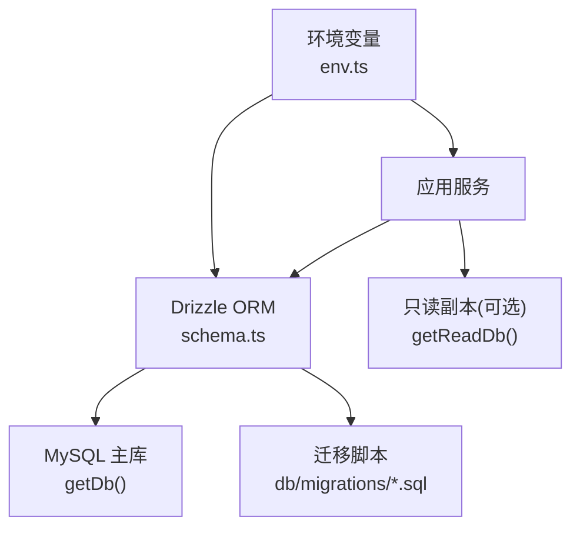
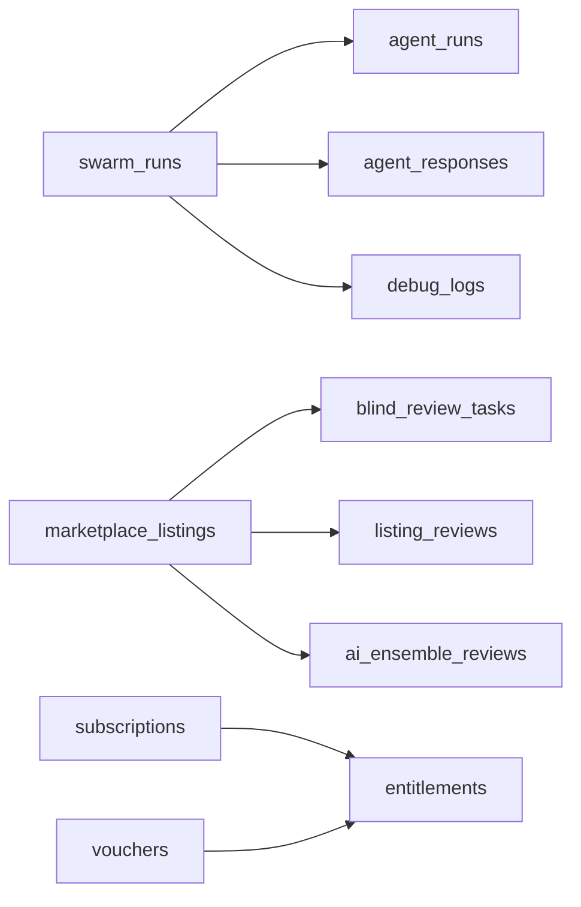

# 数据库设计文档

<cite>
**本文引用的文件**
- [db/schema.ts](file://db/schema.ts)
- [db/relations.ts](file://db/relations.ts)
- [drizzle.config.ts](file://drizzle.config.ts)
- [api/queries/connection.ts](file://api/queries/connection.ts)
- [api/lib/env.ts](file://api/lib/env.ts)
- [db/migrations/009_foundation.sql](file://db/migrations/009_foundation.sql)
- [db/migrations/014_marketplace_trust.sql](file://db/migrations/014_marketplace_trust.sql)
- [db/migrations/019_research_mode.sql](file://db/migrations/019_research_mode.sql)
- [db/migrations/021_widen_content_columns.sql](file://db/migrations/021_widen_content_columns.sql)
</cite>

## 目录
1. [简介](#简介)
2. [项目结构](#项目结构)
3. [核心组件](#核心组件)
4. [架构总览](#架构总览)
5. [详细组件分析](#详细组件分析)
6. [依赖关系分析](#依赖关系分析)
7. [性能考虑](#性能考虑)
8. [故障排查指南](#故障排查指南)
9. [结论](#结论)
10. [附录](#附录)

## 简介
本文件为 DeeWaanAI 的数据库数据模型与访问规范提供权威说明。内容覆盖实体关系、字段定义与数据类型、主键/外键与索引约束、数据验证规则与业务规则、模式图与示例数据、数据访问模式（含读写分离）、缓存策略与性能优化、数据生命周期与归档策略、迁移路径与版本管理、数据安全与隐私要求，以及 Drizzle ORM 的使用方式与迁移管理策略。

## 项目结构
- 数据模型以 Drizzle ORM 声明式 schema 定义在 db/schema.ts，并通过 drizzle.config.ts 配置 MySQL 方言与迁移输出目录。
- 连接层在 api/queries/connection.ts，提供写库 getDb() 与读库 getReadDb()（可选只读副本）。
- 环境变量在 api/lib/env.ts，包含 DATABASE_URL、DATABASE_READ_URL 等关键配置。
- 迁移脚本位于 db/migrations/*.sql，按序号递增，增量变更数据库结构。

图表来源
- [db/schema.ts:1-16](file://db/schema.ts#L1-L16)
- [drizzle.config.ts:1-17](file://drizzle.config.ts#L1-L17)
- [api/queries/connection.ts:1-42](file://api/queries/connection.ts#L1-L42)
- [api/lib/env.ts:24-35](file://api/lib/env.ts#L24-L35)

章节来源
- [db/schema.ts:1-1332](file://db/schema.ts#L1-L1332)
- [drizzle.config.ts:1-17](file://drizzle.config.ts#L1-L17)
- [api/queries/connection.ts:1-42](file://api/queries/connection.ts#L1-L42)
- [api/lib/env.ts:24-35](file://api/lib/env.ts#L24-L35)

## 核心组件
- 用户与权限：users、subscriptions、entitlements、feature_flags、vouchers、voucher_redemptions、oauth_clients、oauth_auth_codes、oauth_refresh_tokens
- 项目与工作流：projects、agents、pipeline_steps、pipeline_templates、swarm_runs、agent_runs、agent_responses、debug_logs、project_files、project_file_contents、file_dependencies
- 市场与信任：marketplace_listings、test_prompts、listing_reviews、ai_ensemble_reviews、reviewer_profiles、review_assignments、blind_review_tasks、creator_deposits、refund_ledger、marketplace_purchases、test_prompt_intermediate、encrypted_prompts
- 团队与协作：teams、team_members、team_projects、test_fixtures、memory_locks、approval_assignments
- 运营与审计：feedback、issues、fix_verifications、activity_log、changelog_entries、notifications、admin_audit_log、mcp_audit_log、waitlist_entries
- 企业集成：sso_connections、relay_registrations、relay_requests

章节来源
- [db/schema.ts:17-1332](file://db/schema.ts#L17-L1332)

## 架构总览
下图展示核心实体间的关系与主要外键约束。

```mermaid
erDiagram
USERS ||--o{ LLM_PROVIDERS : "拥有"
USERS ||--o{ PROJECTS : "创建"
USERS ||--o{ CUSTOM_AGENTS : "创建"
USERS ||--o{ PIPELINE_TEMPLATES : "创建"
USERS ||--o{ MARKETPLACE_LISTINGS : "发布"
USERS ||--o{ SUBSCRIPTIONS : "订阅"
USERS ||--o{ TEAM_MEMBERS : "加入团队"
USERS ||--o{ NOTIFICATIONS : "接收通知"
USERS ||--o{ OAUTH_AUTH_CODES : "授权码"
USERS ||--o{ OAUTH_REFRESH_TOKENS : "刷新令牌"
USERS ||--o{ USER_PRIVACY_CONSENT : "隐私同意"
USERS ||--o{ ACTIVITY_LOG : "活动记录"
USERS ||--o{ FEEDBACK : "提交反馈"
USERS ||--o{ ISSUES : "创建问题"
USERS ||--o{ FIX_VERIFICATIONS : "验证修复"
USERS ||--o{ VOUCHER_REDEMPTIONS : "兑换券"
USERS ||--o{ ADMIN_AUDIT_LOG : "管理员操作"
USERS ||--o{ RELAY_REGISTRATIONS : "注册中继"
PROJECTS ||--o{ AGENTS : "包含"
PROJECTS ||--o{ PIPELINE_STEPS : "包含"
PROJECTS ||--o{ SWARM_RUNS : "运行"
PROJECTS ||--o{ AGENT_RUNS : "步骤执行"
PROJECTS ||--o{ AGENT_RESPONSES : "响应"
PROJECTS ||--o{ DEBUG_LOGS : "调试日志"
PROJECTS ||--o{ PROJECT_FILES : "文件"
PROJECTS ||--o{ PROJECT_FILE_CONTENTS : "内容"
PROJECTS ||--o{ FILE_DEPENDENCIES : "依赖"
PROJECTS ||--o{ MEMORY_LOCKS : "内存锁"
PROJECTS ||--o{ TEAM_PROJECTS : "团队共享"
LLM_PROVIDERS ||--o{ AGENTS : "被使用"
LLM_PROVIDERS ||--o{ PIPELINE_STEPS : "被使用"
LLM_PROVIDERS ||--o{ AI_ENSEMBLE_REVIEWS : "评估"
SWARM_RUNS ||--o{ AGENT_RUNS : "包含"
SWARM_RUNS ||--o{ AGENT_RESPONSES : "包含"
SWARM_RUNS ||--o{ DEBUG_LOGS : "包含"
SWARM_RUNS ||--o{ APPROVAL_ASSIGNMENTS : "人工审批"
PIPELINE_TEMPLATES ||--o{ MARKETPLACE_LISTINGS : "模板引用"
MARKETPLACE_LISTINGS ||--o{ TEST_PROMPTS : "测试提示"
MARKETPLACE_LISTINGS ||--o{ LISTING_REVIEWS : "人类评审"
MARKETPLACE_LISTINGS ||--o{ AI_ENSEMBLE_REVIEWS : "AI评审"
MARKETPLACE_LISTINGS ||--o{ BLIND_REVIEW_TASKS : "盲审任务"
MARKETPLACE_LISTINGS ||--o{ CREATOR_DEPOSITS : "创作者押金"
MARKETPLACE_LISTINGS ||--o{ REFUND_LEDGER : "退款账本"
MARKETPLACE_LISTINGS ||--o{ MARKETPLACE_PURCHASES : "购买记录"
MARKETPLACE_LISTINGS ||--o{ ENCRYPTED_PROMPTS : "加密提示"
TEAMS ||--o{ TEAM_MEMBERS : "成员"
TEAMS ||--o{ TEAM_PROJECTS : "共享项目"
TEAMS ||--o{ FEEDBACK : "团队反馈"
TEAMS ||--o{ ISSUES : "团队问题"
TEAMS ||--o{ ACTIVITY_LOG : "活动"
TEAMS ||--o{ CHANGELOG_ENTRIES : "更新日志"
TEAMS ||--o{ SUBSCRIPTIONS : "团队订阅"
TEAMS ||--o{ TEAM_SEATS : "席位"
TEST_FIXTURES ||--o{ SWARM_RUNS : "测试用例"
```

图表来源
- [db/schema.ts:17-1332](file://db/schema.ts#L17-L1332)

## 详细组件分析

### 用户与身份认证
- users：用户主表，支持 OAuth 与本地密码登录；role、tier、defaultProviderId、preferences 等字段用于角色、套餐、默认 LLM 提供者与持久化偏好。
- oauth_clients / oauth_auth_codes / oauth_refresh_tokens：OAuth 2.1 客户端、授权码（PKCE）与刷新令牌，敏感值哈希存储。
- entitlements：统一能力源，subject_type 支持 user/team，source 包括 tier、subscription、voucher、purchase、manual。
- subscriptions：Stripe 订阅状态与周期。
- vouchers / voucher_redemptions：内测券与兑换记录。
- feature_flags：功能开关与灰度。

主键/外键与索引
- users.id 为主键；oauth_auth_codes.code_hash、oauth_refresh_tokens.token_hash 唯一索引；entitlements.subject_id+capability 复合索引；subscriptions.user_id/team_id 索引。

数据验证与业务规则
- role/tier/status 等枚举约束由 mysqlEnum 保证。
- 凭据安全：API Key 与密钥通过文本字段存储并配合加密逻辑（见 apiKeyStore、llmProviders.apiKeyRef），生产环境禁止使用开发默认密钥（env.ts 校验）。

章节来源
- [db/schema.ts:17-82](file://db/schema.ts#L17-L82)
- [db/schema.ts:1063-1147](file://db/schema.ts#L1063-L1147)
- [api/lib/env.ts:21-23](file://api/lib/env.ts#L21-L23)

### 项目与工作流（Swarm/Pipeline）
- projects：项目元信息、Gitee/GitHub 同步、智能卡片、默认提供者与模型、流水线配置。
- agents / custom_agents：内置与自定义代理，角色、系统提示词、模型参数。
- pipeline_steps / pipeline_templates：可编排的步骤序列，支持条件分支（if）、循环（while）、人工审批（approval）。
- swarm_runs：一次流水线执行，包含执行状态、重试参数、批分组（batch_id）、错误信息。
- agent_runs / agent_responses：每个步骤的执行与响应，记录 token、延迟、模型、提供者、质量评分等。
- debug_logs：调试事件与负载。
- project_files / project_file_contents / file_dependencies：项目文件索引、全文内容与跨文件依赖。

主键/外键与索引
- swarm_runs.project_id/user_id/status/batch_id 索引；agent_runs/swarm_run_id/project_id 索引；agent_responses/swarm_run_id/agent_run_id/project_id 索引；project_files.path 复合索引。

数据验证与业务规则
- status 枚举限制运行状态；execution_state/run_params 用于恢复执行与批链式调用；content 列升级为 MEDIUMTEXT 避免溢出。

章节来源
- [db/schema.ts:84-171](file://db/schema.ts#L84-L171)
- [db/schema.ts:173-237](file://db/schema.ts#L173-L237)
- [db/schema.ts:239-260](file://db/schema.ts#L239-L260)
- [db/schema.ts:262-335](file://db/schema.ts#L262-L335)
- [db/schema.ts:337-414](file://db/schema.ts#L337-L414)
- [db/migrations/019_research_mode.sql:1-28](file://db/migrations/019_research_mode.sql#L1-L28)
- [db/migrations/021_widen_content_columns.sql:1-16](file://db/migrations/021_widen_content_columns.sql#L1-L16)

### 市场与信任（Marketplace Trust）
- marketplace_listings：商品条目，状态机包含 draft/generating/pending_review/reviewing/certifying/rejected/approved/published/unpublished；含评分、Kappa、AI 相关指标与认证时间。
- test_prompts / listing_reviews / ai_ensemble_reviews / blind_review_tasks：自动化测试、人类评审、AI 集合评审与盲审任务池。
- creator_deposits / refund_ledger / marketplace_purchases：费用、退款与销售记录。
- encrypted_prompts：对提示进行加密存储，保护平台机密。

主键/外键与索引
- blind_review_tasks 具备 (listing_id, prompt_index, reviewer_id) 唯一索引与 pool 查询索引；其他表均建立必要的外键与索引。

数据验证与业务规则
- 盲审流程：进入 certifying 时生成 pooled 任务，reviewer 认领后变为 assigned，完成后标记 completed；pooled 行去重在代码层实现，数据库唯一键防止重复分配同一 reviewer。
- 价格与订阅：decimal 精度控制；is_subscription 与 subscription_end 控制订阅到期。

章节来源
- [db/schema.ts:511-779](file://db/schema.ts#L511-L779)
- [db/migrations/014_marketplace_trust.sql:1-38](file://db/migrations/014_marketplace_trust.sql#L1-L38)

### 团队与协作（Teams & Teamsync）
- teams / team_members / team_projects：团队、成员角色与项目共享。
- memory_locks：基于版本号与 lastWriterId 的乐观并发锁，保障共享项目状态一致性。
- approval_assignments：跨应用的人工审批流转。
- test_fixtures：可复用的测试 ZIP 包，供流水线测试引用。

主键/外键与索引
- team_members.team_id+user_id 唯一索引；team_projects.team_id+project_id 唯一索引；memory_locks.project_id 主键。

章节来源
- [db/schema.ts:785-862](file://db/schema.ts#L785-L862)
- [db/schema.ts:1202-1246](file://db/schema.ts#L1202-L1246)

### 运营、审计与企业集成
- feedback / issues / fix_verifications / activity_log / changelog_entries / notifications：用户反馈、问题跟踪、活动统计、更新日志与通知。
- admin_audit_log / mcp_audit_log：管理员操作与 MCP 工具调用审计。
- sso_connections / relay_registrations / relay_requests：企业 SSO（OIDC/SAML）与中继注册与请求队列。
- waitlist_entries：营销网站候补名单。

主键/外键与索引
- 各表针对高频查询字段建立索引（如 userId、status、createdAt 等）。

章节来源
- [db/schema.ts:878-1332](file://db/schema.ts#L878-L1332)

## 依赖关系分析
- 强耦合：swarm_runs 与 agent_runs/agent_responses/debug_logs 形成执行链路；marketplace_listings 与评审相关表形成质量闭环。
- 弱耦合：teams 与 projects 通过 team_projects 解耦；entitlements 作为统一能力源，降低订阅/券/购买的耦合。
- 外部依赖：Stripe（订阅/支付）、Redis（可选，限流/队列）、对象存储（上传/截图）。

图表来源
- [db/schema.ts:173-335](file://db/schema.ts#L173-L335)
- [db/schema.ts:511-779](file://db/schema.ts#L511-L779)
- [db/schema.ts:1063-1147](file://db/schema.ts#L1063-L1147)

章节来源
- [db/schema.ts:173-335](file://db/schema.ts#L173-L335)
- [db/schema.ts:511-779](file://db/schema.ts#L511-L779)
- [db/schema.ts:1063-1147](file://db/schema.ts#L1063-L1147)

## 性能考虑
- 索引策略：对高频过滤字段（userId、projectId、status、createdAt）建立索引；复合索引用于联合查询（如 pipeline_steps.orderIdx）。
- 大文本处理：将 agent_runs/agent_responses/swarm_runs 的 content/prompt 等列升级为 MEDIUMTEXT，避免 64KiB TEXT 溢出。
- 读写分离：getReadDb() 可将读请求路由到只读副本，减轻主库压力；写与一致性读取仍走主库。
- 批量与批分组：swarm_batches 聚合批运行统计，便于监控与分页。
- JSON 字段：合理使用 JSON 类型存储灵活配置（如 preferences、pipeline_config、metadata），减少冗余列。

章节来源
- [db/migrations/021_widen_content_columns.sql:1-16](file://db/migrations/021_widen_content_columns.sql#L1-L16)
- [api/queries/connection.ts:22-42](file://api/queries/connection.ts#L22-L42)
- [db/schema.ts:148-150](file://db/schema.ts#L148-L150)
- [db/schema.ts:477-480](file://db/schema.ts#L477-L480)

## 故障排查指南
- 连接与环境变量
  - 确保 DATABASE_URL 存在且正确；生产环境缺失必需变量会抛错。
  - 若启用只读副本，设置 DATABASE_READ_URL；否则 getReadDb() 回退到主库。
- 常见错误
  - 文本溢出：确认已执行 021 迁移，将 content/prompt 列改为 MEDIUMTEXT。
  - 幂等性：webhook/checkout 等外部事件使用 idempotency_keys 防重放。
  - 盲审任务重复：pooled 行去重在代码层实现，数据库唯一键防止同一 reviewer 重复分配。
- 审计与追踪
  - 使用 admin_audit_log、mcp_audit_log、debug_logs 定位问题。
  - 使用 activity_log 追踪用户行为与参与度。

章节来源
- [api/lib/env.ts:24-35](file://api/lib/env.ts#L24-L35)
- [db/migrations/021_widen_content_columns.sql:1-16](file://db/migrations/021_widen_content_columns.sql#L1-L16)
- [db/schema.ts:1106-1114](file://db/schema.ts#L1106-L1114)
- [db/schema.ts:1181-1196](file://db/schema.ts#L1181-L1196)
- [db/schema.ts:337-361](file://db/schema.ts#L337-L361)

## 结论
DeeWaanAI 的数据库采用 Drizzle ORM 声明式 schema，结合增量迁移与严格的索引/约束策略，支撑了从项目工作流、市场信任体系到团队协作与企业集成的多域需求。通过读写分离、JSON 灵活字段与大文本升级，系统在可扩展性与性能上取得平衡。建议在生产中持续完善备份与归档策略，并强化数据访问层的审计与监控。

## 附录

### 数据访问模式与缓存策略
- 数据访问
  - 写库：getDb() 用于所有写入与一致性读取。
  - 读库：getReadDb() 用于读多写少场景（浏览、搜索、报表），容忍复制延迟。
- 缓存策略
  - 当前 schema 未内建缓存表；建议在应用层引入 Redis（env.redisUrl）缓存热点数据（如 listings、features、usage counters）。
  - 对于频繁读取的配置或元数据（如 feature_flags、entitlements），可在应用层做短期缓存。

章节来源
- [api/queries/connection.ts:1-42](file://api/queries/connection.ts#L1-L42)
- [api/lib/env.ts:37-37](file://api/lib/env.ts#L37-L37)

### 数据生命周期、保留与归档
- 日志与调试
  - debug_logs、activity_log、mcp_audit_log、admin_audit_log 建议定期归档至冷存储，并清理过期数据。
- 运行与响应
  - agent_runs、agent_responses、swarm_runs 可按项目/时间窗口归档，保留最近活跃期数据于热库。
- 市场与评审
  - listing_reviews、ai_ensemble_reviews、blind_review_tasks 可按月归档，保留审计所需的最小历史。
- 订阅与计费
  - subscriptions、entitlements、usage_counters、idempotency_keys 需长期保留以满足审计与合规。

[本节为通用指导，不直接分析具体文件]

### 数据迁移路径与版本管理
- 使用 Drizzle Kit 管理迁移：drizzle.config.ts 指定 schema 与输出目录。
- 迁移顺序：按数字前缀递增，新增表/列/索引，保持向后兼容（additive-only）。
- 关键迁移
  - 009_foundation：基础计费、能力、用量、幂等、OAuth、券兑换。
  - 014_marketplace_trust：市场信任与盲审任务池。
  - 019_research_mode：研究模式批分组与关联。
  - 021_widen_content_columns：扩大内容列容量并增加错误字段。

章节来源
- [drizzle.config.ts:1-17](file://drizzle.config.ts#L1-L17)
- [db/migrations/009_foundation.sql:1-75](file://db/migrations/009_foundation.sql#L1-L75)
- [db/migrations/014_marketplace_trust.sql:1-38](file://db/migrations/014_marketplace_trust.sql#L1-L38)
- [db/migrations/019_research_mode.sql:1-28](file://db/migrations/019_research_mode.sql#L1-L28)
- [db/migrations/021_widen_content_columns.sql:1-16](file://db/migrations/021_widen_content_columns.sql#L1-L16)

### 数据安全、隐私与访问控制
- 敏感数据存储
  - API Key、OAuth 令牌、SSO 密钥等采用加密或哈希存储（apiKeyStore、oauth_refresh_tokens.token_hash、sso_connections.oidc_client_secret_enc）。
- 隐私同意
  - user_privacy_consent 记录用户对提示、反馈、截图、对话历史的存储许可。
- 访问控制
  - 通过 entitlements 统一判定主体（用户/团队）能力；subscriptions/vouchers/purchases 作为能力来源。
  - 团队级隔离：team_members.role、team_projects 限定共享范围。
- 审计与合规
  - admin_audit_log、mcp_audit_log、activity_log 提供操作与使用轨迹。

章节来源
- [db/schema.ts:416-427](file://db/schema.ts#L416-L427)
- [db/schema.ts:864-876](file://db/schema.ts#L864-L876)
- [db/schema.ts:1081-1093](file://db/schema.ts#L1081-L1093)
- [db/schema.ts:1303-1317](file://db/schema.ts#L1303-L1317)

### Drizzle ORM 使用方式与迁移管理策略
- Schema 定义
  - 使用 mysqlTable、int、varchar、text、mediumtext、boolean、bigint、timestamp、json、mysqlEnum、index、uniqueIndex 等构建强类型表结构。
- 连接与实例
  - getDb() 单例化写库；getReadDb() 按需复用只读副本实例。
- 迁移命令
  - 通过 drizzle-kit 读取 env.DATABASE_URL，生成/应用迁移到 db/migrations。
- 最佳实践
  - 仅追加变更（additive-only），避免破坏性修改。
  - 为新表/列添加合适索引，关注复合索引与唯一约束。
  - 对大文本使用 mediumtext，避免溢出。
  - 对外部回调使用幂等键，防止重复处理。

章节来源
- [db/schema.ts:1-16](file://db/schema.ts#L1-L16)
- [api/queries/connection.ts:1-42](file://api/queries/connection.ts#L1-L42)
- [drizzle.config.ts:1-17](file://drizzle.config.ts#L1-L17)