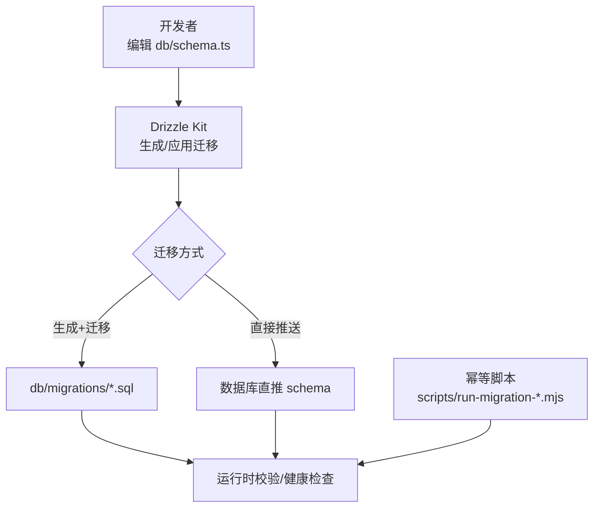
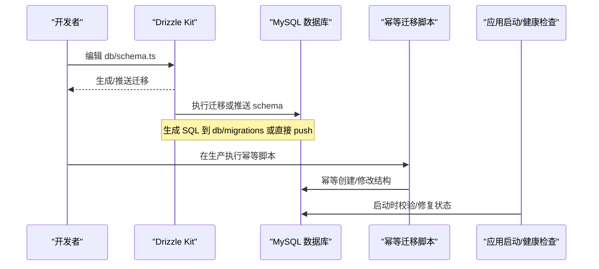
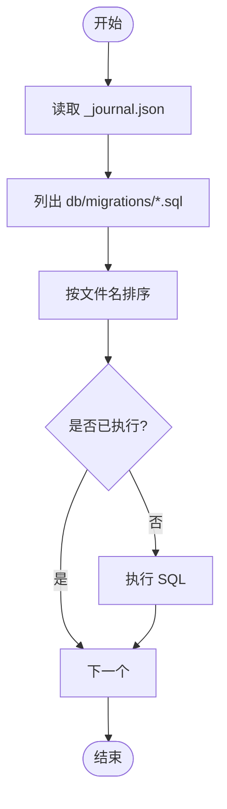
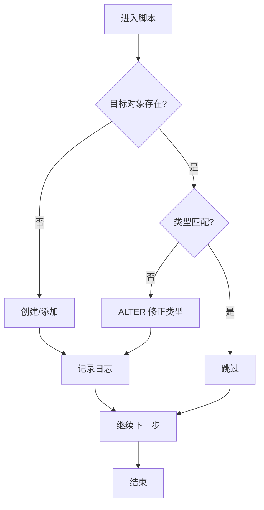
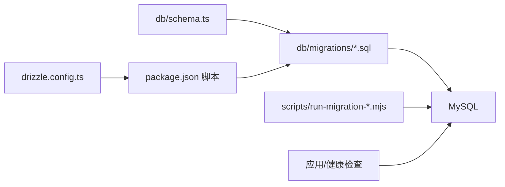

# 数据库迁移

<cite>
**本文引用的文件**
- [drizzle.config.ts](file://drizzle.config.ts)
- [package.json](file://package.json)
- [ENGINEERING.md](file://ENGINEERING.md)
- [db/schema.ts](file://db/schema.ts)
- [db/migrations/meta/_journal.json](file://db/migrations/meta/_journal.json)
- [db/migrations/009_foundation.sql](file://db/migrations/009_foundation.sql)
- [db/migrations/021_widen_content_columns.sql](file://db/migrations/021_widen_content_columns.sql)
- [scripts/run-migration-019.mjs](file://scripts/run-migration-019.mjs)
- [scripts/run-migration-020.mjs](file://scripts/run-migration-020.mjs)
- [scripts/run-migration-021.mjs](file://scripts/run-migration-021.mjs)
</cite>

## 目录
1. [简介](#简介)
2. [项目结构](#项目结构)
3. [核心组件](#核心组件)
4. [架构总览](#架构总览)
5. [详细组件分析](#详细组件分析)
6. [依赖关系分析](#依赖关系分析)
7. [性能考虑](#性能考虑)
8. [故障排查指南](#故障排查指南)
9. [结论](#结论)
10. [附录](#附录)

## 简介
本文件为 DeeWaanAI 数据库迁移系统的权威文档，聚焦于 Drizzle ORM 的迁移策略、版本管理与回滚机制，梳理所有迁移文件的执行顺序与依赖关系，总结向后兼容性、数据安全与性能最佳实践，并提供开发指南、生产部署流程与监控策略。

## 项目结构
- 配置与工具链
  - Drizzle 配置：[drizzle.config.ts](file://drizzle.config.ts)
  - 脚本命令：[package.json](file://package.json)
  - 工程规范与迁移说明：[ENGINEERING.md](file://ENGINEERING.md)
- 数据模型与关系
  - 类型化 Schema（MySQL）：[db/schema.ts](file://db/schema.ts)
- 迁移资产
  - 迁移 SQL 与元数据：[db/migrations/...](file://db/migrations/)
  - 迁移日志快照：[db/migrations/meta/_journal.json](file://db/migrations/meta/_journal.json)
- 运行期补丁脚本
  - 幂等迁移脚本：[scripts/run-migration-019.mjs](file://scripts/run-migration-019.mjs)、[scripts/run-migration-020.mjs](file://scripts/run-migration-020.mjs)、[scripts/run-migration-021.mjs](file://scripts/run-migration-021.mjs)

**图表来源**
- [drizzle.config.ts:1-16](file://drizzle.config.ts#L1-L16)
- [package.json:17-19](file://package.json#L17-L19)
- [ENGINEERING.md:298-312](file://ENGINEERING.md#L298-L312)

**章节来源**
- [drizzle.config.ts:1-16](file://drizzle.config.ts#L1-L16)
- [package.json:17-19](file://package.json#L17-L19)
- [ENGINEERING.md:298-312](file://ENGINEERING.md#L298-L312)

## 核心组件
- Drizzle 配置与方言
  - 使用 MySQL 方言，Schema 路径指向 db/schema.ts，输出目录为 db/migrations，连接串来自环境变量 DATABASE_URL。
- 迁移命令与工作流
  - 开发环境：db:push 将 schema 直接推送到数据库；db:generate 生成 SQL 到 db/migrations；db:migrate 按顺序执行迁移。
  - 工程约定：大型阶段变更采用手写编号 SQL 迁移，保持与 schema 同步。
- 幂等迁移脚本
  - 针对生产环境不自动执行迁移的场景，提供幂等的 Node 脚本，用于创建表、添加列、修改列类型等，可重复安全执行。

**章节来源**
- [drizzle.config.ts:1-16](file://drizzle.config.ts#L1-L16)
- [package.json:17-19](file://package.json#L17-L19)
- [ENGINEERING.md:298-312](file://ENGINEERING.md#L298-L312)
- [scripts/run-migration-019.mjs:1-58](file://scripts/run-migration-019.mjs#L1-L58)
- [scripts/run-migration-020.mjs:1-26](file://scripts/run-migration-020.mjs#L1-L26)
- [scripts/run-migration-021.mjs:1-60](file://scripts/run-migration-021.mjs#L1-L60)

## 架构总览
下图展示了从 Schema 定义到数据库变更的完整链路，包括生成迁移、手动迁移与幂等脚本三种路径，以及运行时的健康检查。

**图表来源**
- [drizzle.config.ts:1-16](file://drizzle.config.ts#L1-L16)
- [package.json:17-19](file://package.json#L17-L19)
- [ENGINEERING.md:298-312](file://ENGINEERING.md#L298-L312)
- [scripts/run-migration-019.mjs:1-58](file://scripts/run-migration-019.mjs#L1-L58)

## 详细组件分析

### Drizzle 配置与迁移工作流
- 配置要点
  - 强制要求 DATABASE_URL，否则无法运行 drizzle 命令。
  - 指定 dialect 为 mysql，schema 与 out 目录明确。
- 工作流
  - 开发：db:push 快速迭代；db:generate + db:migrate 生成并审计 SQL。
  - 生产：遵循工程约定，对大变更采用手写编号 SQL 迁移，并在各环境手动应用；小变更可通过 db:migrate 管理。

**章节来源**
- [drizzle.config.ts:1-16](file://drizzle.config.ts#L1-L16)
- [package.json:17-19](file://package.json#L17-L19)
- [ENGINEERING.md:298-312](file://ENGINEERING.md#L298-L312)

### 迁移文件清单与执行顺序
- 迁移元数据
  - 当前 journal 记录了一个初始断点迁移（索引 0），后续新增的手写迁移以数字前缀命名，按文件名排序依次执行。
- 已知迁移
  - 009_foundation.sql：基础能力扩展（订阅、权限、用量计数、幂等键、OAuth 刷新令牌、代金券兑换等），均为增量变更。
  - 021_widen_content_columns.sql：将 agent_runs、agent_responses、swarm_runs 的内容列扩容至 MEDIUMTEXT，并为 swarm_runs 增加 error 字段。
- 执行顺序与依赖
  - 按数字递增顺序执行：009 → ... → 021。
  - 021 依赖前述表已存在且包含相应列；若缺失则通过幂等脚本补齐。

**图表来源**
- [db/migrations/meta/_journal.json:1-13](file://db/migrations/meta/_journal.json#L1-L13)
- [db/migrations/009_foundation.sql:1-75](file://db/migrations/009_foundation.sql#L1-L75)
- [db/migrations/021_widen_content_columns.sql:1-16](file://db/migrations/021_widen_content_columns.sql#L1-L16)

**章节来源**
- [db/migrations/meta/_journal.json:1-13](file://db/migrations/meta/_journal.json#L1-L13)
- [db/migrations/009_foundation.sql:1-75](file://db/migrations/009_foundation.sql#L1-L75)
- [db/migrations/021_widen_content_columns.sql:1-16](file://db/migrations/021_widen_content_columns.sql#L1-L16)

### 幂等迁移脚本详解
- run-migration-019.mjs
  - 目标：确保 swarm_batches 表存在，并在 swarm_runs 中追加 batch_id 列及索引/外键。
  - 特性：先检测表/列是否存在，再执行变更；可重复执行。
- run-migration-020.mjs
  - 目标：将 llm_providers.api_key_ref 列类型调整为 TEXT，避免密钥超长写入失败。
  - 特性：查询列类型后条件性 ALTER。
- run-migration-021.mjs
  - 目标：将多个内容列升级为 MEDIUMTEXT，并在 swarm_runs 增加 error 列。
  - 特性：逐项检测列类型与存在性，完成后进行验证输出。

**图表来源**
- [scripts/run-migration-019.mjs:1-58](file://scripts/run-migration-019.mjs#L1-L58)
- [scripts/run-migration-020.mjs:1-26](file://scripts/run-migration-020.mjs#L1-L26)
- [scripts/run-migration-021.mjs:1-60](file://scripts/run-migration-021.mjs#L1-L60)

**章节来源**
- [scripts/run-migration-019.mjs:1-58](file://scripts/run-migration-019.mjs#L1-L58)
- [scripts/run-migration-020.mjs:1-26](file://scripts/run-migration-020.mjs#L1-L26)
- [scripts/run-migration-021.mjs:1-60](file://scripts/run-migration-021.mjs#L1-L60)

### 数据模型与迁移对齐
- Schema 与迁移一致性
  - db/schema.ts 定义了用户、项目、代理、流水线、市场模块、团队等实体及其关系；迁移文件负责在数据库中落地这些结构。
  - 当迁移涉及列类型变更（如 TEXT→MEDIUMTEXT）或新增列时，需同步更新 schema 中的类型定义，保证类型推断一致。
- 关键变更示例
  - 009_foundation.sql 引入订阅、权限、用量、幂等键、OAuth 刷新令牌、代金券等表，支撑计费与能力管控。
  - 021_widen_content_columns.sql 解决长文本溢出问题，提升稳定性。

**章节来源**
- [db/schema.ts:1-800](file://db/schema.ts#L1-L800)
- [db/migrations/009_foundation.sql:1-75](file://db/migrations/009_foundation.sql#L1-L75)
- [db/migrations/021_widen_content_columns.sql:1-16](file://db/migrations/021_widen_content_columns.sql#L1-L16)

## 依赖关系分析
- 组件耦合
  - 应用代码依赖 db/schema.ts 的类型定义；迁移文件依赖已有表/列存在；幂等脚本作为兜底保障。
- 外部依赖
  - 数据库驱动 mysql2 被幂等脚本直接使用；Drizzle Kit 依赖 drizzle-orm 与 drizzle-kit。
- 潜在循环依赖
  - 无直接循环导入；但 schema 中多处外键引用需在迁移中确保目标表/列先存在。

**图表来源**
- [db/schema.ts:1-800](file://db/schema.ts#L1-L800)
- [db/migrations/009_foundation.sql:1-75](file://db/migrations/009_foundation.sql#L1-L75)
- [db/migrations/021_widen_content_columns.sql:1-16](file://db/migrations/021_widen_content_columns.sql#L1-L16)
- [scripts/run-migration-019.mjs:1-58](file://scripts/run-migration-019.mjs#L1-L58)
- [scripts/run-migration-020.mjs:1-26](file://scripts/run-migration-020.mjs#L1-L26)
- [scripts/run-migration-021.mjs:1-60](file://scripts/run-migration-021.mjs#L1-L60)
- [package.json:17-19](file://package.json#L17-L19)
- [drizzle.config.ts:1-16](file://drizzle.config.ts#L1-L16)

**章节来源**
- [db/schema.ts:1-800](file://db/schema.ts#L1-L800)
- [db/migrations/009_foundation.sql:1-75](file://db/migrations/009_foundation.sql#L1-L75)
- [db/migrations/021_widen_content_columns.sql:1-16](file://db/migrations/021_widen_content_columns.sql#L1-L16)
- [scripts/run-migration-019.mjs:1-58](file://scripts/run-migration-019.mjs#L1-L58)
- [scripts/run-migration-020.mjs:1-26](file://scripts/run-migration-020.mjs#L1-L26)
- [scripts/run-migration-021.mjs:1-60](file://scripts/run-migration-021.mjs#L1-L60)
- [package.json:17-19](file://package.json#L17-L19)
- [drizzle.config.ts:1-16](file://drizzle.config.ts#L1-L16)

## 性能考虑
- 列类型选择
  - 对可能超过 TEXT(64KB) 的内容列使用 MEDIUMTEXT，避免截断与写入失败（见 021）。
- 索引设计
  - 迁移中对高频查询列建立索引（如 usage_counters 复合唯一键、swarm_runs.batch_id 索引等），提升查询效率。
- 增量变更优先
  - 尽量采用 ADD COLUMN、MODIFY 等增量操作，减少锁表时间与停机窗口。
- 幂等与重试
  - 幂等脚本避免重复执行带来的额外开销，适合在生产多次尝试。

[本节为通用指导，无需特定文件引用]

## 故障排查指南
- 常见问题
  - 缺少 DATABASE_URL：drizzle 命令会报错退出。
  - 列类型不匹配：应用写入时报错，需通过对应幂等脚本修正。
  - 表/列不存在：应用启动或业务逻辑失败，需先执行幂等脚本或迁移。
- 定位步骤
  - 查看 _journal.json 确认已记录的迁移版本。
  - 对照 db/migrations 中的 SQL 与 schema.ts 的类型定义是否一致。
  - 使用 scripts/run-migration-*.mjs 进行幂等修复，观察输出日志。
- 恢复建议
  - 优先执行幂等脚本修复结构；必要时回滚到上一稳定版本并重新应用迁移。
  - 对关键表变更前备份数据，确保可回退。

**章节来源**
- [drizzle.config.ts:1-16](file://drizzle.config.ts#L1-L16)
- [db/migrations/meta/_journal.json:1-13](file://db/migrations/meta/_journal.json#L1-L13)
- [scripts/run-migration-019.mjs:1-58](file://scripts/run-migration-019.mjs#L1-L58)
- [scripts/run-migration-020.mjs:1-26](file://scripts/run-migration-020.mjs#L1-L26)
- [scripts/run-migration-021.mjs:1-60](file://scripts/run-migration-021.mjs#L1-L60)

## 结论
本项目采用 Drizzle ORM 配合手写编号 SQL 迁移与幂等脚本的组合策略，兼顾开发效率与生产稳定性。通过严格的执行顺序、幂等性与增量变更原则，确保数据库结构演进可控、可观测、可回滚。建议在重大变更前进行备份与演练，并在生产环境中保留完整的迁移日志与验证步骤。

[本节为总结，无需特定文件引用]

## 附录

### 迁移最佳实践清单
- 向后兼容
  - 新增列设置默认值，避免破坏旧版应用写入。
  - 先加列/索引，再改业务逻辑，最后删除旧列/索引，分阶段发布。
- 数据安全
  - 敏感字段加密存储（如 API Key 引用），避免明文落库。
  - 对外暴露字段最小化，内部使用严格类型约束。
- 性能优化
  - 为大文本列选择合适的类型（MEDIUMTEXT）。
  - 为高频过滤/关联列建立合适索引，避免过度索引。
- 可观测性
  - 迁移脚本输出关键步骤日志，便于排障。
  - 在应用启动时进行轻量级健康检查，及时发现结构不一致。

[本节为通用指导，无需特定文件引用]

### 生产环境迁移部署流程
- 准备
  - 确认 DATABASE_URL 正确配置。
  - 备份数据库或至少备份受影响表。
- 执行
  - 优先执行幂等脚本（run-migration-*.mjs）确保结构就绪。
  - 如需应用新迁移，使用 db:migrate，并审查迁移日志。
- 验证
  - 运行 npm run check 与测试套件。
  - 检查关键表结构与索引是否符合预期。
- 回滚
  - 若出现问题，回滚应用版本并恢复数据库备份；必要时再次执行幂等脚本修复结构。

**章节来源**
- [ENGINEERING.md:298-312](file://ENGINEERING.md#L298-L312)
- [scripts/run-migration-019.mjs:1-58](file://scripts/run-migration-019.mjs#L1-L58)
- [scripts/run-migration-020.mjs:1-26](file://scripts/run-migration-020.mjs#L1-L26)
- [scripts/run-migration-021.mjs:1-60](file://scripts/run-migration-021.mjs#L1-L60)

### 监控策略
- 指标采集
  - 记录迁移执行耗时、错误率、影响行数。
  - 监控关键表的写入延迟与锁等待。
- 告警规则
  - 迁移失败立即告警。
  - 列类型不匹配或写入异常触发告警。
- 审计与回溯
  - 保存每次迁移的 SQL 与执行结果。
  - 结合 _journal.json 与脚本日志进行问题回溯。

[本节为通用指导，无需特定文件引用]