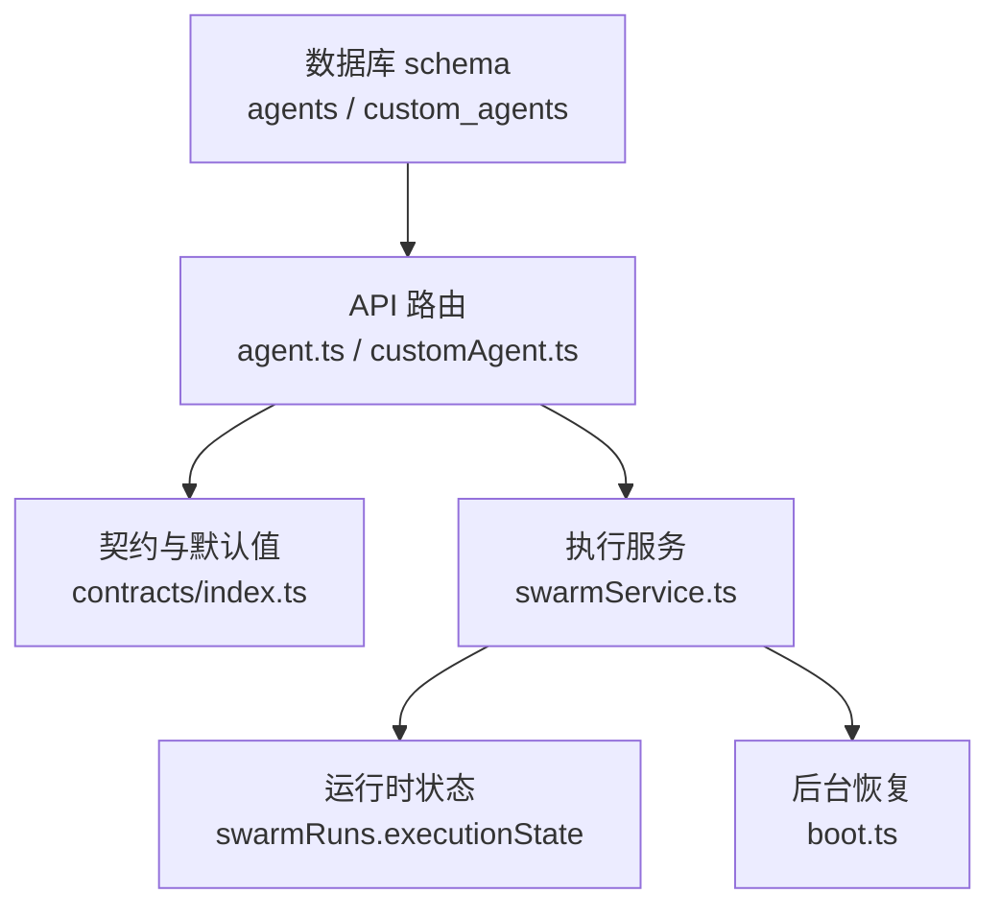
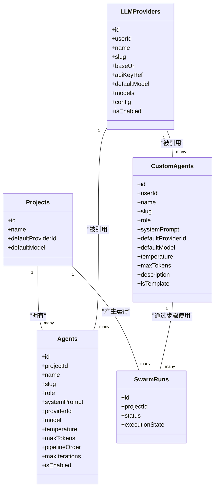
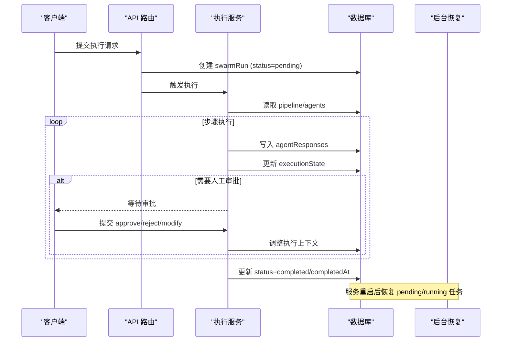
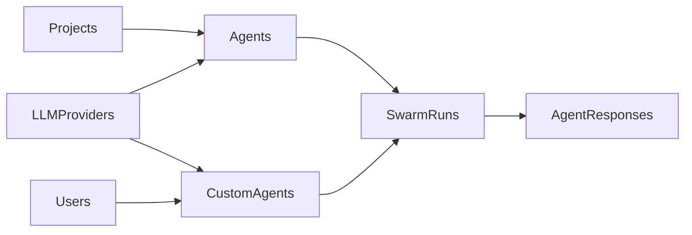

# 代理定义

<cite>
**本文引用的文件**
- [db/schema.ts](file://db/schema.ts)
- [contracts/index.ts](file://contracts/index.ts)
- [api/routers/agent.ts](file://api/routers/agent.ts)
- [api/routers/customAgent.ts](file://api/routers/customAgent.ts)
- [api/services/swarmService.ts](file://api/services/swarmService.ts)
- [api/boot.ts](file://api/boot.ts)
</cite>

## 目录
1. [简介](#简介)
2. [项目结构](#项目结构)
3. [核心组件](#核心组件)
4. [架构总览](#架构总览)
5. [详细组件分析](#详细组件分析)
6. [依赖关系分析](#依赖关系分析)
7. [性能考量](#性能考量)
8. [故障排查指南](#故障排查指南)
9. [结论](#结论)
10. [附录](#附录)

## 简介
本文件为 DeeWaanAI 代理定义系统的数据模型文档，聚焦于 agents 表的结构、字段语义、与项目和 LLM 提供商的关联关系，以及内置代理与自定义代理的区别。同时说明代理的执行参数（temperature、maxTokens、maxIterations）、工作流程控制（pipelineOrder、isEnabled），并给出生命周期管理与状态控制的机制说明。

## 项目结构
与代理数据模型直接相关的代码主要分布在以下位置：
- 数据库表定义：db/schema.ts
- 契约与默认值：contracts/index.ts
- 代理 API：api/routers/agent.ts、api/routers/customAgent.ts
- 执行与状态管理：api/services/swarmService.ts、api/boot.ts

图表来源
- [db/schema.ts:152-171](file://db/schema.ts#L152-L171)
- [contracts/index.ts:239-335](file://contracts/index.ts#L239-L335)
- [api/routers/agent.ts:1-99](file://api/routers/agent.ts#L1-L99)
- [api/routers/customAgent.ts:1-167](file://api/routers/customAgent.ts#L1-L167)
- [api/services/swarmService.ts:247-269](file://api/services/swarmService.ts#L247-L269)
- [api/boot.ts:212-340](file://api/boot.ts#L212-L340)

章节来源
- [db/schema.ts:152-171](file://db/schema.ts#L152-L171)
- [contracts/index.ts:239-335](file://contracts/index.ts#L239-L335)
- [api/routers/agent.ts:1-99](file://api/routers/agent.ts#L1-L99)
- [api/routers/customAgent.ts:1-167](file://api/routers/customAgent.ts#L1-L167)
- [api/services/swarmService.ts:247-269](file://api/services/swarmService.ts#L247-L269)
- [api/boot.ts:212-340](file://api/boot.ts#L212-L340)

## 核心组件
- agents 表：项目级代理定义，包含基本信息、角色配置、执行参数和工作流控制字段。
- custom_agents 表：用户级可复用代理库（Pro Designer），用于构建 pipeline steps。
- llm_providers 表：LLM 提供商配置，被 agents 和 custom_agents 引用以选择具体模型与参数。
- swarm_runs / agent_runs / agent_responses：记录代理执行的运行上下文、步骤与响应，支撑生命周期与状态管理。

章节来源
- [db/schema.ts:56-82](file://db/schema.ts#L56-L82)
- [db/schema.ts:152-171](file://db/schema.ts#L152-L171)
- [db/schema.ts:429-450](file://db/schema.ts#L429-L450)
- [db/schema.ts:173-335](file://db/schema.ts#L173-L335)

## 架构总览
下图展示了代理数据模型在系统中的位置与交互关系：项目通过 agents 定义步骤中的代理；custom_agents 提供可复用的代理模板；执行时由 swarmService 驱动，结合 swarmRuns.executionState 实现流程控制与恢复。

图表来源
- [db/schema.ts:56-82](file://db/schema.ts#L56-L82)
- [db/schema.ts:84-150](file://db/schema.ts#L84-L150)
- [db/schema.ts:152-171](file://db/schema.ts#L152-L171)
- [db/schema.ts:173-237](file://db/schema.ts#L173-L237)
- [db/schema.ts:429-450](file://db/schema.ts#L429-L450)

## 详细组件分析

### agents 表数据模型
- 标识与归属
  - id：自增主键
  - projectId：所属项目（外键指向 projects.id）
- 基本信息
  - name：显示名称
  - slug：唯一标识（同项目内建议唯一）
- 角色配置
  - role：角色类型（如 builder、critic、refiner、polisher、custom）
  - systemPrompt：系统提示词，定义代理行为
- 执行参数
  - providerId：可选，指定使用的 LLM 提供商（外键指向 llm_providers.id）
  - model：可选，覆盖默认模型
  - temperature：字符串形式的温度参数（默认 "0.7"）
  - maxTokens：最大令牌数（默认 4096）
  - maxIterations：最大迭代次数（默认 1）
- 工作流控制
  - pipelineOrder：在流水线中的顺序（默认 0）
  - isEnabled：是否启用（默认 true）
- 时间戳
  - createdAt：创建时间

字段说明要点
- temperature 存储为字符串，便于前端/后端统一处理与校验。
- maxIterations 控制单步重试或循环上限，配合 pipeline 的 WHILE/IF 逻辑使用。
- pipelineOrder 决定执行顺序，API 列表按该字段升序返回。
- isEnabled 作为开关，可在 UI 中禁用某代理而不删除。

章节来源
- [db/schema.ts:152-171](file://db/schema.ts#L152-L171)
- [api/routers/agent.ts:1-99](file://api/routers/agent.ts#L1-L99)
- [contracts/index.ts:74-100](file://contracts/index.ts#L74-L100)

### 代理与项目的关联关系
- 一对多：一个项目可包含多个代理（agents.projectId -> projects.id）。
- 项目级默认：projects 表也支持 defaultProviderId 与 defaultModel，当 agents 未显式设置时，可作为回退策略。
- 流水线编排：pipelineOrder 决定同一项目内代理的执行顺序，API 查询按该字段排序。

章节来源
- [db/schema.ts:84-150](file://db/schema.ts#L84-L150)
- [db/schema.ts:152-171](file://db/schema.ts#L152-L171)
- [api/routers/agent.ts:11-17](file://api/routers/agent.ts#L11-L17)

### 代理如何引用 LLM 提供商
- agents.providerId 指向 llm_providers.id，允许每个代理独立选择提供商与模型。
- llm_providers 表包含 baseUrl、apiKeyRef、defaultModel、models、config（含 temperature/topP/timeout 等）及 isEnabled。
- 若 agents 未设置 providerId/model，则回退到项目或系统默认。

章节来源
- [db/schema.ts:56-82](file://db/schema.ts#L56-L82)
- [db/schema.ts:152-171](file://db/schema.ts#L152-L171)

### 内置代理与自定义代理的区别
- 内置代理（agents）
  - 面向项目级流水线步骤，强调执行顺序与迭代控制。
  - 通过 DEFAULT_AGENT_PROMPTS 提供预置角色与提示词（builder/critic/refiner/polisher）。
  - 适合快速搭建标准流水线。
- 自定义代理（custom_agents）
  - 面向用户级可复用代理库（Pro Designer），支持描述、模板标记等。
  - 常用于 pipeline_steps 中引用，跨项目复用。
  - 提供模板化能力，便于团队共享。

章节来源
- [contracts/index.ts:239-335](file://contracts/index.ts#L239-L335)
- [db/schema.ts:429-450](file://db/schema.ts#L429-L450)
- [api/routers/customAgent.ts:1-167](file://api/routers/customAgent.ts#L1-L167)

### 代理配置的完整字段说明与使用示例
- 必填字段
  - name、slug、role、systemPrompt：定义代理身份与行为。
- 可选字段
  - providerId、model：覆盖默认 LLM 提供商与模型。
  - temperature、maxTokens：控制生成质量与长度。
  - pipelineOrder：控制执行顺序。
  - maxIterations：控制单步最大迭代次数。
  - isEnabled：控制是否参与执行。
- 使用示例（概念性）
  - 新建项目后，调用“创建默认代理”接口，自动生成 builder/critic/refiner/polisher 四个步骤。
  - 在流水线编辑器中调整 pipelineOrder 以改变执行顺序。
  - 针对特定任务提高 temperature 以获得更发散的结果，或降低以获得稳定输出。
  - 将 maxIterations 设为大于 1 的值，配合 WHILE/IF 逻辑进行条件重试。
  - 通过 isEnabled 临时禁用某个代理而不删除配置。

章节来源
- [api/routers/agent.ts:19-45](file://api/routers/agent.ts#L19-L45)
- [api/routers/agent.ts:70-99](file://api/routers/agent.ts#L70-L99)
- [contracts/index.ts:74-100](file://contracts/index.ts#L74-L100)
- [contracts/index.ts:239-335](file://contracts/index.ts#L239-L335)

### 代理的生命周期管理与状态控制机制
- 执行上下文
  - swarmRuns.executionState 保存当前执行进度、链式结果、迭代计数、待审批信息等，支持断点续跑。
- 状态流转
  - 启动：swarmRuns.status 初始为 pending，进入运行后变为 running。
  - 推进：每步完成后更新 executionState，必要时暂停等待人工审批。
  - 完成：全部步骤通过后，status 更新为 completed，并记录 completedAt。
  - 失败：出现错误时记录 error 字段，status 可能为 failed。
- 恢复与重入
  - 服务重启后，boot 会扫描 pending/running 的任务，恢复执行上下文并继续推进。
  - 审批动作（approve/reject/modify）会调整 currentIndex 与 chain，确保流程正确回溯或前进。

图表来源
- [api/services/swarmService.ts:247-269](file://api/services/swarmService.ts#L247-L269)
- [api/services/swarmService.ts:829-854](file://api/services/swarmService.ts#L829-L854)
- [api/services/swarmService.ts:1417-1452](file://api/services/swarmService.ts#L1417-L1452)
- [api/boot.ts:212-340](file://api/boot.ts#L212-L340)

章节来源
- [api/services/swarmService.ts:247-269](file://api/services/swarmService.ts#L247-L269)
- [api/services/swarmService.ts:829-854](file://api/services/swarmService.ts#L829-L854)
- [api/services/swarmService.ts:1417-1452](file://api/services/swarmService.ts#L1417-L1452)
- [api/boot.ts:212-340](file://api/boot.ts#L212-L340)

## 依赖关系分析
- agents 依赖 projects（归属）与 llm_providers（模型与提供商）。
- custom_agents 依赖 users（所有者）与 llm_providers（默认提供商/模型）。
- 执行链路依赖 swarmRuns.executionState 与 agent_responses 记录，保证可恢复性与可观测性。
- 契约层 contracts/index.ts 提供输入校验与默认值，确保一致性。

图表来源
- [db/schema.ts:56-82](file://db/schema.ts#L56-L82)
- [db/schema.ts:84-150](file://db/schema.ts#L84-L150)
- [db/schema.ts:152-171](file://db/schema.ts#L152-L171)
- [db/schema.ts:173-335](file://db/schema.ts#L173-L335)
- [db/schema.ts:429-450](file://db/schema.ts#L429-L450)

章节来源
- [db/schema.ts:56-82](file://db/schema.ts#L56-L82)
- [db/schema.ts:84-150](file://db/schema.ts#L84-L150)
- [db/schema.ts:152-171](file://db/schema.ts#L152-L171)
- [db/schema.ts:173-335](file://db/schema.ts#L173-L335)
- [db/schema.ts:429-450](file://db/schema.ts#L429-L450)

## 性能考量
- 合理设置 maxTokens 与 temperature，避免过长输出与高随机性带来的成本与延迟。
- 使用 pipelineOrder 优化执行顺序，减少不必要的重试。
- 利用 isEnabled 动态启停代理，降低无效执行。
- 借助 executionState 持久化上下文，支持中断恢复，提升鲁棒性。

[本节为通用指导，不直接分析具体文件]

## 故障排查指南
- 常见问题
  - 代理未执行：检查 isEnabled 是否为 true，pipelineOrder 是否正确。
  - 执行卡住：查看 swarmRuns.executionState 是否存在 pendingApproval，需人工审批。
  - 重复创建：确保 slug 在项目或用户维度唯一。
- 定位方法
  - 通过 agent_runs 与 agent_responses 追踪每一步的输入输出与耗时。
  - 检查 llm_providers.isEnabled 与模型可用性。
  - 服务重启后确认 boot 是否恢复 pending/running 任务。

章节来源
- [api/services/swarmService.ts:1417-1452](file://api/services/swarmService.ts#L1417-L1452)
- [api/boot.ts:212-340](file://api/boot.ts#L212-L340)

## 结论
agents 表提供了项目级代理的核心定义，涵盖身份、角色、执行参数与工作流控制，能够灵活适配不同任务需求。结合 custom_agents 的可复用能力与 swarmRuns.executionState 的状态管理，系统实现了从配置到执行再到恢复的完整闭环。通过合理的字段设计与流程控制，能够在保证质量的同时兼顾效率与成本。

[本节为总结，不直接分析具体文件]

## 附录
- 字段速查
  - agents：id、projectId、name、slug、role、systemPrompt、providerId、model、temperature、maxTokens、pipelineOrder、maxIterations、isEnabled、createdAt
  - custom_agents：id、userId、name、slug、role、systemPrompt、defaultProviderId、defaultModel、temperature、maxTokens、description、isTemplate、createdAt
  - llm_providers：id、userId、name、slug、baseUrl、apiKeyRef、defaultModel、models、config、isEnabled、createdAt、updatedAt
- 默认内置代理
  - builder、critic、refiner、polisher，各自具备明确的系统提示词与温度、顺序配置。

章节来源
- [db/schema.ts:56-82](file://db/schema.ts#L56-L82)
- [db/schema.ts:152-171](file://db/schema.ts#L152-L171)
- [db/schema.ts:429-450](file://db/schema.ts#L429-L450)
- [contracts/index.ts:239-335](file://contracts/index.ts#L239-L335)