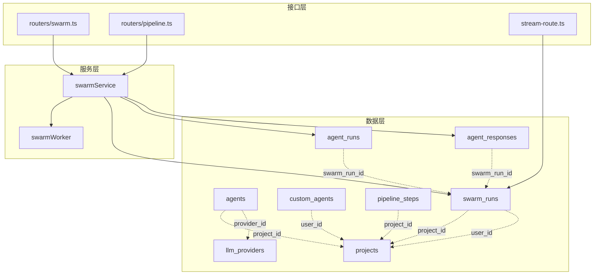
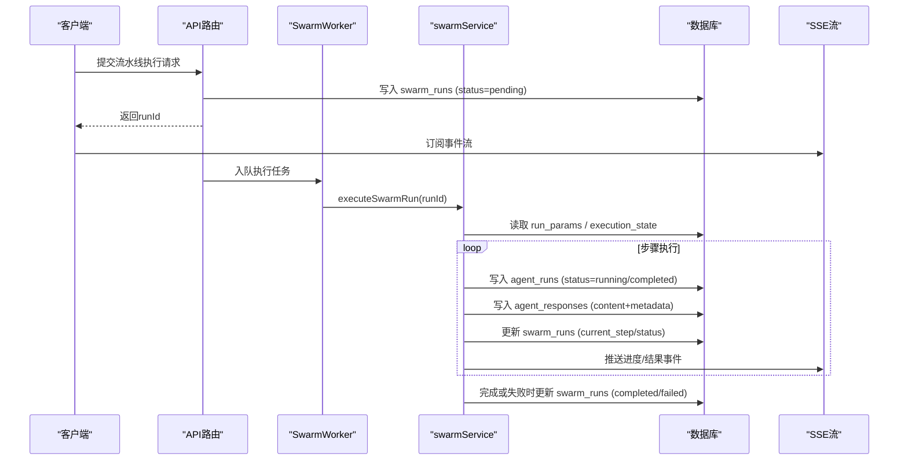
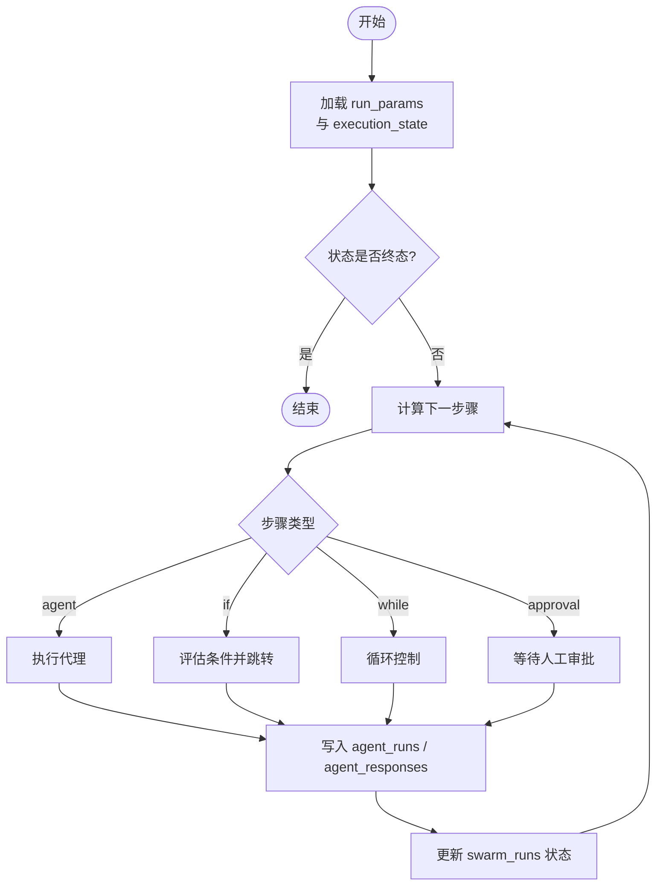

# 代理流水线

<cite>
**本文引用的文件**
- [db/schema.ts](file://db/schema.ts)
- [api/routers/swarm.ts](file://api/routers/swarm.ts)
- [api/routers/pipeline.ts](file://api/routers/pipeline.ts)
- [api/services/swarmService.ts](file://api/services/swarmService.ts)
- [api/workers/swarmWorker.ts](file://api/workers/swarmWorker.ts)
- [api/stream-route.ts](file://api/stream-route.ts)
</cite>

## 目录
1. [简介](#简介)
2. [项目结构](#项目结构)
3. [核心数据模型](#核心数据模型)
4. [架构总览](#架构总览)
5. [详细组件分析](#详细组件分析)
6. [依赖关系分析](#依赖关系分析)
7. [性能与可扩展性](#性能与可扩展性)
8. [故障排查指南](#故障排查指南)
9. [结论](#结论)

## 简介
本文件面向DeeWaanAI代理流水线系统的数据模型，聚焦以下目标：
- 详细说明 agents 表的结构与字段含义（代理配置、执行参数、工作流程控制）
- 记录代理与项目、LLM提供商的关联关系
- 解释自定义代理（customAgents）与内置/遗留代理（agents）的区别
- 说明代理执行历史与结果存储的数据结构设计（swarmRuns、agentRuns、agentResponses）
- 描述流水线步骤的配置与执行状态管理（pipelineSteps、swarmRuns.executionState）

## 项目结构
与代理流水线相关的数据模型集中在数据库Schema定义中，并通过API路由与服务层进行编排与执行。关键位置如下：
- 数据模型定义：db/schema.ts
- 流水线加载与兼容逻辑：api/routers/swarm.ts、api/routers/pipeline.ts
- 流水线执行与状态机：api/services/swarmService.ts、api/workers/swarmWorker.ts
- 实时事件流：api/stream-route.ts



图表来源
- [db/schema.ts:152-171](file://db/schema.ts#L152-L171)
- [db/schema.ts:173-237](file://db/schema.ts#L173-L237)
- [db/schema.ts:262-335](file://db/schema.ts#L262-L335)
- [db/schema.ts:429-480](file://db/schema.ts#L429-L480)
- [api/routers/swarm.ts:89-107](file://api/routers/swarm.ts#L89-L107)
- [api/routers/pipeline.ts:235-305](file://api/routers/pipeline.ts#L235-L305)
- [api/services/swarmService.ts:1284-1392](file://api/services/swarmService.ts#L1284-L1392)
- [api/workers/swarmWorker.ts:37-74](file://api/workers/swarmWorker.ts#L37-L74)
- [api/stream-route.ts:39-70](file://api/stream-route.ts#L39-L70)

章节来源
- [db/schema.ts:152-171](file://db/schema.ts#L152-L171)
- [db/schema.ts:173-237](file://db/schema.ts#L173-L237)
- [db/schema.ts:262-335](file://db/schema.ts#L262-L335)
- [db/schema.ts:429-480](file://db/schema.ts#L429-L480)
- [api/routers/swarm.ts:89-107](file://api/routers/swarm.ts#L89-L107)
- [api/routers/pipeline.ts:235-305](file://api/routers/pipeline.ts#L235-L305)
- [api/services/swarmService.ts:1284-1392](file://api/services/swarmService.ts#L1284-L1392)
- [api/workers/swarmWorker.ts:37-74](file://api/workers/swarmWorker.ts#L37-L74)
- [api/stream-route.ts:39-70](file://api/stream-route.ts#L39-L70)

## 核心数据模型
本节按实体分组，给出字段、用途与约束要点。

### 代理表 agents（项目级内置/遗留代理）
- 标识与归属
  - id: 自增主键
  - project_id: 所属项目（外键指向 projects.id，级联删除）
- 代理配置
  - name: 显示名
  - slug: 唯一标识（用于匹配与复用）
  - role: 角色（如 builder/critic/refiner/polisher/reviewer/translator/summarizer/custom）
  - system_prompt: 系统提示词
- 执行参数
  - provider_id: 可选，指向 llm_providers.id（指定使用的LLM提供商）
  - model: 可选，覆盖默认模型
  - temperature: 字符串型温度（默认“0.7”）
  - max_tokens: 最大输出token数（默认4096）
  - max_iterations: 最大迭代次数（默认1）
- 流程控制
  - pipeline_order: 流水线顺序（默认0）
  - is_enabled: 是否启用（默认true）
- 时间戳
  - created_at

章节来源
- [db/schema.ts:152-171](file://db/schema.ts#L152-L171)

### 自定义代理 custom_agents（用户级可复用代理库）
- 标识与归属
  - id: 自增主键
  - user_id: 创建者用户（外键指向 users.id，级联删除）
- 代理配置
  - name、slug、role、system_prompt
  - description: UI展示用描述
  - is_template: 是否为模板（可被克隆）
- 执行参数
  - default_provider_id: 默认LLM提供商
  - default_model: 默认模型
  - temperature、max_tokens
- 时间戳
  - created_at

章节来源
- [db/schema.ts:429-450](file://db/schema.ts#L429-L450)

### LLM提供商 llm_providers
- 标识与归属
  - id: 自增主键
  - user_id: 所属用户（外键指向 users.id，级联删除）
- 配置
  - name、slug、base_url、api_key_ref（加密引用）、default_model
  - models: JSON数组（可用模型列表）
  - config: JSON（temperature/topP/timeout/declaredRpm等）
  - is_enabled: 是否启用
- 时间戳
  - created_at、updated_at

章节来源
- [db/schema.ts:56-82](file://db/schema.ts#L56-L82)

### 项目 projects
- 标识与归属
  - id: 自增主键
  - user_id: 所属用户（外键指向 users.id，级联删除）
- 项目信息
  - name、description
  - gitee/github集成字段（owner/repo/branch）
  - local_folder_name、state_summary_path
- 默认LLM
  - default_provider_id、default_model
- 流水线配置
  - pipeline_config: JSON（maxIterations、enabledAgents、stopOnNoImprovement）
  - pipeline_template_id: 可复用模板ID
- 其他
  - intelligence_card: JSON（项目智能卡片）
  - is_archived、last_synced_at
- 时间戳
  - created_at、updated_at

章节来源
- [db/schema.ts:84-150](file://db/schema.ts#L84-L150)

### 流水线步骤 pipeline_steps（Pro Designer：项目内有序步骤）
- 标识与归属
  - id: 自增主键
  - project_id: 所属项目（外键指向 projects.id，级联删除）
- 步骤定义
  - step_order: 执行顺序（1,2,3…）
  - agent_id: 可选，指向 custom_agents.id（级联删除）
  - step_type: 步骤类型（agent/if/while/approval，默认agent）
  - name、role、system_prompt
  - provider_id、model（可覆盖）
  - temperature、max_tokens
  - if_config: JSON（条件分支选项与映射）
  - while_config: JSON（循环目标步骤与最大迭代）
  - is_enabled: 是否启用
- 时间戳
  - created_at

章节来源
- [db/schema.ts:452-480](file://db/schema.ts#L452-L480)

### 流水线运行 swarm_runs（一次流水线执行的顶层记录）
- 标识与归属
  - id: 自增主键
  - project_id: 所属项目（外键指向 projects.id，级联删除）
  - user_id: 发起用户（外键指向 users.id）
- 输入与版本
  - user_prompt: 用户提示
  - pipeline_version: 流水线版本（默认cascade-v1）
- 执行状态
  - status: pending/running/completed/failed/cancelled（默认pending）
  - current_step: 当前步骤（默认init）
  - execution_state: JSON（currentIndex、chain、iterationCounts、modifyInstructions、pendingApproval等）
  - run_params: JSON（source、prompt、giteeTokenEnc、memoryMode、attachments、includeProjectFiles、autoApprove、clientTraceId、stateless、chain等）
- 资源统计
  - agents_used: JSON（使用到的代理角色/名称）
  - iterations_used: 累计迭代次数
  - total_tokens_used、total_latency_ms
- 测试与批处理
  - is_test_run、test_fixture_id
  - batch_id: 批处理ID（Research Mode）
- 结果与错误
  - final_response_id
  - error: 错误信息（失败时写入）
- 时间戳
  - started_at、completed_at

章节来源
- [db/schema.ts:173-237](file://db/schema.ts#L173-L237)

### 代理执行历史 agent_runs（每个代理步骤的一次调用）
- 标识与归属
  - id: 自增主键
  - swarm_run_id: 所属流水线运行（外键指向 swarm_runs.id，级联删除）
  - project_id: 所属项目（外键指向 projects.id，级联删除）
  - agent_id: 可选，指向 custom_agents.id（注释说明为兼容旧agents表）
- 步骤与上下文
  - agent_name、agent_role
  - pipeline_step: 步骤序号
  - iteration: 迭代次数（默认1）
  - system_prompt、user_prompt、context_input
- 执行指标
  - status: pending/running/completed/failed（默认pending）
  - tokens_used、latency_ms
  - model_used、provider_used
- 时间戳
  - started_at、completed_at

章节来源
- [db/schema.ts:262-289](file://db/schema.ts#L262-L289)

### 代理响应 agent_responses（每次调用的完整输出与元数据）
- 标识与归属
  - id: 自增主键
  - agent_run_id: 所属代理执行（外键指向 agent_runs.id，级联删除）
  - swarm_run_id: 所属流水线运行（外键指向 swarm_runs.id，级联删除）
  - project_id: 所属项目（外键指向 projects.id，级联删除）
  - parent_response_id: 父响应ID（支持链式）
- 内容
  - response_type: 响应类型
  - content: 文本内容
  - metadata: JSON（model/provider/providerSlug/tokensUsed/latencyMs/temperature/maxTokens/topP/agentName/agentRole/agentSlug/pipelineStep/iteration/buildMethod/sourceResponseIds/qualityScore/humanRating）
  - human_reviewed、human_notes、is_flagged
- 时间戳
  - created_at

章节来源
- [db/schema.ts:291-335](file://db/schema.ts#L291-L335)

## 架构总览
流水线从API入口进入，由worker消费队列任务并执行；执行过程中持续写入swarm_runs、agent_runs与agent_responses，并通过SSE向客户端推送事件。



图表来源
- [api/routers/swarm.ts:89-107](file://api/routers/swarm.ts#L89-L107)
- [api/services/swarmService.ts:1284-1392](file://api/services/swarmService.ts#L1284-L1392)
- [api/workers/swarmWorker.ts:37-74](file://api/workers/swarmWorker.ts#L37-L74)
- [api/stream-route.ts:39-70](file://api/stream-route.ts#L39-L70)

## 详细组件分析

### 代理表 agents 详解
- 代理配置
  - name/slug/role/system_prompt 构成代理的身份与行为指令
- 执行参数
  - temperature 控制生成随机性（字符串存储，便于前端直接透传）
  - max_tokens 限制单次输出长度
  - max_iterations 控制重试/迭代上限
- 流程控制
  - pipeline_order 决定在遗留模式下的执行顺序
  - is_enabled 控制是否参与流水线
- 关联关系
  - project_id 绑定到项目，实现项目隔离
  - provider_id 可选绑定到 llm_providers，实现按代理选择提供商
  - model 可覆盖提供商默认模型

章节来源
- [db/schema.ts:152-171](file://db/schema.ts#L152-L171)

### 自定义代理 vs 内置/遗留代理
- 作用域
  - agents: 项目级，常用于遗留或简单场景
  - custom_agents: 用户级，作为可复用的代理库，可在多个项目中引用
- 能力差异
  - custom_agents 支持 is_template、description 等更丰富的元数据
  - pipeline_steps 通过 agent_id 引用 custom_agents，实现步骤级覆盖（provider/model/temperature/max_tokens）
- 自动创建
  - 当创建流水线时，若缺少对应角色/名称的自定义代理，系统会按需创建（去重策略基于 role+name）

章节来源
- [db/schema.ts:429-480](file://db/schema.ts#L429-L480)
- [api/routers/pipeline.ts:235-305](file://api/routers/pipeline.ts#L235-L305)

### 流水线步骤与执行状态管理
- 步骤类型
  - agent: 常规代理步骤
  - if: 条件分支（if_config）
  - while: 循环（while_config）
  - approval: 人工审批（结合approval_assignments）
- 执行状态
  - swarm_runs.status 表示整体状态
  - swarm_runs.current_step 表示当前步骤
  - swarm_runs.execution_state 保存断点续跑所需上下文（currentIndex、chain、iterationCounts、pendingApproval等）
  - run_params 持久化原始执行参数，便于崩溃恢复与重放



图表来源
- [db/schema.ts:173-237](file://db/schema.ts#L173-L237)
- [db/schema.ts:452-480](file://db/schema.ts#L452-L480)
- [api/services/swarmService.ts:1284-1392](file://api/services/swarmService.ts#L1284-L1392)

### 执行历史与结果存储
- 顶层运行：swarm_runs 记录一次流水线的总体信息、状态、资源消耗与错误
- 步骤执行：agent_runs 记录每个代理步骤的输入、参数、耗时与指标
- 结果内容：agent_responses 记录每次调用的完整输出与丰富元数据（模型、提供商、token、延迟、质量评分等）
- 索引优化：针对 swarm_run_id、project_id 建立索引以加速查询

章节来源
- [db/schema.ts:173-237](file://db/schema.ts#L173-L237)
- [db/schema.ts:262-335](file://db/schema.ts#L262-L335)

### 流水线加载与兼容逻辑
- 优先加载 pipeline_steps（自定义流水线）
- 若无自定义步骤，则回退到 legacy agents（按 pipeline_order 排序）
- 返回统一格式的步骤集合，供前端渲染与执行

章节来源
- [api/routers/swarm.ts:89-107](file://api/routers/swarm.ts#L89-L107)

## 依赖关系分析
- 实体关系
  - projects 1:N agents、pipeline_steps、swarm_runs
  - users 1:N custom_agents、swarm_runs
  - llm_providers 1:N agents、custom_agents（通过provider_id/default_provider_id）
  - swarm_runs 1:N agent_runs、agent_responses
- 耦合与内聚
  - swarmService 高内聚地封装了执行流程、状态更新与错误处理
  - swarmWorker 负责队列消费与重试/节流
  - routers 仅做参数校验与调度，保持低耦合
- 外部依赖
  - 队列（Redis/消息队列）用于异步执行
  - SSE用于实时事件推送

```mermaid
classDiagram
class Projects {
+id
+user_id
+pipeline_config
}
class Agents {
+id
+project_id
+provider_id
+temperature
+max_tokens
+pipeline_order
+max_iterations
+is_enabled
}
class CustomAgents {
+id
+user_id
+default_provider_id
+temperature
+max_tokens
}
class PipelineSteps {
+id
+project_id
+step_order
+agent_id
+step_type
+if_config
+while_config
}
class SwarmRuns {
+id
+project_id
+user_id
+status
+execution_state
+run_params
}
class AgentRuns {
+id
+swarm_run_id
+project_id
+status
}
class AgentResponses {
+id
+agent_run_id
+swarm_run_id
+content
+metadata
}
Projects --> Agents : "1 : N"
Projects --> PipelineSteps : "1 : N"
Projects --> SwarmRuns : "1 : N"
Users --> CustomAgents : "1 : N"
LlmProviders --> Agents : "1 : N (provider_id)"
LlmProviders --> CustomAgents : "1 : N (default_provider_id)"
SwarmRuns --> AgentRuns : "1 : N"
SwarmRuns --> AgentResponses : "1 : N"
PipelineSteps --> CustomAgents : "N : 1 (agent_id)"
```

图表来源
- [db/schema.ts:56-82](file://db/schema.ts#L56-L82)
- [db/schema.ts:84-150](file://db/schema.ts#L84-L150)
- [db/schema.ts:152-171](file://db/schema.ts#L152-L171)
- [db/schema.ts:173-237](file://db/schema.ts#L173-L237)
- [db/schema.ts:262-335](file://db/schema.ts#L262-L335)
- [db/schema.ts:429-480](file://db/schema.ts#L429-L480)

章节来源
- [db/schema.ts:56-82](file://db/schema.ts#L56-L82)
- [db/schema.ts:84-150](file://db/schema.ts#L84-L150)
- [db/schema.ts:152-171](file://db/schema.ts#L152-L171)
- [db/schema.ts:173-237](file://db/schema.ts#L173-L237)
- [db/schema.ts:262-335](file://db/schema.ts#L262-L335)
- [db/schema.ts:429-480](file://db/schema.ts#L429-L480)

## 性能与可扩展性
- 索引设计
  - swarm_runs: project_id、user_id、status、batch_id
  - agent_runs: swarm_run_id、project_id
  - agent_responses: swarm_run_id、agent_run_id、project_id
  - pipeline_steps: project_id、(project_id, step_order)
- 并发与可靠性
  - worker 通过本地claims避免重复执行同一run
  - 启动阶段对stale running/pending run进行自愈（重新入队）
  - 执行异常时写入error并标记failed，保证状态一致性
- 扩展点
  - pipeline_steps 支持if/while/approval，便于复杂流程编排
  - execution_state/run_params 支持断点续跑与重放
  - metadata 中的qualityScore/humanRating可用于后续质量评估与模型选择

章节来源
- [db/schema.ts:173-237](file://db/schema.ts#L173-L237)
- [db/schema.ts:262-335](file://db/schema.ts#L262-L335)
- [api/services/swarmService.ts:1284-1392](file://api/services/swarmService.ts#L1284-L1392)

## 故障排查指南
- 常见问题定位
  - 查看 swarm_runs.error 获取流水线失败原因
  - 检查 agent_runs.status 与 latency_ms 定位慢步骤
  - 通过 agent_responses.metadata 核对实际使用的模型/提供商/token/延迟
- 状态修复
  - 启动时会自动将卡住的running/pending run重新入队
  - 若run已处于终态（completed/failed/cancelled），worker会直接丢弃重复任务
- 实时调试
  - 通过SSE订阅事件流，观察pipeline_complete/pipeline_error等事件

章节来源
- [api/services/swarmService.ts:1284-1392](file://api/services/swarmService.ts#L1284-L1392)
- [api/stream-route.ts:39-70](file://api/stream-route.ts#L39-L70)

## 结论
- agents 表提供项目级代理配置与执行参数，适合简单场景；custom_agents 提供更灵活的用户级代理库，配合 pipeline_steps 可实现复杂流水线编排
- swarm_runs/agent_runs/agent_responses 形成完整的执行历史与结果存储体系，支持细粒度追踪与回溯
- 通过execution_state与run_params实现断点续跑与崩溃恢复，提升鲁棒性
- 建议在复杂场景中优先使用 pipeline_steps + custom_agents，以获得更强的可维护性与扩展性