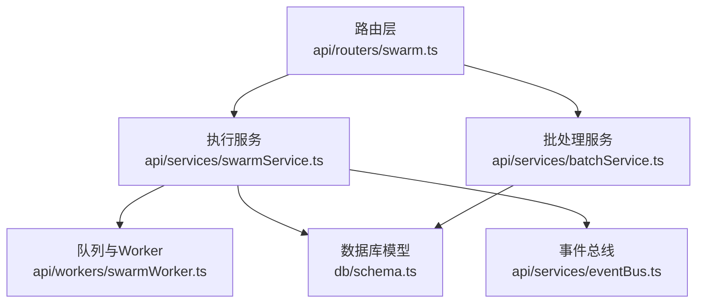
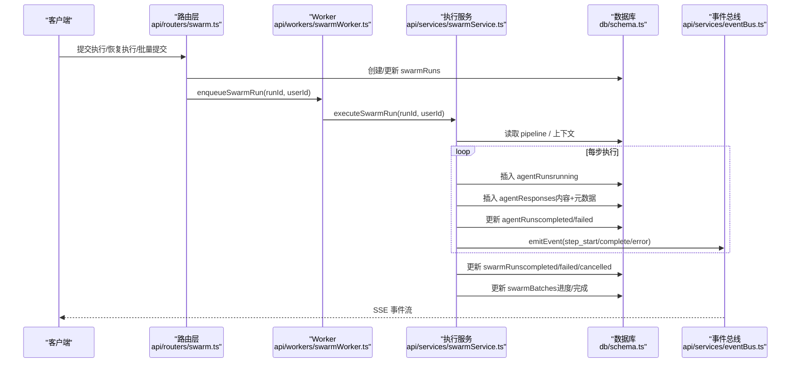
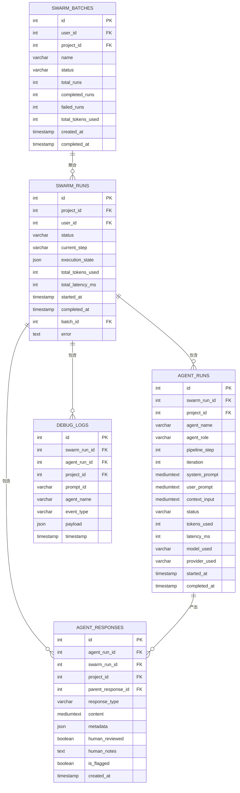
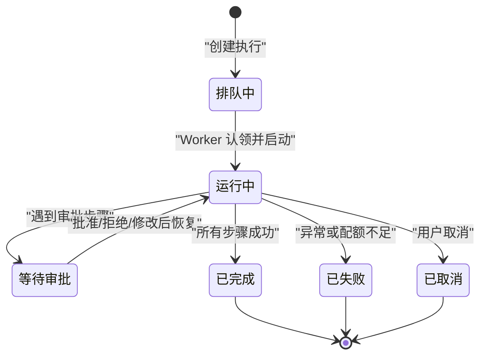
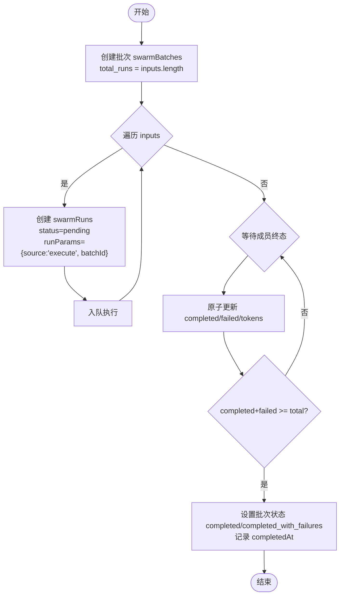
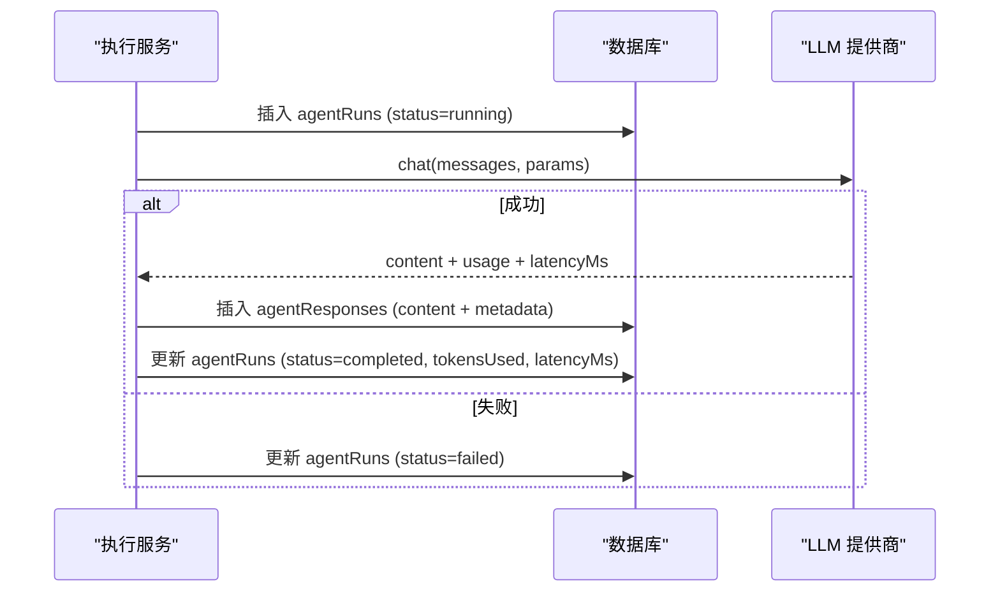
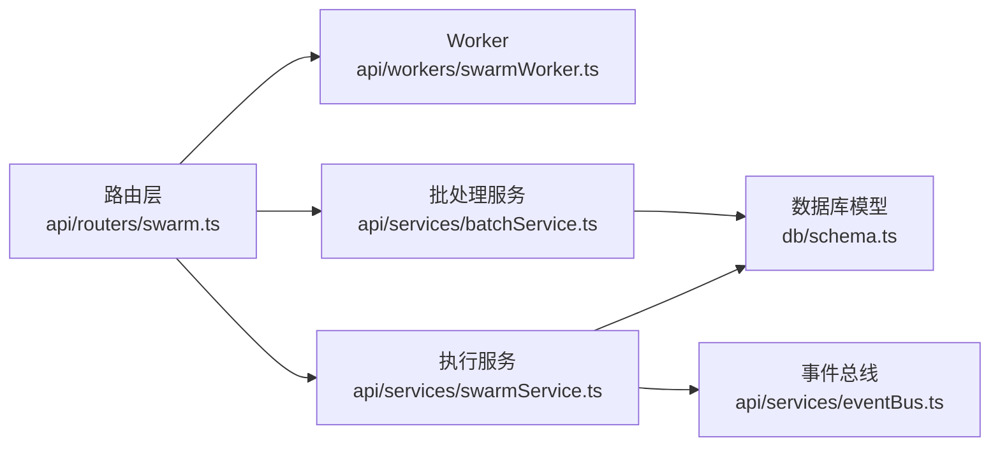

# 执行历史

<cite>
**本文引用的文件**
- [db/schema.ts](file://db/schema.ts)
- [api/services/swarmService.ts](file://api/services/swarmService.ts)
- [api/routers/swarm.ts](file://api/routers/swarm.ts)
- [api/workers/swarmWorker.ts](file://api/workers/swarmWorker.ts)
- [api/services/batchService.ts](file://api/services/batchService.ts)
- [api/services/eventBus.ts](file://api/services/eventBus.ts)
</cite>

## 目录
1. [简介](#简介)
2. [项目结构](#项目结构)
3. [核心组件](#核心组件)
4. [架构总览](#架构总览)
5. [详细组件分析](#详细组件分析)
6. [依赖关系分析](#依赖关系分析)
7. [性能与查询优化](#性能与查询优化)
8. [故障排查指南](#故障排查指南)
9. [结论](#结论)

## 简介
本文件为 DeeWaanAI 执行历史系统的数据模型与运行机制文档，聚焦以下数据表与流程：
- swarmRuns（执行历史）
- agentRuns（代理执行记录）
- agentResponses（响应存储）
- debugLogs（调试日志）
- swarmBatches（批量运行分组）

重点说明：
- 批量运行（swarmBatches）与执行历史（swarmRuns）的管理机制
- 单个代理执行（agentRuns）的输入输出、资源使用（tokensUsed、latencyMs）与状态
- 响应存储（agentResponses）的层次结构与元数据管理
- 调试日志（debugLogs）的事件类型与负载结构
- 执行状态生命周期（pending → running → completed/failed/cancelled）
- 执行历史的查询优化与索引策略

## 项目结构
执行历史相关代码主要分布在数据库定义、服务层、路由层与 Worker 中：
- 数据库模型定义：db/schema.ts
- 执行引擎与服务：api/services/swarmService.ts
- 路由与批处理入口：api/routers/swarm.ts、api/services/batchService.ts
- 队列与 Worker：api/workers/swarmWorker.ts
- 事件总线（SSE 流式事件）：api/services/eventBus.ts

**图表来源**
- [api/routers/swarm.ts:109-199](file://api/routers/swarm.ts#L109-L199)
- [api/services/swarmService.ts:1284-1392](file://api/services/swarmService.ts#L1284-L1392)
- [api/workers/swarmWorker.ts:24-59](file://api/workers/swarmWorker.ts#L24-L59)
- [db/schema.ts:174-361](file://db/schema.ts#L174-L361)
- [api/services/batchService.ts:46-105](file://api/services/batchService.ts#L46-L105)
- [api/services/eventBus.ts:156-167](file://api/services/eventBus.ts#L156-L167)

**章节来源**
- [db/schema.ts:174-361](file://db/schema.ts#L174-L361)
- [api/routers/swarm.ts:109-199](file://api/routers/swarm.ts#L109-L199)
- [api/services/swarmService.ts:1284-1392](file://api/services/swarmService.ts#L1284-L1392)
- [api/workers/swarmWorker.ts:24-59](file://api/workers/swarmWorker.ts#L24-L59)
- [api/services/batchService.ts:46-105](file://api/services/batchService.ts#L46-L105)
- [api/services/eventBus.ts:156-167](file://api/services/eventBus.ts#L156-L167)

## 核心组件
- 执行历史表（swarmRuns）：记录一次用户请求触发的完整流水线执行，包含状态、步骤进度、资源汇总、可恢复的执行上下文等。
- 代理执行表（agentRuns）：记录流水线中每个代理步骤的一次调用，包括输入摘要、状态、资源消耗与时间戳。
- 响应存储表（agentResponses）：记录每次 LLM 调用的内容与元数据，支持父子层级（parentResponseId）、角色类型（responseType）与质量评分等。
- 调试日志表（debugLogs）：记录流水线关键事件（如 step_start、step_complete、step_error），便于追踪与审计。
- 批量运行表（swarmBatches）：聚合多个 swarmRuns，提供批次级统计与生命周期管理。

**章节来源**
- [db/schema.ts:174-361](file://db/schema.ts#L174-L361)

## 架构总览
执行流程从路由层创建或恢复执行历史，随后将任务入队；Worker 消费任务并执行流水线，期间写入 agentRuns、agentResponses、debugLogs，并在完成时更新 swarmRuns 与 swarmBatches。事件通过 eventBus 以 SSE 形式推送给前端。

**图表来源**
- [api/routers/swarm.ts:109-199](file://api/routers/swarm.ts#L109-L199)
- [api/workers/swarmWorker.ts:24-59](file://api/workers/swarmWorker.ts#L24-L59)
- [api/services/swarmService.ts:356-530](file://api/services/swarmService.ts#L356-L530)
- [api/services/swarmService.ts:918-1141](file://api/services/swarmService.ts#L918-L1141)
- [api/services/eventBus.ts:156-167](file://api/services/eventBus.ts#L156-L167)

## 详细组件分析

### 数据模型与关系
- swarmRuns：主执行记录，关联项目与用户，记录状态、当前步骤、版本、资源汇总、执行上下文、错误信息等。
- agentRuns：隶属于某次 swarmRun，记录代理名称、角色、步骤序号、迭代次数、输入摘要、状态、资源与时间。
- agentResponses：隶属于某次 agentRun 与 swarmRun，支持 parentResponseId 形成层次结构；metadata 包含模型、提供商、token 用量、延迟、温度、最大 token、构建方法、来源响应 ID、质量评分等。
- debugLogs：隶属于 swarmRun（可选 agentRun），记录 eventType 与 payload（消息、详情、延迟、token 用量）。
- swarmBatches：聚合 swarmRuns，记录总次数、完成次数、失败次数、总 token 用量与完成时间。

**图表来源**
- [db/schema.ts:174-361](file://db/schema.ts#L174-L361)

**章节来源**
- [db/schema.ts:174-361](file://db/schema.ts#L174-L361)

### 执行状态生命周期
- 初始状态：
  - 新执行：status = "queued" 或 "running"（取决于是否直接入队）
  - 批量成员：status = "pending"
- 运行中：status = "running"，current_step 推进，executionState 持久化用于恢复
- 完成：status = "completed"，completedAt 设置，finalResponseId 指向最终响应
- 失败：status = "failed"，error 保存（截断安全）
- 取消：status = "cancelled"
- 暂停（审批等待）：executionState.pendingApproval 存在，前端需人工批准/拒绝/修改后恢复

**图表来源**
- [api/routers/swarm.ts:109-199](file://api/routers/swarm.ts#L109-L199)
- [api/services/swarmService.ts:918-1141](file://api/services/swarmService.ts#L918-L1141)
- [api/services/swarmService.ts:1284-1392](file://api/services/swarmService.ts#L1284-L1392)

**章节来源**
- [api/routers/swarm.ts:109-199](file://api/routers/swarm.ts#L109-L199)
- [api/services/swarmService.ts:918-1141](file://api/services/swarmService.ts#L918-L1141)
- [api/services/swarmService.ts:1284-1392](file://api/services/swarmService.ts#L1284-L1392)

### 批量运行（swarmBatches）与执行历史（swarmRuns）管理
- 创建批次：
  - 在 swarmBatches 中创建记录，total_runs = inputs.length，status = "running"
  - 为每个 input 创建 swarmRuns（status = "pending"），并写入 runParams（source=execute，batchId，stateless=true，可选 chain）
  - 逐个入队执行
- 进度更新：
  - 当成员到达终态（completed/failed）时，原子递增 completedRuns/failedRuns/totalTokensUsed
  - 若 completedRuns + failedRuns >= totalRuns，则批次状态设为 completed 或 completed_with_failures，并记录 completedAt
- 取消与恢复：
  - 取消：将批次状态设为 cancelled，并将非终态成员标记为 cancelled
  - 恢复：仅允许 paused_credit/paused_outage 状态的批次恢复，重新入队 pending/running 成员

**图表来源**
- [api/services/batchService.ts:46-105](file://api/services/batchService.ts#L46-L105)
- [api/services/batchService.ts:107-142](file://api/services/batchService.ts#L107-L142)
- [api/services/batchService.ts:201-273](file://api/services/batchService.ts#L201-L273)

**章节来源**
- [api/services/batchService.ts:46-105](file://api/services/batchService.ts#L46-L105)
- [api/services/batchService.ts:107-142](file://api/services/batchService.ts#L107-L142)
- [api/services/batchService.ts:201-273](file://api/services/batchService.ts#L201-L273)

### 单个代理执行（agentRuns）日志与资源
- 每条代理步骤执行都会：
  - 插入 agentRuns（status=running），记录系统提示摘要、用户提示摘要、上下文输入
  - 调用 LLM，成功后插入 agentResponses（content + metadata），并更新 agentRuns（status=completed，tokensUsed、latencyMs、modelUsed、providerUsed、completedAt）
  - 失败时更新 agentRuns（status=failed）
- 资源指标：
  - tokensUsed：来自 LLM usage.totalTokens
  - latencyMs：调用耗时
- 状态流转：pending → running → completed/failed

**图表来源**
- [api/services/swarmService.ts:356-530](file://api/services/swarmService.ts#L356-L530)

**章节来源**
- [api/services/swarmService.ts:356-530](file://api/services/swarmService.ts#L356-L530)

### 响应存储（agentResponses）层次与元数据
- 层次结构：
  - parentResponseId 表示父响应，形成树状链（例如 refine_from_#id）
  - buildMethod 标识构建方式（initial 或由上游响应生成）
  - sourceResponseIds 记录来源响应 ID 列表
- 元数据字段：
  - model、provider、providerSlug
  - tokensUsed（prompt、completion、total）
  - latencyMs、temperature、maxTokens、topP
  - agentName、agentRole、agentSlug
  - pipelineStep、iteration
  - qualityScore、humanRating（可选）
- 人类审核与标记：
  - humanReviewed、humanNotes、isFlagged

**章节来源**
- [db/schema.ts:292-335](file://db/schema.ts#L292-L335)
- [api/services/swarmService.ts:486-514](file://api/services/swarmService.ts#L486-L514)

### 调试日志（debugLogs）事件类型与负载
- 事件类型（eventType）：
  - step_start、step_complete、step_error、pipeline_complete、pipeline_error、awaiting_approval
- 负载结构（payload）：
  - message：简要描述
  - details：扩展信息（键值对）
  - latencyMs：可选，步骤耗时
  - tokensUsed：可选，步骤 token 用量
- 关联维度：
  - swarm_run_id、agent_run_id（可选）、project_id、prompt_id、agent_name

**章节来源**
- [db/schema.ts:338-361](file://db/schema.ts#L338-L361)
- [api/services/eventBus.ts:174-192](file://api/services/eventBus.ts#L174-L192)
- [api/services/swarmService.ts:383-514](file://api/services/swarmService.ts#L383-L514)

### 执行引擎与恢复机制
- 执行循环：
  - 加载 pipeline steps（自定义或遗留 agents）
  - 维护执行上下文（currentIndex、chain、iterationCounts、visitCounts、modifyInstructions、pendingApproval）
  - 支持 IF/WHILE 分支与循环，限制最大访问次数与 WHILE 迭代次数
- 恢复机制：
  - executionState 持久化到 swarmRuns.executionState
  - resumePipeline 时重建上下文并从断点继续
  - 审批动作（approve/reject/modify）影响下一步走向

**章节来源**
- [api/services/swarmService.ts:287-353](file://api/services/swarmService.ts#L287-L353)
- [api/services/swarmService.ts:568-855](file://api/services/swarmService.ts#L568-L855)
- [api/routers/swarm.ts:204-248](file://api/routers/swarm.ts#L204-L248)

## 依赖关系分析
- 路由层依赖执行服务与 Worker，负责参数校验、权限检查与入队
- 执行服务依赖数据库模型、事件总线、提供商适配器、Gitee 服务、内存管理器与状态总结器
- Worker 负责队列消费与重试重入
- 批处理服务依赖执行服务与数据库，负责批次生命周期与进度统计

**图表来源**
- [api/routers/swarm.ts:109-199](file://api/routers/swarm.ts#L109-L199)
- [api/workers/swarmWorker.ts:24-59](file://api/workers/swarmWorker.ts#L24-L59)
- [api/services/swarmService.ts:1284-1392](file://api/services/swarmService.ts#L1284-L1392)
- [api/services/batchService.ts:46-105](file://api/services/batchService.ts#L46-L105)

**章节来源**
- [api/routers/swarm.ts:109-199](file://api/routers/swarm.ts#L109-L199)
- [api/workers/swarmWorker.ts:24-59](file://api/workers/swarmWorker.ts#L24-L59)
- [api/services/swarmService.ts:1284-1392](file://api/services/swarmService.ts#L1284-L1392)
- [api/services/batchService.ts:46-105](file://api/services/batchService.ts#L46-L105)

## 性能与查询优化
- 索引策略（已定义）：
  - swarmRuns：projectId、userId、status、batchId
  - agentRuns：swarmRunId、projectId
  - agentResponses：swarmRunId、agentRunId、projectId
  - debugLogs：swarmRunId、projectId
  - swarmBatches：userId、projectId、status
- 查询建议：
  - 按项目与用户分页查询执行历史：WHERE projectId=? AND userId=? ORDER BY startedAt DESC LIMIT N
  - 获取批次状态：JOIN swarmBatches 与 swarmRuns，按 batchId 过滤
  - 检索代理执行明细：WHERE swarmRunId=? ORDER BY id ASC
  - 调试日志回溯：WHERE swarmRunId=? ORDER BY timestamp ASC
- 资源与成本：
  - 使用 totalTokensUsed、totalLatencyMs 进行聚合分析
  - 注意大文本字段（mediumtext）的存储与传输开销，必要时只取摘要或分页

**章节来源**
- [db/schema.ts:174-361](file://db/schema.ts#L174-L361)
- [api/services/batchService.ts:145-186](file://api/services/batchService.ts#L145-L186)

## 故障排查指南
- 常见错误分类：
  - 配额不足（credit exhausted）：触发批次暂停（paused_credit），需充值后恢复
  - 速率限制（rate limit/throttled）：自动重试并重入队列，不暂停批次
  - 网络或提供商异常：记录错误并标记失败
- 定位步骤：
  - 查看 swarmRuns.error 与 status
  - 检查 agentRuns.status 与 timestamps
  - 查看 agentResponses.metadata 中的 model/provider/latency/tokens
  - 通过 debugLogs.eventType 与 payload 定位具体步骤问题
- 恢复操作：
  - 审批等待：调用 approveStep 并重新入队
  - 批次暂停：确认原因后调用 resumeBatch

**章节来源**
- [api/services/swarmService.ts:176-214](file://api/services/swarmService.ts#L176-L214)
- [api/services/swarmService.ts:1082-1141](file://api/services/swarmService.ts#L1082-L1141)
- [api/routers/swarm.ts:250-305](file://api/routers/swarm.ts#L250-L305)
- [api/services/batchService.ts:233-273](file://api/services/batchService.ts#L233-L273)

## 结论
本系统通过清晰的数据库模型与分层架构实现了可靠的执行历史管理：
- swarmRuns 作为执行主线，承载状态与上下文
- agentRuns 与 agentResponses 提供细粒度执行与响应追溯
- debugLogs 提供事件级可观测性
- swarmBatches 支持批量运行的组织与统计
- 执行状态生命周期明确，具备恢复与审批能力
- 索引与查询策略保障性能与可维护性