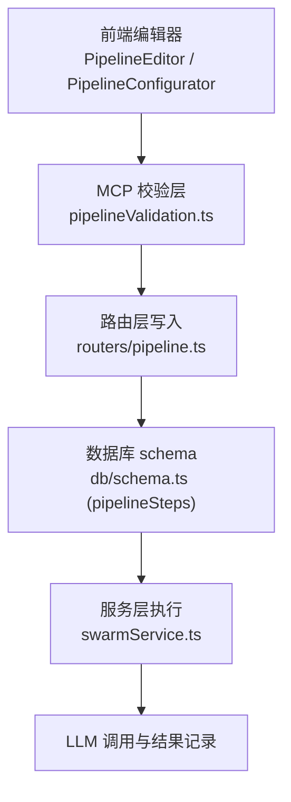
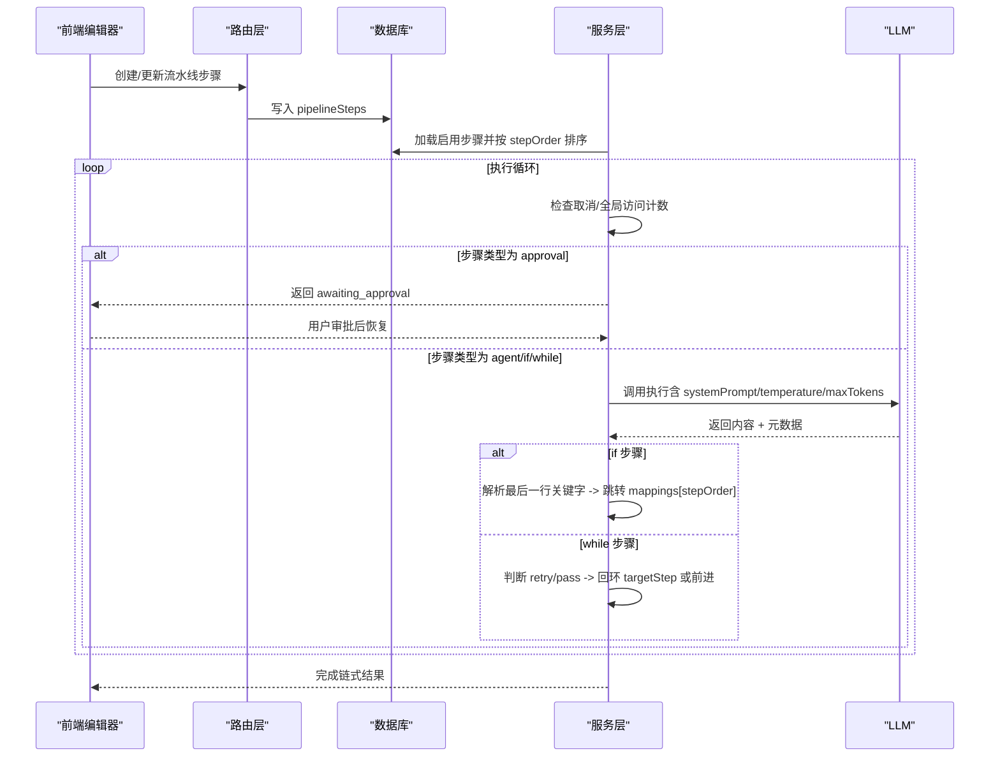
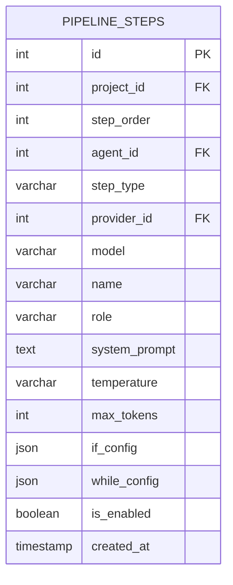
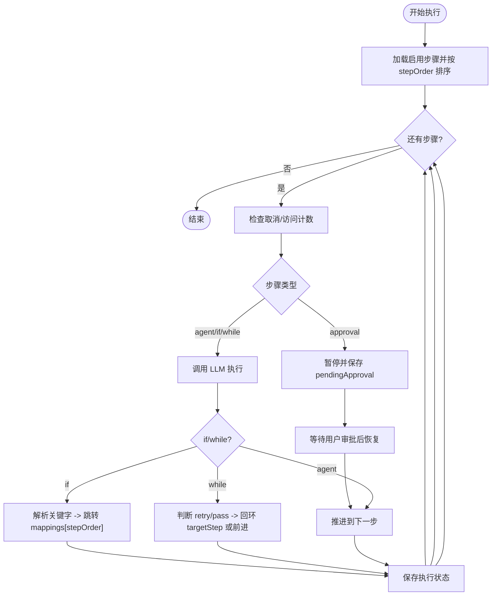
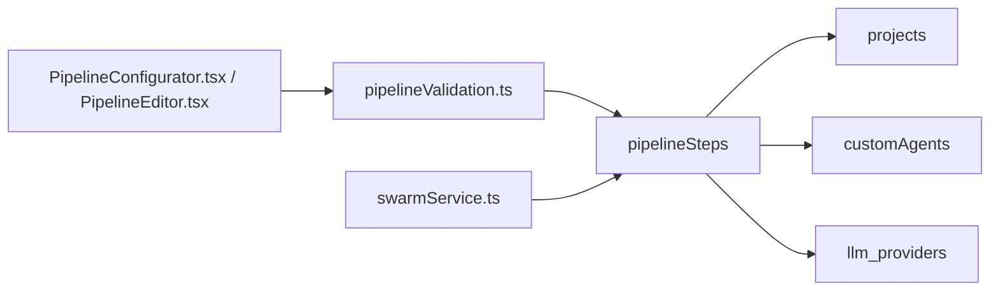

# 流水线步骤

<cite>
**本文引用的文件**
- [db/schema.ts](file://db/schema.ts)
- [api/mcp/tools/pipelineValidation.ts](file://api/mcp/tools/pipelineValidation.ts)
- [api/services/swarmService.ts](file://api/services/swarmService.ts)
- [src/components/pipeline/PipelineConfigurator.tsx](file://src/components/pipeline/PipelineConfigurator.tsx)
- [src/pages/PipelineEditor.tsx](file://src/pages/PipelineEditor.tsx)
- [api/routers/pipeline.ts](file://api/routers/pipeline.ts)
</cite>

## 目录
1. [简介](#简介)
2. [项目结构](#项目结构)
3. [核心组件](#核心组件)
4. [架构总览](#架构总览)
5. [详细组件分析](#详细组件分析)
6. [依赖关系分析](#依赖关系分析)
7. [性能考虑](#性能考虑)
8. [故障排查指南](#故障排查指南)
9. [结论](#结论)
10. [附录](#附录)

## 简介
本文件为 DeeWaanAI 流水线步骤系统的数据模型与执行机制文档，聚焦 pipelineSteps 表的结构、步骤类型（agent、if、while、approval）、执行配置（providerId、model、name、role、systemPrompt、temperature、maxTokens），以及条件分支 ifConfig 和循环控制 whileConfig 的配置结构。同时说明步骤与代理的关联关系、如何通过步骤类型实现复杂流水线逻辑，并提供 IF 步骤选项映射与 WHILE 步骤目标步骤配置示例。最后涵盖步骤启用状态管理与执行顺序控制机制。

## 项目结构
- 数据模型定义位于数据库 schema 中，pipelineSteps 表包含步骤顺序、类型、LLM 覆盖配置、条件/循环配置及启用标志等字段。
- 输入校验与约束在 MCP 工具层以 Zod schema 形式定义，确保 stepType 与对应配置结构的合法性。
- 运行时执行由服务层编排：加载步骤、按 stepOrder 排序执行、处理 approval 暂停、解析 if/while 分支与循环、维护执行上下文与迭代计数。
- 前端编辑器提供可视化配置界面，支持新增/编辑步骤、设置 ifConfig/whileConfig、调整温度与最大 token 等。

图表来源
- [db/schema.ts:453-480](file://db/schema.ts#L453-L480)
- [api/mcp/tools/pipelineValidation.ts:1-84](file://api/mcp/tools/pipelineValidation.ts#L1-L84)
- [api/routers/pipeline.ts:271-292](file://api/routers/pipeline.ts#L271-L292)
- [api/services/swarmService.ts:287-353](file://api/services/swarmService.ts#L287-L353)
- [src/components/pipeline/PipelineConfigurator.tsx:388-466](file://src/components/pipeline/PipelineConfigurator.tsx#L388-L466)
- [src/pages/PipelineEditor.tsx:114-136](file://src/pages/PipelineEditor.tsx#L114-L136)

章节来源
- [db/schema.ts:453-480](file://db/schema.ts#L453-L480)
- [api/mcp/tools/pipelineValidation.ts:1-84](file://api/mcp/tools/pipelineValidation.ts#L1-L84)
- [api/services/swarmService.ts:287-353](file://api/services/swarmService.ts#L287-L353)
- [src/components/pipeline/PipelineConfigurator.tsx:388-466](file://src/components/pipeline/PipelineConfigurator.tsx#L388-L466)
- [src/pages/PipelineEditor.tsx:114-136](file://src/pages/PipelineEditor.tsx#L114-L136)
- [api/routers/pipeline.ts:271-292](file://api/routers/pipeline.ts#L271-L292)

## 核心组件
- pipelineSteps 表：存储每个项目的流水线步骤，包括顺序、类型、LLM 覆盖参数、条件/循环配置、启用状态等。
- 步骤类型：
  - agent：普通代理执行步骤。
  - if：条件分支步骤，基于 LLM 输出关键字路由到不同后续步骤。
  - while：循环步骤，根据“重试/通过”决策进行回环或前进。
  - approval：人工审批步骤，执行时暂停等待用户操作。
- 执行配置：
  - providerId/model：可选覆盖默认 LLM 提供商与模型。
  - name/role/systemPrompt：步骤显示名、角色与系统提示词。
  - temperature/maxTokens：模型采样参数与最大 token 限制。
- 条件与循环配置：
  - ifConfig：options（关键字列表）与 mappings（关键字到目标 stepOrder 的映射）。
  - whileConfig：targetStep（循环目标步骤序号）与 maxIterations（最大迭代次数）。
- 步骤与代理关联：
  - agentId 指向 customAgents.id；若为空则为纯控制流步骤（如 approval）。
- 启用状态与顺序：
  - isEnabled：控制是否参与执行。
  - stepOrder：决定执行顺序，查询时按升序排列。

章节来源
- [db/schema.ts:453-480](file://db/schema.ts#L453-L480)
- [api/mcp/tools/pipelineValidation.ts:1-84](file://api/mcp/tools/pipelineValidation.ts#L1-L84)
- [api/services/swarmService.ts:287-353](file://api/services/swarmService.ts#L287-L353)

## 架构总览
流水线执行流程从加载步骤开始，按 stepOrder 遍历执行，遇到 approval 暂停并保存上下文；agent/if/while 均会触发 LLM 调用，并根据响应更新执行指针与上下文。IF 步骤依据最后一行关键字跳转到 mappings 指定的 stepOrder；WHILE 步骤根据“retry/pass”决定是否回环到 targetStep，并在达到 maxIterations 后强制前进。全局访问计数防止无限循环。

图表来源
- [api/services/swarmService.ts:600-799](file://api/services/swarmService.ts#L600-L799)
- [api/services/swarmService.ts:287-353](file://api/services/swarmService.ts#L287-L353)
- [api/routers/pipeline.ts:271-292](file://api/routers/pipeline.ts#L271-L292)

## 详细组件分析

### pipelineSteps 数据模型
- 主键 id：自增整数。
- projectId：所属项目。
- stepOrder：执行顺序（1,2,3...），用于排序与路由目标。
- agentId：关联自定义代理（customAgents.id），可为空（如 approval）。
- stepType：步骤类型，枚举值 ["agent","if","while","approval"]。
- providerId/model：可选覆盖默认 LLM 提供商与模型。
- name/role/systemPrompt：步骤显示名、角色与系统提示词。
- temperature/maxTokens：模型采样参数与最大 token 限制。
- ifConfig：JSON，{ options: string[], mappings: Record<string,number> }。
- whileConfig：JSON，{ targetStep: number; maxIterations: number }。
- isEnabled：布尔，默认 true，控制是否参与执行。
- createdAt：创建时间。
- 索引：按 projectId 与 stepOrder 建立复合索引，优化查询与排序。

图表来源
- [db/schema.ts:453-480](file://db/schema.ts#L453-L480)

章节来源
- [db/schema.ts:453-480](file://db/schema.ts#L453-L480)

### 输入校验与约束
- STEP_TYPES：["agent","if","while","approval"]。
- CONTROL_FLOW_TYPES：{"if","while"}，需要额外能力权限。
- MAX_STEPS：单条流水线最多 20 个步骤。
- MAX_WHILE_ITERATIONS：while 最大迭代次数上限（10）。
- pipelineStepInputSchema：
  - name：必填，长度限制。
  - role/systemPrompt：除 approval 外必填。
  - stepType：默认 "agent"。
  - ifConfig：当 stepType="if" 时必填，包含 options 与 mappings。
  - whileConfig：当 stepType="while" 时必填，包含 targetStep 与 maxIterations。
  - model/temperature/maxTokens：可选，带范围限制。
- findWhileTargetErrors：校验 whileConfig.targetStep 必须指向当前步骤或更早的步骤，避免向前跳转导致死循环。

章节来源
- [api/mcp/tools/pipelineValidation.ts:1-84](file://api/mcp/tools/pipelineValidation.ts#L1-L84)

### 执行流程与控制流
- 加载步骤：按 projectId 过滤且仅加载 isEnabled=true 的步骤，按 stepOrder 升序排序。
- 执行循环：
  - 每步前检查取消与全局访问计数（MAX_STEP_VISITS），超过则强制前进。
  - approval：暂停并保存 pendingApproval，等待用户审批后恢复。
  - agent/if/while：构造 prompt 与上下文，调用 LLM。
    - if：读取最后一行关键字，查找 mappings 对应的 stepOrder 并跳转。
    - while：根据“retry/pass”决定是否回环到 targetStep，并递增 iterationCounts；达到 maxIterations 后强制前进。
  - 正常 agent：推进到下一步。
- 上下文维护：
  - chain：保存每一步的输出与元数据。
  - iterationCounts：记录每个步骤的迭代次数。
  - visitCounts：记录每个步骤被访问的次数，防止无限循环。
  - executionState：持久化以便崩溃恢复与断点续跑。

图表来源
- [api/services/swarmService.ts:600-799](file://api/services/swarmService.ts#L600-L799)
- [api/services/swarmService.ts:287-353](file://api/services/swarmService.ts#L287-L353)

章节来源
- [api/services/swarmService.ts:600-799](file://api/services/swarmService.ts#L600-L799)
- [api/services/swarmService.ts:287-353](file://api/services/swarmService.ts#L287-L353)

### IF 步骤选项映射配置
- options：关键字数组，例如 ["pass","revise","reject"]。
- mappings：关键字到目标 stepOrder 的映射，例如 {"pass": 4, "revise": 2}。
- 执行时，IF 步骤要求 LLM 在最后一行输出指定关键字之一，系统据此跳转到对应 stepOrder。
- 前端编辑器支持配置 options 与 mappings，并在添加 IF 步骤时自动计算默认映射（如 pass 指向下一个步骤，revise 指向上一个步骤）。

章节来源
- [src/components/pipeline/PipelineConfigurator.tsx:388-466](file://src/components/pipeline/PipelineConfigurator.tsx#L388-L466)
- [src/pages/PipelineEditor.tsx:114-136](file://src/pages/PipelineEditor.tsx#L114-L136)
- [api/mcp/tools/pipelineValidation.ts:16-24](file://api/mcp/tools/pipelineValidation.ts#L16-L24)

### WHILE 步骤目标步骤配置
- targetStep：循环目标步骤序号（1-based），必须小于等于当前步骤位置，防止向前跳转。
- maxIterations：最大迭代次数（上限 10），达到后强制前进。
- 执行时，WHILE 步骤根据 LLM 输出的“retry/pass”决定是否回环到 targetStep，并递增迭代计数；达到上限后强制前进。

章节来源
- [api/mcp/tools/pipelineValidation.ts:21-24](file://api/mcp/tools/pipelineValidation.ts#L21-L24)
- [api/mcp/tools/pipelineValidation.ts:72-83](file://api/mcp/tools/pipelineValidation.ts#L72-L83)
- [api/services/swarmService.ts:829-843](file://api/services/swarmService.ts#L829-L843)

### 步骤与代理的关联关系
- agentId：指向 customAgents.id，用于复用自定义代理的角色、系统提示词与默认 LLM 配置。
- 若 agentId 为空（如 approval），则不执行 LLM 调用，仅作为控制流节点。
- 执行时，若步骤未覆盖 providerId/model，则回退到代理默认配置。

章节来源
- [db/schema.ts:453-480](file://db/schema.ts#L453-L480)
- [api/services/swarmService.ts:328-353](file://api/services/swarmService.ts#L328-L353)

### 执行顺序控制机制
- stepOrder：决定执行顺序，查询时按升序排序。
- 路由跳转：IF 步骤通过 mappings 直接跳转到指定 stepOrder；WHILE 步骤回环到 targetStep。
- 全局访问计数：任何步骤被访问超过阈值将强制前进，防止无限循环。
- 启用状态：isEnabled=false 的步骤不会被加载执行。

章节来源
- [db/schema.ts:477-480](file://db/schema.ts#L477-L480)
- [api/services/swarmService.ts:600-614](file://api/services/swarmService.ts#L600-L614)
- [api/services/swarmService.ts:287-303](file://api/services/swarmService.ts#L287-L303)

## 依赖关系分析
- 数据模型依赖：
  - pipelineSteps.projectId -> projects.id
  - pipelineSteps.agentId -> customAgents.id
  - pipelineSteps.providerId -> llm_providers.id
- 校验依赖：
  - pipelineValidation.ts 对 stepType 与配置结构进行强约束，确保 ifConfig/whileConfig 的合法性。
- 执行依赖：
  - swarmService.ts 负责加载步骤、执行循环、处理控制流、维护上下文与持久化状态。
- 前端依赖：
  - PipelineConfigurator.tsx 与 PipelineEditor.tsx 提供可视化配置与默认值生成。

图表来源
- [db/schema.ts:453-480](file://db/schema.ts#L453-L480)
- [api/mcp/tools/pipelineValidation.ts:1-84](file://api/mcp/tools/pipelineValidation.ts#L1-L84)
- [api/services/swarmService.ts:287-353](file://api/services/swarmService.ts#L287-L353)
- [src/components/pipeline/PipelineConfigurator.tsx:388-466](file://src/components/pipeline/PipelineConfigurator.tsx#L388-L466)
- [src/pages/PipelineEditor.tsx:114-136](file://src/pages/PipelineEditor.tsx#L114-L136)

章节来源
- [db/schema.ts:453-480](file://db/schema.ts#L453-L480)
- [api/mcp/tools/pipelineValidation.ts:1-84](file://api/mcp/tools/pipelineValidation.ts#L1-L84)
- [api/services/swarmService.ts:287-353](file://api/services/swarmService.ts#L287-L353)
- [src/components/pipeline/PipelineConfigurator.tsx:388-466](file://src/components/pipeline/PipelineConfigurator.tsx#L388-L466)
- [src/pages/PipelineEditor.tsx:114-136](file://src/pages/PipelineEditor.tsx#L114-L136)

## 性能考虑
- 步骤数量限制：单条流水线最多 20 个步骤，避免过长链路影响性能与维护性。
- 循环保护：while 最大迭代次数上限为 10，全局访问计数防止无限循环。
- 资源估算：执行前可估算 token 用量与成本，结合熔断器限制异常消耗。
- 索引优化：按 projectId 与 stepOrder 建立复合索引，提升加载与排序效率。

章节来源
- [api/mcp/tools/pipelineValidation.ts:13-14](file://api/mcp/tools/pipelineValidation.ts#L13-L14)
- [api/services/swarmService.ts:606-614](file://api/services/swarmService.ts#L606-L614)
- [db/schema.ts:477-480](file://db/schema.ts#L477-L480)

## 故障排查指南
- 步骤未执行：
  - 检查 isEnabled 是否为 true。
  - 确认 stepOrder 是否正确且无重复。
- IF 步骤未跳转：
  - 检查 ifConfig.options 与 mappings 是否完整且有效。
  - 确认 LLM 输出最后一行关键字是否在 options 中。
- WHILE 步骤无限循环：
  - 检查 whileConfig.targetStep 是否指向当前或更早步骤。
  - 确认 maxIterations 是否合理，必要时降低以避免长时间运行。
- 审批卡住：
  - 检查 pendingApproval 状态，确保用户审批后正确恢复执行。

章节来源
- [api/services/swarmService.ts:616-632](file://api/services/swarmService.ts#L616-L632)
- [api/mcp/tools/pipelineValidation.ts:72-83](file://api/mcp/tools/pipelineValidation.ts#L72-L83)

## 结论
DeeWaanAI 的流水线步骤系统通过 pipelineSteps 表实现了灵活的步骤编排与控制流。借助 stepType、ifConfig、whileConfig 与执行上下文，系统能够构建复杂的条件分支与循环逻辑，同时通过启用状态与顺序控制保证执行的稳定性与可维护性。前端编辑器提供了直观的配置体验，后端校验与服务层执行确保了数据的合法性与流程的正确性。

## 附录
- IF 步骤配置示例：
  - options: ["pass", "revise"]
  - mappings: {"pass": 4, "revise": 2}
- WHILE 步骤配置示例：
  - targetStep: 2
  - maxIterations: 3

章节来源
- [src/components/pipeline/PipelineConfigurator.tsx:388-466](file://src/components/pipeline/PipelineConfigurator.tsx#L388-L466)
- [src/pages/PipelineEditor.tsx:114-136](file://src/pages/PipelineEditor.tsx#L114-L136)