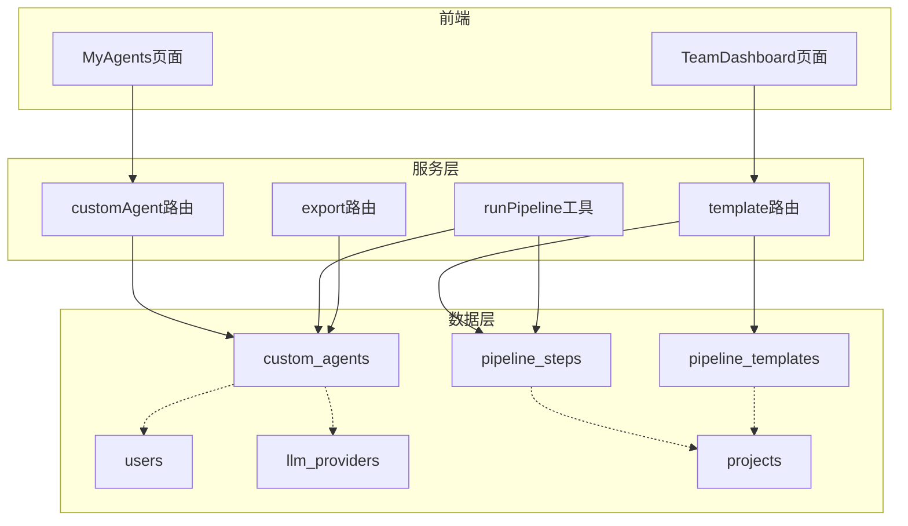
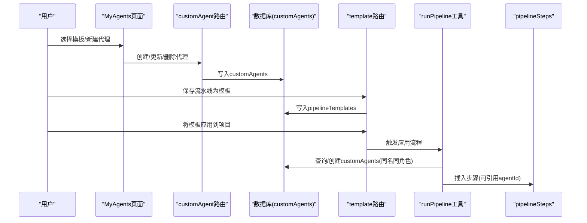
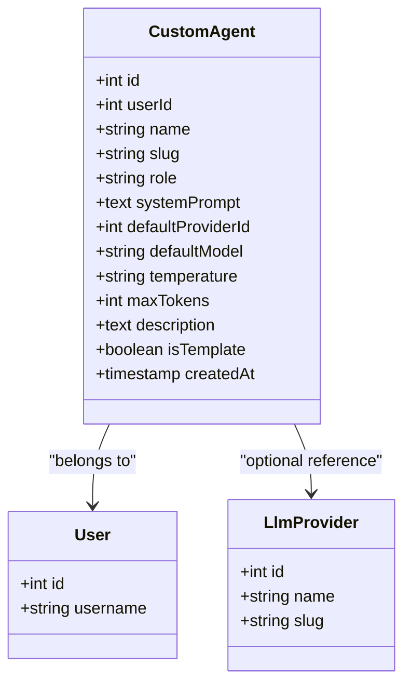
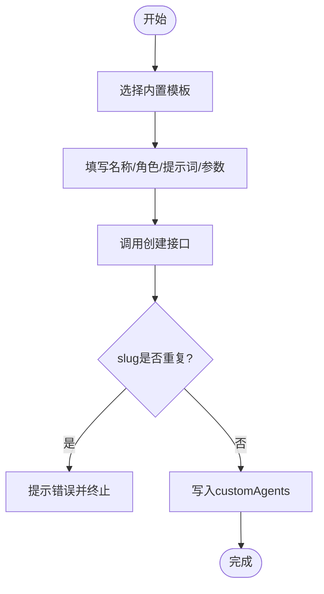
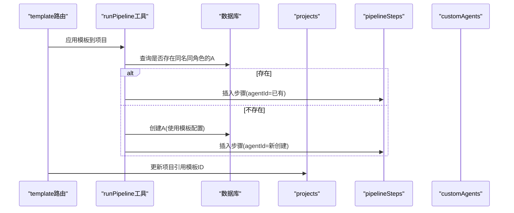
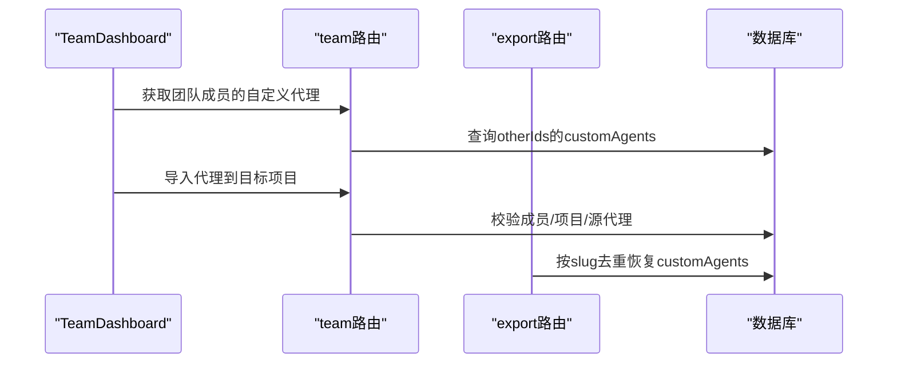
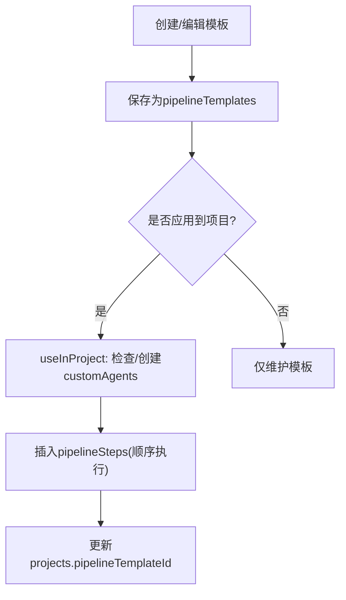
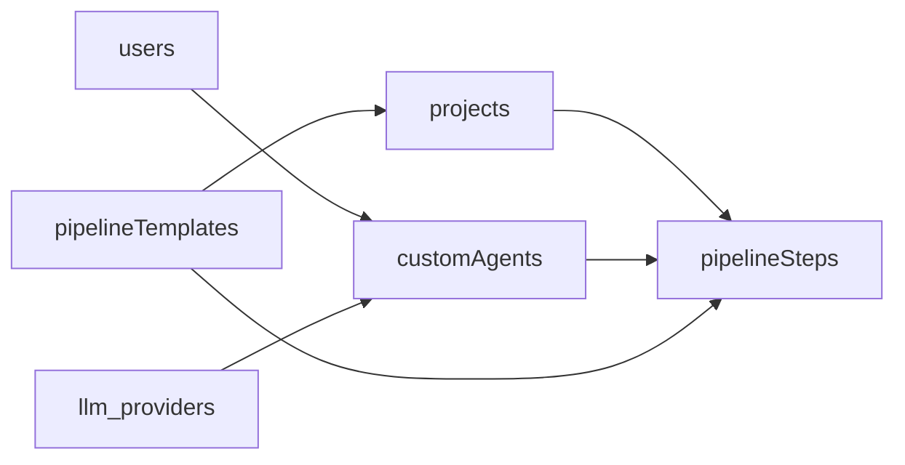

# 自定义代理

<cite>
**本文引用的文件**
- [db/schema.ts](file://db/schema.ts)
- [api/routers/customAgent.ts](file://api/routers/customAgent.ts)
- [api/routers/template.ts](file://api/routers/template.ts)
- [api/mcp/tools/runPipeline.ts](file://api/mcp/tools/runPipeline.ts)
- [api/routers/export.ts](file://api/routers/export.ts)
- [src/pages/MyAgents.tsx](file://src/pages/MyAgents.tsx)
- [src/pages/TeamDashboard.tsx](file://src/pages/TeamDashboard.tsx)
</cite>

## 目录
1. [简介](#简介)
2. [项目结构](#项目结构)
3. [核心组件](#核心组件)
4. [架构总览](#架构总览)
5. [详细组件分析](#详细组件分析)
6. [依赖关系分析](#依赖关系分析)
7. [性能考量](#性能考量)
8. [故障排查指南](#故障排查指南)
9. [结论](#结论)
10. [附录](#附录)

## 简介
本文件聚焦于DeeWaanAI的“自定义代理”数据模型与能力，围绕customAgents表的结构、模板代理概念（isTemplate）、用户级代理管理、默认LLM提供商设置、执行参数与描述信息展开。同时说明自定义代理与项目代理（pipelineSteps）的关系，以及如何在不同项目间共享和复用自定义代理，并给出代理模板的创建、克隆与管理流程。

## 项目结构
- 数据库模型定义位于 db/schema.ts，其中包含 customAgents、pipelineTemplates、pipelineSteps、projects、users、llmProviders 等关键表。
- 自定义代理的CRUD与模板列表在 api/routers/customAgent.ts。
- 模板（流水线模板）的创建、更新、复制与应用在 api/routers/template.ts。
- 应用模板时自动同步或创建对应自定义代理的逻辑在 api/mcp/tools/runPipeline.ts。
- 导出/导入功能中涉及自定义代理的去重与恢复逻辑在 api/routers/export.ts。
- 前端展示与交互在 src/pages/MyAgents.tsx 与 src/pages/TeamDashboard.tsx。

图表来源
- [db/schema.ts:429-450](file://db/schema.ts#L429-L450)
- [api/routers/customAgent.ts:67-166](file://api/routers/customAgent.ts#L67-L166)
- [api/routers/template.ts:7-264](file://api/routers/template.ts#L7-L264)
- [api/mcp/tools/runPipeline.ts:35-72](file://api/mcp/tools/runPipeline.ts#L35-L72)
- [api/routers/export.ts:285-308](file://api/routers/export.ts#L285-L308)

章节来源
- [db/schema.ts:429-450](file://db/schema.ts#L429-L450)
- [api/routers/customAgent.ts:67-166](file://api/routers/customAgent.ts#L67-L166)
- [api/routers/template.ts:7-264](file://api/routers/template.ts#L7-L264)
- [api/mcp/tools/runPipeline.ts:35-72](file://api/mcp/tools/runPipeline.ts#L35-L72)
- [api/routers/export.ts:285-308](file://api/routers/export.ts#L285-L308)

## 核心组件
- customAgents：用户级可复用代理库，支持系统提示词、默认LLM提供商与模型、执行参数（temperature、maxTokens）、描述信息与模板标记（isTemplate）。
- pipelineTemplates：可复用的流水线模板，包含步骤序列与每步的配置；应用模板时会按需创建或复用同名同角色的自定义代理。
- pipelineSteps：项目内具体执行的步骤，可引用自定义代理（agentId），也可覆盖LLM提供商与模型。
- projects：项目维度配置，可关联模板（pipelineTemplateId），并提供默认LLM提供商与模型。
- users / llm_providers：用户与LLM提供商基础实体，customAgents通过userId与defaultProviderId与之关联。

章节来源
- [db/schema.ts:429-450](file://db/schema.ts#L429-L450)
- [db/schema.ts:452-505](file://db/schema.ts#L452-L505)
- [db/schema.ts:84-150](file://db/schema.ts#L84-L150)
- [db/schema.ts:17-51](file://db/schema.ts#L17-L51)
- [db/schema.ts:56-82](file://db/schema.ts#L56-L82)

## 架构总览
自定义代理体系由“用户级代理库 + 模板 + 项目步骤”构成：
- 用户在 MyAgents 页面创建或从内置模板克隆代理，形成个人代理库。
- 用户可将流水线保存为模板（pipelineTemplates），并在其他项目中应用该模板。
- 应用模板时，若目标用户不存在同名同角色的自定义代理，则自动创建；若存在则复用。
- 项目中的 pipelineSteps 引用自定义代理（agentId），并可按步骤覆盖LLM提供商与模型。
- 团队场景下，可共享他人自定义代理并导入到当前用户的项目中。

图表来源
- [api/routers/customAgent.ts:67-166](file://api/routers/customAgent.ts#L67-L166)
- [api/routers/template.ts:99-263](file://api/routers/template.ts#L99-L263)
- [api/mcp/tools/runPipeline.ts:35-72](file://api/mcp/tools/runPipeline.ts#L35-L72)

## 详细组件分析

### customAgents 数据模型
- 标识与归属
  - id：自增主键
  - userId：所属用户（外键指向 users.id）
- 基本属性
  - name：显示名称
  - slug：唯一标识（同一用户下唯一）
  - role：角色（如 builder、critic、refiner、polisher、reviewer、translator、summarizer、custom）
- 系统与提示词
  - systemPrompt：系统提示词（必填）
  - description：描述信息（可选，用于UI展示）
- LLM与执行参数
  - defaultProviderId：默认LLM提供商（可选，外键指向 llm_providers.id）
  - defaultModel：默认模型（可选）
  - temperature：温度（字符串，默认"0.7"）
  - maxTokens：最大令牌数（整数，默认4096）
- 模板标记
  - isTemplate：是否预置模板（布尔，默认false），用于区分“可被克隆的模板”与“用户创建的实例”
- 索引
  - 基于 userId 的索引
  - 基于 (userId, slug) 的唯一性约束（通过索引实现去重）

图表来源
- [db/schema.ts:429-450](file://db/schema.ts#L429-L450)
- [db/schema.ts:17-51](file://db/schema.ts#L17-L51)
- [db/schema.ts:56-82](file://db/schema.ts#L56-L82)

章节来源
- [db/schema.ts:429-450](file://db/schema.ts#L429-L450)
- [api/routers/customAgent.ts:82-126](file://api/routers/customAgent.ts#L82-L126)

### 模板代理与内置模板
- 内置模板：在 customAgent 路由中提供一组默认模板（Builder、Critic、Refiner、Polisher、Reviewer、Translator、Summarizer、Custom），用于快速创建代理。
- 模板代理概念：isTemplate 字段用于标记是否为“模板”。虽然内置模板以常量形式返回，但数据模型支持持久化的模板记录，便于扩展与复用。
- 克隆流程：前端 MyAgents 页面允许用户点击模板卡片进入表单，填充默认值后创建新的自定义代理实例。

图表来源
- [api/routers/customAgent.ts:8-65](file://api/routers/customAgent.ts#L8-L65)
- [api/routers/customAgent.ts:82-126](file://api/routers/customAgent.ts#L82-L126)
- [src/pages/MyAgents.tsx:151-182](file://src/pages/MyAgents.tsx#L151-L182)

章节来源
- [api/routers/customAgent.ts:8-65](file://api/routers/customAgent.ts#L8-L65)
- [src/pages/MyAgents.tsx:151-182](file://src/pages/MyAgents.tsx#L151-L182)

### 自定义代理与项目代理的关系
- 项目步骤（pipelineSteps）可引用自定义代理（agentId），从而在项目执行中使用该代理的系统提示词与默认LLM配置。
- 当应用模板到项目时，若不存在同名同角色的自定义代理，系统将自动创建；若已存在则复用已有代理。
- 项目本身也可设置默认LLM提供商与模型（projects.defaultProviderId、projects.defaultModel），作为未指定时的回退策略。

图表来源
- [api/routers/template.ts:186-263](file://api/routers/template.ts#L186-L263)
- [api/mcp/tools/runPipeline.ts:35-72](file://api/mcp/tools/runPipeline.ts#L35-L72)
- [db/schema.ts:452-480](file://db/schema.ts#L452-L480)
- [db/schema.ts:84-150](file://db/schema.ts#L84-L150)

章节来源
- [api/routers/template.ts:186-263](file://api/routers/template.ts#L186-L263)
- [api/mcp/tools/runPipeline.ts:35-72](file://api/mcp/tools/runPipeline.ts#L35-L72)
- [db/schema.ts:452-480](file://db/schema.ts#L452-L480)
- [db/schema.ts:84-150](file://db/schema.ts#L84-L150)

### 跨项目共享与复用自定义代理
- 模板复用：通过 pipelineTemplates 将流水线保存为模板，可在多个项目中应用，自动处理代理的创建或复用。
- 团队共享：团队模块支持查看其他成员的自定义代理，并将代理导入到当前用户的项目中。
- 导出/导入：导出时按 slug 去重恢复用户的自定义代理，避免重复导入。

图表来源
- [src/pages/TeamDashboard.tsx:720-777](file://src/pages/TeamDashboard.tsx#L720-L777)
- [api/routers/team.ts:534-679](file://api/routers/team.ts#L534-L679)
- [api/routers/export.ts:285-308](file://api/routers/export.ts#L285-L308)

章节来源
- [src/pages/TeamDashboard.tsx:720-777](file://src/pages/TeamDashboard.tsx#L720-L777)
- [api/routers/team.ts:534-679](file://api/routers/team.ts#L534-L679)
- [api/routers/export.ts:285-308](file://api/routers/export.ts#L285-L308)

### 代理模板的创建、克隆与管理流程
- 创建模板：可从当前项目的流水线步骤生成模板（createFromPipeline），或创建空模板（createEmpty）。
- 更新模板：编辑模板的步骤、名称与描述（update）。
- 复制模板：duplicate 操作会复制模板及其步骤。
- 应用模板：useInProject 将模板应用到项目，自动处理代理的创建或复用，并更新项目的模板引用。

图表来源
- [api/routers/template.ts:84-153](file://api/routers/template.ts#L84-L153)
- [api/routers/template.ts:155-184](file://api/routers/template.ts#L155-L184)
- [api/routers/template.ts:186-263](file://api/routers/template.ts#L186-L263)

章节来源
- [api/routers/template.ts:84-153](file://api/routers/template.ts#L84-L153)
- [api/routers/template.ts:155-184](file://api/routers/template.ts#L155-L184)
- [api/routers/template.ts:186-263](file://api/routers/template.ts#L186-L263)

## 依赖关系分析
- customAgents 依赖 users（userId）与 llm_providers（defaultProviderId）。
- pipelineSteps 依赖 projects（projectId）与 customAgents（agentId，可选）。
- pipelineTemplates 独立存储步骤序列，应用时与 customAgents 和 pipelineSteps 联动。
- 前端 MyAgents 与 TeamDashboard 分别负责用户级代理管理与团队共享代理的展示与导入。

图表来源
- [db/schema.ts:429-450](file://db/schema.ts#L429-L450)
- [db/schema.ts:452-480](file://db/schema.ts#L452-L480)
- [db/schema.ts:482-505](file://db/schema.ts#L482-L505)
- [db/schema.ts:84-150](file://db/schema.ts#L84-L150)

章节来源
- [db/schema.ts:429-450](file://db/schema.ts#L429-L450)
- [db/schema.ts:452-480](file://db/schema.ts#L452-L480)
- [db/schema.ts:482-505](file://db/schema.ts#L482-L505)
- [db/schema.ts:84-150](file://db/schema.ts#L84-L150)

## 性能考量
- 索引优化：customAgents 对 userId 与 (userId, slug) 建立索引，提升按用户查询与slug去重的效率。
- 批量操作：应用模板时循环插入 pipelineSteps，建议结合事务保证一致性。
- 缓存策略：对于频繁读取的模板与代理列表，可考虑在服务端进行短期缓存以减少数据库压力。
- 大文本字段：systemPrompt 使用 text/mediumtext，注意存储大小与查询性能。

[本节为通用指导，不直接分析具体文件]

## 故障排查指南
- slug重复错误：创建代理时若同一用户下slug已存在，将抛出错误。请确保slug唯一或修改为新值。
- 模板未找到：应用模板时需验证模板与项目的所有权，否则报错。
- 代理未找到：导入代理时需确认源代理存在且目标项目属于当前用户。
- 导出恢复去重：导入时按slug跳过重复项，避免重复创建。

章节来源
- [api/routers/customAgent.ts:98-104](file://api/routers/customAgent.ts#L98-L104)
- [api/routers/template.ts:107-113](file://api/routers/template.ts#L107-L113)
- [api/routers/template.ts:195-202](file://api/routers/template.ts#L195-L202)
- [api/routers/export.ts:300-308](file://api/routers/export.ts#L300-L308)

## 结论
DeeWaanAI的自定义代理系统通过 customAgents 表实现了用户级的可复用代理库，并结合 pipelineTemplates 与 pipelineSteps 提供了灵活的流水线编排能力。isTemplate 字段支持模板化代理的标记与克隆，配合模板应用流程可实现跨项目共享与复用。团队模块进一步增强了代理的协作与共享能力。整体设计清晰、可扩展，适合多项目、多团队协作场景。

[本节为总结性内容，不直接分析具体文件]

## 附录
- 字段类型与默认值参考：
  - temperature：字符串，默认"0.7"
  - maxTokens：整数，默认4096
  - isTemplate：布尔，默认false
  - description：文本，可选
- 角色枚举（示例）：builder、critic、refiner、polisher、reviewer、translator、summarizer、custom

[本节为补充说明，不直接分析具体文件]