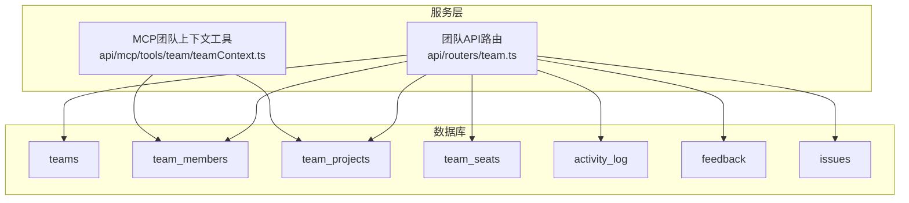
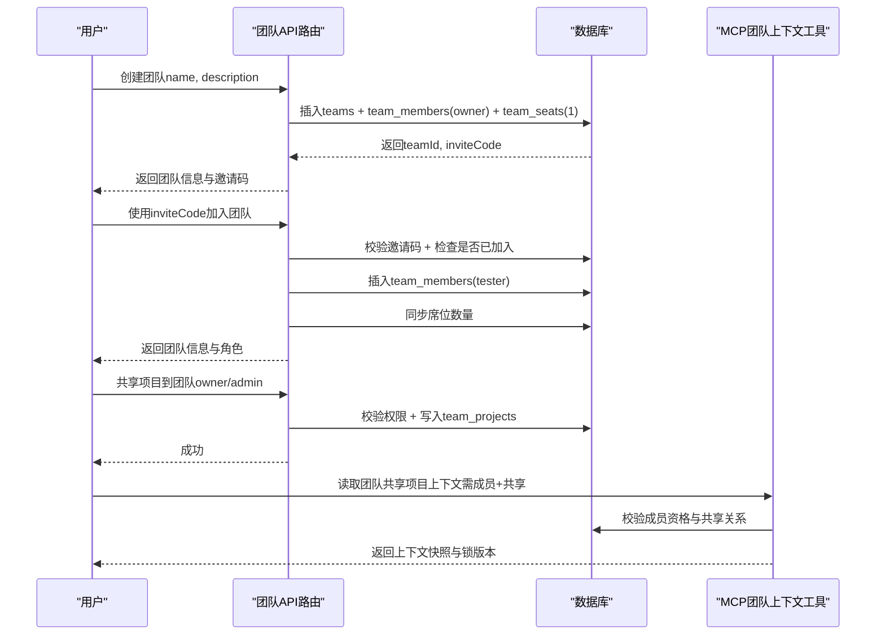
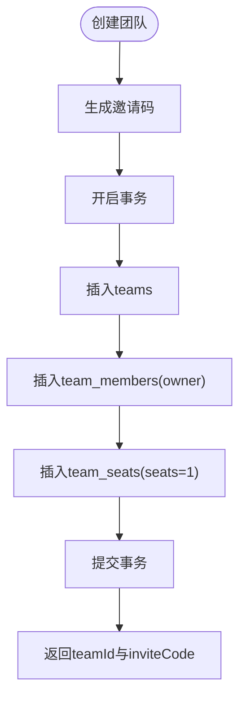
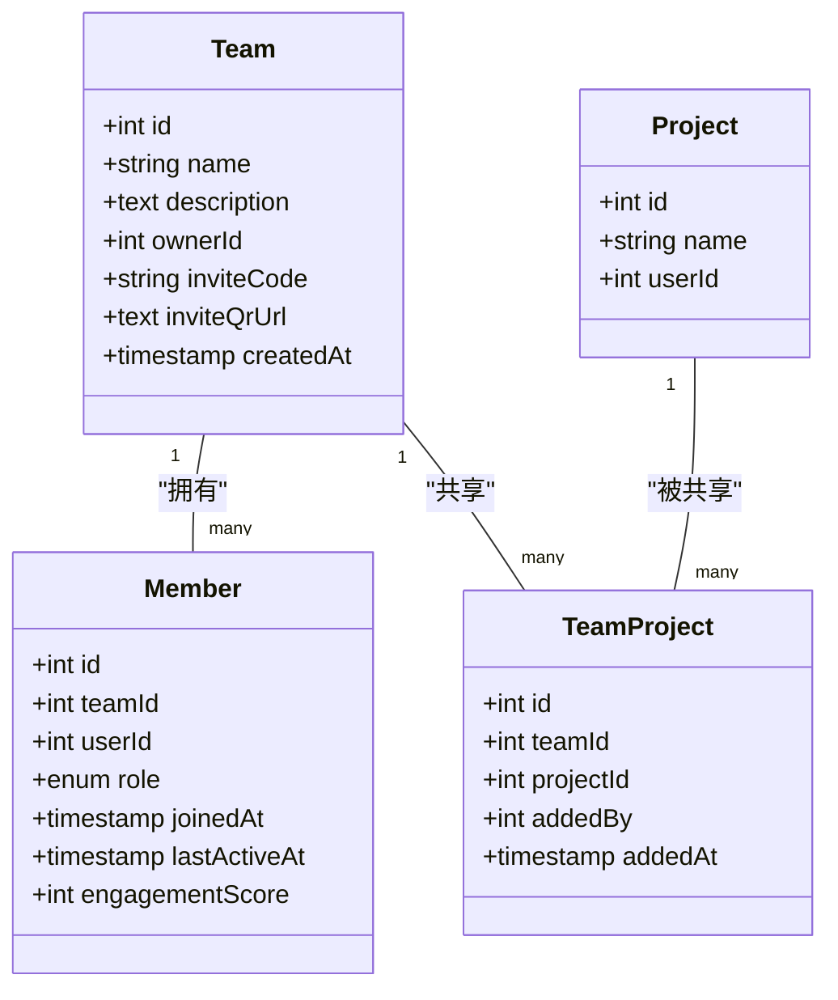
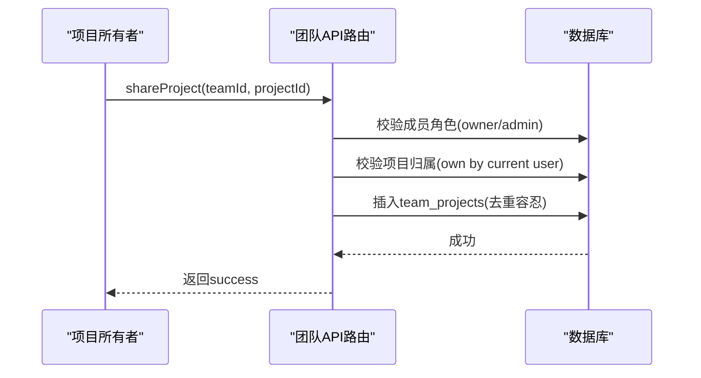
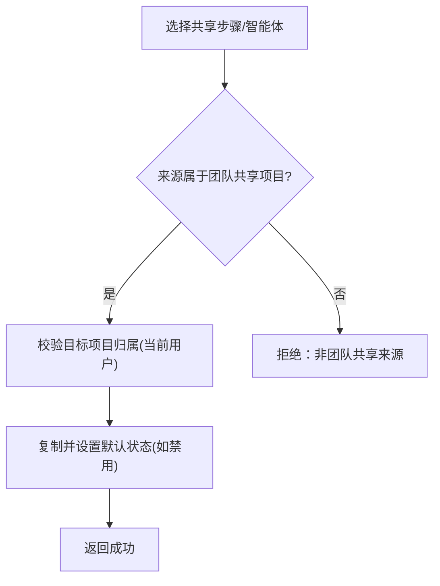
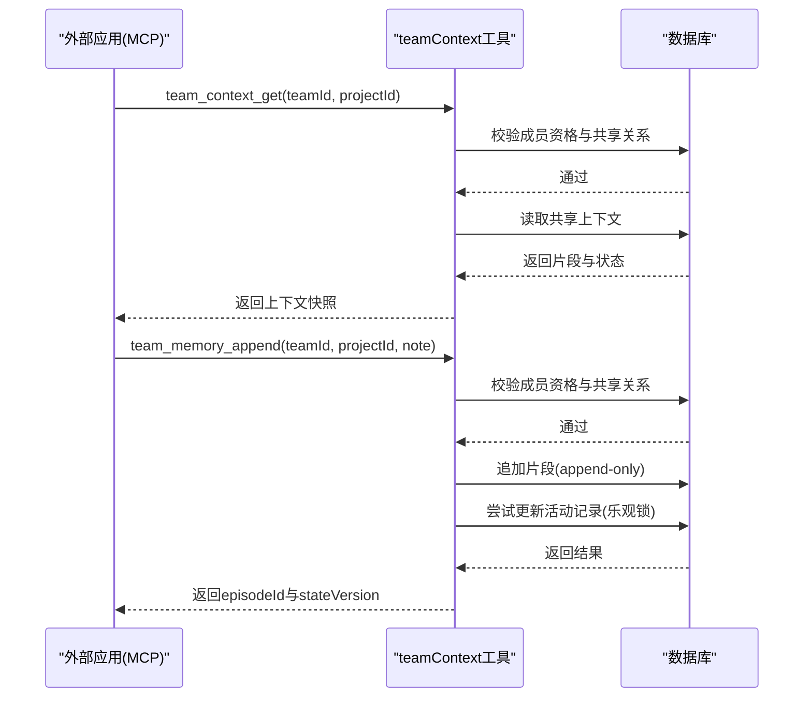
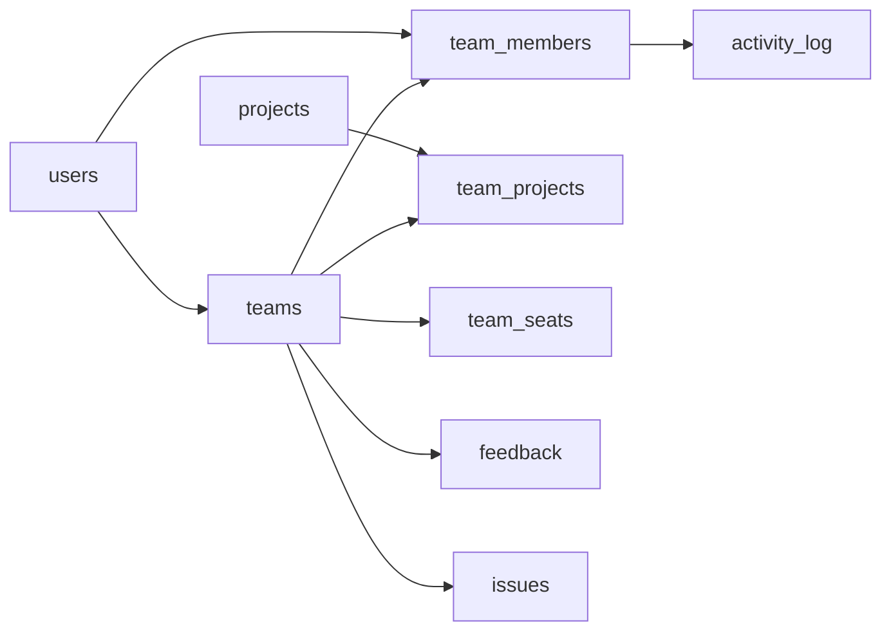

# 团队协作

<cite>
**本文引用的文件**
- [db/schema.ts](file://db/schema.ts)
- [api/routers/team.ts](file://api/routers/team.ts)
- [api/mcp/tools/team/teamContext.ts](file://api/mcp/tools/team/teamContext.ts)
- [api/testUtils/teamFixture.ts](file://api/testUtils/teamFixture.ts)
- [db/add_team_tables.sql](file://db/add_team_tables.sql)
</cite>

## 目录
1. [简介](#简介)
2. [项目结构](#项目结构)
3. [核心数据模型](#核心数据模型)
4. [架构总览](#架构总览)
5. [详细组件分析](#详细组件分析)
6. [依赖关系分析](#依赖关系分析)
7. [性能与扩展性](#性能与扩展性)
8. [故障排查指南](#故障排查指南)
9. [结论](#结论)

## 简介
本文件为 DeeWaanAI 团队协作系统的数据模型文档，聚焦团队（teams）及其成员、权限、共享空间与协作能力。文档覆盖：
- teams 表结构与字段含义（名称、描述、邀请码、二维码链接、所有者）
- team_members 成员关系与角色权限（owner/admin/tester/viewer）
- team_projects 团队项目共享机制
- 订阅与席位（team_seats）、活动日志（activity_log）、反馈与问题（feedback/issues）等配套数据模型
- API 路由对创建、加入、成员管理、项目共享、资源导入/导出的实现要点
- MCP 工具在团队上下文读写中的访问控制与协作流程

## 项目结构
围绕团队协作的关键代码位置：
- 数据模型定义：db/schema.ts
- 团队 API 路由：api/routers/team.ts
- MCP 团队上下文工具：api/mcp/tools/team/teamContext.ts
- 测试夹具（构造团队、成员、项目）：api/testUtils/teamFixture.ts
- 手动迁移脚本（建表 SQL）：db/add_team_tables.sql

图表来源
- [db/schema.ts:786-836](file://db/schema.ts#L786-L836)
- [db/schema.ts:1203-1213](file://db/schema.ts#L1203-L1213)
- [db/schema.ts:973-996](file://db/schema.ts#L973-L996)
- [db/schema.ts:879-923](file://db/schema.ts#L879-L923)
- [db/schema.ts:926-953](file://db/schema.ts#L926-L953)
- [api/routers/team.ts:25-721](file://api/routers/team.ts#L25-L721)
- [api/mcp/tools/team/teamContext.ts:1-157](file://api/mcp/tools/team/teamContext.ts#L1-L157)

章节来源
- [db/schema.ts:786-836](file://db/schema.ts#L786-L836)
- [api/routers/team.ts:25-721](file://api/routers/team.ts#L25-L721)
- [api/mcp/tools/team/teamContext.ts:1-157](file://api/mcp/tools/team/teamContext.ts#L1-L157)

## 核心数据模型
本节以“表名 + 关键字段 + 约束/索引”的方式说明团队相关数据模型，并给出业务含义。

- teams（团队）
  - 主键：id
  - name：团队名称（必填）
  - description：团队描述（可选）
  - owner_id：所有者用户ID（外键关联 users.id，级联删除）
  - invite_code：邀请码（唯一）
  - invite_qr_url：邀请二维码URL（文本）
  - created_at：创建时间
  - 用途：承载团队基本信息与邀请入口；通过 owner_id 明确所有权

- team_members（团队成员）
  - 主键：id
  - team_id：团队ID（外键，级联删除）
  - user_id：用户ID（外键，级联删除）
  - role：成员角色（枚举：owner/admin/tester/viewer，默认 tester）
  - joined_at：加入时间
  - last_active_at：最后活跃时间
  - engagement_score：参与度评分
  - 唯一索引：(team_id, user_id) 防止重复加入
  - 用途：记录成员与角色的多对一关系，支撑权限控制

- team_projects（团队共享项目）
  - 主键：id
  - team_id：团队ID（外键，级联删除）
  - project_id：项目ID（外键，级联删除）
  - added_by：添加者用户ID（外键）
  - added_at：添加时间
  - 唯一索引：(team_id, project_id) 防止重复共享
  - 用途：将个人项目纳入团队共享范围，供团队成员访问与协作

- team_seats（团队席位/订阅）
  - 主键：id
  - team_id：团队ID（唯一）
  - seats：席位数量（默认 1）
  - stripe_subscription_id / stripe_subscription_item_id：Stripe 订阅关联
  - updated_at：更新时间
  - 用途：计费与容量控制，随成员增减同步

- activity_log（活动日志）
  - 主键：id
  - user_id：用户ID（外键，级联删除）
  - team_id：团队ID（外键，级联删除）
  - project_id：项目ID（外键，级联删除）
  - action：动作类型（消息、反馈、运行流水线、导入项目、查看仪表板、创建问题、验证修复）
  - metadata_json：元数据
  - 用途：用于参与度评分、审计与分析

- feedback（反馈）
  - 主键：id
  - team_id/project_id/user_id：作用域与提交人
  - target_type/target_message_id：目标类型与消息ID
  - feedback_type/severity/status：反馈分类、严重级别、状态
  - content/screenshot_url/context_json/tags_json：内容、截图、上下文、标签
  - assigned_to/converted_to_issue_id：指派与转问题
  - 用途：收集团队内反馈，可转为问题跟踪

- issues（问题）
  - 主键：id
  - team_id/project_id/title/description/priority/status
  - assignee_id/related_feedback_ids_json/resolution_notes
  - created_by/created_at/resolved_at
  - 用途：问题生命周期管理，支持从反馈转化

- 其他相关表（与团队功能联动）
  - projects：项目主体（被 team_projects 引用）
  - users：用户主体（被多个表引用）
  - pipeline_steps/custom_agents：流水线步骤与自定义智能体（可在团队内共享与导入）

章节来源
- [db/schema.ts:786-836](file://db/schema.ts#L786-L836)
- [db/schema.ts:1203-1213](file://db/schema.ts#L1203-L1213)
- [db/schema.ts:973-996](file://db/schema.ts#L973-L996)
- [db/schema.ts:879-923](file://db/schema.ts#L879-L923)
- [db/schema.ts:926-953](file://db/schema.ts#L926-L953)
- [db/add_team_tables.sql:4-38](file://db/add_team_tables.sql#L4-L38)

## 架构总览
团队协作的核心交互包括：
- 创建团队与自动分配所有者、生成邀请码、初始化席位
- 通过邀请码加入团队，自动赋予 tester 角色并同步席位
- 成员列表与详情查询（含用户信息）
- 项目共享与取消共享（仅 owner/admin 可操作）
- 跨项目共享资源的导入（流水线步骤、自定义智能体）
- MCP 工具对团队共享项目的上下文读取与追加（需同时满足“是团队成员且项目已共享”）

图表来源
- [api/routers/team.ts:29-67](file://api/routers/team.ts#L29-L67)
- [api/routers/team.ts:72-117](file://api/routers/team.ts#L72-L117)
- [api/routers/team.ts:347-398](file://api/routers/team.ts#L347-L398)
- [api/mcp/tools/team/teamContext.ts:35-54](file://api/mcp/tools/team/teamContext.ts#L35-L54)
- [api/mcp/tools/team/teamContext.ts:56-96](file://api/mcp/tools/team/teamContext.ts#L56-L96)

## 详细组件分析

### 团队表（teams）与邀请机制
- 字段设计
  - name/description：团队基本信息
  - owner_id：所有权归属，级联删除保证一致性
  - invite_code：唯一邀请码，用于无账号门槛的拉新
  - invite_qr_url：便于扫码加入
- 创建流程
  - 事务中同时写入 teams、team_members(owner)、team_seats(1)，确保原子性
  - 自动生成16位邀请码（字母数字），具备高唯一性
- 加入流程
  - 根据 invite_code 查找团队，校验未重复加入后插入 member(tester)
  - 触发席位数量同步（计费/容量）

图表来源
- [api/routers/team.ts:29-67](file://api/routers/team.ts#L29-L67)

章节来源
- [api/routers/team.ts:29-67](file://api/routers/team.ts#L29-L67)
- [db/schema.ts:786-796](file://db/schema.ts#L786-L796)

### 成员关系与权限控制（team_members）
- 角色体系
  - owner：团队拥有者，不可被移除或降级
  - admin：管理员，可管理成员、共享/取消共享项目
  - tester：普通成员（通过邀请码加入默认角色）
  - viewer：只读成员（可用于受限场景）
- 权限规则（由路由层实施）
  - 更新成员角色：仅 owner/admin
  - 移除成员：本人或 owner/admin；禁止移除 owner
  - 共享/取消共享项目：仅 owner/admin
- 数据完整性
  - (team_id, user_id) 唯一约束避免重复加入
  - 外键级联删除保证数据一致性

图表来源
- [db/schema.ts:786-836](file://db/schema.ts#L786-L836)

章节来源
- [db/schema.ts:799-817](file://db/schema.ts#L799-L817)
- [api/routers/team.ts:223-342](file://api/routers/team.ts#L223-L342)

### 团队项目共享与协作（team_projects）
- 共享机制
  - 仅项目所有者可将项目共享至团队（路由校验 ownership）
  - 共享后团队成员可访问该项目的共享资源（如流水线步骤、智能体）
- 去重与审计
  - (team_id, project_id) 唯一约束避免重复共享
  - added_by/added_at 记录共享来源与时间
- 资源共享范围
  - 共享流水线步骤：getSharedPipelines/importPipeline
  - 共享自定义智能体：getSharedAgents/importAgent

图表来源
- [api/routers/team.ts:347-398](file://api/routers/team.ts#L347-L398)

章节来源
- [api/routers/team.ts:347-398](file://api/routers/team.ts#L347-L398)
- [db/schema.ts:819-836](file://db/schema.ts#L819-L836)

### 团队配置与成员管理
- 成员管理
  - 列出当前用户所在团队及角色、成员数
  - 获取团队详情（成员列表含用户信息、共享项目列表）
  - 更新成员角色（owner/admin 可操作，禁止修改 owner）
  - 移除成员（本人或 owner/admin，禁止移除 owner）
- 席位与订阅
  - 加入/移除成员时同步 team_seats.seats 数量
  - 删除团队时尝试取消 Stripe 订阅（Phase 2）

章节来源
- [api/routers/team.ts:122-159](file://api/routers/team.ts#L122-L159)
- [api/routers/team.ts:164-221](file://api/routers/team.ts#L164-L221)
- [api/routers/team.ts:223-342](file://api/routers/team.ts#L223-L342)
- [api/routers/team.ts:443-463](file://api/routers/team.ts#L443-L463)
- [db/schema.ts:1203-1213](file://db/schema.ts#L1203-L1213)

### 资源共享与协作（流水线步骤与智能体）
- 共享流水线步骤
  - getSharedPipelines：聚合团队所有共享项目的步骤并按顺序返回
  - importPipeline：将源步骤复制到目标项目（默认禁用，需启用）
- 共享自定义智能体
  - getSharedAgents：获取团队其他成员的自定义智能体
  - importAgent：复制智能体到本地项目（处理 slug 冲突）

图表来源
- [api/routers/team.ts:468-517](file://api/routers/team.ts#L468-L517)
- [api/routers/team.ts:576-646](file://api/routers/team.ts#L576-L646)
- [api/routers/team.ts:651-719](file://api/routers/team.ts#L651-L719)

章节来源
- [api/routers/team.ts:468-517](file://api/routers/team.ts#L468-L517)
- [api/routers/team.ts:576-646](file://api/routers/team.ts#L576-L646)
- [api/routers/team.ts:651-719](file://api/routers/team.ts#L651-L719)

### MCP 团队上下文读写（共享项目记忆）
- 访问控制
  - requireTeamMembershipAndShare：必须同时满足“是团队成员”和“项目已共享”
- 读取上下文
  - team_context_get：返回最近片段、结构化状态与锁版本
- 写入记忆
  - team_memory_append：追加片段（append-only），并尽力更新共享状态的活动记录（乐观锁失败不阻断）

图表来源
- [api/mcp/tools/team/teamContext.ts:35-54](file://api/mcp/tools/team/teamContext.ts#L35-L54)
- [api/mcp/tools/team/teamContext.ts:56-96](file://api/mcp/tools/team/teamContext.ts#L56-L96)
- [api/mcp/tools/team/teamContext.ts:99-156](file://api/mcp/tools/team/teamContext.ts#L99-L156)

章节来源
- [api/mcp/tools/team/teamContext.ts:1-157](file://api/mcp/tools/team/teamContext.ts#L1-L157)

## 依赖关系分析
- 数据模型依赖
  - teams.owner_id -> users.id（级联删除）
  - team_members.team_id -> teams.id（级联删除）
  - team_members.user_id -> users.id（级联删除）
  - team_projects.team_id -> teams.id（级联删除）
  - team_projects.project_id -> projects.id（级联删除）
  - team_seats.team_id -> teams.id（级联删除）
  - activity_log/feedback/issues 均支持 team_id 作用域
- 路由与服务依赖
  - 团队路由依赖 schema 中的 teams/team_members/team_projects/team_seats
  - MCP 工具依赖 team_members/team_projects 进行访问控制
  - 测试夹具通过原始SQL构建团队、成员、项目，便于集成测试

图表来源
- [db/schema.ts:786-836](file://db/schema.ts#L786-L836)
- [db/schema.ts:973-996](file://db/schema.ts#L973-L996)
- [db/schema.ts:879-923](file://db/schema.ts#L879-L923)
- [db/schema.ts:926-953](file://db/schema.ts#L926-L953)

章节来源
- [db/schema.ts:786-836](file://db/schema.ts#L786-L836)
- [db/schema.ts:973-996](file://db/schema.ts#L973-L996)
- [db/schema.ts:879-923](file://db/schema.ts#L879-L923)
- [db/schema.ts:926-953](file://db/schema.ts#L926-L953)

## 性能与扩展性
- 索引与查询优化
  - team_members：按 user_id、team_id 建立索引，提升成员查询效率
  - team_projects：按 team_id、project_id 建立索引，提升共享项目检索
  - activity_log：按 user_id、team_id 建立索引，便于统计与审计
- 并发与一致性
  - 创建团队使用事务保证原子性
  - 共享项目与加入成员存在幂等处理（容忍重复插入）
  - 共享状态更新采用乐观锁（memory_locks.version），避免写冲突
- 扩展点
  - 席位与订阅（team_seats）预留 Stripe 集成，支持按团队计费
  - 活动日志与参与度评分（engagement_score）可扩展为激励与治理依据

[本节提供通用指导，无需特定文件引用]

## 故障排查指南
- 常见错误与定位
  - 邀请码无效：检查 teams.invite_code 是否存在
  - 重复加入：team_members 唯一约束导致，应提示“已是成员”
  - 非成员访问：MCP 工具会返回“团队不存在/项目未共享”，确认成员资格与共享关系
  - 无法共享项目：校验是否为项目所有者且具备 owner/admin 角色
  - 席位不同步：加入/移除成员后应调用席位同步逻辑
- 调试建议
  - 使用测试夹具快速构造团队与成员环境，复现问题
  - 关注 activity_log 与 feedback/issues 的状态流转
  - 对于共享状态更新失败，检查 memory_locks 的版本冲突与重试策略

章节来源
- [api/routers/team.ts:72-117](file://api/routers/team.ts#L72-L117)
- [api/routers/team.ts:347-398](file://api/routers/team.ts#L347-L398)
- [api/mcp/tools/team/teamContext.ts:35-54](file://api/mcp/tools/team/teamContext.ts#L35-L54)
- [api/testUtils/teamFixture.ts:28-131](file://api/testUtils/teamFixture.ts#L28-L131)

## 结论
DeeWaanAI 的团队协作数据模型以 teams/team_members/team_projects 为核心，配合 team_seats、activity_log、feedback/issues 等表形成完整的团队管理与协作闭环。API 路由实现了创建、加入、成员管理、项目共享与资源共享导入/导出；MCP 工具提供了安全的团队上下文读写能力。整体设计强调权限边界清晰、数据一致性与可扩展性，适合面向多团队的协作场景。