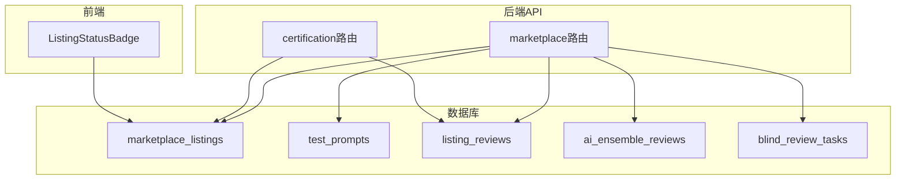
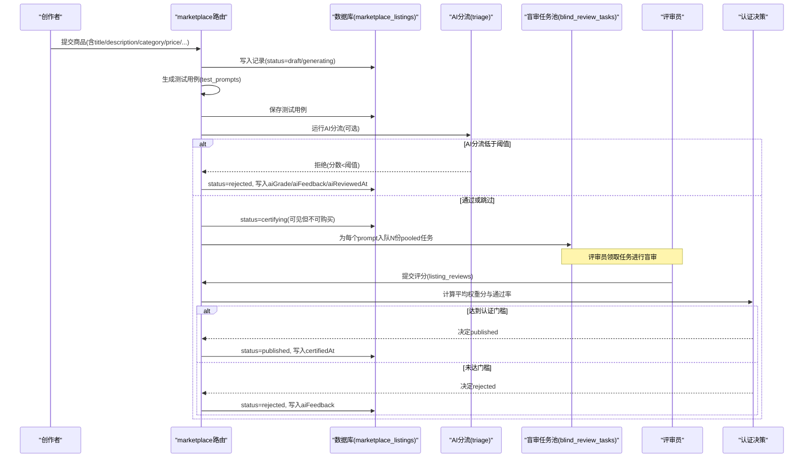
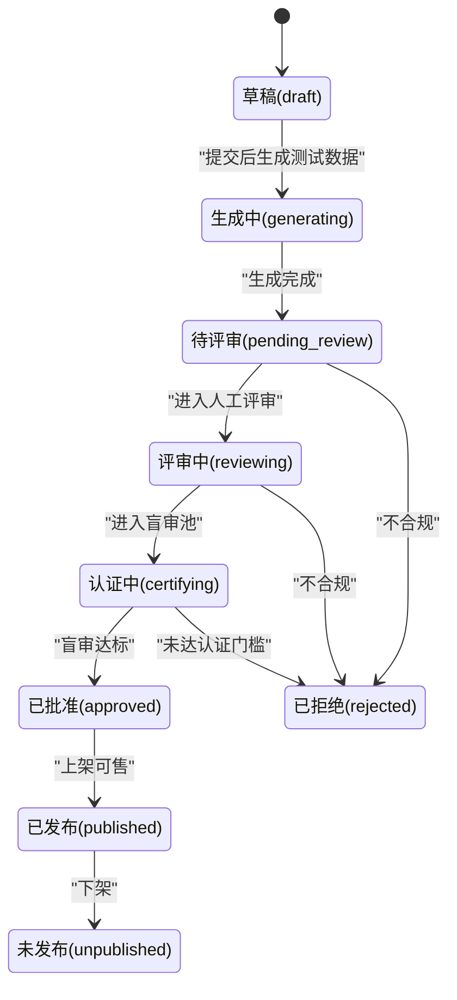
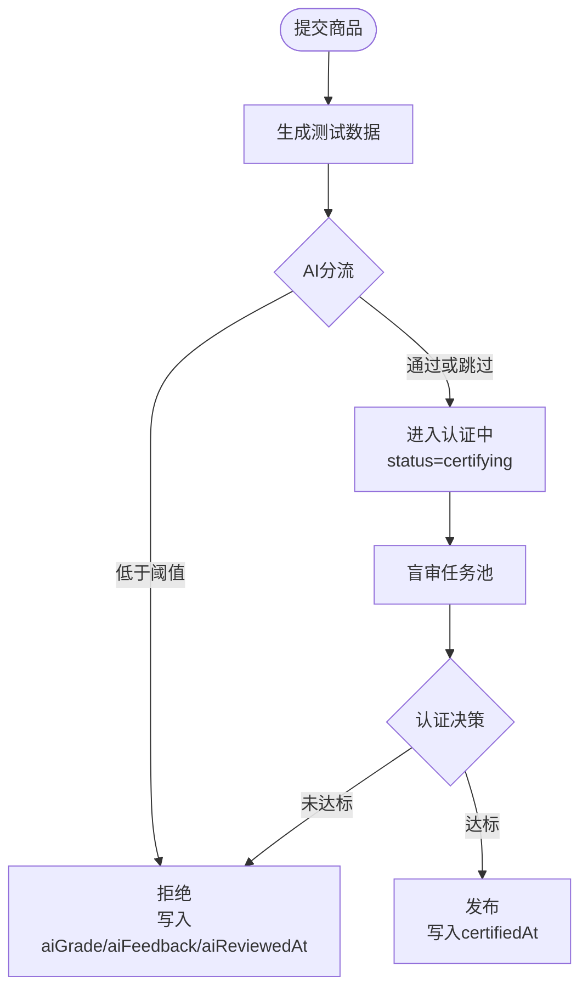
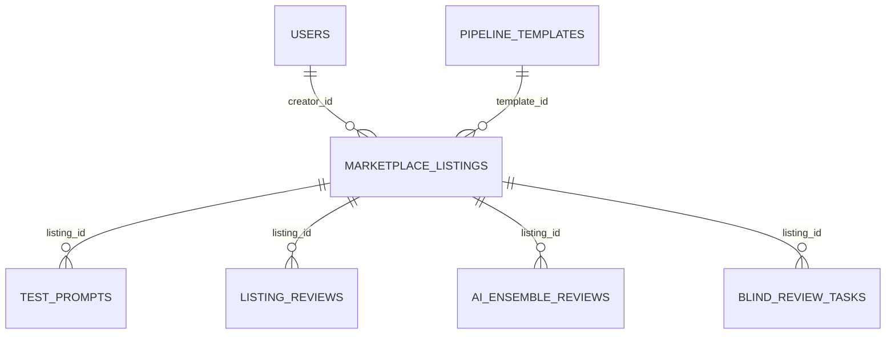

# 商品管理

<cite>
**本文引用的文件**
- [db/schema.ts](file://db/schema.ts)
- [db/migrate-008-create-marketplace.sql](file://db/migrate-008-create-marketplace.sql)
- [db/marketplace_migration.sql](file://db/marketplace_migration.sql)
- [db/migrations/014_marketplace_trust.sql](file://db/migrations/014_marketplace_trust.sql)
- [api/routers/marketplace.ts](file://api/routers/marketplace.ts)
- [api/routers/certification.ts](file://api/routers/certification.ts)
- [src/components/marketplace/ListingStatusBadge.tsx](file://src/components/marketplace/ListingStatusBadge.tsx)
</cite>

## 目录
1. [简介](#简介)
2. [项目结构](#项目结构)
3. [核心组件](#核心组件)
4. [架构总览](#架构总览)
5. [详细组件分析](#详细组件分析)
6. [依赖关系分析](#依赖关系分析)
7. [性能考虑](#性能考虑)
8. [故障排查指南](#故障排查指南)
9. [结论](#结论)
10. [附录](#附录)

## 简介
本数据模型文档聚焦于DeeWaanAI市场商品管理系统中的marketplaceListings表，系统性说明其字段设计、质量评估指标、定价策略、审核状态流转与时间戳语义，并解释AI评审相关字段与人工认证时间戳的业务含义。同时给出商品分类枚举值及典型使用场景示例，帮助开发者与运营人员准确理解数据模型与业务流程。

## 项目结构
- 数据库层：通过SQL迁移脚本与Drizzle ORM schema定义共同维护marketplace_listings表结构与约束。
- 服务层：marketplace路由实现商品提交、测试数据生成、AI分流（triage）、盲审任务池、认证决策等流程；certification路由提供公开认证报告。
- 前端展示：状态徽章组件根据status渲染“正在认证”或“已认证”。

图表来源
- [db/schema.ts:512-564](file://db/schema.ts#L512-L564)
- [db/migrate-008-create-marketplace.sql:8-33](file://db/migrate-008-create-marketplace.sql#L8-L33)
- [db/migrations/014_marketplace_trust.sql:9-16](file://db/migrations/014_marketplace_trust.sql#L9-L16)
- [api/routers/marketplace.ts:919-940](file://api/routers/marketplace.ts#L919-L940)
- [api/routers/certification.ts:32-90](file://api/routers/certification.ts#L32-L90)
- [src/components/marketplace/ListingStatusBadge.tsx:11-33](file://src/components/marketplace/ListingStatusBadge.tsx#L11-L33)

章节来源
- [db/schema.ts:512-564](file://db/schema.ts#L512-L564)
- [db/migrate-008-create-marketplace.sql:8-33](file://db/migrate-008-create-marketplace.sql#L8-L33)
- [db/marketplace_migration.sql:8-28](file://db/marketplace_migration.sql#L8-L28)
- [db/migrations/014_marketplace_trust.sql:9-16](file://db/migrations/014_marketplace_trust.sql#L9-L16)

## 核心组件
- marketplaceListings表：承载商品基本信息、定价策略、质量评估指标、AI评审结果与人工认证时间戳，以及审核状态机。
- 辅助表：test_prompts（测试用例）、listing_reviews（人工评分）、ai_ensemble_reviews（AI集成评审）、blind_review_tasks（盲审任务池）。
- 路由与服务：marketplace路由负责提交、测试、AI分流、盲审队列与认证决策；certification路由对外暴露认证报告。

章节来源
- [db/schema.ts:512-564](file://db/schema.ts#L512-L564)
- [api/routers/marketplace.ts:1350-1402](file://api/routers/marketplace.ts#L1350-L1402)
- [api/routers/certification.ts:32-90](file://api/routers/certification.ts#L32-L90)

## 架构总览
下图展示了商品从创建到发布的关键数据流与状态变迁，包括AI分流与盲审环节。

图表来源
- [api/routers/marketplace.ts:1350-1402](file://api/routers/marketplace.ts#L1350-L1402)
- [db/migrations/014_marketplace_trust.sql:9-16](file://db/migrations/014_marketplace_trust.sql#L9-L16)
- [db/schema.ts:512-564](file://db/schema.ts#L512-L564)

## 详细组件分析

### marketplaceListings表字段设计
- 商品基本信息
  - title：商品标题，必填，用于展示与检索。
  - description：商品描述，支持富文本或长文本。
  - objectives/input_format/output_format/remarks：结构化描述字段，便于自动生成测试用例与评审提示。
  - category：商品分类枚举，见下节。
- 定价策略
  - price：一次性购买价格，必填。
  - is_subscription：是否订阅制商品。
  - subscription_price：订阅价格（当is_subscription为真时有效）。
- 质量评估指标
  - grade：综合质量等级（小数），由人工评审聚合得出。
  - review_count：累计评审数量。
  - kappa_score：一致性度量（Fleiss' Kappa），衡量评审者间一致性。
  - ai_correlation：AI评分与人工评分的相关性指标。
- 审核状态流转
  - 状态枚举：draft → generating → pending_review → reviewing → certifying → approved → published → unpublished；另有rejected分支。
  - 关键规则：
    - draft：草稿态，可编辑。
    - generating：后台生成测试数据中。
    - pending_review/reviewing：历史人工分配流程（兼容保留）。
    - certifying：可见但不可购买，等待盲审。
    - approved/published：已通过人类盲审并可购买。
    - rejected/unpublished：被拒绝或未发布。
- AI评审相关字段
  - aiGrade：AI分流给出的分数。
  - aiKappaScore：AI侧的一致性度量（用于诊断）。
  - aiFeedback：AI分流反馈（如拒绝原因或改进建议）。
  - aiReviewedAt：AI评审完成时间。
- 人工认证时间戳
  - certifiedAt：当商品进入published并通过盲审时记录的时间戳，用于审计与报表。

章节来源
- [db/schema.ts:512-564](file://db/schema.ts#L512-L564)
- [db/migrate-008-create-marketplace.sql:8-33](file://db/migrate-008-create-marketplace.sql#L8-L33)
- [db/marketplace_migration.sql:8-28](file://db/marketplace_migration.sql#L8-L28)
- [db/migrations/014_marketplace_trust.sql:9-16](file://db/migrations/014_marketplace_trust.sql#L9-L16)
- [api/routers/marketplace.ts:1350-1402](file://api/routers/marketplace.ts#L1350-L1402)
- [api/routers/certification.ts:32-90](file://api/routers/certification.ts#L32-L90)

### 审核状态流转图

图表来源
- [db/schema.ts:538-548](file://db/schema.ts#L538-L548)
- [db/migrations/014_marketplace_trust.sql:9-13](file://db/migrations/014_marketplace_trust.sql#L9-L13)

### AI评审流程与字段更新时机
- AI分流（triage）在提交后运行，若分数低于阈值则直接拒绝，并写入aiGrade、aiFeedback、aiReviewedAt。
- 若通过或配置关闭，则进入certifying，并继续盲审流程。
- 盲审通过后，设置status=published并写入certifiedAt。

图表来源
- [api/routers/marketplace.ts:1350-1402](file://api/routers/marketplace.ts#L1350-L1402)
- [db/schema.ts:554-560](file://db/schema.ts#L554-L560)

### 商品分类枚举与使用场景
- 枚举值：translation、writing、code、analysis、creative、other。
- 使用场景示例：
  - translation：翻译类流水线，输入多语言文本，输出目标语言译文。
  - writing：写作辅助，如文章润色、摘要生成。
  - code：代码生成/重构/审查工具。
  - analysis：数据分析、报告生成、洞察提取。
  - creative：创意内容生成（文案、海报文案等）。
  - other：其他未归类的用途。

章节来源
- [db/schema.ts:527-534](file://db/schema.ts#L527-L534)
- [src/pages/MarketplaceBrowse.tsx:32-40](file://src/pages/MarketplaceBrowse.tsx#L32-L40)

### 定价策略与购买限制
- 一次性购买：price生效，is_subscription=false。
- 订阅制：is_subscription=true且subscription_price生效，购买记录包含subscription_end。
- 认证中商品（status=certifying）在前端可见但不可购买，需等待published。

章节来源
- [db/schema.ts:535-537](file://db/schema.ts#L535-L537)
- [api/routers/marketplace.ts:935-940](file://api/routers/marketplace.ts#L935-L940)
- [src/components/marketplace/ListingStatusBadge.tsx:11-33](file://src/components/marketplace/ListingStatusBadge.tsx#L11-L33)

## 依赖关系分析
- marketplaceListings与users、pipeline_templates存在外键关联，确保创作者与模板的完整性。
- test_prompts、listing_reviews、ai_ensemble_reviews、blind_review_tasks均通过listing_id与marketplaceListings关联，形成围绕商品的多维评测体系。
- certification路由仅对approved/published状态的商品开放公开报告，避免内部状态泄露。

图表来源
- [db/schema.ts:512-564](file://db/schema.ts#L512-L564)
- [db/schema.ts:567-692](file://db/schema.ts#L567-L692)

章节来源
- [db/schema.ts:512-564](file://db/schema.ts#L512-L564)
- [db/schema.ts:567-692](file://db/schema.ts#L567-L692)

## 性能考虑
- 索引优化：对creator_id、status、category建立索引以加速列表查询与筛选。
- 缓存策略：公开浏览接口采用短TTL缓存，减少数据库压力。
- 并发控制：盲审任务池采用原子claim与随机顺序，避免热点listing垄断评审资源。

章节来源
- [db/migrate-008-create-marketplace.sql:28-33](file://db/migrate-008-create-marketplace.sql#L28-L33)
- [api/routers/marketplace.ts:37-39](file://api/routers/marketplace.ts#L37-L39)
- [api/routers/marketplace.ts:630-735](file://api/routers/marketplace.ts#L630-L735)

## 故障排查指南
- 卡在generating：检查后台任务是否超时或失败，必要时管理员重置为draft重新提交。
- AI分流拒绝：查看aiGrade与aiFeedback定位问题，按反馈优化流水线。
- 认证未通过：检查review_count、grade、kappa_score与pass ratio，确认是否达到认证门槛。
- 购买失败：确认status是否为published；certifying状态下禁止购买。

章节来源
- [api/routers/admin.ts:402-441](file://api/routers/admin.ts#L402-L441)
- [api/routers/marketplace.ts:1350-1402](file://api/routers/marketplace.ts#L1350-L1402)
- [api/routers/certification.ts:32-90](file://api/routers/certification.ts#L32-L90)

## 结论
marketplaceListings表通过清晰的状态机、多维质量指标与AI+人工双轨评审机制，构建了可信的市场商品管理体系。字段设计兼顾业务可读性与系统可扩展性，配合盲审任务池与认证决策逻辑，确保上线商品的质量与一致性。建议在后续迭代中持续优化AI分流阈值与认证门槛，提升整体效率与用户体验。

## 附录
- 关键字段速查
  - 基本信息：title、description、objectives、input_format、output_format、remarks、category
  - 定价：price、is_subscription、subscription_price
  - 质量：grade、review_count、kappa_score、ai_correlation
  - AI评审：aiGrade、aiKappaScore、aiFeedback、aiReviewedAt
  - 认证：certifiedAt
  - 状态：draft、generating、pending_review、reviewing、certifying、approved、published、unpublished、rejected

章节来源
- [db/schema.ts:512-564](file://db/schema.ts#L512-L564)
- [db/migrations/014_marketplace_trust.sql:9-16](file://db/migrations/014_marketplace_trust.sql#L9-L16)