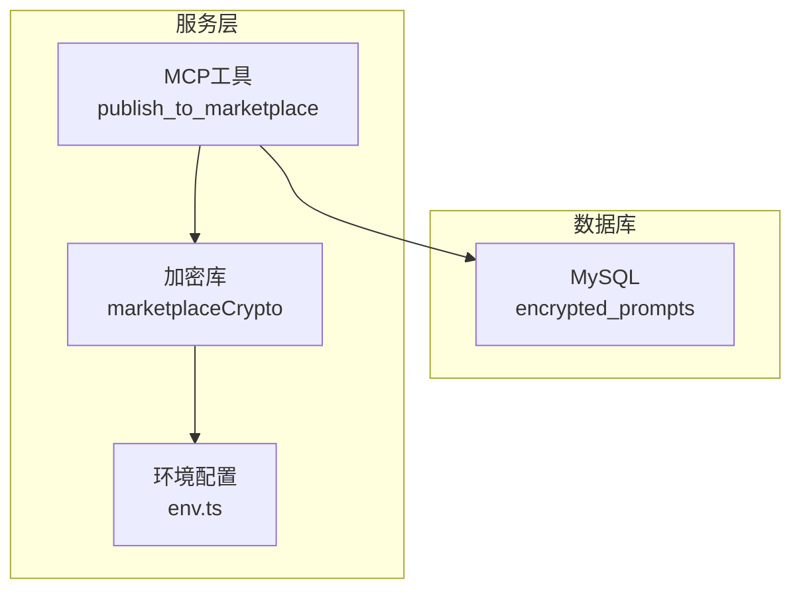
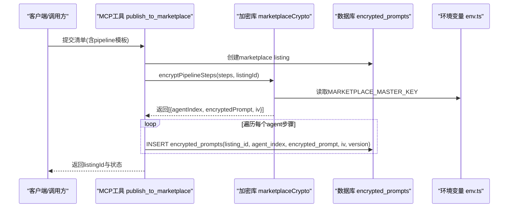
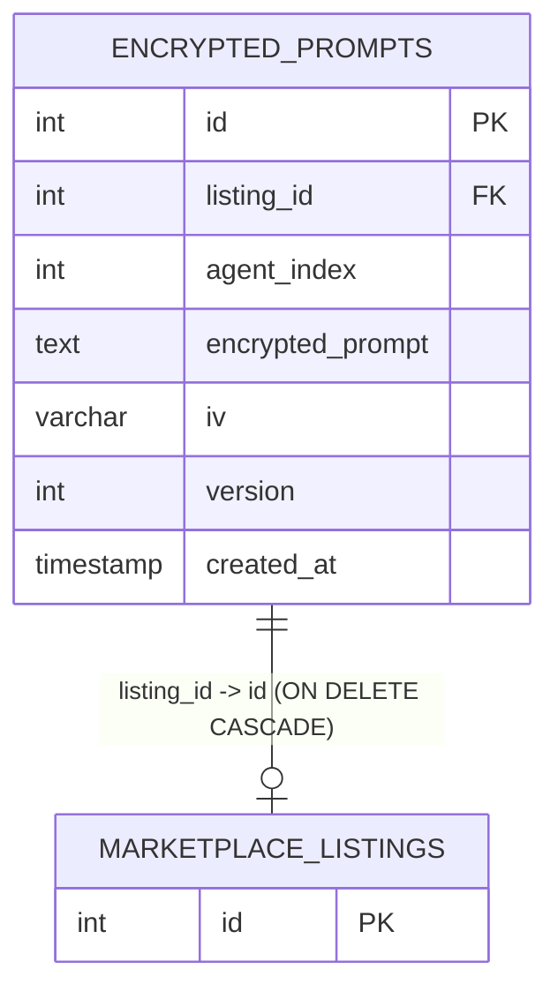
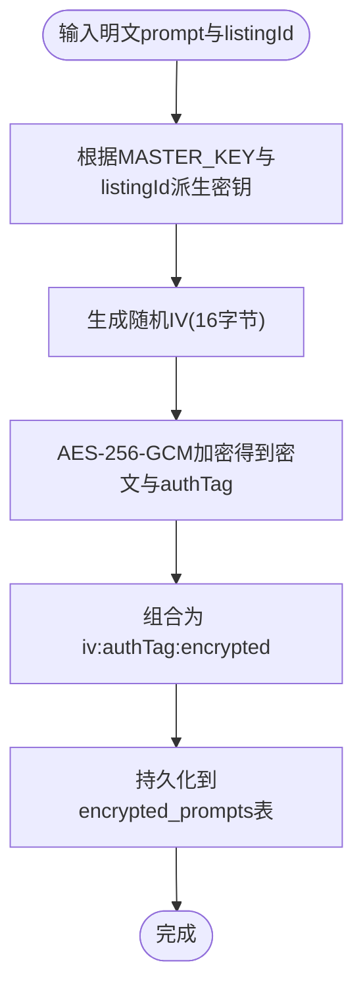
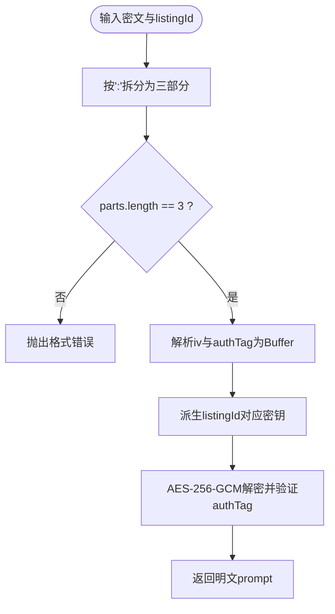
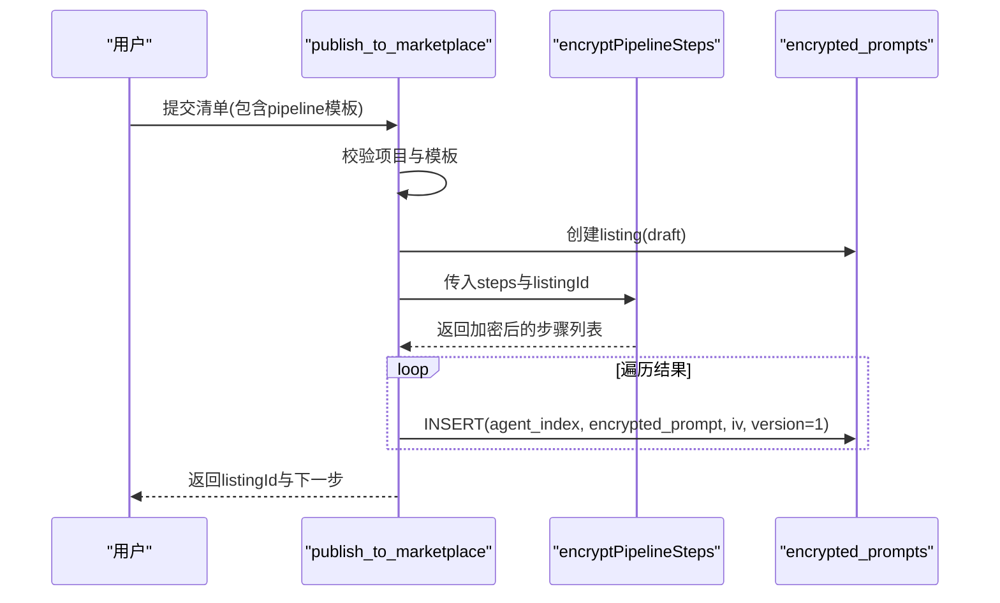
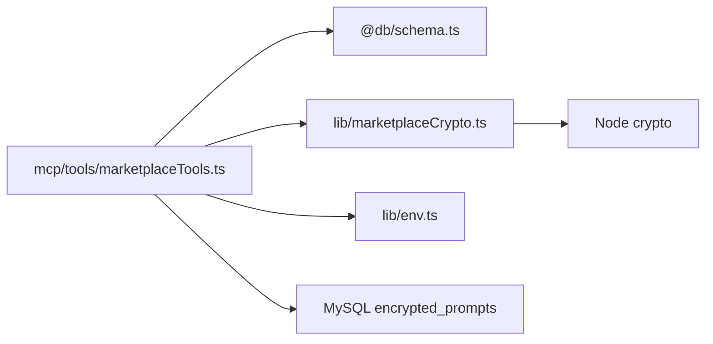

# 安全存储机制

<cite>
**本文引用的文件**
- [db/schema.ts](file://db/schema.ts)
- [db/marketplace_migration.sql](file://db/marketplace_migration.sql)
- [api/lib/marketplaceCrypto.ts](file://api/lib/marketplaceCrypto.ts)
- [api/services/cryptoService.ts](file://api/services/cryptoService.ts)
- [api/mcp/tools/marketplaceTools.ts](file://api/mcp/tools/marketplaceTools.ts)
- [api/lib/env.ts](file://api/lib/env.ts)
- [DEPLOY.md](file://DEPLOY.md)
</cite>

## 目录
1. [简介](#简介)
2. [项目结构](#项目结构)
3. [核心组件](#核心组件)
4. [架构总览](#架构总览)
5. [详细组件分析](#详细组件分析)
6. [依赖关系分析](#依赖关系分析)
7. [性能考虑](#性能考虑)
8. [故障排查指南](#故障排查指南)
9. [结论](#结论)
10. [附录：API调用示例与环境配置](#附录api调用示例与环境配置)

## 简介
本文件面向DeeWaanAI市场的安全存储机制，聚焦于encryptedPrompts表的数据模型与加密实现。内容涵盖：
- encryptedPrompts表的字段定义、外键约束与版本控制设计
- 加密算法选择（AES-256-GCM）、密钥派生与数据隔离策略
- 提示词加密/解密流程、错误处理与安全最佳实践
- API调用示例与不同环境下的配置要求

## 项目结构
围绕“市场提示词安全存储”的相关代码分布在数据库定义、加密库、MCP工具与环境配置中：
- 数据库层：schema与迁移脚本定义了encrypted_prompts表结构与外键关系
- 加密层：marketplaceCrypto提供AES-256-GCM加解密与按listingId派生密钥
- 业务层：marketplaceTools在发布清单时批量加密并持久化提示词
- 配置层：env集中管理密钥环境变量，部署文档说明生产环境必需项

图表来源
- [api/mcp/tools/marketplaceTools.ts:42-103](file://api/mcp/tools/marketplaceTools.ts#L42-L103)
- [api/lib/marketplaceCrypto.ts:1-82](file://api/lib/marketplaceCrypto.ts#L1-L82)
- [db/schema.ts:768-779](file://db/schema.ts#L768-L779)

章节来源
- [db/schema.ts:768-779](file://db/schema.ts#L768-L779)
- [db/marketplace_migration.sql:158-168](file://db/marketplace_migration.sql#L158-L168)
- [api/lib/env.ts:24-47](file://api/lib/env.ts#L24-L47)

## 核心组件
- 数据模型：encrypted_prompts表用于存储每个agent步骤的加密提示词、初始化向量与版本
- 加密库：基于AES-256-GCM，使用listingId派生每条目独立密钥，确保数据隔离
- 业务流程：发布清单时将pipeline模板中的systemPrompt逐条加密并写入encrypted_prompts
- 环境配置：生产环境必须设置MARKETPLACE_MASTER_KEY；开发环境有降级策略但需警惕安全风险

章节来源
- [db/schema.ts:768-779](file://db/schema.ts#L768-L779)
- [api/lib/marketplaceCrypto.ts:1-82](file://api/lib/marketplaceCrypto.ts#L1-L82)
- [api/mcp/tools/marketplaceTools.ts:42-103](file://api/mcp/tools/marketplaceTools.ts#L42-L103)
- [api/lib/env.ts:24-47](file://api/lib/env.ts#L24-L47)

## 架构总览
下图展示了从“发布清单”到“加密存储”的端到端流程，以及密钥派生与数据隔离的关键点。

图表来源
- [api/mcp/tools/marketplaceTools.ts:42-103](file://api/mcp/tools/marketplaceTools.ts#L42-L103)
- [api/lib/marketplaceCrypto.ts:31-81](file://api/lib/marketplaceCrypto.ts#L31-L81)
- [db/schema.ts:768-779](file://db/schema.ts#L768-L779)

## 详细组件分析

### 数据模型：encrypted_prompts表
- 主键id：自增整数
- listing_id：关联marketplace_listings.id，级联删除，保证清单与提示词的一致性
- agent_index：标识该提示词对应pipeline中的第几个agent步骤（从0开始）
- encrypted_prompt：密文，采用“iv:authTag:encrypted”三段式拼接的十六进制字符串
- iv：初始化向量，以十六进制字符串存储，长度不超过64字符
- version：默认1，用于未来算法或密钥轮换时的兼容升级
- created_at：记录创建时间戳

图表来源
- [db/schema.ts:768-779](file://db/schema.ts#L768-L779)
- [db/marketplace_migration.sql:158-168](file://db/marketplace_migration.sql#L158-L168)

章节来源
- [db/schema.ts:768-779](file://db/schema.ts#L768-L779)
- [db/marketplace_migration.sql:158-168](file://db/marketplace_migration.sql#L158-L168)

### 加密算法与密钥管理
- 算法：AES-256-GCM，提供机密性与完整性校验（authTag）
- IV：每次加密随机生成16字节IV，并以十六进制形式单独存储
- 密钥派生：通过MASTER_KEY与listingId派生每条记录的独立密钥，实现数据隔离
- 密文格式：iv:authTag:encrypted（均为十六进制），便于存储与传输
- 环境要求：生产环境必须设置MARKETPLACE_MASTER_KEY；未设置时在非生产环境会降级为不安全密钥并告警

图表来源
- [api/lib/marketplaceCrypto.ts:7-24](file://api/lib/marketplaceCrypto.ts#L7-L24)
- [api/lib/marketplaceCrypto.ts:31-46](file://api/lib/marketplaceCrypto.ts#L31-L46)

章节来源
- [api/lib/marketplaceCrypto.ts:1-82](file://api/lib/marketplaceCrypto.ts#L1-L82)
- [api/lib/env.ts:24-47](file://api/lib/env.ts#L24-L47)
- [DEPLOY.md:46-63](file://DEPLOY.md#L46-L63)

### 解密流程与兼容性
- 解析密文：按“:”分割为三部分，校验数量
- 恢复IV与authTag：将前两部分转为Buffer
- 派生密钥：使用相同listingId派生密钥
- 解密验证：设置authTag后执行GCM解密，失败则抛出异常
- 兼容性：cryptoService支持新旧两种格式（GCM与CBC），但市场加密统一使用GCM

图表来源
- [api/lib/marketplaceCrypto.ts:48-66](file://api/lib/marketplaceCrypto.ts#L48-L66)
- [api/services/cryptoService.ts:33-67](file://api/services/cryptoService.ts#L33-L67)

章节来源
- [api/lib/marketplaceCrypto.ts:48-66](file://api/lib/marketplaceCrypto.ts#L48-L66)
- [api/services/cryptoService.ts:33-67](file://api/services/cryptoService.ts#L33-L67)

### 业务集成：发布清单时的加密存储
- 入口：publish_to_marketplace工具
- 流程：
  - 校验项目与模板归属
  - 创建marketplace listing（草稿状态）
  - 对模板中每个step.systemPrompt进行加密，生成agentIndex、encryptedPrompt、iv
  - 批量插入encrypted_prompts表
- 输出：返回listingId与下一步操作指引

图表来源
- [api/mcp/tools/marketplaceTools.ts:42-103](file://api/mcp/tools/marketplaceTools.ts#L42-L103)
- [api/lib/marketplaceCrypto.ts:68-81](file://api/lib/marketplaceCrypto.ts#L68-L81)

章节来源
- [api/mcp/tools/marketplaceTools.ts:42-103](file://api/mcp/tools/marketplaceTools.ts#L42-L103)
- [api/lib/marketplaceCrypto.ts:68-81](file://api/lib/marketplaceCrypto.ts#L68-L81)

## 依赖关系分析
- marketplaceTools依赖：
  - Drizzle ORM与schema（引用encrypted_prompts等表）
  - marketplaceCrypto（加密函数）
  - env（环境变量）
- marketplaceCrypto依赖：
  - Node crypto模块（createCipheriv/createDecipheriv/randomBytes/createHash）
  - logger（日志）
  - 环境变量MARKETPLACE_MASTER_KEY
- 数据库依赖：
  - MySQL（encrypted_prompts表）
  - 外键约束至marketplace_listings，级联删除

图表来源
- [api/mcp/tools/marketplaceTools.ts:1-22](file://api/mcp/tools/marketplaceTools.ts#L1-L22)
- [api/lib/marketplaceCrypto.ts:1-3](file://api/lib/marketplaceCrypto.ts#L1-L3)
- [api/lib/env.ts:24-47](file://api/lib/env.ts#L24-L47)
- [db/schema.ts:768-779](file://db/schema.ts#L768-L779)

章节来源
- [api/mcp/tools/marketplaceTools.ts:1-22](file://api/mcp/tools/marketplaceTools.ts#L1-L22)
- [api/lib/marketplaceCrypto.ts:1-3](file://api/lib/marketplaceCrypto.ts#L1-L3)
- [api/lib/env.ts:24-47](file://api/lib/env.ts#L24-L47)
- [db/schema.ts:768-779](file://db/schema.ts#L768-L779)

## 性能考虑
- 加密开销：AES-256-GCM为对称加密，性能良好；IV与authTag生成与附加成本较低
- 密钥派生：基于哈希的派生计算轻量，适合高频调用
- I/O瓶颈：批量插入encrypted_prompts时建议分批提交以减少事务压力
- 扩展性：version字段预留了算法/密钥轮换能力，可在不破坏历史数据的前提下平滑升级

[本节为通用性能讨论，不直接分析具体文件]

## 故障排查指南
- 缺少密钥：
  - 现象：生产环境启动或加密时报错，提示需要MARKETPLACE_MASTER_KEY
  - 处理：在部署环境中设置该环境变量；开发环境可临时使用降级密钥但不推荐
- 密文格式错误：
  - 现象：解密时抛出不合法格式错误
  - 处理：检查encrypted_prompt是否由系统加密生成，确认“iv:authTag:encrypted”三段式完整且为十六进制
- 权限与访问控制：
  - 仅允许拥有者或授权角色访问清单与提示词；查询时应校验creatorId或审核员身份
- 数据一致性：
  - 删除listing时，外键级联删除对应的encrypted_prompts；注意备份与审计

章节来源
- [api/lib/marketplaceCrypto.ts:7-17](file://api/lib/marketplaceCrypto.ts#L7-L17)
- [api/lib/marketplaceCrypto.ts:48-53](file://api/lib/marketplaceCrypto.ts#L48-L53)
- [api/mcp/tools/marketplaceTools.ts:197-200](file://api/mcp/tools/marketplaceTools.ts#L197-L200)
- [db/schema.ts:768-779](file://db/schema.ts#L768-L779)

## 结论
- encrypted_prompts表以AES-256-GCM对提示词进行强加密，结合随机IV与authTag保障机密性与完整性
- 通过listingId派生密钥实现数据隔离，避免跨清单共享密钥风险
- 版本字段为未来算法/密钥轮换提供扩展空间
- 生产环境必须严格管理MARKETPLACE_MASTER_KEY，遵循最小权限与访问控制原则

[本节为总结性内容，不直接分析具体文件]

## 附录：API调用示例与环境配置

### 加密与解密API（概念示例）
- 加密提示词：
  - 输入：明文prompt、listingId
  - 输出：{ encrypted: "iv:authTag:encrypted", iv: "hex_iv" }
  - 参考路径：[encryptPrompt:31-46](file://api/lib/marketplaceCrypto.ts#L31-L46)
- 解密提示词：
  - 输入：密文字符串、listingId
  - 输出：明文prompt
  - 参考路径：[decryptPrompt:48-66](file://api/lib/marketplaceCrypto.ts#L48-L66)
- 批量加密pipeline步骤：
  - 输入：steps数组、listingId
  - 输出：[{ agentIndex, encryptedPrompt, iv }]
  - 参考路径：[encryptPipelineSteps:68-81](file://api/lib/marketplaceCrypto.ts#L68-L81)

章节来源
- [api/lib/marketplaceCrypto.ts:31-81](file://api/lib/marketplaceCrypto.ts#L31-L81)

### 发布清单时的加密存储（MCP工具）
- 工具名：publish_to_marketplace
- 功能：创建清单并将pipeline模板中的每个systemPrompt加密后写入encrypted_prompts
- 关键步骤：
  - 校验项目与模板归属
  - 创建listing（草稿）
  - 调用encryptPipelineSteps并批量插入encrypted_prompts
- 参考路径：[publish_to_marketplace:42-103](file://api/mcp/tools/marketplaceTools.ts#L42-L103)

章节来源
- [api/mcp/tools/marketplaceTools.ts:42-103](file://api/mcp/tools/marketplaceTools.ts#L42-L103)

### 环境配置要求
- 必需变量：
  - DATABASE_URL：数据库连接
  - AI_SWARM_MASTER_KEY：其他加密场景的主密钥
  - MARKETPLACE_MASTER_KEY：市场提示词加密的主密钥（生产环境必填）
  - APP_ID/VITE_APP_ID：应用标识
  - NODE_ENV：运行环境
- 可选变量：
  - REDIS_URL、STRIPE_*、AUDIT_EXPORT_KEY等
- 部署参考：
  - 参考部署文档中关于变量的设置方式与顺序
- 参考路径：
  - [env.ts:24-47](file://api/lib/env.ts#L24-L47)
  - [DEPLOY.md:46-63](file://DEPLOY.md#L46-L63)

章节来源
- [api/lib/env.ts:24-47](file://api/lib/env.ts#L24-L47)
- [DEPLOY.md:46-63](file://DEPLOY.md#L46-L63)