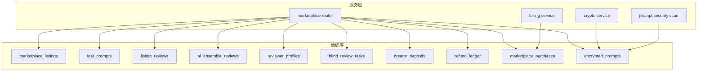
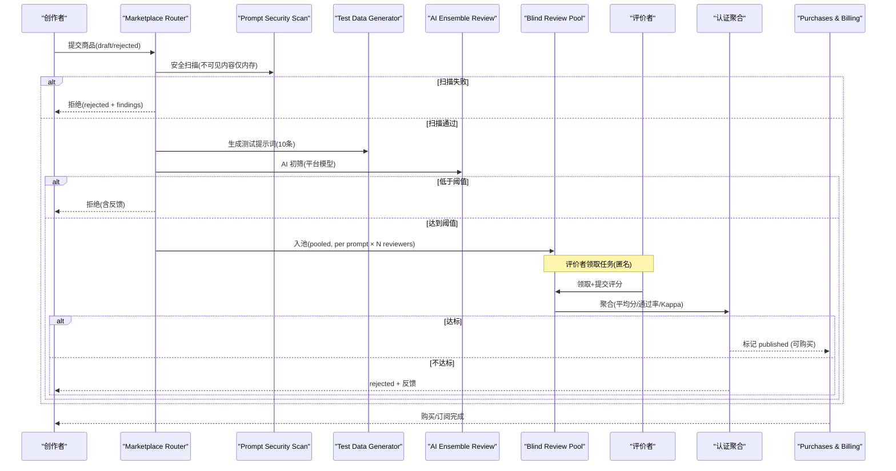
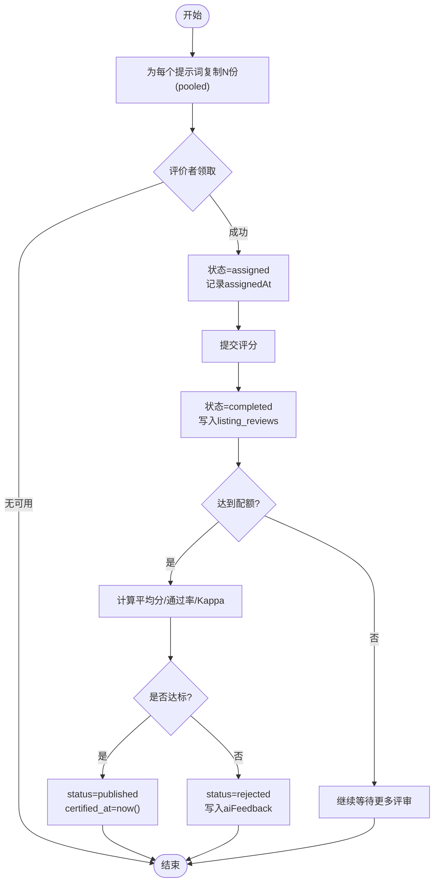
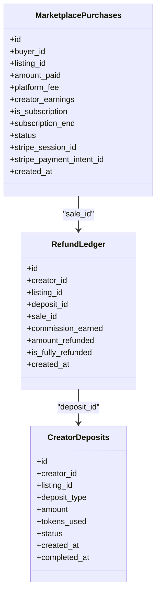
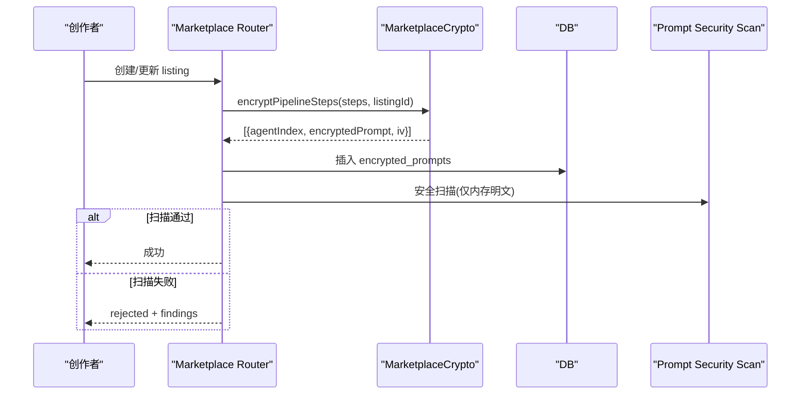
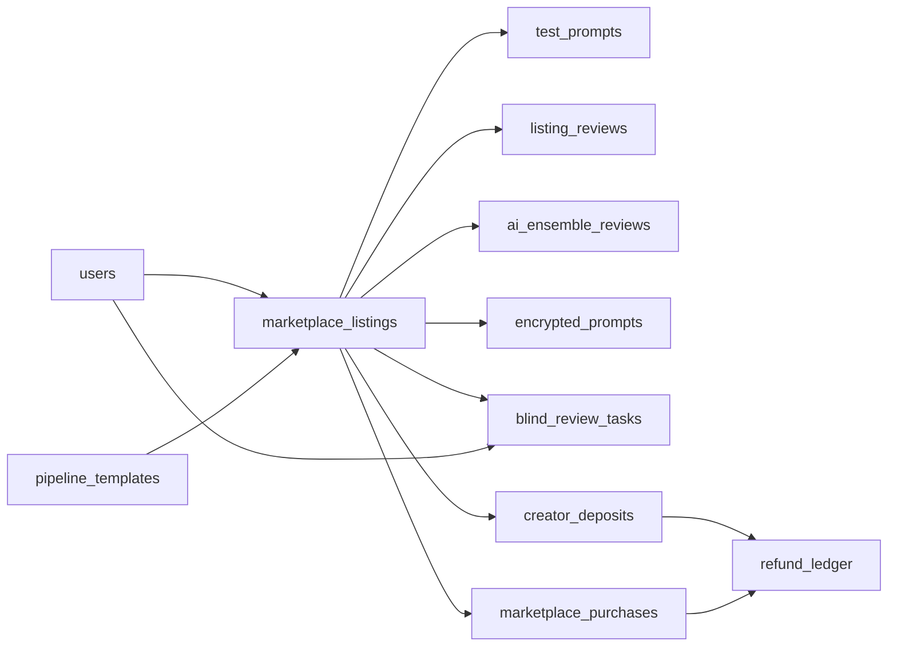

# 市场生态系统

<cite>
**本文引用的文件**
- [db/marketplace_migration.sql](file://db/marketplace_migration.sql)
- [db/migrations/014_marketplace_trust.sql](file://db/migrations/014_marketplace_trust.sql)
- [db/schema.ts](file://db/schema.ts)
- [api/routers/marketplace.ts](file://api/routers/marketplace.ts)
- [api/lib/marketplaceCrypto.ts](file://api/lib/marketplaceCrypto.ts)
- [api/services/cryptoService.ts](file://api/services/cryptoService.ts)
- [api/services/promptSecurityScan.ts](file://api/services/promptSecurityScan.ts)
- [api/services/billingService.ts](file://api/services/billingService.ts)
- [db/migrations/011_store.sql](file://db/migrations/011_store.sql)
</cite>

## 目录
1. [简介](#简介)
2. [项目结构](#项目结构)
3. [核心数据模型](#核心数据模型)
4. [架构总览](#架构总览)
5. [详细组件分析](#详细组件分析)
6. [依赖关系分析](#依赖关系分析)
7. [性能与一致性考量](#性能与一致性考量)
8. [故障排查指南](#故障排查指南)
9. [结论](#结论)
10. [附录：字段与枚举速查](#附录字段与枚举速查)

## 简介
本文件为 DeeWaanAI 市场生态系统的权威数据模型文档，聚焦 marketplace_listings 及其关联表的结构、状态流转、质量评估指标、审核机制（人工盲审与 AI 评审）、财务数据结构（购买、退款、创作者押金）以及加密提示词与安全存储机制。文档同时解释盲审任务分配与评价者档案系统，帮助开发者与运营人员理解从上架到认证、销售与结算的完整数据流。

## 项目结构
市场模块的数据定义集中在数据库迁移与 Drizzle schema 中；业务逻辑在 API 路由与服务层实现；加密与安全扫描由专用库与服务提供；支付与退款通过 Stripe 集成并落库。

图表来源
- [db/schema.ts:512-779](file://db/schema.ts#L512-L779)
- [api/routers/marketplace.ts:1-36](file://api/routers/marketplace.ts#L1-L36)
- [api/lib/marketplaceCrypto.ts:1-82](file://api/lib/marketplaceCrypto.ts#L1-L82)
- [api/services/promptSecurityScan.ts:1-26](file://api/services/promptSecurityScan.ts#L1-L26)
- [api/services/billingService.ts:80-120](file://api/services/billingService.ts#L80-L120)

章节来源
- [db/schema.ts:512-779](file://db/schema.ts#L512-L779)
- [db/marketplace_migration.sql:8-168](file://db/marketplace_migration.sql#L8-L168)
- [db/migrations/014_marketplace_trust.sql:1-38](file://db/migrations/014_marketplace_trust.sql#L1-L38)

## 核心数据模型
本节概述市场模块的核心实体及关键字段，重点覆盖商品基本信息、定价策略、质量评估、审核状态、测试提示词、人工/AI评审、盲审任务、评价者档案、购买记录、退款与创作者押金、加密提示词等。

- marketplace_listings（商品/流水线模板商品化）
  - 基本信息：title、description、category、objectives、input_format、output_format、remarks
  - 定价策略：price、is_subscription、subscription_price
  - 质量评估：grade、review_count、kappa_score、ai_correlation、ai_grade、ai_kappa_score、ai_feedback、ai_reviewed_at
  - 审核状态：status（draft/generating/pending_review/reviewing/certifying/rejected/approved/published/unpublished），certified_at
  - 其他：sales_count、created_at、updated_at

- test_prompts（测试提示词）
  - listing_id、prompt_index、category（simple/medium/complex/edge/adversarial）、input_text、actual_output、created_at

- listing_reviews（人工评审）
  - listing_id、reviewer_id、prompt_index、accuracy/completeness/clarity/token_efficiency/speed/consistency、weighted_score、review_time、flagged、created_at

- ai_ensemble_reviews（AI 评审）
  - listing_id、prompt_index、provider_id、model_slug、各维度评分、weighted_score、raw_response、created_at

- reviewer_profiles（评价者档案）
  - user_id（唯一）、trust_score、reviews_completed、reviews_flagged、arbiter_rulings_against、points_earned、points_balance、subscription_days、is_active、status（active/suspended/banned）、created_at、updated_at

- blind_review_tasks（盲审任务池）
  - listing_id、prompt_index、reviewer_id（可为空）、status（pooled/assigned/completed/expired）、assigned_at、completed_at

- creator_deposits（创作者押金）
  - creator_id、listing_id、deposit_type（ai_test/human_review）、amount、tokens_used、status（pending/completed/refunded/partial_refund）、created_at、completed_at

- refund_ledger（退款账本）
  - creator_id、listing_id、deposit_id、sale_id、commission_earned、amount_refunded、is_fully_refunded、created_at

- marketplace_purchases（购买记录）
  - buyer_id、listing_id、amount_paid、platform_fee、creator_earnings、is_subscription、subscription_end、status（active/refunded/cancelled）、stripe_session_id、stripe_payment_intent_id、created_at

- encrypted_prompts（加密提示词）
  - listing_id、agent_index、encrypted_prompt、iv、version、created_at

章节来源
- [db/schema.ts:512-779](file://db/schema.ts#L512-L779)
- [db/marketplace_migration.sql:8-168](file://db/marketplace_migration.sql#L8-L168)
- [db/migrations/014_marketplace_trust.sql:1-38](file://db/migrations/014_marketplace_trust.sql#L1-L38)

## 架构总览
市场模块围绕“商品上架 → 安全扫描 → 测试数据生成 → AI 初筛 → 盲审池 → 人类评审 → 认证决策 → 可购买”的主路径运行，同时支持订阅与一次性购买、Stripe 支付与退款回调、创作者押金与退款记账。

图表来源
- [api/routers/marketplace.ts:1135-1200](file://api/routers/marketplace.ts#L1135-L1200)
- [api/routers/marketplace.ts:589-614](file://api/routers/marketplace.ts#L589-L614)
- [api/routers/marketplace.ts:630-735](file://api/routers/marketplace.ts#L630-L735)
- [api/routers/marketplace.ts:742-917](file://api/routers/marketplace.ts#L742-L917)
- [api/services/billingService.ts:80-120](file://api/services/billingService.ts#L80-L120)

## 详细组件分析

### marketplace_listings（商品主表）
- 作用：承载商品元信息、定价、质量指标与审核状态，是购买、展示、认证的核心实体。
- 关键字段
  - 基本信息：title、description、category、objectives、input_format、output_format、remarks
  - 定价策略：price、is_subscription、subscription_price
  - 质量评估：grade、review_count、kappa_score、ai_correlation、ai_grade、ai_kappa_score、ai_feedback、ai_reviewed_at
  - 审核状态：status（含 certifying 可见但不可买）、certified_at
  - 销量：sales_count
- 状态说明
  - draft：草稿
  - generating：正在生成测试数据
  - pending_review/reviewing：旧版人工指派流程
  - certifying：进入盲审池，可见但不可购买
  - approved/published：通过认证后可购买
  - rejected/unpublished：被拒或下架

章节来源
- [db/schema.ts:512-564](file://db/schema.ts#L512-L564)
- [db/marketplace_migration.sql:8-28](file://db/marketplace_migration.sql#L8-L28)
- [db/migrations/014_marketplace_trust.sql:9-16](file://db/migrations/014_marketplace_trust.sql#L9-L16)

### 测试提示词与中间结果
- test_prompts：每个 listing 自动生成多条测试输入，用于评测与盲审。
- test_prompt_intermediate：记录每个 agent 步骤的输入输出、token 消耗与延迟，便于审计与调试。

章节来源
- [db/schema.ts:567-577](file://db/schema.ts#L567-L577)
- [db/schema.ts:753-766](file://db/schema.ts#L753-L766)
- [api/routers/marketplace.ts:55-122](file://api/routers/marketplace.ts#L55-L122)
- [api/routers/marketplace.ts:201-328](file://api/routers/marketplace.ts#L201-L328)

### 人工评审与权重评分
- listing_reviews：记录每位评价者对每条测试输入的六维评分与加权得分、用时、是否标记异常。
- 权重计算：accuracy(0.30)、completeness(0.20)、clarity(0.15)、token_efficiency(0.10)、speed(0.10)、consistency(0.15)。
- 认证门槛：平均加权分≥阈值且通过率≥阈值时通过；Kappa 作为一致性诊断指标。

章节来源
- [db/schema.ts:580-599](file://db/schema.ts#L580-L599)
- [api/routers/marketplace.ts:485-510](file://api/routers/marketplace.ts#L485-L510)
- [api/routers/marketplace.ts:825-917](file://api/routers/marketplace.ts#L825-L917)

### AI 评审与初筛
- ai_ensemble_reviews：记录多模型/规则引擎的评审结果与原始响应，用于平台级 AI 初筛与相关性分析。
- 初筛阈值：低于阈值直接拒绝并给出反馈；达到阈值进入盲审池。

章节来源
- [db/schema.ts:602-620](file://db/schema.ts#L602-L620)
- [api/routers/marketplace.ts:403-410](file://api/routers/marketplace.ts#L403-L410)

### 盲审任务分配机制
- blind_review_tasks：按“每提示词 × 最少评价者数”复制入池，初始状态 pooled（未分配）。
- 领取规则
  - 仅 active 评价者可领取
  - 禁止自审（listing.creatorId ≠ reviewerId）
  - 避免同一 listing 内重复领取相同提示词
  - 原子领取：条件更新 + 重读确认
  - 随机顺序防热点
- 提交后聚合：统计合格评价者数量与每人提交数，达到配额后进行认证决策。

图表来源
- [api/routers/marketplace.ts:589-614](file://api/routers/marketplace.ts#L589-L614)
- [api/routers/marketplace.ts:630-735](file://api/routers/marketplace.ts#L630-L735)
- [api/routers/marketplace.ts:742-917](file://api/routers/marketplace.ts#L742-L917)

章节来源
- [db/migrations/014_marketplace_trust.sql:18-38](file://db/migrations/014_marketplace_trust.sql#L18-L38)
- [db/schema.ts:659-692](file://db/schema.ts#L659-L692)
- [api/routers/marketplace.ts:589-735](file://api/routers/marketplace.ts#L589-L735)

### 评价者档案系统
- reviewer_profiles：维护信任分、完成数、标记数、仲裁不利裁决、积分与余额、订阅天数、活跃状态。
- 积分奖励：每次提交基础分，完成某 listing 全部提示词额外加分。

章节来源
- [db/schema.ts:623-642](file://db/schema.ts#L623-L642)
- [api/routers/marketplace.ts:791-823](file://api/routers/marketplace.ts#L791-L823)

### 购买记录、退款处理与创作者存款
- marketplace_purchases：记录买家、金额、平台费、创作者收益、订阅到期、状态、Stripe 会话与支付意图 ID。
- refund_ledger：将退款与佣金、已退金额、是否全额退款关联至原押金与销售。
- creator_deposits：跟踪 AI 测试与人工评审的成本与状态（待完成/已完成/退款/部分退款）。
- Stripe 集成：创建一次性购买结账会话，metadata 携带用户与 listing 标识以便回调匹配。

图表来源
- [db/schema.ts:694-749](file://db/schema.ts#L694-L749)
- [db/migrations/011_store.sql:1-10](file://db/migrations/011_store.sql#L1-L10)
- [api/services/billingService.ts:80-120](file://api/services/billingService.ts#L80-L120)

章节来源
- [db/schema.ts:694-749](file://db/schema.ts#L694-L749)
- [db/migrations/011_store.sql:1-10](file://db/migrations/011_store.sql#L1-L10)
- [api/services/billingService.ts:80-120](file://api/services/billingService.ts#L80-L120)

### 加密提示词与安全存储
- encrypted_prompts：以 AES-256-GCM 加密存储 pipeline 各 step 的 system prompt，附带 iv/version。
- 密钥派生：基于全局 MASTER_KEY 与 listingId 派生 per-listing 密钥，防止跨 listing 泄露。
- 使用场景：测试执行与运行时按需解密，明文不出库、不日志。
- 安全扫描：promptSecurityScan 对可见元数据、测试提示词与内存中的解密提示词进行确定性检查，失败即拒绝上架。

图表来源
- [api/lib/marketplaceCrypto.ts:1-82](file://api/lib/marketplaceCrypto.ts#L1-L82)
- [api/routers/marketplace.ts:1074-1083](file://api/routers/marketplace.ts#L1074-L1083)
- [api/services/promptSecurityScan.ts:1-26](file://api/services/promptSecurityScan.ts#L1-L26)

章节来源
- [db/schema.ts:768-779](file://db/schema.ts#L768-L779)
- [api/lib/marketplaceCrypto.ts:1-82](file://api/lib/marketplaceCrypto.ts#L1-L82)
- [api/services/cryptoService.ts:1-80](file://api/services/cryptoService.ts#L1-L80)
- [api/services/promptSecurityScan.ts:1-26](file://api/services/promptSecurityScan.ts#L1-L26)

## 依赖关系分析
- 数据模型依赖
  - marketplace_listings 依赖 users（creator）、pipeline_templates（template）
  - test_prompts、listing_reviews、ai_ensemble_reviews、encrypted_prompts 均依赖 marketplace_listings
  - blind_review_tasks 依赖 marketplace_listings 与 users（reviewer）
  - creator_deposits、refund_ledger、marketplace_purchases 形成财务闭环
- 服务依赖
  - marketplace router 依赖 crypto、security scan、billing 与 LLM provider 适配器
  - 盲审流程依赖 review_assignments（历史）与 blind_review_tasks（新池）
  - 认证聚合依赖 listing_reviews 与 test_prompts

图表来源
- [db/schema.ts:512-779](file://db/schema.ts#L512-L779)

章节来源
- [db/schema.ts:512-779](file://db/schema.ts#L512-L779)

## 性能与一致性考量
- 盲审池并发领取：采用条件 UPDATE + 重读确认，避免重复分配；随机排序降低热点 listing 垄断。
- 认证聚合：仅在达到配额时触发，减少频繁写库；Kappa 计算为 O(n×m)，n 为提示词数，m 为评价者数。
- 加密开销：per-listing 密钥派生与 AES-GCM 加解密成本较低；IV 与 authTag 随密文存储。
- 缓存控制：公开浏览接口设置短 TTL 缓存头，降低读放大。
- 幂等性：重新提交时清理历史任务与提示词，避免重复计数。

[本节为通用性能讨论，不直接分析具体代码行]

## 故障排查指南
- 安全扫描失败
  - 现象：提交后立即被拒绝，返回 findings
  - 定位：查看 ai_feedback 中的 [SECURITY] 前缀条目
  - 参考：安全扫描服务与路由拒绝分支
- 信用耗尽/配额错误
  - 现象：测试生成中断，提示需充值
  - 定位：捕获 CreditExhaustedError 并回退状态
  - 参考：重试包装与错误模式匹配
- 盲审任务无法领取
  - 现象：评价者无法获取任务
  - 定位：检查 reviewerProfiles 状态、listing 状态是否为 certifying、是否存在同 listing 未完成任务
  - 参考：claimNextBlindTask 约束
- 认证不通过
  - 现象：listing 停留在 certifying 或被 rejected
  - 定位：检查 weightedScore 平均值与通过率是否达标；查看 Kappa 诊断
  - 参考：submitBlindTaskReview 聚合逻辑
- 购买与退款不一致
  - 现象：Stripe 回调后状态不同步
  - 定位：核对 stripe_session_id/stripe_payment_intent_id 与 webhook 处理
  - 参考：billingService 与 purchases 表字段

章节来源
- [api/routers/marketplace.ts:1164-1185](file://api/routers/marketplace.ts#L1164-L1185)
- [api/routers/marketplace.ts:129-199](file://api/routers/marketplace.ts#L129-L199)
- [api/routers/marketplace.ts:630-735](file://api/routers/marketplace.ts#L630-L735)
- [api/routers/marketplace.ts:825-917](file://api/routers/marketplace.ts#L825-L917)
- [api/services/billingService.ts:80-120](file://api/services/billingService.ts#L80-L120)

## 结论
DeeWaanAI 市场生态系统以 marketplace_listings 为核心，结合测试提示词、人工与 AI 评审、盲审任务池与评价者档案，构建了从创作到认证的完整质量保障体系。财务侧通过购买记录、退款账本与创作者押金实现透明结算。加密提示词与安全扫描确保敏感内容不被外泄，并在上架前进行确定性安全检查。该数据模型兼顾可扩展性与安全性，支撑未来多阶段演进。

[本节为总结性内容，不直接分析具体代码行]

## 附录：字段与枚举速查
- marketplace_listings.status
  - draft、generating、pending_review、reviewing、certifying、rejected、approved、published、unpublished
- test_prompts.category
  - simple、medium、complex、edge、adversarial
- listing_reviews 评分维度
  - accuracy、completeness、clarity、token_efficiency、speed、consistency
- reviewer_profiles.status
  - active、suspended、banned
- blind_review_tasks.status
  - pooled、assigned、completed、expired
- creator_deposits.deposit_type
  - ai_test、human_review
- creator_deposits.status
  - pending、completed、refunded、partial_refund
- marketplace_purchases.status
  - active、refunded、cancelled

章节来源
- [db/schema.ts:512-779](file://db/schema.ts#L512-L779)
- [db/marketplace_migration.sql:8-168](file://db/marketplace_migration.sql#L8-L168)
- [db/migrations/014_marketplace_trust.sql:9-38](file://db/migrations/014_marketplace_trust.sql#L9-L38)