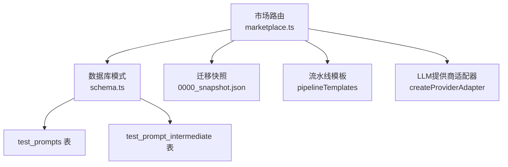
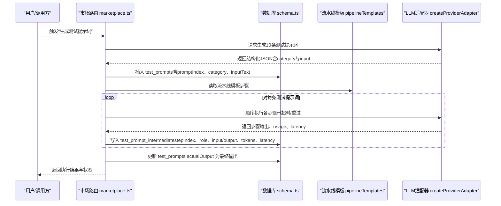
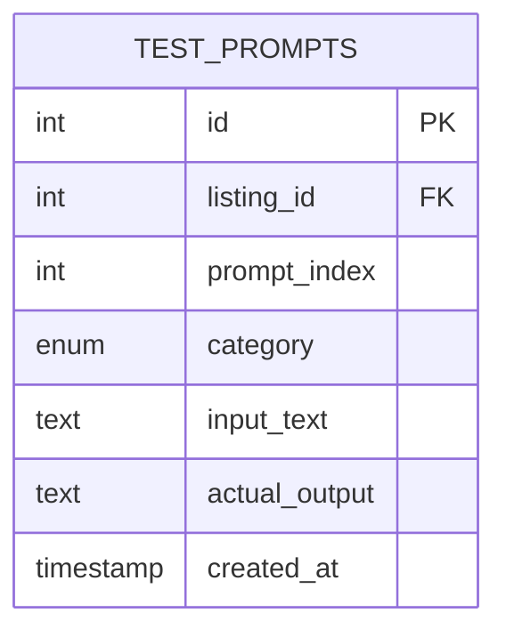
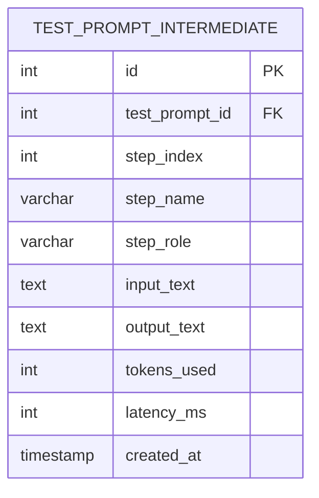
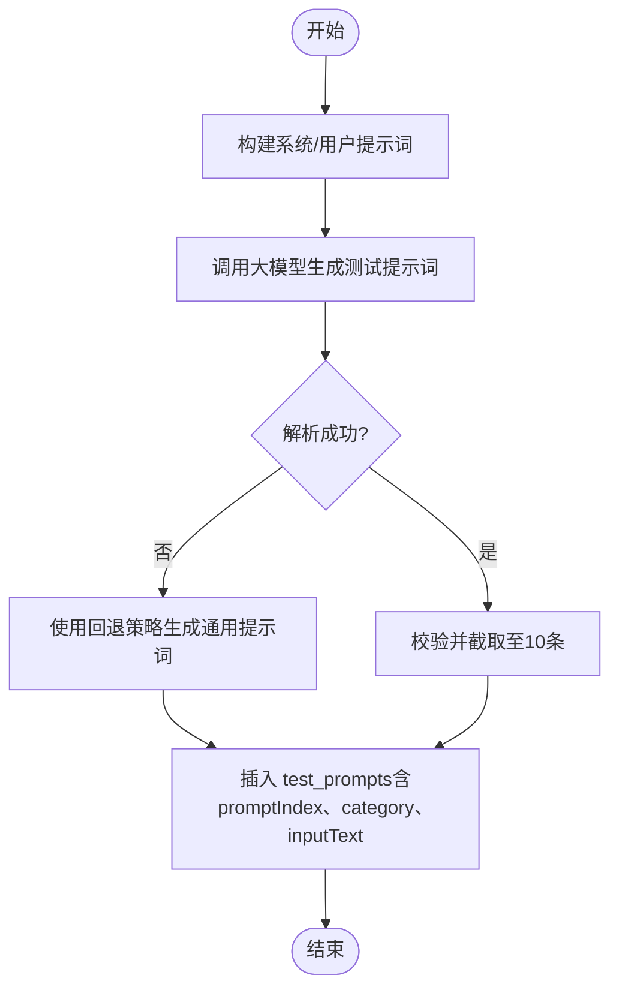
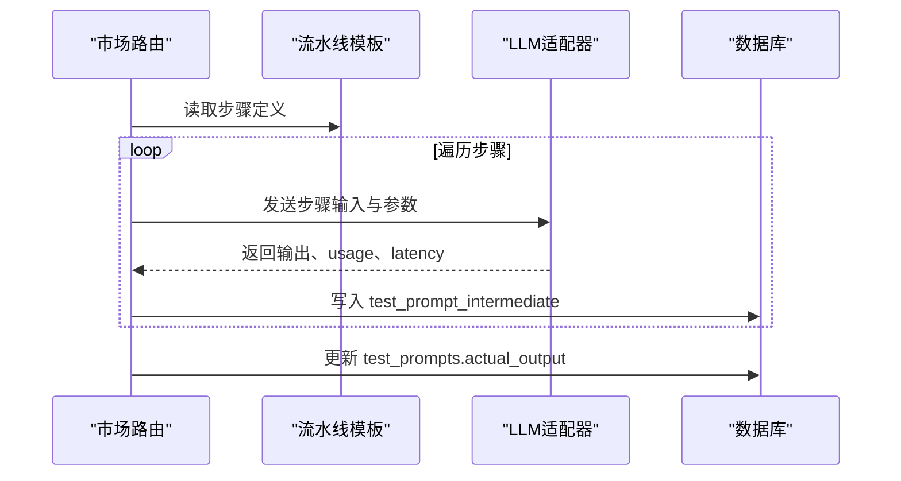

# 测试提示词系统

<cite>
**本文引用的文件**
- [db/schema.ts](file://db/schema.ts)
- [api/routers/marketplace.ts](file://api/routers/marketplace.ts)
- [db/migrations/meta/0000_snapshot.json](file://db/migrations/meta/0000_snapshot.json)
</cite>

## 目录
1. [简介](#简介)
2. [项目结构](#项目结构)
3. [核心组件](#核心组件)
4. [架构总览](#架构总览)
5. [详细组件分析](#详细组件分析)
6. [依赖关系分析](#依赖关系分析)
7. [性能考量](#性能考量)
8. [故障排查指南](#故障排查指南)
9. [结论](#结论)
10. [附录](#附录)

## 简介
本文件面向DeeWaanAI测试提示词系统的数据模型与执行流程，聚焦以下目标：
- 说明 testPrompts 表的结构设计，包括提示词索引（promptIndex）、难度分类（simple、medium、complex、edge、adversarial）、输入文本存储（inputText）与实际输出记录（actualOutput）。
- 说明 testPromptIntermediate 表如何记录每个流水线步骤的中间结果，包括步骤索引、角色信息、输入输出文本、token使用量与延迟时间。
- 解释测试用例生成与执行的端到端流程，涵盖从提示词生成、批量执行、中间结果落库到最终输出回填的关键实现细节。

## 项目结构
测试提示词相关的数据定义集中在数据库模式文件中；执行逻辑集中在市场路由中，负责生成测试提示词、执行流水线并持久化中间与最终结果。



图表来源
- [db/schema.ts:566-577](file://db/schema.ts#L566-L577)
- [db/schema.ts:751-766](file://db/schema.ts#L751-L766)
- [api/routers/marketplace.ts:201-327](file://api/routers/marketplace.ts#L201-L327)
- [db/migrations/meta/0000_snapshot.json:4042-4097](file://db/migrations/meta/0000_snapshot.json#L4042-L4097)

章节来源
- [db/schema.ts:566-577](file://db/schema.ts#L566-L577)
- [db/schema.ts:751-766](file://db/schema.ts#L751-L766)
- [api/routers/marketplace.ts:201-327](file://api/routers/marketplace.ts#L201-L327)
- [db/migrations/meta/0000_snapshot.json:4042-4097](file://db/migrations/meta/0000_snapshot.json#L4042-L4097)

## 核心组件
- 测试提示词主表（test_prompts）：用于存储针对某个上架条目（listing）自动生成的测试提示词，包含索引、难度分类、输入文本以及实际输出。
- 中间结果表（test_prompt_intermediate）：用于记录每次测试提示词在流水线各步骤中的中间产物，便于回溯与审计。
- 测试提示词生成与执行：由市场路由驱动，先基于流水线描述生成多样化测试提示词，再按流水线模板顺序执行，并将每步中间结果与最终输出落库。

章节来源
- [db/schema.ts:566-577](file://db/schema.ts#L566-L577)
- [db/schema.ts:751-766](file://db/schema.ts#L751-L766)
- [api/routers/marketplace.ts:60-122](file://api/routers/marketplace.ts#L60-L122)
- [api/routers/marketplace.ts:201-327](file://api/routers/marketplace.ts#L201-L327)

## 架构总览
测试提示词系统的工作流如下：
- 生成阶段：根据流水线标题与描述调用大模型生成一组测试提示词，并为每条提示词分配难度类别与索引。
- 执行阶段：对每条测试提示词，按流水线模板顺序依次执行各步骤，将每步的输入、输出、token用量与耗时写入中间结果表。
- 回填阶段：将最后一步的输出回填至测试提示词主表的 actualOutput 字段。
- 重试与容错：对失败提示词进行有限次重试；遇到额度耗尽等错误时立即中止并回退状态。



图表来源
- [api/routers/marketplace.ts:60-122](file://api/routers/marketplace.ts#L60-L122)
- [api/routers/marketplace.ts:201-327](file://api/routers/marketplace.ts#L201-L327)
- [api/routers/marketplace.ts:1200-1399](file://api/routers/marketplace.ts#L1200-L1399)
- [db/schema.ts:566-577](file://db/schema.ts#L566-L577)
- [db/schema.ts:751-766](file://db/schema.ts#L751-L766)

## 详细组件分析

### 数据模型：test_prompts（测试提示词主表）
- 作用：存储针对某上架条目的测试提示词集合，用于后续流水线验证与评测。
- 关键字段
  - id：自增主键
  - listing_id：关联的上架条目ID（外键）
  - prompt_index：提示词索引（从0开始），用于排序与定位
  - category：难度分类，枚举值包括 simple、medium、complex、edge、adversarial
  - input_text：测试输入文本
  - actual_output：流水线执行后的实际输出（可空，执行完成后回填）
  - created_at：创建时间戳
- 约束与关系
  - listing_id 外键级联删除
  - category 使用枚举限制取值范围
  - prompt_index 在同一 listing 下唯一标识一条测试提示词



图表来源
- [db/schema.ts:566-577](file://db/schema.ts#L566-L577)
- [db/migrations/meta/0000_snapshot.json:4042-4097](file://db/migrations/meta/0000_snapshot.json#L4042-L4097)

章节来源
- [db/schema.ts:566-577](file://db/schema.ts#L566-L577)
- [db/migrations/meta/0000_snapshot.json:4042-4097](file://db/migrations/meta/0000_snapshot.json#L4042-L4097)

### 数据模型：test_prompt_intermediate（中间结果表）
- 作用：记录每次测试提示词在流水线各步骤的中间产物，支持可观测性与问题定位。
- 关键字段
  - id：自增主键
  - test_prompt_id：关联的测试提示词ID（外键，级联删除）
  - step_index：步骤索引（0, 1, 2...）
  - step_name：步骤名称
  - step_role：步骤角色（如 agent）
  - input_text：该步骤接收到的输入文本
  - output_text：该步骤产生的输出文本
  - tokens_used：该步骤消耗的token数量（可为空）
  - latency_ms：该步骤响应耗时（毫秒）
  - created_at：记录创建时间戳
- 约束与关系
  - test_prompt_id 外键指向 test_prompts.id，级联删除
  - 通过 step_index 与 step_name 可还原执行轨迹



图表来源
- [db/schema.ts:751-766](file://db/schema.ts#L751-L766)

章节来源
- [db/schema.ts:751-766](file://db/schema.ts#L751-L766)

### 测试提示词生成流程
- 输入：流水线标题与描述
- 过程：
  - 构造系统提示词与用户提示词，要求大模型返回固定结构的JSON数组（包含 category 与 input）
  - 解析并校验返回内容，最多保留10条
  - 若解析失败，回退为基于标题的通用提示词，并按预设分布分配难度类别
- 输出：插入 test_prompts，初始 actual_output 标记为“生成中”



图表来源
- [api/routers/marketplace.ts:60-122](file://api/routers/marketplace.ts#L60-L122)

章节来源
- [api/routers/marketplace.ts:60-122](file://api/routers/marketplace.ts#L60-L122)

### 测试提示词执行流程
- 输入：测试提示词列表与流水线模板
- 过程：
  - 获取流水线模板步骤，按顺序执行每个 agent 步骤
  - 每步调用大模型适配器，记录 usage 与 latency
  - 将每步的输入、输出、token用量、耗时写入 test_prompt_intermediate
  - 将最后一步的输出回填至 test_prompts.actual_output
- 重试与容错：
  - 对API调用进行指数退避重试
  - 检测到额度耗尽错误时立即停止并回退状态
  - 超过一定失败率时回退为草稿



图表来源
- [api/routers/marketplace.ts:201-327](file://api/routers/marketplace.ts#L201-L327)
- [api/routers/marketplace.ts:1200-1399](file://api/routers/marketplace.ts#L1200-L1399)

章节来源
- [api/routers/marketplace.ts:201-327](file://api/routers/marketplace.ts#L201-L327)
- [api/routers/marketplace.ts:1200-1399](file://api/routers/marketplace.ts#L1200-L1399)

### 难度分类与分布
- 难度类别：simple、medium、complex、edge、adversarial
- 默认分布策略：在生成阶段优先保证简单、中等、复杂与边界用例的覆盖；当解析失败时使用回退策略按固定比例分配类别
- 用途：便于后续评估不同难度下的流水线表现与稳定性

章节来源
- [db/schema.ts:566-577](file://db/schema.ts#L566-L577)
- [api/routers/marketplace.ts:60-122](file://api/routers/marketplace.ts#L60-L122)

## 依赖关系分析
- 模块耦合
  - 市场路由依赖数据库模式定义（Drizzle schema）进行读写
  - 执行流程依赖流水线模板与大模型适配器
  - 中间结果与主表通过外键关联，形成一对多关系
- 外部依赖
  - 大模型适配器：提供聊天接口、usage统计与超时控制
  - 数据库：MySQL（通过Drizzle ORM）
- 潜在循环依赖
  - 当前实现无循环依赖；执行流程单向依赖模板与适配器

```mermaid
graph LR
M["marketplace.ts"] --> S["schema.ts"]
M --> P["pipelineTemplates"]
M --> A["LLM适配器"]
S --> TP["test_prompts"]
S --> TI["test_prompt_intermediate"]
TP <--|外键| TI
```

图表来源
- [api/routers/marketplace.ts:201-327](file://api/routers/marketplace.ts#L201-L327)
- [db/schema.ts:566-577](file://db/schema.ts#L566-L577)
- [db/schema.ts:751-766](file://db/schema.ts#L751-L766)

章节来源
- [api/routers/marketplace.ts:201-327](file://api/routers/marketplace.ts#L201-L327)
- [db/schema.ts:566-577](file://db/schema.ts#L566-L577)
- [db/schema.ts:751-766](file://db/schema.ts#L751-L766)

## 性能考量
- 中间结果落库采用“尽力而为”策略：即使写入失败也不中断流水线执行，避免阻塞整体流程
- 重试机制：对非额度类错误进行指数退避重试，减少瞬时抖动影响
- 并发控制：测试生成阶段串行执行以避免速率限制与资源争用
- 超时控制：单步调用设置超时阈值，防止长时间挂起
- 建议优化
  - 对高频写入的中间结果考虑批处理或异步队列
  - 对大文本字段（input_text、output_text）评估压缩或分片存储
  - 增加指标埋点以监控各步骤延迟与token消耗

[本节为通用指导，不直接分析具体文件]

## 故障排查指南
- 常见错误类型
  - 额度耗尽：检测到特定错误模式后立即停止并回退状态，需用户充值后重试
  - API超时/限流：通过重试与退避缓解；仍失败则记录错误并继续其他提示词
  - 数据库写入失败：中间结果写入失败不影响主流程，但会影响可观测性
- 排查步骤
  - 检查 test_prompts.actual_output 是否被正确回填
  - 检查 test_prompt_intermediate 是否存在缺失的步骤记录
  - 查看日志中的重试与错误信息，定位具体步骤与原因
  - 确认流水线模板配置是否正确（步骤顺序、参数）

章节来源
- [api/routers/marketplace.ts:162-199](file://api/routers/marketplace.ts#L162-L199)
- [api/routers/marketplace.ts:201-327](file://api/routers/marketplace.ts#L201-L327)
- [api/routers/marketplace.ts:1200-1399](file://api/routers/marketplace.ts#L1200-L1399)

## 结论
本系统通过清晰的数据模型与稳健的执行流程，实现了测试提示词的自动生成、执行与可观测性记录。test_prompts 表承载测试用例元数据与最终输出，test_prompt_intermediate 表提供细粒度的步骤级追踪。结合重试、超时与额度检测机制，系统在稳定性与可维护性方面具备良好基础。未来可在批处理、存储优化与指标监控方面进一步改进。

[本节为总结性内容，不直接分析具体文件]

## 附录
- 关键实现位置
  - 测试提示词生成：市场路由中的提示词生成函数
  - 流水线执行：市场路由中的 runTestPipeline 函数
  - 中间结果写入：市场路由中对 test_prompt_intermediate 的插入逻辑
  - 数据模型定义：数据库模式文件中的 test_prompts 与 test_prompt_intermediate 表定义

章节来源
- [api/routers/marketplace.ts:60-122](file://api/routers/marketplace.ts#L60-L122)
- [api/routers/marketplace.ts:201-327](file://api/routers/marketplace.ts#L201-L327)
- [db/schema.ts:566-577](file://db/schema.ts#L566-L577)
- [db/schema.ts:751-766](file://db/schema.ts#L751-L766)