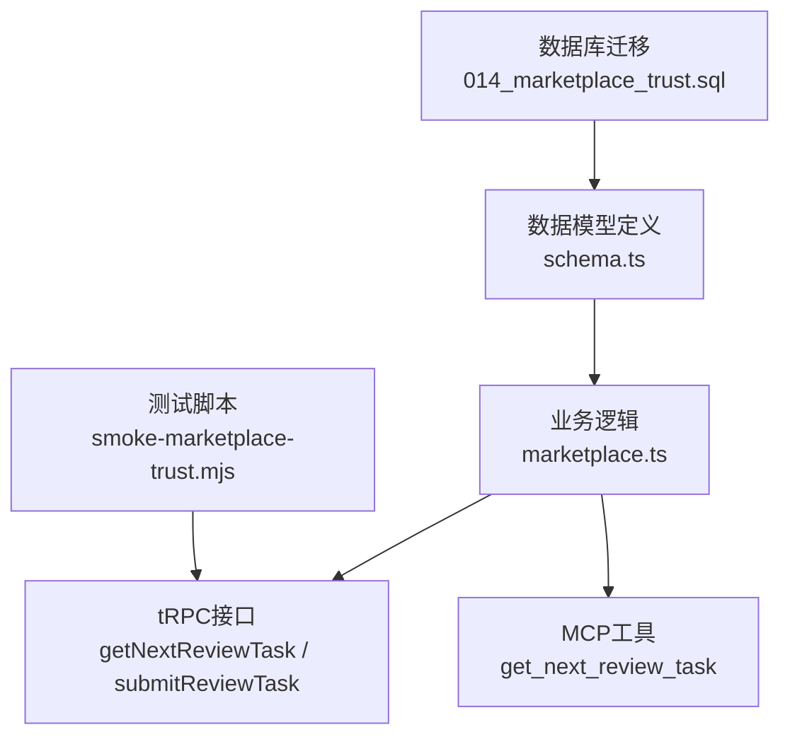
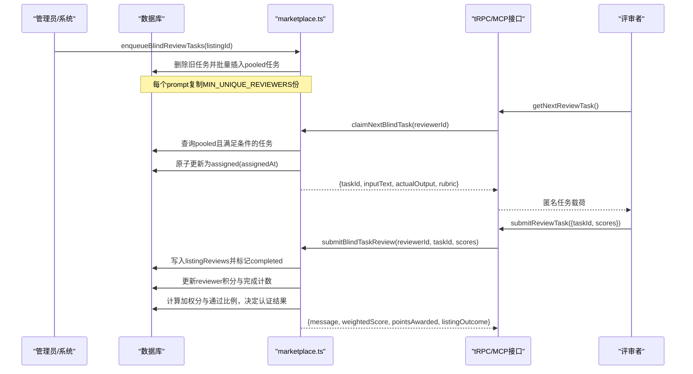
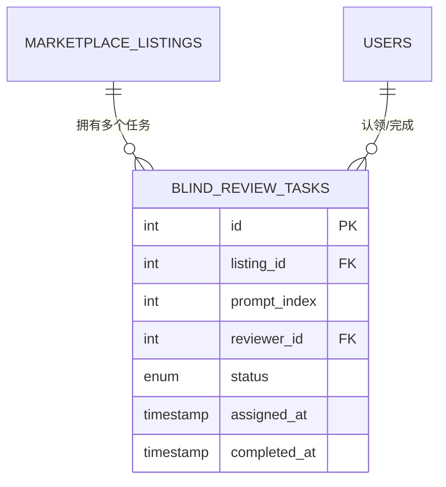
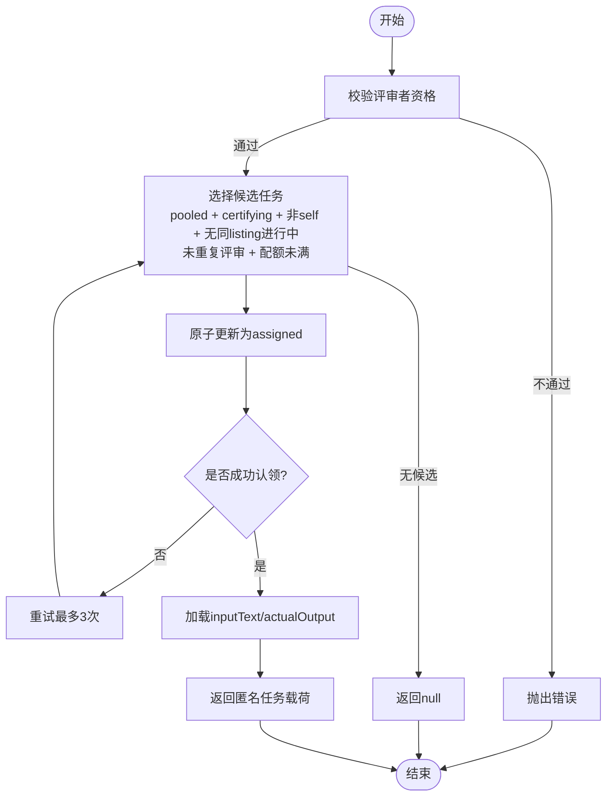
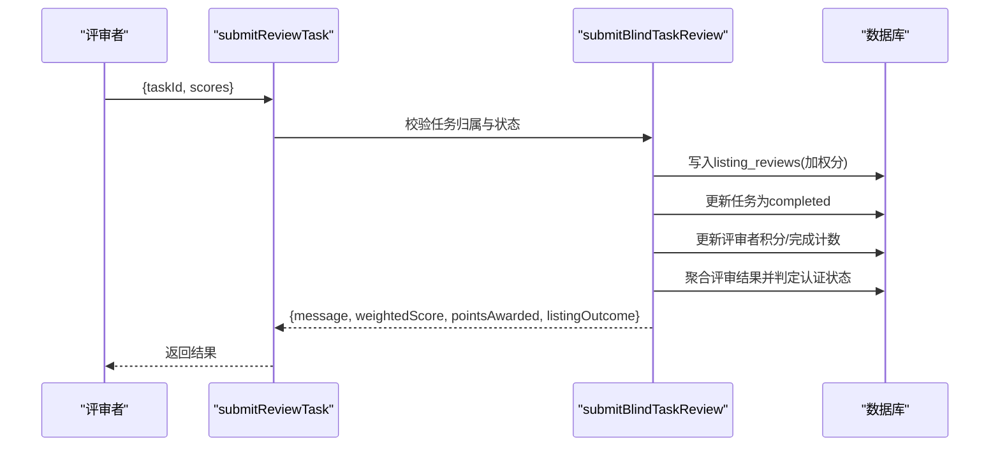
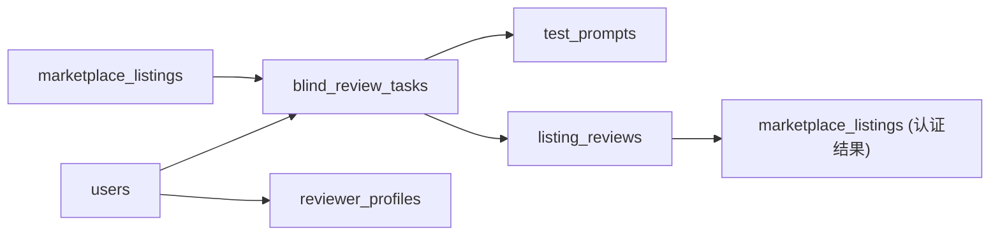

# 盲审任务分配

<cite>
**本文引用的文件**
- [db/migrations/014_marketplace_trust.sql](file://db/migrations/014_marketplace_trust.sql)
- [db/schema.ts](file://db/schema.ts)
- [api/routers/marketplace.ts](file://api/routers/marketplace.ts)
- [api/mcp/tools/getNextReviewTask.ts](file://api/mcp/tools/getNextReviewTask.ts)
- [scripts/smoke-marketplace-trust.mjs](file://scripts/smoke-marketplace-trust.mjs)
</cite>

## 目录
1. [简介](#简介)
2. [项目结构](#项目结构)
3. [核心组件](#核心组件)
4. [架构总览](#架构总览)
5. [详细组件分析](#详细组件分析)
6. [依赖关系分析](#依赖关系分析)
7. [性能考量](#性能考量)
8. [故障排查指南](#故障排查指南)
9. [结论](#结论)

## 简介
本文件聚焦于DeeWaanAI的“盲审任务分配系统”，围绕blindReviewTasks表的数据模型、匿名评审机制、任务池状态机与去重约束，以及任务分配算法（评审者匹配、负载均衡、超时处理）进行系统化说明。同时给出getNextReviewTask与submitReviewTask两个接口的数据流转过程，帮助读者理解从任务入池、认领、提交到认证聚合的完整链路。

## 项目结构
与盲审任务分配相关的代码主要分布在数据库迁移与Schema定义、市场路由（业务逻辑）、MCP工具封装和测试脚本中：
- 数据库层：定义blind_review_tasks表结构与索引
- 服务层：实现任务入池、认领、提交与认证聚合
- 接口层：暴露tRPC与MCP工具供客户端调用
- 测试脚本：模拟评审者拉取与提交流程

图表来源
- [db/migrations/014_marketplace_trust.sql:18-37](file://db/migrations/014_marketplace_trust.sql#L18-L37)
- [db/schema.ts:659-692](file://db/schema.ts#L659-L692)
- [api/routers/marketplace.ts:577-735](file://api/routers/marketplace.ts#L577-L735)
- [api/routers/marketplace.ts:2421-2452](file://api/routers/marketplace.ts#L2421-L2452)
- [api/mcp/tools/getNextReviewTask.ts:1-31](file://api/mcp/tools/getNextReviewTask.ts#L1-L31)
- [scripts/smoke-marketplace-trust.mjs:134-153](file://scripts/smoke-marketplace-trust.mjs#L134-L153)

章节来源
- [db/migrations/014_marketplace_trust.sql:18-37](file://db/migrations/014_marketplace_trust.sql#L18-L37)
- [db/schema.ts:659-692](file://db/schema.ts#L659-L692)
- [api/routers/marketplace.ts:577-735](file://api/routers/marketplace.ts#L577-L735)
- [api/routers/marketplace.ts:2421-2452](file://api/routers/marketplace.ts#L2421-L2452)
- [api/mcp/tools/getNextReviewTask.ts:1-31](file://api/mcp/tools/getNextReviewTask.ts#L1-L31)
- [scripts/smoke-marketplace-trust.mjs:134-153](file://scripts/smoke-marketplace-trust.mjs#L134-L153)

## 核心组件
- 数据模型：blind_review_tasks表，承载匿名评审任务池
- 任务入池：enqueueBlindReviewTasks将测试提示词复制为多条pooled任务
- 任务认领：claimNextBlindTask按规则随机挑选并原子锁定
- 任务提交：submitBlindTaskReview校验所有权、写入评分、更新任务状态与积分，并触发认证聚合
- 接口封装：tRPC getNextReviewTask/submitReviewTask；MCP get_next_review_task

章节来源
- [db/schema.ts:659-692](file://db/schema.ts#L659-L692)
- [api/routers/marketplace.ts:577-614](file://api/routers/marketplace.ts#L577-L614)
- [api/routers/marketplace.ts:630-735](file://api/routers/marketplace.ts#L630-L735)
- [api/routers/marketplace.ts:742-829](file://api/routers/marketplace.ts#L742-L829)
- [api/routers/marketplace.ts:2421-2452](file://api/routers/marketplace.ts#L2421-L2452)
- [api/mcp/tools/getNextReviewTask.ts:1-31](file://api/mcp/tools/getNextReviewTask.ts#L1-L31)

## 架构总览
下图展示了从任务入池到认领、提交与认证聚合的整体流程，以及关键数据表与服务的交互。

图表来源
- [api/routers/marketplace.ts:577-614](file://api/routers/marketplace.ts#L577-L614)
- [api/routers/marketplace.ts:630-735](file://api/routers/marketplace.ts#L630-L735)
- [api/routers/marketplace.ts:742-829](file://api/routers/marketplace.ts#L742-L829)
- [api/routers/marketplace.ts:2421-2452](file://api/routers/marketplace.ts#L2421-L2452)
- [api/mcp/tools/getNextReviewTask.ts:1-31](file://api/mcp/tools/getNextReviewTask.ts#L1-L31)

## 详细组件分析

### 数据模型：blindReviewTasks表
- 字段设计
  - id：自增主键
  - listing_id：关联marketplace_listings，级联删除
  - prompt_index：测试提示词序号
  - reviewer_id：认领后记录评审者ID，未认领时为NULL
  - status：枚举值pooled/assigned/completed/expired，默认pooled
  - assigned_at：认领时间戳
  - completed_at：完成时间戳
- 索引与约束
  - uq_blind_review_tasks_listing_prompt_reviewer：唯一索引，防止同一评审者在同一listing+prompt上重复被分配
  - idx_blind_review_tasks_pool：复合索引(status, listing_id)，加速池内任务筛选
- 匿名机制
  - listing_id仅在服务器端使用，不会序列化到客户端；评审者仅看到inputText、actualOutput与评分量表

图表来源
- [db/migrations/014_marketplace_trust.sql:18-37](file://db/migrations/014_marketplace_trust.sql#L18-L37)
- [db/schema.ts:659-692](file://db/schema.ts#L659-L692)

章节来源
- [db/migrations/014_marketplace_trust.sql:18-37](file://db/migrations/014_marketplace_trust.sql#L18-L37)
- [db/schema.ts:659-692](file://db/schema.ts#L659-L692)

### 任务入池：enqueueBlindReviewTasks
- 行为
  - 清理该listing的旧任务行，避免残留
  - 读取test_prompts，对每个prompt复制MIN_UNIQUE_REVIEWERS份pooled任务
- 目的
  - 确保达到“评审者数量×每人最少评审数”的法定人数要求
  - 利用MySQL unique索引对NULL reviewer_id视为不同值的特性，允许多条pooled副本存在

章节来源
- [api/routers/marketplace.ts:577-614](file://api/routers/marketplace.ts#L577-L614)

### 任务认领：claimNextBlindTask（评审者匹配与负载均衡）
- 评审者资格校验
  - 必须为active且isActive的评审者
- 候选任务选择条件
  - 任务状态为pooled且reviewer_id为NULL
  - 对应listing状态为certifying
  - 禁止自我评审（listing.creatorId != reviewerId）
  - 同一listing下不能有正在进行的assigned任务（防聚集）
  - 同一listing+prompt不得重复评审（防重复计数）
  - 单评审者在该listing下的已完成任务数小于MIN_REVIEWS_PER_REVIEWER（配额控制）
- 负载均衡
  - 使用随机排序（RAND）打乱候选顺序，避免热门listing垄断
- 原子认领
  - 条件更新status=pooled且reviewer_id IS NULL的行，设置reviewer_id与assigned_at
  - 二次检查是否真正赢得竞争，否则重试
- 返回载荷
  - 仅包含taskId、inputText、actualOutput与rubric，隐藏listing身份

图表来源
- [api/routers/marketplace.ts:630-735](file://api/routers/marketplace.ts#L630-L735)

章节来源
- [api/routers/marketplace.ts:630-735](file://api/routers/marketplace.ts#L630-L735)

### 任务提交：submitBlindTaskReview（评分与认证聚合）
- 所有权校验
  - 任务存在且当前状态为assigned，且reviewer_id等于当前用户
  - 防御性检查：禁止创作者自评
- 评分写入
  - 计算加权分数，写入listing_reviews（每prompt一条）
  - 将任务标记为completed并记录completed_at
- 评审者激励
  - 增加reviews_completed、points_earned与points_balance
  - 完成某listing全部prompt时给予完成奖励
- 认证聚合
  - 统计所有有效评审（排除创作者当MIN_UNIQUE_REVIEWERS>1）
  - 计算平均加权分与通过率，决定是否published或rejected，或继续certifying
  - 更新listing相关指标（grade、kappa等）

图表来源
- [api/routers/marketplace.ts:742-829](file://api/routers/marketplace.ts#L742-L829)
- [api/routers/marketplace.ts:2432-2452](file://api/routers/marketplace.ts#L2432-L2452)

章节来源
- [api/routers/marketplace.ts:742-829](file://api/routers/marketplace.ts#L742-L829)
- [api/routers/marketplace.ts:2432-2452](file://api/routers/marketplace.ts#L2432-L2452)

### 接口封装：getNextReviewTask与submitReviewTask
- tRPC
  - getNextReviewTask：调用claimNextBlindTask，返回匿名任务或空
  - submitReviewTask：接收taskId与评分，调用submitBlindTaskReview
- MCP
  - get_next_review_task：同样调用claimNextBlindTask，返回匿名任务载荷与下一步提示

章节来源
- [api/routers/marketplace.ts:2421-2452](file://api/routers/marketplace.ts#L2421-L2452)
- [api/mcp/tools/getNextReviewTask.ts:1-31](file://api/mcp/tools/getNextReviewTask.ts#L1-L31)

### 任务池状态管理：pooled→assigned→completed/expired
- pooled：初始状态，reviewer_id为NULL，等待认领
- assigned：认领成功后设置reviewer_id与assigned_at
- completed：提交评分后标记完成，记录completed_at
- expired：预留状态，用于后续清理长期未完成的认领（当前代码未实现自动过期回收）

章节来源
- [db/schema.ts:659-692](file://db/schema.ts#L659-L692)
- [api/routers/marketplace.ts:630-735](file://api/routers/marketplace.ts#L630-L735)
- [api/routers/marketplace.ts:742-829](file://api/routers/marketplace.ts#L742-L829)

### 去重约束：uq_blind_review_tasks_listing_prompt_reviewer
- 作用
  - 防止同一评审者在同一listing+prompt上重复被分配
- MySQL特性
  - unique索引对NULL视为不同值，因此pooled副本可共存；去重由业务逻辑保证
- 效果
  - 保障每个prompt的多份副本可被不同评审者认领，但同一评审者不可重复认领同一prompt

章节来源
- [db/migrations/014_marketplace_trust.sql:18-37](file://db/migrations/014_marketplace_trust.sql#L18-L37)
- [db/schema.ts:659-692](file://db/schema.ts#L659-L692)
- [api/routers/marketplace.ts:630-735](file://api/routers/marketplace.ts#L630-L735)

## 依赖关系分析
- 数据依赖
  - blind_review_tasks依赖marketplace_listings（级联删除）
  - listing_reviews由submitBlindTaskReview写入，参与认证聚合
  - reviewer_profiles维护评审者积分与完成计数
- 服务依赖
  - claimNextBlindTask依赖test_prompts获取输入输出
  - submitBlindTaskReview依赖listing_reviews与marketplace_listings进行聚合决策
- 接口依赖
  - tRPC与MCP均复用同一套服务函数，保证一致性

图表来源
- [db/schema.ts:659-692](file://db/schema.ts#L659-L692)
- [api/routers/marketplace.ts:742-829](file://api/routers/marketplace.ts#L742-L829)

章节来源
- [db/schema.ts:659-692](file://db/schema.ts#L659-L692)
- [api/routers/marketplace.ts:742-829](file://api/routers/marketplace.ts#L742-L829)

## 性能考量
- 索引优化
  - idx_blind_review_tasks_pool(status, listing_id)提升池内任务筛选效率
- 并发安全
  - 原子条件更新避免重复认领；二次检查确保幂等
- 负载均衡
  - 随机排序分散评审者负载，避免热点listing独占
- 配额限制
  - MIN_REVIEWS_PER_REVIEWER控制单评审者单listing的任务上限，防止过度集中
- 扩展建议
  - 引入过期任务清理（expired）与心跳刷新，避免长时间占用资源

[本节提供通用指导，无需特定文件引用]

## 故障排查指南
- 常见问题
  - 无法领取任务：检查评审者是否为active且isActive；确认listing状态为certifying；避免自我评审与重复评审
  - 提交失败：确认任务仍为assigned且属于当前评审者；检查评分范围与必填字段
  - 认证延迟：确认达到MIN_UNIQUE_REVIEWERS与MIN_REVIEWS_PER_REVIEWER阈值；查看listing_reviews数量与加权分
- 定位方法
  - 查看blind_review_tasks状态流转（pooled→assigned→completed）
  - 检查listing_reviews是否写入成功
  - 核对评审者积分与完成计数是否正确更新

章节来源
- [api/routers/marketplace.ts:630-735](file://api/routers/marketplace.ts#L630-L735)
- [api/routers/marketplace.ts:742-829](file://api/routers/marketplace.ts#L742-L829)
- [scripts/smoke-marketplace-trust.mjs:134-153](file://scripts/smoke-marketplace-trust.mjs#L134-L153)

## 结论
blindReviewTasks表以简洁的结构实现了匿名评审的核心需求：通过服务器端隐藏listing身份、严格的状态机与去重约束，配合合理的评审者匹配与负载均衡策略，保障了多评审者协同评审的公平性与效率。getNextReviewTask与submitReviewTask形成闭环，从任务入池到认证聚合全流程可控、可观测。未来可进一步增强过期任务清理与心跳机制，以提升系统的鲁棒性与可扩展性。