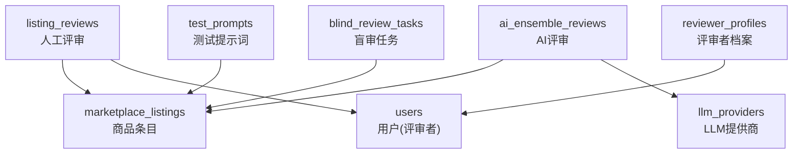
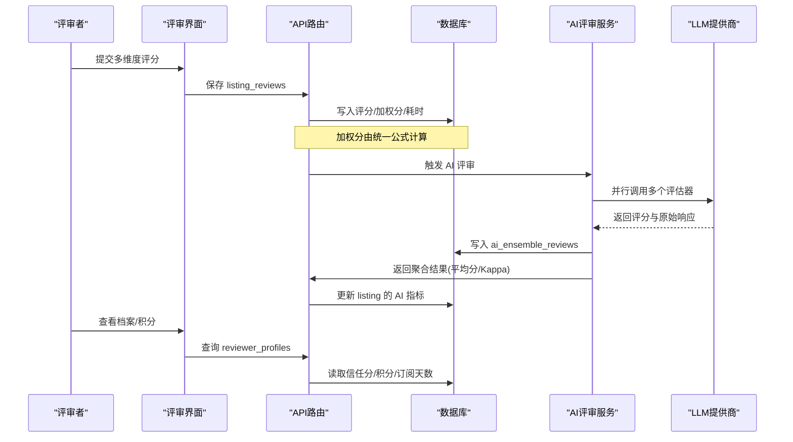
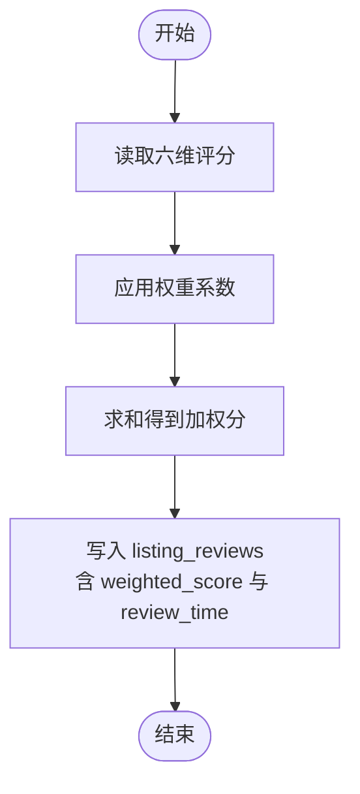
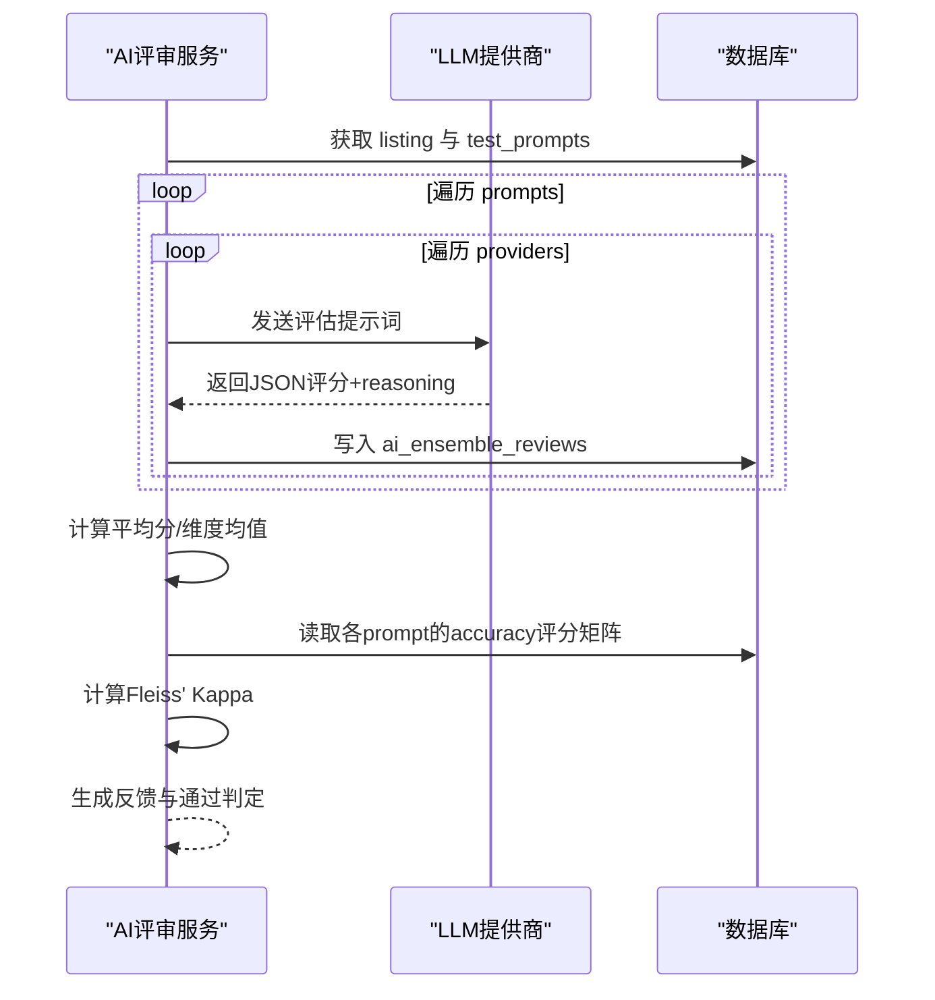
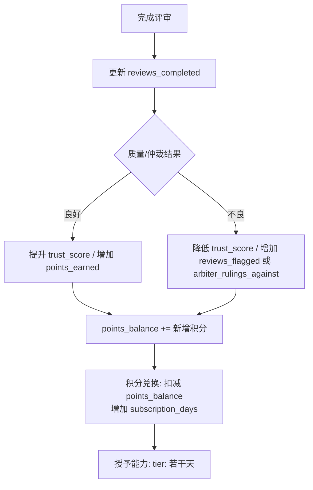
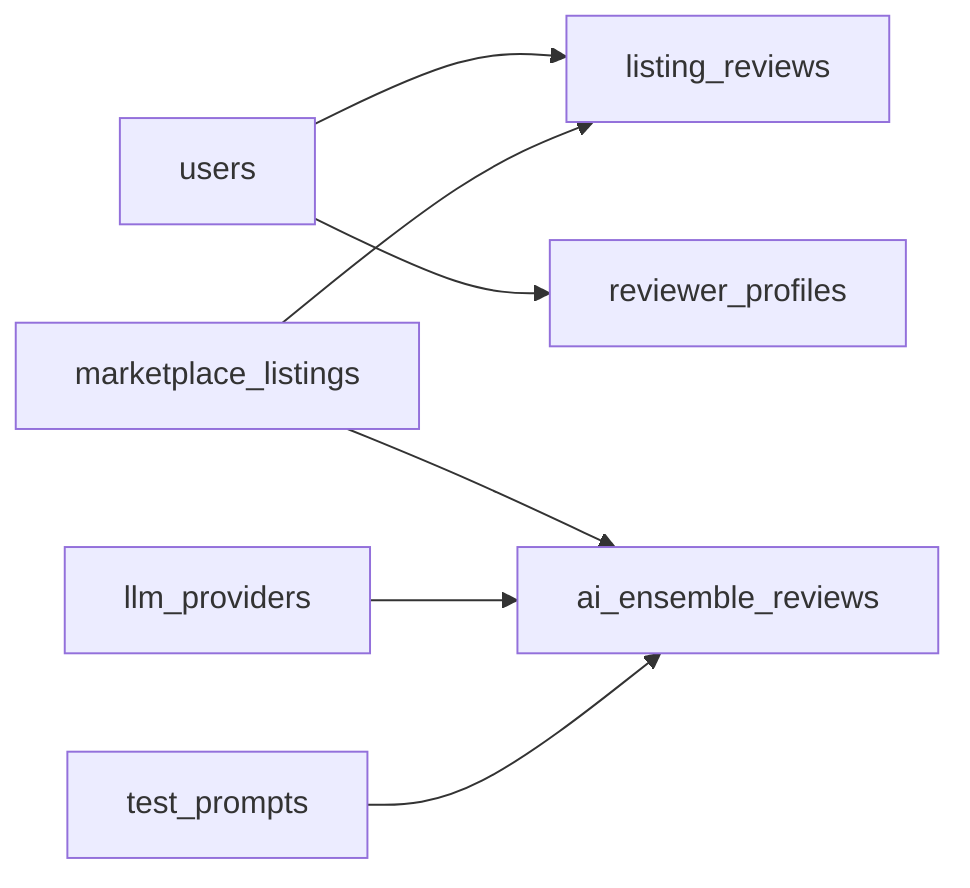

# 评审系统

<cite>
**本文引用的文件**
- [db/schema.ts](file://db/schema.ts)
- [api/services/aiEnsembleReviewService.ts](file://api/services/aiEnsembleReviewService.ts)
- [api/routers/marketplace.ts](file://api/routers/marketplace.ts)
- [src/pages/ReviewerPortal.tsx](file://src/pages/ReviewerPortal.tsx)
- [src/pages/ReviewerReview.tsx](file://src/pages/ReviewerReview.tsx)
</cite>

## 目录
1. [简介](#简介)
2. [项目结构](#项目结构)
3. [核心数据模型](#核心数据模型)
4. [架构总览](#架构总览)
5. [详细组件分析](#详细组件分析)
6. [依赖关系分析](#依赖关系分析)
7. [性能与一致性考量](#性能与一致性考量)
8. [故障排查指南](#故障排查指南)
9. [结论](#结论)

## 简介
本文件为 DeeWaanAI 评审系统的数据模型文档，聚焦以下三个核心表：
- listingReviews：人工评审的多维度评分、加权分数与耗时记录。
- aiEnsembleReviews：AI 多模型投票评审机制，包含原始响应存储与评分聚合。
- reviewerProfiles：评审者档案系统，涵盖信任分、完成统计、积分系统与订阅奖励兑换。

该文档从数据库模式、服务层计算逻辑到前端展示进行系统化说明，帮助读者理解评审质量度量、AI 协同评估与评审者激励闭环。

## 项目结构
评审相关的数据定义集中在数据库模式文件中；AI 评审流程由服务层实现；权重与阈值在路由层集中管理；前端页面负责展示评审者档案与评分维度。

图表来源
- [db/schema.ts:511-564](file://db/schema.ts#L511-L564)
- [db/schema.ts:566-620](file://db/schema.ts#L566-L620)
- [db/schema.ts:622-642](file://db/schema.ts#L622-L642)
- [db/schema.ts:659-692](file://db/schema.ts#L659-L692)

章节来源
- [db/schema.ts:511-692](file://db/schema.ts#L511-L692)

## 核心数据模型
本节对三个关键表进行字段级说明，并标注类型、约束与业务含义。

### listing_reviews（人工评审）
- id：自增主键
- listing_id：关联 marketplace_listings.id，级联删除
- reviewer_id：关联 users.id，级联删除
- prompt_index：对应 test_prompts.prompt_index，标识被评审的测试用例序号
- accuracy：准确性评分（整数）
- completeness：完整性评分（整数）
- clarity：清晰度评分（整数）
- token_efficiency：令牌效率评分（整数）
- speed：速度评分（整数）
- consistency：一致性评分（整数）
- weighted_score：加权总分（decimal(4,2)，非空）
- review_time：评审耗时（秒，非空）
- flagged：是否标记异常（布尔，默认 false）
- created_at：创建时间戳

用途：记录每位评审员对每个测试用例的多维打分、最终加权分与耗时，用于质量度量与可信度评估。

章节来源
- [db/schema.ts:579-599](file://db/schema.ts#L579-L599)

### ai_ensemble_reviews（AI 评审）
- id：自增主键
- listing_id：关联 marketplace_listings.id，级联删除
- prompt_index：测试用例序号
- provider_id：可选，关联 llm_providers.id，级联删除
- model_slug：模型标识（如 slug:model）
- accuracy/completeness/clarity/token_efficiency/speed/consistency：各维度评分（可空）
- weighted_score：加权总分（decimal(4,2)，可空）
- raw_response：原始响应文本（可空），用于审计与回溯
- created_at：创建时间戳

用途：记录每个 LLM 评估器对同一测试用例的评分与原始输出，支持后续聚合与一致性度量。

章节来源
- [db/schema.ts:601-620](file://db/schema.ts#L601-L620)

### reviewer_profiles（评审者档案）
- id：自增主键
- user_id：唯一关联 users.id，级联删除
- trust_score：信任分（整数，默认 100）
- reviews_completed：已完成评审数（整数，默认 0）
- reviews_flagged：被标记异常的评审数（整数，默认 0）
- arbiter_rulings_against：仲裁裁决对其不利的次数（整数，默认 0）
- points_earned：累计获得积分（整数，默认 0）
- points_balance：当前可用积分余额（整数，默认 0）
- subscription_days：通过积分兑换获得的订阅天数（整数，默认 0）
- is_active：是否活跃（布尔，默认 true）
- status：状态枚举 active/suspended/banned（默认 active）
- created_at/updated_at：时间戳

用途：维护评审者信誉、绩效与激励账户，支撑排行榜与订阅奖励兑换。

章节来源
- [db/schema.ts:622-642](file://db/schema.ts#L622-L642)

## 架构总览
评审系统由“人工评审 + AI 评审 + 评审者激励”三部分构成：
- 人工评审：评审者在界面中对测试用例按六个维度打分，系统计算加权分并记录耗时。
- AI 评审：对每个测试用例调用多个 LLM 评估器，收集评分与原始响应，计算平均分与一致性（Kappa）。
- 评审者激励：基于完成量、质量与仲裁结果更新信任分与积分，支持用积分兑换订阅天数。

图表来源
- [api/services/aiEnsembleReviewService.ts:216-345](file://api/services/aiEnsembleReviewService.ts#L216-L345)
- [api/routers/marketplace.ts:485-510](file://api/routers/marketplace.ts#L485-L510)
- [db/schema.ts:579-642](file://db/schema.ts#L579-L642)

## 详细组件分析

### 人工评审：listing_reviews 与加权分计算
- 维度：accuracy、completeness、clarity、tokenEfficiency、speed、consistency。
- 权重：accuracy=0.30、completeness=0.20、clarity=0.15、tokenEfficiency=0.10、speed=0.10、consistency=0.15。
- 加权分：weighted_score = Σ(维度×权重)。
- 耗时：review_time 以秒为单位记录评审用时。
- 异常标记：flagged 用于标记可疑或需复核的评审。

图表来源
- [api/routers/marketplace.ts:485-510](file://api/routers/marketplace.ts#L485-L510)
- [db/schema.ts:579-599](file://db/schema.ts#L579-L599)

章节来源
- [api/routers/marketplace.ts:485-510](file://api/routers/marketplace.ts#L485-L510)
- [db/schema.ts:579-599](file://db/schema.ts#L579-L599)
- [src/pages/ReviewerReview.tsx:23-30](file://src/pages/ReviewerReview.tsx#L23-L30)

### AI 评审：aiEnsembleReviews 与多模型投票
- 多模型：至少选择 3 个不同的 LLM 提供商（slug+model 去重）作为评估器。
- 评分采集：对每个测试用例，分别调用各评估器，解析 JSON 中的六维评分与 reasoning。
- 原始响应：raw_response 持久化，便于审计与问题定位。
- 聚合计算：
  - 平均加权分：对所有评估器的 weightedScore 求均值。
  - 维度均值：对各维度评分求均值（忽略无效值）。
  - 一致性：使用 Fleiss' Kappa 衡量不同评估器在“认证决策”上的一致性（将加权分桶化为 pass/fail 后计算）。
- 通过条件：平均分达到阈值且 Kappa 大于阈值时视为通过。

图表来源
- [api/services/aiEnsembleReviewService.ts:216-345](file://api/services/aiEnsembleReviewService.ts#L216-L345)
- [api/services/aiEnsembleReviewService.ts:105-135](file://api/services/aiEnsembleReviewService.ts#L105-L135)
- [api/services/aiEnsembleReviewService.ts:148-170](file://api/services/aiEnsembleReviewService.ts#L148-L170)
- [api/services/aiEnsembleReviewService.ts:257-276](file://api/services/aiEnsembleReviewService.ts#L257-L276)
- [api/routers/marketplace.ts:464-483](file://api/routers/marketplace.ts#L464-L483)

章节来源
- [api/services/aiEnsembleReviewService.ts:105-170](file://api/services/aiEnsembleReviewService.ts#L105-L170)
- [api/services/aiEnsembleReviewService.ts:216-345](file://api/services/aiEnsembleReviewService.ts#L216-L345)
- [api/routers/marketplace.ts:464-483](file://api/routers/marketplace.ts#L464-L483)

### 评审者档案：reviewerProfiles 与激励体系
- 信任分：trust_score 初始为 100，随完成量、质量与仲裁结果动态调整。
- 完成统计：reviews_completed 记录完成数量；reviews_flagged 记录异常评审次数；arbiter_rulings_against 记录仲裁不利裁决次数。
- 积分系统：
  - points_earned：累计获得积分。
  - points_balance：当前可用积分余额。
  - 兑换规则：根据 tier 决定每日成本（master=72点/天，sage=120点/天），扣除余额并增加 subscription_days。
- 订阅奖励：subscription_days 记录通过积分兑换获得的订阅天数；同时通过 entitlementGrant 授予能力权限（如 tier:sage 若干天）。
- 状态管理：isActive 与 status 控制评审者参与资格。

图表来源
- [db/schema.ts:622-642](file://db/schema.ts#L622-L642)
- [api/routers/marketplace.ts:2608-2665](file://api/routers/marketplace.ts#L2608-L2665)
- [src/pages/ReviewerPortal.tsx:449-474](file://src/pages/ReviewerPortal.tsx#L449-L474)

章节来源
- [db/schema.ts:622-642](file://db/schema.ts#L622-L642)
- [api/routers/marketplace.ts:2608-2665](file://api/routers/marketplace.ts#L2608-L2665)
- [src/pages/ReviewerPortal.tsx:449-474](file://src/pages/ReviewerPortal.tsx#L449-L474)

## 依赖关系分析
- listing_reviews 依赖 marketplace_listings（被评对象）与 users（评审者）。
- ai_ensemble_reviews 依赖 marketplace_listings 与 llm_providers（评估器配置）。
- reviewer_profiles 依赖 users（评审者身份）。
- 服务层 aiEnsembleReviewService 依赖数据库 schema、LLM 提供商适配器、JSON 提取与超时控制。
- 路由层 marketplace.ts 提供加权分计算、Kappa 计算与积分兑换等接口。

图表来源
- [db/schema.ts:511-642](file://db/schema.ts#L511-L642)

章节来源
- [db/schema.ts:511-642](file://db/schema.ts#L511-L642)

## 性能与一致性考量
- 加权分计算：采用固定权重，O(1) 复杂度，适合高频写入 listing_reviews。
- AI 评审并发：对每个测试用例并行调用多个 LLM 评估器，注意超时与重试策略，避免阻塞。
- Kappa 计算：基于每 prompt 的 accuracy 评分矩阵，计算 O(N×M) 复杂度（N 为有效 prompt 数，M 为评估器数）。
- 数据存储：ai_ensemble_reviews 的 raw_response 可能较大，建议定期归档或压缩。
- 索引优化：listing_reviews 与 ai_ensemble_reviews 均对 listing_id 建立索引，加速按商品聚合查询。

[本节为通用指导，无需具体文件引用]

## 故障排查指南
- AI 评审失败：检查 LLM 提供商配置与密钥解密流程；确认 test_prompts 存在 actualOutput；查看 aiEnsembleReviewService 的错误日志。
- 加权分异常：核对维度取值范围（1–5）与权重分配；确认前端提交的维度完整。
- 积分兑换失败：检查 reviewer_profiles 的 points_balance 是否足够；确认 tier 对应的每日成本；查看 entitlementGrant 调用是否成功。
- 一致性低：若 Kappa 过低，检查评估器差异与评分分布；必要时调整提示词或评估策略。

章节来源
- [api/services/aiEnsembleReviewService.ts:279-345](file://api/services/aiEnsembleReviewService.ts#L279-L345)
- [api/routers/marketplace.ts:2608-2665](file://api/routers/marketplace.ts#L2608-L2665)

## 结论
DeeWaanAI 评审系统通过 listing_reviews 实现严谨的人工多维评分与耗时追踪，借助 aiEnsembleReviews 引入多模型投票与原始响应审计，并以 reviewerProfiles 构建评审者信誉与激励闭环。统一的加权分公式与 Kappa 一致性度量确保质量评估的可比性与可靠性。未来可进一步扩展评估维度、优化提示词与评估器组合，以及完善仲裁与申诉机制。