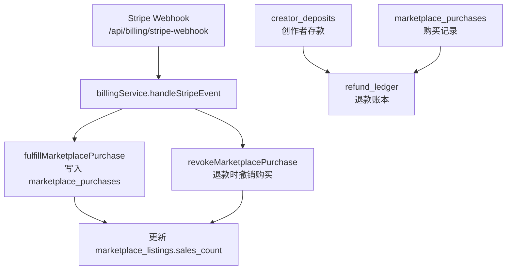
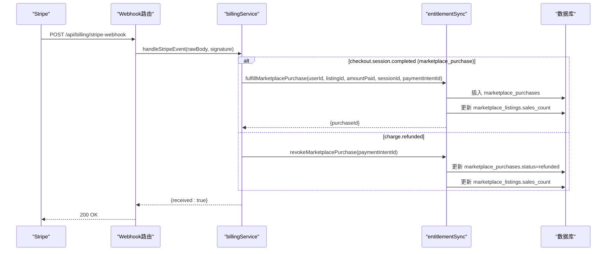
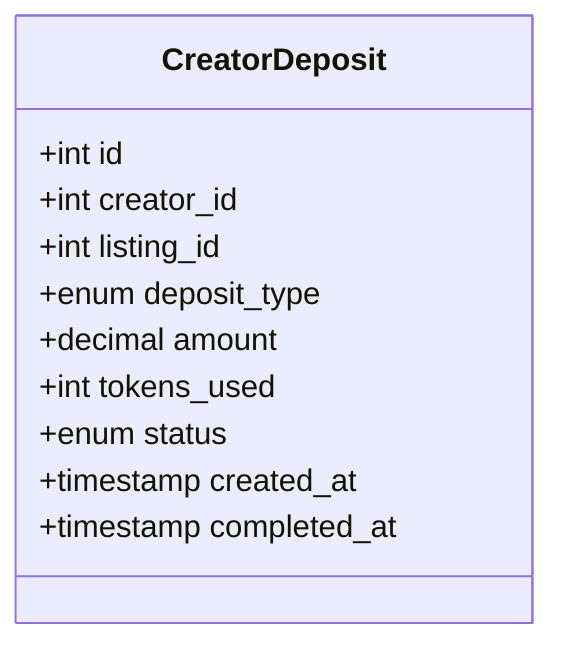
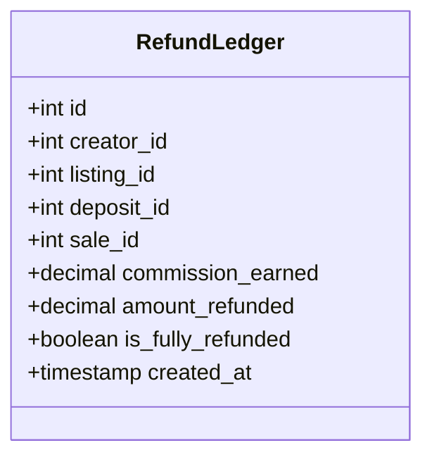
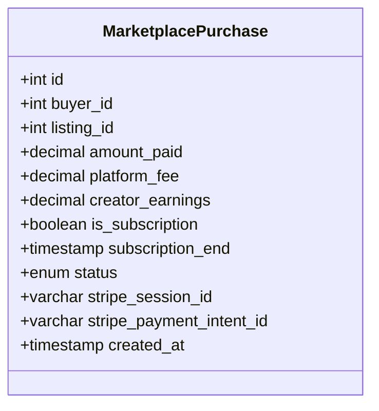
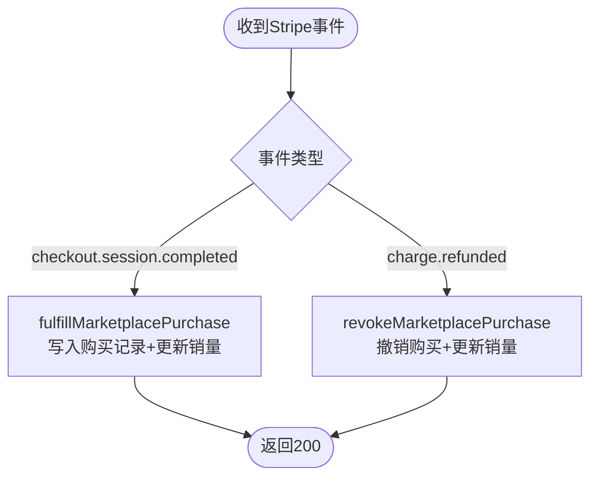
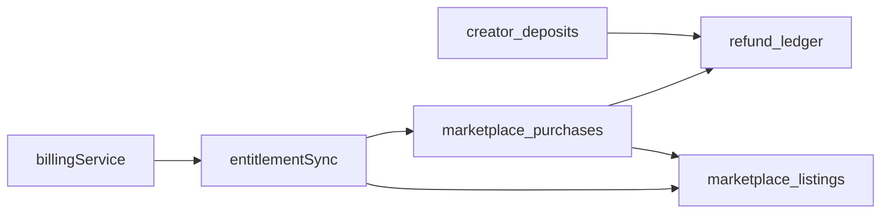

# 财务追踪系统

<cite>
**本文引用的文件**
- [db/marketplace_migration.sql](file://db/marketplace_migration.sql)
- [db/migrate-008-create-marketplace.sql](file://db/migrate-008-create-marketplace.sql)
- [db/schema.ts](file://db/schema.ts)
- [api/billing-webhook-route.ts](file://api/billing-webhook-route.ts)
- [api/services/billingService.ts](file://api/services/billingService.ts)
- [api/services/entitlementSync.ts](file://api/services/entitlementSync.ts)
</cite>

## 目录
1. [简介](#简介)
2. [项目结构](#项目结构)
3. [核心组件](#核心组件)
4. [架构总览](#架构总览)
5. [详细组件分析](#详细组件分析)
6. [依赖关系分析](#依赖关系分析)
7. [性能考量](#性能考量)
8. [故障排查指南](#故障排查指南)
9. [结论](#结论)
10. [附录](#附录)

## 简介
本文件为DeeWaanAI市场财务追踪系统的详细数据模型文档，聚焦以下目标：
- 创作者存款机制（creatorDeposits）：费用类型区分、金额记录与状态流转。
- 退款账本（refundLedger）：与销售记录的关联、佣金计算与退款比例跟踪。
- 购买记录（marketplacePurchases）：支付金额、平台费用、创作者收益与订阅模式支持。
- Stripe集成映射：会话ID与支付意图ID的存储与使用，用于支付确认与退款匹配。

## 项目结构
与财务追踪相关的数据模型定义在数据库迁移脚本与Drizzle schema中；Stripe支付与退款处理通过Webhook路由与服务层实现，购买履约与权限同步由独立服务完成。

图表来源
- [api/billing-webhook-route.ts:18-49](file://api/billing-webhook-route.ts#L18-L49)
- [api/services/billingService.ts:445-668](file://api/services/billingService.ts#L445-L668)
- [api/services/entitlementSync.ts:32-123](file://api/services/entitlementSync.ts#L32-L123)
- [api/services/entitlementSync.ts:129-174](file://api/services/entitlementSync.ts#L129-L174)

章节来源
- [db/marketplace_migration.sql:111-156](file://db/marketplace_migration.sql#L111-L156)
- [db/migrate-008-create-marketplace.sql:135-179](file://db/migrate-008-create-marketplace.sql#L135-L179)
- [db/schema.ts:700-749](file://db/schema.ts#L700-L749)
- [api/billing-webhook-route.ts:18-49](file://api/billing-webhook-route.ts#L18-L49)
- [api/services/billingService.ts:445-668](file://api/services/billingService.ts#L445-L668)
- [api/services/entitlementSync.ts:32-174](file://api/services/entitlementSync.ts#L32-L174)

## 核心组件
- creator_deposits：记录创作者为测试或评审产生的费用押金，包含费用类型、金额、Token消耗、状态与时间戳。
- refund_ledger：记录每笔销售对应的退款明细，包括已赚佣金、退款金额、是否全额退款等。
- marketplace_purchases：记录买家购买行为，包含支付金额、平台费用、创作者收益、订阅标识与结束时间、状态及Stripe引用。

章节来源
- [db/marketplace_migration.sql:111-156](file://db/marketplace_migration.sql#L111-L156)
- [db/migrate-008-create-marketplace.sql:135-179](file://db/migrate-008-create-marketplace.sql#L135-L179)
- [db/schema.ts:700-749](file://db/schema.ts#L700-L749)

## 架构总览
Stripe支付事件通过Webhook进入系统，按事件类型分发处理：
- 一次性购买：创建Checkout Session并回调checkout.session.completed，调用履约逻辑写入购买记录、更新销量、授予能力。
- 团队席位订阅：维护team_seats与能力授权。
- 退款：charge.refunded事件根据payment_intent撤销购买并更新销量。

图表来源
- [api/billing-webhook-route.ts:18-49](file://api/billing-webhook-route.ts#L18-L49)
- [api/services/billingService.ts:445-668](file://api/services/billingService.ts#L445-L668)
- [api/services/entitlementSync.ts:32-174](file://api/services/entitlementSync.ts#L32-L174)

## 详细组件分析

### 创作者存款表（creator_deposits）
- 字段与含义
  - id：主键
  - creator_id：创作者ID
  - listing_id：商品列表ID
  - deposit_type：费用类型枚举，区分ai_test与human_review
  - amount：金额（十进制）
  - tokens_used：消耗的Token数（可选）
  - status：状态枚举，支持pending→completed/refunded/partial_refund
  - created_at/completed_at：创建与完成时间
- 设计要点
  - 费用类型明确区分AI测试与人工评审两类成本。
  - 状态机清晰：待处理、已完成、已退款、部分退款。
  - 可结合tokens_used进行AI测试成本核算。

图表来源
- [db/schema.ts:700-709](file://db/schema.ts#L700-L709)
- [db/marketplace_migration.sql:111-124](file://db/marketplace_migration.sql#L111-L124)
- [db/migrate-008-create-marketplace.sql:135-148](file://db/migrate-008-create-marketplace.sql#L135-L148)

章节来源
- [db/schema.ts:700-709](file://db/schema.ts#L700-L709)
- [db/marketplace_migration.sql:111-124](file://db/marketplace_migration.sql#L111-L124)
- [db/migrate-008-create-marketplace.sql:135-148](file://db/migrate-008-create-marketplace.sql#L135-L148)

### 退款账本表（refund_ledger）
- 字段与含义
  - id：主键
  - creator_id/listing_id/deposit_id/sale_id：关联创作者、商品、存款与销售记录
  - commission_earned：该笔销售对应已赚取的佣金
  - amount_refunded：退款金额
  - is_fully_refunded：是否已全额退款
  - created_at：创建时间
- 设计要点
  - 将退款与具体销售绑定，便于对每笔交易进行审计。
  - 通过commission_earned与amount_refunded可计算退款比例与净收益。
  - 支持部分退款场景（partial_refund）与全额退款标记。

图表来源
- [db/schema.ts:711-728](file://db/schema.ts#L711-L728)
- [db/marketplace_migration.sql:126-140](file://db/marketplace_migration.sql#L126-L140)
- [db/migrate-008-create-marketplace.sql:150-163](file://db/migrate-008-create-marketplace.sql#L150-L163)

章节来源
- [db/schema.ts:711-728](file://db/schema.ts#L711-L728)
- [db/marketplace_migration.sql:126-140](file://db/marketplace_migration.sql#L126-L140)
- [db/migrate-008-create-marketplace.sql:150-163](file://db/migrate-008-create-marketplace.sql#L150-L163)

### 购买记录表（marketplace_purchases）
- 字段与含义
  - id：主键
  - buyer_id/listing_id：买家与商品ID
  - amount_paid/platform_fee/creator_earnings：支付金额、平台费用、创作者收益
  - is_subscription/subscription_end：订阅标识与结束时间
  - status：active/refunded/cancelled
  - stripe_session_id/stripe_payment_intent_id：Stripe会话与支付意图ID
  - created_at：创建时间
- 设计要点
  - 支持一次性购买与订阅模式（is_subscription与subscription_end）。
  - 平台费用与创作者收益在履约时计算并落库。
  - 通过Stripe ID进行幂等与退款匹配。

图表来源
- [db/schema.ts:730-749](file://db/schema.ts#L730-L749)
- [db/marketplace_migration.sql:142-156](file://db/marketplace_migration.sql#L142-L156)
- [db/migrate-008-create-marketplace.sql:165-179](file://db/migrate-008-create-marketplace.sql#L165-L179)

章节来源
- [db/schema.ts:730-749](file://db/schema.ts#L730-L749)
- [db/marketplace_migration.sql:142-156](file://db/marketplace_migration.sql#L142-L156)
- [db/migrate-008-create-marketplace.sql:165-179](file://db/migrate-008-create-marketplace.sql#L165-L179)

### Stripe集成与会话/支付意图映射
- 会话创建
  - 一次性购买：createMarketplaceCheckoutSession生成Stripe Checkout Session，metadata中包含type=marketplace_purchase、userId、listingId；payment_intent_data携带相同元数据以便后续退款匹配。
- 事件处理
  - checkout.session.completed：解析session.metadata获取userId与listingId，调用fulfillMarketplacePurchase写入购买记录，并保存stripe_session_id与stripe_payment_intent_id。
  - charge.refunded：从charge.payment_intent提取payment_intent_id，调用revokeMarketplacePurchase撤销购买并更新销量。
- 幂等性
  - 通过idempotencyKeys避免重复处理同一Stripe事件。

图表来源
- [api/services/billingService.ts:80-129](file://api/services/billingService.ts#L80-L129)
- [api/services/billingService.ts:445-668](file://api/services/billingService.ts#L445-L668)
- [api/services/entitlementSync.ts:32-174](file://api/services/entitlementSync.ts#L32-L174)

章节来源
- [api/services/billingService.ts:80-129](file://api/services/billingService.ts#L80-L129)
- [api/services/billingService.ts:445-668](file://api/services/billingService.ts#L445-L668)
- [api/services/entitlementSync.ts:32-174](file://api/services/entitlementSync.ts#L32-L174)

## 依赖关系分析
- 数据模型依赖
  - refund_ledger依赖creator_deposits与marketplace_purchases（sale_id），形成“存款—销售—退款”的闭环。
  - marketplace_purchases依赖marketplace_listings以更新销量。
- 服务依赖
  - billingService依赖Stripe SDK与数据库连接，调用entitlementSync进行购买履约与退款撤销。
  - entitlementSync负责写入购买记录、更新销量、授予/撤销能力。

图表来源
- [db/schema.ts:700-749](file://db/schema.ts#L700-L749)
- [api/services/billingService.ts:445-668](file://api/services/billingService.ts#L445-L668)
- [api/services/entitlementSync.ts:32-174](file://api/services/entitlementSync.ts#L32-L174)

章节来源
- [db/schema.ts:700-749](file://db/schema.ts#L700-L749)
- [api/services/billingService.ts:445-668](file://api/services/billingService.ts#L445-L668)
- [api/services/entitlementSync.ts:32-174](file://api/services/entitlementSync.ts#L32-L174)

## 性能考量
- 索引优化
  - creator_deposits与refund_ledger均对creator_id与listing_id建立索引，提升按创作者与商品查询效率。
  - marketplace_purchases对buyer_id与listing_id建立索引，加速购买记录检索。
- 幂等与去重
  - 通过idempotencyKeys避免重复处理Stripe事件，减少重复写入与竞争条件。
- 事务与一致性
  - 购买履约与销量更新在同一流程中执行，确保数据一致性。

章节来源
- [db/migrate-008-create-marketplace.sql:135-179](file://db/migrate-008-create-marketplace.sql#L135-L179)
- [api/services/billingService.ts:182-211](file://api/services/billingService.ts#L182-L211)

## 故障排查指南
- Webhook签名验证失败
  - 现象：返回400错误，提示无效签名。
  - 排查：检查stripe-signature头与webhook密钥配置。
- 未配置计费
  - 现象：返回503错误，提示计费未配置。
  - 排查：确认Stripe密钥与webhook密钥环境变量已设置。
- 退款匹配失败
  - 现象：charge.refunded事件未找到对应购买记录。
  - 排查：确认payment_intent_id是否正确存储于marketplace_purchases，且状态为active。

章节来源
- [api/billing-webhook-route.ts:18-49](file://api/billing-webhook-route.ts#L18-L49)
- [api/services/billingService.ts:445-668](file://api/services/billingService.ts#L445-L668)
- [api/services/entitlementSync.ts:129-174](file://api/services/entitlementSync.ts#L129-L174)

## 结论
本财务追踪系统通过清晰的三张核心表（creator_deposits、refund_ledger、marketplace_purchases）与Stripe事件驱动的服务层，实现了从创作者费用管理到购买履约与退款的完整闭环。数据模型支持费用类型区分、状态流转、订阅模式与退款比例跟踪；Stripe集成通过会话与支付意图ID实现幂等与可靠匹配。建议在生产环境中持续监控Webhook处理日志与数据库一致性，确保财务数据的准确性与可审计性。

## 附录
- 关键路径参考
  - Webhook入口：[api/billing-webhook-route.ts:18-49](file://api/billing-webhook-route.ts#L18-L49)
  - 事件处理：[api/services/billingService.ts:445-668](file://api/services/billingService.ts#L445-L668)
  - 购买履约：[api/services/entitlementSync.ts:32-123](file://api/services/entitlementSync.ts#L32-L123)
  - 退款撤销：[api/services/entitlementSync.ts:129-174](file://api/services/entitlementSync.ts#L129-L174)
  - 数据模型定义：[db/schema.ts:700-749](file://db/schema.ts#L700-L749)
  - 迁移脚本：[db/marketplace_migration.sql:111-156](file://db/marketplace_migration.sql#L111-L156)、[db/migrate-008-create-marketplace.sql:135-179](file://db/migrate-008-create-marketplace.sql#L135-L179)