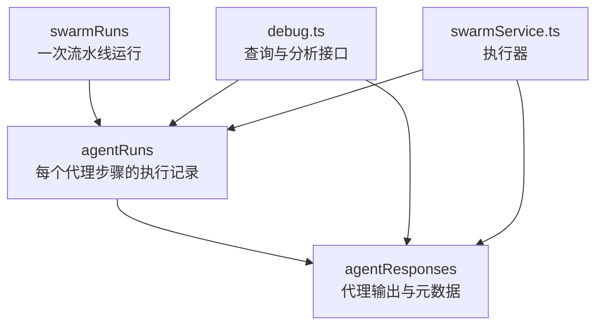
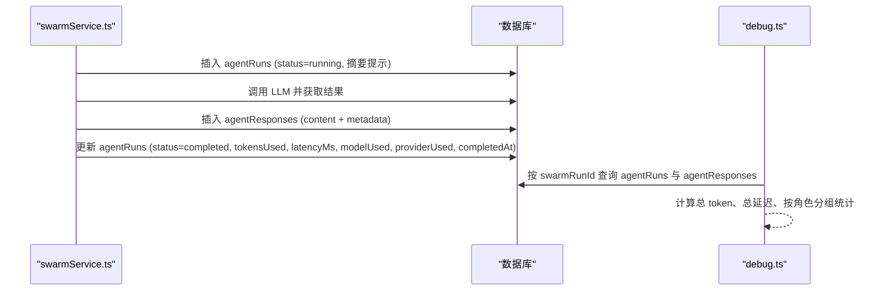
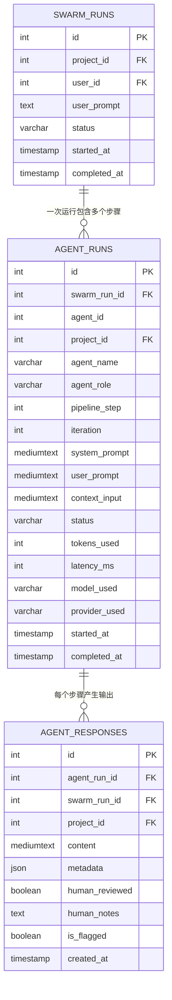
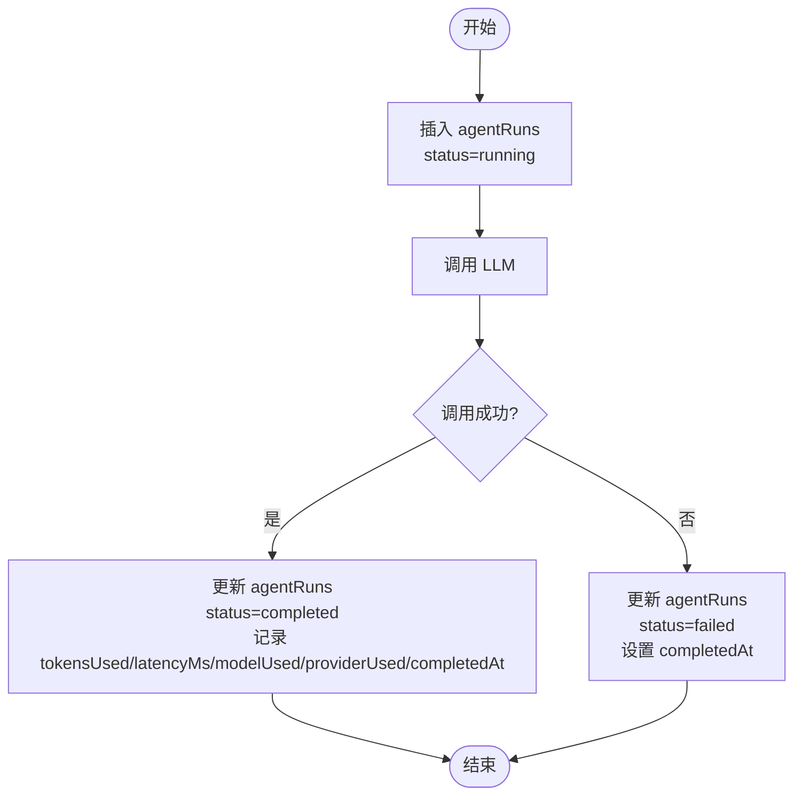
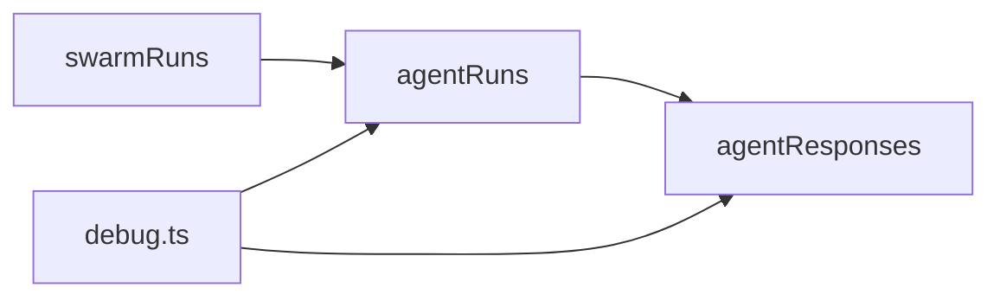

# 代理执行历史

<cite>
**本文引用的文件**
- [db/schema.ts](file://db/schema.ts)
- [api/services/swarmService.ts](file://api/services/swarmService.ts)
- [api/routers/debug.ts](file://api/routers/debug.ts)
- [db/migrations/021_widen_content_columns.sql](file://db/migrations/021_widen_content_columns.sql)
- [DeeWaanAI-Next/PIPELINE-OVERFLOW-FIX-HANDOFF.md](file://DeeWaanAI-Next/PIPELINE-OVERFLOW-FIX-HANDOFF.md)
</cite>

## 目录
1. [简介](#简介)
2. [项目结构](#项目结构)
3. [核心组件](#核心组件)
4. [架构总览](#架构总览)
5. [详细组件分析](#详细组件分析)
6. [依赖关系分析](#依赖关系分析)
7. [性能考量](#性能考量)
8. [故障排查指南](#故障排查指南)
9. [结论](#结论)
10. [附录](#附录)

## 简介
本文件为 DeeWaanAI 的 agentRuns 表提供完整的数据模型与使用文档。agentRuns 记录每次代理执行的完整历史，包括代理标识、流水线步骤与迭代层次、执行参数（系统提示、用户提示、上下文输入）、执行状态及其生命周期、性能指标（tokensUsed、latencyMs、modelUsed、providerUsed）以及时间戳（startedAt、completedAt）。同时说明与 swarmRuns 表的关联关系和数据完整性保证，并提供查询与分析接口的使用方式。

## 项目结构
- 数据模型定义位于 db/schema.ts，其中包含 agentRuns、swarmRuns、agentResponses 等表结构。
- 执行流程与写入逻辑位于 api/services/swarmService.ts，负责在流水线执行过程中创建、更新 agentRuns 并记录性能指标。
- 查询与分析接口位于 api/routers/debug.ts，提供按 swarmRunId 获取步骤明细与聚合统计的能力。
- 内容列扩容迁移位于 db/migrations/021_widen_content_columns.sql，将 system_prompt、user_prompt、context_input 从 TEXT 升级为 MEDIUMTEXT，避免大文本溢出。
- 溢出问题背景与修复说明见 DeeWaanAI-Next/PIPELINE-OVERFLOW-FIX-HANDOFF.md。

图表来源
- [db/schema.ts:174-237](file://db/schema.ts#L174-L237)
- [db/schema.ts:262-289](file://db/schema.ts#L262-L289)
- [db/schema.ts:291-335](file://db/schema.ts#L291-L335)
- [api/services/swarmService.ts:390-512](file://api/services/swarmService.ts#L390-L512)
- [api/routers/debug.ts:44-173](file://api/routers/debug.ts#L44-L173)

章节来源
- [db/schema.ts:174-237](file://db/schema.ts#L174-L237)
- [db/schema.ts:262-289](file://db/schema.ts#L262-L289)
- [db/schema.ts:291-335](file://db/schema.ts#L291-L335)
- [api/services/swarmService.ts:390-512](file://api/services/swarmService.ts#L390-L512)
- [api/routers/debug.ts:44-173](file://api/routers/debug.ts#L44-L173)

## 核心组件
- agentRuns：记录每次代理步骤的执行历史，包含代理名称、角色、流水线步骤、迭代次数、执行参数、状态、性能指标和时间戳。
- swarmRuns：代表一次完整的流水线运行，作为 agentRuns 的上层容器。
- agentResponses：记录每次代理的输出内容与丰富元数据（模型、提供商、token 用量、延迟等），与 agentRuns 通过外键关联。

关键字段说明（基于 schema 定义）：
- id：自增主键
- swarm_run_id：关联到 swarmRuns.id，级联删除
- agent_id：可选，指向 custom_agents.id（无外键约束，兼容旧 agents 表）
- project_id：关联到 projects.id，级联删除
- agent_name：代理名称（varchar(100)，非空）
- agent_role：代理角色（varchar(50)，非空）
- pipeline_step：流水线步骤序号（int，非空）
- iteration：迭代次数（int，默认 1）
- system_prompt：系统提示（mediumtext，允许大文本）
- user_prompt：用户提示（mediumtext，非空）
- context_input：上下文输入（mediumtext，允许大文本）
- status：执行状态（varchar(20)，默认 "pending"）
- tokens_used：消耗的 token 数（int）
- latency_ms：响应耗时毫秒（int）
- model_used：使用的模型名（varchar(100)）
- provider_used：使用的提供商标识（varchar(100)）
- started_at：开始时间戳（timestamp，默认当前时间）
- completed_at：完成时间戳（timestamp）

索引：
- idx_agent_runs_swarm_run_id：加速按 swarmRunId 查询
- idx_agent_runs_project_id：加速按 projectId 查询

章节来源
- [db/schema.ts:262-289](file://db/schema.ts#L262-L289)
- [db/migrations/021_widen_content_columns.sql:5-8](file://db/migrations/021_widen_content_columns.sql#L5-L8)

## 架构总览
流水线执行时，服务会为每个代理步骤创建一条 agentRuns 记录，并在执行完成后更新状态与性能指标；代理输出则写入 agentResponses，并通过外键与 agentRuns 关联。调试接口可从 agentRuns 和 agentResponses 中聚合出步骤级与项目级的统计信息。

图表来源
- [api/services/swarmService.ts:390-512](file://api/services/swarmService.ts#L390-L512)
- [api/routers/debug.ts:44-173](file://api/routers/debug.ts#L44-L173)

## 详细组件分析

### agentRuns 数据模型与层次结构
- 层次结构：
  - swarmRuns：一次流水线运行（父级）
  - agentRuns：该运行下的每个代理步骤执行记录（子级）
  - agentResponses：每个 agentRuns 对应的输出与元数据（一对一或一对多，取决于实现）
- 关键字段含义：
  - agentName、agentRole：标识执行代理的身份与职责
  - pipelineStep、iteration：描述流水线步骤顺序与重试/循环迭代
  - systemPrompt、userPrompt、contextInput：执行参数存储（已升级为 mediumtext 以支持大文本）
  - status：执行状态管理（详见下文）
  - tokensUsed、latencyMs、modelUsed、providerUsed：性能指标追踪
  - startedAt、completedAt：用于计算执行时长

图表来源
- [db/schema.ts:174-237](file://db/schema.ts#L174-L237)
- [db/schema.ts:262-289](file://db/schema.ts#L262-L289)
- [db/schema.ts:291-335](file://db/schema.ts#L291-L335)

章节来源
- [db/schema.ts:262-289](file://db/schema.ts#L262-L289)
- [db/schema.ts:291-335](file://db/schema.ts#L291-L335)

### 执行参数存储设计
- systemPrompt：存储系统提示的摘要或完整内容（mediumtext），便于审计与回溯。
- userPrompt：存储用户提示的摘要或完整内容（mediumtext），非空。
- contextInput：存储上下文输入（mediumtext），用于拼接前序输出、项目状态等。
- 注意：为避免溢出，已将上述列从 TEXT 升级为 MEDIUMTEXT（最大约 16MB），解决大上下文导致的 INSERT 失败问题。

章节来源
- [db/schema.ts:262-289](file://db/schema.ts#L262-L289)
- [db/migrations/021_widen_content_columns.sql:5-8](file://db/migrations/021_widen_content_columns.sql#L5-L8)
- [DeeWaanAI-Next/PIPELINE-OVERFLOW-FIX-HANDOFF.md:15-28](file://DeeWaanAI-Next/PIPELINE-OVERFLOW-FIX-HANDOFF.md#L15-L28)

### 执行状态管理与生命周期
- 初始状态：插入 agentRuns 时设置为 "running"（实际代码中直接写入 running，后续根据结果更新）。
- 成功完成：LLM 调用成功后，更新 status 为 "completed"，并填充 tokensUsed、latencyMs、modelUsed、providerUsed、completedAt。
- 失败处理：捕获异常后，更新 status 为 "failed"，并设置 completedAt。
- 状态流转示意：

图表来源
- [api/services/swarmService.ts:390-512](file://api/services/swarmService.ts#L390-L512)

章节来源
- [api/services/swarmService.ts:390-512](file://api/services/swarmService.ts#L390-L512)

### 性能指标追踪机制
- tokensUsed：来自 LLM 返回的 usage.totalTokens，记录单次步骤消耗。
- latencyMs：记录 LLM 调用耗时（毫秒）。
- modelUsed：记录实际调用的模型名。
- providerUsed：记录提供商 slug（如 openai、anthropic 等）。
- 这些指标在成功完成后写入 agentRuns，同时在 agentResponses.metadata 中保留更详细的 token 拆分（prompt、completion、total）与延迟。

章节来源
- [api/services/swarmService.ts:486-512](file://api/services/swarmService.ts#L486-L512)
- [db/schema.ts:291-335](file://db/schema.ts#L291-L335)

### 时间戳与执行时长计算
- startedAt：插入时默认当前时间，表示步骤开始。
- completedAt：成功或失败时设置，表示步骤结束。
- 执行时长 = completedAt - startedAt（秒或毫秒，依需求转换）。

章节来源
- [db/schema.ts:262-289](file://db/schema.ts#L262-L289)

### 查询与分析接口
- 按 swarmRunId 查询：
  - 获取所有 agentRuns，按 pipelineStep 与 iteration 排序。
  - 获取所有 agentResponses，按创建时间排序。
  - 计算总 token、总延迟，并按角色分组统计平均 token 与延迟。
- 按 projectId 聚合：
  - 统计总运行数、总响应数、总 token、总延迟。
  - 按角色分组统计平均 token 与延迟。
  - 统计被标记（isFlagged）的响应数量。

章节来源
- [api/routers/debug.ts:44-173](file://api/routers/debug.ts#L44-L173)

## 依赖关系分析
- agentRuns 与 swarmRuns：通过 swarm_run_id 建立外键关系，级联删除确保一致性。
- agentRuns 与 agentResponses：通过 agent_run_id 建立外键关系，级联删除确保一致性。
- 索引优化：
  - idx_agent_runs_swarm_run_id：加速按运行查询步骤。
  - idx_agent_runs_project_id：加速按项目查询步骤。
  - agentResponses 也有对应索引以支持高效查询。

图表来源
- [db/schema.ts:174-237](file://db/schema.ts#L174-L237)
- [db/schema.ts:262-289](file://db/schema.ts#L262-L289)
- [db/schema.ts:291-335](file://db/schema.ts#L291-L335)
- [api/routers/debug.ts:44-173](file://api/routers/debug.ts#L44-L173)

章节来源
- [db/schema.ts:262-289](file://db/schema.ts#L262-L289)
- [db/schema.ts:291-335](file://db/schema.ts#L291-L335)
- [api/routers/debug.ts:44-173](file://api/routers/debug.ts#L44-L173)

## 性能考量
- 大文本存储：system_prompt、user_prompt、context_input 已升级为 MEDIUMTEXT，避免溢出导致 INSERT 失败。
- 索引策略：对 swarm_run_id 与 project_id 建立索引，提升查询效率。
- 指标采集：在 LLM 调用前后记录延迟与 token 用量，减少额外开销。
- 批处理与节流：服务层对提供商进行速率限制与重试，避免瞬时过载影响整体性能。

章节来源
- [db/migrations/021_widen_content_columns.sql:5-8](file://db/migrations/021_widen_content_columns.sql#L5-L8)
- [db/schema.ts:262-289](file://db/schema.ts#L262-L289)
- [api/services/swarmService.ts:432-436](file://api/services/swarmService.ts#L432-L436)

## 故障排查指南
- 常见错误：
  - 上下文溢出：当 contextInput 超过 TEXT 限制时会插入失败。已通过迁移升级到 MEDIUMTEXT 解决。
  - 提供商限流：出现 429 或 rate limit 错误时，服务会重试或重新入队。
  - 余额不足：CreditExhaustedError 会被识别并记录为特定错误类型。
- 排查步骤：
  - 检查 agentRuns.status 是否为 failed，查看 completedAt 是否设置。
  - 检查 agentResponses 是否存在，确认输出是否成功写入。
  - 使用 debug.ts 接口按 swarmRunId 查询步骤明细与聚合统计，定位瓶颈。

章节来源
- [DeeWaanAI-Next/PIPELINE-OVERFLOW-FIX-HANDOFF.md:15-28](file://DeeWaanAI-Next/PIPELINE-OVERFLOW-FIX-HANDOFF.md#L15-L28)
- [api/services/swarmService.ts:463-483](file://api/services/swarmService.ts#L463-L483)
- [api/routers/debug.ts:44-173](file://api/routers/debug.ts#L44-L173)

## 结论
agentRuns 表作为 DeeWaanAI 流水线执行的核心历史记录，提供了完整的代理执行上下文、状态与性能指标。通过与 swarmRuns 和 agentResponses 的关联，形成了清晰的层次结构与数据完整性保障。结合索引优化与大文本升级，系统在大规模执行场景下具备稳定性与可观测性。提供的查询与分析接口便于运维与业务侧进行性能分析与问题定位。

## 附录
- 字段类型与长度参考：
  - agent_name: varchar(100)
  - agent_role: varchar(50)
  - system_prompt/user_prompt/context_input: mediumtext
  - status: varchar(20)
  - model_used/provider_used: varchar(100)
- 索引列表：
  - idx_agent_runs_swarm_run_id
  - idx_agent_runs_project_id

章节来源
- [db/schema.ts:262-289](file://db/schema.ts#L262-L289)