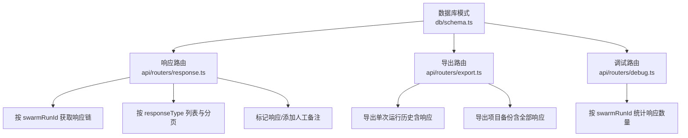
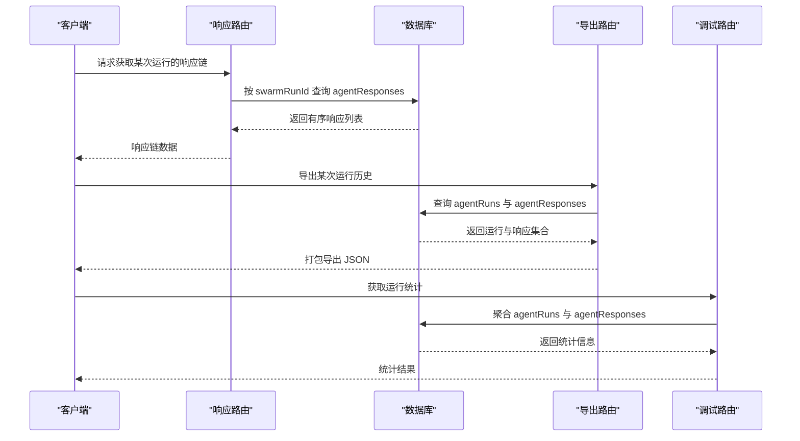
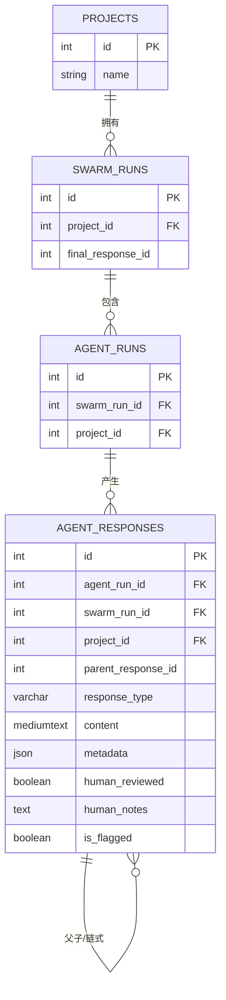

# 响应存储

<cite>
**本文引用的文件**
- [db/schema.ts](file://db/schema.ts)
- [api/routers/response.ts](file://api/routers/response.ts)
- [api/routers/export.ts](file://api/routers/export.ts)
- [api/routers/debug.ts](file://api/routers/debug.ts)
</cite>

## 目录
1. [简介](#简介)
2. [项目结构](#项目结构)
3. [核心组件](#核心组件)
4. [架构总览](#架构总览)
5. [详细组件分析](#详细组件分析)
6. [依赖关系分析](#依赖关系分析)
7. [性能考量](#性能考量)
8. [故障排查指南](#故障排查指南)
9. [结论](#结论)
10. [附录](#附录)

## 简介
本文件为 DeeWaanAI 的 agentResponses 表提供数据模型与使用文档，聚焦以下方面：
- 响应内容存储结构：content 字段采用 mediumtext 类型的设计原因与影响。
- 树形关系：parentResponseId 如何构建响应之间的父子/链式关系。
- 响应类型管理：responseType 的分类（raw、feedback、corrected、synthesized、final）及其在查询中的使用。
- 元数据结构：metadata 中 model、provider、tokensUsed、latencyMs、temperature 等字段的含义与用途。
- 质量评估：qualityScore 与 humanRating 的作用与使用场景。
- 人工审核：humanReviewed 与 humanNotes 的语义与更新流程。
- 标记机制与来源追踪：isFlagged 标记与 sourceResponseIds 的来源追溯。
- 查询、过滤与分析接口：基于现有路由提供的检索能力与扩展建议。

## 项目结构
agentResponses 表定义位于数据库模式文件中，相关查询与导出逻辑分布在 API 路由中。下图展示了与 agentResponses 直接相关的代码位置与职责分工。

图表来源
- [db/schema.ts:291-335](file://db/schema.ts#L291-L335)
- [api/routers/response.ts:7-91](file://api/routers/response.ts#L7-L91)
- [api/routers/export.ts:63-89](file://api/routers/export.ts#L63-L89)
- [api/routers/export.ts:144-179](file://api/routers/export.ts#L144-L179)
- [api/routers/debug.ts:44-114](file://api/routers/debug.ts#L44-L114)

章节来源
- [db/schema.ts:291-335](file://db/schema.ts#L291-L335)
- [api/routers/response.ts:7-91](file://api/routers/response.ts#L7-L91)
- [api/routers/export.ts:63-89](file://api/routers/export.ts#L63-L89)
- [api/routers/export.ts:144-179](file://api/routers/export.ts#L144-L179)
- [api/routers/debug.ts:44-114](file://api/routers/debug.ts#L44-L114)

## 核心组件
- agentResponses 表：存储每次 Agent 步骤的输出结果、元数据、质量评分、人工审核信息与来源追踪。
- 关联表：
  - agentRuns：一次 Agent 执行上下文（包含系统提示、用户提示、状态、耗时、token 用量等）。
  - swarmRuns：一次多智能体协作运行的顶层记录（包含最终响应 ID、总 token、总耗时等）。
  - projects：项目维度隔离与审计。
- 索引：针对 swarmRunId、agentRunId、projectId 建立索引以优化查询。

章节来源
- [db/schema.ts:262-289](file://db/schema.ts#L262-L289)
- [db/schema.ts:291-335](file://db/schema.ts#L291-L335)

## 架构总览
下图展示 agentResponses 在运行生命周期中的角色：swarmRuns 作为一次运行容器，agentRuns 表示每个 Agent 步骤的执行，agentResponses 记录该步骤的输出与丰富元数据，并通过 parentResponseId 形成链式或树状结构。

图表来源
- [api/routers/response.ts:7-23](file://api/routers/response.ts#L7-L23)
- [api/routers/export.ts:63-89](file://api/routers/export.ts#L63-L89)
- [api/routers/debug.ts:44-114](file://api/routers/debug.ts#L44-L114)

## 详细组件分析

### 数据模型：agentResponses 表
- 主键与关联：
  - id：自增主键。
  - agentRunId：关联到 agentRuns.id，表示该响应来自哪一步 Agent 执行。
  - swarmRunId：关联到 swarmRuns.id，用于按运行聚合与导出。
  - projectId：关联到 projects.id，实现项目级隔离。
- 树形关系：
  - parentResponseId：指向同一次运行中的另一条响应记录，用于构建父子/链式关系（例如“原始输出→反馈→修正→合成→最终”）。
- 响应类型：
  - responseType：字符串类型，限制长度为 20；当前在路由层枚举为 raw、feedback、corrected、synthesized、final，用于分类与筛选。
- 内容存储：
  - content：mediumtext 类型，适合存储较长的文本响应（如长文档、代码片段、结构化文本），避免 varchar 长度限制。
- 元数据：
  - metadata：JSON 字段，包含模型与提供者信息、token 用量、延迟、温度、步序与迭代、构建方法、来源响应 ID 列表、质量评分与人类评分等。
- 人工审核与标记：
  - humanReviewed：布尔值，标记是否已完成人工审核。
  - humanNotes：文本，记录人工审核意见。
  - isFlagged：布尔值，标记响应是否需要关注或进一步审查。
- 时间戳：
  - createdAt：记录创建时间，便于排序与审计。

章节来源
- [db/schema.ts:291-335](file://db/schema.ts#L291-L335)

#### 字段说明与复杂度
- content（mediumtext）：
  - 设计原因：Agent 输出可能非常长（如代码、报告、长对话），mediumtext 可容纳更大文本，避免截断。
  - 复杂度：读取与传输成本较高，建议在导出或展示时按需加载或分页。
- metadata（json）：
  - 结构要点：
    - model/provider/providerSlug：标识使用的模型与提供者。
    - tokensUsed：包含 prompt、completion、total 三个计数，便于成本核算。
    - latencyMs：响应耗时，用于性能分析与超时策略。
    - temperature/maxTokens/topP：生成参数，便于复现与调优。
    - agentName/agentRole/agentSlug/pipelineStep/iteration：定位具体 Agent 与步骤。
    - buildMethod：构建方式（如自动合成、人工修正等）。
    - sourceResponseIds：来源响应 ID 数组，用于溯源上游输入。
    - qualityScore/humanRating：可选的质量评分，分别代表 AI 或人工评分。
  - 复杂度：JSON 字段灵活但不可直接进行强约束查询；建议通过应用层校验与索引策略配合。
- parentResponseId：
  - 作用：构建响应树/链，支持从根到叶的遍历，便于展示完整推理过程。
  - 复杂度：需要应用层维护一致性，避免循环引用与孤立节点。

章节来源
- [db/schema.ts:291-335](file://db/schema.ts#L291-L335)

### 响应类型与管理
- 类型枚举：
  - raw：原始输出，未经加工。
  - feedback：对原始输出的反馈或评价。
  - corrected：基于反馈修正后的输出。
  - synthesized：综合多个来源的合成输出。
  - final：最终确认的输出。
- 管理方式：
  - 路由层通过 zod 校验确保类型合法。
  - 查询接口支持按 responseType 过滤与分页。

章节来源
- [api/routers/response.ts:35-57](file://api/routers/response.ts#L35-L57)

### 元数据结构详解
- model/provider/providerSlug：
  - 标识实际调用模型与提供者，便于成本分摊与回滚。
- tokensUsed：
  - 包含 prompt/completion/total，用于计费与配额控制。
- latencyMs：
  - 用于性能监控与超时处理。
- temperature/maxTokens/topP：
  - 生成参数，便于复现实验与对比效果。
- agentName/agentRole/agentSlug/pipelineStep/iteration：
  - 精确定位到某 Agent 在某步骤某迭代的输出。
- buildMethod：
  - 区分不同构建路径（如自动生成、人工编辑、混合）。
- sourceResponseIds：
  - 记录上游响应 ID 列表，用于溯源与影响分析。
- qualityScore/humanRating：
  - 可选评分字段，支持自动化评估与人工复核。

章节来源
- [db/schema.ts:306-324](file://db/schema.ts#L306-L324)

### 质量评估与人工审核
- qualityScore：
  - 由 AI 或系统计算的质量评分，可用于排序与筛选高质量输出。
- humanRating：
  - 人工评分，通常与 humanReviewed 配合使用，体现专家判断。
- humanReviewed：
  - 标记是否完成人工审核，便于审计与合规。
- humanNotes：
  - 记录人工审核意见，支持问题定位与改进。

章节来源
- [db/schema.ts:325-327](file://db/schema.ts#L325-L327)
- [api/routers/response.ts:74-91](file://api/routers/response.ts#L74-L91)

### 标记机制与来源追踪
- isFlagged：
  - 标记响应是否需要关注，常用于问题响应或异常响应的快速识别。
- sourceResponseIds：
  - 记录来源响应 ID 数组，支持溯源上游输入，便于影响面分析与回溯。

章节来源
- [db/schema.ts:327-327](file://db/schema.ts#L327-L327)
- [db/schema.ts:321-321](file://db/schema.ts#L321-L321)
- [api/routers/response.ts:59-72](file://api/routers/response.ts#L59-L72)

### 查询、过滤与分析接口
- 获取响应链：
  - 按 swarmRunId 获取该运行下的所有响应，按 id 升序排列，便于还原执行顺序。
- 按类型列表与分页：
  - 支持按 projectId 与 responseType 过滤，并提供 limit/offset 分页。
- 标记与备注：
  - 支持将响应标记为 flagged，并写入 humanNotes。
  - 支持添加人工备注并设置 humanReviewed。
- 导出与备份：
  - 导出单次运行历史，包含 agentRuns 与 agentResponses。
  - 导出项目备份，包含该项目下所有运行的响应。
- 调试与统计：
  - 获取某次运行的响应数量与步骤统计，支持按角色分组与汇总。

章节来源
- [api/routers/response.ts:7-91](file://api/routers/response.ts#L7-L91)
- [api/routers/export.ts:63-89](file://api/routers/export.ts#L63-L89)
- [api/routers/export.ts:144-179](file://api/routers/export.ts#L144-L179)
- [api/routers/debug.ts:44-114](file://api/routers/debug.ts#L44-L114)

## 依赖关系分析
下图展示 agentResponses 与周边表的依赖关系及常用查询路径。

图表来源
- [db/schema.ts:84-150](file://db/schema.ts#L84-L150)
- [db/schema.ts:173-237](file://db/schema.ts#L173-L237)
- [db/schema.ts:262-289](file://db/schema.ts#L262-L289)
- [db/schema.ts:291-335](file://db/schema.ts#L291-L335)

章节来源
- [db/schema.ts:84-150](file://db/schema.ts#L84-L150)
- [db/schema.ts:173-237](file://db/schema.ts#L173-L237)
- [db/schema.ts:262-289](file://db/schema.ts#L262-L289)
- [db/schema.ts:291-335](file://db/schema.ts#L291-L335)

## 性能考量
- 大字段存储：
  - content 使用 mediumtext，适合长文本但会增加 I/O 与网络传输成本。建议在导出或展示时按需加载或分块。
- JSON 元数据：
  - metadata 灵活但不可直接索引；可通过应用层校验与缓存提升性能。
- 索引策略：
  - 已为 swarmRunId、agentRunId、projectId 建立索引，优化常见查询路径。
- 分页与限制：
  - 列表接口支持 limit/offset，避免一次性返回大量数据。
- 导出与备份：
  - 全量导出可能产生大数据量，建议结合速率限制与异步任务处理。

[本节为通用指导，不直接分析具体文件]

## 故障排查指南
- 无法获取响应链：
  - 检查 swarmRunId 是否正确，确认权限与归属。
  - 查看路由 getChain 的实现，确认按 id 升序返回。
- 类型过滤无效：
  - 确认传入的 responseType 是否在枚举范围内（raw、feedback、corrected、synthesized、final）。
- 标记与备注未生效：
  - 检查 flagResponse 与 addHumanNotes 的调用参数与权限。
- 导出数据缺失：
  - 确认导出接口是否包含目标 swarmRunId 或项目范围。
- 统计异常：
  - 检查 debug 路由的聚合逻辑，确认 agentRuns 与 agentResponses 的数据完整性。

章节来源
- [api/routers/response.ts:7-91](file://api/routers/response.ts#L7-L91)
- [api/routers/export.ts:63-89](file://api/routers/export.ts#L63-L89)
- [api/routers/debug.ts:44-114](file://api/routers/debug.ts#L44-L114)

## 结论
agentResponses 表通过 mediumtext 的 content 字段与丰富的 metadata 元数据，完整记录了 Agent 输出的内容与上下文；通过 parentResponseId 构建链式/树状关系，支持溯源与可视化；通过 responseType 分类与质量评估字段，便于筛选与分析；通过 humanReviewed、humanNotes 与 isFlagged 支持人工审核与问题标记；通过现有路由提供查询、过滤、导出与分析能力。建议在生产环境中结合索引、分页与缓存策略，保障性能与可扩展性。

[本节为总结，不直接分析具体文件]

## 附录
- 常用查询示例（概念性）：
  - 按运行获取响应链：select * from agentResponses where swarm_run_id = ? order by id asc。
  - 按类型与项目分页：select * from agentResponses where project_id = ? and response_type = ? order by created_at desc limit ? offset ?。
  - 标记响应：update agentResponses set is_flagged = true, human_notes = ? where id = ?。
  - 添加人工备注：update agentResponses set human_reviewed = true, human_notes = ? where id = ?。
- 导出与备份：
  - 导出单次运行：包含 agentRuns 与 agentResponses，按步骤与创建时间排序。
  - 导出项目备份：包含项目、步骤、运行与全部响应。

[本节为补充说明，不直接分析具体文件]