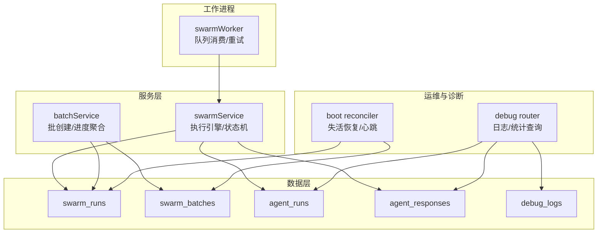
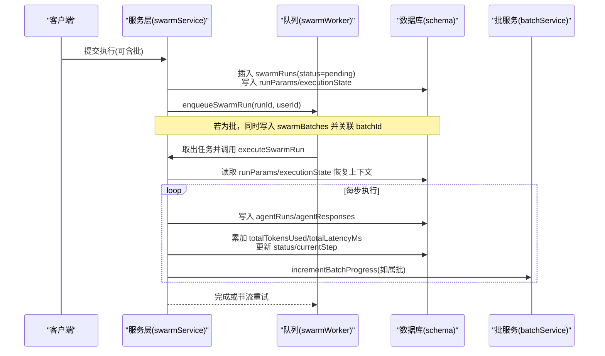
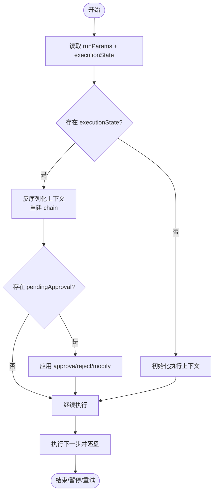
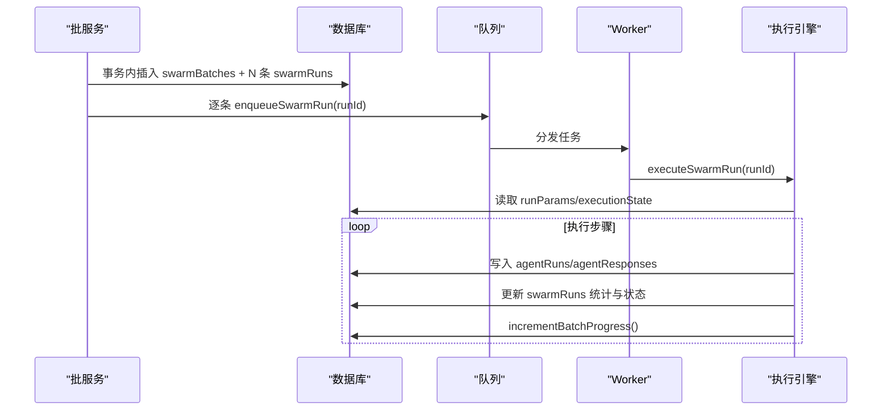
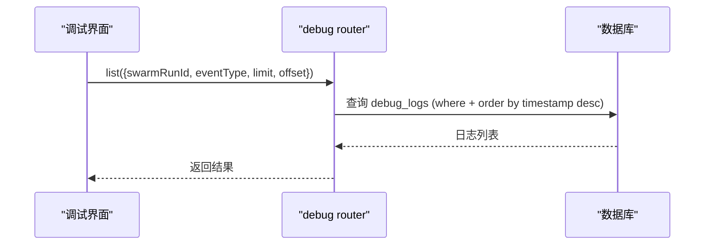
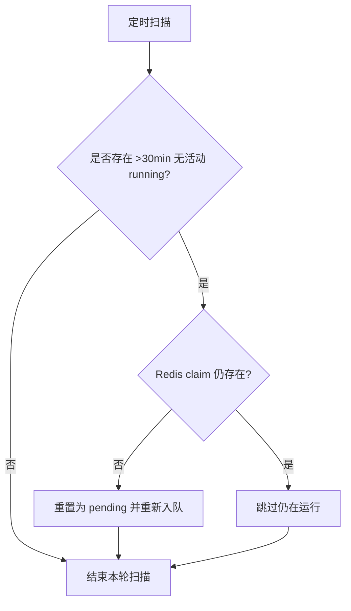
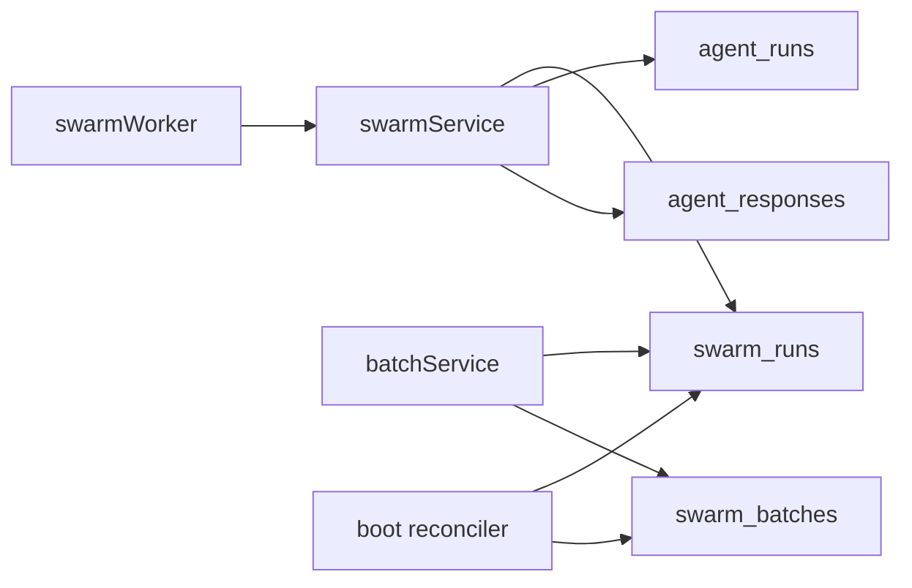

# 执行跟踪

<cite>
**本文引用的文件**
- [db/schema.ts](file://db/schema.ts)
- [api/services/swarmService.ts](file://api/services/swarmService.ts)
- [api/workers/swarmWorker.ts](file://api/workers/swarmWorker.ts)
- [api/services/batchService.ts](file://api/services/batchService.ts)
- [api/routers/debug.ts](file://api/routers/debug.ts)
- [api/boot.ts](file://api/boot.ts)
- [DeeWaanAI-Next/BATCH-HARDENING-HANDOFF.md](file://DeeWaanAI-Next/BATCH-HARDENING-HANDOFF.md)
</cite>

## 目录
1. [简介](#简介)
2. [项目结构](#项目结构)
3. [核心组件](#核心组件)
4. [架构总览](#架构总览)
5. [详细组件分析](#详细组件分析)
6. [依赖关系分析](#依赖关系分析)
7. [性能考量](#性能考量)
8. [故障排查指南](#故障排查指南)
9. [结论](#结论)
10. [附录](#附录)

## 简介
本文件为 DeeWaanAI 执行跟踪系统的数据模型与运行机制文档，聚焦以下目标：
- 详细说明 swarmRuns 表的结构与字段语义，包括运行状态管理（status、currentStep）、执行上下文（executionState、runParams）、资源使用统计（totalTokensUsed、totalLatencyMs）和批处理支持（batchId）。
- 记录代理执行历史（agentRuns）与响应存储（agentResponses）的数据结构。
- 解释调试日志（debug_logs）与错误追踪机制。
- 提供批量执行与并行处理的数据库设计要点。
- 说明执行状态持久化与恢复机制（crash-safe resume）。

## 项目结构
执行跟踪相关的数据模型集中在数据库 schema 中，运行时由服务层与 Worker 协作完成执行、状态更新与恢复；批处理由专用服务编排；调试与诊断通过路由暴露查询接口。

图表来源
- [db/schema.ts:173-237](file://db/schema.ts#L173-L237)
- [db/schema.ts:239-260](file://db/schema.ts#L239-L260)
- [db/schema.ts:262-335](file://db/schema.ts#L262-L335)
- [db/schema.ts:337-361](file://db/schema.ts#L337-L361)
- [api/services/swarmService.ts:247-284](file://api/services/swarmService.ts#L247-L284)
- [api/services/batchService.ts:45-142](file://api/services/batchService.ts#L45-L142)
- [api/workers/swarmWorker.ts:24-59](file://api/workers/swarmWorker.ts#L24-L59)
- [api/routers/debug.ts:1-42](file://api/routers/debug.ts#L1-L42)
- [api/boot.ts:265-286](file://api/boot.ts#L265-L286)

章节来源
- [db/schema.ts:173-361](file://db/schema.ts#L173-L361)
- [api/services/swarmService.ts:247-284](file://api/services/swarmService.ts#L247-L284)
- [api/services/batchService.ts:45-142](file://api/services/batchService.ts#L45-L142)
- [api/workers/swarmWorker.ts:24-59](file://api/workers/swarmWorker.ts#L24-L59)
- [api/routers/debug.ts:1-42](file://api/routers/debug.ts#L1-L42)
- [api/boot.ts:265-286](file://api/boot.ts#L265-L286)

## 核心组件
- swarmRuns：单次流水线执行的“运行”实体，承载状态、上下文、参数、资源统计与批归属。
- agentRuns：每个代理步骤的执行记录，包含输入、模型、耗时、Token 等。
- agentResponses：每个代理步骤的完整输出与元数据，支撑结果回溯与质量评估。
- debug_logs：细粒度事件日志（思考、动作、结果、错误、系统），用于排障与审计。
- swarmBatches：批分组，聚合成员运行数、完成/失败计数与 Token 总量。
- swarmWorker：队列消费者，负责拉取任务、调用执行引擎、处理节流与重试。
- batchService：批创建、进度原子递增、取消/恢复等生命周期管理。
- boot reconciler：周期性健康检查，修复丢失的任务与僵尸运行。

章节来源
- [db/schema.ts:173-361](file://db/schema.ts#L173-L361)
- [api/workers/swarmWorker.ts:24-59](file://api/workers/swarmWorker.ts#L24-L59)
- [api/services/batchService.ts:45-235](file://api/services/batchService.ts#L45-L235)
- [api/boot.ts:265-286](file://api/boot.ts#L265-L286)

## 架构总览
执行流程从请求进入服务层开始，写入 swarmRuns 并入队；Worker 消费任务，加载 runParams 与 executionState 恢复上下文，逐步推进 pipeline，持续落盘 agentRuns/agentResponses 与运行统计；批处理在 batchService 中统一编排，按成员完成度聚合批次状态；reconciler 定期修复异常状态。

图表来源
- [api/services/swarmService.ts:1417-1452](file://api/services/swarmService.ts#L1417-L1452)
- [api/workers/swarmWorker.ts:24-59](file://api/workers/swarmWorker.ts#L24-L59)
- [api/services/batchService.ts:107-142](file://api/services/batchService.ts#L107-L142)
- [db/schema.ts:173-237](file://db/schema.ts#L173-L237)
- [db/schema.ts:262-335](file://db/schema.ts#L262-L335)

## 详细组件分析

### 数据模型：swarmRuns
- 标识与归属
  - id：自增主键
  - projectId/userId：项目与用户归属
- 运行控制
  - status：运行状态（pending/running/completed/failed/cancelled 等）
  - currentStep：当前步骤名（如 init、step_1 等）
  - pipelineVersion：流水线版本
  - agentsUsed/iterationsUsed：使用的代理集合与迭代次数
  - isTestRun/testFixtureId：测试模式标记与夹具引用
  - finalResponseId：最终响应关联
- 资源统计
  - totalTokensUsed：累计 Token 消耗
  - totalLatencyMs：累计延迟毫秒
- 执行上下文与参数
  - executionState：JSON，保存执行指针、链式上下文、循环计数、待审批节点等，用于断点续跑
  - runParams：JSON，保存原始执行参数（source/prompt/giteeTokenEnc/memoryMode/attachments/includeProjectFiles/autoApprove/clientTraceId/stateless/chain 等），用于崩溃后重建执行环境
- 时间与批
  - startedAt/completedAt：起止时间
  - batchId：所属批 ID（NULL 表示独立运行）
  - error：错误信息（截断安全存储）

索引
- 按 project_id、user_id、status、batch_id 建立索引以优化查询与调度。

章节来源
- [db/schema.ts:173-237](file://db/schema.ts#L173-L237)

### 数据模型：swarmBatches（批）
- 标识与归属：id、userId、projectId
- 名称与状态：name、status（running/completed/completed_with_failures/cancelled 等）
- 规模与进度：totalRuns、completedRuns、failedRuns
- 资源统计：totalTokensUsed
- 时间：createdAt、completedAt

索引
- 按 user_id、project_id、status 建立索引。

章节来源
- [db/schema.ts:239-260](file://db/schema.ts#L239-L260)

### 数据模型：agentRuns（代理执行历史）
- 关联：swarm_run_id、agent_id（可选）、project_id
- 代理信息：agent_name、agent_role
- 步骤与迭代：pipeline_step、iteration
- 输入上下文：system_prompt、user_prompt、context_input
- 状态与指标：status、tokens_used、latency_ms、model_used、provider_used
- 时间：started_at、completed_at

索引
- 按 swarm_run_id、project_id 建立索引。

章节来源
- [db/schema.ts:262-289](file://db/schema.ts#L262-L289)

### 数据模型：agentResponses（响应存储）
- 关联：agent_run_id、swarm_run_id、project_id、parent_response_id（可选）
- 内容：response_type、content（大文本）
- 元数据：metadata（模型、提供商、Token 拆分、延迟、温度、最大令牌、角色、步骤、迭代、构建方法、来源响应、质量评分、人工评分等）
- 审核与标记：human_reviewed、human_notes、is_flagged
- 时间：created_at

索引
- 按 swarm_run_id、agent_run_id、project_id 建立索引。

章节来源
- [db/schema.ts:291-335](file://db/schema.ts#L291-L335)

### 数据模型：debug_logs（调试日志）
- 关联：swarm_run_id、agent_run_id（可选）、project_id
- 标识：prompt_id、agent_name
- 事件类型：event_type（thought/action/result/error/system）
- 负载：payload（message/details/latencyMs/tokensUsed）
- 时间：timestamp

索引
- 按 swarm_run_id、project_id 建立索引。

章节来源
- [db/schema.ts:337-361](file://db/schema.ts#L337-L361)

### 执行状态持久化与恢复
- 持久化位置：swarmRuns.executionState 与 runParams
- 恢复流程：
  - Worker 取出任务后，从 DB 读取 runParams 与 executionState
  - 反序列化执行上下文（currentIndex、链、循环计数、待审批等）
  - 根据 pendingApproval 决定前进或回退步骤
  - 继续执行并持续落盘中间结果与统计
- 关键实现路径
  - 上下文序列化/反序列化与链重建
  - 恢复时重新加载 agentResponses 以重建 chain
  - 清理 pendingApproval 避免重复处理

图表来源
- [api/services/swarmService.ts:247-284](file://api/services/swarmService.ts#L247-L284)
- [api/services/swarmService.ts:1417-1452](file://api/services/swarmService.ts#L1417-L1452)

章节来源
- [api/services/swarmService.ts:247-284](file://api/services/swarmService.ts#L247-L284)
- [api/services/swarmService.ts:1417-1452](file://api/services/swarmService.ts#L1417-L1452)

### 批处理与并行处理
- 批创建：
  - 事务内创建 swarmBatches 与多条 swarmRuns（status=pending，关联 batchId，runParams.stateless=true）
  - 逐条入队（去重键 run-{runId} 防止重复入队）
- 进度聚合：
  - 成员达到终态时原子递增 completedRuns/failedRuns/totalTokensUsed
  - 当 completed+failed >= totalRuns 时，将批次状态置为 completed 或 completed_with_failures，并记录 completedAt
- 取消与恢复：
  - 取消：将批次状态置 cancelled，并将非终态成员置 cancelled
  - 恢复：对非终态成员重新入队（支持 bypassDedup）
- 并行与并发：
  - Worker 基于队列并发消费（可通过环境变量配置）
  - 批成员默认 stateless 保证独立性，避免共享项目状态导致的非确定性

图表来源
- [api/services/batchService.ts:45-142](file://api/services/batchService.ts#L45-L142)
- [api/workers/swarmWorker.ts:24-59](file://api/workers/swarmWorker.ts#L24-L59)
- [api/services/swarmService.ts:1417-1452](file://api/services/swarmService.ts#L1417-L1452)

章节来源
- [api/services/batchService.ts:45-235](file://api/services/batchService.ts#L45-L235)
- [DeeWaanAI-Next/BATCH-HARDENING-HANDOFF.md:87-151](file://DeeWaanAI-Next/BATCH-HARDENING-HANDOFF.md#L87-L151)

### 调试日志与错误追踪
- 调试日志：
  - debug_logs 记录事件类型（思考/动作/结果/错误/系统）与负载（消息、详情、延迟、Token）
  - 支持按 swarmRunId、eventType 过滤分页查询
- 错误追踪：
  - swarmRuns.error 字段存储截断后的错误信息，便于前端展示与导出
  - 路由提供按项目/运行维度的统计（总 Token、总延迟、按角色分布、标记数量等）

图表来源
- [api/routers/debug.ts:1-42](file://api/routers/debug.ts#L1-L42)
- [db/schema.ts:337-361](file://db/schema.ts#L337-L361)

章节来源
- [api/routers/debug.ts:1-42](file://api/routers/debug.ts#L1-L42)
- [db/schema.ts:337-361](file://db/schema.ts#L337-L361)

### 运行状态管理与健康恢复
- 状态流转：
  - pending → running → completed/failed/cancelled
  - 批成员状态与批次整体状态联动
- 健康恢复：
  - 周期性 reconciler 扫描长时间无活动的 running 任务，结合 Redis claim 判断是否仍活跃
  - 对真正丢失的 pending 批成员进行长周期恢复（例如超过阈值后重新入队）
  - 对孤儿运行进行重置与再入队

图表来源
- [api/boot.ts:265-286](file://api/boot.ts#L265-L286)
- [DeeWaanAI-Next/BATCH-HARDENING-HANDOFF.md:121-151](file://DeeWaanAI-Next/BATCH-HARDENING-HANDOFF.md#L121-L151)

章节来源
- [api/boot.ts:265-286](file://api/boot.ts#L265-L286)
- [DeeWaanAI-Next/BATCH-HARDENING-HANDOFF.md:121-151](file://DeeWaanAI-Next/BATCH-HARDENING-HANDOFF.md#L121-L151)

## 依赖关系分析
- 数据层依赖
  - swarmRuns 与 agentRuns/agentResponses 通过外键级联删除，确保一致性
  - swarmBatches 与 swarmRuns 通过 batchId 关联，支持批维度聚合
  - debug_logs 与 swarmRuns/agentRuns 关联，便于定位问题
- 服务层依赖
  - swarmService 依赖 schema 中的多表进行读写，维护执行上下文与统计
  - batchService 依赖 swarmBatches/swarmRuns 进行批生命周期管理
  - swarmWorker 依赖队列与执行引擎，负责任务消费与重试
- 运维依赖
  - boot reconciler 依赖 Redis claim 与 DB 状态，保障健壮性

图表来源
- [db/schema.ts:173-361](file://db/schema.ts#L173-L361)
- [api/services/swarmService.ts:1417-1452](file://api/services/swarmService.ts#L1417-L1452)
- [api/services/batchService.ts:45-142](file://api/services/batchService.ts#L45-L142)
- [api/workers/swarmWorker.ts:24-59](file://api/workers/swarmWorker.ts#L24-L59)
- [api/boot.ts:265-286](file://api/boot.ts#L265-L286)

章节来源
- [db/schema.ts:173-361](file://db/schema.ts#L173-L361)
- [api/services/swarmService.ts:1417-1452](file://api/services/swarmService.ts#L1417-L1452)
- [api/services/batchService.ts:45-142](file://api/services/batchService.ts#L45-L142)
- [api/workers/swarmWorker.ts:24-59](file://api/workers/swarmWorker.ts#L24-L59)
- [api/boot.ts:265-286](file://api/boot.ts#L265-L286)

## 性能考量
- 索引优化：对高频查询字段（project_id、user_id、status、batch_id、swarm_run_id、agent_run_id）建立索引，提升筛选与聚合效率。
- 批处理隔离：批成员默认 stateless，避免共享项目状态带来的竞争与不确定性。
- 节流与重试：对供应商限流与账户额度不足做差异化处理，避免误停批任务。
- 资源统计：在每一步落盘时增量更新 totalTokensUsed/totalLatencyMs，减少额外聚合开销。
- 恢复策略：reconciler 结合 Redis claim 避免对活跃运行的误判，降低重复执行风险。

[本节为通用指导，不直接分析具体文件]

## 故障排查指南
- 查看调试日志
  - 使用 debug router 按 swarmRunId 与 eventType 过滤，获取最近 N 条日志
  - 关注 error 事件与 payload 中的 latencyMs/tokensUsed
- 检查运行状态
  - 查看 swarmRuns.status/currentStep/executionState，确认是否处于等待审批或卡住
  - 核对 totalTokensUsed/totalLatencyMs 是否与预期一致
- 批处理问题
  - 检查 swarmBatches.status 与 completedRuns/failedRuns 是否收敛
  - 对长期 pending 的批成员，确认是否被 reconciler 恢复
- 错误信息
  - 读取 swarmRuns.error 字段（已截断），结合 agentRuns/agentResponses 定位失败步骤

章节来源
- [api/routers/debug.ts:1-42](file://api/routers/debug.ts#L1-L42)
- [db/schema.ts:173-361](file://db/schema.ts#L173-L361)
- [api/services/batchService.ts:144-235](file://api/services/batchService.ts#L144-L235)
- [api/boot.ts:265-286](file://api/boot.ts#L265-L286)

## 结论
本系统通过清晰的数据库模型与分层服务架构，实现了可靠的执行跟踪、批处理与恢复能力：
- swarmRuns 作为执行核心，承载状态、上下文与统计，支持断点续跑。
- agentRuns/agentResponses 提供细粒度的执行历史与结果存储。
- debug_logs 与错误字段构成完整的排障链路。
- batchService 与 worker 协同实现高吞吐、可恢复的批量执行。
- reconciler 保障系统在异常场景下的自愈能力。

[本节为总结，不直接分析具体文件]

## 附录
- 字段语义速查
  - swarmRuns.status：pending/running/completed/failed/cancelled
  - swarmRuns.currentStep：当前步骤名（如 init、step_N）
  - swarmRuns.executionState：执行上下文（currentIndex、chain、iterationCounts、pendingApproval）
  - swarmRuns.runParams：执行参数（source/prompt/stateless/chain 等）
  - swarmRuns.totalTokensUsed/totalLatencyMs：累计资源统计
  - swarmRuns.batchId：批归属（NULL 表示独立运行）
  - agentRuns.*：代理步骤执行记录
  - agentResponses.*：代理输出与元数据
  - debug_logs.*：调试事件日志

[本节为补充说明，不直接分析具体文件]