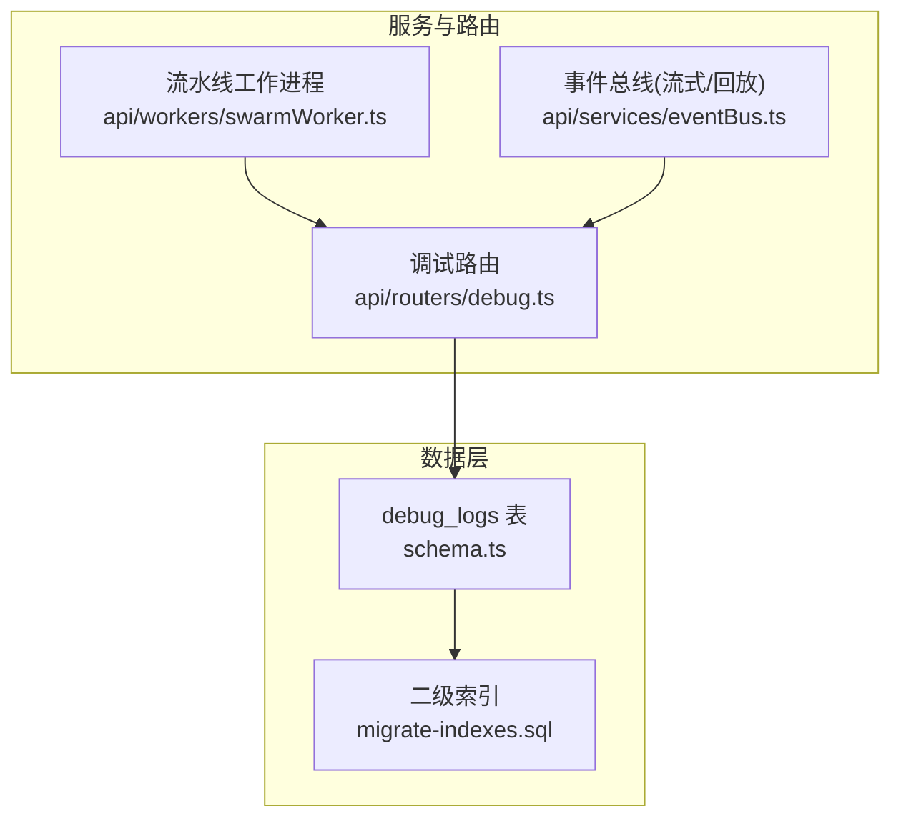
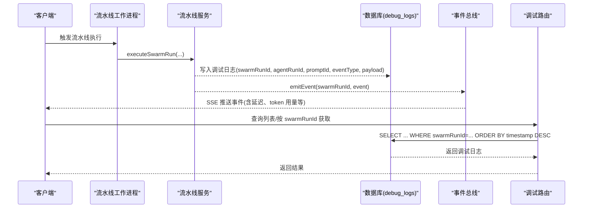
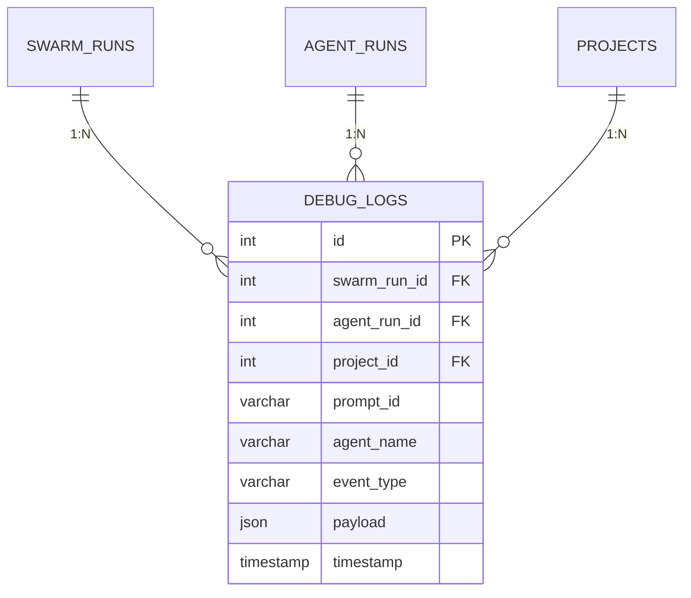
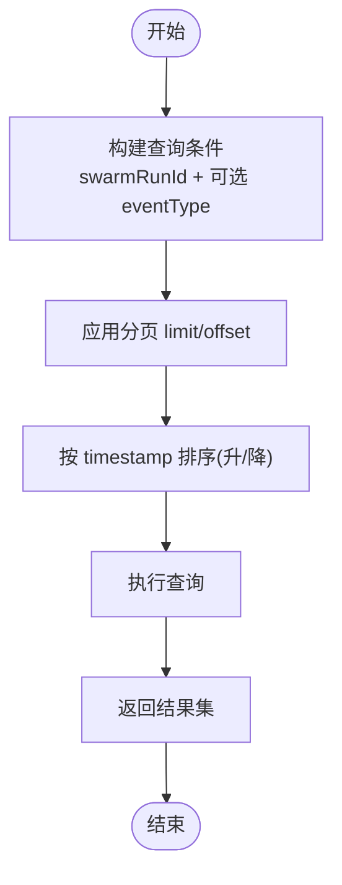
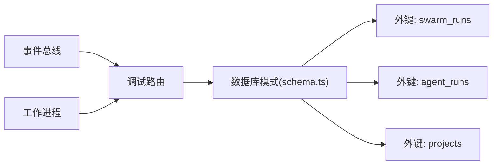

# 调试日志

<cite>
**本文引用的文件**
- [schema.ts](file://db/schema.ts)
- [migrate-indexes.sql](file://db/migrate-indexes.sql)
- [debug.ts](file://api/routers/debug.ts)
- [eventBus.ts](file://api/services/eventBus.ts)
- [swarmWorker.ts](file://api/workers/swarmWorker.ts)
</cite>

## 目录
1. [简介](#简介)
2. [项目结构](#项目结构)
3. [核心组件](#核心组件)
4. [架构总览](#架构总览)
5. [详细组件分析](#详细组件分析)
6. [依赖关系分析](#依赖关系分析)
7. [性能考虑](#性能考虑)
8. [故障排查指南](#故障排查指南)
9. [结论](#结论)
10. [附录](#附录)

## 简介
本文件为 DeeWaanAI 的 debugLogs 表提供完整的数据模型与使用文档，覆盖以下方面：
- 调试日志的记录机制与字段语义
- promptId 的唯一标识策略与 eventType 事件分类
- payload 字段的灵活结构设计（message、details、latencyMs、tokensUsed 等）
- 与 swarmRunId、agentRunId 的多层级关联追踪
- timestamp 的时间戳管理与索引优化
- 日志查询、过滤与导出能力
- 日志级别控制与存储策略建议
- 性能监控与错误诊断的使用场景

## 项目结构
debugLogs 表定义位于数据库模式文件中，并通过迁移脚本创建必要的二级索引；API 层提供按 swarmRunId 和 eventType 的查询接口；运行时通过工作进程与服务总线在流水线执行过程中产生并持久化调试事件。

图表来源
- [schema.ts:337-361](file://db/schema.ts#L337-L361)
- [migrate-indexes.sql:24-26](file://db/migrate-indexes.sql#L24-L26)
- [debug.ts:7-42](file://api/routers/debug.ts#L7-L42)
- [eventBus.ts:156-167](file://api/services/eventBus.ts#L156-L167)
- [swarmWorker.ts:24-59](file://api/workers/swarmWorker.ts#L24-L59)

章节来源
- [schema.ts:337-361](file://db/schema.ts#L337-L361)
- [migrate-indexes.sql:24-26](file://db/migrate-indexes.sql#L24-L26)
- [debug.ts:7-42](file://api/routers/debug.ts#L7-L42)

## 核心组件
- 数据模型：debugLogs 表包含自增主键 id、swarmRunId、agentRunId、projectId、promptId、agentName、eventType、payload、timestamp 等字段，并提供外键约束与索引。
- API 查询：提供 list 与 getBySwarmRun 两个查询端点，支持按 swarmRunId 与 eventType 过滤，默认按时间倒序分页。
- 事件总线：用于 SSE 流式推送与回放，便于前端实时展示调试事件。
- 工作进程：调度执行 swarm 流水线任务，并在执行过程中记录调试日志。

章节来源
- [schema.ts:337-361](file://db/schema.ts#L337-L361)
- [debug.ts:7-42](file://api/routers/debug.ts#L7-L42)
- [eventBus.ts:156-167](file://api/services/eventBus.ts#L156-L167)
- [swarmWorker.ts:24-59](file://api/workers/swarmWorker.ts#L24-L59)

## 架构总览
下图展示了从流水线执行到调试日志落库与前端展示的端到端流程。

图表来源
- [swarmWorker.ts:24-59](file://api/workers/swarmWorker.ts#L24-L59)
- [eventBus.ts:156-167](file://api/services/eventBus.ts#L156-L167)
- [debug.ts:7-42](file://api/routers/debug.ts#L7-L42)
- [schema.ts:337-361](file://db/schema.ts#L337-L361)

## 详细组件分析

### 数据模型：debugLogs 表
- 主键：id（自增）
- 关联键：
  - swarmRunId：关联 swarm_runs.id，表示一次“蜂群”运行上下文
  - agentRunId：可选，关联 agent_runs.id，定位到具体代理步骤
  - projectId：关联 projects.id，用于项目维度隔离
- 标识与分类：
  - promptId：varchar(64)，非空，作为本次提示/调用的唯一标识，便于跨阶段、跨步骤串联
  - agentName：varchar(100)，非空，记录调用代理名称
  - eventType：varchar(20)，非空，当前枚举值包括 thought、action、result、error、system
- 负载字段：
  - payload：JSON，非空，结构化承载调试信息，推荐包含 message、details、latencyMs、tokensUsed 等
- 时间戳：
  - timestamp：timestamp，默认 now()，用于排序与审计

图表来源
- [schema.ts:337-361](file://db/schema.ts#L337-L361)

章节来源
- [schema.ts:337-361](file://db/schema.ts#L337-L361)

### 事件分类与 payload 设计
- 事件类型（eventType）：
  - thought：代理思考过程或内部推理片段
  - action：代理执行的动作（如调用工具、读取文件等）
  - result：动作或步骤的结果摘要
  - error：异常或错误上下文
  - system：系统级事件（如开始、结束、重试、限流等）
- payload 字段建议：
  - message：人类可读的简要说明
  - details：扩展元数据（对象），可包含请求参数、上下文片段、链路信息等
  - latencyMs：耗时（毫秒），用于性能分析
  - tokensUsed：消耗 token 数，用于成本与效率分析
  - 其他：可根据需要扩展，保持向后兼容

章节来源
- [debug.ts:10-14](file://api/routers/debug.ts#L10-L14)
- [schema.ts:351-356](file://db/schema.ts#L351-L356)

### 多层级追踪：swarmRunId 与 agentRunId
- swarmRunId：顶层运行上下文，贯穿整个流水线生命周期
- agentRunId：细粒度代理步骤，结合 pipelineStep 与 iteration 可在 agent_runs 中精确定位
- 通过这两类 ID 可将调试日志与响应链、步骤状态进行关联，形成“运行→步骤→事件”的完整追踪链

章节来源
- [schema.ts:337-361](file://db/schema.ts#L337-L361)

### 时间戳与索引优化
- timestamp：默认 now()，用于排序与审计；查询时按时间倒序返回最新事件
- 索引：
  - swarm_run_id 索引：加速按运行上下文检索
  - project_id 索引：加速按项目维度检索
- 建议在高频查询场景下增加复合索引（如 swarm_run_id + timestamp）以优化分页与时间范围查询

章节来源
- [schema.ts:358-361](file://db/schema.ts#L358-L361)
- [migrate-indexes.sql:24-26](file://db/migrate-indexes.sql#L24-L26)

### 查询、过滤与导出
- 列表查询：支持 swarmRunId 必填、eventType 可选过滤，默认 limit=100、offset=0，按 timestamp 降序
- 按运行获取：按 swarmRunId 升序返回，适合构建时序视图
- 导出建议：基于上述查询组合条件，将结果导出为 CSV/JSON，便于离线分析与归档

图表来源
- [debug.ts:7-42](file://api/routers/debug.ts#L7-L42)

章节来源
- [debug.ts:7-42](file://api/routers/debug.ts#L7-L42)

### 实时展示与回放
- 事件总线负责本地缓冲与跨节点广播，支持最近 5 分钟的重放窗口
- 前端可通过 SSE 订阅 swarm:<runId> 通道，实时接收调试事件
- 终端事件（完成/错误）会持久化，确保断线重连后可恢复

章节来源
- [eventBus.ts:1-172](file://api/services/eventBus.ts#L1-L172)

### 写入路径与工作进程
- 流水线由工作进程消费队列任务并执行，执行过程中记录调试日志
- 若需节流或重试，工作进程会将任务重新入队并延迟执行
- 调试日志应包含 swarmRunId、agentRunId、promptId、eventType、payload 等关键字段，确保可追溯性

章节来源
- [swarmWorker.ts:24-59](file://api/workers/swarmWorker.ts#L24-L59)

## 依赖关系分析
- 数据模型依赖：
  - debug_logs.swarm_run_id → swarm_runs.id（级联删除）
  - debug_logs.agent_run_id → agent_runs.id（级联删除）
  - debug_logs.project_id → projects.id（级联删除）
- 查询依赖：
  - 调试路由依赖 schema 中的表定义与 Drizzle ORM 操作
  - 事件总线依赖 pub/sub 实现，失败不影响本地投递
- 外部依赖：
  - 数据库 MySQL（Drizzle ORM）
  - 队列与 worker（BullMQ/内存队列）

图表来源
- [schema.ts:337-361](file://db/schema.ts#L337-L361)
- [debug.ts:7-42](file://api/routers/debug.ts#L7-L42)
- [eventBus.ts:156-167](file://api/services/eventBus.ts#L156-L167)
- [swarmWorker.ts:24-59](file://api/workers/swarmWorker.ts#L24-L59)

章节来源
- [schema.ts:337-361](file://db/schema.ts#L337-L361)
- [debug.ts:7-42](file://api/routers/debug.ts#L7-L42)

## 性能考虑
- 索引策略：
  - 已存在 swarm_run_id 与 project_id 索引，满足常见过滤需求
  - 建议针对高频查询增加复合索引（如 swarm_run_id + timestamp）以提升分页与时间范围查询性能
- JSON 字段：
  - payload 为 JSON，避免对大对象频繁全量扫描；必要时可对常用字段建立生成列或冗余字段以优化查询
- 写入吞吐：
  - 在高并发流水线场景下，批量写入与异步落库可降低请求延迟
- 缓存与回放：
  - 利用事件总线的 5 分钟回放窗口减少重复查询压力

[本节为通用性能建议，不直接分析具体文件]

## 故障排查指南
- 常见问题定位：
  - 缺失 swarmRunId 或 agentRunId：检查写入逻辑是否携带必要上下文
  - eventType 不在允许集合：确认调用方使用的枚举值
  - payload 过大：限制 message/details 大小，避免影响查询与存储
- 查询技巧：
  - 按 swarmRunId 获取全部事件，再按 eventType 筛选特定阶段
  - 使用 timestamp 范围过滤快速定位问题时段
- 实时观察：
  - 通过事件总线订阅 swarm:<runId> 通道，观察 step_start/step_complete/step_error/pipeline_complete/pipeline_error 等事件
- 回滚与清理：
  - 级联删除：当 swarm_runs/agent_runs/projects 被删除时，debug_logs 对应记录将被级联清理

章节来源
- [debug.ts:7-42](file://api/routers/debug.ts#L7-L42)
- [eventBus.ts:1-172](file://api/services/eventBus.ts#L1-L172)

## 结论
debugLogs 表以 swarmRunId 与 agentRunId 为核心关联键，配合 promptId 与 eventType，形成了从运行到步骤再到事件的完整调试追踪体系。payload 的 JSON 设计提供了灵活的扩展空间，支持 message、details、latencyMs、tokensUsed 等多维调试信息。通过合理的索引与查询接口，可实现高效的日志检索与分析。结合事件总线的实时推送与回放能力，可有效支撑性能监控与错误诊断。

[本节为总结性内容，不直接分析具体文件]

## 附录

### 字段字典
- id：自增主键
- swarmRunId：蜂群运行 ID（外键）
- agentRunId：代理步骤 ID（外键，可选）
- projectId：项目 ID（外键）
- promptId：提示/调用唯一标识（varchar 64）
- agentName：代理名称（varchar 100）
- eventType：事件类型（thought/action/result/error/system）
- payload：调试负载（JSON，包含 message、details、latencyMs、tokensUsed 等）
- timestamp：事件时间戳（默认 now()）

章节来源
- [schema.ts:337-361](file://db/schema.ts#L337-L361)

### API 参考
- 列表查询：
  - 输入：swarmRunId（必填）、eventType（可选）、limit（默认 100）、offset（默认 0）
  - 行为：按 swarmRunId 过滤，可选 eventType，按 timestamp 降序分页
- 按运行获取：
  - 输入：swarmRunId（必填）
  - 行为：按 timestamp 升序返回该运行的全部事件

章节来源
- [debug.ts:7-42](file://api/routers/debug.ts#L7-L42)