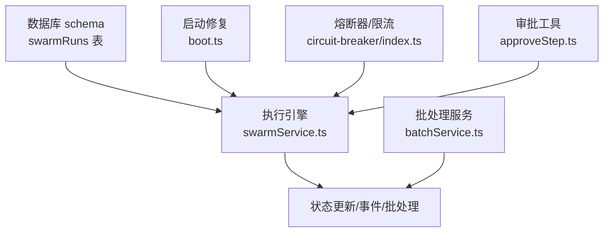
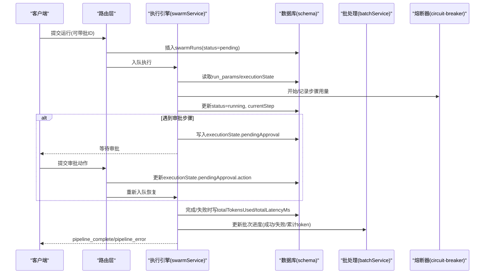
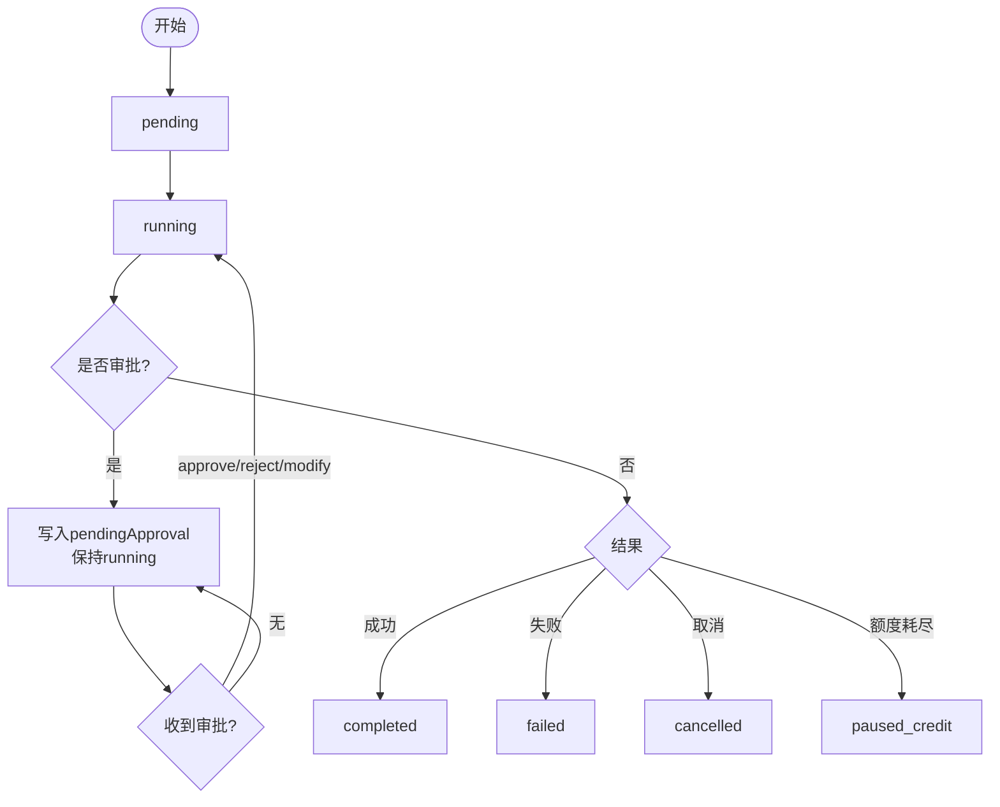
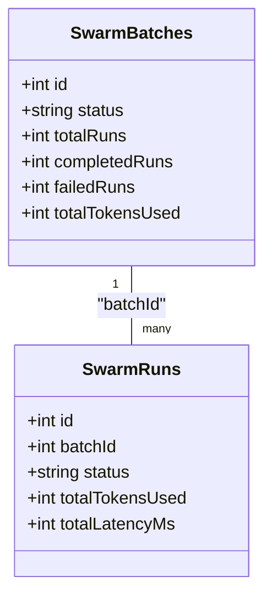
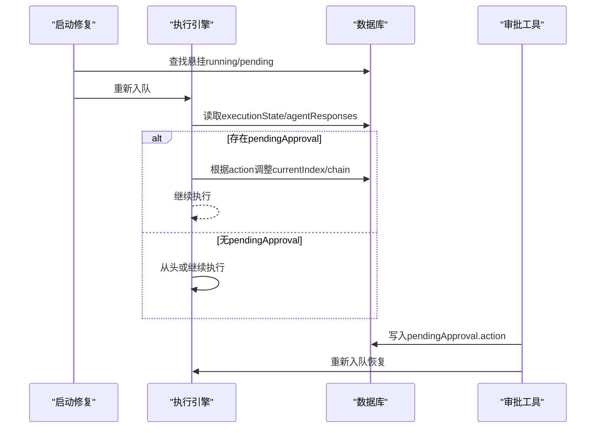
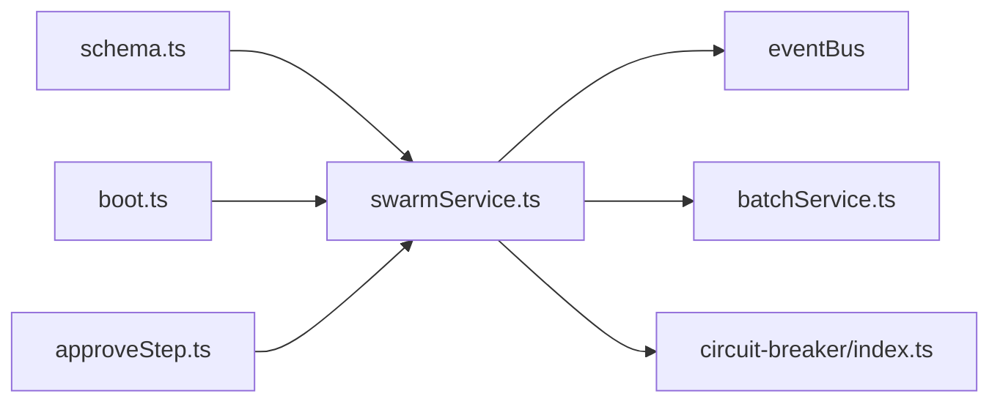

# 运行管理

<cite>
**本文引用的文件**
- [db/schema.ts](file://db/schema.ts)
- [api/services/swarmService.ts](file://api/services/swarmService.ts)
- [api/boot.ts](file://api/boot.ts)
- [api/routers/swarm.ts](file://api/routers/swarm.ts)
- [api/mcp/tools/approveStep.ts](file://api/mcp/tools/approveStep.ts)
- [api/plugins/circuit-breaker/index.ts](file://api/plugins/circuit-breaker/index.ts)
- [api/services/batchService.ts](file://api/services/batchService.ts)
- [scripts/run-migration-019.mjs](file://scripts/run-migration-019.mjs)
</cite>

## 目录
1. [简介](#简介)
2. [项目结构](#项目结构)
3. [核心组件](#核心组件)
4. [架构总览](#架构总览)
5. [详细组件分析](#详细组件分析)
6. [依赖关系分析](#依赖关系分析)
7. [性能考量](#性能考量)
8. [故障排查指南](#故障排查指南)
9. [结论](#结论)
10. [附录](#附录)

## 简介
本文件围绕 swarmRuns 表构建数据模型与运行管理机制文档，重点说明：
- 运行状态 status 的状态机（pending、running、completed、failed、cancelled、paused_credit）及转换规则。
- currentStep 字段在步骤推进中的作用。
- executionState 的执行上下文结构（currentIndex、chain、iterationCounts、visitCounts、modifyInstructions、pendingApproval）。
- runParams 的持久化设计，支持 execute 与 resumePipeline 两种模式。
- 批处理 batchId 的设计与进度聚合。
- 资源使用统计 totalTokensUsed 与 totalLatencyMs 的收集机制。
- 运行恢复与断点续传的实现原理（含人类审批暂停与恢复）。

## 项目结构
swarmRuns 表定义位于数据库 schema，执行引擎与状态更新逻辑集中在服务层，启动阶段提供崩溃恢复能力，批处理由独立服务维护。

**图表来源**
- [db/schema.ts:174-237](file://db/schema.ts#L174-L237)
- [api/services/swarmService.ts:1000-1141](file://api/services/swarmService.ts#L1000-L1141)
- [api/boot.ts:197-230](file://api/boot.ts#L197-L230)
- [api/services/batchService.ts:107-141](file://api/services/batchService.ts#L107-L141)
- [api/plugins/circuit-breaker/index.ts:99-145](file://api/plugins/circuit-breaker/index.ts#L99-L145)
- [api/mcp/tools/approveStep.ts:35-99](file://api/mcp/tools/approveStep.ts#L35-L99)

**章节来源**
- [db/schema.ts:174-237](file://db/schema.ts#L174-L237)
- [api/services/swarmService.ts:1000-1141](file://api/services/swarmService.ts#L1000-L1141)
- [api/boot.ts:197-230](file://api/boot.ts#L197-L230)
- [api/services/batchService.ts:107-141](file://api/services/batchService.ts#L107-L141)
- [api/plugins/circuit-breaker/index.ts:99-145](file://api/plugins/circuit-breaker/index.ts#L99-L145)
- [api/mcp/tools/approveStep.ts:35-99](file://api/mcp/tools/approveStep.ts#L35-L99)

## 核心组件
- 数据模型：swarmRuns 表包含运行元数据、执行上下文、参数快照、时间戳与批关联等。
- 执行引擎：swarmService.ts 负责流水线调度、步骤推进、审批暂停、错误处理、完成/失败收尾。
- 启动修复：boot.ts 在应用启动时扫描“悬挂”的 running/pending 任务并重新入队。
- 批处理：batchService.ts 维护批次进度、完成/失败计数与聚合 token 用量。
- 熔断与限制：circuit-breaker 模块跟踪每步 token/成本/迭代次数，防止无限循环与超耗。
- 审批流程：approveStep.ts 与路由层写入 pendingApproval 并触发恢复。

**章节来源**
- [db/schema.ts:174-237](file://db/schema.ts#L174-L237)
- [api/services/swarmService.ts:247-269](file://api/services/swarmService.ts#L247-L269)
- [api/boot.ts:197-230](file://api/boot.ts#L197-L230)
- [api/services/batchService.ts:107-141](file://api/services/batchService.ts#L107-L141)
- [api/plugins/circuit-breaker/index.ts:31-56](file://api/plugins/circuit-breaker/index.ts#L31-L56)
- [api/mcp/tools/approveStep.ts:35-99](file://api/mcp/tools/approveStep.ts#L35-L99)

## 架构总览
下图展示从创建到完成的完整生命周期，包括人类审批暂停与恢复、批处理进度聚合与资源统计落库。

**图表来源**
- [api/services/swarmService.ts:1000-1141](file://api/services/swarmService.ts#L1000-L1141)
- [api/services/swarmService.ts:1417-1452](file://api/services/swarmService.ts#L1417-L1452)
- [api/mcp/tools/approveStep.ts:35-99](file://api/mcp/tools/approveStep.ts#L35-L99)
- [api/services/batchService.ts:107-141](file://api/services/batchService.ts#L107-L141)
- [api/plugins/circuit-breaker/index.ts:115-145](file://api/plugins/circuit-breaker/index.ts#L115-L145)

## 详细组件分析

### 数据模型：swarmRuns 表
- 标识与归属：id、projectId、userId。
- 运行控制：status（默认 pending）、currentStep（默认 init）、pipelineVersion、agentsUsed、iterationsUsed、isTestRun、testFixtureId、finalResponseId。
- 资源统计：totalTokensUsed、totalLatencyMs。
- 执行上下文：executionState（JSON），包含 currentIndex、chain、iterationCounts、visitCounts、modifyInstructions、pendingApproval。
- 参数快照：runParams（JSON），source 为 execute 或 resumePipeline，并携带 prompt、giteeTokenEnc、memoryMode、attachments、includeProjectFiles、autoApprove、clientTraceId、stateless、chain（目标项目、模板、深度、血缘）。
- 时间戳：startedAt、completedAt。
- 批关联：batchId（可为空，表示独立运行）。
- 错误信息：error。

索引优化：按 projectId、userId、status、batchId 建立索引以加速查询与状态筛选。

**章节来源**
- [db/schema.ts:174-237](file://db/schema.ts#L174-L237)
- [scripts/run-migration-019.mjs:38-48](file://scripts/run-migration-019.mjs#L38-L48)

### 运行状态机与转换
- 初始：pending（新建后入队前）。
- 运行中：running（开始执行）。
- 审批暂停：仍为 running，但 executionState.pendingApproval 存在；等待外部审批。
- 完成：completed（正常结束，写入 finalResponseId、totalTokensUsed、totalLatencyMs，清空 executionState）。
- 失败/取消：failed/cancelled（写入 error 或清空 error，清空 executionState）。
- 批暂停：paused_credit（当批次因额度耗尽而暂停，通知用户充值后可恢复）。

关键转换点：
- 开始执行：进入 running。
- 审批暂停：保持 running，写入 pendingApproval。
- 审批恢复：继续执行，直至完成/失败。
- 异常路径：根据错误类型决定 failed/cancelled/paused_credit。

**图表来源**
- [api/services/swarmService.ts:1000-1141](file://api/services/swarmService.ts#L1000-L1141)
- [api/mcp/tools/approveStep.ts:35-99](file://api/mcp/tools/approveStep.ts#L35-L99)

**章节来源**
- [api/services/swarmService.ts:1000-1141](file://api/services/swarmService.ts#L1000-L1141)
- [api/mcp/tools/approveStep.ts:35-99](file://api/mcp/tools/approveStep.ts#L35-L99)

### 执行上下文 executionState
- currentIndex：当前执行到的步骤索引。
- chain：已生成的响应链（仅保留必要字段用于序列化）。
- iterationCounts：每个步骤的迭代计数（WHILE 循环用）。
- visitCounts：访问计数（通用循环控制）。
- modifyInstructions：修改指令（用于 reject/modify 回退时的提示）。
- pendingApproval：人类审批状态，包含 stepOrder、lastOutput、action（approve/reject/modify）、instructions。

序列化和反序列化：
- 执行过程中定期将上下文序列化到 executionState，确保崩溃后可恢复。
- 恢复时从 agentResponses 重建 chain，并根据 pendingApproval 调整 currentIndex 与 chain 长度。

**章节来源**
- [api/services/swarmService.ts:247-269](file://api/services/swarmService.ts#L247-L269)
- [api/services/swarmService.ts:1417-1452](file://api/services/swarmService.ts#L1417-L1452)

### 参数持久化 runParams
- source：区分 execute 与 resumePipeline 两种入口。
- prompt：用户原始输入（恢复时若为空则回退到 userPrompt）。
- giteeTokenEnc：加密存储的仓库令牌。
- memoryMode：内存模式配置。
- attachments/includeProjectFiles/autoApprove/clientTraceId/stateless：运行时开关与附件。
- chain：研究模式的流水线串联（targetProjectId、inputTemplate、depth、lineage）。

用途：
- 工作进程崩溃/重启后，通过 runParams 重建执行环境，实现断点续传。
- 支持流水线级联，自动创建下游运行。

**章节来源**
- [db/schema.ts:207-226](file://db/schema.ts#L207-L226)
- [api/services/swarmService.ts:63-83](file://api/services/swarmService.ts#L63-L83)
- [api/services/swarmService.ts:1456-1492](file://api/services/swarmService.ts#L1456-L1492)

### 批处理支持 batchId
- 设计：swarmRuns.batchId 指向 swarmBatches.id，NULL 表示独立运行。
- 进度聚合：incrementBatchProgress 原子更新 completedRuns、failedRuns、totalTokensUsed，并在全部完成后设置批次最终状态（completed/completed_with_failures）。
- 取消/恢复：cancelBatch 批量标记非终态运行；resumeBatch 重入队未终态成员。

**图表来源**
- [db/schema.ts:239-260](file://db/schema.ts#L239-L260)
- [db/schema.ts:174-237](file://db/schema.ts#L174-L237)

**章节来源**
- [api/services/batchService.ts:107-141](file://api/services/batchService.ts#L107-L141)
- [api/services/batchService.ts:144-185](file://api/services/batchService.ts#L144-L185)
- [api/services/batchService.ts:201-230](file://api/services/batchService.ts#L201-L230)
- [scripts/run-migration-019.mjs:38-48](file://scripts/run-migration-019.mjs#L38-L48)

### 资源使用统计 totalTokensUsed 与 totalLatencyMs
- 收集点：
  - 每步调用后通过熔断器记录 token/成本/迭代次数。
  - 完成时汇总写入 swarmRuns.totalTokensUsed 与 totalLatencyMs。
  - 批级别聚合 totalTokensUsed 至 swarmBatches。
- 作用：
  - 成本核算、配额控制、性能分析。
  - 研究模式下的指标采集与导出。

**章节来源**
- [api/plugins/circuit-breaker/index.ts:115-145](file://api/plugins/circuit-breaker/index.ts#L115-L145)
- [api/services/swarmService.ts:1018-1039](file://api/services/swarmService.ts#L1018-L1039)
- [api/services/batchService.ts:107-141](file://api/services/batchService.ts#L107-L141)

### 运行恢复与断点续传
- 启动修复：boot.ts 在启动时扫描“悬挂”的 running 任务，重置为 pending 并重新入队；pending 未领取的任务也重新入队。
- 执行恢复：
  - 读取 executionState 与 agentResponses 重建上下文。
  - 若存在 pendingApproval，依据 action 调整 currentIndex 与 chain，清除 pendingApproval 避免重复处理。
  - 恢复 builderPrompt（必要时使用 userPrompt）。
- 审批恢复：approveStep.ts 写入 pendingApproval.action 后重新入队，worker 恢复执行。

**图表来源**
- [api/boot.ts:197-230](file://api/boot.ts#L197-L230)
- [api/services/swarmService.ts:1417-1452](file://api/services/swarmService.ts#L1417-L1452)
- [api/mcp/tools/approveStep.ts:35-99](file://api/mcp/tools/approveStep.ts#L35-L99)

**章节来源**
- [api/boot.ts:197-230](file://api/boot.ts#L197-L230)
- [api/services/swarmService.ts:1417-1452](file://api/services/swarmService.ts#L1417-L1452)
- [api/mcp/tools/approveStep.ts:35-99](file://api/mcp/tools/approveStep.ts#L35-L99)

## 依赖关系分析
- swarmService.ts 依赖 schema 进行读写，依赖 eventBus 发送事件，依赖 batchService 更新批进度，依赖 circuit-breaker 做限额与迭代保护。
- boot.ts 在启动时依赖 schema 与队列能力进行修复。
- approveStep.ts 与路由层协作，更新 executionState 并触发恢复。
- batchService.ts 与 schema 交互，维护批次状态与成员状态。

**图表来源**
- [api/services/swarmService.ts:13-24](file://api/services/swarmService.ts#L13-L24)
- [api/boot.ts:197-230](file://api/boot.ts#L197-L230)
- [api/mcp/tools/approveStep.ts:35-99](file://api/mcp/tools/approveStep.ts#L35-L99)
- [api/services/batchService.ts:107-141](file://api/services/batchService.ts#L107-L141)
- [api/plugins/circuit-breaker/index.ts:99-145](file://api/plugins/circuit-breaker/index.ts#L99-L145)

**章节来源**
- [api/services/swarmService.ts:13-24](file://api/services/swarmService.ts#L13-L24)
- [api/boot.ts:197-230](file://api/boot.ts#L197-L230)
- [api/mcp/tools/approveStep.ts:35-99](file://api/mcp/tools/approveStep.ts#L35-L99)
- [api/services/batchService.ts:107-141](file://api/services/batchService.ts#L107-L141)
- [api/plugins/circuit-breaker/index.ts:99-145](file://api/plugins/circuit-breaker/index.ts#L99-L145)

## 性能考量
- 状态更新频率：每次步骤推进与审批暂停均写入 executionState，建议结合事件总线与异步落库减少阻塞。
- 批处理聚合：incrementBatchProgress 使用原子 SQL 更新，避免竞争条件。
- 熔断与限流：通过 circuit-breaker 限制 WHILE 迭代次数与 token/成本上限，防止无限循环与超耗。
- 恢复效率：恢复时仅重建必要上下文（chain 与计数器），避免全量重建。

[本节为通用指导，不直接分析具体文件]

## 故障排查指南
- 悬挂任务：检查 boot.ts 的修复逻辑是否生效，确认 running/pending 任务被重置并重新入队。
- 审批卡住：确认 executionState.pendingApproval 是否存在且 action 正确，检查 approveStep.ts 是否正确更新并重新入队。
- 批暂停：若出现 paused_credit，需充值额度后恢复；检查 batchService 的暂停与恢复逻辑。
- 资源超限：查看 circuit-breaker 的限制策略与记录，确认是否达到 maxIterations 或 token/cost 上限。

**章节来源**
- [api/boot.ts:197-230](file://api/boot.ts#L197-L230)
- [api/mcp/tools/approveStep.ts:35-99](file://api/mcp/tools/approveStep.ts#L35-L99)
- [api/services/batchService.ts:107-141](file://api/services/batchService.ts#L107-L141)
- [api/plugins/circuit-breaker/index.ts:99-145](file://api/plugins/circuit-breaker/index.ts#L99-L145)

## 结论
swarmRuns 表作为运行管理的核心载体，配合执行引擎、启动修复、批处理与熔断机制，实现了可靠的流水线执行、人类审批暂停与恢复、批处理进度聚合以及资源统计。通过 executionState 与 runParams 的持久化，系统具备强大的断点续传能力，能够在崩溃或部署后无缝恢复。未来可进一步优化状态更新频率与恢复重建效率，以提升整体吞吐与稳定性。

[本节为总结性内容，不直接分析具体文件]

## 附录
- 状态字段说明：
  - status：pending、running、completed、failed、cancelled、paused_credit。
  - currentStep：当前步骤名称或序号，辅助定位执行位置。
- executionState 关键字段：
  - currentIndex：当前步骤索引。
  - chain：历史响应链（精简序列化）。
  - iterationCounts：WHILE 迭代计数。
  - visitCounts：通用访问计数。
  - modifyInstructions：修改指令。
  - pendingApproval：审批状态（stepOrder、lastOutput、action、instructions）。
- runParams 关键字段：
  - source：execute 或 resumePipeline。
  - prompt/giteeTokenEnc/memoryMode/attachments/includeProjectFiles/autoApprove/clientTraceId/stateless。
  - chain：流水线串联（targetProjectId、inputTemplate、depth、lineage）。
- 批处理关键字段：
  - batchId：关联 swarmBatches.id。
  - swarmBatches：totalRuns、completedRuns、failedRuns、totalTokensUsed、status。

**章节来源**
- [db/schema.ts:174-237](file://db/schema.ts#L174-L237)
- [db/schema.ts:239-260](file://db/schema.ts#L239-L260)
- [api/services/swarmService.ts:247-269](file://api/services/swarmService.ts#L247-L269)
- [api/services/swarmService.ts:63-83](file://api/services/swarmService.ts#L63-L83)