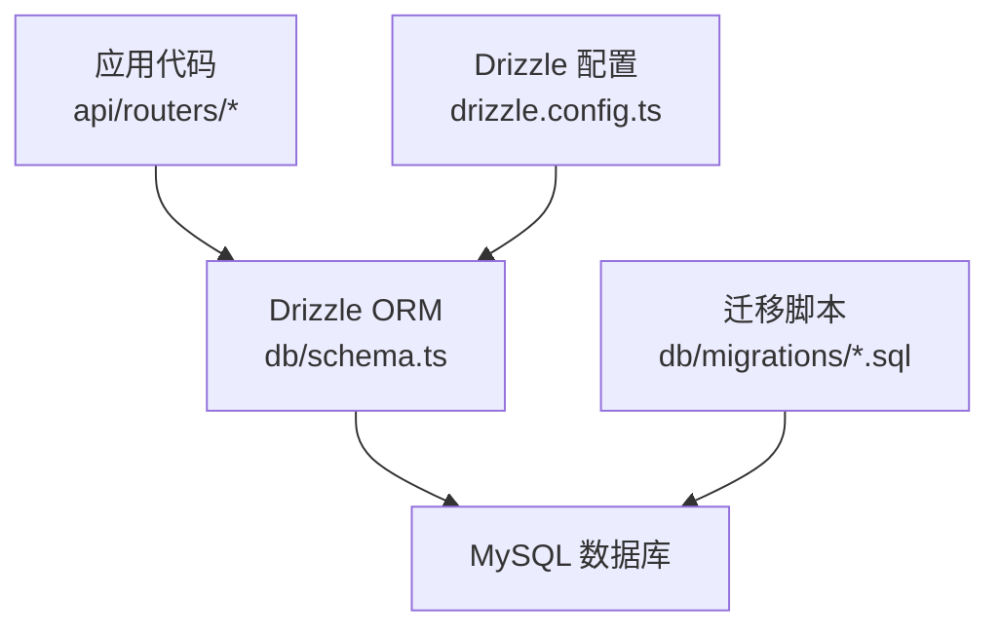
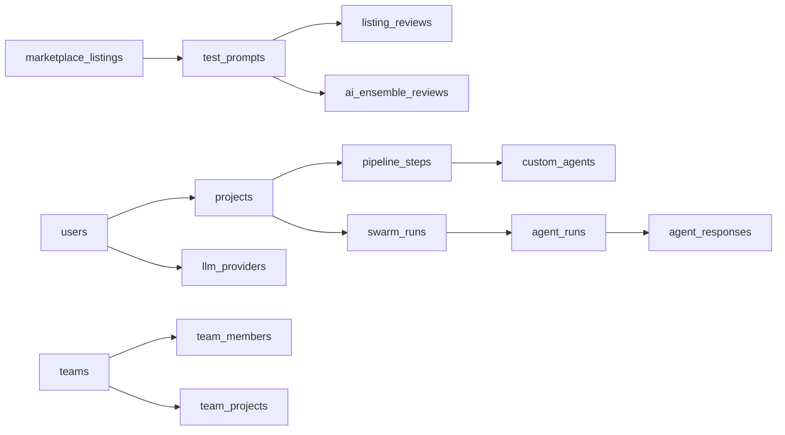

# 数据模型

<cite>
**本文引用的文件**
- [db/schema.ts](file://db/schema.ts)
- [db/relations.ts](file://db/relations.ts)
- [drizzle.config.ts](file://drizzle.config.ts)
- [api/routers/project.ts](file://api/routers/project.ts)
- [api/routers/marketplace.ts](file://api/routers/marketplace.ts)
- [db/migrations/009_foundation.sql](file://db/migrations/009_foundation.sql)
- [db/migrations/014_marketplace_trust.sql](file://db/migrations/014_marketplace_trust.sql)
</cite>

## 目录
1. [简介](#简介)
2. [项目结构](#项目结构)
3. [核心组件](#核心组件)
4. [架构总览](#架构总览)
5. [详细组件分析](#详细组件分析)
6. [依赖关系分析](#依赖关系分析)
7. [性能与索引策略](#性能与索引策略)
8. [数据验证与业务约束](#数据验证与业务约束)
9. [故障排查指南](#故障排查指南)
10. [结论](#结论)
11. [附录：Drizzle ORM 类型定义与使用方式](#附录drizzle-orm-类型定义与使用方式)

## 简介
本文件为 DeeWaanAI 的核心数据模型文档，覆盖用户、项目、代理（Agent）、流水线（Pipeline）、市场（Marketplace）等关键实体及其关系。内容包含字段定义、主键/外键约束、索引策略、数据类型选择、关联关系说明（一对一、一对多、多对多）、ER 图与示例数据、数据验证规则与业务约束，以及 Drizzle ORM 的 TypeScript 类型定义与使用方式。目标是帮助开发者快速理解并正确使用数据库层。

## 项目结构
数据模型以 Drizzle ORM 在 db/schema.ts 中统一定义，并通过 MySQL 迁移脚本演进。API 路由通过 drizzle-orm 查询这些表，实现业务逻辑。配置位于 drizzle.config.ts，指定 schema 路径、输出目录和数据库方言。

图表来源
- [db/schema.ts:1-16](file://db/schema.ts#L1-L16)
- [drizzle.config.ts:9-16](file://drizzle.config.ts#L9-L16)

章节来源
- [db/schema.ts:1-16](file://db/schema.ts#L1-L16)
- [drizzle.config.ts:1-17](file://drizzle.config.ts#L1-L17)

## 核心组件
- 用户（users）：支持 OAuth 和本地账户，角色、订阅层级、默认 LLM 提供者与模型、偏好设置等。
- LLM 提供者（llm_providers）：插件化配置，存储加密密钥引用、默认模型、可用模型列表与参数。
- 项目（projects）：用户或团队的项目容器，集成 Gitee/GitHub，默认提供者与模型，流水线配置与智能卡片。
- 代理（agents/custom_agents）：可复用的 Agent 模板与实例，用于流水线步骤。
- 流水线（pipeline_steps/pipeline_templates）：按顺序执行的步骤序列，支持条件分支、循环与人工审批。
- 运行记录（swarm_runs/agent_runs/agent_responses/debug_logs）：记录一次或多步执行过程、中间结果与调试信息。
- 市场（marketplace_listings/test_prompts/listing_reviews/ai_ensemble_reviews/reviewer_profiles/review_assignments/blind_review_tasks/creator_deposits/refund_ledger/marketplace_purchases/test_prompt_intermediate/encrypted_prompts）：提供可购买/订阅的流水线模板与评测体系。
- 团队与协作（teams/team_members/team_projects/test_fixtures）：团队协作、共享项目与测试用例包。
- 计费与权限（subscriptions/entitlements/usage_counters/idempotency_keys/oauth_refresh_tokens/vouchers/voucher_redemptions）：订阅、能力授予、用量计量、幂等与 OAuth。
- 企业功能（sso_connections/relay_registrations/relay_requests/admin_audit_log/waitlist_entries）：SSO、中继注册、请求队列、审计日志与候补名单。

章节来源
- [db/schema.ts:17-1332](file://db/schema.ts#L17-L1332)

## 架构总览
下图展示核心实体之间的关系：用户拥有项目和 LLM 提供者；项目包含代理与流水线步骤；运行记录关联项目与用户；市场模块围绕流水线模板与评测展开；团队与项目共享；计费与权限贯穿全局。

```mermaid
erDiagram
USERS ||--o{ PROJECTS : "拥有"
USERS ||--o{ LLM_PROVIDERS : "配置"
USERS ||--o{ CUSTOM_AGENTS : "创建"
USERS ||--o{ MARKETPLACE_PURCHASES : "购买"
USERS ||--o{ REVIEWER_PROFILES : "评审员"
USERS ||--o{ BLIND_REVIEW_TASKS : "认领任务"
USERS ||--o{ TEAM_MEMBERS : "成员"
USERS ||--o{ SUBSCRIPTIONS : "订阅"
USERS ||--o{ VOUCHER_REDEMPTIONS : "兑换券"
USERS ||--o{ OAUTH_REFRESH_TOKENS : "刷新令牌"
PROJECTS ||--o{ PIPELINE_STEPS : "包含步骤"
PROJECTS ||--o{ SWARM_RUNS : "执行记录"
PROJECTS ||--o{ AGENT_RUNS : "代理运行"
PROJECTS ||--o{ AGENT_RESPONSES : "响应"
PROJECTS ||--o{ DEBUG_LOGS : "调试日志"
PROJECTS ||--o{ TEAM_PROJECTS : "团队共享"
CUSTOM_AGENTS ||--o{ PIPELINE_STEPS : "被步骤引用"
LLM_PROVIDERS ||--o{ PIPELINE_STEPS : "步骤覆盖提供者"
LLM_PROVIDERS ||--o{ MARKETPLACE_LISTINGS : "AI评测提供者"
PIPELINE_TEMPLATES ||--o{ MARKETPLACE_LISTINGS : "模板上架"
MARKETPLACE_LISTINGS ||--o{ TEST_PROMPTS : "测试提示"
MARKETPLACE_LISTINGS ||--o{ LISTING_REVIEWS : "人工评审"
MARKETPLACE_LISTINGS ||--o{ AI_ENSEMBLE_REVIEWS : "AI评审"
MARKETPLACE_LISTINGS ||--o{ CREATOR_DEPOSITS : "创作者押金"
MARKETPLACE_LISTINGS ||--o{ REFUND_LEDGER : "退款账本"
MARKETPLACE_LISTINGS ||--o{ MARKETPLACE_PURCHASES : "购买记录"
MARKETPLACE_LISTINGS ||--o{ ENCRYPTED_PROMPTS : "加密提示"
TEAMS ||--o{ TEAM_MEMBERS : "成员"
TEAMS ||--o{ TEAM_PROJECTS : "共享项目"
TEAMS ||--o{ TEST_FIXTURES : "测试包"
SWARM_RUNS ||--o{ AGENT_RUNS : "包含代理运行"
SWARM_RUNS ||--o{ AGENT_RESPONSES : "包含响应"
SWARM_RUNS ||--o{ DEBUG_LOGS : "包含调试日志"
```

图表来源
- [db/schema.ts:17-1332](file://db/schema.ts#L17-L1332)

## 详细组件分析

### 用户（users）
- 主键：id（自增整数）
- 唯一约束：unionId、username
- 关键字段：role（user/admin）、tier（standard/pro_designer/pro_auto）、defaultProviderId、defaultModel、preferences（JSON）
- 时间戳：createdAt、updatedAt、lastSignInAt
- 关系：
  - 一对多：llm_providers、custom_agents、team_members、subscriptions、vouchers、oauth_refresh_tokens、blind_review_tasks、reviewer_profiles、notifications、activity_log、issues、feedback、waitlist_entries 等
- 数据类型选择：用户名与邮箱采用 varchar，密码哈希使用 varchar(255)，偏好与 UI 状态使用 JSON 以灵活扩展

章节来源
- [db/schema.ts:17-54](file://db/schema.ts#L17-L54)

### LLM 提供者（llm_providers）
- 主键：id
- 外键：userId → users.id（级联删除）
- 关键字段：name、slug、baseUrl、apiKeyRef（text，避免溢出）、defaultModel、models（JSON 数组）、config（JSON 参数）
- 索引：userIdIdx
- 数据类型选择：apiKeyRef 使用 text 以容纳现代大模型密钥长度；config 使用 JSON 存储温度、topP、超时等参数

章节来源
- [db/schema.ts:56-82](file://db/schema.ts#L56-L82)

### 项目（projects）
- 主键：id
- 外键：userId → users.id（级联删除），defaultProviderId → llm_providers.id
- 关键字段：name、description、giteeOwner/Repo/Branch、githubOwner/Repo/Branch、localFolderName、stateSummaryPath、pipelineConfig（JSON）、pipelineTemplateId、intelligenceCard（JSON）
- 索引：userIdIdx
- 数据类型选择：pipelineConfig 与 intelligenceCard 使用 JSON 以支持复杂结构与动态字段

章节来源
- [db/schema.ts:84-150](file://db/schema.ts#L84-L150)

### 代理（agents / custom_agents）
- agents（项目内临时代理）：
  - 主键：id
  - 外键：projectId → projects.id（级联删除），providerId → llm_providers.id
  - 关键字段：name、slug、role、systemPrompt、model、temperature、maxTokens、pipelineOrder、maxIterations、isEnabled
- custom_agents（用户可复用代理库）：
  - 主键：id
  - 外键：userId → users.id（级联删除），defaultProviderId → llm_providers.id
  - 关键字段：name、slug、role、systemPrompt、defaultModel、temperature、maxTokens、description、isTemplate
  - 索引：userIdIdx、slugIdx（联合）
- 数据类型选择：systemPrompt 使用 text 以容纳长提示；JSON 未在此表使用，保持结构化字段

章节来源
- [db/schema.ts:152-171](file://db/schema.ts#L152-L171)
- [db/schema.ts:429-450](file://db/schema.ts#L429-L450)

### 流水线（pipeline_steps / pipeline_templates）
- pipeline_steps（项目内步骤序列）：
  - 主键：id
  - 外键：projectId → projects.id（级联删除），agentId → custom_agents.id（级联删除），providerId → llm_providers.id
  - 关键字段：stepOrder、stepType（agent/if/while/approval）、name、role、systemPrompt、temperature、maxTokens、ifConfig（JSON）、whileConfig（JSON）
  - 索引：projectIdIdx、orderIdx（联合）
- pipeline_templates（可复用流水线模板）：
  - 主键：id
  - 外键：userId → users.id（级联删除），sourceProjectId → projects.id
  - 关键字段：name、description、steps（JSON 数组）、isAuto、sourceProjectId
- 数据类型选择：ifConfig 与 whileConfig 使用 JSON 表达条件与循环控制；steps 使用 JSON 数组描述步骤元数据

章节来源
- [db/schema.ts:452-505](file://db/schema.ts#L452-L505)

### 运行记录（swarm_runs / agent_runs / agent_responses / debug_logs）
- swarm_runs：
  - 主键：id
  - 外键：projectId → projects.id（级联删除），userId → users.id
  - 关键字段：userPrompt、status、currentStep、pipelineVersion、agentsUsed（JSON）、executionState（JSON）、runParams（JSON）、batchId、error
  - 索引：projectIdIdx、userIdIdx、statusIdx、batchIdIdx
- agent_runs：
  - 主键：id
  - 外键：swarmRunId → swarmRuns.id（级联删除），projectId → projects.id（级联删除）
  - 关键字段：agentName、agentRole、pipelineStep、iteration、systemPrompt、userPrompt、contextInput、status、tokensUsed、latencyMs、modelUsed、providerUsed
  - 索引：swarmRunIdIdx、projectIdIdx
- agent_responses：
  - 主键：id
  - 外键：agentRunId → agentRuns.id（级联删除），swarmRunId → swarmRuns.id（级联删除），projectId → projects.id（级联删除）
  - 关键字段：parentResponseId、responseType、content、metadata（JSON）、humanReviewed、humanNotes、isFlagged
  - 索引：swarmRunIdIdx、agentRunIdIdx、projectIdIdx
- debug_logs：
  - 主键：id
  - 外键：swarmRunId → swarmRuns.id（级联删除），agentRunId → agentRuns.id（级联删除），projectId → projects.id（级联删除）
  - 关键字段：promptId、agentName、eventType、payload（JSON）、timestamp
  - 索引：swarmRunIdIdx、projectIdIdx
- 数据类型选择：content 与 systemPrompt 使用 mediumtext 以容纳大文本；metadata 与 executionState/runParams 使用 JSON 以记录运行时上下文

章节来源
- [db/schema.ts:173-361](file://db/schema.ts#L173-L361)

### 市场（marketplace_listings / test_prompts / listing_reviews / ai_ensemble_reviews / reviewer_profiles / review_assignments / blind_review_tasks / creator_deposits / refund_ledger / marketplace_purchases / test_prompt_intermediate / encrypted_prompts）
- marketplace_listings：
  - 主键：id
  - 外键：creatorId → users.id（级联删除），templateId → pipelineTemplates.id（级联删除）
  - 关键字段：title、description、objectives、input_format、output_format、remarks、category、price、is_subscription、subscription_price、status（含 certifying/published 等）、grade、kappaScore、aiCorrelation、aiGrade、aiKappaScore、aiFeedback、aiReviewedAt、certifiedAt、salesCount
- test_prompts：
  - 主键：id
  - 外键：listingId → marketplace_listings.id（级联删除）
  - 关键字段：promptIndex、category、inputText、actualOutput
- listing_reviews：
  - 主键：id
  - 外键：listingId → marketplace_listings.id（级联删除），reviewerId → users.id（级联删除）
  - 关键字段：promptIndex、accuracy、completeness、clarity、token_efficiency、speed、consistency、weighted_score、review_time、flagged
- ai_ensemble_reviews：
  - 主键：id
  - 外键：listingId → marketplace_listings.id（级联删除），providerId → llm_providers.id（级联删除）
  - 关键字段：promptIndex、各评分字段、raw_response
- reviewer_profiles：
  - 主键：id
  - 外键：userId → users.id（级联删除，唯一）
  - 关键字段：trust_score、reviews_completed、points_earned、subscription_days、isActive、status
- review_assignments：
  - 主键：id
  - 外键：listingId → marketplace_listings.id（级联删除），reviewerId → users.id（级联删除）
  - 关键字段：status、assigned_at、due_at、completed_at
- blind_review_tasks：
  - 主键：id
  - 外键：listingId → marketplace_listings.id（级联删除），reviewerId → users.id（级联删除）
  - 关键字段：promptIndex、status（pooled/assigned/completed/expired）、assigned_at、completed_at
  - 唯一索引：uq_blind_review_tasks_listing_prompt_reviewer（listing_id, prompt_index, reviewer_id）
  - 索引：poolIdx（status, listing_id）
- creator_deposits：
  - 主键：id
  - 外键：creatorId → users.id（级联删除），listingId → marketplace_listings.id（级联删除）
  - 关键字段：deposit_type、amount、tokens_used、status
- refund_ledger：
  - 主键：id
  - 外键：creatorId → users.id（级联删除），listingId → marketplace_listings.id（级联删除），depositId → creator_deposits.id（级联删除）
  - 关键字段：sale_id、commission_earned、amount_refunded、is_fully_refunded
- marketplace_purchases：
  - 主键：id
  - 外键：buyerId → users.id（级联删除），listingId → marketplace_listings.id（级联删除）
  - 关键字段：amount_paid、platform_fee、creator_earnings、is_subscription、subscription_end、status、stripe_session_id、stripe_payment_intent_id
- test_prompt_intermediate：
  - 主键：id
  - 外键：testPromptId → test_prompts.id（级联删除）
  - 关键字段：step_index、step_name、step_role、input_text、output_text、tokens_used、latency_ms
- encrypted_prompts：
  - 主键：id
  - 外键：listingId → marketplace_listings.id（级联删除）
  - 关键字段：agent_index、encrypted_prompt、iv、version
- 数据类型选择：价格与评分使用 decimal；状态与分类使用 enum；大文本使用 text/mediumtext；复杂结构使用 JSON

章节来源
- [db/schema.ts:511-779](file://db/schema.ts#L511-L779)
- [db/migrations/014_marketplace_trust.sql:1-38](file://db/migrations/014_marketplace_trust.sql#L1-L38)

### 团队与协作（teams / team_members / team_projects / test_fixtures）
- teams：
  - 主键：id
  - 外键：ownerId → users.id（级联删除）
  - 关键字段：name、description、inviteCode（唯一）、inviteQrUrl
- team_members：
  - 主键：id
  - 外键：teamId → teams.id（级联删除），userId → users.id（级联删除）
  - 关键字段：role（owner/admin/tester/viewer）、joinedAt、lastActiveAt、engagementScore
  - 唯一索引：uq_team_members_team_user（team_id, user_id）
  - 索引：userIdIdx、teamIdIdx
- team_projects：
  - 主键：id
  - 外键：teamId → teams.id（级联删除），projectId → projects.id（级联删除），addedBy → users.id
  - 关键字段：addedAt
  - 唯一索引：uq_team_projects_team_project（team_id, project_id）
  - 索引：teamIdIdx、projectIdIdx
- test_fixtures：
  - 主键：id
  - 外键：userId → users.id（级联删除），teamId → teams.id（级联删除）
  - 关键字段：name、description、complexity、storage_path、size_bytes、file_count、gitee_path、is_public
  - 索引：userIdIdx、teamIdIdx
- 数据类型选择：role 使用 enum；邀请码唯一；复杂度使用 enum；路径与描述使用 varchar/text

章节来源
- [db/schema.ts:785-862](file://db/schema.ts#L785-L862)

### 计费与权限（subscriptions / entitlements / usage_counters / idempotency_keys / oauth_refresh_tokens / vouchers / voucher_redemptions）
- subscriptions：
  - 主键：id
  - 外键：userId → users.id（级联删除），teamId → teams.id（级联删除）
  - 关键字段：plan、status、stripe_customer_id、stripe_subscription_id（唯一）、seats、current_period_end
  - 索引：userIdIdx、teamIdIdx
- entitlements：
  - 主键：id
  - 关键字段：subject_type（user/team）、subject_id、capability、source（tier/subscription/voucher/purchase/manual）、source_ref、expires_at
  - 索引：subjectCapabilityIdx（subject_id, capability）
- usage_counters：
  - 主键：id
  - 关键字段：subject_id、metric、period（yyyymm）、count
  - 唯一索引：uq_usage_counters_subject_metric_period（subject_id, metric, period）
- idempotency_keys：
  - 主键：key
  - 关键字段：scope、response_hash
  - 索引：createdAtIdx
- oauth_refresh_tokens：
  - 主键：id
  - 外键：userId → users.id（级联删除）
  - 关键字段：client_id、token_hash（唯一）、scopes（JSON）、expires_at、revoked_at
  - 索引：userIdIdx
- vouchers：
  - 主键：id
  - 关键字段：code（唯一）、tier、duration_days、max_uses、used_count、label、expires_at、created_by
- voucher_redemptions：
  - 主键：id
  - 外键：userId → users.id（级联删除），voucherId → vouchers.id（级联删除）
  - 关键字段：tier、expires_at
  - 索引：userIdIdx、voucherIdIdx
- 数据类型选择：金额与计数使用 decimal/int；状态与来源使用 enum；JSON 用于 scopes；唯一性保证幂等与去重

章节来源
- [db/schema.ts:1063-1147](file://db/schema.ts#L1063-L1147)
- [db/migrations/009_foundation.sql:1-75](file://db/migrations/009_foundation.sql#L1-L75)

### 企业功能（sso_connections / relay_registrations / relay_requests / admin_audit_log / waitlist_entries）
- sso_connections：
  - 主键：id
  - 关键字段：type（oidc/saml）、domain（唯一）、display_name、enabled、oidc_*、saml_*
- relay_registrations：
  - 主键：id
  - 外键：ownerUserId → users.id（级联删除）
  - 关键字段：name、token_hash（唯一）、status、last_seen_at
- relay_requests：
  - 主键：id（bigint）
  - 外键：relayId → relay_registrations.id（级联删除）
  - 关键字段：kind、payload_json、status、result_json、error
  - 索引：relayStatusIdx（relay_id, status）
- admin_audit_log：
  - 主键：id
  - 外键：adminUserId → users.id（级联置空）
  - 关键字段：action、target_type、target_id、detail（JSON）、ip
  - 索引：createdIdx、adminIdx
- waitlist_entries：
  - 主键：id
  - 关键字段：email（唯一）、role、ref、referral_code（唯一）、invited_at
  - 唯一索引：uq_waitlist_email、uq_waitlist_referral_code
- 数据类型选择：敏感字段使用 text/varchar；状态使用 enum；JSON 用于 detail/payload；唯一性保证安全与幂等

章节来源
- [db/schema.ts:1252-1331](file://db/schema.ts#L1252-L1331)

## 依赖关系分析
- 强耦合：
  - swarm_runs ↔ agent_runs ↔ agent_responses：运行链式依赖，确保执行上下文与中间结果可追溯
  - marketplace_listings ↔ test_prompts ↔ listing_reviews/ai_ensemble_reviews：评测闭环，保障质量与可信度
  - projects ↔ pipeline_steps ↔ custom_agents：流水线由代理步骤组成，支持条件与循环
- 弱耦合：
  - subscriptions/entitlements/usage_counters：跨模块的能力与用量计量，通过 subject_id/capability 解耦
  - teams/team_members/team_projects：团队协作与资源共享，通过多对多映射表实现
- 外部依赖：
  - Stripe：通过 stripe_session_id/stripe_subscription_id 关联支付与订阅
  - Gitee/GitHub：项目同步与文件管理
  - LLM 提供商：通过 llm_providers 配置与调用

图表来源
- [db/schema.ts:84-505](file://db/schema.ts#L84-L505)
- [db/schema.ts:511-779](file://db/schema.ts#L511-L779)
- [db/schema.ts:785-862](file://db/schema.ts#L785-L862)

章节来源
- [db/schema.ts:84-862](file://db/schema.ts#L84-L862)

## 性能与索引策略
- 高频查询优化：
  - swarm_runs：按 projectId、userId、status、batchId 建立索引，加速运行列表与统计
  - agent_runs：按 swarmRunId、projectId 建立索引，便于按运行聚合代理结果
  - agent_responses：按 swarmRunId、agentRunId、projectId 建立索引，支持快速检索响应
  - marketplace_listings：按 status、creatorId、templateId 等常见过滤条件进行查询优化（可通过应用层索引补充）
- 唯一性与去重：
  - users.username、users.unionId、vouchers.code、waitlist_entries.email/referral_code 等唯一约束防止重复
  - blind_review_tasks 的 (listing_id, prompt_index, reviewer_id) 唯一索引防止同一评审员重复认领同一提示
- JSON 字段：
  - preferences、pipelineConfig、intelligenceCard、metadata、executionState、runParams 等使用 JSON 提升灵活性，但应避免在 JSON 中进行复杂过滤；必要时在应用层维护辅助列或索引
- 大文本：
  - content、systemPrompt、userPrompt 使用 mediumtext，注意存储成本与备份策略

章节来源
- [db/schema.ts:173-361](file://db/schema.ts#L173-L361)
- [db/schema.ts:511-779](file://db/schema.ts#L511-L779)
- [db/schema.ts:785-862](file://db/schema.ts#L785-L862)

## 数据验证与业务约束
- 必填与非空：
  - 大多数核心字段标记 notNull，如 name、role、status、content 等，确保数据完整性
- 枚举约束：
  - role、tier、status、category、deposit_type、priority 等使用 enum 限制取值范围，减少非法数据
- 外键约束：
  - 多数外键设置 onDelete cascade，确保级联删除一致性；部分场景使用 set null（如 admin_audit_log.adminUserId）
- 唯一约束：
  - 用户标识（username、unionId）、邀请码（inviteCode）、优惠券码（code）、邮箱（email）、推荐码（referral_code）等唯一约束防止冲突
- 业务规则：
  - 盲审任务状态机：pooled → assigned → completed/expired，确保评审流程可控
  - 市场清单状态机：draft → generating → pending_review → reviewing → certifying → published/unpublished，保障发布质量
  - 订阅与能力：通过 entitlements 统一授予能力，结合 subscriptions/usage_counters 进行计量与限流
  - 幂等性：idempotency_keys 防止重复处理 webhook 或外部事件

章节来源
- [db/schema.ts:511-779](file://db/schema.ts#L511-L779)
- [db/schema.ts:1063-1147](file://db/schema.ts#L1063-L1147)
- [db/migrations/014_marketplace_trust.sql:1-38](file://db/migrations/014_marketplace_trust.sql#L1-L38)

## 故障排查指南
- 常见问题定位：
  - 运行失败：检查 swarm_runs.status 与 error 字段，结合 agent_runs 与 agent_responses 的 metadata 定位具体步骤与模型调用错误
  - 评审阻塞：查看 blind_review_tasks.status 与 assigned_at/completed_at，确认是否过期或未认领
  - 市场发布延迟：检查 marketplace_listings.status 与 aiReviewedAt/certifiedAt，确认 AI 评测与人工审核进度
  - 订阅异常：核对 subscriptions.status 与 stripe_subscription_id，结合 entitlements 检查能力授予
- 日志与审计：
  - debug_logs：记录事件类型与负载，便于追踪执行链路
  - admin_audit_log：记录管理员操作，便于审计与回溯
- 工具与脚本：
  - 迁移脚本：db/migrations/*.sql 用于增量变更，避免破坏性修改
  - API 路由：api/routers/* 中的错误处理与重试逻辑（如 marketplace.ts 中的重试与信用耗尽处理）

章节来源
- [db/schema.ts:173-361](file://db/schema.ts#L173-L361)
- [db/schema.ts:1303-1317](file://db/schema.ts#L1303-L1317)
- [api/routers/marketplace.ts:162-199](file://api/routers/marketplace.ts#L162-L199)

## 结论
DeeWaanAI 的数据模型以 Drizzle ORM 为核心，采用 MySQL 作为持久化存储，通过清晰的实体关系、严格的约束与索引策略，支撑用户、项目、代理、流水线与市场等核心业务。模型设计兼顾灵活性与性能，JSON 字段与枚举约束平衡了扩展性与规范性。建议在生产环境中持续监控索引命中率与慢查询，并结合业务需求优化查询路径。

## 附录：Drizzle ORM 类型定义与使用方式
- 类型导出：
  - 每个表定义后导出 $inferSelect 与 $inferInsert 类型，如 User、InsertUser 等，供 TypeScript 使用
  - 示例：users 表导出 User 与 InsertUser；featureFlags 表导出 FeatureFlag
- 使用方式：
  - 在 API 路由中导入表定义与 drizzle-orm 查询函数（eq、and、desc、asc、inArray 等）
  - 通过 getDb() 获取数据库连接，执行 select/insert/update/delete
  - 示例参考：
    - 项目路由：api/routers/project.ts 中使用 projects、pipelineSteps、customAgents、llmProviders、teamMembers、teamProjects 进行查询与写入
    - 市场路由：api/routers/marketplace.ts 中使用 marketplaceListings、testPrompts、listingReviews、reviewerProfiles、reviewAssignments、blindReviewTasks、marketplacePurchases、encryptedPrompts、pipelineTemplates 等进行复杂业务逻辑

章节来源
- [db/schema.ts:17-54](file://db/schema.ts#L17-L54)
- [db/schema.ts:1057-1057](file://db/schema.ts#L1057-L1057)
- [api/routers/project.ts:1-200](file://api/routers/project.ts#L1-L200)
- [api/routers/marketplace.ts:1-200](file://api/routers/marketplace.ts#L1-L200)