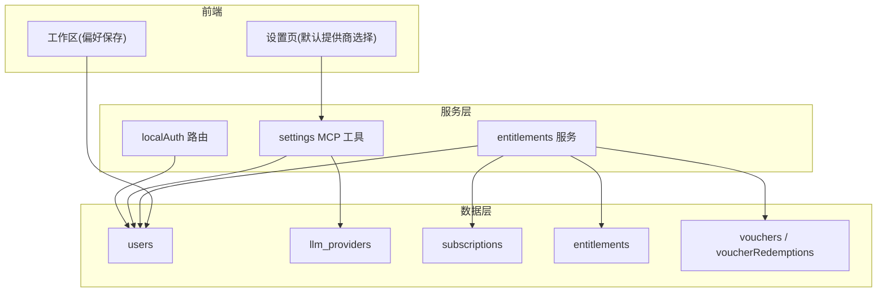
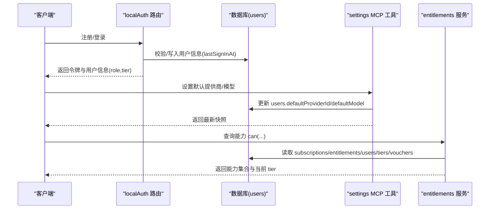
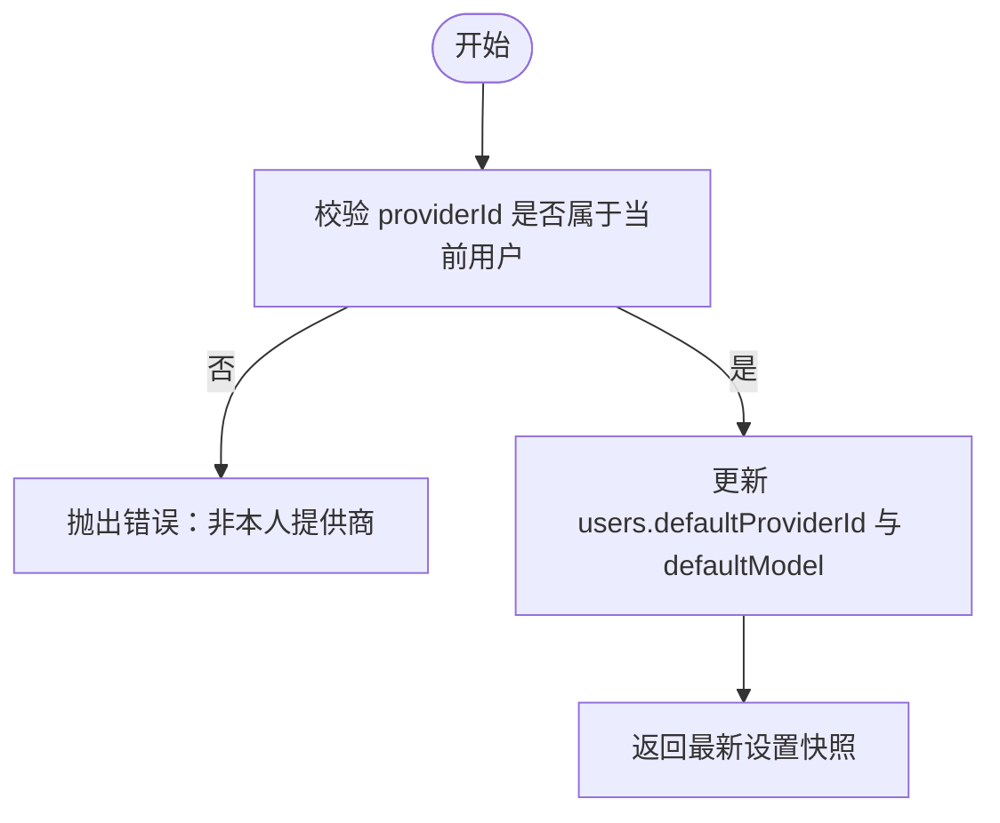
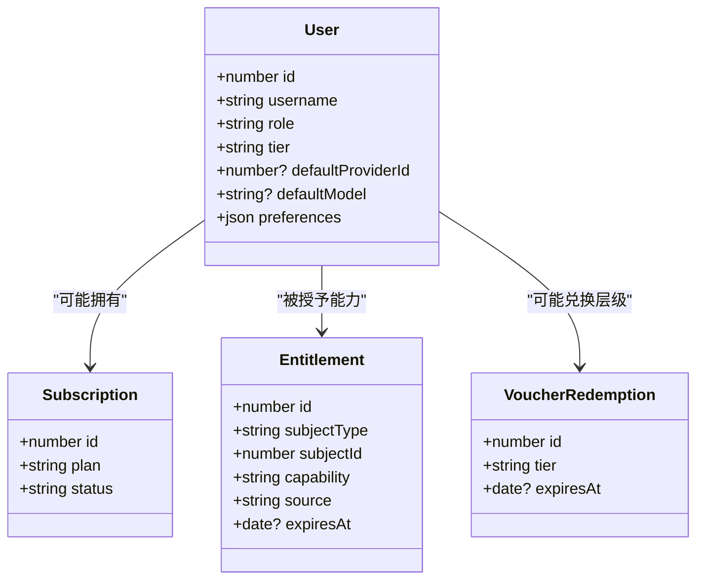
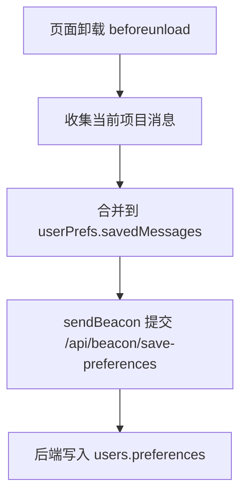
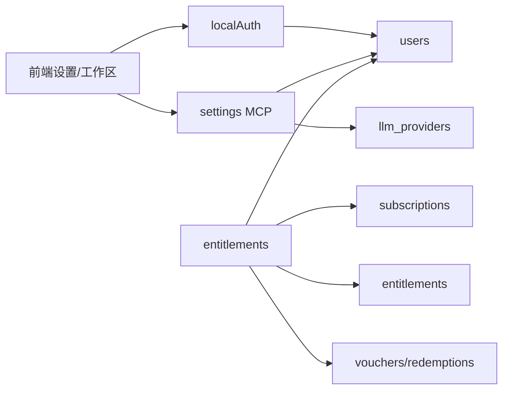

# 用户管理

<cite>
**本文引用的文件**
- [db/schema.ts](file://db/schema.ts)
- [api/routers/localAuth.ts](file://api/routers/localAuth.ts)
- [api/services/entitlements.ts](file://api/services/entitlements.ts)
- [api/config/plans.ts](file://api/config/plans.ts)
- [api/mcp/tools/settings.ts](file://api/mcp/tools/settings.ts)
- [src/pages/Settings.tsx](file://src/pages/Settings.tsx)
- [src/pages/ProjectWorkspace.tsx](file://src/pages/ProjectWorkspace.tsx)
- [migrations/001_add_pro_auto_tier.sql](file://migrations/001_add_pro_auto_tier.sql)
</cite>

## 目录
1. [简介](#简介)
2. [项目结构](#项目结构)
3. [核心组件](#核心组件)
4. [架构总览](#架构总览)
5. [详细组件分析](#详细组件分析)
6. [依赖关系分析](#依赖关系分析)
7. [性能考虑](#性能考虑)
8. [故障排查指南](#故障排查指南)
9. [结论](#结论)
10. [附录](#附录)

## 简介
本文件为 DeeWaanAI 用户管理系统的数据模型文档，聚焦 users 表及其与 LLM 提供商、权限与订阅层级、偏好设置之间的关系。文档同时给出 Drizzle ORM 的 TypeScript 类型定义要点与使用示例路径，帮助读者快速理解并正确使用用户数据。

## 项目结构
- 数据库模式与类型：由 db/schema.ts 统一声明，包含 users、llm_providers、projects、subscriptions、entitlements、vouchers、voucherRedemptions 等核心表。
- 认证与登录：api/routers/localAuth.ts 实现本地用户名/密码注册与登录、令牌签发、自动管理员提升、等级切换等。
- 权限与能力：api/services/entitlements.ts 提供“can”判定、能力解析、授予/撤销；api/config/plans.ts 定义订阅计划的能力矩阵。
- 默认提供商与模型：api/mcp/tools/settings.ts 暴露设置默认提供商与模型的接口；前端 src/pages/Settings.tsx 提供选择 UI。
- 用户偏好：db/schema.ts 中 users.preferences JSON 字段持久化用户级 UI 状态与保存消息；src/pages/ProjectWorkspace.tsx 在页面卸载时通过 Beacon API 保存 savedMessages。

图表来源
- [db/schema.ts:18-51](file://db/schema.ts#L18-L51)
- [db/schema.ts:57-82](file://db/schema.ts#L57-L82)
- [db/schema.ts:1063-1147](file://db/schema.ts#L1063-L1147)
- [api/routers/localAuth.ts:60-216](file://api/routers/localAuth.ts#L60-L216)
- [api/services/entitlements.ts:165-207](file://api/services/entitlements.ts#L165-L207)
- [api/config/plans.ts:19-40](file://api/config/plans.ts#L19-L40)
- [api/mcp/tools/settings.ts:68-104](file://api/mcp/tools/settings.ts#L68-L104)
- [src/pages/Settings.tsx:927-953](file://src/pages/Settings.tsx#L927-L953)
- [src/pages/ProjectWorkspace.tsx:308-332](file://src/pages/ProjectWorkspace.tsx#L308-L332)

章节来源
- [db/schema.ts:18-51](file://db/schema.ts#L18-L51)
- [db/schema.ts:57-82](file://db/schema.ts#L57-L82)
- [api/routers/localAuth.ts:60-216](file://api/routers/localAuth.ts#L60-L216)
- [api/services/entitlements.ts:165-207](file://api/services/entitlements.ts#L165-L207)
- [api/config/plans.ts:19-40](file://api/config/plans.ts#L19-L40)
- [api/mcp/tools/settings.ts:68-104](file://api/mcp/tools/settings.ts#L68-L104)
- [src/pages/Settings.tsx:927-953](file://src/pages/Settings.tsx#L927-L953)
- [src/pages/ProjectWorkspace.tsx:308-332](file://src/pages/ProjectWorkspace.tsx#L308-L332)

## 核心组件
- users 表：承载用户认证（unionId、username、passwordHash）、基本信息（name、email、avatar）、权限控制（role、tier）以及用户偏好（preferences JSON）。
- llm_providers 表：用户级 LLM 提供商配置，含名称、slug、baseUrl、密钥引用、默认模型、可用模型列表与运行时配置。
- subscriptions、entitlements、vouchers/voucherRedemptions：订阅、能力与优惠券体系，决定用户可使用的功能集。
- settings MCP 工具与前端设置页：用于设置用户级默认提供商与模型。
- 偏好存储：通过 users.preferences 持久化 UI 状态与项目对话缓存。

章节来源
- [db/schema.ts:18-51](file://db/schema.ts#L18-L51)
- [db/schema.ts:57-82](file://db/schema.ts#L57-L82)
- [db/schema.ts:1063-1147](file://db/schema.ts#L1063-L1147)
- [api/mcp/tools/settings.ts:68-104](file://api/mcp/tools/settings.ts#L68-L104)
- [src/pages/Settings.tsx:927-953](file://src/pages/Settings.tsx#L927-L953)
- [src/pages/ProjectWorkspace.tsx:308-332](file://src/pages/ProjectWorkspace.tsx#L308-L332)

## 架构总览
下图展示用户数据在系统中的流转：认证流程更新最后登录时间；设置流程写入默认提供商与模型；权限系统综合订阅、层级与券来判定能力；前端将用户偏好落库。

图表来源
- [api/routers/localAuth.ts:60-216](file://api/routers/localAuth.ts#L60-L216)
- [api/mcp/tools/settings.ts:68-104](file://api/mcp/tools/settings.ts#L68-L104)
- [api/services/entitlements.ts:165-207](file://api/services/entitlements.ts#L165-L207)
- [db/schema.ts:18-51](file://db/schema.ts#L18-L51)
- [db/schema.ts:1063-1147](file://db/schema.ts#L1063-L1147)

## 详细组件分析

### users 表结构与约束
- 主键与时间戳：id 自增主键；createdAt、updatedAt、lastSignInAt 记录创建、更新与最后登录时间。
- 认证字段：
  - unionId：唯一，支持 OAuth 联合身份。
  - username：唯一，本地账号标识。
  - passwordHash：本地密码哈希值（SSO 用户可为空）。
- 基本信息：name、email、avatar。
- 权限控制：
  - role：枚举 user/admin，默认 user。
  - tier：枚举 standard/pro_designer/pro_auto，默认 standard。
- 默认 LLM 提供商与模型：
  - defaultProviderId：整数外键（应用层保证完整性，避免循环引用）。
  - defaultModel：字符串，长度限制。
- 用户偏好 preferences（JSON）：
  - savedMessages：按项目 ID 映射的消息数组，包含 id、role、content、agentName、pipelineStep。
  - uiState：任意 UI 状态键值对。
  - recentProjectIds：最近项目 ID 列表。
- 索引与唯一性：username、unionId 唯一；其他索引按需添加。

章节来源
- [db/schema.ts:18-51](file://db/schema.ts#L18-L51)

### 用户与 LLM 提供商关联
- 关系说明：users.defaultProviderId 指向 llm_providers.id（应用层维护一致性），允许用户级默认提供商覆盖项目或系统默认。
- 设置流程：通过 settings MCP 工具 set_default_model 更新 users.defaultProviderId 与 defaultModel；前端 Settings 页提供下拉选择并触发更新。
- 验证规则：设置前会校验 providerId 是否属于当前用户已配置的提供商之一。

图表来源
- [api/mcp/tools/settings.ts:68-104](file://api/mcp/tools/settings.ts#L68-L104)
- [db/schema.ts:18-51](file://db/schema.ts#L18-L51)
- [db/schema.ts:57-82](file://db/schema.ts#L57-L82)

章节来源
- [api/mcp/tools/settings.ts:68-104](file://api/mcp/tools/settings.ts#L68-L104)
- [db/schema.ts:18-51](file://db/schema.ts#L18-L51)
- [db/schema.ts:57-82](file://db/schema.ts#L57-L82)
- [src/pages/Settings.tsx:927-953](file://src/pages/Settings.tsx#L927-L953)

### 用户级别权限模型与订阅层级
- 层级（tier）：standard、pro_designer、pro_auto，分别对应不同能力集。
- 能力来源（合并计算）：
  - 显式授权（entitlements）：手动授予或系统事件产生，可设置过期时间。
  - 活跃订阅（subscriptions）：根据 plan 的能力矩阵赋予能力。
  - 层级（users.tier）：直接赋予层级能力。
  - 未过期的券兑换（voucherRedemptions）：临时获得某层级能力。
- 能力解析：resolveCapabilities 返回能力集合与当前 tier；can 函数用于单项能力判断。
- 计划能力：plans.ts 定义 solo/team_seat 的计划能力集。

图表来源
- [db/schema.ts:18-51](file://db/schema.ts#L18-L51)
- [db/schema.ts:1063-1147](file://db/schema.ts#L1063-L1147)
- [api/services/entitlements.ts:165-207](file://api/services/entitlements.ts#L165-L207)
- [api/config/plans.ts:19-40](file://api/config/plans.ts#L19-L40)

章节来源
- [api/services/entitlements.ts:165-207](file://api/services/entitlements.ts#L165-L207)
- [api/config/plans.ts:19-40](file://api/config/plans.ts#L19-L40)
- [db/schema.ts:1063-1147](file://db/schema.ts#L1063-L1147)

### 用户数据验证规则与业务约束
- 注册与登录：
  - 用户名：唯一，长度限制。
  - 密码：最小长度、最大长度；注册时拒绝常见弱口令（黑名单比对）。
  - 登录失败次数限制：基于 IP 的速率限制。
  - 成功登录后更新 lastSignInAt。
- 管理员自动提升：
  - 首个注册用户或匹配环境变量 AUTO_ADMIN_USERNAME 的用户自动设为 admin。
- 等级切换：
  - 生产环境仅管理员可通过 setTier 修改；开发环境允许用户自行切换测试。
- 默认提供商设置：
  - 必须为当前用户拥有的提供商之一，否则拒绝。

章节来源
- [api/routers/localAuth.ts:60-216](file://api/routers/localAuth.ts#L60-L216)
- [api/mcp/tools/settings.ts:68-104](file://api/mcp/tools/settings.ts#L68-L104)

### 用户偏好设置（preferences JSON）
- 结构说明：
  - savedMessages：以项目 ID 为键的消息数组，每条包含 id、role、content、agentName、pipelineStep。
  - uiState：UI 状态键值对。
  - recentProjectIds：最近项目 ID 列表。
- 保存时机：页面卸载时使用 sendBeacon 将当前项目的 savedMessages 合并到用户 preferences 并持久化。

图表来源
- [src/pages/ProjectWorkspace.tsx:308-332](file://src/pages/ProjectWorkspace.tsx#L308-L332)
- [db/schema.ts:18-51](file://db/schema.ts#L18-L51)

章节来源
- [src/pages/ProjectWorkspace.tsx:308-332](file://src/pages/ProjectWorkspace.tsx#L308-L332)
- [db/schema.ts:18-51](file://db/schema.ts#L18-L51)

### Drizzle ORM 类型定义与使用示例
- 类型导出：
  - User、InsertUser 由 schema.ts 中的 users 表推导而来，可直接在 TS 代码中使用。
- 使用示例（路径参考）：
  - 注册/登录：在 localAuth 路由中插入/查询 users，并使用 bcrypt 处理密码。
  - 设置默认提供商：通过 settings MCP 工具更新 users.defaultProviderId 与 defaultModel。
  - 权限判定：调用 entitlements 服务的 can/resolveCapabilities，依据 subscriptions、entitlements、users.tier、voucherRedemptions 计算能力。
  - 偏好保存：前端在页面卸载时发送 preferences 变更至后端，后端更新 users.preferences。

章节来源
- [db/schema.ts:18-51](file://db/schema.ts#L18-L51)
- [api/routers/localAuth.ts:60-216](file://api/routers/localAuth.ts#L60-L216)
- [api/mcp/tools/settings.ts:68-104](file://api/mcp/tools/settings.ts#L68-L104)
- [api/services/entitlements.ts:165-207](file://api/services/entitlements.ts#L165-L207)
- [src/pages/ProjectWorkspace.tsx:308-332](file://src/pages/ProjectWorkspace.tsx#L308-L332)

## 依赖关系分析
- 模块耦合：
  - localAuth 依赖 schema.users 进行用户读写，依赖 rate limiter 与 JWT 库。
  - settings MCP 工具依赖 schema.users 与 schema.llm_providers，并在更新前校验归属。
  - entitlements 服务聚合 subscriptions、entitlements、users.tier、voucherRedemptions 计算能力。
- 外部依赖：
  - Stripe 计划与价格通过 plans.ts 注入，影响能力分配。
  - 前端 Settings 与 ProjectWorkspace 与后端 MCP/Beacon 接口交互。

图表来源
- [api/routers/localAuth.ts:60-216](file://api/routers/localAuth.ts#L60-L216)
- [api/mcp/tools/settings.ts:68-104](file://api/mcp/tools/settings.ts#L68-L104)
- [api/services/entitlements.ts:165-207](file://api/services/entitlements.ts#L165-L207)
- [db/schema.ts:18-51](file://db/schema.ts#L18-L51)
- [db/schema.ts:57-82](file://db/schema.ts#L57-L82)
- [db/schema.ts:1063-1147](file://db/schema.ts#L1063-L1147)

章节来源
- [api/routers/localAuth.ts:60-216](file://api/routers/localAuth.ts#L60-L216)
- [api/mcp/tools/settings.ts:68-104](file://api/mcp/tools/settings.ts#L68-L104)
- [api/services/entitlements.ts:165-207](file://api/services/entitlements.ts#L165-L207)
- [db/schema.ts:18-51](file://db/schema.ts#L18-L51)
- [db/schema.ts:57-82](file://db/schema.ts#L57-L82)
- [db/schema.ts:1063-1147](file://db/schema.ts#L1063-L1147)

## 性能考虑
- 登录与注册：
  - 使用速率限制防止暴力破解与滥用。
  - 密码哈希强度适中（bcrypt），兼顾安全与性能。
- 默认提供商设置：
  - 仅在必要时校验归属并更新单行，开销低。
- 能力解析：
  - 合并多个数据源但查询量可控；可按需引入缓存以减少重复计算。
- 偏好保存：
  - 使用 sendBeacon 降低请求丢失风险；合并消息减少写入频率。

[本节为通用指导，不直接分析具体文件]

## 故障排查指南
- 数据库连接异常：
  - 错误提示包含连接失败或列不存在时，检查数据库启动与迁移同步。
- 登录失败：
  - 检查用户名是否存在且设置了 passwordHash；确认速率限制未被触发。
- 设置默认提供商失败：
  - 确认 providerId 属于当前用户；如不存在则报错。
- 等级切换受限：
  - 生产环境仅管理员可切换；开发环境允许用户自行切换。

章节来源
- [api/routers/localAuth.ts:23-36](file://api/routers/localAuth.ts#L23-L36)
- [api/routers/localAuth.ts:124-158](file://api/routers/localAuth.ts#L124-L158)
- [api/mcp/tools/settings.ts:79-90](file://api/mcp/tools/settings.ts#L79-L90)
- [api/routers/localAuth.ts:171-214](file://api/routers/localAuth.ts#L171-L214)

## 结论
users 表作为用户管理的核心，结合 llm_providers、subscriptions、entitlements、vouchers 等表构建了完整的认证、偏好与权限体系。通过 settings MCP 工具与前端设置页，用户可以便捷地管理默认提供商与模型；权限系统以多层来源合并的方式确保灵活性与可扩展性。Drizzle ORM 的类型推导使类型安全贯穿全栈，便于维护与演进。

[本节为总结，不直接分析具体文件]

## 附录
- 层级扩展：
  - pro_auto 层级通过迁移脚本添加到 users.tier 枚举，确保向后兼容。
- 相关迁移：
  - 001_add_pro_auto_tier.sql 用于扩展 tier 枚举值。

章节来源
- [migrations/001_add_pro_auto_tier.sql:1-4](file://migrations/001_add_pro_auto_tier.sql#L1-L4)