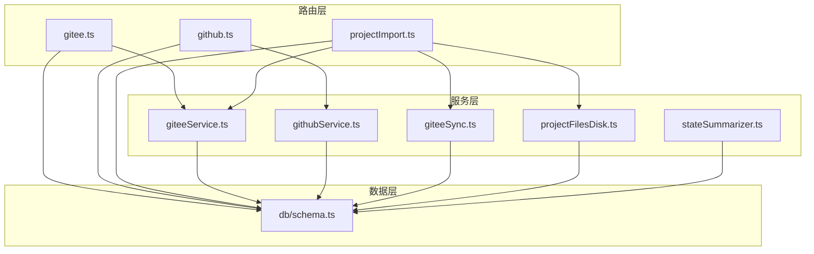
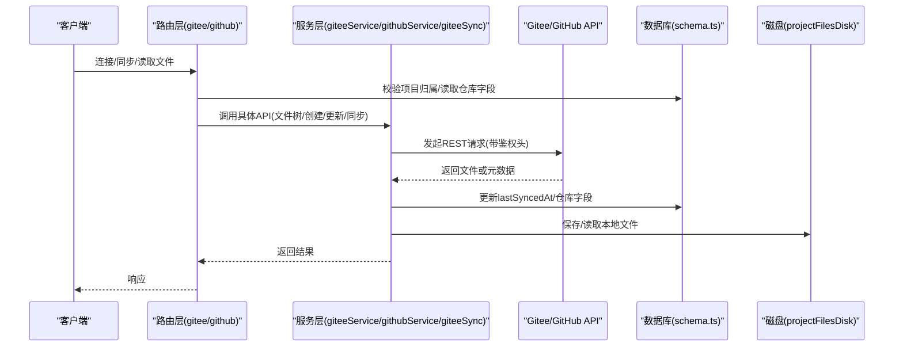
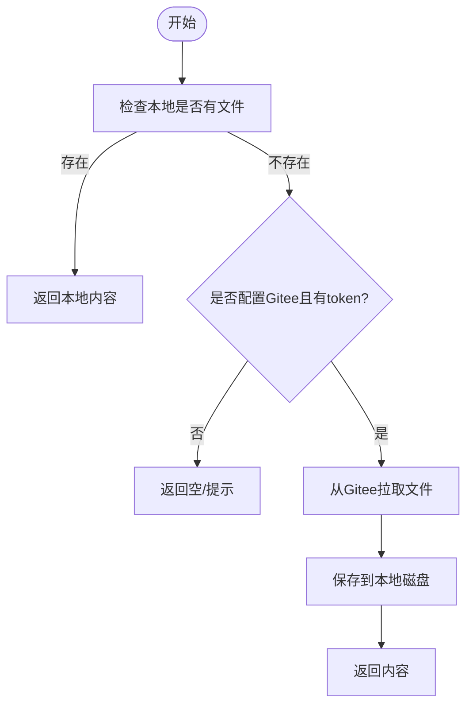
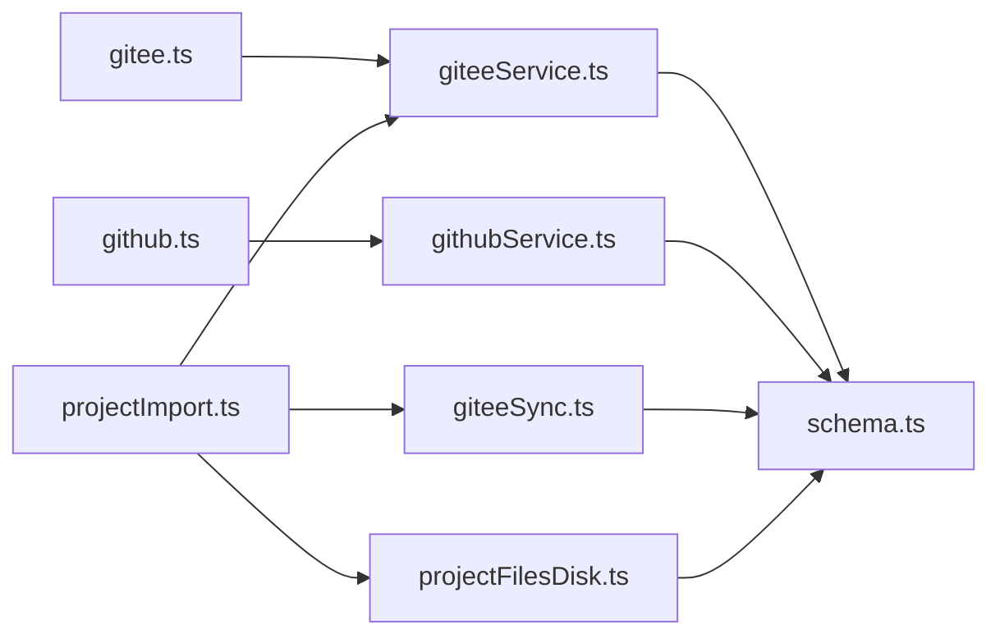

# 代码仓库集成

<cite>
**本文引用的文件**
- [api/routers/gitee.ts](file://api/routers/gitee.ts)
- [api/routers/github.ts](file://api/routers/github.ts)
- [api/services/giteeService.ts](file://api/services/giteeService.ts)
- [api/services/githubService.ts](file://api/services/githubService.ts)
- [api/services/giteeSync.ts](file://api/services/giteeSync.ts)
- [db/schema.ts](file://db/schema.ts)
- [api/routers/projectImport.ts](file://api/routers/projectImport.ts)
- [api/services/projectFilesDisk.ts](file://api/services/projectFilesDisk.ts)
- [src/lib/localFolder.ts](file://src/lib/localFolder.ts)
- [api/services/stateSummarizer.ts](file://api/services/stateSummarizer.ts)
</cite>

## 目录
1. [简介](#简介)
2. [项目结构](#项目结构)
3. [核心组件](#核心组件)
4. [架构总览](#架构总览)
5. [详细组件分析](#详细组件分析)
6. [依赖关系分析](#依赖关系分析)
7. [性能考量](#性能考量)
8. [故障排查指南](#故障排查指南)
9. [结论](#结论)
10. [附录](#附录)

## 简介
本技术文档聚焦于 DeeWaanAI 项目的代码仓库集成功能，覆盖 Gitee 与 GitHub 的集成设计、数据库字段、同步机制、本地文件夹配置、状态摘要存储路径、认证与权限管理、冲突处理策略以及错误处理与重试模式。目标是帮助开发者快速理解并扩展该能力，确保跨平台（Gitee/GitHub）的代码同步稳定可靠。

## 项目结构
围绕代码仓库集成，系统采用“路由层 + 服务层 + 数据持久化”的分层组织：
- 路由层：提供对外 API（如连接仓库、列出仓库、获取文件树、创建/更新文件、同步等）
- 服务层：封装 Gitee/GitHub API 调用、同步逻辑、磁盘读写、状态摘要序列化
- 数据层：Drizzle ORM 定义的项目表及迁移快照，包含仓库关联字段、本地文件夹名、状态摘要路径、最后同步时间等

图表来源
- [api/routers/gitee.ts:1-289](file://api/routers/gitee.ts#L1-L289)
- [api/routers/github.ts:1-136](file://api/routers/github.ts#L1-L136)
- [api/routers/projectImport.ts:1-653](file://api/routers/projectImport.ts#L1-L653)
- [api/services/giteeService.ts:1-185](file://api/services/giteeService.ts#L1-L185)
- [api/services/githubService.ts:1-124](file://api/services/githubService.ts#L1-L124)
- [api/services/giteeSync.ts:1-130](file://api/services/giteeSync.ts#L1-L130)
- [api/services/projectFilesDisk.ts:1-142](file://api/services/projectFilesDisk.ts#L1-L142)
- [api/services/stateSummarizer.ts:1-312](file://api/services/stateSummarizer.ts#L1-L312)
- [db/schema.ts:84-150](file://db/schema.ts#L84-L150)

章节来源
- [api/routers/gitee.ts:1-289](file://api/routers/gitee.ts#L1-L289)
- [api/routers/github.ts:1-136](file://api/routers/github.ts#L1-L136)
- [api/routers/projectImport.ts:1-653](file://api/routers/projectImport.ts#L1-L653)
- [api/services/giteeService.ts:1-185](file://api/services/giteeService.ts#L1-L185)
- [api/services/githubService.ts:1-124](file://api/services/githubService.ts#L1-L124)
- [api/services/giteeSync.ts:1-130](file://api/services/giteeSync.ts#L1-L130)
- [api/services/projectFilesDisk.ts:1-142](file://api/services/projectFilesDisk.ts#L1-L142)
- [api/services/stateSummarizer.ts:1-312](file://api/services/stateSummarizer.ts#L1-L312)
- [db/schema.ts:84-150](file://db/schema.ts#L84-L150)

## 核心组件
- Gitee 路由与服务：提供令牌校验、仓库列表、文件树读取、文件创建/更新、分支回退尝试、调试接口等
- GitHub 路由与服务：提供令牌校验、仓库列表、项目连接/断开、文件树读取、文件创建/更新、同步标记
- 同步服务：批量推送文件到 Gitee，控制速率限制，记录提交信息
- 磁盘存储：按项目隔离的文件目录，支持读取、写入、删除、遍历
- 状态摘要：结构化项目状态序列化为 Markdown，用于持久化到仓库或本地

章节来源
- [api/routers/gitee.ts:1-289](file://api/routers/gitee.ts#L1-L289)
- [api/routers/github.ts:1-136](file://api/routers/github.ts#L1-L136)
- [api/services/giteeSync.ts:1-130](file://api/services/giteeSync.ts#L1-L130)
- [api/services/projectFilesDisk.ts:1-142](file://api/services/projectFilesDisk.ts#L1-L142)
- [api/services/stateSummarizer.ts:1-312](file://api/services/stateSummarizer.ts#L1-L312)

## 架构总览
下图展示从前端/客户端到后端路由、服务、外部仓库 API 和数据库的整体交互流程。

图表来源
- [api/routers/gitee.ts:1-289](file://api/routers/gitee.ts#L1-L289)
- [api/routers/github.ts:1-136](file://api/routers/github.ts#L1-L136)
- [api/services/giteeService.ts:1-185](file://api/services/giteeService.ts#L1-L185)
- [api/services/githubService.ts:1-124](file://api/services/githubService.ts#L1-L124)
- [api/services/giteeSync.ts:1-130](file://api/services/giteeSync.ts#L1-L130)
- [api/services/projectFilesDisk.ts:1-142](file://api/services/projectFilesDisk.ts#L1-L142)
- [db/schema.ts:84-150](file://db/schema.ts#L84-L150)

## 详细组件分析

### 数据库字段设计（Gitee 与 GitHub）
- 项目表 projects 中与仓库相关的字段：
  - giteeOwner、giteeRepo、giteeBranch：标识 Gitee 仓库所有者、仓库名、默认分支（默认 main）
  - githubOwner、githubRepo、githubBranch：标识 GitHub 仓库所有者、仓库名、默认分支（默认 main）
  - localFolderName：本地文件夹名称（用于前端本地文件夹访问时命名与持久化）
  - stateSummaryPath：项目状态摘要文件路径（默认 .ai-swarm/project-state.md），用于将结构化状态序列化为 Markdown 并存储到仓库或本地
  - lastSyncedAt：最后同步时间戳，用于标记最近一次同步操作的时间点
  - intelligenceCard：JSON 类型，存储项目智能卡片（含文件树、入口、API 端点等）
- 项目文件表 project_files 中：
  - giteeSha：记录对应文件的 Gitee 提交 SHA，便于增量同步与冲突检测
  - lastSyncedAt：记录该文件最后一次同步时间

章节来源
- [db/schema.ts:84-150](file://db/schema.ts#L84-L150)
- [db/schema.ts:363-383](file://db/schema.ts#L363-L383)

### 代码同步机制与 lastSyncedAt
- Gitee 同步：
  - 路由层提供 syncProject 接口，成功后更新项目的 lastSyncedAt
  - 导入流程 importFromZip 会生成智能卡片，并将文本文件推送到 Gitee；失败不影响本地存储
  - 从 Gitee 拉取文件到本地磁盘：优先读本地，缺失则回退到 Gitee，并缓存到磁盘
- GitHub 同步：
  - 路由层提供 connectProject/disconnectProject/syncProject 接口，分别设置/清空/更新时间戳
  - 文件树读取与创建/更新通过 githubService 完成，使用 Bearer 令牌与版本头
- 分支回退策略：
  - Gitee 在多处尝试 master/main 分支，提升兼容性
- 状态摘要：
  - stateSummarizer 提供序列化/解析方法，可将项目状态以 Markdown 形式存储到仓库或本地，路径由 stateSummaryPath 指定

图表来源
- [api/routers/projectImport.ts:247-309](file://api/routers/projectImport.ts#L247-L309)
- [api/routers/projectImport.ts:314-412](file://api/routers/projectImport.ts#L314-L412)
- [api/services/giteeService.ts:18-48](file://api/services/giteeService.ts#L18-L48)
- [api/services/projectFilesDisk.ts:87-99](file://api/services/projectFilesDisk.ts#L87-L99)

章节来源
- [api/routers/gitee.ts:52-74](file://api/routers/gitee.ts#L52-L74)
- [api/routers/github.ts:66-82](file://api/routers/github.ts#L66-L82)
- [api/routers/projectImport.ts:153-175](file://api/routers/projectImport.ts#L153-L175)
- [api/routers/projectImport.ts:247-309](file://api/routers/projectImport.ts#L247-L309)
- [api/routers/projectImport.ts:314-412](file://api/routers/projectImport.ts#L314-L412)
- [api/services/giteeSync.ts:26-93](file://api/services/giteeSync.ts#L26-L93)
- [api/services/stateSummarizer.ts:247-312](file://api/services/stateSummarizer.ts#L247-L312)

### 本地文件夹配置 localFolderName
- 用途：
  - 前端通过 File System Access API 选择本地文件夹，并以 projectId 为键持久化目录句柄到 IndexedDB
  - 服务器端通过 localFolderName 记录用户选择的文件夹名称，便于跨浏览器会话识别
- 实现要点：
  - 支持创建新文件夹并链接到项目
  - 支持恢复已授权文件夹句柄，若权限被撤销则清理存储
  - 提供 fallback 方案（隐藏 file input）以兼容 Firefox/Safari

章节来源
- [src/lib/localFolder.ts:1-255](file://src/lib/localFolder.ts#L1-L255)
- [db/schema.ts:84-150](file://db/schema.ts#L84-L150)

### 状态摘要路径 stateSummaryPath
- 用途：
  - 指定项目状态摘要文件的相对路径（默认 .ai-swarm/project-state.md）
  - 将结构化状态（目标、关键决策、近期活动、长期摘要等）序列化为 Markdown，便于人类可读与版本化管理
- 实现要点：
  - 提供序列化与解析函数，支持压缩策略（保守/平衡/激进）
  - 可结合 Gitee/GitHub 进行持久化与回溯

章节来源
- [db/schema.ts:84-150](file://db/schema.ts#L84-L150)
- [api/services/stateSummarizer.ts:1-312](file://api/services/stateSummarizer.ts#L1-L312)

### 认证、权限管理与同步冲突处理
- 认证：
  - Gitee：Authorization: token {token}
  - GitHub：Authorization: Bearer {token}，Accept 与 X-GitHub-Api-Version 头
- 权限：
  - 路由层校验项目归属与团队共享权限（canAccessProject）
  - 功能开关：gitee_sync 特性标志控制是否允许 Gitee 同步
- 冲突处理：
  - 文件创建/更新前先获取 SHA，若存在则附带 sha 进行更新，避免覆盖冲突
  - 分支回退：Gitee 尝试 master/main，提高兼容性
  - 批量推送：分批次并加入小延迟，尊重速率限制
  - 失败容忍：单个文件失败不中断整体流程，记录日志继续其他文件

章节来源
- [api/services/giteeService.ts:55-98](file://api/services/giteeService.ts#L55-L98)
- [api/services/githubService.ts:60-101](file://api/services/githubService.ts#L60-L101)
- [api/routers/gitee.ts:173-259](file://api/routers/gitee.ts#L173-L259)
- [api/services/giteeSync.ts:43-72](file://api/services/giteeSync.ts#L43-L72)

### 错误处理与重试机制
- 错误处理：
  - 统一捕获 HTTP 非 2xx 响应并抛出错误，包含状态码与响应体
  - 对目录/大文件/符号链接等边界情况做显式判断与报错
  - 日志记录关键步骤与异常信息，便于定位问题
- 重试机制：
  - 当前实现未内置指数退避重试，但可通过上层调用方包装重试逻辑
  - 建议对网络抖动与限流场景增加重试（例如 3 次，间隔递增）
  - 对批量操作可引入断路器模式，避免雪崩

章节来源
- [api/services/giteeService.ts:10-48](file://api/services/giteeService.ts#L10-L48)
- [api/services/githubService.ts:17-53](file://api/services/githubService.ts#L17-L53)
- [api/services/giteeSync.ts:43-72](file://api/services/giteeSync.ts#L43-L72)

## 依赖关系分析
- 路由依赖服务：
  - gitee.ts 依赖 giteeService.ts 与 schema.ts
  - github.ts 依赖 githubService.ts 与 schema.ts
  - projectImport.ts 依赖 giteeService.ts、giteeSync.ts、projectFilesDisk.ts 与 schema.ts
- 服务依赖：
  - giteeService.ts 与 githubService.ts 直接调用外部 REST API
  - giteeSync.ts 复用 giteeService.ts 的能力进行批量推送
  - projectFilesDisk.ts 负责本地文件系统 I/O
  - stateSummarizer.ts 提供状态序列化/解析能力

图表来源
- [api/routers/gitee.ts:1-289](file://api/routers/gitee.ts#L1-L289)
- [api/routers/github.ts:1-136](file://api/routers/github.ts#L1-L136)
- [api/routers/projectImport.ts:1-653](file://api/routers/projectImport.ts#L1-L653)
- [api/services/giteeService.ts:1-185](file://api/services/giteeService.ts#L1-L185)
- [api/services/githubService.ts:1-124](file://api/services/githubService.ts#L1-L124)
- [api/services/giteeSync.ts:1-130](file://api/services/giteeSync.ts#L1-L130)
- [api/services/projectFilesDisk.ts:1-142](file://api/services/projectFilesDisk.ts#L1-L142)
- [db/schema.ts:84-150](file://db/schema.ts#L84-L150)

章节来源
- [api/routers/gitee.ts:1-289](file://api/routers/gitee.ts#L1-L289)
- [api/routers/github.ts:1-136](file://api/routers/github.ts#L1-L136)
- [api/routers/projectImport.ts:1-653](file://api/routers/projectImport.ts#L1-L653)
- [api/services/giteeService.ts:1-185](file://api/services/giteeService.ts#L1-L185)
- [api/services/githubService.ts:1-124](file://api/services/githubService.ts#L1-L124)
- [api/services/giteeSync.ts:1-130](file://api/services/giteeSync.ts#L1-L130)
- [api/services/projectFilesDisk.ts:1-142](file://api/services/projectFilesDisk.ts#L1-L142)
- [db/schema.ts:84-150](file://db/schema.ts#L84-L150)

## 性能考量
- 批量推送：分批次（每批 10 个文件）并加入小延迟，降低速率限制风险
- 并行拉取：使用 Promise.allSettled 并发获取多个文件，提升吞吐
- 本地缓存：优先读取本地磁盘，减少远程调用
- 分支回退：master/main 双分支尝试，提高可用性
- 状态压缩：根据内存模式（保守/平衡/激进）压缩近期活动与长期摘要，控制上下文大小

章节来源
- [api/services/giteeSync.ts:43-72](file://api/services/giteeSync.ts#L43-L72)
- [api/services/giteeSync.ts:112-129](file://api/services/giteeSync.ts#L112-L129)
- [api/routers/projectImport.ts:247-309](file://api/routers/projectImport.ts#L247-L309)
- [api/services/stateSummarizer.ts:100-192](file://api/services/stateSummarizer.ts#L100-L192)

## 故障排查指南
- 常见问题：
  - 令牌无效：检查 Authorization 头格式与权限范围
  - 仓库未连接：确认项目中 giteeOwner/giteeRepo 或 githubOwner/githubRepo 已设置
  - 分支不存在：尝试 master/main 或其他有效分支
  - 文件过大/二进制：跳过或单独处理
  - 权限不足：检查 OAuth 权限与仓库可见性
- 日志定位：
  - 关注导入、同步、文件读取的关键日志与错误堆栈
  - 使用 debugGitee 接口输出原始 API 响应，辅助诊断

章节来源
- [api/routers/gitee.ts:261-287](file://api/routers/gitee.ts#L261-L287)
- [api/services/giteeService.ts:10-48](file://api/services/giteeService.ts#L10-L48)
- [api/services/githubService.ts:17-53](file://api/services/githubService.ts#L17-L53)
- [api/routers/projectImport.ts:153-175](file://api/routers/projectImport.ts#L153-L175)

## 结论
本项目实现了 Gitee 与 GitHub 的双仓库集成，具备完善的字段设计、同步机制、本地文件夹管理与状态摘要持久化。通过分层架构与健壮的错误处理，系统在跨设备协作与团队协作场景中表现稳定。未来可进一步增强重试与熔断机制，优化大规模文件同步的性能与可靠性。

## 附录
- 关键接口说明（示例）：
  - Gitee：validateToken、listRepos、syncProject、getFileTree、createOrUpdateFile
  - GitHub：validateToken、listRepos、connectProject、disconnectProject、syncProject、getFileTree、createOrUpdateFile
  - 项目导入：importFromZip、fetchFileContents、fetchRelevantFileContents、syncFromGitee、findRelevantFiles
- 数据模型要点：
  - projects.giteeOwner/giteeRepo/giteeBranch
  - projects.githubOwner/githubRepo/githubBranch
  - projects.localFolderName
  - projects.stateSummaryPath
  - projects.lastSyncedAt
  - project_files.giteeSha、project_files.lastSyncedAt

章节来源
- [api/routers/gitee.ts:33-171](file://api/routers/gitee.ts#L33-L171)
- [api/routers/github.ts:8-135](file://api/routers/github.ts#L8-L135)
- [api/routers/projectImport.ts:75-651](file://api/routers/projectImport.ts#L75-L651)
- [db/schema.ts:84-150](file://db/schema.ts#L84-L150)
- [db/schema.ts:363-383](file://db/schema.ts#L363-L383)