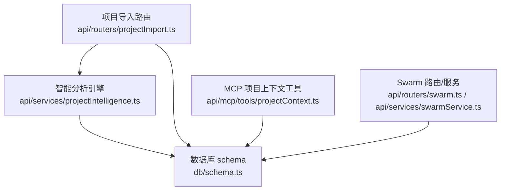
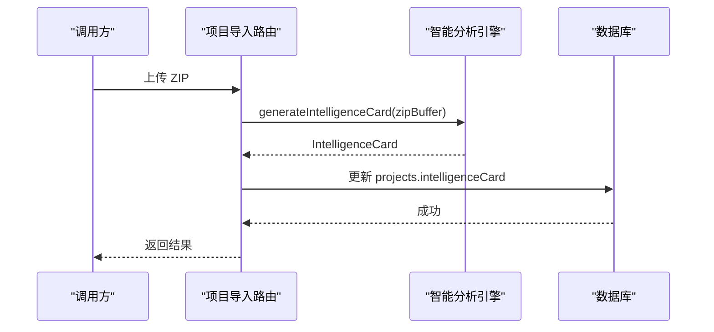
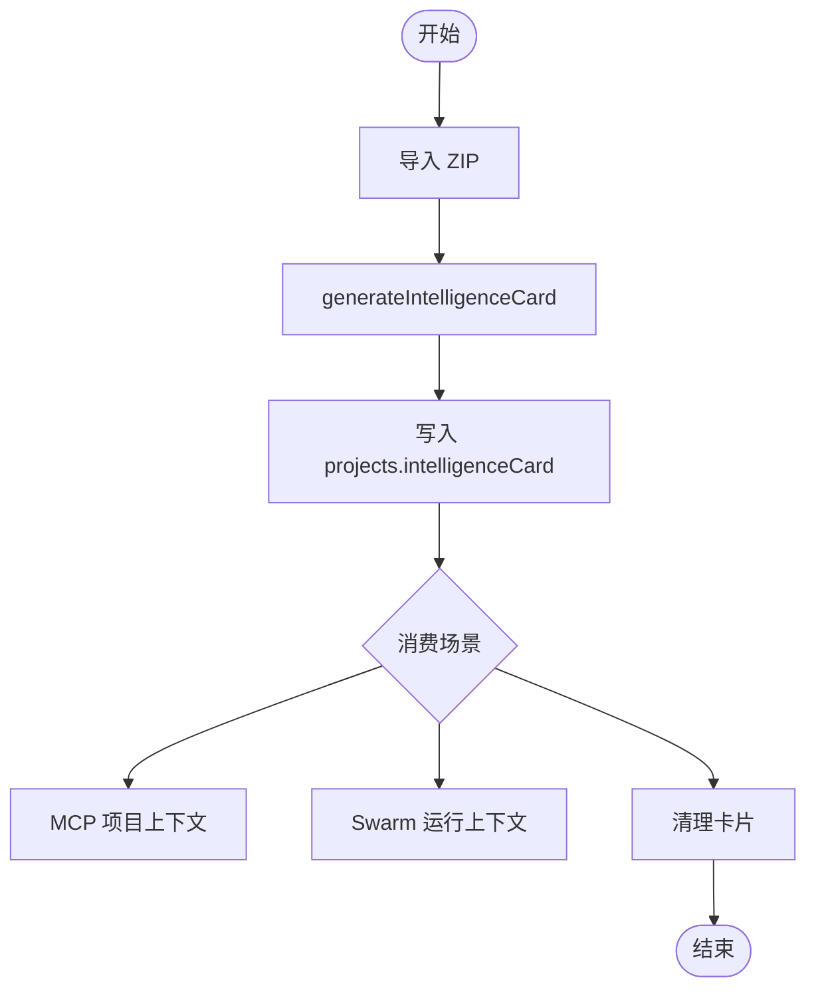
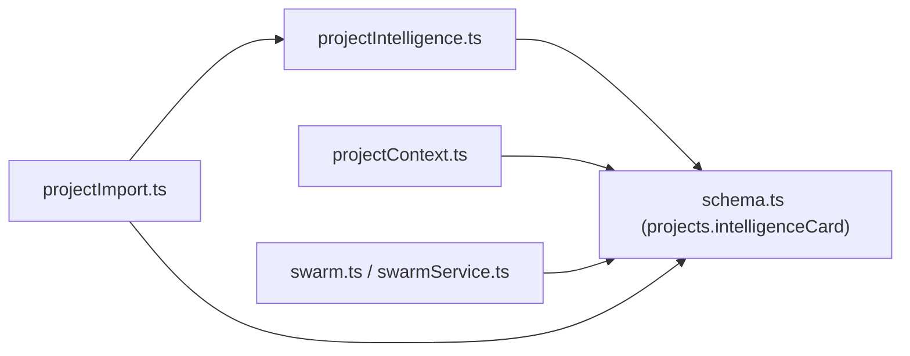

# 智能分析卡片

<cite>
**本文引用的文件**
- [api/services/projectIntelligence.ts](file://api/services/projectIntelligence.ts)
- [db/schema.ts](file://db/schema.ts)
- [api/routers/projectImport.ts](file://api/routers/projectImport.ts)
- [api/project-import-route.ts](file://api/project-import-route.ts)
- [api/mcp/tools/projectContext.ts](file://api/mcp/tools/projectContext.ts)
- [api/routers/swarm.ts](file://api/routers/swarm.ts)
- [api/services/swarmService.ts](file://api/services/swarmService.ts)
</cite>

## 目录
1. [简介](#简介)
2. [项目结构](#项目结构)
3. [核心组件](#核心组件)
4. [架构总览](#架构总览)
5. [详细组件分析](#详细组件分析)
6. [依赖关系分析](#依赖关系分析)
7. [性能考虑](#性能考虑)
8. [故障排查指南](#故障排查指南)
9. [结论](#结论)
10. [附录](#附录)

## 简介
本文件为 DeeWaanAI 项目的“智能分析卡片”功能提供完整的数据结构文档。智能分析卡片是对导入项目的结构化理解摘要，包含基础元数据、文件树、入口点、架构描述、实体关系、数据库表结构、API 端点、待办事项以及跨引用等高级分析信息。该卡片用于驱动后续 LLM 上下文注入、相关代码检索与多 Agent 协作。

## 项目结构
智能分析卡片的核心定义与生成逻辑位于后端服务中，持久化在项目的 JSON 字段中，并在多个路由与服务中被消费（MCP 工具、Swarm 运行、项目导入等）。

图表来源
- [api/routers/projectImport.ts:113-228](file://api/routers/projectImport.ts#L113-L228)
- [api/services/projectIntelligence.ts:625-777](file://api/services/projectIntelligence.ts#L625-L777)
- [db/schema.ts:113-145](file://db/schema.ts#L113-L145)
- [api/mcp/tools/projectContext.ts:35-72](file://api/mcp/tools/projectContext.ts#L35-L72)
- [api/routers/swarm.ts:455-486](file://api/routers/swarm.ts#L455-L486)
- [api/services/swarmService.ts:1494-1526](file://api/services/swarmService.ts#L1494-L1526)

章节来源
- [api/routers/projectImport.ts:113-228](file://api/routers/projectImport.ts#L113-L228)
- [db/schema.ts:113-145](file://db/schema.ts#L113-L145)

## 核心组件
- IntelligenceCard：智能分析卡片的顶层数据结构，包含版本、生成时间、项目类型、主要语言、框架、文件统计、文件树、依赖图、实体、数据库表、API 端点、入口点、架构、待办、跨引用及 LLM 上下文渲染方法。
- FileNode：文件树节点，描述每个文件的元信息与导出项、是否入口点等。
- DatabaseTable：数据库表结构，含列定义与来源文件。
- ApiEndpoint：API 端点，含 HTTP 方法、路径、处理器名与来源文件。
- ExtractedEntity：从文档或代码中提取的实体（人、公司、产品、技术、指标、日期、地点等）。
- DependencyEdge：依赖边，表示源文件到目标文件的导入关系。

章节来源
- [api/services/projectIntelligence.ts:23-78](file://api/services/projectIntelligence.ts#L23-L78)
- [db/schema.ts:113-145](file://db/schema.ts#L113-L145)

## 架构总览
智能分析卡片的生成流程如下：
- 接收 ZIP 包并解压过滤无关文件
- 构建文件树节点（path、name、size、language、category）
- 解析代码/文档/数据文件，提取导出项、依赖、实体、TODO、数据库表、API 端点
- 检测入口点、架构、框架、项目类型、主要语言
- 组装 IntelligenceCard 并限制数组大小以控制体积
- 存储到项目的 intelligenceCard 字段，供后续消费

图表来源
- [api/routers/projectImport.ts:113-228](file://api/routers/projectImport.ts#L113-L228)
- [api/services/projectIntelligence.ts:625-777](file://api/services/projectIntelligence.ts#L625-L777)
- [db/schema.ts:113-145](file://db/schema.ts#L113-L145)

## 详细组件分析

### IntelligenceCard 数据结构
- version：版本号，当前固定为 1，用于未来向后兼容演进。
- generatedAt：生成时间戳（ISO 字符串），标识卡片最新一次生成的时间。
- projectType：项目类型，枚举值包括 code、business、mixed、data、unknown，由代码/文档/数据文件占比推断。
- primaryLanguage：主要编程语言，按代码类文件数量统计得出。
- framework：框架识别结果，基于配置文件或典型目录结构判断（如 nextjs、nuxt、vite、angular、svelte、astro、remix、docker、go、rust、python、java、ruby、php、flutter、elixir 等）。
- totalFiles：文件总数。
- totalSize：所有文件字节总和。
- fileTree：文件树数组，见下文详细说明。
- dependencyGraph：依赖边数组，记录导入关系与导入类型。
- entities：实体数组，去重后保留最多 50 条。
- databaseTables：数据库表结构数组，来自 SQL/Prisma/Drizzle 等模式文件。
- apiEndpoints：API 端点数组，来自 Express/Fastify/Flask/Next.js/Django 等路由定义，最多保留 30 条。
- entryPoints：入口点路径数组，自动检测常见入口文件名。
- architecture：架构风格，如 mvc、layered、react-spa、nextjs-app、nextjs-pages、standard-lib、ddd、go-standard、standard-src、dockerized、flat。
- todos：待办事项数组，自动抽取 TODO/FIXME/HACK/BUG/XXX，最多保留 20 条。
- crossReferences：跨引用数组，基于依赖图推导。
- toLLMContext()：将卡片渲染为紧凑文本，便于注入 LLM 上下文。

章节来源
- [api/services/projectIntelligence.ts:59-78](file://api/services/projectIntelligence.ts#L59-L78)
- [api/services/projectIntelligence.ts:724-777](file://api/services/projectIntelligence.ts#L724-L777)
- [db/schema.ts:113-145](file://db/schema.ts#L113-L145)

### 文件树 FileNode 设计
- path：文件相对路径，用于唯一标识与定位。
- name：文件名（取自路径最后一部分）。
- size：文件大小（字节）。
- language：语言类型，通过扩展名映射（如 typescript、python、pdf、docx、unknown 等）。
- category：分类，code/document/data/config/image/binary，依据语言与路径特征判定。
- exports：导出项数组，代码文件为函数/类/变量名；文档文件为标题/章节名；最多保留 30（代码）或 20（文档）。
- description：单行摘要，优先取 JSDoc/Python docstring/首段正文，截断至一定长度。
- isEntryPoint：是否为入口点，由入口点检测规则标记。

章节来源
- [api/services/projectIntelligence.ts:23-32](file://api/services/projectIntelligence.ts#L23-L32)
- [api/services/projectIntelligence.ts:632-646](file://api/services/projectIntelligence.ts#L632-L646)
- [api/services/projectIntelligence.ts:586-604](file://api/services/projectIntelligence.ts#L586-L604)

### 高级分析能力
- 入口点检测：匹配常见入口命名与路径模式（main/index/app/server/cli/manage.py/asgi/wsgi/application.py 等），并将对应文件标记为入口点。
- 架构检测：根据目录结构组合判断（如存在 controllers/models/views 则为 mvc；存在 routes/services/models 则为 layered；存在 components/hooks/pages 则为 react-spa 等）。
- 框架检测：扫描配置或工程文件（如 next.config、nuxt.config、vite.config、angular.json、svelte.config、astro.config、remix.config、Dockerfile/docker-compose、go.mod、Cargo.toml、requirements.txt/pyproject.toml、pom.xml/build.gradle、Gemfile、composer.json、pubspec.yaml、mix.exs）。
- 实体提取：从文档中抽取人物、公司、产品、技术、指标、日期、地点等实体，并记录上下文位置。
- 数据库表结构：支持 SQL CREATE TABLE、Prisma model、Drizzle ORM 模式，解析表名、列名、类型与约束。
- API 端点：支持 Express/Fastify/Flask/Next.js API 路由、Django path 等，提取 HTTP 方法与路径。
- 待办抽取：正则匹配 TODO/FIXME/HACK/BUG/XXX，附带行号与文件路径。
- 跨引用：基于依赖图生成 source/target/type 三元组，用于相关性计算。

章节来源
- [api/services/projectIntelligence.ts:541-582](file://api/services/projectIntelligence.ts#L541-L582)
- [api/services/projectIntelligence.ts:398-473](file://api/services/projectIntelligence.ts#L398-L473)
- [api/services/projectIntelligence.ts:490-537](file://api/services/projectIntelligence.ts#L490-L537)
- [api/services/projectIntelligence.ts:290-318](file://api/services/projectIntelligence.ts#L290-L318)
- [api/services/projectIntelligence.ts:608-617](file://api/services/projectIntelligence.ts#L608-L617)

### 触发机制与更新策略
- 触发时机：
  - 项目导入时：上传 ZIP 后调用 generateIntelligenceCard 生成卡片并写入 projects.intelligenceCard。
  - 清理卡片：提供 clearIntelligenceCard 接口，清空卡片并删除本地磁盘文件。
- 更新策略：
  - 每次导入都会重新生成并覆盖旧卡片，确保内容最新。
  - 读取侧对大数组进行裁剪（entities 最多 50、apiEndpoints 最多 30、todos 最多 20、fileTree 按需截断），避免响应过大。
  - 在 Swarm 运行中，若启用 includeProjectFiles，会基于卡片中的相关路径拉取具体文件内容注入 LLM 上下文。

图表来源
- [api/routers/projectImport.ts:113-228](file://api/routers/projectImport.ts#L113-L228)
- [api/routers/projectImport.ts:624-652](file://api/routers/projectImport.ts#L624-L652)
- [api/mcp/tools/projectContext.ts:35-72](file://api/mcp/tools/projectContext.ts#L35-L72)
- [api/services/swarmService.ts:1494-1526](file://api/services/swarmService.ts#L1494-L1526)

章节来源
- [api/routers/projectImport.ts:113-228](file://api/routers/projectImport.ts#L113-L228)
- [api/routers/projectImport.ts:624-652](file://api/routers/projectImport.ts#L624-L652)
- [api/mcp/tools/projectContext.ts:35-72](file://api/mcp/tools/projectContext.ts#L35-L72)
- [api/services/swarmService.ts:1494-1526](file://api/services/swarmService.ts#L1494-L1526)

### 与代码仓库信息的集成
- 当导入来源为 Gitee 时，卡片可附加 giteeOwner、giteeRepo、giteeCommitSha 字段，便于追踪仓库与提交信息。
- 这些字段在存储时条件性写入，不影响卡片主结构。

章节来源
- [db/schema.ts:113-145](file://db/schema.ts#L113-L145)
- [api/routers/projectImport.ts:187-228](file://api/routers/projectImport.ts#L187-L228)

## 依赖关系分析
- 生成器依赖：ZIP 解压、语言/分类检测、代码/文档/数据解析、依赖图构建、入口点/架构/框架检测、实体/表/端点抽取、TODO 抽取、跨引用推导。
- 消费者依赖：
  - MCP 工具：读取 projects.intelligenceCard，裁剪大数组后返回紧凑视图。
  - Swarm：将卡片作为项目上下文注入，必要时拉取相关文件内容增强提示。
  - 项目导入路由：生成并持久化卡片，提供清理接口。

图表来源
- [api/services/projectIntelligence.ts:625-777](file://api/services/projectIntelligence.ts#L625-L777)
- [db/schema.ts:113-145](file://db/schema.ts#L113-L145)
- [api/mcp/tools/projectContext.ts:35-72](file://api/mcp/tools/projectContext.ts#L35-L72)
- [api/routers/swarm.ts:455-486](file://api/routers/swarm.ts#L455-L486)
- [api/services/swarmService.ts:1494-1526](file://api/services/swarmService.ts#L1494-L1526)
- [api/routers/projectImport.ts:113-228](file://api/routers/projectImport.ts#L113-L228)

章节来源
- [api/services/projectIntelligence.ts:625-777](file://api/services/projectIntelligence.ts#L625-L777)
- [db/schema.ts:113-145](file://db/schema.ts#L113-L145)
- [api/mcp/tools/projectContext.ts:35-72](file://api/mcp/tools/projectContext.ts#L35-L72)
- [api/routers/swarm.ts:455-486](file://api/routers/swarm.ts#L455-L486)
- [api/services/swarmService.ts:1494-1526](file://api/services/swarmService.ts#L1494-L1526)
- [api/routers/projectImport.ts:113-228](file://api/routers/projectImport.ts#L113-L228)

## 性能考虑
- 文件过滤：排除 node_modules、.git、dist、build、二进制、日志、缓存等无关路径与扩展名，减少解析开销。
- 大文件跳过：单文件超过阈值（例如 5MB）直接忽略，避免内存与 CPU 压力。
- 数组裁剪：entities、apiEndpoints、todos、fileTree 等在生成与读取侧均做上限控制，防止响应体过大。
- 文本转换：仅对非二进制/图像文件尝试 UTF-8 解码，失败则跳过内容分析。
- 依赖解析：仅对本地/别名导入尝试路径解析，包导入不解析，降低复杂度。

[本节为通用性能建议，无需特定文件引用]

## 故障排查指南
- 导入失败：检查 ZIP 是否为空或仅包含被排除的文件；确认未包含敏感文件（如 .env、secret、private-key、.pem）。
- 卡片为空：确认导入流程已调用 generateIntelligenceCard 并成功写入 projects.intelligenceCard；可通过 MCP 工具查询是否存在卡片。
- 数据不完整：检查文件类别是否正确识别；确认代码/文档/数据解析是否命中相应规则；查看依赖图与跨引用是否生成。
- 清理卡片：使用 clearIntelligenceCard 接口移除卡片并清理本地磁盘文件，确保状态一致。

章节来源
- [api/services/projectIntelligence.ts:178-208](file://api/services/projectIntelligence.ts#L178-L208)
- [api/routers/projectImport.ts:624-652](file://api/routers/projectImport.ts#L624-L652)
- [api/mcp/tools/projectContext.ts:35-72](file://api/mcp/tools/projectContext.ts#L35-L72)

## 结论
智能分析卡片为 DeeWaanAI 提供了统一的项目理解抽象，支撑 LLM 上下文注入、相关代码检索与多 Agent 协作。其数据结构清晰、可扩展性强，并通过严格的过滤与裁剪保证性能与稳定性。建议在后续迭代中持续完善语言/框架识别、实体抽取精度与依赖解析能力，同时保持向后兼容的版本管理。

[本节为总结性内容，无需特定文件引用]

## 附录

### 关键数据结构一览（字段说明）
- IntelligenceCard
  - version：数字，当前为 1
  - generatedAt：ISO 时间字符串
  - projectType：code/business/mixed/data/unknown
  - primaryLanguage：字符串（如 typescript、python）
  - framework：字符串（如 nextjs、nuxt、vite、angular、svelte、astro、remix、docker、go、rust、python、java、ruby、php、flutter、elixir、custom）
  - totalFiles：数字
  - totalSize：数字（字节）
  - fileTree：FileNode[]
  - dependencyGraph：DependencyEdge[]
  - entities：ExtractedEntity[]（最多 50）
  - databaseTables：DatabaseTable[]
  - apiEndpoints：ApiEndpoint[]（最多 30）
  - entryPoints：string[]
  - architecture：字符串（mvc/layered/react-spa/nextjs-app/nextjs-pages/standard-lib/ddd/go-standard/standard-src/dockerized/flat）
  - todos：string[]（最多 20）
  - crossReferences：{source, target, type}[]
  - toLLMContext()：返回紧凑文本

- FileNode
  - path：string
  - name：string
  - size：number
  - language：string
  - category：code/document/data/config/image/binary
  - exports：string[]
  - description：string
  - isEntryPoint：boolean

- DatabaseTable
  - name：string
  - columns：[{name, type, constraints?}]
  - sourceFile：string

- ApiEndpoint
  - method：string
  - path：string
  - handler：string
  - sourceFile：string

- ExtractedEntity
  - name：string
  - type：person/company/product/technology/metric/date/location/other
  - context：string

- DependencyEdge
  - source：string
  - target：string
  - importType：string

章节来源
- [api/services/projectIntelligence.ts:23-78](file://api/services/projectIntelligence.ts#L23-L78)
- [db/schema.ts:113-145](file://db/schema.ts#L113-L145)