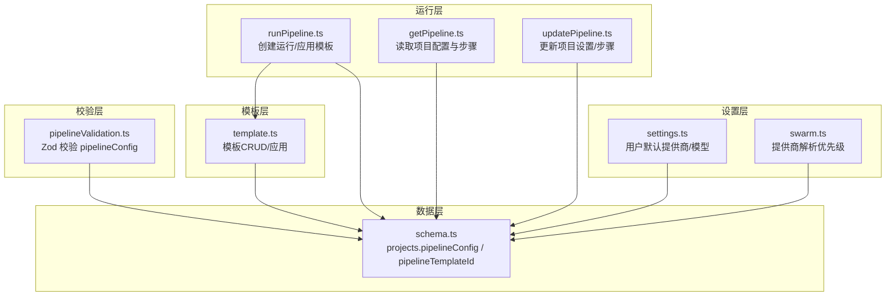
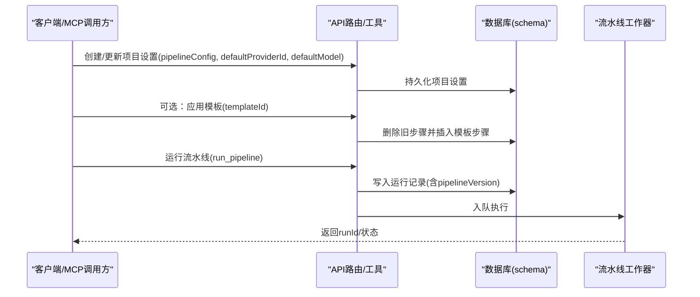
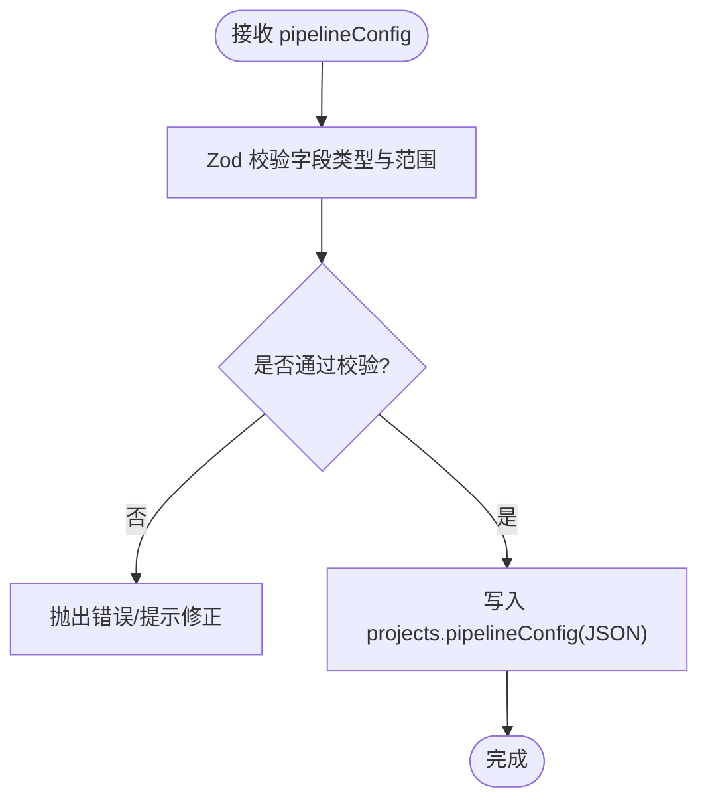
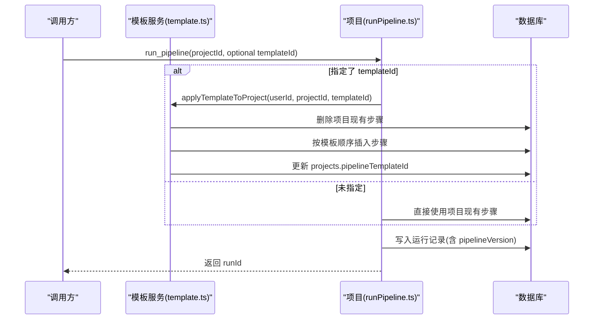
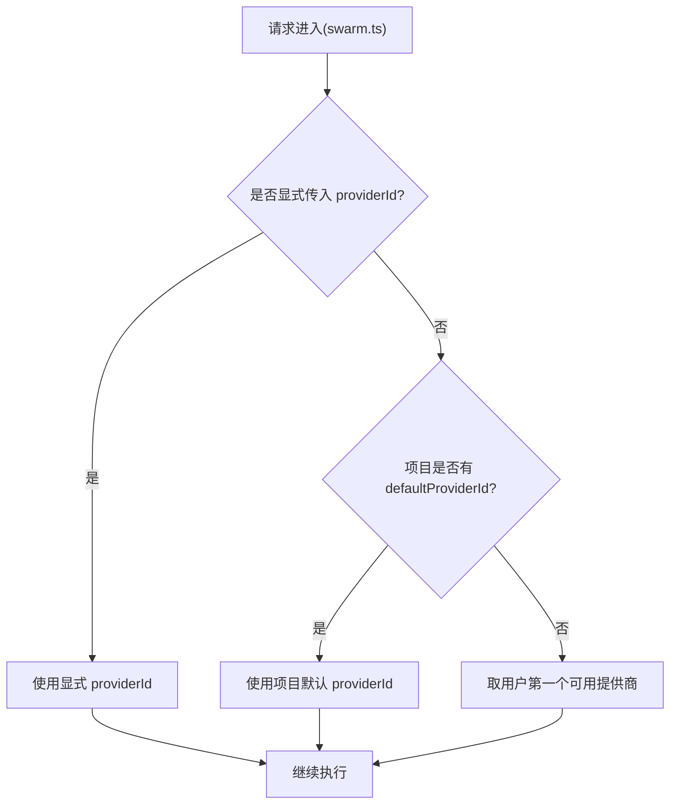
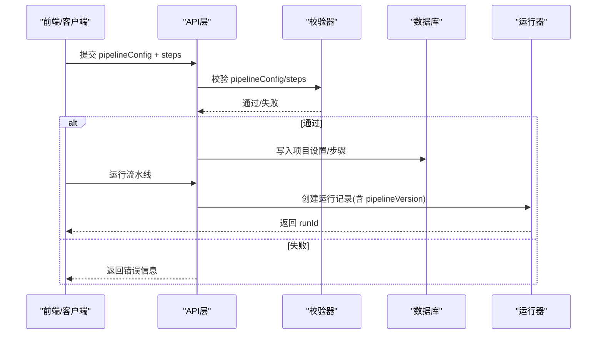
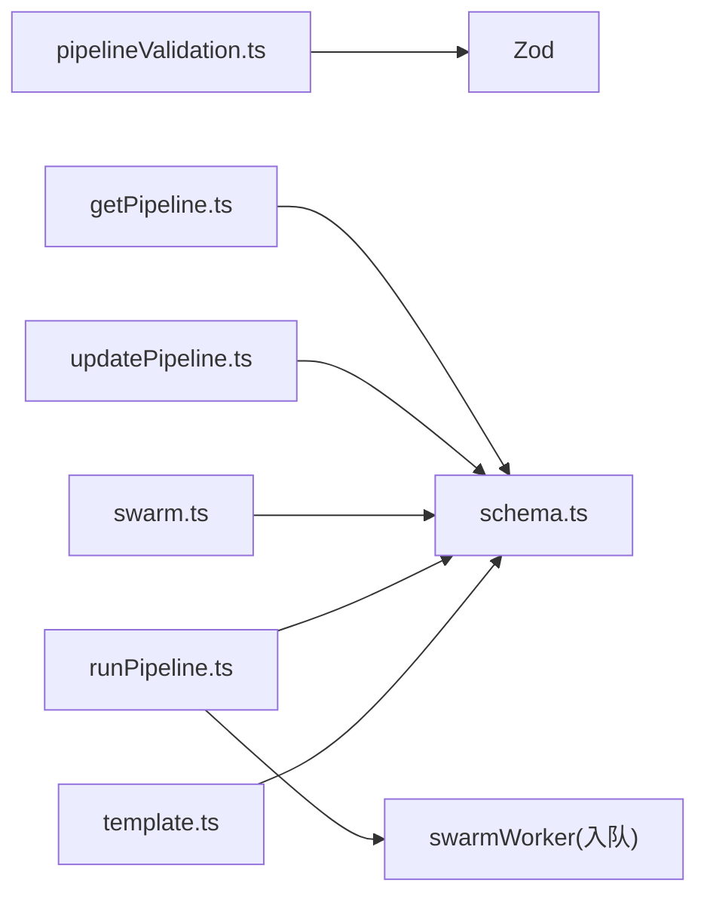
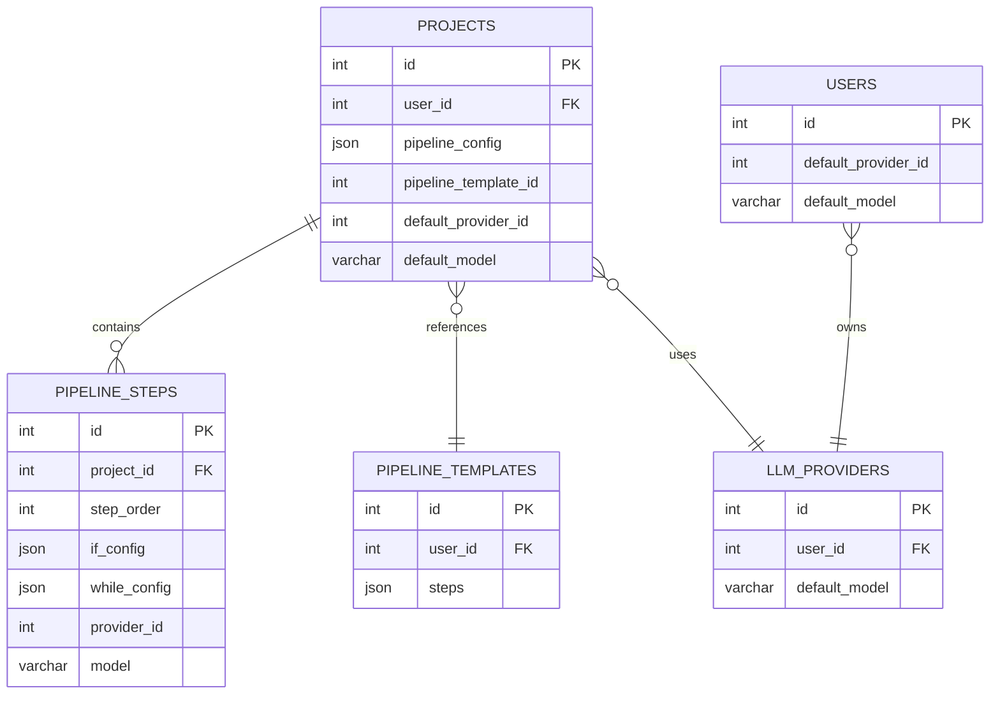

# 流水线配置

<cite>
**本文引用的文件**
- [pipelineValidation.ts](file://api/mcp/tools/pipelineValidation.ts)
- [template.ts](file://api/routers/template.ts)
- [runPipeline.ts](file://api/mcp/tools/runPipeline.ts)
- [getPipeline.ts](file://api/mcp/tools/getPipeline.ts)
- [schema.ts](file://db/schema.ts)
- [updatePipeline.ts](file://api/mcp/tools/updatePipeline.ts)
- [createPipeline.ts](file://api/mcp/tools/createPipeline.ts)
- [settings.ts](file://api/mcp/tools/settings.ts)
- [swarm.ts](file://api/routers/swarm.ts)
</cite>

## 目录
1. [简介](#简介)
2. [项目结构](#项目结构)
3. [核心组件](#核心组件)
4. [架构总览](#架构总览)
5. [详细组件分析](#详细组件分析)
6. [依赖关系分析](#依赖关系分析)
7. [性能考虑](#性能考虑)
8. [故障排查指南](#故障排查指南)
9. [结论](#结论)
10. [附录](#附录)

## 简介
本技术文档聚焦于 DeeWaanAI 项目的“流水线配置系统”，围绕以下目标展开：
- 说明 pipelineConfig JSON 字段设计，包括 maxIterations、enabledAgents、stopOnNoImprovement 等选项的语义与约束。
- 解释 pipelineTemplateId 字段用于引用可复用流水线模板的能力。
- 记录项目级别的 LLM 提供商配置（defaultProviderId、defaultModel）及其继承与覆盖规则。
- 说明流水线执行时的配置验证与默认值处理逻辑。
- 讨论配置版本管理与向后兼容性考虑。

## 项目结构
与流水线配置相关的代码主要分布在以下模块：
- 数据模型定义：数据库 schema 中定义了 projects.pipelineConfig、projects.pipelineTemplateId、llm_providers.defaultModel 等字段。
- 输入校验：MCP 工具层使用 Zod 对 pipelineConfig 和步骤进行严格校验。
- 模板管理：模板 CRUD、复制、应用到项目等能力。
- 运行入口：创建/更新/运行流水线时读取并应用配置。
- 设置与提供商：用户/项目级默认提供商与模型设置。

**图表来源**
- [schema.ts:84-150](file://db/schema.ts#L84-L150)
- [pipelineValidation.ts:61-65](file://api/mcp/tools/pipelineValidation.ts#L61-L65)
- [template.ts:186-263](file://api/routers/template.ts#L186-L263)
- [runPipeline.ts:32-95](file://api/mcp/tools/runPipeline.ts#L32-L95)
- [getPipeline.ts:22-57](file://api/mcp/tools/getPipeline.ts#L22-L57)
- [updatePipeline.ts:64-89](file://api/mcp/tools/updatePipeline.ts#L64-L89)
- [settings.ts:4-5](file://api/mcp/tools/settings.ts#L4-L5)
- [swarm.ts:418-428](file://api/routers/swarm.ts#L418-L428)

**章节来源**
- [schema.ts:84-150](file://db/schema.ts#L84-L150)
- [pipelineValidation.ts:61-65](file://api/mcp/tools/pipelineValidation.ts#L61-L65)
- [template.ts:186-263](file://api/routers/template.ts#L186-L263)
- [runPipeline.ts:32-95](file://api/mcp/tools/runPipeline.ts#L32-L95)
- [getPipeline.ts:22-57](file://api/mcp/tools/getPipeline.ts#L22-L57)
- [updatePipeline.ts:64-89](file://api/mcp/tools/updatePipeline.ts#L64-L89)
- [settings.ts:4-5](file://api/mcp/tools/settings.ts#L4-L5)
- [swarm.ts:418-428](file://api/routers/swarm.ts#L418-L428)

## 核心组件
- 流水线配置校验器：定义 pipelineConfig 的字段类型与取值范围，确保输入安全。
- 模板系统：支持将一组步骤保存为模板，并在项目中复用或应用。
- 运行编排：在创建/运行流水线时，根据是否指定模板决定步骤来源，并写入运行元信息。
- 提供商与模型选择：提供用户/项目/步骤三级默认值解析与覆盖机制。

**章节来源**
- [pipelineValidation.ts:61-65](file://api/mcp/tools/pipelineValidation.ts#L61-L65)
- [template.ts:186-263](file://api/routers/template.ts#L186-L263)
- [runPipeline.ts:115-129](file://api/mcp/tools/runPipeline.ts#L115-L129)
- [swarm.ts:418-428](file://api/routers/swarm.ts#L418-L428)

## 架构总览
下图展示了从“配置”到“执行”的关键路径：用户在项目设置中维护 pipelineConfig 与默认提供商/模型；通过模板复用步骤；运行流水线时，系统校验配置、解析提供商/模型、生成运行记录并交由工作队列执行。

**图表来源**
- [updatePipeline.ts:64-89](file://api/mcp/tools/updatePipeline.ts#L64-L89)
- [template.ts:186-263](file://api/routers/template.ts#L186-L263)
- [runPipeline.ts:115-147](file://api/mcp/tools/runPipeline.ts#L115-L147)
- [schema.ts:84-150](file://db/schema.ts#L84-L150)

## 详细组件分析

### pipelineConfig JSON 字段设计与约束
- 字段定义
  - maxIterations：整数，最小值1，最大值50，可选。用于限制整体迭代次数。
  - enabledAgents：字符串数组，元素长度≥1，最多不超过最大步数限制，可选。用于启用特定代理名称列表。
  - stopOnNoImprovement：布尔值，可选。用于在无改进时提前停止。
- 校验位置
  - 由 Zod schema 在 MCP 工具层进行强校验，拒绝非法值（如负数、超出上限）。
- 存储位置
  - 持久化到 projects.pipelineConfig 的 JSON 列。

**图表来源**
- [pipelineValidation.ts:61-65](file://api/mcp/tools/pipelineValidation.ts#L61-L65)
- [schema.ts:105-110](file://db/schema.ts#L105-L110)

**章节来源**
- [pipelineValidation.ts:61-65](file://api/mcp/tools/pipelineValidation.ts#L61-L65)
- [schema.ts:105-110](file://db/schema.ts#L105-L110)

### pipelineTemplateId 模板引用与应用
- 作用
  - projects.pipelineTemplateId 指向一个可复用的模板，用于批量应用步骤序列。
- 应用流程
  - 当调用 run_pipeline 时传入 templateId，系统将删除项目现有步骤，按模板顺序插入新步骤，并更新 projects.pipelineTemplateId。
  - 若未传入 templateId，则沿用项目已有步骤。
- 模板能力
  - 支持创建空模板、从当前步骤创建模板、复制模板、删除模板、在项目中应用模板。

**图表来源**
- [runPipeline.ts:32-95](file://api/mcp/tools/runPipeline.ts#L32-L95)
- [runPipeline.ts:115-129](file://api/mcp/tools/runPipeline.ts#L115-L129)
- [template.ts:186-263](file://api/routers/template.ts#L186-L263)

**章节来源**
- [runPipeline.ts:32-95](file://api/mcp/tools/runPipeline.ts#L32-L95)
- [runPipeline.ts:115-129](file://api/mcp/tools/runPipeline.ts#L115-L129)
- [template.ts:186-263](file://api/routers/template.ts#L186-L263)

### 项目级 LLM 提供商配置与继承/覆盖规则
- 配置项
  - 用户级：users.defaultProviderId、users.defaultModel
  - 项目级：projects.defaultProviderId、projects.defaultModel
  - 步骤级：pipelineSteps.providerId、pipelineSteps.model（可在单步覆盖）
- 解析优先级（以 swarm.ts 为例）
  - 显式传入 providerId > 项目默认 defaultProviderId > 用户第一个可用提供商
- 设置入口
  - settings.ts 暴露设置用户默认提供商/模型的接口；前端 Settings 页面提供选择器。
- 创建/更新项目时
  - createPipeline.ts / updatePipeline.ts 允许设置项目的 defaultProviderId 与 defaultModel，并进行所有权校验。

**图表来源**
- [swarm.ts:418-428](file://api/routers/swarm.ts#L418-L428)
- [createPipeline.ts:23-76](file://api/mcp/tools/createPipeline.ts#L23-L76)
- [updatePipeline.ts:64-89](file://api/mcp/tools/updatePipeline.ts#L64-L89)
- [settings.ts:4-5](file://api/mcp/tools/settings.ts#L4-L5)

**章节来源**
- [swarm.ts:418-428](file://api/routers/swarm.ts#L418-L428)
- [createPipeline.ts:23-76](file://api/mcp/tools/createPipeline.ts#L23-L76)
- [updatePipeline.ts:64-89](file://api/mcp/tools/updatePipeline.ts#L64-L89)
- [settings.ts:4-5](file://api/mcp/tools/settings.ts#L4-L5)

### 流水线执行时的配置验证与默认值处理
- 配置验证
  - pipelineConfig 在创建/更新阶段由 Zod 校验，确保字段合法。
  - 步骤链也受限于最大步数、控制流步骤（if/while）的额外校验。
- 默认值处理
  - 步骤级默认：temperature、maxTokens 等在模板应用时赋予默认值。
  - 提供商/模型：按“显式 > 项目默认 > 用户默认”的优先级解析。
- 运行元信息
  - 运行记录包含 pipelineVersion，区分是否基于模板（custom-v2）或默认级联（cascade-v1）。

**图表来源**
- [pipelineValidation.ts:61-65](file://api/mcp/tools/pipelineValidation.ts#L61-L65)
- [runPipeline.ts:115-129](file://api/mcp/tools/runPipeline.ts#L115-L129)
- [template.ts:208-254](file://api/routers/template.ts#L208-L254)

**章节来源**
- [pipelineValidation.ts:61-65](file://api/mcp/tools/pipelineValidation.ts#L61-L65)
- [runPipeline.ts:115-129](file://api/mcp/tools/runPipeline.ts#L115-L129)
- [template.ts:208-254](file://api/routers/template.ts#L208-L254)

### 配置版本管理与向后兼容性
- 版本标识
  - 运行记录中的 pipelineVersion 字段用于标识流水线版本策略：
    - custom-v2：基于模板应用的流水线
    - cascade-v1：默认级联模式
- 兼容性与演进
  - 通过 pipelineVersion 区分不同实现，便于后续升级时保持旧行为。
  - 模板步骤结构在 schema 中以 JSON 存储，具备一定弹性；新增字段可通过默认值保证向后兼容。
  - 建议在引入破坏性变更时增加迁移脚本与版本判断分支，避免影响既有运行。

**章节来源**
- [schema.ts:174-237](file://db/schema.ts#L174-L237)
- [runPipeline.ts:121-129](file://api/mcp/tools/runPipeline.ts#L121-L129)

## 依赖关系分析
- 校验器依赖 Zod，不直接访问数据库，便于单元测试。
- 模板服务依赖数据库表 pipelineTemplates、pipelineSteps、customAgents、projects。
- 运行器依赖 swarmRuns、projects、pipelineTemplates、pipelineSteps。
- 提供商解析依赖 llm_providers、users、projects。

**图表来源**
- [pipelineValidation.ts:1-84](file://api/mcp/tools/pipelineValidation.ts#L1-L84)
- [template.ts:1-265](file://api/routers/template.ts#L1-L265)
- [runPipeline.ts:1-156](file://api/mcp/tools/runPipeline.ts#L1-L156)
- [schema.ts:84-505](file://db/schema.ts#L84-L505)

**章节来源**
- [pipelineValidation.ts:1-84](file://api/mcp/tools/pipelineValidation.ts#L1-L84)
- [template.ts:1-265](file://api/routers/template.ts#L1-L265)
- [runPipeline.ts:1-156](file://api/mcp/tools/runPipeline.ts#L1-L156)
- [schema.ts:84-505](file://db/schema.ts#L84-L505)

## 性能考虑
- 步骤数量限制：MAX_STEPS=20，防止过长的流水线导致执行开销过大。
- while 循环限制：whileConfig.maxIterations 上限为10，避免无限循环。
- 提供商解析：优先使用缓存/短路径（显式或项目默认），减少额外查询。
- 模板应用：一次性删除并批量插入步骤，减少多次IO。

[本节为通用指导，无需具体文件引用]

## 故障排查指南
- 常见校验错误
  - pipelineConfig.maxIterations 超出范围（必须 1–50）
  - enabledAgents 数组元素为空或超过最大步数
  - if/while 步骤缺少必要配置
- 提供商相关错误
  - 未配置任何提供商时，系统会报错提示添加提供商
  - 项目默认提供商不存在时会回退到用户第一个可用提供商
- 模板应用问题
  - 模板不存在或无权限时会抛出错误
  - 应用模板后需确认步骤已正确写入

**章节来源**
- [pipelineValidation.ts:61-83](file://api/mcp/tools/pipelineValidation.ts#L61-L83)
- [swarm.ts:418-428](file://api/routers/swarm.ts#L418-L428)
- [template.ts:196-202](file://api/routers/template.ts#L196-L202)

## 结论
DeeWaanAI 的流水线配置系统通过严格的输入校验、清晰的模板复用机制以及明确的提供商/模型继承规则，提供了灵活且安全的流水线编排能力。pipelineConfig 的字段设计兼顾了可扩展性与安全性；模板引用与版本标识使得系统具备良好的演进能力。建议在生产环境中结合监控与日志，持续优化步骤数量与循环限制，确保稳定高效执行。

[本节为总结，无需具体文件引用]

## 附录
- 关键实体关系图（简化）

**图表来源**
- [schema.ts:84-505](file://db/schema.ts#L84-L505)