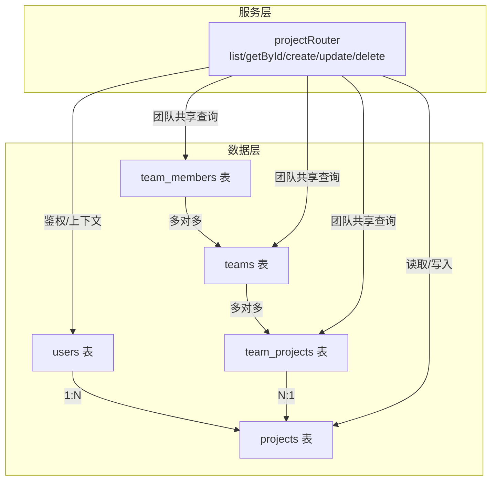
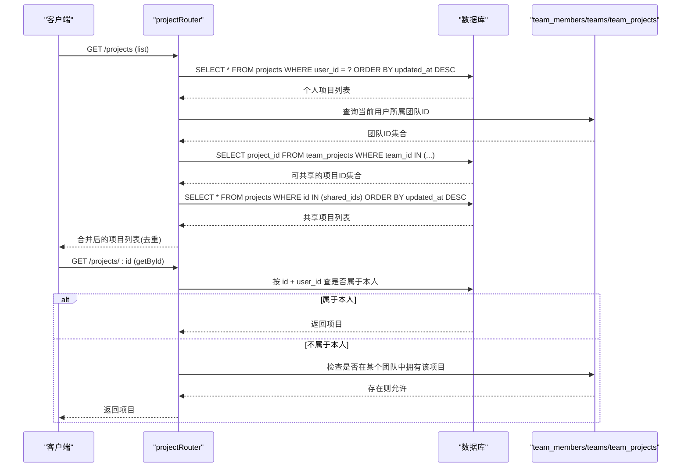
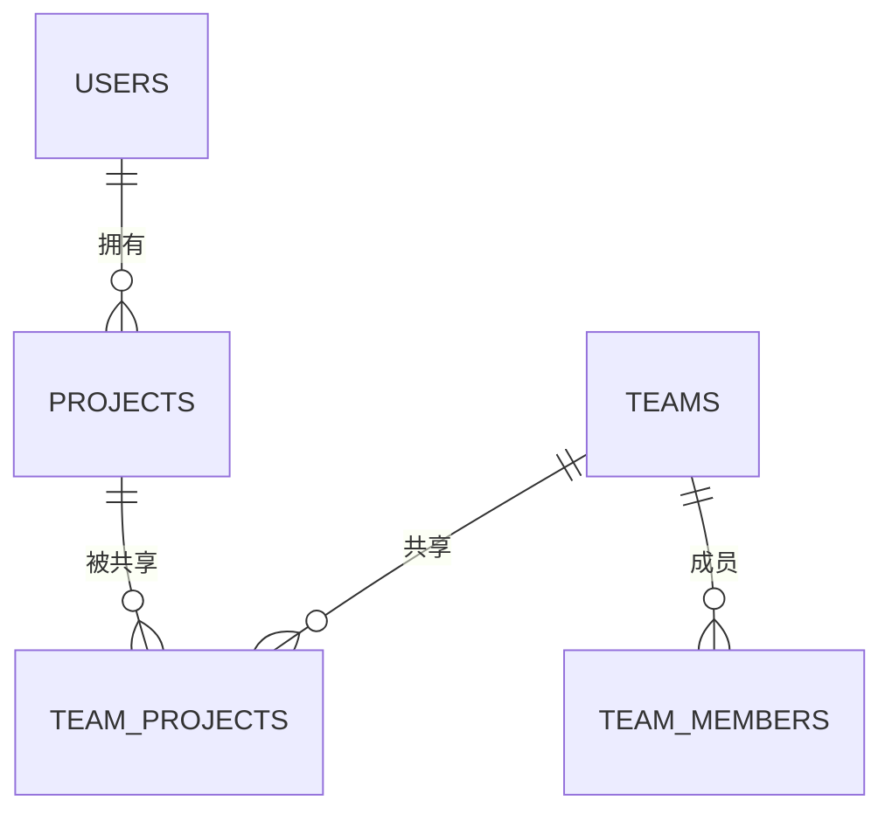
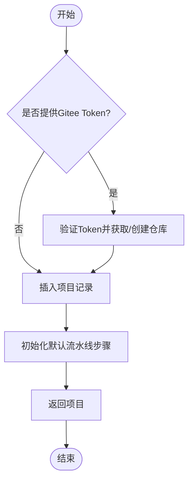
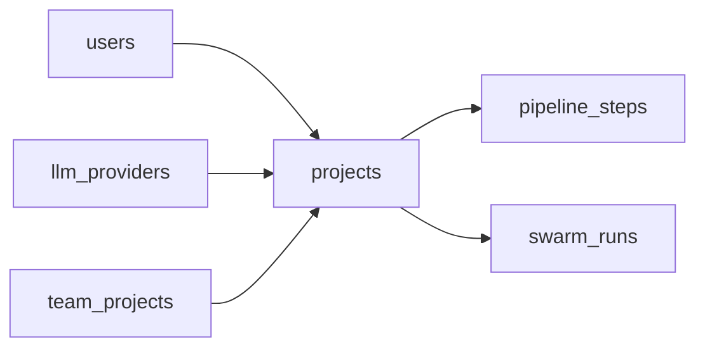

# 项目基本信息

<cite>
**本文引用的文件**
- [db/schema.ts](file://db/schema.ts)
- [api/routers/project.ts](file://api/routers/project.ts)
- [db/migrate-indexes.sql](file://db/migrate-indexes.sql)
</cite>

## 目录
1. [简介](#简介)
2. [项目结构](#项目结构)
3. [核心组件](#核心组件)
4. [架构总览](#架构总览)
5. [详细组件分析](#详细组件分析)
6. [依赖关系分析](#依赖关系分析)
7. [性能与索引优化](#性能与索引优化)
8. [故障排查指南](#故障排查指南)
9. [结论](#结论)

## 简介
本文件聚焦于DeeWaanAI项目的核心实体 projects 表，系统性地说明其数据模型、字段含义、审计字段、状态管理（归档）、以及与用户和团队的权限关联。同时给出查询路径、索引策略与性能优化建议，帮助开发者与运维人员高效理解并维护该表。

## 项目结构
projects 表定义位于数据库Schema中，并通过API路由暴露CRUD能力；团队共享通过 team_projects 关联实现；索引在迁移脚本中集中维护。

图表来源
- [db/schema.ts:18-51](file://db/schema.ts#L18-L51)
- [db/schema.ts:84-150](file://db/schema.ts#L84-L150)
- [db/schema.ts:786-836](file://db/schema.ts#L786-L836)
- [api/routers/project.ts:11-101](file://api/routers/project.ts#L11-L101)

章节来源
- [db/schema.ts:18-51](file://db/schema.ts#L18-L51)
- [db/schema.ts:84-150](file://db/schema.ts#L84-L150)
- [db/schema.ts:786-836](file://db/schema.ts#L786-L836)
- [api/routers/project.ts:11-101](file://api/routers/project.ts#L11-L101)

## 核心组件
- 数据模型：projects 表定义包含基础信息、集成配置、智能卡片、时间戳等。
- API接口：提供列表、详情、创建、更新、删除以及流水线配置读取/更新。
- 权限控制：基于用户归属与团队共享的访问控制。
- 索引策略：针对常用查询路径建立二级索引，提升检索性能。

章节来源
- [db/schema.ts:84-150](file://db/schema.ts#L84-L150)
- [api/routers/project.ts:11-405](file://api/routers/project.ts#L11-L405)
- [db/migrate-indexes.sql:1-50](file://db/migrate-indexes.sql#L1-L50)

## 架构总览
下图展示了从请求到数据层的调用链，重点体现项目列表与详情查询中的“个人项目 + 团队共享”合并逻辑。

图表来源
- [api/routers/project.ts:12-54](file://api/routers/project.ts#L12-L54)
- [api/routers/project.ts:56-101](file://api/routers/project.ts#L56-L101)
- [db/schema.ts:786-836](file://db/schema.ts#L786-L836)

## 详细组件分析

### projects 表数据模型
- 主键与标识
  - id: 自增主键，唯一标识项目。
  - userId: 外键关联 users.id，表示项目所有者。
- 基础信息
  - name: 项目名称，必填。
  - description: 项目描述，可选。
- 代码仓库集成
  - giteeOwner/giteeRepo/giteeBranch: Gitee仓库信息。
  - githubOwner/githubRepo/githubBranch: GitHub仓库信息。
  - localFolderName: 本地文件夹名称。
- 运行与智能
  - defaultProviderId/defaultModel: 项目级默认LLM提供者与模型。
  - pipelineConfig: 流水线配置JSON（最大迭代次数、启用Agent列表、停止条件等）。
  - pipelineTemplateId: 复用模板ID（可为空）。
  - intelligenceCard: 项目智能卡片（结构化摘要，非文件内容）。
- 状态与同步
  - isArchived: 是否归档，默认false。用于归档功能。
  - lastSyncedAt: 最近一次与外部仓库同步的时间。
- 审计字段
  - createdAt: 创建时间。
  - updatedAt: 更新时间（自动更新）。

章节来源
- [db/schema.ts:84-150](file://db/schema.ts#L84-L150)

### 与用户的关联与权限控制
- 所有权：projects.userId 指向 users.id，形成一对多关系。
- 列表与详情：
  - 列表：先拉取当前用户的所有项目，再拉取该用户所在团队共享的项目，合并去重后返回。
  - 详情：优先校验是否属于当前用户；否则检查是否在某个团队中被共享。
- 团队共享：
  - teams、team_members、team_projects 三表协作，实现“项目对团队可见”。
  - team_projects 记录项目被加入团队的关系，含添加人与时间。

图表来源
- [db/schema.ts:18-51](file://db/schema.ts#L18-L51)
- [db/schema.ts:786-836](file://db/schema.ts#L786-L836)
- [api/routers/project.ts:12-101](file://api/routers/project.ts#L12-L101)

章节来源
- [api/routers/project.ts:12-101](file://api/routers/project.ts#L12-L101)
- [db/schema.ts:786-836](file://db/schema.ts#L786-L836)

### 项目状态管理与归档
- isArchived 布尔字段用于标记项目是否归档。
- 常见用法：
  - 列表查询时可过滤已归档项目。
  - 归档后可限制编辑或删除操作（由业务层控制）。
- 注意：当前Schema未强制业务层行为，需在API层或上层服务中统一处理。

章节来源
- [db/schema.ts:111-112](file://db/schema.ts#L111-L112)
- [api/routers/project.ts:12-54](file://api/routers/project.ts#L12-L54)

### 审计字段与时间线
- createdAt：项目创建时间，默认当前时间。
- updatedAt：项目更新时间，每次更新自动刷新。
- lastSyncedAt：与外部仓库同步时间，便于追踪同步状态。

章节来源
- [db/schema.ts:112-147](file://db/schema.ts#L112-L147)

### API工作流（创建/更新/删除）
- 创建：支持传入Gitee Token时自动创建仓库与README；事务内插入项目并初始化默认流水线步骤。
- 更新：仅允许项目所有者更新（WHERE user_id = ctx.user.id）。
- 删除：仅允许项目所有者删除；可选清理Gitee与本地文件。

图表来源
- [api/routers/project.ts:103-250](file://api/routers/project.ts#L103-L250)

章节来源
- [api/routers/project.ts:103-250](file://api/routers/project.ts#L103-L250)

## 依赖关系分析
- 外键关系
  - projects.userId -> users.id（级联删除）
  - projects.defaultProviderId -> llm_providers.id（可选）
- 间接依赖
  - team_projects.projectId -> projects.id（级联删除）
  - 其他子表（如pipeline_steps、swarm_runs等）通过projectId引用projects，保证数据一致性。

图表来源
- [db/schema.ts:57-82](file://db/schema.ts#L57-L82)
- [db/schema.ts:84-150](file://db/schema.ts#L84-L150)
- [db/schema.ts:453-480](file://db/schema.ts#L453-L480)
- [db/schema.ts:174-237](file://db/schema.ts#L174-L237)

章节来源
- [db/schema.ts:57-82](file://db/schema.ts#L57-L82)
- [db/schema.ts:84-150](file://db/schema.ts#L84-L150)
- [db/schema.ts:453-480](file://db/schema.ts#L453-L480)
- [db/schema.ts:174-237](file://db/schema.ts#L174-L237)

## 性能与索引优化
- 已有索引
  - idx_projects_user_id：加速按用户查询项目列表与详情。
  - team_projects 相关索引：加速团队共享项目查询。
- 建议补充
  - 若频繁按 isArchived 过滤，可考虑复合索引 (userId, isArchived)。
  - 若按 lastSyncedAt 排序/过滤，可考虑 (userId, lastSyncedAt)。
  - 若按名称模糊搜索，可考虑全文索引或应用层搜索引擎。
- 查询优化要点
  - 列表接口已按 updatedAt 降序，确保热点数据靠前。
  - 详情接口采用“本人优先，团队共享兜底”的两段式查询，减少不必要扫描。
  - 避免在高频路径进行全表扫描或大对象JSON解析。

章节来源
- [db/migrate-indexes.sql:1-50](file://db/migrate-indexes.sql#L1-L50)
- [api/routers/project.ts:12-54](file://api/routers/project.ts#L12-L54)
- [api/routers/project.ts:56-101](file://api/routers/project.ts#L56-L101)

## 故障排查指南
- 无法列出项目
  - 检查 idx_projects_user_id 是否存在且命中。
  - 确认当前用户是否正确登录并携带有效会话。
- 详情返回为空
  - 确认项目是否属于当前用户或被其所在团队共享。
  - 检查 team_members 与 team_projects 关联是否正确。
- 创建失败
  - 若使用Gitee Token，检查Token有效性及仓库创建结果。
  - 查看事务内默认流水线步骤初始化日志。
- 归档后仍可见
  - 确认列表接口是否已按 isArchived 过滤。
  - 检查前端展示逻辑是否忽略了归档状态。

章节来源
- [api/routers/project.ts:12-101](file://api/routers/project.ts#L12-L101)
- [api/routers/project.ts:103-250](file://api/routers/project.ts#L103-L250)
- [db/migrate-indexes.sql:1-50](file://db/migrate-indexes.sql#L1-L50)

## 结论
projects 表作为DeeWaanAI的核心实体，承载了项目的基础信息与运行时配置，并通过用户与团队机制实现灵活的权限控制。结合现有索引与API设计，系统在可读性与性能上具备良好基础。建议在后续演进中根据实际查询模式补充复合索引，并在业务层统一归档与访问控制策略，以进一步提升一致性与可维护性。