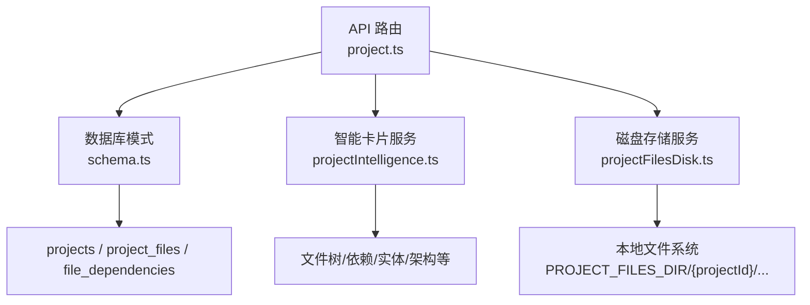
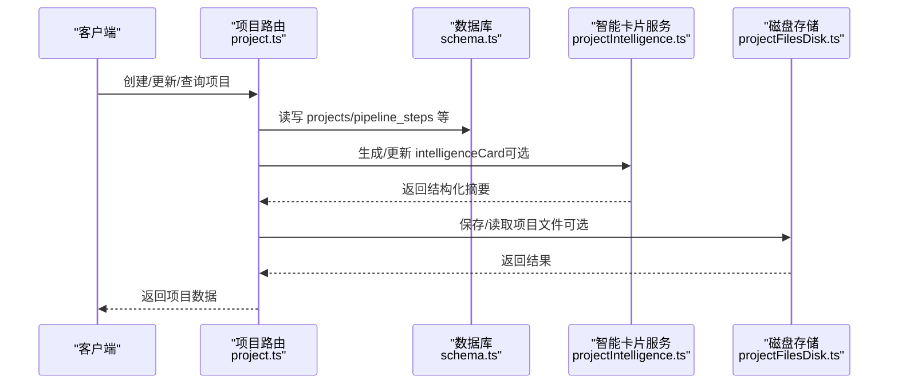
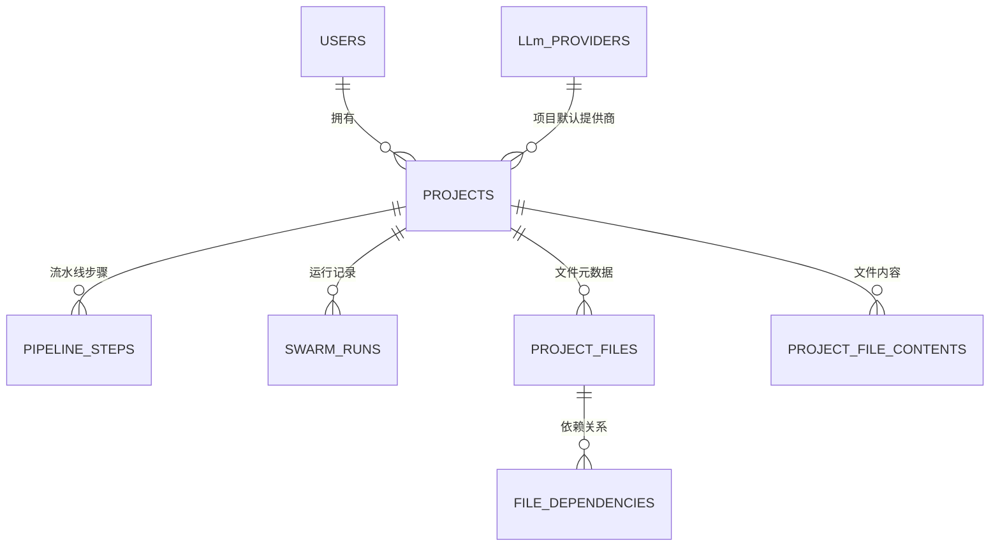
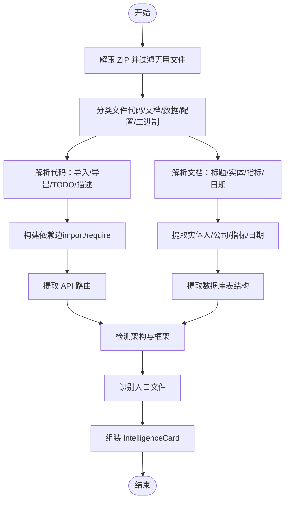
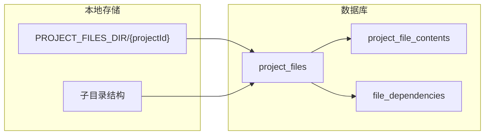
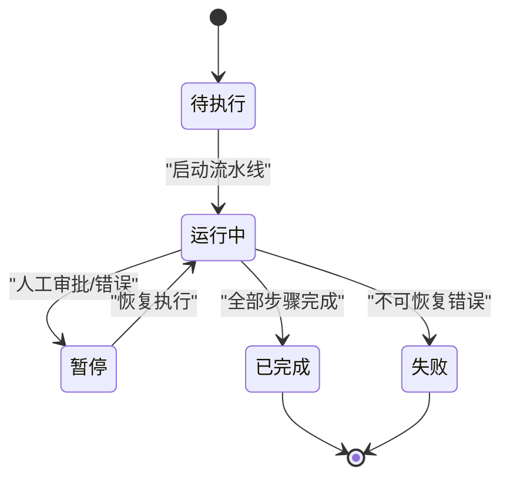
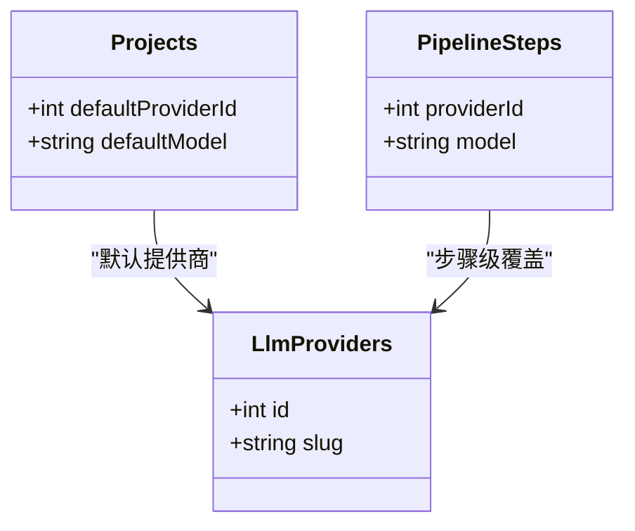
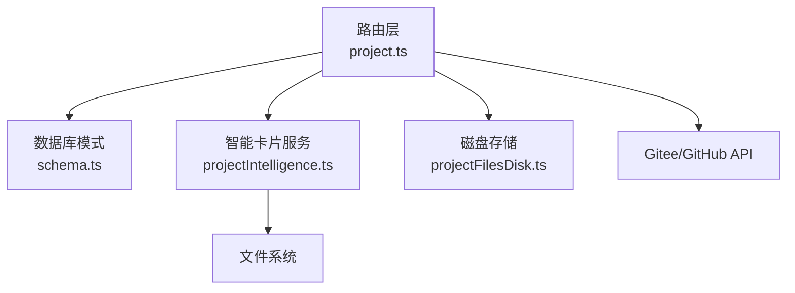

# 项目管理

<cite>
**本文引用的文件**
- [db/schema.ts](file://db/schema.ts)
- [api/routers/project.ts](file://api/routers/project.ts)
- [api/services/projectIntelligence.ts](file://api/services/projectIntelligence.ts)
- [api/services/projectFilesDisk.ts](file://api/services/projectFilesDisk.ts)
- [contracts/types.ts](file://contracts/types.ts)
</cite>

## 目录
1. [简介](#简介)
2. [项目结构](#项目结构)
3. [核心数据模型](#核心数据模型)
4. [架构总览](#架构总览)
5. [详细组件分析](#详细组件分析)
6. [依赖关系分析](#依赖关系分析)
7. [性能与扩展性](#性能与扩展性)
8. [故障排查指南](#故障排查指南)
9. [结论](#结论)

## 简介
本文件为 DeeWaanAI 项目管理系统的“数据模型文档”，聚焦 projects 表及其相关能力：项目基本信息、代码仓库集成（Gitee/GitHub）、项目级 LLM 提供商配置、智能卡片数据结构、状态管理与版本控制字段，以及项目文件的存储结构与依赖关系管理。内容基于数据库模式定义、路由与服务实现进行梳理，便于开发者与产品人员理解项目的数据组织与流转。

## 项目结构
围绕项目管理的核心数据与逻辑分布在以下位置：
- 数据库模式定义：db/schema.ts
- 项目 API 路由：api/routers/project.ts
- 项目智能卡片生成：api/services/projectIntelligence.ts
- 项目文件磁盘存储：api/services/projectFilesDisk.ts
- 类型导出聚合：contracts/types.ts

图表来源
- [api/routers/project.ts:1-405](file://api/routers/project.ts#L1-L405)
- [db/schema.ts:84-150](file://db/schema.ts#L84-L150)
- [api/services/projectIntelligence.ts:1-800](file://api/services/projectIntelligence.ts#L1-L800)
- [api/services/projectFilesDisk.ts:1-143](file://api/services/projectFilesDisk.ts#L1-L143)

章节来源
- [db/schema.ts:84-150](file://db/schema.ts#L84-L150)
- [api/routers/project.ts:1-405](file://api/routers/project.ts#L1-L405)

## 核心数据模型
本节以 projects 为中心，说明其字段含义、关联关系与用途。

- 项目基本信息
  - id：自增主键
  - userId：所属用户（外键指向 users）
  - name：项目名称
  - description：项目描述
- 代码仓库集成
  - giteeOwner/giteeRepo/giteeBranch：Gitee 仓库信息
  - githubOwner/githubRepo/githubBranch：GitHub 仓库信息（与 Gitee 并列）
  - localFolderName：本地文件夹名（可选）
  - lastSyncedAt：最近一次同步时间戳
- 项目配置
  - defaultProviderId/defaultModel：项目级默认 LLM 提供商与模型（可覆盖用户级默认）
  - pipelineConfig：JSON 配置，包含最大迭代次数、启用的代理列表、无改进时停止等
  - pipelineTemplateId：可复用流水线模板引用（可为空）
- 项目智能卡片
  - intelligenceCard：JSON，记录项目概览与结构化摘要（见下文“智能卡片数据结构”）
- 归档与时间戳
  - isArchived：是否归档
  - createdAt/updatedAt：创建与更新时间

项目与用户的关联关系
- projects.userId → users.id（一对多：一个用户拥有多个项目）
- 项目级 LLM 提供商配置
  - projects.defaultProviderId → llm_providers.id（可选）
  - 若未设置，则回退到用户级默认或系统默认

章节来源
- [db/schema.ts:17-51](file://db/schema.ts#L17-L51)
- [db/schema.ts:56-82](file://db/schema.ts#L56-L82)
- [db/schema.ts:84-150](file://db/schema.ts#L84-L150)

## 架构总览
下图展示了项目数据在系统中的主要交互路径：API 路由负责权限校验与事务处理；数据库模式提供持久化结构；智能卡片服务解析 ZIP 并生成结构化摘要；磁盘存储服务负责项目文件内容的本地读写。

图表来源
- [api/routers/project.ts:103-250](file://api/routers/project.ts#L103-L250)
- [db/schema.ts:84-150](file://db/schema.ts#L84-L150)
- [api/services/projectIntelligence.ts:619-777](file://api/services/projectIntelligence.ts#L619-L777)
- [api/services/projectFilesDisk.ts:42-81](file://api/services/projectFilesDisk.ts#L42-L81)

## 详细组件分析

### projects 表与关联实体
- projects：项目主表，承载基本信息、仓库集成、LLM 配置、智能卡片等
- llm_providers：LLM 提供商配置，支持用户级与项目级选择
- agents/pipeline_steps：项目流水线步骤与代理，用于编排执行流程
- swarm_runs/swarm_batches：项目运行批次与任务，记录执行状态与参数
- project_files/project_file_contents/file_dependencies：项目文件元数据、内容与跨文件依赖

图表来源
- [db/schema.ts:17-51](file://db/schema.ts#L17-L51)
- [db/schema.ts:56-82](file://db/schema.ts#L56-L82)
- [db/schema.ts:84-150](file://db/schema.ts#L84-L150)
- [db/schema.ts:152-171](file://db/schema.ts#L152-L171)
- [db/schema.ts:173-237](file://db/schema.ts#L173-L237)
- [db/schema.ts:363-414](file://db/schema.ts#L363-L414)

章节来源
- [db/schema.ts:84-150](file://db/schema.ts#L84-L150)
- [db/schema.ts:152-171](file://db/schema.ts#L152-L171)
- [db/schema.ts:173-237](file://db/schema.ts#L173-L237)
- [db/schema.ts:363-414](file://db/schema.ts#L363-L414)

### 智能卡片数据结构（intelligenceCard）
智能卡片是项目的“紧凑 JSON 摘要”，用于让 LLM 在不读取全部文件的情况下获得项目全景。关键字段包括：
- version：版本号
- generatedAt：生成时间
- projectType：项目类型（code/business/mixed/data/unknown）
- primaryLanguage：主要语言
- framework：框架识别结果
- totalFiles/totalSize：文件数与总大小
- fileTree：文件树节点数组，每个节点包含 path/name/size/language/category/exports/description/isEntryPoint
- entryPoints：入口文件路径集合
- architecture：架构风格（如 mvc/layered/react-spa/nextjs-app 等）
- entities：提取的实体（名称、类型、上下文）
- databaseTables：数据库表结构（表名、列、约束、源文件）
- apiEndpoints：API 端点（方法、路径、源文件）
- todos：自动提取的待办项（TODO/FIXME 等）
- giteeOwner/giteeRepo/giteeCommitSha：与 Gitee 集成的快照信息（可选）

图表来源
- [api/services/projectIntelligence.ts:173-227](file://api/services/projectIntelligence.ts#L173-L227)
- [api/services/projectIntelligence.ts:229-326](file://api/services/projectIntelligence.ts#L229-L326)
- [api/services/projectIntelligence.ts:328-391](file://api/services/projectIntelligence.ts#L328-L391)
- [api/services/projectIntelligence.ts:393-473](file://api/services/projectIntelligence.ts#L393-L473)
- [api/services/projectIntelligence.ts:485-537](file://api/services/projectIntelligence.ts#L485-L537)
- [api/services/projectIntelligence.ts:539-604](file://api/services/projectIntelligence.ts#L539-L604)
- [api/services/projectIntelligence.ts:619-777](file://api/services/projectIntelligence.ts#L619-L777)

章节来源
- [db/schema.ts:113-145](file://db/schema.ts#L113-L145)
- [api/services/projectIntelligence.ts:59-78](file://api/services/projectIntelligence.ts#L59-L78)
- [api/services/projectIntelligence.ts:619-777](file://api/services/projectIntelligence.ts#L619-L777)

### 项目文件存储结构与依赖关系管理
- 存储位置
  - 本地磁盘：PROJECT_FILES_DIR/{projectId}/...（环境变量决定根目录）
  - 远程仓库：Gitee/GitHub（作为同步与备份）
- 存储接口
  - saveFile/saveProjectFiles：写入单个或批量文件
  - readProjectFile：读取单个文件
  - listProjectFiles：列出项目下所有相对路径
  - deleteProjectFiles：删除项目目录
- 元数据与内容分离
  - project_files：文件元数据（path/name/mimeType/size/isDirectory/parentPath/giteeSha/lastSyncedAt）
  - project_file_contents：文件全文内容（content/sizeBytes/language），供 LLM 快速访问
- 依赖关系
  - file_dependencies：sourceFileId → targetFileId，记录跨文件依赖（import/require/include/reference）

图表来源
- [api/services/projectFilesDisk.ts:17-28](file://api/services/projectFilesDisk.ts#L17-L28)
- [api/services/projectFilesDisk.ts:42-81](file://api/services/projectFilesDisk.ts#L42-L81)
- [api/services/projectFilesDisk.ts:87-113](file://api/services/projectFilesDisk.ts#L87-L113)
- [api/services/projectFilesDisk.ts:135-143](file://api/services/projectFilesDisk.ts#L135-L143)
- [db/schema.ts:363-414](file://db/schema.ts#L363-L414)

章节来源
- [api/services/projectFilesDisk.ts:1-143](file://api/services/projectFilesDisk.ts#L1-L143)
- [db/schema.ts:363-414](file://db/schema.ts#L363-L414)

### 项目状态管理与版本控制相关字段
- 状态管理
  - swarm_runs.status/current_step：流水线执行状态与当前步骤
  - swarm_runs.execution_state：可恢复的执行状态（索引、链式调用、审批等）
  - swarm_runs.run_params：重水合参数（含加密 token、内存模式、附件、是否包含项目文件、自动批准、研究模式链式目标等）
  - swarm_batches：批处理分组（总数、完成数、失败数、累计 token、状态）
- 版本控制
  - projects.giteeOwner/giteeRepo/giteeBranch：Gitee 仓库与分支
  - projects.githubOwner/githubRepo/githubBranch：GitHub 仓库与分支
  - projects.lastSyncedAt：最近同步时间
  - project_files.giteeSha：文件在 Gitee 中的提交哈希
  - intelligenceCard.giteeCommitSha：智能卡片中记录的 Gitee 提交快照

图表来源
- [db/schema.ts:173-237](file://db/schema.ts#L173-L237)
- [db/schema.ts:239-260](file://db/schema.ts#L239-L260)
- [db/schema.ts:84-150](file://db/schema.ts#L84-L150)
- [db/schema.ts:363-383](file://db/schema.ts#L363-L383)

章节来源
- [db/schema.ts:173-237](file://db/schema.ts#L173-L237)
- [db/schema.ts:239-260](file://db/schema.ts#L239-L260)
- [db/schema.ts:84-150](file://db/schema.ts#L84-L150)
- [db/schema.ts:363-383](file://db/schema.ts#L363-L383)

### 项目级 LLM 提供商配置
- 项目级默认提供商与模型
  - projects.defaultProviderId/projects.defaultModel：覆盖用户级默认
- 流水线步骤级覆盖
  - pipelineSteps.providerId/model：针对具体步骤指定提供商与模型
- 限制
  - Pro Designer 模式下，单条流水线最多使用 3 个不同 LLM 提供商（路由层校验）

图表来源
- [db/schema.ts:56-82](file://db/schema.ts#L56-L82)
- [db/schema.ts:452-480](file://db/schema.ts#L452-L480)
- [api/routers/project.ts:356-403](file://api/routers/project.ts#L356-L403)

章节来源
- [db/schema.ts:56-82](file://db/schema.ts#L56-L82)
- [db/schema.ts:452-480](file://db/schema.ts#L452-L480)
- [api/routers/project.ts:356-403](file://api/routers/project.ts#L356-L403)

## 依赖关系分析
- 模块耦合
  - 路由层依赖数据库模式与存储服务，解耦业务逻辑与持久化
  - 智能卡片服务独立于存储实现，仅关注 ZIP 解析与结构化输出
  - 磁盘存储服务通过环境变量隔离路径，避免与 Vite 热重载冲突
- 外部依赖
  - Gitee/GitHub：仓库同步与备份
  - 文件系统：本地存储与读取
- 潜在循环依赖
  - 数据库模式中 llm_providers 引用 users，users 又引用 llm_providers（注释说明为避免循环类型推断而不在 schema 中建立 FK，完整性由应用层保证）

图表来源
- [api/routers/project.ts:1-405](file://api/routers/project.ts#L1-L405)
- [db/schema.ts:17-51](file://db/schema.ts#L17-L51)
- [api/services/projectIntelligence.ts:1-800](file://api/services/projectIntelligence.ts#L1-L800)
- [api/services/projectFilesDisk.ts:1-143](file://api/services/projectFilesDisk.ts#L1-L143)

章节来源
- [api/routers/project.ts:1-405](file://api/routers/project.ts#L1-L405)
- [db/schema.ts:17-51](file://db/schema.ts#L17-L51)
- [api/services/projectIntelligence.ts:1-800](file://api/services/projectIntelligence.ts#L1-L800)
- [api/services/projectFilesDisk.ts:1-143](file://api/services/projectFilesDisk.ts#L1-L143)

## 性能与扩展性
- 智能卡片生成
  - 过滤无用路径与扩展名，限制大文件与敏感文件，减少解析开销
  - 对导出、实体、API 路由等进行上限裁剪（如 exports ≤ 30、entities ≤ 50、routes ≤ 30、todos ≤ 20）
- 文件存储
  - 本地磁盘优先，避免数据库大字段压力；Gitee 作为同步与备份
  - 批量写入接口提升效率，异常计数便于监控
- 流水线执行
  - execution_state/run_params 支持断点续跑与重水合，提高容错与可扩展性
- 建议
  - 对大项目启用增量同步与缓存策略
  - 对智能卡片生成增加并发与超时控制
  - 对磁盘存储增加配额与清理策略

[本节为通用指导，不直接分析具体文件]

## 故障排查指南
- 项目创建失败
  - 检查 Gitee Token 有效性及仓库创建流程
  - 查看日志中的错误信息（如令牌无效、仓库已存在等）
- 智能卡片生成失败
  - 确认 ZIP 非空且不含被排除的文件（node_modules/.git 等）
  - 检查文件编码与二进制判断逻辑
- 文件存储异常
  - 检查磁盘目录权限与空间
  - 核对路径规范化与防遍历攻击逻辑
- 流水线执行中断
  - 检查 execution_state/run_params 是否完整
  - 根据 status/current_step 定位失败步骤

章节来源
- [api/routers/project.ts:103-250](file://api/routers/project.ts#L103-L250)
- [api/services/projectIntelligence.ts:619-630](file://api/services/projectIntelligence.ts#L619-L630)
- [api/services/projectFilesDisk.ts:24-28](file://api/services/projectFilesDisk.ts#L24-L28)
- [db/schema.ts:173-237](file://db/schema.ts#L173-L237)

## 结论
本项目通过清晰的数据库模式与模块化服务实现了强大的项目管理能力：projects 表承载项目基础信息与配置，结合 Gitee/GitHub 集成与本地磁盘存储，形成可靠的数据与文件管理体系；智能卡片为 LLM 提供高效的项目概览；流水线与批处理机制支持复杂的多步执行与可恢复性。建议在后续迭代中持续优化性能与可观测性，确保大规模项目下的稳定与高效。