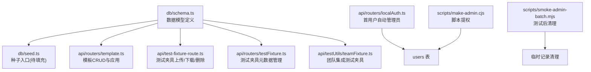
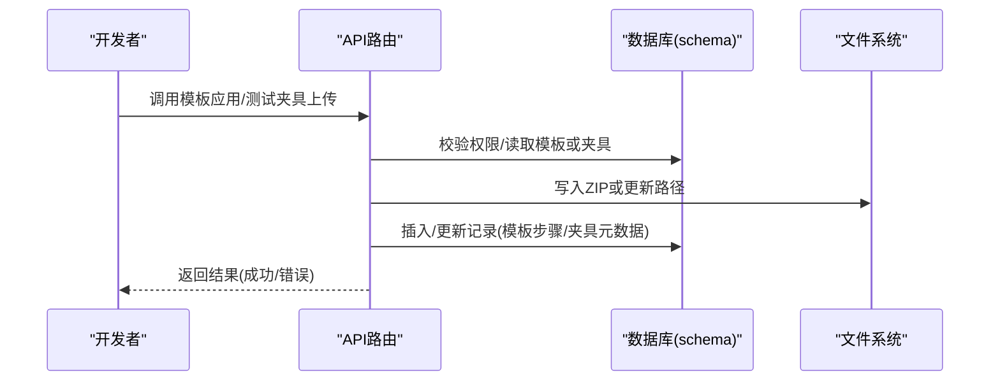
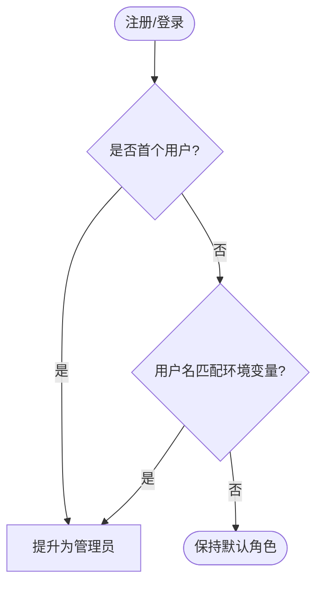
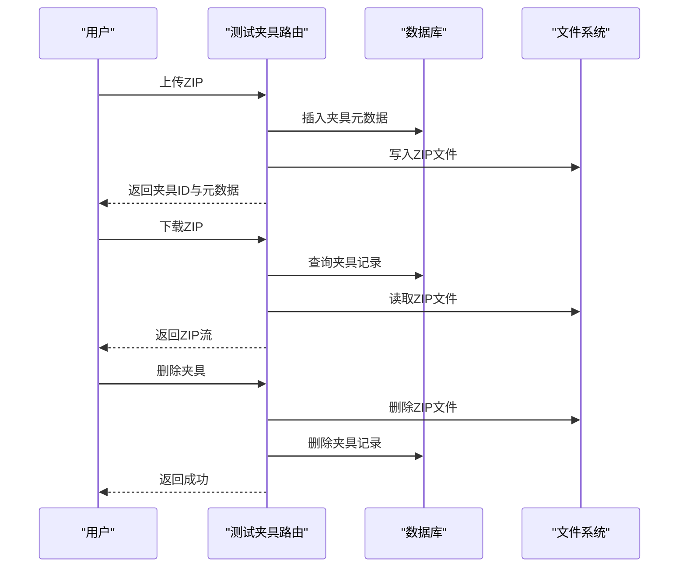
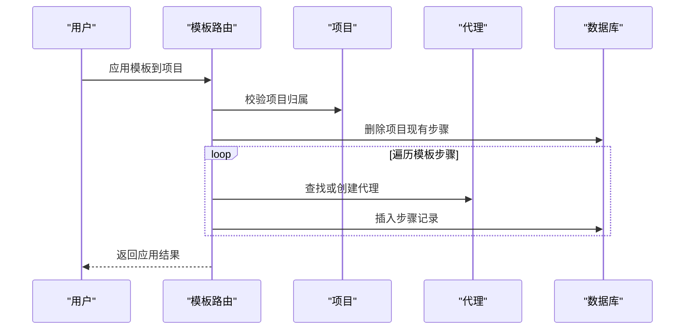
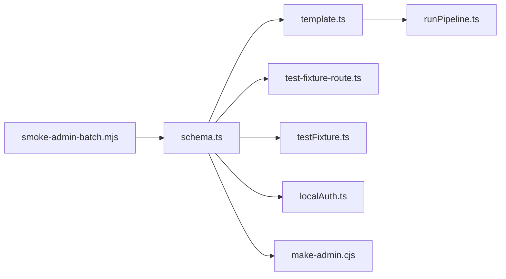

# 数据种子

<cite>
**本文引用的文件**
- [db/seed.ts](file://db/seed.ts)
- [db/schema.ts](file://db/schema.ts)
- [api/routers/template.ts](file://api/routers/template.ts)
- [api/mcp/tools/runPipeline.ts](file://api/mcp/tools/runPipeline.ts)
- [api/test-fixture-route.ts](file://api/test-fixture-route.ts)
- [api/routers/testFixture.ts](file://api/routers/testFixture.ts)
- [api/testUtils/teamFixture.ts](file://api/testUtils/teamFixture.ts)
- [scripts/make-admin.cjs](file://scripts/make-admin.cjs)
- [api/routers/localAuth.ts](file://api/routers/localAuth.ts)
- [scripts/smoke-admin-batch.mjs](file://scripts/smoke-admin-batch.mjs)
</cite>

## 目录
1. [简介](#简介)
2. [项目结构](#项目结构)
3. [核心组件](#核心组件)
4. [架构总览](#架构总览)
5. [详细组件分析](#详细组件分析)
6. [依赖关系分析](#依赖关系分析)
7. [性能考虑](#性能考虑)
8. [故障排查指南](#故障排查指南)
9. [结论](#结论)
10. [附录](#附录)

## 简介
本文件面向DeeWaanAI数据种子系统，聚焦三类数据的生成与治理：
- 初始数据：系统启动或首次注册时自动创建的“管理员用户”等基础角色与配置。
- 测试数据：用于流水线、市场审核、团队功能等的可重复测试夹具与示例项目。
- 模板数据：可复用的流水线模板及其步骤，支持一键应用到项目并派生代理与执行序列。

文档将说明种子数据的结构与用途（用户角色、默认配置、示例项目等），提供种子数据的管理方法与自定义扩展指南，并给出数据一致性检查与清理策略。

## 项目结构
与数据种子相关的代码主要分布在以下位置：
- 数据库模型定义：schema.ts，定义了用户、项目、流水线模板、测试夹具、团队等表结构。
- 种子入口：db/seed.ts，预留了插入种子数据的钩子。
- 模板与流水线：template.ts、runPipeline.ts，负责创建、复制、应用模板以及按模板生成步骤与代理。
- 测试夹具：test-fixture-route.ts、testFixture.ts、teamFixture.ts，提供上传/下载/删除测试ZIP与团队集成测试夹具。
- 初始管理员：localAuth.ts、make-admin.cjs，实现首用户自动提升为管理员及脚本化提权。
- 清理脚本：smoke-admin-batch.mjs，演示在冒烟测试后清理临时数据。

图表来源
- [db/schema.ts:17-51](file://db/schema.ts#L17-L51)
- [db/schema.ts:482-505](file://db/schema.ts#L482-L505)
- [db/schema.ts:838-862](file://db/schema.ts#L838-L862)
- [api/routers/template.ts:152-237](file://api/routers/template.ts#L152-L237)
- [api/test-fixture-route.ts:61-198](file://api/test-fixture-route.ts#L61-L198)
- [api/routers/testFixture.ts:15-61](file://api/routers/testFixture.ts#L15-L61)
- [api/testUtils/teamFixture.ts:28-131](file://api/testUtils/teamFixture.ts#L28-L131)
- [api/routers/localAuth.ts:94-116](file://api/routers/localAuth.ts#L94-L116)
- [scripts/make-admin.cjs:21-43](file://scripts/make-admin.cjs#L21-L43)
- [scripts/smoke-admin-batch.mjs:119-131](file://scripts/smoke-admin-batch.mjs#L119-L131)

章节来源
- [db/schema.ts:17-51](file://db/schema.ts#L17-L51)
- [db/schema.ts:482-505](file://db/schema.ts#L482-L505)
- [db/schema.ts:838-862](file://db/schema.ts#L838-L862)
- [api/routers/template.ts:152-237](file://api/routers/template.ts#L152-L237)
- [api/test-fixture-route.ts:61-198](file://api/test-fixture-route.ts#L61-L198)
- [api/routers/testFixture.ts:15-61](file://api/routers/testFixture.ts#L15-L61)
- [api/testUtils/teamFixture.ts:28-131](file://api/testUtils/teamFixture.ts#L28-L131)
- [api/routers/localAuth.ts:94-116](file://api/routers/localAuth.ts#L94-L116)
- [scripts/make-admin.cjs:21-43](file://scripts/make-admin.cjs#L21-L43)
- [scripts/smoke-admin-batch.mjs:119-131](file://scripts/smoke-admin-batch.mjs#L119-L131)

## 核心组件
- 初始数据（管理员）
  - 首用户自动管理员：本地注册时若系统无用户或用户名匹配环境变量，则自动提升为管理员。
  - 脚本提权：通过命令行脚本将指定用户提升为管理员。
- 测试数据（测试夹具）
  - 上传/下载/删除：开发环境可用，存储ZIP到磁盘并在数据库中记录元数据。
  - 元数据管理：列出、更新复杂度标签等。
  - 团队集成测试夹具：创建用户、团队、项目和成员关系，供集成测试使用。
- 模板数据（流水线模板）
  - 模板CRUD：创建、删除、复制模板。
  - 模板应用：将模板步骤应用到项目，按需创建或复用代理，生成执行序列。

章节来源
- [api/routers/localAuth.ts:94-116](file://api/routers/localAuth.ts#L94-L116)
- [scripts/make-admin.cjs:21-43](file://scripts/make-admin.cjs#L21-L43)
- [api/test-fixture-route.ts:61-198](file://api/test-fixture-route.ts#L61-L198)
- [api/routers/testFixture.ts:15-61](file://api/routers/testFixture.ts#L15-L61)
- [api/testUtils/teamFixture.ts:28-131](file://api/testUtils/teamFixture.ts#L28-L131)
- [api/routers/template.ts:152-237](file://api/routers/template.ts#L152-L237)

## 架构总览
数据种子系统围绕“模型—入口—服务—工具”的层次组织：
- 模型层：schema.ts统一描述所有表结构，包括用户、项目、模板、测试夹具、团队等。
- 入口层：db/seed.ts作为种子入口，当前为占位；实际种子逻辑可通过API路由或脚本触发。
- 服务层：template.ts、test-fixture-route.ts、localAuth.ts等提供业务级种子能力。
- 工具层：make-admin.cjs、smoke-admin-batch.mjs等辅助脚本用于提权与清理。

图表来源
- [api/routers/template.ts:152-237](file://api/routers/template.ts#L152-L237)
- [api/test-fixture-route.ts:61-198](file://api/test-fixture-route.ts#L61-L198)
- [db/schema.ts:482-505](file://db/schema.ts#L482-L505)
- [db/schema.ts:838-862](file://db/schema.ts#L838-L862)

## 详细组件分析

### 初始数据：管理员用户
- 自动生成规则
  - 首次注册用户自动提升为管理员，便于快速体验。
  - 支持通过环境变量指定特定用户名自动成为管理员。
- 脚本提权
  - 提供命令行脚本，根据用户名直接更新角色字段。

图表来源
- [api/routers/localAuth.ts:94-116](file://api/routers/localAuth.ts#L94-L116)
- [scripts/make-admin.cjs:21-43](file://scripts/make-admin.cjs#L21-L43)

章节来源
- [api/routers/localAuth.ts:94-116](file://api/routers/localAuth.ts#L94-L116)
- [scripts/make-admin.cjs:21-43](file://scripts/make-admin.cjs#L21-L43)

### 测试数据：测试夹具与团队夹具
- 测试夹具（ZIP）
  - 上传：仅开发环境可用，校验用户身份，写入ZIP到磁盘，记录大小、文件数、存储路径等元数据。
  - 下载：按ID查找并返回ZIP文件。
  - 删除：同时删除磁盘文件与数据库记录。
- 测试夹具元数据管理
  - 列表：按用户过滤并按创建时间排序。
  - 更新：允许修改名称、描述、复杂度标签。
- 团队集成测试夹具
  - 创建用户、团队、成员、共享项目与非共享项目，并提供tRPC调用器以便测试。
  - 清理：在测试结束后删除团队成员、项目、团队与用户。

图表来源
- [api/test-fixture-route.ts:61-198](file://api/test-fixture-route.ts#L61-L198)
- [api/routers/testFixture.ts:15-61](file://api/routers/testFixture.ts#L15-L61)
- [db/schema.ts:838-862](file://db/schema.ts#L838-L862)

章节来源
- [api/test-fixture-route.ts:61-198](file://api/test-fixture-route.ts#L61-L198)
- [api/routers/testFixture.ts:15-61](file://api/routers/testFixture.ts#L15-L61)
- [api/testUtils/teamFixture.ts:28-131](file://api/testUtils/teamFixture.ts#L28-L131)
- [db/schema.ts:838-862](file://db/schema.ts#L838-L862)

### 模板数据：流水线模板与应用
- 模板CRUD
  - 创建：可包含多个步骤（如Builder等）。
  - 删除：按用户权限删除。
  - 复制：克隆模板并重置状态。
- 模板应用
  - 清空项目现有步骤。
  - 遍历模板步骤，若为非审批步骤则尝试按名称+角色查找或创建代理。
  - 将步骤顺序与参数写入项目，形成可执行的流水线。

图表来源
- [api/routers/template.ts:152-237](file://api/routers/template.ts#L152-L237)
- [api/mcp/tools/runPipeline.ts:35-72](file://api/mcp/tools/runPipeline.ts#L35-L72)
- [db/schema.ts:482-505](file://db/schema.ts#L482-L505)

章节来源
- [api/routers/template.ts:152-237](file://api/routers/template.ts#L152-L237)
- [api/mcp/tools/runPipeline.ts:35-72](file://api/mcp/tools/runPipeline.ts#L35-L72)
- [db/schema.ts:482-505](file://db/schema.ts#L482-L505)

### 种子入口与占位
- db/seed.ts目前为占位实现，打印日志后退出。
- 建议后续在此处集中编排初始数据、测试数据与模板数据的初始化流程，或通过API/脚本触发。

章节来源
- [db/seed.ts:1-18](file://db/seed.ts#L1-L18)

## 依赖关系分析
- schema.ts是所有种子数据的权威模型定义，被各路由与脚本引用。
- template.ts与runPipeline.ts依赖schema中的模板与代理表，确保步骤与代理的一致性。
- test-fixture-route.ts与testFixture.ts依赖schema中的测试夹具表，并与文件系统交互。
- localAuth.ts与make-admin.cjs操作users表，影响用户角色与权限。
- smoke-admin-batch.mjs演示测试后的清理流程，涉及多张表的删除。

图表来源
- [db/schema.ts:17-51](file://db/schema.ts#L17-L51)
- [db/schema.ts:482-505](file://db/schema.ts#L482-L505)
- [db/schema.ts:838-862](file://db/schema.ts#L838-L862)
- [api/routers/template.ts:152-237](file://api/routers/template.ts#L152-L237)
- [api/mcp/tools/runPipeline.ts:35-72](file://api/mcp/tools/runPipeline.ts#L35-L72)
- [api/test-fixture-route.ts:61-198](file://api/test-fixture-route.ts#L61-L198)
- [api/routers/testFixture.ts:15-61](file://api/routers/testFixture.ts#L15-L61)
- [api/routers/localAuth.ts:94-116](file://api/routers/localAuth.ts#L94-L116)
- [scripts/make-admin.cjs:21-43](file://scripts/make-admin.cjs#L21-L43)
- [scripts/smoke-admin-batch.mjs:119-131](file://scripts/smoke-admin-batch.mjs#L119-L131)

章节来源
- [db/schema.ts:17-51](file://db/schema.ts#L17-L51)
- [db/schema.ts:482-505](file://db/schema.ts#L482-L505)
- [db/schema.ts:838-862](file://db/schema.ts#L838-L862)
- [api/routers/template.ts:152-237](file://api/routers/template.ts#L152-L237)
- [api/mcp/tools/runPipeline.ts:35-72](file://api/mcp/tools/runPipeline.ts#L35-L72)
- [api/test-fixture-route.ts:61-198](file://api/test-fixture-route.ts#L61-L198)
- [api/routers/testFixture.ts:15-61](file://api/routers/testFixture.ts#L15-L61)
- [api/routers/localAuth.ts:94-116](file://api/routers/localAuth.ts#L94-L116)
- [scripts/make-admin.cjs:21-43](file://scripts/make-admin.cjs#L21-L43)
- [scripts/smoke-admin-batch.mjs:119-131](file://scripts/smoke-admin-batch.mjs#L119-L131)

## 性能考虑
- 模板应用与步骤插入采用逐条处理，建议在大批量模板应用时使用批量插入以提升性能。
- 测试夹具上传涉及磁盘IO与大文件传输，应限制文件大小并异步处理以避免阻塞请求。
- 管理员自动提升逻辑仅在注册时触发，影响面小，无需额外优化。

[本节为通用指导，不直接分析具体文件]

## 故障排查指南
- 开发环境限制
  - 测试夹具接口在生产环境禁用，访问会返回未找到错误。
- 权限与归属
  - 模板应用需校验项目归属；代理创建需按用户隔离。
- 清理策略
  - 冒烟测试后应清理临时记录，避免污染数据库。
- 常见问题
  - ZIP文件缺失：检查存储路径与磁盘文件是否存在。
  - 模板步骤冲突：应用前清空项目现有步骤，避免重复。

章节来源
- [api/test-fixture-route.ts:61-198](file://api/test-fixture-route.ts#L61-L198)
- [api/routers/template.ts:152-237](file://api/routers/template.ts#L152-L237)
- [scripts/smoke-admin-batch.mjs:119-131](file://scripts/smoke-admin-batch.mjs#L119-L131)

## 结论
DeeWaanAI的数据种子系统以schema.ts为核心，结合API路由与脚本实现了初始管理员、测试夹具与模板数据的生成与管理。通过明确的权限校验、文件与数据库同步、以及测试后的清理策略，保证了种子数据的一致性与可维护性。后续可在db/seed.ts中集中编排种子流程，进一步提升可观测性与可回滚能力。

[本节为总结，不直接分析具体文件]

## 附录
- 数据模型概览（节选）
  - 用户：id、unionId、username、passwordHash、name、email、avatar、role、tier、defaultProviderId、defaultModel、preferences、createdAt、updatedAt、lastSignInAt。
  - 项目：id、userId、name、description、gitee/GitHub信息、localFolderName、stateSummaryPath、defaultProviderId、defaultModel、pipelineConfig、pipelineTemplateId、isArchived、lastSyncedAt、intelligenceCard、createdAt、updatedAt。
  - 流水线模板：id、userId、name、description、steps、isAuto、sourceProjectId、createdAt。
  - 测试夹具：id、userId、teamId、name、description、complexity、storagePath、sizeBytes、fileCount、giteePath、isPublic、createdAt。
  - 团队与成员：teams、team_members、team_projects、team_seats等。

章节来源
- [db/schema.ts:17-51](file://db/schema.ts#L17-L51)
- [db/schema.ts:84-150](file://db/schema.ts#L84-L150)
- [db/schema.ts:482-505](file://db/schema.ts#L482-L505)
- [db/schema.ts:838-862](file://db/schema.ts#L838-L862)
- [db/schema.ts:785-836](file://db/schema.ts#L785-L836)