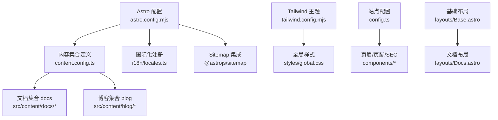
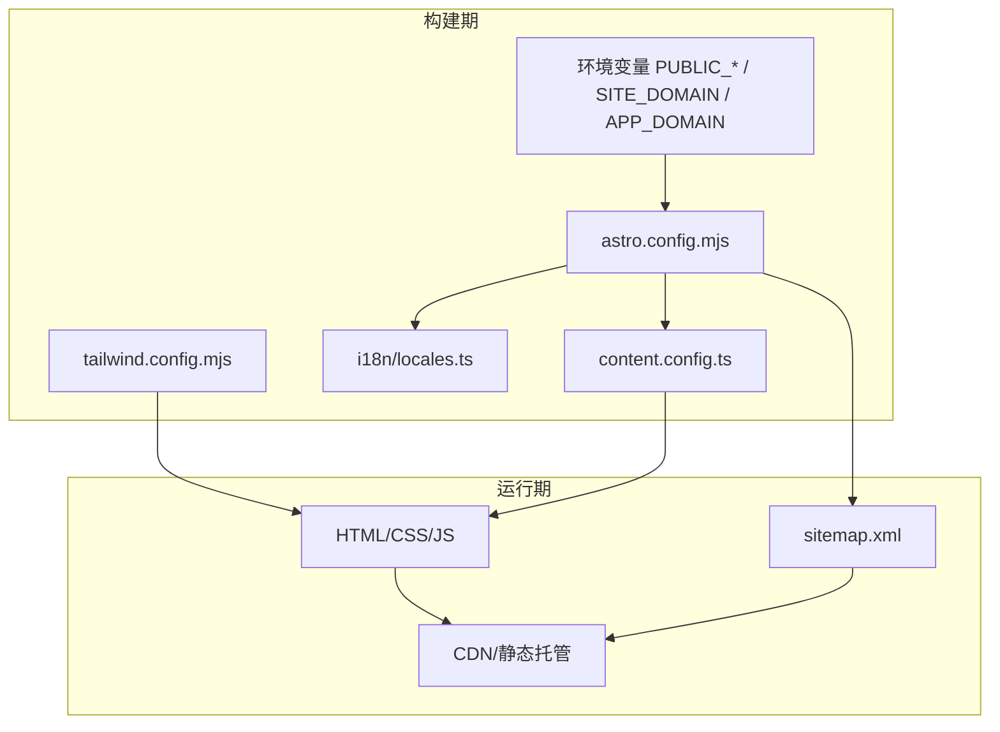
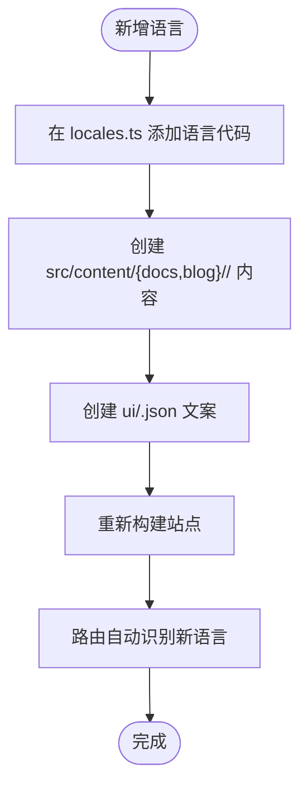
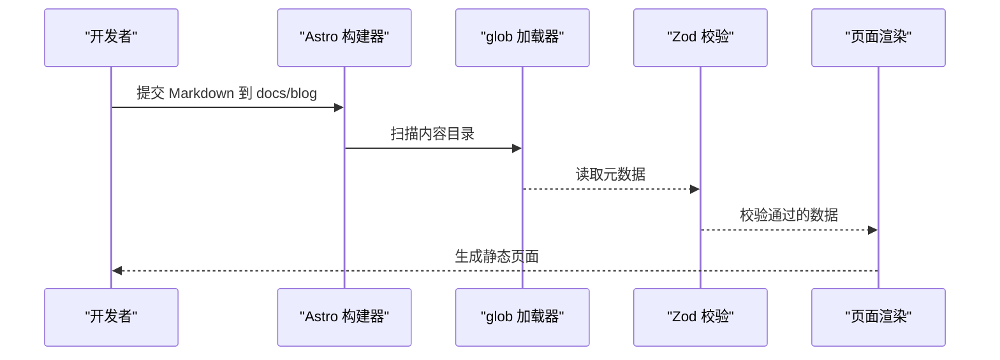
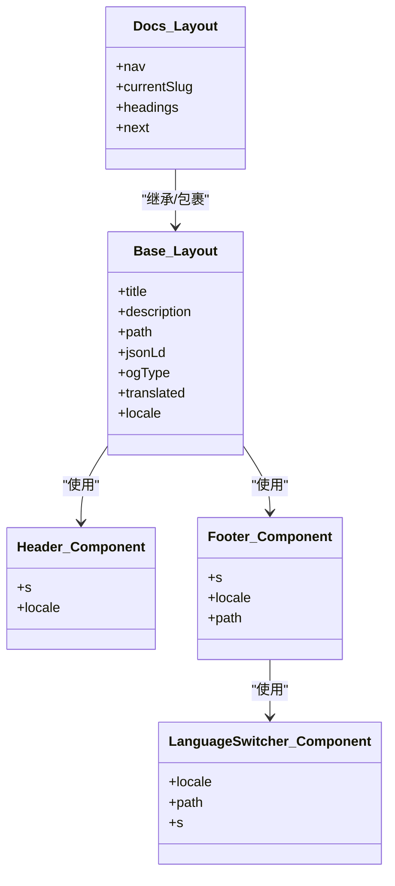
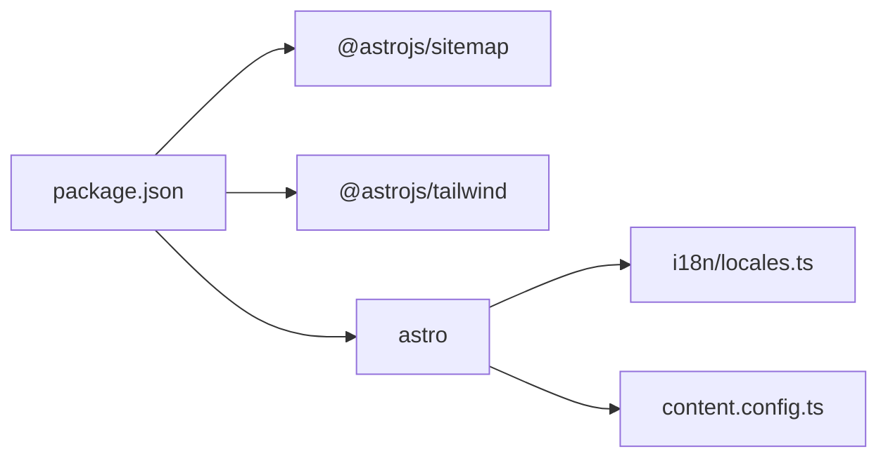

# 文档网站

<cite>
**本文引用的文件**
- [site/README.md](file://site/README.md)
- [site/package.json](file://site/package.json)
- [site/astro.config.mjs](file://site/astro.config.mjs)
- [site/tailwind.config.mjs](file://site/tailwind.config.mjs)
- [site/src/config.ts](file://site/src/config.ts)
- [site/src/i18n/locales.ts](file://site/src/i18n/locales.ts)
- [site/src/content.config.ts](file://site/src/content.config.ts)
- [site/src/layouts/Base.astro](file://site/src/layouts/Base.astro)
- [site/src/layouts/Docs.astro](file://site/src/layouts/Docs.astro)
- [site/src/components/Header.astro](file://site/src/components/Header.astro)
- [site/src/components/Footer.astro](file://site/src/components/Footer.astro)
- [site/src/components/LanguageSwitcher.astro](file://site/src/components/LanguageSwitcher.astro)
</cite>

## 目录
1. [简介](#简介)
2. [项目结构](#项目结构)
3. [核心组件](#核心组件)
4. [架构总览](#架构总览)
5. [详细组件分析](#详细组件分析)
6. [依赖分析](#依赖分析)
7. [性能考虑](#性能考虑)
8. [故障排查指南](#故障排查指南)
9. [结论](#结论)
10. [附录](#附录)

## 简介
本仓库包含 DeeWaanAI 的营销与文档站点，基于 Astro 构建为完全静态站点，部署为独立服务。站点提供多语言支持、SEO 优化（sitemap、OG、JSON-LD）、内容管理（Markdown 文档与博客）以及可定制的布局与样式。所有业务配置集中在单一配置文件，便于替换域名、社交链接等占位值。

## 项目结构
站点位于 site 子目录，采用 Astro 标准结构：
- 配置与脚本：package.json、astro.config.mjs、tailwind.config.mjs
- 内容与集合：src/content/docs、src/content/blog、src/content/ui
- 国际化：src/i18n（本地化列表、路径工具、UI 字符串）
- 布局与页面：src/layouts、src/pages
- 组件与样式：src/components、src/styles

图表来源
- [site/astro.config.mjs:1-33](file://site/astro.config.mjs#L1-L33)
- [site/src/content.config.ts:1-25](file://site/src/content.config.ts#L1-L25)
- [site/src/i18n/locales.ts:1-26](file://site/src/i18n/locales.ts#L1-L26)
- [site/tailwind.config.mjs:1-32](file://site/tailwind.config.mjs#L1-L32)
- [site/src/config.ts:1-24](file://site/src/config.ts#L1-L24)

章节来源
- [site/README.md:1-65](file://site/README.md#L1-L65)
- [site/package.json:1-18](file://site/package.json#L1-L18)
- [site/astro.config.mjs:1-33](file://site/astro.config.mjs#L1-L33)
- [site/src/content.config.ts:1-25](file://site/src/content.config.ts#L1-L25)
- [site/src/i18n/locales.ts:1-26](file://site/src/i18n/locales.ts#L1-L26)
- [site/tailwind.config.mjs:1-32](file://site/tailwind.config.mjs#L1-L32)
- [site/src/config.ts:1-24](file://site/src/config.ts#L1-L24)

## 核心组件
- 国际化与路由
  - 通过 i18n/locales.ts 维护 LOCALES、默认语言、语言标签与是否多语言开关；astro.config.mjs 中启用 Astro i18n 并关闭默认语言前缀。
  - 新增语言仅需添加代码、内容目录与 UI 文案，无需改动页面或组件。
- 内容集合
  - content.config.ts 使用 glob 加载 docs 与 blog 的 Markdown，并通过 Zod 校验元数据（标题、描述、排序、日期）。
- 布局系统
  - Base.astro 提供语义化 HTML、SEO 注入、头尾与“尚未翻译”提示；Docs.astro 提供左侧导航、“本页目录”与“下一篇”链接。
- 站点配置
  - config.ts 集中管理公司名、域名、社交链接、等待名单 API、商标行等占位值。
- 样式系统
  - Tailwind 主题在 tailwind.config.mjs 中扩展品牌色与字体族，全局样式在 styles/global.css。

章节来源
- [site/src/i18n/locales.ts:1-26](file://site/src/i18n/locales.ts#L1-L26)
- [site/astro.config.mjs:1-33](file://site/astro.config.mjs#L1-L33)
- [site/src/content.config.ts:1-25](file://site/src/content.config.ts#L1-L25)
- [site/src/layouts/Base.astro:1-48](file://site/src/layouts/Base.astro#L1-L48)
- [site/src/layouts/Docs.astro:1-77](file://site/src/layouts/Docs.astro#L1-L77)
- [site/src/config.ts:1-24](file://site/src/config.ts#L1-L24)
- [site/tailwind.config.mjs:1-32](file://site/tailwind.config.mjs#L1-L32)

## 架构总览
站点以 Astro 为核心，输出纯静态资源。构建时根据环境变量注入站点域与 App 域，运行时由 CDN/反向代理托管。Sitemap 与 SEO 在构建期生成，内容来自 Markdown 集合，UI 文案与多语言路由由 i18n 模块驱动。

图表来源
- [site/astro.config.mjs:1-33](file://site/astro.config.mjs#L1-L33)
- [site/src/content.config.ts:1-25](file://site/src/content.config.ts#L1-L25)
- [site/src/i18n/locales.ts:1-26](file://site/src/i18n/locales.ts#L1-L26)
- [site/tailwind.config.mjs:1-32](file://site/tailwind.config.mjs#L1-L32)
- [site/README.md:19-29](file://site/README.md#L19-L29)

## 详细组件分析

### 国际化与多语言支持
- 语言注册与路由
  - LOCALES 数组决定可用语言；DEFAULT_LOCALE 指定默认语言；routing.prefixDefaultLocale=false 使默认语言无前缀。
  - localePrefix 用于生成带/不带语言前缀的路径；localeTag 用于 og:locale/hreflang。
- 构建配置
  - astro.config.mjs 将 LOCALES 传入 i18n 与 sitemap 插件，确保多语言站点地图。
- 行为
  - 未翻译页面会显示英文回退与提示条，不会返回 404。

图表来源
- [site/src/i18n/locales.ts:1-26](file://site/src/i18n/locales.ts#L1-L26)
- [site/astro.config.mjs:17-22](file://site/astro.config.mjs#L17-L22)
- [site/README.md:59-65](file://site/README.md#L59-L65)

章节来源
- [site/src/i18n/locales.ts:1-26](file://site/src/i18n/locales.ts#L1-L26)
- [site/astro.config.mjs:17-22](file://site/astro.config.mjs#L17-L22)
- [site/README.md:59-65](file://site/README.md#L59-L65)

### 内容管理系统（CMS）
- 集合与模式
  - docs：标题、描述、排序；blog：标题、描述、日期。
  - 使用 glob 从 src/content/docs 与 src/content/blog 扫描 Markdown。
- 访问方式
  - 页面路由通过 [...slug] 读取集合条目渲染文档与博客。
- 扩展建议
  - 可在 schema 中添加封面图、作者、标签等字段；在布局中按需展示。

图表来源
- [site/src/content.config.ts:1-25](file://site/src/content.config.ts#L1-L25)

章节来源
- [site/src/content.config.ts:1-25](file://site/src/content.config.ts#L1-L25)

### 布局与组件
- Base.astro
  - 注入 favicon、Seo 组件、Header/Footer，处理“尚未翻译”提示条，统一 lang 属性。
- Docs.astro
  - 三栏网格：左侧导航、正文、右侧“本页目录”；支持“下一篇”链式跳转；注入 TechArticle JSON-LD。
- Header/Footer/LanguageSwitcher
  - Header 提供粘性导航与移动端菜单；Footer 提供产品/公司/社区列与法律信息；LanguageSwitcher 在多语言时切换当前路径的语言前缀。

图表来源
- [site/src/layouts/Base.astro:1-48](file://site/src/layouts/Base.astro#L1-L48)
- [site/src/layouts/Docs.astro:1-77](file://site/src/layouts/Docs.astro#L1-L77)
- [site/src/components/Header.astro:1-52](file://site/src/components/Header.astro#L1-L52)
- [site/src/components/Footer.astro:1-67](file://site/src/components/Footer.astro#L1-L67)
- [site/src/components/LanguageSwitcher.astro:1-17](file://site/src/components/LanguageSwitcher.astro#L1-L17)

章节来源
- [site/src/layouts/Base.astro:1-48](file://site/src/layouts/Base.astro#L1-L48)
- [site/src/layouts/Docs.astro:1-77](file://site/src/layouts/Docs.astro#L1-L77)
- [site/src/components/Header.astro:1-52](file://site/src/components/Header.astro#L1-L52)
- [site/src/components/Footer.astro:1-67](file://site/src/components/Footer.astro#L1-L67)
- [site/src/components/LanguageSwitcher.astro:1-17](file://site/src/components/LanguageSwitcher.astro#L1-L17)

### 样式定制
- Tailwind 主题
  - 扩展 accent 色系与 ink 深色体系；定义 sans/mono 字体栈。
- 全局样式
  - 在 global.css 中引入，供 Base.astro 统一加载。
- 组件样式
  - 组件内直接使用 Tailwind 类名，保持原子化与一致性。

章节来源
- [site/tailwind.config.mjs:1-32](file://site/tailwind.config.mjs#L1-L32)
- [site/src/layouts/Base.astro:4-4](file://site/src/layouts/Base.astro#L4-L4)

### 站点配置与占位符
- 集中配置
  - config.ts 管理公司名、站点域、应用域、社交链接、等待名单 API、商标行等。
- 环境变量
  - 构建期 PUBLIC_SITE_DOMAIN 影响站点根地址；运行时 SITE_DOMAIN 与 APP_DOMAIN 用于替换 robots.txt 与 HTML 中的占位符。

章节来源
- [site/src/config.ts:1-24](file://site/src/config.ts#L1-L24)
- [site/README.md:19-29](file://site/README.md#L19-L29)

## 依赖分析
- 框架与插件
  - Astro 作为核心；@astrojs/sitemap 生成多语言站点地图；@astrojs/tailwind 集成 Tailwind。
- 包脚本
  - dev/build/preview 对应开发、构建与预览流程。

图表来源
- [site/package.json:1-18](file://site/package.json#L1-L18)
- [site/astro.config.mjs:1-33](file://site/astro.config.mjs#L1-L33)

章节来源
- [site/package.json:1-18](file://site/package.json#L1-L18)
- [site/astro.config.mjs:1-33](file://site/astro.config.mjs#L1-L33)

## 性能考虑
- 纯静态输出
  - 无 SSR、无客户端框架，整体 JS 体积极小，利于缓存与 CDN 分发。
- 构建期优化
  - 使用 Astro 的静态导出与 Tailwind 的按需生成，减少冗余 CSS。
- 资源策略
  - 仅允许少量必要客户端脚本（如移动端菜单），其余逻辑在服务端/构建期完成。
- 缓存与版本
  - 建议开启长缓存与内容哈希；更新内容后重新构建即可刷新缓存。

[本节为通用指导，不直接分析具体文件]

## 故障排查指南
- 构建失败
  - 检查环境变量是否正确注入（PUBLIC_SITE_DOMAIN、PUBLIC_WAITLIST_API_URL、SITE_DOMAIN、APP_DOMAIN）。
  - 确认 content.config.ts 的 schema 与 Markdown frontmatter 一致。
- 多语言问题
  - 若页面未翻译，Base.astro 会显示回退提示；请补充对应语言的 UI 文案与内容。
- 链接与域名
  - 若出现占位符未替换，检查 README 的环境变量说明与 config.ts 中的占位符。
- 等待名单表单
  - 缺少 WAITLIST_API_URL 时表单会降级为显示备用邮箱；请设置正确的后端地址。

章节来源
- [site/README.md:19-29](file://site/README.md#L19-L29)
- [site/src/layouts/Base.astro:37-41](file://site/src/layouts/Base.astro#L37-L41)
- [site/src/config.ts:17-19](file://site/src/config.ts#L17-L19)

## 结论
该文档网站以 Astro 为核心，结合 Markdown 内容集合与 i18n 机制，实现了轻量、可维护、可扩展的多语言静态站点。通过集中配置与环境变量管理，既保证了部署灵活性，又降低了维护成本。建议在后续迭代中持续完善内容模型、SEO 标记与可访问性细节。

## 附录

### 开发与构建命令
- 安装依赖：npm i
- 本地开发：npm run dev
- 构建产物：npm run build
- 预览构建结果：npm run preview

章节来源
- [site/README.md:5-17](file://site/README.md#L5-L17)
- [site/package.json:6-9](file://site/package.json#L6-L9)

### 部署与发布流程
- Railway 部署
  - 新建服务，根目录指向 site/，配置构建与运行时环境变量，绑定自定义域名。
- Docker 部署
  - 使用提供的 Dockerfile 构建镜像，设置环境变量后启动容器。
- CI/CD
  - .github/workflows/site-ci.yml 可用于自动化构建与测试。

章节来源
- [site/README.md:35-48](file://site/README.md#L35-L48)
- [site/Dockerfile:1-1](file://site/Dockerfile#L1-L1)

### 内容编写规范
- 文档与博客
  - 在 src/content/docs 与 src/content/blog 下按语言分目录组织 Markdown。
  - frontmatter 需包含 title、description，文档还需 order，博客还需 date。
- 命名与排序
  - 文件名即 slug；order 控制文档侧边栏顺序。
- 图片与媒体
  - 建议使用相对路径引用 public 目录下的资源，或通过内容集合扩展字段管理。

章节来源
- [site/src/content.config.ts:6-22](file://site/src/content.config.ts#L6-L22)

### SEO 与可访问性
- SEO
  - 使用 Seo 组件注入 meta、OG、JSON-LD；Sitemap 插件自动生成多语言站点地图。
- 可访问性
  - 语义化标签、aria-label、键盘可达；移动端菜单具备 aria-expanded 状态。

章节来源
- [site/astro.config.mjs:23-31](file://site/astro.config.mjs#L23-L31)
- [site/src/layouts/Base.astro:28-34](file://site/src/layouts/Base.astro#L28-L34)
- [site/src/components/Header.astro:23-33](file://site/src/components/Header.astro#L23-L33)

### 维护与扩展指南
- 新增语言
  - 在 locales.ts 添加语言代码，创建对应内容目录与 UI 文案，无需修改页面。
- 新增页面
  - 在 pages 目录下新增路由或使用 [...slug] 动态路由；复用 Base/Docs 布局。
- 样式扩展
  - 在 tailwind.config.mjs 中扩展颜色、字体与组件样式；在 global.css 中补充全局规则。
- 配置变更
  - 所有站点级占位值仅在 config.ts 修改，避免散落多处。

章节来源
- [site/src/i18n/locales.ts:1-26](file://site/src/i18n/locales.ts#L1-L26)
- [site/src/config.ts:1-24](file://site/src/config.ts#L1-L24)
- [site/tailwind.config.mjs:1-32](file://site/tailwind.config.mjs#L1-L32)